# Chuyên đề: Nhúng Ngữ cảnh & Học Biểu diễn Tương phản Hiện đại (Contextual Sentence Embeddings & Contrastive Learning)

## 1. Tổng quan Chuyên đề
Sự ra đời của cơ chế **Học Tương phản (Contrastive Representation Learning)** đã tạo nên cuộc cách mạng trong lĩnh vực tìm kiếm ngữ nghĩa (Semantic Search), hệ thống RAG (Retrieval-Augmented Generation) và truy xuất tài liệu mật độ cao (Dense Retrieval). Thay vì dựa vào nhãn gán thủ công, học tương phản định hình không gian vector bằng cách kéo các mẫu tương đồng (Positive Pairs) lại gần nhau và đẩy các mẫu khác biệt (Negative Pairs) ra xa nhau dưới sự kiểm soát của hàm mất mát **InfoNCE Loss**.

Sự tiến hóa của các hệ thống nhúng câu hiện đại:
1. **Từ Bi-LSTM Ngữ cảnh đến Mạng Sinh đôi (Siamese Transformers)**: ELMo mở đầu kỷ nguyên nhúng phụ thuộc ngữ cảnh, tiếp nối bởi bước nhảy vọt của Sentence-BERT (SBERT) và Universal Sentence Encoder (USE) biến bài toán so khớp văn bản thành phép tra cứu vector thời gian thực.
2. **Kỷ nguyên Tự Giám sát Tương phản (Self-Supervised Contrastive Learning)**: SimCSE khai thác cơ chế Dropout nội tại của Transformer làm phép tăng cường dữ liệu tối thiểu (Data Augmentation) mà không làm méo mó ngữ nghĩa.
3. **Thế hệ Mô hình Nhúng Đỉnh cao (Frontier Dense Retrievers)**: Dòng mô hình E5, BGE, GTE, Jina Embeddings thống trị bảng xếp hạng MTEB (Massive Text Embedding Benchmark) nhờ kết hợp khai phá mẫu âm khó (Hard Negative Mining), In-Batch Negatives, hỗ trợ ngữ cảnh dài 8192 tokens và nén lượng tử hóa nhị phân (Binary Quantization / SQ8).

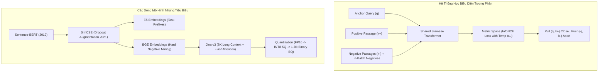

---

## 2. Chi tiết từng Keyword

---

### 36. ELMo (Embeddings from Language Models)

#### a. Định nghĩa Bản chất Toán học
**ELMo** (Peters et al., AllenAI 2018) là mô hình đầu tiên giải quyết thành công vấn đề từ đa nghĩa bằng cách xây dựng biểu diễn vector phụ thuộc hoàn toàn vào ngữ cảnh xung quanh.
Kiến trúc: Mạng Bi-LSTM hai chiều 2 tầng sâu:
- Chiều thuận (Forward LM): $P(t_1, \dots, t_N) = \prod_{k=1}^N P(t_k \mid t_1, \dots, t_{k-1})$
- Chiều nghịch (Backward LM): $P(t_1, \dots, t_N) = \prod_{k=1}^N P(t_k \mid t_{k+1}, \dots, t_N)$

Với mỗi token $t_k$, ELMo trích xuất tập hợp $2L + 1$ biểu diễn trung gian:
$$R_k = \{\mathbf{x}_k^{\text{LM}}, \mathbf{h}_{k, j}^{\text{LM\_forward}}, \mathbf{h}_{k, j}^{\text{LM\_backward}} \mid j = 1, \dots, L\}$$
Vector ELMo cuối cùng đưa vào bài toán hạ nguồn là tổ hợp tuyến tính có trọng số học được của các tầng này:
$$\text{ELMo}_k^{\text{task}} = \gamma^{\text{task}} \sum_{j=0}^L s_j^{\text{task}} \mathbf{h}_{k, j}^{\text{LM}}$$
Trong đó $s_j^{\text{task}}$ là trọng số Softmax được tối ưu hóa riêng cho từng tác vụ cụ thể, và $\gamma^{\text{task}}$ là hệ số scale toàn cục.

#### b. Cơ chế Tầng Sâu & Điện toán
- Các tầng LSTM thấp mã hóa thông tin cú pháp (Syntax / Part-of-Speech), trong khi các tầng cao nắm bắt ngữ nghĩa trừu tượng (Semantics).

#### c. Sơ đồ Minh họa
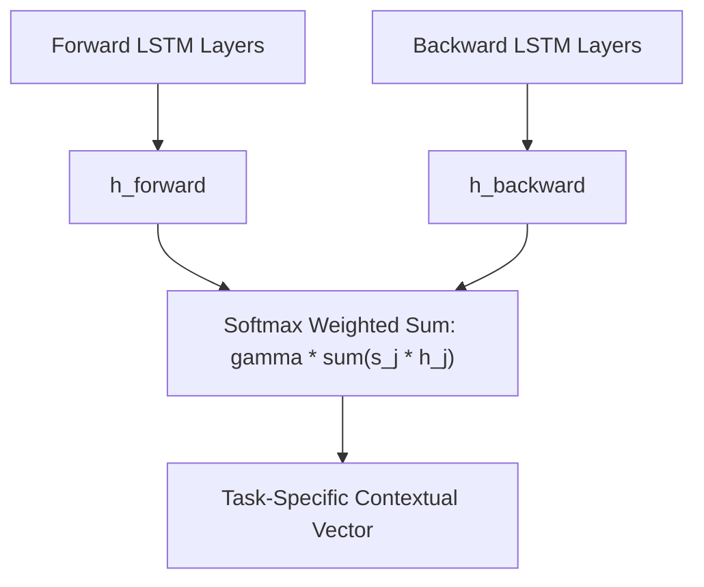

#### d. Code Thực chiến (C++ & Python)
```python
import torch
import torch.nn as nn

class ELMoTaskCombination(nn.Module):
    def __init__(self, num_layers: int = 3, feature_dim: int = 1024):
        super().__init__()
        self.weights = nn.Parameter(torch.zeros(num_layers)) # Trọng số s_j
        self.gamma = nn.Parameter(torch.ones(1))             # Hệ số gamma

    def forward(self, layer_representations: torch.Tensor) -> torch.Tensor:
        # layer_representations: [num_layers, B, N, D]
        norm_weights = torch.softmax(self.weights, dim=0).view(-1, 1, 1, 1)
        weighted_sum = torch.sum(norm_weights * layer_representations, dim=0)
        return self.gamma * weighted_sum
```

#### e. Lỗi Thường gặp & Ổn định Số học
- Sự phân tách độc lập giữa Forward và Backward LM: Hai chiều tính toán riêng rẽ rồi ghép nối (concatenation) chứ không giao tiếp chéo hai chiều đồng thời trong từng tầng như Transformer (BERT).

#### f. Ứng dụng Thực chiến trong AI
- Cột mốc lịch sử mở màn cho kỷ nguyên Pre-trained Contextual Language Representations (2018).

---

### 37. Sentence-BERT (SBERT)

#### a. Định nghĩa Bản chất Toán học
**Sentence-BERT** (Reimers & Gurevych, EMNLP 2019) giải quyết nút thắt cổ chai tính toán trí mạng của BERT: Để tìm cặp câu tương đồng nhất trong tập hợp 10,000 câu, BERT gốc đòi hỏi đưa từng cặp câu qua mạng để tính Cross-Attention ($10000 \times 9999 / 2 \approx 50$ triệu phép suy luận, mất **65 giờ** trên GPU V100).

SBERT sử dụng kiến trúc **Mạng Sinh đôi (Siamese Network)** kết hợp tầng **Mean Pooling**:
$$\mathbf{u} = \text{MeanPooling}(\text{BERT}(S_A)), \quad \mathbf{v} = \text{MeanPooling}(\text{BERT}(S_B))$$
Trong quá trình huấn luyện phân loại trên tập SNLI:
$$\mathbf{z} = [\mathbf{u}; \mathbf{v}; |\mathbf{u} - \mathbf{v}|] \in \mathbb{R}^{3d}$$
$$\hat{y} = \text{Softmax}(\mathbf{W}_t \mathbf{z})$$
Thành phần hiệu tuyệt đối $|\mathbf{u} - \mathbf{v}|$ đóng vai trò ép góc khoảng cách giữa các chiều đặc trưng tương đồng.
Sau khi huấn luyện, SBERT trích xuất vector tĩnh cho mỗi câu độc lập. Quá trình tìm kiếm 10,000 câu chỉ mất **5 giây** bằng Cosine Similarity (nhanh hơn **$46,000\times$**!).

#### b. Cơ chế Tầng Sâu & Điện toán
- Tách rời hoàn toàn quá trình tạo vector (Indexing Phase) và quá trình so khớp (Querying Phase).

#### c. Sơ đồ Minh họa
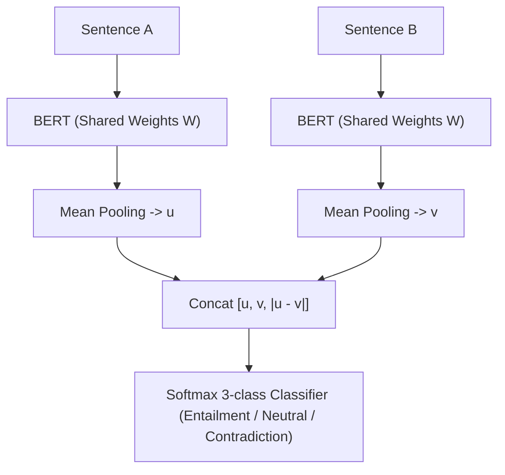

#### d. Code Thực chiến (C++ & Python)
```cpp
// C++17: Trích xuất vector đặc trưng SBERT [u, v, |u - v|]
#include <vector>
#include <cmath>

std::vector<float> build_sbert_triplet_feature(const float* u, const float* v, int d) {
    std::vector<float> feat(3 * d);
    for (int i = 0; i < d; ++i) {
        feat[i]         = u[i];
        feat[d + i]     = v[i];
        feat[2 * d + i] = std::abs(u[i] - v[i]);
    }
    return feat;
}
```

```python
from sentence_transformers import SentenceTransformer

# Sử dụng SBERT công nghiệp
model = SentenceTransformer('paraphrase-MiniLM-L6-v2')
embeddings = model.encode(["Học máy rất thú vị", "Trí tuệ nhân tạo đang phát triển"])
```

#### e. Lỗi Thường gặp & Ổn định Số học
- Dùng vector `[CLS]` thay vì Mean Pooling khi dùng checkpoint BERT: Khiến chất lượng embedding tụt dốc trầm trọng trên các benchmark ngữ nghĩa.

#### f. Ứng dụng Thực chiến trong AI
- Nền móng tiêu chuẩn vàng cho toàn bộ thư viện `sentence-transformers` và các hệ thống tìm kiếm ngữ nghĩa hiện đại.

---

### 38. Universal Sentence Encoder (USE)

#### a. Định nghĩa Bản chất Toán học
**Universal Sentence Encoder** (Cer et al., Google 2018) cung cấp các vector nhúng câu 512 chiều chuẩn hóa với hai biến thể kiến trúc:
1. **Transformer-based USE**: Độ chính xác cao, khai thác Encoder 6 tầng với Attention đa đầu.
2. **Deep Averaging Network (DAN) based USE**: Tốc độ siêu nhanh, tính trung bình cộng embedding các từ và bi-grams rồi nạp qua một mạng MLP sâu (độ phức tạp thời gian tuyến tính $\mathcal{O}(N)$).

Huấn luyện đa nhiệm đồng thời (Multi-task Learning):
- Dự đoán câu trả lời trong đối thoại (Conversational Response Prediction).
- Tương đồng ngữ nghĩa SNLI.
- Khôi phục câu ngữ cảnh xung quanh (Skip-Thought objective).

#### b. Cơ chế Tầng Sâu & Điện toán
- Bản DAN cực kỳ nhẹ, có thể chạy trực tiếp trên trình duyệt web thông qua TensorFlow.js với thời gian trễ chỉ vài mili-giây.

#### c. Sơ đồ Minh họa
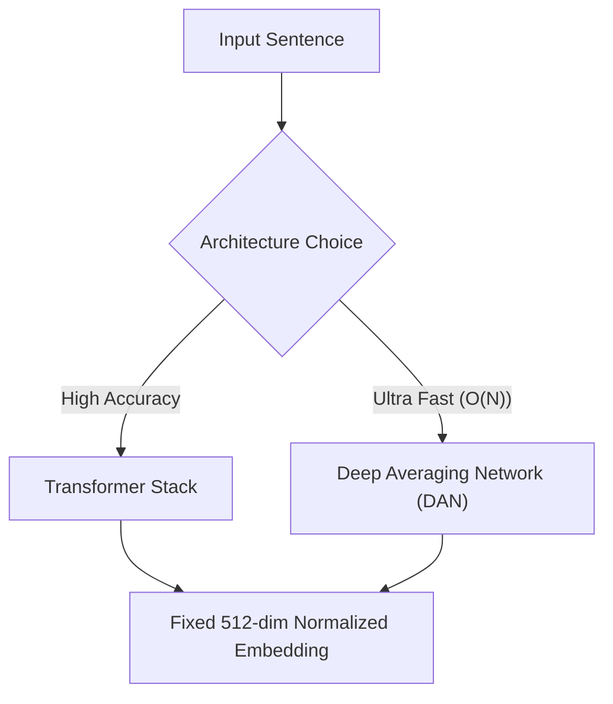

#### d. Code Thực chiến (C++ & Python)
```python
# Load Universal Sentence Encoder qua TensorFlow Hub
import tensorflow_hub as hub

# embed = hub.load("https://tfhub.dev/google/universal-sentence-encoder/4")
# vectors = embed(["The quick brown fox jumps over the lazy dog."])
```

#### e. Lỗi Thường gặp & Ổn định Số học
- Không hỗ trợ fine-tuning linh hoạt cho các miền từ vựng chuyên ngành hẹp như các mô hình hiện đại.

#### f. Ứng dụng Thực chiến trong AI
- Phân cụm văn bản quy mô lớn và hệ thống lọc câu hỏi trùng lặp trong Quora / StackOverflow.

---

### 39. SimCSE (Simple Contrastive Sentence Embedding Framework)

#### a. Định nghĩa Bản chất Toán học
**SimCSE** (Gao et al., Princeton 2021) là một công trình đột phá chứng minh rằng có thể học được không gian biểu diễn câu đỉnh cao mà **hoàn toàn không cần dữ liệu gán nhãn** (Unsupervised SimCSE):
- **Phép Tăng cường Dữ liệu Tối thiểu bằng Dropout**: Nạp **cùng một câu văn $x_i$** qua mô hình Transformer hai lần liên tiếp. Do cơ chế Dropout ngẫu nhiên (thường $p = 0.1$), hai lượt forward pass này sẽ kích hoạt hai tập hợp nơ-ron hơi khác nhau, sinh ra hai vector biểu diễn $\mathbf{h}_i$ và $\mathbf{h}_i^+$ hơi lệch nhau. Đây chính là **Cặp Đích Thực sự (Positive Pair)** hoàn hảo!
- Mọi câu khác $x_j$ ($j \neq i$) trong cùng mini-batch kích thước $N$ đóng vai trò là **Mẫu Tiêu cực (Negative Samples)**:
$$\mathcal{L}_{\text{SimCSE}} = -\log \frac{\exp(\text{sim}(\mathbf{h}_i, \mathbf{h}_i^+) / \tau)}{\sum_{j=1}^N \exp(\text{sim}(\mathbf{h}_i, \mathbf{h}_j^+) / \tau)}$$

**Supervised SimCSE**: Mở rộng với dữ liệu NLI:
- Cặp tương đương ngữ nghĩa (Entailment) làm mẫu dương: $(x_i, x_i^+)$.
- Cặp mâu thuẫn (Contradiction) làm mẫu âm khó (Hard Negative): $x_i^-$.

#### b. Cơ chế Tầng Sâu & Điện toán
- **Giải quyết triệt để tính Bất đẳng hướng (Anisotropy)**: Phân tích phổ chứng minh rằng hàm mất mát tương phản của SimCSE trực tiếp kéo phẳng các giá trị riêng của ma trận hiệp phương sai, biến không gian hình nón hẹp thành một không gian cầu đẳng hướng đồng đều (Isotropic Hypersphere).

#### c. Sơ đồ Minh họa
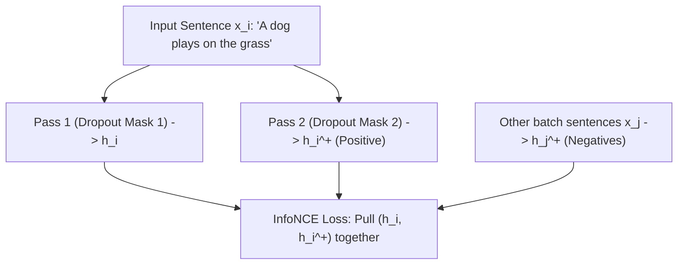

#### d. Code Thực chiến (C++ & Python)
```python
import torch
import torch.nn as nn
import torch.nn.functional as F

class UnsupervisedSimCSE(nn.Module):
    def __init__(self, encoder: nn.Module, tau: float = 0.05):
        super().__init__()
        self.encoder = encoder
        self.tau = tau

    def forward(self, input_ids: torch.Tensor, attention_mask: torch.Tensor) -> torch.Tensor:
        # Chạy forward 2 lần với 2 dropout mask khác nhau
        h1 = self.encoder(input_ids, attention_mask=attention_mask).last_hidden_state[:, 0]
        h2 = self.encoder(input_ids, attention_mask=attention_mask).last_hidden_state[:, 0]
        
        # Chuẩn hóa L2
        h1 = F.normalize(h1, p=2, dim=-1)
        h2 = F.normalize(h2, p=2, dim=-1)
        
        # Ma trận tương đồng Cosine giữa mọi cặp: [B, B]
        cos_sim = torch.matmul(h1, h2.T) / self.tau
        labels = torch.arange(cos_sim.size(0), device=cos_sim.device) # Nhãn đường chéo chính
        loss = F.cross_entropy(cos_sim, labels)
        return loss
```

#### e. Lỗi Thường gặp & Ổn định Số học
- Tắt chế độ training (`model.eval()`) trong lúc train Unsupervised SimCSE: Khi tắt eval, dropout bị vô hiệu hóa ($p = 0$), khiến $\mathbf{h}_i \equiv \mathbf{h}_i^+$, làm mất hoàn toàn gradient hữu ích.

#### f. Ứng dụng Thực chiến trong AI
- Kỹ thuật tiền huấn luyện chuẩn mực cho các mô hình embedding hiện đại.

---

### 40. E5 Embeddings (Embarrassingly Easy Language Representations)

#### a. Định nghĩa Bản chất Toán học
**E5** (Wang et al., Microsoft 2022, 2024: E5, BGE, E5-Mistral) đề xuất nguyên lý huấn luyện đơn giản nhưng đạt hiệu năng vượt trội:
1. Huấn luyện tiền kỳ trên tập dữ liệu khổng lồ **CCPairs (hơn 1 tỷ cặp văn bản)** thu thập bán giám sát từ web.
2. **Cơ chế Tiền tố Hướng dẫn Tác vụ (Task-specific Instruction Prefixes)**:
   Để giải quyết tính chất bất đối xứng giữa câu truy vấn ngắn và đoạn văn bản dài, E5 yêu cầu gắn tiền tố bắt buộc:
   - Truy vấn: `"query: cách tối ưu hóa SQL"`
   - Tài liệu/Đoạn văn: `"passage: Để tối ưu hóa SQL, người ta sử dụng chỉ mục..."`

#### b. Cơ chế Tầng Sâu & Điện toán
- Tiền tố giúp mô hình nhận biết được hướng tìm kiếm bất đối xứng (Asymmetric Search), tránh việc mô hình cố gắng tìm kiếm các câu có cấu trúc ngữ pháp giống hệt câu hỏi.

#### c. Sơ đồ Minh họa
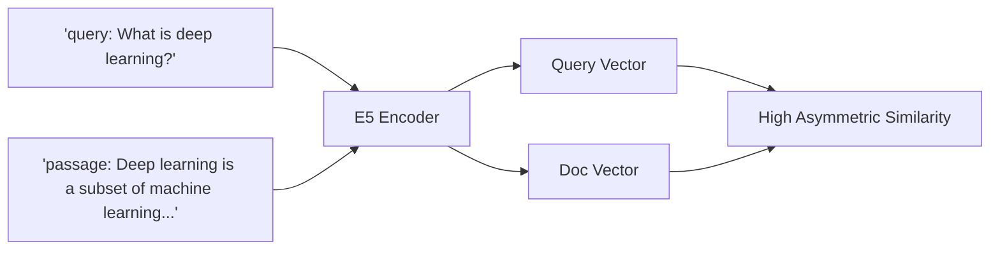

#### d. Code Thực chiến (C++ & Python)
```python
from sentence_transformers import SentenceTransformer

model = SentenceTransformer('intfloat/e5-base-v2')
# Bắt buộc thêm prefix
query_emb = model.encode("query: Python memory layout")
doc_emb = model.encode("passage: Python uses a private heap for memory management.")
```

#### e. Lỗi Thường gặp & Ổn định Số học
- Quên thêm tiền tố `"query: "` hoặc `"passage: "` làm giảm từ $5\%$ đến $10\%$ độ chính xác trên thang đo MTEB.

#### f. Ứng dụng Thực chiến trong AI
- Mô hình nhúng thông dụng hàng đầu trong các ứng dụng RAG thương mại.

---

### 41. BGE Embeddings (BAAI General Embedding)

#### a. Định nghĩa Bản chất Toán học
Dòng mô hình **BGE** (Beijing Academy of Artificial Intelligence, 2023–2024: BGE-v1.5, BGE-M3) liên tục giữ vị trí số 1 trên bảng xếp hạng MTEB Leaderboard.
Quy trình huấn luyện đa giai đoạn:
1. **Pre-training**: Huấn luyện tự giám sát trên hàng tỷ cặp văn bản với độ dài lớn.
2. **Fine-tuning với Hard Negatives quy mô lớn**: Sử dụng các mô hình Dense Retriever khác nhau để đào bới các mẫu âm cực kỳ khó (Hard Negatives Mining).
3. **BGE-M3 (Multi-Linguality, Multi-Functionality, Multi-Granularity)**: Hỗ trợ đồng thời 3 cơ chế tìm kiếm trong một mô hình duy nhất:
   - **Dense Retrieval**: Biểu diễn vector dày đặc chuẩn.
   - **Sparse Retrieval**: Dự đoán trọng số từ vựng lexical kiểu BM25/SPLADE.
   - **Multi-Vector / ColBERT Retrieval**: So khớp tương tác trễ (Late Interaction).
   Hỗ trợ độ dài ngữ cảnh lên tới **8192 tokens**.

#### b. Cơ chế Tầng Sâu & Điện toán
- BGE-M3 kết hợp cả 3 điểm số (Dense + Sparse + Multi-vector) tạo thành một hệ thống tìm kiếm lai (Hybrid Search) hoàn hảo chỉ với 1 lượt forward pass duy nhất.

#### c. Sơ đồ Minh họa
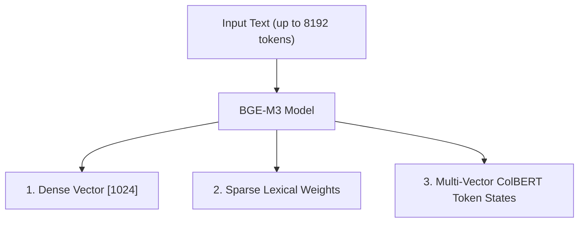

#### d. Code Thực chiến (C++ & Python)
```python
# Cài đặt FlagEmbedding của BAAI
from FlagEmbedding import BGEM3FlagModel

model = BGEM3FlagModel('BAAI/bge-m3', use_fp16=True)
embeddings = model.encode(["BGE-M3 hỗ trợ tìm kiếm đa phương thức và đa ngôn ngữ"], 
                          return_dense=True, return_sparse=True, return_colbert_vecs=True)
```

#### e. Lỗi Thường gặp & Ổn định Số học
- Sử dụng mô hình BGE tiếng Anh cho tiếng Việt mà không dùng bản đa ngôn ngữ (`bge-m3` hoặc `bge-multilingual`).

#### f. Ứng dụng Thực chiến trong AI
- Tiêu chuẩn công nghiệp tối cao cho các hệ sinh thái RAG quy mô lớn và tìm kiếm văn bản đa ngôn ngữ.

---

### 42. GTE Embeddings (General Text Embeddings)

#### a. Định nghĩa Bản chất Toán học
**GTE** (Alibaba DAMO Academy, 2023–2024: GTE-Base, GTE-Large, GTE-Qwen) dựa trên kiến trúc Transformer hai nhánh (Dual-Encoder). GTE áp dụng chiến lược lọc dữ liệu khắt khe loại bỏ các cặp dữ liệu nhiễu trước khi nạp vào quy trình huấn luyện tương phản đa tác vụ (Multi-task Contrastive Pretraining) bao gồm phân loại, tìm kiếm, suy diễn tự nhiên và gom cụm.

#### b. Cơ chế Tầng Sâu & Điện toán
- Biến thể **GTE-Qwen** tận dụng các trọng số được tiền huấn luyện từ siêu mô hình ngôn ngữ Qwen-LLM, mang lại khả năng hiểu ngữ nghĩa sâu sắc và khả năng suy luận logic vượt trội so với các bộ mã hóa BERT truyền thống.

#### c. Sơ đồ Minh họa


#### d. Code Thực chiến (C++ & Python)
```python
from sentence_transformers import SentenceTransformer
model = SentenceTransformer("Alibaba-NLP/gte-large-en-v1.5", trust_remote_code=True)
```

#### e. Lỗi Thường gặp & Ổn định Số học
- Quên thiết lập `trust_remote_code=True` khi nạp mô hình có custom attention code từ Hugging Face.

#### f. Ứng dụng Thực chiến trong AI
- Hệ thống tìm kiếm thương mại điện tử Taobao/Alibaba và các tác vụ phân tích tài chính.

---

### 43. Jina Embeddings (Jina-v2 / Jina-v3)

#### a. Định nghĩa Bản chất Toán học
**Jina Embeddings** (Jina AI, 2023–2024) là dòng mô hình mã nguồn mở thương mại chuyên dụng giải quyết bài toán tài liệu dài:
- Hỗ trợ cửa sổ ngữ cảnh lên tới **8192 tokens bản địa** nhờ tích hợp **ALiBi** và **FlashAttention**.
- **Jina-v3**: Sử dụng các Adapter Chuyên biệt theo Tác vụ (Task-specific LoRA Adapters) được nhúng ngay trong mô hình: Cho phép người dùng chuyển đổi chế độ embedding giữa tìm kiếm đối xứng, tìm kiếm bất đối xứng, phân loại hoặc phân cụm mà không cần đổi mô hình.

#### b. Cơ chế Tầng Sâu & Điện toán
- Tận dụng FlashAttention-2 giúp việc nhúng toàn bộ các tài liệu PDF dài 20 trang diễn ra với tốc độ tương đương các câu văn ngắn thông thường trên GPU.

#### c. Sơ đồ Minh họa
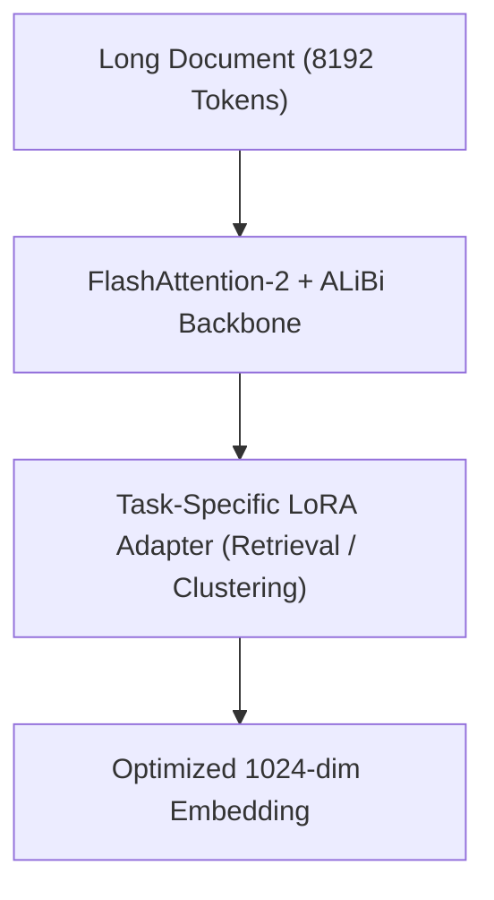

#### d. Code Thực chiến (C++ & Python)
```python
from transformers import AutoModel

model = AutoModel.from_pretrained("jinaai/jina-embeddings-v3", trust_remote_code=True)
# Sử dụng task adapter chuyên biệt
embeddings = model.encode(["Tài liệu rất dài ..."], task="retrieval.passage")
```

#### e. Lỗi Thường gặp & Ổn định Số học
- Chạy chuỗi 8K tokens trên các GPU đời cũ không hỗ trợ FlashAttention-2 sẽ gây lỗi quá tải bộ nhớ VRAM OOM.

#### f. Ứng dụng Thực chiến trong AI
- Nhúng toàn văn tài liệu pháp lý, mã nguồn phần mềm lớn và sách điện tử.

---

### 44. Contrastive Representation Learning (Học Biểu diễn Tương phản)

#### a. Định nghĩa Bản chất Toán học
Nguyên lý cốt lõi của **Contrastive Learning** là định hình không gian vector thông qua **sự so sánh cặp**:
Cho một tập hợp các điểm dữ liệu, với mỗi điểm mỏ neo $\mathbf{x}$ (Anchor), ta xây dựng:
- Tập các điểm tương đồng $\mathcal{P}(\mathbf{x})$ (Positives): Ví dụ các bản biến thể tăng cường dữ liệu, các câu đồng nghĩa, hoặc cặp (Câu hỏi, Câu trả lời).
- Tập các điểm không tương đồng $\mathcal{N}(\mathbf{x})$ (Negatives): Các mẫu ngẫu nhiên hoặc các mẫu gây nhiễu.

Hàm mất mát ép khoảng cách giữa Anchor và Positives tiến về 0, đồng thời đẩy khoảng cách giữa Anchor và Negatives vượt qua một ngưỡng an toàn (Margin $m$):
$$d(f(\mathbf{x}), f(\mathbf{x}^+)) \to 0, \quad d(f(\mathbf{x}), f(\mathbf{x}^-)) \ge m$$

#### b. Cơ chế Tầng Sâu & Điện toán
- Không yêu cầu nhãn phân loại tuyệt đối của con người; mô hình học biểu diễn thông qua cấu trúc quan hệ nội tại của dữ liệu.

#### c. Sơ đồ Minh họa
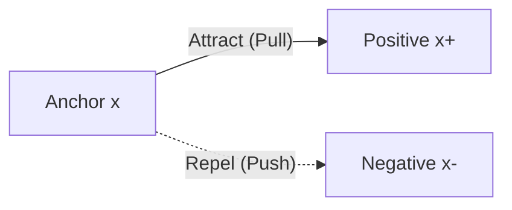

#### d. Code Thực chiến (C++ & Python)
```python
import torch

def contrastive_margin_loss(dist_pos: torch.Tensor, dist_neg: torch.Tensor, margin: float = 1.0):
    loss_pos = dist_pos.pow(2)
    loss_neg = torch.clamp(margin - dist_neg, min=0.0).pow(2)
    return (loss_pos + loss_neg).mean()
```

#### e. Lỗi Thường gặp & Ổn định Số học
- Sự sụp đổ không gian (Mode Collapse): Tất cả các vector bị kéo về 1 điểm hằng số duy nhất. Cần các mẫu âm đủ mạnh và chuẩn hóa vector để giữ cân bằng.

#### f. Ứng dụng Thực chiến trong AI
- Nền tảng của **SimCLR**, **MoCo**, **CLIP**, và toàn bộ các mô hình Text Embedding hiện đại.

---

### 45. Siamese Networks (Mạng Sinh đôi)

#### a. Định nghĩa Bản chất Toán học
**Siamese Network** (Bromley et al., 1993) bao gồm hai (hoặc nhiều) mạng nơ-ron giống hệt nhau có **cùng chia sẻ chung một bộ trọng số duy nhất $\mathbf{W}$**.
Đầu vào $\mathbf{x}_1, \mathbf{x}_2$ được nạp qua hai nhánh song song để sinh ra hai vector $\mathbf{z}_1 = f_{\mathbf{W}}(\mathbf{x}_1)$ và $\mathbf{z}_2 = f_{\mathbf{W}}(\mathbf{x}_2)$.
Khoảng cách mêtric giữa hai vector được đo bằng khoảng cách Euclid hoặc Cosine.
Hàm mất mát **Contrastive Loss** (Hadsell, Chopra, LeCun, 2006):
$$\mathcal{L}(y, \mathbf{z}_1, \mathbf{z}_2) = (1 - y) \frac{1}{2} \|\mathbf{z}_1 - \mathbf{z}_2\|_2^2 + y \frac{1}{2} \max(0, m - \|\mathbf{z}_1 - \mathbf{z}_2\|_2)^2$$
Trong đó $y = 0$ nếu hai mẫu cùng loại, $y = 1$ nếu khác loại, và $m > 0$ là biên an toàn (Margin).

#### b. Cơ chế Tầng Sâu & Điện toán
- Việc chia sẻ trọng số đảm bảo tính đối xứng tuyệt đối: $\text{Dist}(\mathbf{x}_1, \mathbf{x}_2) = \text{Dist}(\mathbf{x}_2, \mathbf{x}_1)$, ngăn việc mạng học ra hai không gian biểu diễn khác nhau cho hai đầu vào.

#### c. Sơ đồ Minh họa
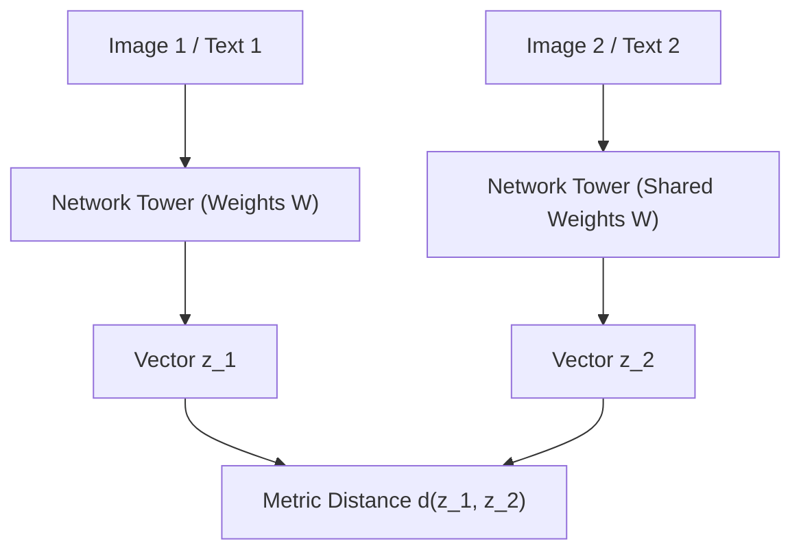

#### d. Code Thực chiến (C++ & Python)
```python
import torch
import torch.nn as nn

class SiameseNetwork(nn.Module):
    def __init__(self, backbone: nn.Module):
        super().__init__()
        self.backbone = backbone # Cùng chia sẻ 1 backbone

    def forward(self, x1: torch.Tensor, x2: torch.Tensor) -> tuple[torch.Tensor, torch.Tensor]:
        z1 = self.backbone(x1)
        z2 = self.backbone(x2)
        return z1, z2
```

#### e. Lỗi Thường gặp & Ổn định Số học
- Khởi tạo hai nhánh độc lập không chia sẻ trọng số (Pseudo-Siamese) cho bài toán so sánh đồng nhất sẽ phá vỡ tính đối xứng mêtric.

#### f. Ứng dụng Thực chiến trong AI
- Xác thực chữ ký số, so khớp vân tay, nhận diện khuôn mặt và Sentence-BERT.

---

### 46. Triplet Networks (Mạng Bộ ba)

#### a. Định nghĩa Bản chất Toán học
**Triplet Network** (Hoffer & Ailon, 2015; Schroff et al., FaceNet 2015) mở rộng mạng sinh đôi bằng cách nạp đồng thời ba mẫu dữ liệu qua mạng chia sẻ trọng số:
1. **Anchor ($\mathbf{a}$)**: Mẫu cơ sở.
2. **Positive ($\mathbf{p}$)**: Mẫu cùng lớp với Anchor.
3. **Negative ($\mathbf{n}$)**: Mẫu khác lớp với Anchor.

Hàm mất mát **Triplet Loss**:
$$\mathcal{L}_{\text{triplet}} = \max\left(0, \|\mathbf{z}_a - \mathbf{z}_p\|_2^2 - \|\mathbf{z}_a - \mathbf{z}_n\|_2^2 + \alpha\right)$$
Trong đó $\alpha > 0$ là khoảng cách an toàn tối thiểu (Margin).
Mục tiêu: Ép khoảng cách tới mẫu âm phải lớn hơn khoảng cách tới mẫu dương ít nhất một khoảng bằng $\alpha$:
$$\|\mathbf{z}_a - \mathbf{z}_n\|_2^2 \ge \|\mathbf{z}_a - \mathbf{z}_p\|_2^2 + \alpha$$

#### b. Cơ chế Tầng Sâu & Điện toán
- Phân loại bộ ba (Triplet Categories):
  - *Easy Triplets*: $\|\mathbf{z}_a - \mathbf{z}_n\|_2^2 > \|\mathbf{z}_a - \mathbf{z}_p\|_2^2 + \alpha$ (Loss = 0, không tạo gradient).
  - *Hard Triplets*: $\|\mathbf{z}_a - \mathbf{z}_n\|_2^2 < \|\mathbf{z}_a - \mathbf{z}_p\|_2^2$ (Mẫu âm nằm gần anchor hơn cả mẫu dương).
  - *Semi-Hard Triplets*: $\|\mathbf{z}_a - \mathbf{z}_p\|_2^2 < \|\mathbf{z}_a - \mathbf{z}_n\|_2^2 < \|\mathbf{z}_a - \mathbf{z}_p\|_2^2 + \alpha$ (Mẫu âm xa hơn mẫu dương nhưng vẫn nằm trong phạm vi margin).

#### c. Sơ đồ Minh họa
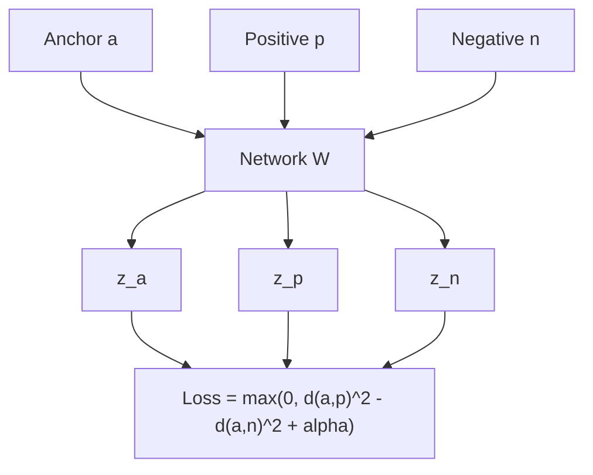

#### d. Code Thực chiến (C++ & Python)
```cpp
// C++17: Triplet Margin Loss
#include <algorithm>

float compute_triplet_loss(float d_ap_sq, float d_an_sq, float margin) {
    return std::max(0.0f, d_ap_sq - d_an_sq + margin);
}
```

```python
import torch
import torch.nn as nn

class TripletMarginLoss(nn.Module):
    def __init__(self, margin: float = 1.0):
        super().__init__()
        self.margin = margin

    def forward(self, z_a: torch.Tensor, z_p: torch.Tensor, z_n: torch.Tensor) -> torch.Tensor:
        d_ap = torch.sum((z_a - z_p) ** 2, dim=-1)
        d_an = torch.sum((z_a - z_n) ** 2, dim=-1)
        losses = torch.relu(d_ap - d_an + self.margin)
        return losses.mean()
```

#### e. Lỗi Thường gặp & Ổn định Số học
- Huấn luyện trên toàn các Easy Triplets: Loss bằng 0 ngay lập tức, mạng nơ-ron ngừng học hoàn toàn. Bắt buộc phải áp dụng kỹ thuật khai phá mẫu âm (Mining).

#### f. Ứng dụng Thực chiến trong AI
- Hệ thống nhận diện khuôn mặt Google FaceNet, tìm kiếm sản phẩm tương tự trong thời trang.

---

### 47. InfoNCE Loss (Hàm Mất mát Thông tin NCE)

#### a. Định nghĩa Bản chất Toán học
**InfoNCE Loss** (van den Oord, Li, Vinyals, 2018 - Contrastive Predictive Coding) là nền tảng toán học của toàn bộ các thuật toán tương phản hiện đại.
Cho một query $\mathbf{q}$, một mẫu dương $\mathbf{k}_+$ và một tập hợp $K$ mẫu âm $\{\mathbf{k}_1^-, \dots, \mathbf{k}_K^-\}$:
$$\mathcal{L}_{\text{InfoNCE}} = -\log \frac{\exp(\mathbf{q} \cdot \mathbf{k}_+ / \tau)}{\exp(\mathbf{q} \cdot \mathbf{k}_+ / \tau) + \sum_{i=1}^K \exp(\mathbf{q} \cdot \mathbf{k}_i^- / \tau)}$$
Trong đó $\tau > 0$ là siêu tham số nhiệt độ (Temperature).

**Bản chất Lý thuyết Thông tin**: Cực tiểu hóa InfoNCE tương đương với việc **tối đa hóa cận dưới của Thông tin Tương hỗ (Mutual Information)** giữa hai biểu diễn ngẫu nhiên $\mathbf{X}$ và $\mathbf{Y}$:
$$I(\mathbf{X}; \mathbf{Y}) \ge \log(K + 1) - \mathcal{L}_{\text{InfoNCE}}$$
Khi số lượng mẫu âm $K$ càng lớn, cận dưới của thông tin tương hỗ càng chặt chẽ!

#### b. Cơ chế Tầng Sâu & Điện toán
- Bản chất tương đương một hàm **Cross-Entropy Loss đa lớp** với $K+1$ lớp, trong đó nhãn đúng luôn là chỉ số 0 (mẫu dương).
- Tham số nhiệt độ $\tau$ (thường chọn $\tau \in [0.01, 0.07]$) đóng vai trò điều tiết độ sắc nét của phân phối: $\tau$ càng nhỏ, mô hình càng phạt nặng các mẫu âm khó nằm gần anchor.

#### c. Sơ đồ Minh họa
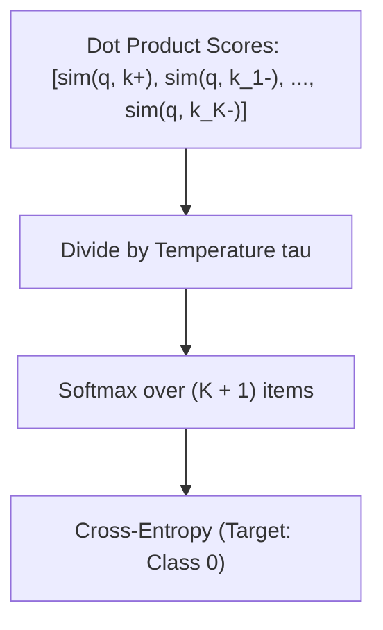

#### d. Code Thực chiến (C++ & Python)
```cpp
// C++17: InfoNCE Single Sample Loss
#include <vector>
#include <cmath>

float compute_infonce(float pos_sim, const std::vector<float>& neg_sims, float tau) {
    float max_s = pos_sim / tau;
    for (float s : neg_sims) if (s / tau > max_s) max_s = s / tau;
    
    float exp_pos = std::exp((pos_sim / tau) - max_s);
    float sum_exp = exp_pos;
    for (float s : neg_sims) {
        sum_exp += std::exp((s / tau) - max_s);
    }
    return -std::log(exp_pos / sum_exp);
}
```

```python
import torch
import torch.nn.functional as F

def info_nce_loss(query: torch.Tensor, positive: torch.Tensor, negatives: torch.Tensor, tau: float = 0.07):
    # query: [B, D], positive: [B, D], negatives: [B, K, D]
    pos_score = torch.sum(query * positive, dim=-1, keepdim=True) / tau # [B, 1]
    neg_scores = torch.bmm(negatives, query.unsqueeze(-1)).squeeze(-1) / tau # [B, K]
    
    logits = torch.cat([pos_score, neg_scores], dim=-1) # [B, K + 1]
    labels = torch.zeros(logits.size(0), dtype=torch.long, device=logits.device)
    return F.cross_entropy(logits, labels)
```

#### e. Lỗi Thường gặp & Ổn định Số học
- Chọn nhiệt độ $\tau$ quá lớn ($>0.5$): Làm phẳng phân phối softmax, mô hình mất khả năng phân biệt ranh giới giữa mẫu dương và mẫu âm. Chọn $\tau$ quá nhỏ ($<0.001$): Gradient bùng nổ, quá trình huấn luyện mất ổn định.

#### f. Ứng dụng Thực chiến trong AI
- Hàm mục tiêu chuẩn mực của **CLIP**, **SimCLR**, **OpenAI Embeddings**, **BGE**, **E5**.

---

### 48. Hard Negative Mining (Khai phá Mẫu âm Khó)

#### a. Định nghĩa Bản chất Toán học
Trong quá trình huấn luyện tương phản, đại đa số các mẫu âm ngẫu nhiên là các mẫu âm dễ (Easy Negatives: hoàn toàn không liên quan, ví dụ Query: "cách chữa cảm cúm" và Negative: "cách sửa xe máy"). Những mẫu này có độ tương đồng cực thấp, sinh ra gradient xấp xỉ 0 ($\nabla_\theta \approx 0$), khiến việc huấn luyện bị chậm lại.

**Hard Negative Mining** là kỹ thuật chủ động tìm kiếm các mẫu âm nằm rất gần Query trong không gian embedding hiện tại (có độ tương đồng cao nhưng về mặt ngữ nghĩa lại là câu trả lời sai):
$$\mathbf{x}^- = \arg\max_{\mathbf{x}' \in \mathcal{N}_{\text{candidates}}} \text{sim}(f(\mathbf{q}), f(\mathbf{x}'))$$
Ví dụ:
- **Query**: `"Ai là đạo diễn phim Inception?"`
- **Positive**: `"Christopher Nolan đạo diễn phim Inception năm 2010."`
- **Hard Negative**: `"Inception là bộ phim khoa học viễn tưởng có sự tham gia của Leonardo DiCaprio."` (Rất nhiều từ trùng nhau, cùng chủ đề phim Inception, nhưng **không trả lời câu hỏi**!).

#### b. Cơ chế Tầng Sâu & Điện toán
- Các chiến lược khai phá:
  1. Dùng **BM25** để tìm các đoạn văn có nhiều từ khóa trùng với Query nhất nhưng không chứa câu trả lời.
  2. Dùng các mô hình **Dense Retriever thế hệ trước** để lọc ra Top-100 văn bản có điểm số cao nhất và loại bỏ văn bản ground-truth.

#### c. Sơ đồ Minh họa
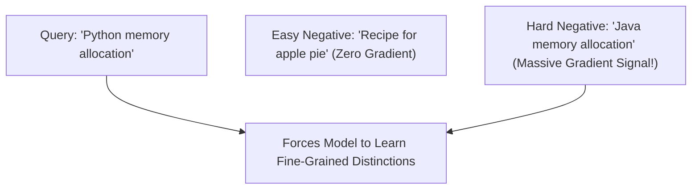

#### d. Code Thực chiến (C++ & Python)
```python
def mine_hard_negatives(query_vector, candidate_vectors, false_candidate_indices, top_k=5):
    # Lấy các vector có Cosine Similarity cao nhất nhưng nhãn là False
    scores = candidate_vectors @ query_vector
    # Sắp xếp giảm dần và lấy top_k mẫu âm khó nhất
    hard_indices = scores.argsort(descending=True)[:top_k]
    return hard_indices
```

#### e. Lỗi Thường gặp & Ổn định Số học
- **False Negative Labeling**: Vô tình khai phá trúng một đoạn văn bản thực chất là câu trả lời đúng nhưng không có trong nhãn gán của tập dữ liệu (False Negative), ép mô hình phạt đáp án đúng, phá hủy chất lượng mô hình.

#### f. Ứng dụng Thực chiến trong AI
- Bước huấn luyện quyết định biến các mô hình nhúng thông thường thành các siêu mô hình dẫn đầu bảng xếp hạng MTEB (BGE, E5-v2).

---

### 49. In-Batch Negatives (Mẫu âm Trong Cùng Batch)

#### a. Định nghĩa Bản chất Toán học
Huấn luyện tương phản yêu cầu số lượng mẫu âm $K$ phải rất lớn (hàng trăm đến hàng nghìn). Việc nạp riêng các mẫu âm cho từng mẫu dương làm tăng chi phí tính toán theo cấp số nhân.

**In-Batch Negatives** là giải pháp điện toán cực kỳ thanh lịch:
Với một mini-batch gồm $B$ cặp (Query, Positive):
$$\mathcal{B} = \{(\mathbf{q}_1, \mathbf{p}_1), (\mathbf{q}_2, \mathbf{p}_2), \dots, (\mathbf{q}_B, \mathbf{p}_B)\}$$
Đối với truy vấn $\mathbf{q}_i$:
- Mẫu dương duy nhất là $\mathbf{p}_i$.
- Toàn bộ $B - 1$ mẫu dương của các câu khác trong batch $\{\mathbf{p}_j \mid j \neq i\}$ được tái sử dụng để làm **Mẫu âm (Negatives)**!

Ma trận tương đồng có kích thước $B \times B$:
$$\mathbf{S}_{ij} = \frac{\mathbf{q}_i \cdot \mathbf{p}_j}{\tau}$$
Đường chéo chính $\mathbf{S}_{ii}$ là các cặp dương, toàn bộ các phần tử ngoài đường chéo $\mathbf{S}_{ij} (i \neq j)$ là các cặp âm.

#### b. Cơ chế Tầng Sâu & Điện toán
- Tiết kiệm $100\%$ chi phí tính toán thêm: Chỉ cần forward đúng $B$ queries và $B$ passages qua mô hình. Phép tính tương phản được thực hiện bằng đúng một phép nhân ma trận GEMM duy nhất:
  $$\mathbf{S} = \frac{\mathbf{Q} \mathbf{P}^T}{\tau}$$
- Khi mở rộng kích thước Batch size $B$ (ví dụ $B = 4096$ trên cụm GPU phân tán), mỗi query lập tức có tới **4095 mẫu âm** hoàn toàn miễn phí.

#### c. Sơ đồ Minh họa
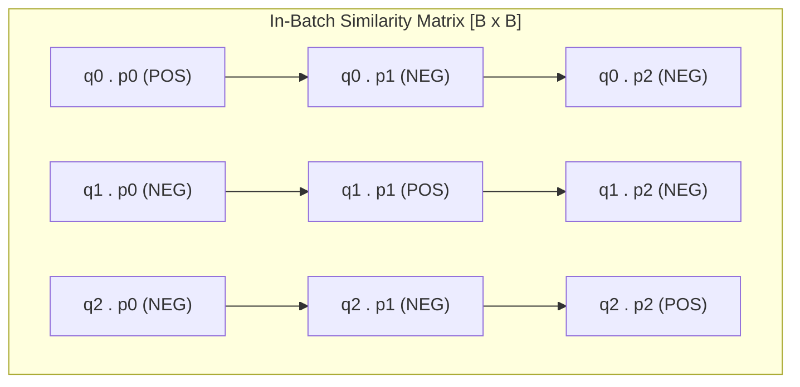

#### d. Code Thực chiến (C++ & Python)
```cpp
// C++17: In-Batch Cross-Entropy Loss Indices
std::vector<int> generate_in_batch_labels(int batch_size) {
    std::vector<int> labels(batch_size);
    for (int i = 0; i < batch_size; ++i) labels[i] = i; // Đường chéo
    return labels;
}
```

```python
import torch
import torch.nn as nn
import torch.nn.functional as F

class InBatchNegativeLoss(nn.Module):
    def __init__(self, tau: float = 0.05):
        super().__init__()
        self.tau = tau

    def forward(self, q_emb: torch.Tensor, p_emb: torch.Tensor) -> torch.Tensor:
        # q_emb, p_emb: [B, D] đã chuẩn hóa L2
        scores = torch.matmul(q_emb, p_emb.T) / self.tau # [B, B]
        labels = torch.arange(q_emb.size(0), device=q_emb.device)
        return F.cross_entropy(scores, labels)
```

#### e. Lỗi Thường gặp & Ổn định Số học
- Sự trùng lặp dữ liệu trong cùng một batch: Nếu hai câu hỏi trong cùng một batch có cùng ý nghĩa, câu này sẽ vô tình trở thành mẫu âm của câu kia (False Negative Collision).

#### f. Ứng dụng Thực chiến trong AI
- Phương pháp huấn luyện chuẩn mực của **DPR (Dense Passage Retrieval)**, **SimCSE**, **E5**, và **CLIP**.

---

### 50. Embedding Fine-Tuning (Tinh chỉnh Mô hình Nhúng)

#### a. Định nghĩa Bản chất Toán học
Mặc dù các mô hình Pre-trained Embeddings tổng quát rất mạnh, chúng thường suy giảm hiệu năng khi áp dụng vào các miền dữ liệu chuyên ngành đặc thù (Y tế, Pháp lý, Dược phẩm, Code nội bộ công ty) do từ vựng và ngữ cảnh chuyên môn bị lệch phân phối.

**Embedding Fine-Tuning** điều chỉnh lại không gian metric của mô hình trên tập dữ liệu đặc thù $\mathcal{D}_{\text{domain}}$:
Các phương pháp hiện đại:
1. **Full Fine-Tuning**: Cập nhật toàn bộ trọng số của Transformer bằng hàm MultipleNegativesRankingLoss.
2. **LoRA (Low-Rank Adaptation)**: Đóng băng mô hình gốc, chỉ thêm các ma trận thích ứng bậc thấp phân rã $\Delta \mathbf{W} = \mathbf{B} \mathbf{A}$ vào các tầng Attention:
   $$\mathbf{W} = \mathbf{W}_0 + \frac{\alpha}{r} \mathbf{B} \mathbf{A}$$
   Giúp tiết kiệm $99\%$ bộ nhớ huấn luyện và ngăn hiện tượng quên tri thức nền tảng (Catastrophic Forgetting).
3. **Matryoshka Loss Fine-Tuning**: Ép mô hình học biểu diễn phân cấp độ dài vector đồng thời.

#### b. Cơ chế Tầng Sâu & Điện toán
- Cho phép biến một mô hình tổng quát thành một bộ truy xuất dữ liệu có độ chính xác cao vượt trội (tăng $20\% - 40\%$ điểm Hit Rate@5 trong hệ thống RAG doanh nghiệp).

#### c. Sơ đồ Minh họa
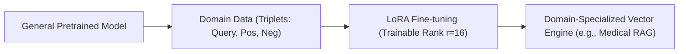

#### d. Code Thực chiến (C++ & Python)
```python
from sentence_transformers import SentenceTransformer, InputExample, losses
from torch.utils.data import DataLoader

# Fine-tuning SBERT đơn giản bằng LoRA hoặc MultipleNegativesRankingLoss
model = SentenceTransformer('BAAI/bge-small-en-v1.5')
train_examples = [
    InputExample(texts=['triệu chứng viêm phổi', 'ho sốt khó thở đau ngực']),
    InputExample(texts=['cách tính thuế VAT', 'thuế giá trị gia tăng 10%'])
]
train_dataloader = DataLoader(train_examples, shuffle=True, batch_size=16)
train_loss = losses.MultipleNegativesRankingLoss(model)

# model.fit(train_objectives=[(train_dataloader, train_loss)], epochs=1)
```

#### e. Lỗi Thường gặp & Ổn định Số học
- Quá khớp trên tập dữ liệu nhỏ (Overfitting): Khiến mô hình mất khả năng hiểu các câu hỏi tổng quát bên ngoài miền dữ liệu tinh chỉnh.

#### f. Ứng dụng Thực chiến trong AI
- Tùy biến hệ thống tìm kiếm thông tin nội bộ doanh nghiệp và nâng cấp chất lượng RAG chuyên ngành.

---

### 51. Embedding Quantization (Lượng tử hóa Vector Nhúng)

#### a. Định nghĩa Bản chất Toán học
Trong các hệ thống Vector Database quy mô lớn (hàng trăm triệu đến hàng tỷ vector), việc lưu trữ các vector số thực 32-bit (FP32) hay 16-bit (FP16) tiêu tốn hàng Terabytes RAM máy chủ đắt đỏ:
$$10^8 \text{ vectors} \times 1536 \text{ dimensions} \times 4 \text{ bytes (FP32)} \approx 614 \text{ GB RAM}$$

**Embedding Quantization** nén các vector liên tục xuống định dạng số nguyên có số bit thấp:
1. **Scalar Quantization (SQ8 - 8-bit Integer)**: Ánh xạ giá trị số thực về số nguyên 8-bit có dấu $[-128, 127]$:
   $$q_i = \text{round}\left( \frac{x_i - \text{min}}{\text{max} - \text{min}} \times 255 \right) - 128$$
   Tiết kiệm **$4\times$ dung lượng RAM** với độ suy giảm độ chính xác $< 1\%$.
2. **Binary Quantization (BQ - 1-bit Binary)**: Nén mỗi chiều vector thành đúng **1 bit nhị phân duy nhất** dựa trên dấu của nó:
   $$b_i = \begin{cases} 1 & \text{nếu } x_i > 0 \\ 0 & \text{nếu } x_i \le 0 \end{cases}$$
   Tiết kiệm **$32\times$ dung lượng RAM**!

**Tính toán Siêu tốc bằng Lệnh Phần cứng**:
Khoảng cách giữa hai vector nhị phân 1-bit được tính bằng **Khoảng cách Hamming (Hamming Distance)**.
Trên CPU x86/ARM hiện đại, khoảng cách Hamming được tính trong đúng **1 chu kỳ xung nhịp** bằng phép toán phần cứng XOR kết hợp đếm số bit 1 (`POPCNT` - Population Count instruction):
$$\text{HammingDistance}(\mathbf{u}, \mathbf{v}) = \text{\_mm\_popcnt\_u64}(\mathbf{u} \oplus \mathbf{v})$$
Tốc độ tìm kiếm tăng vọt từ **$10\times$ đến $40\times$** so với tính tích vô hướng FP32!

#### b. Cơ chế Tầng Sâu & Điện toán
- Kiến trúc Rescoring 2 giai đoạn (Two-stage Retrieval Pipeline):
  - Giai đoạn 1: Dùng Binary Quantization (1-bit) quét toàn bộ 100 triệu vector trên RAM để lấy ra Top-1000 ứng viên tiềm năng trong vài mili-giây.
  - Giai đoạn 2: Dùng vector gốc (hoặc SQ8) tính toán lại chính xác (Rescore) trên 1000 ứng viên để trả về Top-10 kết quả cuối cùng.

#### c. Sơ đồ Minh họa
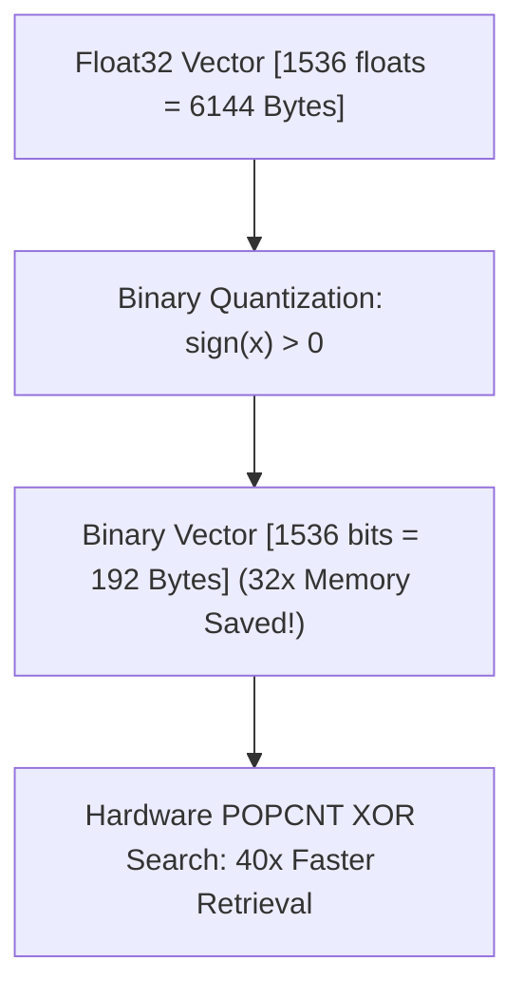

#### d. Code Thực chiến (C++ & Python)
```cpp
// C++20: Khoảng cách Hamming siêu tốc qua phần cứng POPCNT
#include <iostream>
#include <bitset>
#include <cstdint>

#if defined(_MSC_VER)
#include <intrin.h>
#define POPCNT64 __popcnt64
#else
#define POPCNT64 __builtin_popcountll
#endif

inline int fast_hamming_distance_64(uint64_t a, uint64_t b) {
    return POPCNT64(a ^ b); // 1 CPU cycle
}

int main() {
    uint64_t vec_a = 0b101100101101;
    uint64_t vec_b = 0b100100111100;
    std::cout << "Hardware Hamming Distance: " << fast_hamming_distance_64(vec_a, vec_b) << "\n";
    return 0;
}
```

```python
import numpy as np

def binary_quantize(embeddings: np.ndarray) -> np.ndarray:
    # embeddings: [N, D] float
    # Chuyển thành mảng boolean hoặc pack các bits thành uint8
    binary_bool = embeddings > 0
    packed_bits = np.packbits(binary_bool, axis=-1)
    return packed_bits # Dung lượng giảm đúng 32 lần!
```

#### e. Lỗi Thường gặp & Ổn định Số học
- Áp dụng Binary Quantization cho các mô hình embedding chưa được chuẩn hóa trọng tâm (Centering): Nếu trọng tâm bị lệch khỏi gốc tọa độ, $95\%$ các bit sẽ toàn là 1, phá hủy tính phân biệt của phép đo Hamming.

#### f. Ứng dụng Thực chiến trong AI
- Nền tảng cốt lõi của các cơ sở dữ liệu vector cấp độ tỷ bản ghi: **Cohere Embed-v3 Binary**, **Qdrant Binary Quantization**, **FAISS IndexBinaryFlat**, **Milvus**.
