# Chuyên đề: Nền tảng Chuỗi Thời gian & Các Mô hình Thống kê Cổ điển (Time-Series Foundations & Classical Statistical Modeling)

## 1. Tổng quan Chuyên đề
Dữ liệu chuỗi thời gian (Time-Series Data) là dạng dữ liệu phổ biến bậc nhất trong thế giới thực: từ biến động thị trường tài chính, chỉ số cảm biến IoT công nghiệp, lưới điện quốc gia, dự báo thời tiết đến lưu lượng truy cập hệ thống đám mây. Khác với dữ liệu bảng độc lập cùng phân phối (i.i.d.), dữ liệu chuỗi thời gian có đặc tính then chốt: **Sự phụ thuộc thời gian nghiêm ngặt (Temporal Dependency)** và **Trật tự nhân quả một chiều của mũi tên thời gian**.

Nền tảng của mô hình hóa chuỗi thời gian được xây dựng trên:
1. **Các Đặc tính Thống kê Cốt lõi**: Tính dừng (Stationarity), Phép lấy sai phân (Differencing), và Phân rã chuỗi thời gian (Decomposition) thành các thành phần: Xu hướng (Trend), Mùa vụ (Seasonality) và Nhiễu ngẫu nhiên (Residual/Noise).
2. **Họ Mô hình Thống kê Tuyến tính Kinh điển**: Từ các mô hình tự hồi quy (AR) và trung bình trượt (MA) đến ARMA, ARIMA, SARIMA (Box-Jenkins Methodology) và San bằng số mũ (Exponential Smoothing / Holt-Winters).
3. **Các Mô hình Không gian Trạng thái (State-Space Models - SSM)**: Bộ lọc Kalman (Kalman Filter) tối ưu hóa trạng thái tiềm ẩn liên tục và Mô hình Markov Ẩn (Hidden Markov Models - HMM) mô hình hóa các trạng thái rời rạc không quan sát được.

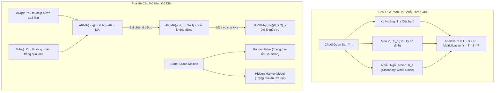

---

## 2. Chi tiết từng Keyword

---

### 1. Sequence Modeling (Mô hình hóa Dữ liệu Chuỗi)

#### a. Định nghĩa Bản chất Toán học
**Sequence Modeling** là bài toán học máy nhằm ước lượng phân phối xác suất đồng thời hoặc ánh xạ khả vi trên một chuỗi các phần tử có thứ tự thời gian $\mathbf{X} = (\mathbf{x}_1, \mathbf{x}_2, \dots, \mathbf{x}_T)$ với $\mathbf{x}_t \in \mathbb{R}^d$:
$$P(\mathbf{X}) = \prod_{t=1}^T P(\mathbf{x}_t \mid \mathbf{x}_{<t})$$
hoặc học ánh xạ từ chuỗi nguồn sang chuỗi đích: $f: \mathcal{X}^{T_{\text{in}}} \to \mathcal{Y}^{T_{\text{out}}}$.

#### b. Cơ chế Tầng Sâu & Điện toán
- Khác với dữ liệu tĩnh, độ dài chuỗi $T$ có thể biến thiên linh hoạt.
- Yêu cầu cấu trúc bộ nhớ duy trì thông tin qua các bước thời gian (trạng thái ẩn recurrent hoặc ma trận attention nhân quả).

#### c. Sơ đồ Minh họa
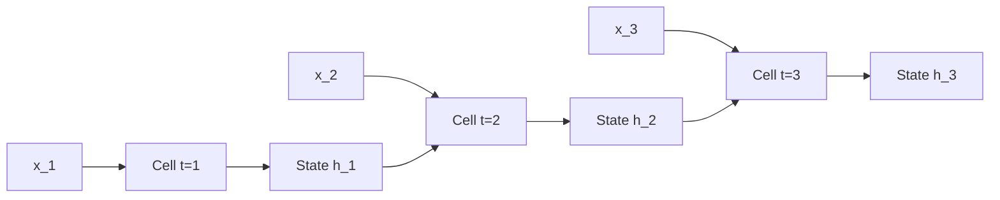

#### d. Code Thực chiến (C++ & Python)
```cpp
// C++17: Khung lặp Sequence Processing cơ bản
#include <vector>

void process_sequence(const std::vector<float>& input_seq, std::vector<float>& hidden_states, 
                      int seq_len, int dim) {
    for (int t = 0; t < seq_len; ++t) {
        // Cập nhật trạng thái tuần tự: h_t = f(h_{t-1}, x_t)
    }
}
```

```python
import torch
import torch.nn as nn

class SimpleSequenceModel(nn.Module):
    def __init__(self, input_dim: int, hidden_dim: int):
        super().__init__()
        self.gru = nn.GRU(input_dim, hidden_dim, batch_first=True)

    def forward(self, x: torch.Tensor) -> torch.Tensor:
        out, h_n = self.gru(x)
        return out
```

#### e. Lỗi Thường gặp & Ổn định Số học
- Giả định sai lầm rằng các quan sát độc lập với nhau (i.i.d.), phá hỏng khả năng nắm bắt phụ thuộc thời gian.

#### f. Ứng dụng Thực chiến trong AI
- Nhận dạng tiếng nói, xử lý ngôn ngữ tự nhiên, phân tích hành vi người dùng trực tuyến.

---

### 2. Sequential Data (Dữ liệu Dạng chuỗi)

#### a. Định nghĩa Bản chất Toán học
**Sequential Data** là tập hợp các điểm dữ liệu trong đó **thứ tự xuất hiện** mang thông tin ngữ nghĩa quyết định:
$$\mathcal{S} = (\mathbf{x}_1, \mathbf{x}_2, \dots, \mathbf{x}_T), \quad \text{với } \mathbf{x}_i \prec \mathbf{x}_j \quad \forall i < j$$
Phép hoán vị các phần tử $\pi(\mathcal{S})$ sẽ làm thay đổi hoặc phá hủy hoàn toàn ý nghĩa ban đầu của dữ liệu:
$$f(\pi(\mathcal{S})) \neq f(\mathcal{S})$$

#### b. Cơ chế Tầng Sâu & Điện toán
- Bố cục bộ nhớ liên tục trong RAM dạng tensor 3D: `[Batch, Time, Features]`.
- Truy cập bộ nhớ theo thứ tự thời gian giúp tối ưu hóa nạp dữ liệu vào CPU L1/L2 Cache (Sequential Memory Access).

#### c. Sơ đồ Minh họa
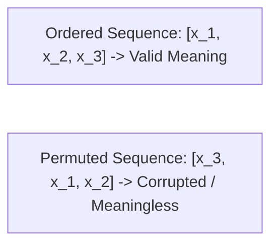

#### d. Code Thực chiến (C++ & Python)
```python
import numpy as np

# Kiểm tra tính tuần tự của chuỗi
def verify_temporal_order(timestamps: np.ndarray) -> bool:
    return np.all(np.diff(timestamps) > 0)
```

#### e. Lỗi Thường gặp & Ổn định Số học
- Xáo trộn ngẫu nhiên (Random Shuffling) toàn bộ tập dữ liệu trước khi chia Train/Validation/Test, gây rò rỉ dữ liệu tương lai (Data Leakage).

#### f. Ứng dụng Thực chiến trong AI
- Chuỗi gõ phím, chuỗi click chuột (Clickstream), chuỗi acid amin protein.

---

### 3. Temporal Modeling (Mô hình hóa Thời gian)

#### a. Định nghĩa Bản chất Toán học
**Temporal Modeling** tập trung vào việc mô hình hóa các quy luật biến thiên liên quan trực tiếp đến trục thời gian vật lý $t \in \mathbb{R}^+$ (khoảng cách thời gian $\Delta t = t_i - t_{i-1}$ có thể đều đặn hoặc bất thường - Irregularly Sampled Time Series):
$$\frac{d\mathbf{h}(t)}{dt} = f_\theta(\mathbf{h}(t), \mathbf{x}(t), t)$$
Áp dụng các phương trình vi phân nơ-ron (Neural ODEs) hoặc các hàm phân rã thời gian (Exponential Time Decay):
$$\mathbf{h}_t = \mathbf{h}_{t-1} \cdot \exp(-\lambda \Delta t) + \mathbf{x}_t$$

#### b. Cơ chế Tầng Sâu & Điện toán
- Xử lý các khoảng thời gian bị thiếu dữ liệu (Missing Values) mà không cần nội suy giả tạo thô sơ.

#### c. Sơ đồ Minh họa
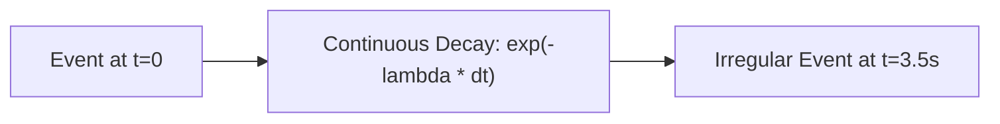

#### d. Code Thực chiến (C++ & Python)
```cpp
// C++17: Exponential Time Decay Step
#include <cmath>

float apply_time_decay(float prev_state, float delta_t, float lambda_param) {
    return prev_state * std::exp(-lambda_param * delta_t);
}
```

```python
import torch

def time_decay_cell(h_prev: torch.Tensor, delta_t: torch.Tensor, decay_rate: float):
    # delta_t: khoảng cách thời gian thực tế
    return h_prev * torch.exp(-decay_rate * delta_t)
```

#### e. Lỗi Thường gặp & Ổn định Số học
- Bỏ qua độ dài khoảng cách thời gian thực tế $\Delta t$ khi dữ liệu được thu thập không đều đặn.

#### f. Ứng dụng Thực chiến trong AI
- Dự đoán tái nhập viện trong hồ sơ bệnh án điện tử (EHR), giao dịch tài chính tần suất cao (HFT).

---

### 4. Time-Series Forecasting (Dự báo Chuỗi Thời gian)

#### a. Định nghĩa Bản chất Toán học
Cho chuỗi lịch sử quan sát gồm $L$ bước thời gian $\mathbf{X}_{1:L} = (\mathbf{x}_1, \dots, \mathbf{x}_L)$, bài toán **Time-Series Forecasting** nhằm mục tiêu dự đoán giá trị của chuỗi trong $H$ bước thời gian tương lai (Forecasting Horizon):
$$\hat{\mathbf{X}}_{L+1:L+H} = f_\theta(\mathbf{X}_{1:L})$$
- **Point Forecasting**: Dự đoán kỳ vọng duy nhất $\hat{\mathbf{x}}_{L+h} = \mathbb{E}[\mathbf{x}_{L+h} \mid \mathbf{X}_{1:L}]$.
- **Probabilistic Forecasting**: Dự đoán toàn bộ hàm mật độ xác suất hoặc các khoảng tin cậy (Quantile Prediction): $P(\mathbf{x}_{L+h} \mid \mathbf{X}_{1:L})$.

#### b. Cơ chế Tầng Sâu & Điện toán
- Hai chiến lược giải mã đa bước:
  1. *Iterative / Autoregressive Rollout*: Dự đoán từng bước $\hat{x}_{t+1}$, đưa ngược vào làm đầu vào để dự đoán $\hat{x}_{t+2}$ (sai số tích lũy nhanh).
  2. *Direct Multi-Horizon Output*: Chiếu thẳng từ biểu diễn lịch sử ra toàn bộ $H$ bước tương lai trong 1 bước duy nhất (Zero error accumulation).

#### c. Sơ đồ Minh họa
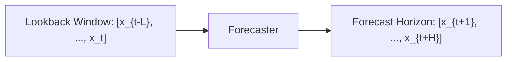

#### d. Code Thực chiến (C++ & Python)
```python
import torch
import torch.nn as nn

class LinearDirectForecaster(nn.Module):
    def __init__(self, lookback_len: int, horizon_len: int):
        super().__init__()
        # Direct Multi-Horizon Projection (DLinear baseline)
        self.proj = nn.Linear(lookback_len, horizon_len)

    def forward(self, x: torch.Tensor) -> torch.Tensor:
        # x: [B, Lookback, D]
        return self.proj(x.transpose(1, 2)).transpose(1, 2) # [B, Horizon, D]
```

#### e. Lỗi Thường gặp & Ổn định Số học
- Dùng các độ đo đánh giá không phù hợp: Dùng MAPE khi dữ liệu có chứa giá trị 0 (sinh ra phép chia cho 0).

#### f. Ứng dụng Thực chiến trong AI
- Dự báo nhu cầu chuỗi cung ứng, phụ tải tiêu thụ điện, kế hoạch tồn kho bán lẻ.

---

### 5. Univariate Time Series (Chuỗi Thời gian Đơn biến)

#### a. Định nghĩa Bản chất Toán học
**Univariate Time Series** là chuỗi thời gian trong đó tại mỗi mốc thời gian $t$, ta chỉ quan sát một biến vô hướng duy nhất:
$$y_t \in \mathbb{R}, \quad Y = (y_1, y_2, \dots, y_T) \in \mathbb{R}^T$$
Mọi sự biến thiên chỉ phụ thuộc vào chính lịch sử quá khứ của đại lượng đó.

#### b. Cơ chế Tầng Sâu & Điện toán
- Tensor 1D phẳng. Cực kỳ gọn nhẹ về mặt bộ nhớ và tính toán, phù hợp cho các thuật toán thống kê cổ điển tối ưu hóa tham số nhanh.

#### c. Sơ đồ Minh họa


#### d. Code Thực chiến (C++ & Python)
```python
import numpy as np

# Tạo chuỗi đơn biến nhân tạo
t = np.linspace(0, 100, 1000)
univariate_series = np.sin(t) + 0.1 * np.random.randn(len(t))
```

#### e. Lỗi Thường gặp & Ổn định Số học
- Bỏ qua các yếu tố tác động ngoại sinh (Exogenous variables) khiến mô hình không giải thích được các đột biến do sự kiện bên ngoài.

#### f. Ứng dụng Thực chiến trong AI
- Theo dõi nhịp tim (ECG), giám sát nhiệt độ CPU server.

---

### 6. Multivariate Time Series (Chuỗi Thời gian Đa biến)

#### a. Định nghĩa Bản chất Toán học
**Multivariate Time Series** theo dõi đồng thời $M$ biến số biến thiên cùng nhau theo thời gian:
$$\mathbf{y}_t = [y_{t, 1}, y_{t, 2}, \dots, y_{t, M}]^T \in \mathbb{R}^M, \quad \mathbf{Y} \in \mathbb{R}^{T \times M}$$
Mô hình phải đồng thời nắm bắt hai chiều tương tác:
1. **Intra-series Temporal Dependency**: Tương quan qua các bước thời gian của cùng một biến.
2. **Inter-series Cross-Variable Correlation**: Mối tương quan chéo giữa các biến số khác nhau tại cùng một thời điểm hoặc có độ trễ (ví dụ: Giá dầu tăng dẫn tới giá cổ phiếu hàng không giảm sau 2 ngày).

#### b. Cơ chế Tầng Sâu & Điện toán
- Ma trận hiệp phương sai kích thước $M \times M$.
- Khi $M$ lớn ($M > 1000$, ví dụ hàng nghìn cảm biến nhà máy), các mô hình ma trận truyền thống bị quá tải tham số; các kiến trúc hiện đại (như iTransformer) đảo chiều ma trận để xem mỗi biến là một token độc lập.

#### c. Sơ đồ Minh họa
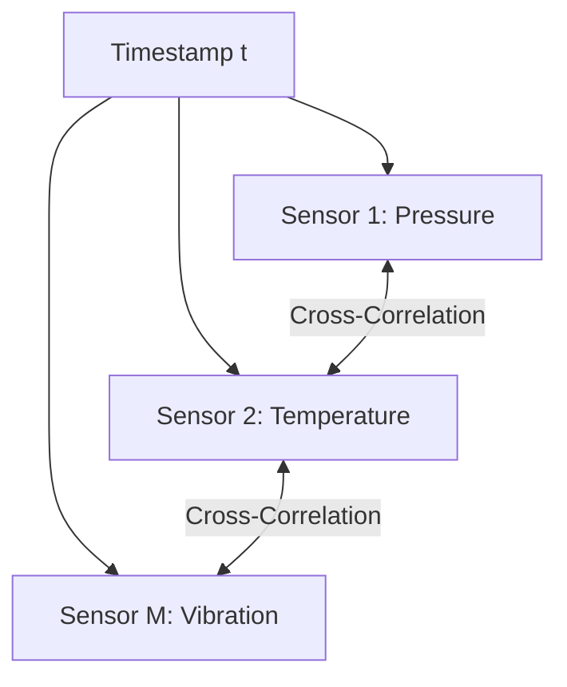

#### d. Code Thực chiến (C++ & Python)
```python
import torch

# Dữ liệu chuỗi đa biến [Batch, Time, Channels]
batch_multivariate = torch.randn(32, 96, 7) # 32 mẫu, 96 bước thời gian, 7 cảm biến
```

#### e. Lỗi Thường gặp & Ổn định Số học
- Giả định rằng tất cả các biến đều có cùng tần số lấy mẫu (khi thực tế cảm biến nhiệt độ lấy mẫu mỗi giây, cảm biến áp suất lấy mẫu mỗi phút).

#### f. Ứng dụng Thực chiến trong AI
- Giám sát lưới điện thông minh, chẩn đoán lỗi hệ thống viễn thông, dự báo kinh tế vĩ mô.

---

### 7. Autoregressive Models (Các Mô hình Tự hồi quy)

#### a. Định nghĩa Bản chất Toán học
Mô hình **Autoregressive (AR)** biểu diễn giá trị hiện tại $y_t$ như một tổ hợp tuyến tính của các giá trị quá khứ của chính nó cộng với một nhiễu trắng ngẫu nhiên:
$$y_t = c + \sum_{i=1}^p \phi_i y_{t-i} + \epsilon_t$$
Trong đó:
- $p$ là bậc tự hồi quy (Order).
- $\phi_1, \dots, \phi_p$ là các hệ số hồi quy.
- $c$ là hằng số dịch chuyển.
- $\epsilon_t \sim \mathcal{WN}(0, \sigma^2)$ là nhiễu trắng (White Noise).

**Điều kiện Dừng (Stationarity Condition)**: Đa thức đặc trưng:
$$\Phi(z) = 1 - \phi_1 z - \phi_2 z^2 - \dots - \phi_p z^p = 0$$
phải có tất cả các nghiệm phức $z_i$ nằm **bên ngoài vòng tròn đơn vị** trên mặt phẳng phức ($|z_i| > 1$).

#### b. Cơ chế Tầng Sâu & Điện toán
- Ước lượng tham số cực nhanh thông qua giải hệ phương trình tuyến tính **Yule-Walker**:
  $$\mathbf{\gamma}_k = \sum_{i=1}^p \phi_i \mathbf{\gamma}_{k-i}$$
  bằng thuật toán Levinson-Durbin trong $\mathcal{O}(p^2)$ thời gian tính toán.

#### c. Sơ đồ Minh họa
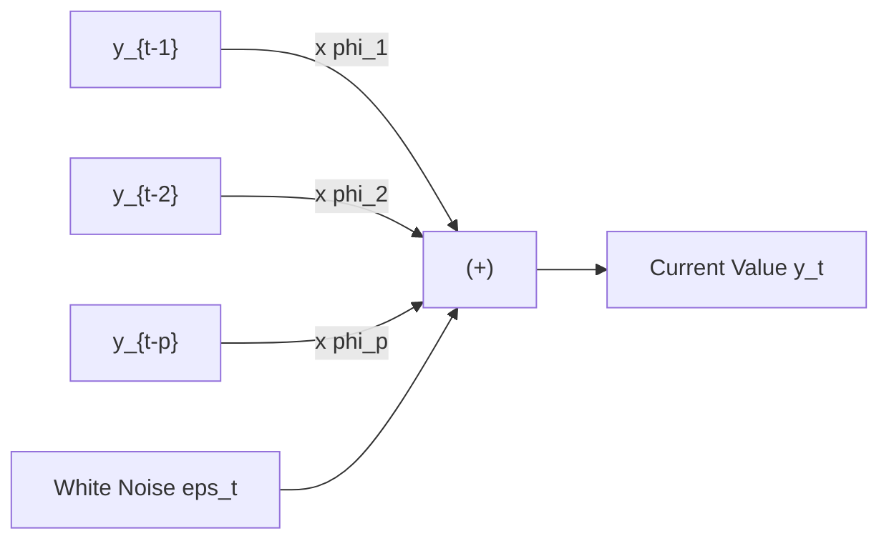

#### d. Code Thực chiến (C++ & Python)
```cpp
// C++17: Dự báo 1 bước bằng mô hình AR(p)
#include <vector>

float ar_predict_step(const std::vector<float>& history, const std::vector<float>& phi, float c) {
    float pred = c;
    int p = phi.size();
    int n = history.size();
    for (int i = 0; i < p; ++i) {
        pred += phi[i] * history[n - 1 - i];
    }
    return pred;
}
```

```python
from statsmodels.tsa.ar_model import AutoReg

def fit_ar_model(series, lags=5):
    model = AutoReg(series, lags=lags)
    model_fitted = model.fit()
    return model_fitted
```

#### e. Lỗi Thường gặp & Ổn định Số học
- Áp dụng AR cho chuỗi có xu hướng không dừng: Hệ số $|\phi| \ge 1$ khiến chuỗi tự bùng nổ ra vô cùng (Exploding Series).

#### f. Ứng dụng Thực chiến trong AI
- Nền tảng phân tích tài chính cổ điển, dự báo tải mạng.

---

### 8. Moving Average Models (Các Mô hình Trung bình Trượt)

#### a. Định nghĩa Bản chất Toán học
Khác với việc lấy trung bình đơn giản của dữ liệu, mô hình **Moving Average (MA)** trong chuỗi thời gian biểu diễn giá trị $y_t$ như một tổ hợp tuyến tính của **các cú sốc ngẫu nhiên quá khứ (Past White Noise Shocks)**:
$$y_t = \mu + \epsilon_t + \sum_{j=1}^q \theta_j \epsilon_{t-j}$$
Trong đó:
- $q$ là bậc trung bình trượt.
- $\theta_1, \dots, \theta_q$ là các tham số mô hình.
- $\epsilon_t$ là sai số ngẫu nhiên không quan sát được tại bước $t$.

**Điều kiện Khả nghịch (Invertibility Condition)**: Đa thức $\Theta(z) = 1 + \theta_1 z + \dots + \theta_q z^q = 0$ phải có tất cả các nghiệm nằm ngoài vòng tròn đơn vị. Khi đó mô hình MA($q$) có thể được viết lại dưới dạng một mô hình AR($\infty$).

#### b. Cơ chế Tầng Sâu & Điện toán
- Vì các cú sốc $\epsilon_t$ không quan sát được trực tiếp, mô hình MA không thể ước lượng bằng OLS tuyến tính mà bắt buộc phải dùng phương pháp tối ưu hóa phi tuyến tính Maximum Likelihood Estimation (MLE) lặp.

#### c. Sơ đồ Minh họa
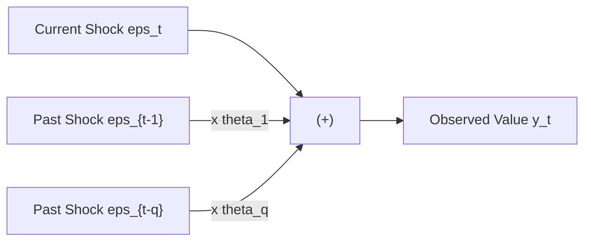

#### d. Code Thực chiến (C++ & Python)
```python
import numpy as np

def simulate_ma1(n_samples=500, theta=0.6, sigma=1.0):
    eps = np.random.normal(0, sigma, n_samples + 1)
    y = np.zeros(n_samples)
    for t in range(n_samples):
        y[t] = eps[t+1] + theta * eps[t]
    return y
```

#### e. Lỗi Thường gặp & Ổn định Số học
- Nhầm lẫn giữa mô hình thống kê MA($q$) và chỉ báo kỹ thuật Moving Average (SMA/EMA) trong phân tích kỹ thuật chứng khoán.

#### f. Ứng dụng Thực chiến trong AI
- Mô hình hóa sự lan truyền của các cú sốc kinh tế ngắn hạn và dự báo sai số hồi quy.

---

### 9. AR (Tự hồi quy Bậc 1 - AR(1))

#### a. Định nghĩa Bản chất Toán học
Mô hình **AR(1)** là viên gạch nền tảng đơn giản nhất:
$$y_t = c + \phi y_{t-1} + \epsilon_t$$
Tính chất giải tích:
- Giá trị trung bình: $\mu = \frac{c}{1 - \phi}$
- Phương sai: $\text{Var}(y_t) = \frac{\sigma^2}{1 - \phi^2}$
- Hàm tự tương quan (ACF): $\rho_k = \phi^k$ (Suy giảm theo hàm mũ theo độ trễ $k$).

Điều kiện dừng: $|\phi| < 1$.
- Nếu $\phi = 1$: Trở thành bước đi ngẫu nhiên (Random Walk) $y_t = y_{t-1} + \epsilon_t$ (Không dừng).

#### b. Cơ chế Tầng Sâu & Điện toán
- Mô phỏng quá trình Markov bậc 1: Trạng thái hiện tại nắm bắt toàn bộ thông tin quá khứ cần thiết.

#### c. Sơ đồ Minh họa
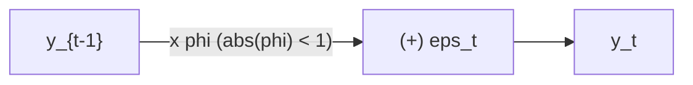

#### d. Code Thực chiến (C++ & Python)
```cpp
// C++17: Mô phỏng AR(1)
#include <vector>
#include <random>

std::vector<float> simulate_ar1(int steps, float phi, float c, float sigma) {
    std::vector<float> y(steps, 0.0f);
    std::default_random_engine gen;
    std::normal_distribution<float> dist(0.0f, sigma);
    for (int t = 1; t < steps; ++t) {
        y[t] = c + phi * y[t - 1] + dist(gen);
    }
    return y;
}
```

```python
import numpy as np

def simulate_ar1_vectorized(n: int, phi: float, sigma: float = 1.0):
    eps = np.random.normal(0, sigma, n)
    y = np.zeros(n)
    for t in range(1, n):
        y[t] = phi * y[t-1] + eps[t]
    return y
```

#### e. Lỗi Thường gặp & Ổn định Số học
- Khi $\phi \to 1.0$, mẫu số phương sai $1 - \phi^2 \to 0$, phương sai tiến ra vô cực (Unit Root problem).

#### f. Ứng dụng Thực chiến trong AI
- Mô phỏng quá trình vật lý Ornstein-Uhlenbeck trong học tăng cường (Reinforcement Learning action exploration).

---

### 10. MA (Trung bình Trượt Bậc 1 - MA(1))

#### a. Định nghĩa Bản chất Toán học
Mô hình **MA(1)**:
$$y_t = \mu + \epsilon_t + \theta \epsilon_{t-1}$$
Tính chất giải tích:
- Kỳ vọng: $\mathbb{E}[y_t] = \mu$
- Phương sai: $\text{Var}(y_t) = \sigma^2 (1 + \theta^2)$
- Hàm tự tương quan (ACF):
  $$\rho_1 = \frac{\theta}{1 + \theta^2}, \quad \rho_k = 0 \quad \forall k \ge 2$$
**Đặc tính then chốt**: Hàm ACF bị cắt cụt hoàn toàn (Cuts off) ngay sau độ trễ $k = 1$. Mọi cú sốc chỉ tồn tại đúng 1 bước rồi biến mất hoàn toàn.

#### b. Cơ chế Tầng Sâu & Điện toán
- Điều kiện khả nghịch: $|\theta| < 1$.

#### c. Sơ đồ Minh họa
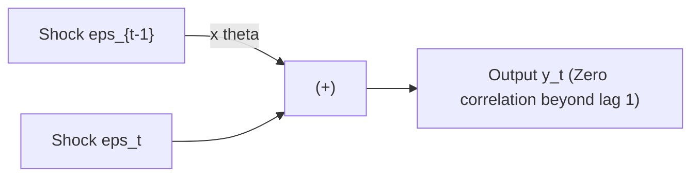

#### d. Code Thực chiến (C++ & Python)
```cpp
// C++17: MA(1) Step
float ma1_step(float mu, float theta, float current_eps, float prev_eps) {
    return mu + current_eps + theta * prev_eps;
}
```

```python
def check_ma1_autocorrelation(theta: float):
    rho_1 = theta / (1.0 + theta**2)
    return {"lag_1_autocorr": rho_1, "lag_2_autocorr": 0.0}
```

#### e. Lỗi Thường gặp & Ổn định Số học
- Cố gắng dự báo dài hạn với MA(1): Sau bước $t+1$, dự báo luôn trở về giá trị trung bình hằng số $\mu$.

#### f. Ứng dụng Thực chiến trong AI
- Khử nhiễu tín hiệu tần số cao trong xử lý âm thanh và cảm biến y tế.

---

### 11. ARMA (Autoregressive Moving Average)

#### a. Định nghĩa Bản chất Toán học
Mô hình **ARMA($p, q$)** kết hợp cả thành phần tự hồi quy bậc $p$ và trung bình trượt bậc $q$:
$$y_t = c + \sum_{i=1}^p \phi_i y_{t-i} + \epsilon_t + \sum_{j=1}^q \theta_j \epsilon_{t-j}$$
Biểu diễn qua toán tử độ trễ (Lag Operator $L$: $L^k y_t = y_{t-k}$):
$$\Phi(L) y_t = c + \Theta(L) \epsilon_t$$
Trong đó:
$$\Phi(L) = 1 - \sum_{i=1}^p \phi_i L^i, \quad \Theta(L) = 1 + \sum_{j=1}^q \theta_j L^j$$

#### b. Cơ chế Tầng Sâu & Điện toán
- Tiết kiệm tham số (Parsimony Principle): Một chuỗi thời gian có thể đòi hỏi mô hình AR với $p = 20$ để mô hình hóa tốt, nhưng chỉ cần một mô hình ARMA($2, 2$) với 4 tham số là đạt độ chính xác tương đương.

#### c. Sơ đồ Minh họa
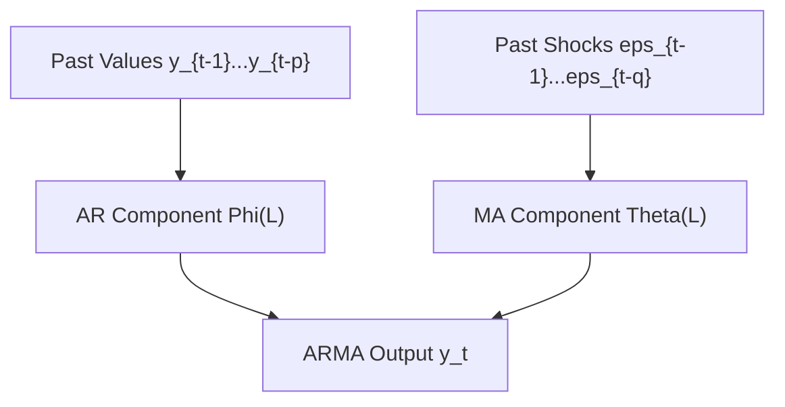

#### d. Code Thực chiến (C++ & Python)
```python
from statsmodels.tsa.arima.model import ARIMA

def fit_arma(series, p=2, q=2):
    # ARIMA với d=0 tương đương ARMA
    model = ARIMA(series, order=(p, 0, q))
    return model.fit()
```

#### e. Lỗi Thường gặp & Ổn định Số học
- Hiện tượng triệt tiêu thừa số chung (Parameter Redundancy): Nếu $\Phi(L)$ và $\Theta(L)$ có nghiệm chung thì mô hình bị over-parameterized và không xác định được nghiệm duy nhất.

#### f. Ứng dụng Thực chiến trong AI
- Mô hình hóa các chuỗi thời gian kinh tế lượng dừng hoàn hảo.

---

### 12. ARIMA (Autoregressive Integrated Moving Average)

#### a. Định nghĩa Bản chất Toán học
Đại đa số các chuỗi thời gian trong thực tế đều **không dừng (Non-Stationary)** (có xu hướng tăng giảm theo thời gian). Mô hình **ARIMA($p, d, q$)** (Box & Jenkins, 1970) giải quyết vấn đề này bằng cách đưa thêm bước **Lấy sai phân bậc $d$ (Integration)** để biến chuỗi không dừng thành chuỗi dừng trước khi áp dụng ARMA:
$$\Delta^d y_t = (1 - L)^d y_t$$
Phương trình toán học của ARIMA($p, d, q$):
$$\Phi(L) (1 - L)^d y_t = c + \Theta(L) \epsilon_t$$
- $d = 1$: Sai phân bậc 1: $y_t' = y_t - y_{t-1}$ (khử xu hướng tuyến tính).
- $d = 2$: Sai phân bậc 2: $y_t'' = (y_t - y_{t-1}) - (y_{t-1} - y_{t-2})$ (khử xu hướng bậc hai).

#### b. Cơ chế Tầng Sâu & Điện toán
- Quy trình Box-Jenkins chuẩn mực 3 bước:
  1. *Định danh (Identification)*: Kiểm tra tính dừng qua kiểm định ADF, xem đồ thị ACF/PACF để chọn $p, d, q$.
  2. *Ước lượng (Estimation)*: Ước lượng tham số bằng MLE hoặc Conditional Least Squares.
  3. *Chẩn đoán (Diagnostic Checking)*: Kiểm tra xem phần dư có phải là nhiễu trắng thuần túy (Ljung-Box Test).

#### c. Sơ đồ Minh họa
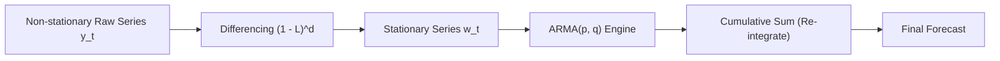

#### d. Code Thực chiến (C++ & Python)
```cpp
// C++17: Sai phân bậc 1 và Hoàn nguyên tích phân
#include <vector>

std::vector<float> difference_series(const std::vector<float>& y) {
    std::vector<float> diff(y.size() - 1);
    for (size_t i = 1; i < y.size(); ++i) diff[i - 1] = y[i] - y[i - 1];
    return diff;
}

std::vector<float> integrate_forecast(float last_val, const std::vector<float>& diff_forecast) {
    std::vector<float> reconstructed(diff_forecast.size());
    float current = last_val;
    for (size_t i = 0; i < diff_forecast.size(); ++i) {
        current += diff_forecast[i];
        reconstructed[i] = current;
    }
    return reconstructed;
}
```

```python
from statsmodels.tsa.arima.model import ARIMA

def run_arima_pipeline(series, p=1, d=1, q=1, steps=10):
    model = ARIMA(series, order=(p, d, q))
    fit_res = model.fit()
    forecast = fit_res.forecast(steps=steps)
    return forecast
```

#### e. Lỗi Thường gặp & Ổn định Số học
- Lấy sai phân quá mức (Over-differencing): Chọn $d = 2$ khi $d = 1$ đã đủ dừng, làm tăng phương sai và đưa thêm tính tương quan nhân tạo vào phần dư.

#### f. Ứng dụng Thực chiến trong AI
- Mô hình baseline thống kê chuẩn mực bắt buộc phải so sánh trong mọi cuộc thi dự báo thời gian (Kaggle).

---

### 13. SARIMA (Seasonal ARIMA)

#### a. Định nghĩa Bản chất Toán học
Khi chuỗi thời gian có tính chất chu kỳ mùa vụ lặp lại sau mỗi $s$ bước thời gian (ví dụ: $s = 12$ cho dữ liệu tháng lặp theo năm, $s = 24$ cho dữ liệu giờ lặp theo ngày), mô hình **SARIMA($p, d, q$)$\times$($P, D, Q$)$_s$** bổ sung các toán tử tự hồi quy và trung bình trượt theo mùa:
$$\Phi_p(L) \tilde{\Phi}_P(L^s) (1 - L)^d (1 - L^s)^D y_t = c + \Theta_q(L) \tilde{\Theta}_Q(L^s) \epsilon_t$$
Trong đó:
- $(1 - L^s)^D$: Sai phân mùa vụ ($y_t - y_{t-s}$).
- $\tilde{\Phi}_P(L^s)$: Toán tử AR mùa vụ bậc $P$ (liên kết $y_t$ với $y_{t-s}, y_{t-2s}, \dots$).
- $\tilde{\Theta}_Q(L^s)$: Toán tử MA mùa vụ bậc $Q$.

#### b. Cơ chế Tầng Sâu & Điện toán
- Số lượng tham số cần tối ưu hóa tăng lên, đòi hỏi ma trận Hessian lớn hơn trong thuật toán tối ưu hóa L-BFGS.

#### c. Sơ đồ Minh họa
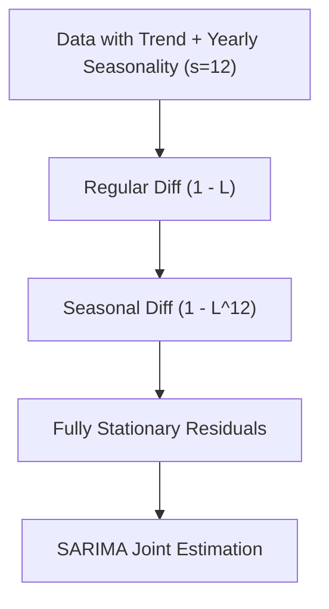

#### d. Code Thực chiến (C++ & Python)
```python
from statsmodels.tsa.statespace.sarimax import SARIMAX

def fit_sarima(series, order=(1, 1, 1), seasonal_order=(1, 1, 1, 12)):
    model = SARIMAX(series, order=order, seasonal_order=seasonal_order, 
                    enforce_stationarity=False, enforce_invertibility=False)
    return model.fit(disp=False)
```

#### e. Lỗi Thường gặp & Ổn định Số học
- Chọn chu kỳ $s$ quá lớn (ví dụ $s = 8760$ cho chuỗi dữ liệu hàng giờ trong năm): Mô hình SARIMA sụp đổ vì ma trận lag quá thưa và bộ nhớ tính toán bùng nổ.

#### f. Ứng dụng Thực chiến trong AI
- Dự báo doanh thu bán lẻ dịp lễ tết, dự báo nhu cầu năng lượng và du lịch hàng không.

---

### 14. Exponential Smoothing (San bằng Số mũ / Holt-Winters)

#### a. Định nghĩa Bản chất Toán học
**Exponential Smoothing** dự báo giá trị tương lai bằng cách lấy trung bình có trọng số của toàn bộ các quan sát trong quá khứ, trong đó trọng số suy giảm theo cấp số nhân khi thời gian lùi xa:
1. **Simple Exponential Smoothing (SES - Không xu hướng, không mùa vụ)**:
   $$\hat{y}_{t+1} = \alpha y_t + (1 - \alpha) \hat{y}_t = \alpha \sum_{j=0}^\infty (1 - \alpha)^j y_{t-j}$$
   ($\alpha \in (0, 1]$ là hệ số làm mịn).
2. **Holt's Linear Trend Method (Có xu hướng)**:
   $$\text{Mức (Level): } \ell_t = \alpha y_t + (1 - \alpha)(\ell_{t-1} + b_{t-1})$$
   $$\text{Xu hướng (Trend): } b_t = \beta (\ell_t - \ell_{t-1}) + (1 - \beta) b_{t-1}$$
   $$\text{Dự báo: } \hat{y}_{t+h} = \ell_t + h b_t$$
3. **Holt-Winters Seasonal Method (Có cả Xu hướng và Mùa vụ)**: Bổ sung thêm phương trình cập nhật thành phần mùa vụ $s_t$ với hệ số $\gamma$.

#### b. Cơ chế Tầng Sâu & Điện toán
- Công thức đệ quy cực kỳ nhẹ: Chỉ cần lưu trữ 3 giá trị vô hướng $(\ell_t, b_t, s_t)$ trong bộ nhớ, tính toán mất $\mathcal{O}(1)$ thời gian và $\mathcal{O}(1)$ không gian.

#### c. Sơ đồ Minh họa
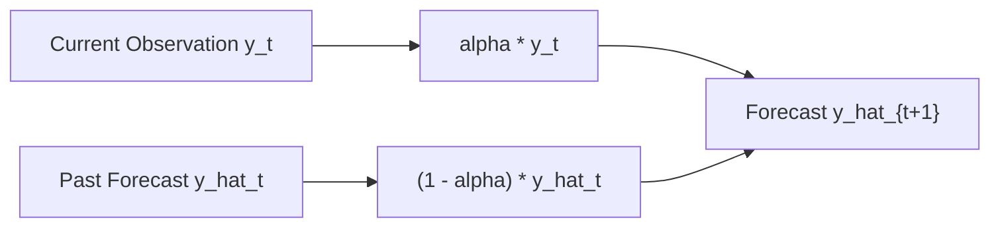

#### d. Code Thực chiến (C++ & Python)
```cpp
// C++17: Simple Exponential Smoothing
#include <vector>

std::vector<float> simple_exponential_smoothing(const std::vector<float>& y, float alpha) {
    std::vector<float> smoothed(y.size());
    smoothed[0] = y[0];
    for (size_t t = 1; t < y.size(); ++t) {
        smoothed[t] = alpha * y[t] + (1.0f - alpha) * smoothed[t - 1];
    }
    return smoothed;
}
```

```python
from statsmodels.tsa.holtwinters import ExponentialSmoothing

def fit_holt_winters(series, seasonal_periods=12):
    model = ExponentialSmoothing(series, trend="add", seasonal="add", seasonal_periods=seasonal_periods)
    return model.fit()
```

#### e. Lỗi Thường gặp & Ổn định Số học
- Sử dụng mô hình xu hướng cộng tính (Additive Trend) cho các chuỗi có xu hướng tăng trưởng theo cấp số nhân (phải dùng Multiplicative Trend hoặc Damped Trend).

#### f. Ứng dụng Thực chiến trong AI
- Thuật toán lõi chạy ngầm trong tính năng dự báo tự động của Microsoft Excel (`FORECAST.ETS`) và giám sát hệ thống metrics Grafana.

---

### 15. State-Space Models (Mô hình Không gian Trạng thái - SSM)

#### a. Định nghĩa Bản chất Toán học
**State-Space Models** phân tách chuỗi thời gian thành hai phương trình bản chất:
1. **Phương trình Trạng thái / Chuyển dịch (State / Transition Equation)**: Mô tả sự tiến hóa của một vector trạng thái ẩn tiềm năng $\mathbf{x}_t \in \mathbb{R}^m$ không quan sát được:
   $$\mathbf{x}_t = \mathbf{F}_t \mathbf{x}_{t-1} + \mathbf{B}_t \mathbf{u}_t + \mathbf{w}_t, \quad \mathbf{w}_t \sim \mathcal{N}(\mathbf{0}, \mathbf{Q}_t)$$
2. **Phương trình Quan sát / Đo lường (Observation / Measurement Equation)**: Ánh xạ trạng thái ẩn thành dữ liệu thực tế quan sát được $\mathbf{y}_t \in \mathbb{R}^d$:
   $$\mathbf{y}_t = \mathbf{H}_t \mathbf{x}_t + \mathbf{v}_t, \quad \mathbf{v}_t \sim \mathcal{N}(\mathbf{0}, \mathbf{R}_t)$$
Trong đó $\mathbf{F}_t$ là ma trận chuyển dịch trạng thái, $\mathbf{H}_t$ là ma trận quan sát, $\mathbf{Q}_t$ và $\mathbf{R}_t$ là ma trận hiệp phương sai của nhiễu hệ thống và nhiễu đo lường.

#### b. Cơ chế Tầng Sâu & Điện toán
- Hợp nhất toàn bộ các mô hình ARMA, ARIMA, Structural Time Series dưới một khung đại số tuyến tính thống nhất.
- Tiền đề cảm hứng trực tiếp cho các kiến trúc học sâu hiện đại như **Mamba (Structured State Space Models - S4)**.

#### c. Sơ đồ Minh họa
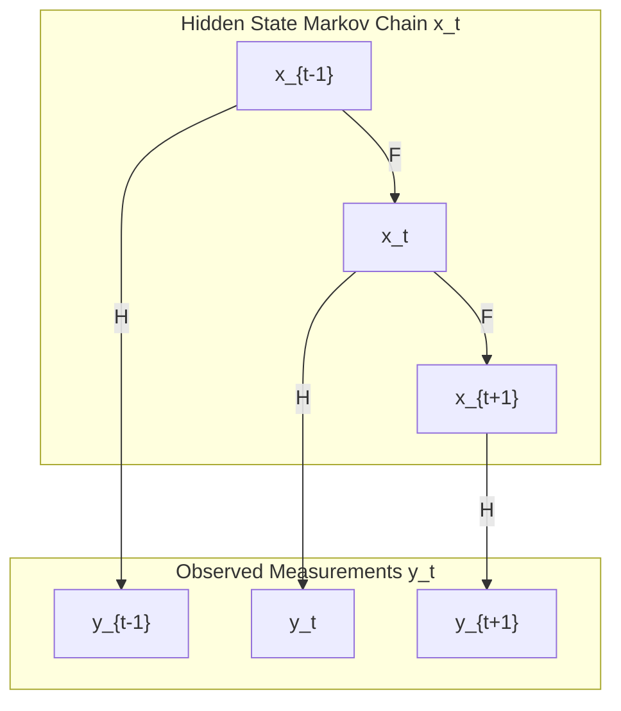

#### d. Code Thực chiến (C++ & Python)
```cpp
// C++17: Cấu trúc ma trận State-Space tuyến tính
struct StateSpaceModelLinear {
    std::vector<float> F_trans; // [m x m]
    std::vector<float> H_obs;   // [d x m]
    std::vector<float> Q_cov;   // [m x m]
    std::vector<float> R_cov;   // [d x d]
};
```

```python
import numpy as np

class LinearSSM:
    def __init__(self, F, H, Q, R):
        self.F = F # State transition
        self.H = H # Observation matrix
        self.Q = Q # Process noise
        self.R = R # Measurement noise

    def step(self, x_prev):
        w = np.random.multivariate_normal(np.zeros(self.F.shape[0]), self.Q)
        v = np.random.multivariate_normal(np.zeros(self.H.shape[0]), self.R)
        x_curr = self.F @ x_prev + w
        y_curr = self.H @ x_curr + v
        return x_curr, y_curr
```

#### e. Lỗi Thường gặp & Ổn định Số học
- Giả định sai ma trận hiệp phương sai nhiễu $\mathbf{Q}$ hoặc $\mathbf{R}$ khiến ước lượng trạng thái bị trôi lệch hoàn toàn.

#### f. Ứng dụng Thực chiến trong AI
- Dẫn đường quán tính tên lửa/máy bay, theo dõi quỹ đạo xe tự hành, và mô hình ngôn ngữ Mamba.

---

### 16. Kalman Filters (Bộ lọc Kalman)

#### a. Định nghĩa Bản chất Toán học
**Kalman Filter** (Rudolf E. Kálmán, 1960) là thuật toán đệ quy tối ưu giải bài toán ước lượng trạng thái cho Linear State-Space Models dưới giả định nhiễu Gauss.
Quy trình thực thi hai giai đoạn liên tục:
1. **Pha Dự đoán (Predict Phase)**:
   $$\hat{\mathbf{x}}_{t|t-1} = \mathbf{F}_t \hat{\mathbf{x}}_{t-1|t-1}$$
   $$\mathbf{P}_{t|t-1} = \mathbf{F}_t \mathbf{P}_{t-1|t-1} \mathbf{F}_t^T + \mathbf{Q}_t$$
2. **Pha Cập nhật / Hiệu chỉnh (Update Phase)**:
   - Sai số đổi mới (Innovation): $\tilde{\mathbf{y}}_t = \mathbf{y}_t - \mathbf{H}_t \hat{\mathbf{x}}_{t|t-1}$
   - Hiệp phương sai đổi mới: $\mathbf{S}_t = \mathbf{H}_t \mathbf{P}_{t|t-1} \mathbf{H}_t^T + \mathbf{R}_t$
   - **Hệ số tăng ích Kalman (Kalman Gain)**:
     $$\mathbf{K}_t = \mathbf{P}_{t|t-1} \mathbf{H}_t^T \mathbf{S}_t^{-1}$$
   - Cập nhật trạng thái và hiệp phương sai:
     $$\hat{\mathbf{x}}_{t|t} = \hat{\mathbf{x}}_{t|t-1} + \mathbf{K}_t \tilde{\mathbf{y}}_t$$
     $$\mathbf{P}_{t|t} = (\mathbf{I} - \mathbf{K}_t \mathbf{H}_t) \mathbf{P}_{t|t-1}$$

#### b. Cơ chế Tầng Sâu & Điện toán
- Hệ số $\mathbf{K}_t$ là trọng số cân bằng tối ưu giữa **Mô hình lý thuyết** và **Dữ liệu cảm biến thực tế**:
  - Nếu cảm biến rất nhiễu ($\mathbf{R} \to \infty$): $\mathbf{K} \to 0$, tin vào mô hình dự đoán.
  - Nếu mô hình kém chính xác ($\mathbf{Q} \to \infty$): $\mathbf{K} \to \mathbf{H}^{-1}$, tin hoàn toàn vào cảm biến.

#### c. Sơ đồ Minh họa
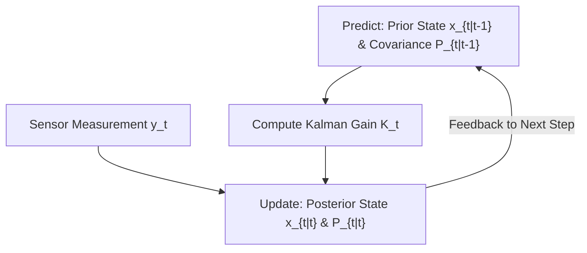

#### d. Code Thực chiến (C++ & Python)
```cpp
// C++17: 1D Scalar Kalman Filter Implementation
struct ScalarKalmanFilter {
    float x; // State
    float p; // Covariance
    float q; // Process noise
    float r; // Measurement noise

    ScalarKalmanFilter(float init_x, float init_p, float q_val, float r_val)
        : x(init_x), p(init_p), q(q_val), r(r_val) {}

    float update(float measurement) {
        // 1. Predict
        p = p + q;
        // 2. Update
        float k = p / (p + r);
        x = x + k * (measurement - x);
        p = (1.0f - k) * p;
        return x;
    }
};
```

```python
import numpy as np

class KalmanFilter1D:
    def __init__(self, x0, p0, f, h, q, r):
        self.x = x0
        self.p = p0
        self.f = f
        self.h = h
        self.q = q
        self.r = r

    def step(self, z):
        # Predict
        x_pred = self.f * self.x
        p_pred = self.f * self.p * self.f + self.q
        # Update
        y = z - self.h * x_pred
        s = self.h * p_pred * self.h + self.r
        k = p_pred * self.h / s
        self.x = x_pred + k * y
        self.p = (1 - k * self.h) * p_pred
        return self.x
```

#### e. Lỗi Thường gặp & Ổn định Số học
- Ma trận hiệp phương sai $\mathbf{P}$ bị mất tính đối xứng và xác định dương do sai số làm tròn số thực: Phải dùng công thức Joseph Form để cập nhật $\mathbf{P}$.

#### f. Ứng dụng Thực chiến trong AI
- Hệ thống định vị vệ tinh GPS, chương trình tàu không gian Apollo của NASA, theo dõi vật thể (Object Tracking) trong xe tự lái.

---

### 17. Hidden Markov Models (Mô hình Markov Ẩn - HMM)

#### a. Định nghĩa Bản chất Toán học
**Hidden Markov Model** là mô hình đồ thị xác suất trong đó chuỗi trạng thái tiềm ẩn $S = (s_1, \dots, s_T)$ là các biến ngẫu nhiên **rời rạc** tuân theo tính chất Markov bậc 1:
$$P(s_t \mid s_1, \dots, s_{t-1}) = P(s_t \mid s_{t-1}) = A_{s_{t-1}, s_t}$$
và các quan sát $O = (o_1, \dots, o_T)$ được sinh ra độc lập từ các trạng thái ẩn tương ứng:
$$P(o_t \mid s_1, \dots, s_T, o_1, \dots, o_{t-1}) = P(o_t \mid s_t) = B_{s_t}(o_t)$$
HMM được định nghĩa bởi bộ 3 tham số $\lambda = (\mathbf{A}, \mathbf{B}, \mathbf{\pi})$:
- $\mathbf{A} \in \mathbb{R}^{K \times K}$: Ma trận xác suất chuyển trạng thái.
- $\mathbf{B} \in \mathbb{R}^{K \times M}$: Ma trận xác suất phát xạ (Emission Matrix).
- $\mathbf{\pi} \in \mathbb{R}^K$: Phân phối trạng thái ban đầu.

Ba bài toán kinh điển của HMM:
1. *Đánh giá (Evaluation)*: Tính $P(O \mid \lambda)$ qua thuật toán **Forward-Backward** ($\mathcal{O}(K^2 T)$).
2. *Giải mã (Decoding)*: Tìm chuỗi trạng thái ẩn $S^*$ có khả năng xảy ra cao nhất qua thuật toán **Viterbi** (Quy hoạch động).
3. *Học tập (Learning)*: Ước lượng tham số $\lambda^*$ qua thuật toán **Baum-Welch (EM)**.

#### b. Cơ chế Tầng Sâu & Điện toán
- Thuật toán Viterbi lưu giữ bảng quy hoạch động kích thước $K \times T$, tính toán cực nhanh qua SIMD.

#### c. Sơ đồ Minh họa
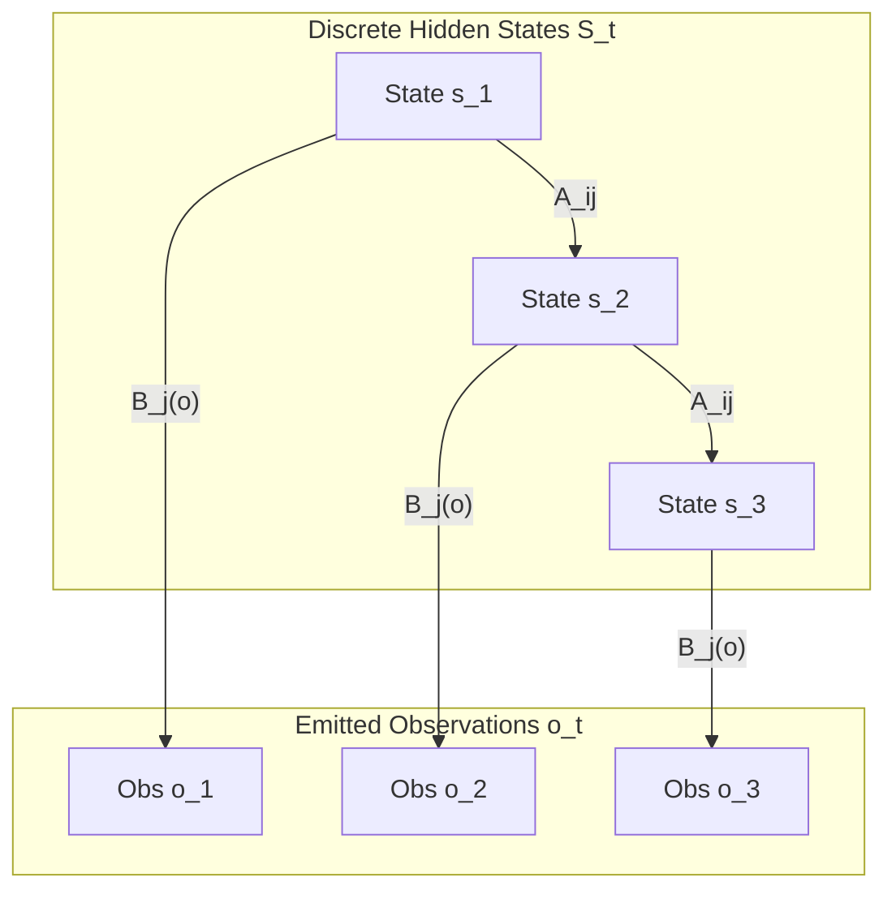

#### d. Code Thực chiến (C++ & Python)
```cpp
// C++17: Viterbi Algorithm Dynamic Programming Step
#include <vector>
#include <cmath>
#include <algorithm>

std::vector<int> viterbi_decode(const std::vector<int>& obs, 
                               const std::vector<std::vector<float>>& log_A,
                               const std::vector<std::vector<float>>& log_B,
                               const std::vector<float>& log_pi) {
    int T = obs.size();
    int K = log_pi.size();
    std::vector<std::vector<float>> V(T, std::vector<float>(K, -1e9f));
    std::vector<std::vector<int>> ptr(T, std::vector<int>(K, 0));

    // Khởi tạo t = 0
    for (int k = 0; k < K; ++k) V[0][k] = log_pi[k] + log_B[k][obs[0]];

    // Đệ quy forward
    for (int t = 1; t < T; ++t) {
        for (int j = 0; j < K; ++j) {
            for (int i = 0; i < K; ++i) {
                float score = V[t - 1][i] + log_A[i][j] + log_B[j][obs[t]];
                if (score > V[t][j]) {
                    V[t][j] = score;
                    ptr[t][j] = i;
                }
            }
        }
    }
    // Backtracking tìm đường đi tối ưu...
    std::vector<int> path(T);
    path[T - 1] = std::max_element(V[T - 1].begin(), V[T - 1].end()) - V[T - 1].begin();
    for (int t = T - 1; t > 0; --t) path[t - 1] = ptr[t][path[t]];
    return path;
}
```

```python
from hmmlearn import hmm
import numpy as np

# Huấn luyện HMM Gaussian đơn giản
model = hmm.GaussianHMM(n_components=3, covariance_type="diag", n_iter=100)
# X = np.array(...)
# model.fit(X)
# hidden_states = model.predict(X)
```

#### e. Lỗi Thường gặp & Ổn định Số học
- Nhân trực tiếp các xác suất nhỏ dẫn đến hiện tượng Underflow về 0: Bắt buộc phải thực hiện trong không gian Log-Probability ($\log A + \log B$).

#### f. Ứng dụng Thực chiến trong AI
- Nhận dạng giọng nói truyền thống (trước Deep Learning), gán nhãn từ loại (POS Tagging), phân tích chuỗi gen sinh học.

---

### 18. Stationarity (Tính Dừng của Chuỗi Thời gian)

#### a. Định nghĩa Bản chất Toán học
Một chuỗi thời gian $\{y_t\}$ được gọi là **Dừng yếu (Weakly Stationary / Covariance Stationary)** nếu thỏa mãn 3 điều kiện toán học:
1. **Kỳ vọng không đổi theo thời gian**:
   $$\mathbb{E}[y_t] = \mu = \text{const}, \quad \forall t$$
2. **Phương sai hữu hạn và không đổi theo thời gian**:
   $$\text{Var}(y_t) = \sigma^2 = \text{const} < \infty, \quad \forall t$$
3. **Hiệp phương sai chỉ phụ thuộc vào khoảng cách độ trễ $k$ (Lag)**, hoàn toàn không phụ thuộc vào thời điểm quan sát $t$:
   $$\text{Cov}(y_t, y_{t-k}) = \gamma_k = f(k), \quad \forall t, k$$

**Tính Dừng nghiêm ngặt (Strict Stationarity)**: Đòi hỏi toàn bộ phân phối xác suất đồng thời không thay đổi khi tịnh tiến thời gian:
$$P(y_1, \dots, y_n) = P(y_{1+k}, \dots, y_{n+k})$$

#### b. Cơ chế Tầng Sâu & Điện toán
- Tính dừng là điều kiện tiên quyết: Nếu chuỗi không dừng, các giá trị thống kê trung bình và phương sai tính từ quá khứ sẽ không còn giá trị dự đoán cho tương lai.
- **Kiểm định Nghiệm Đơn vị (Unit Root Tests)**: Kiểm định ADF (Augmented Dickey-Fuller) và KPSS được dùng để kiểm tra tính dừng trước khi huấn luyện mô hình.

#### c. Sơ đồ Minh họa
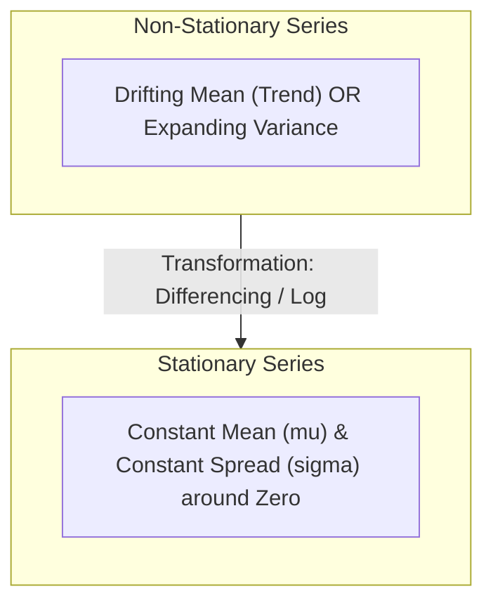

#### d. Code Thực chiến (C++ & Python)
```python
from statsmodels.tsa.stattools import adfuller

def check_stationarity_adf(series):
    result = adfuller(series)
    adf_stat, p_value = result[0], result[1]
    is_stationary = p_value < 0.05
    return {"adf_stat": adf_stat, "p_value": p_value, "is_stationary": is_stationary}
```

#### e. Lỗi Thường gặp & Ổn định Số học
- Huấn luyện mô hình hồi quy tuyến tính trên hai chuỗi không dừng có xu hướng cùng tăng: Dẫn đến hiện tượng **Hồi quy Giả mạo (Spurious Regression)** với $R^2$ rất cao nhưng thực tế hai biến không hề có quan hệ nhân quả.

#### f. Ứng dụng Thực chiến trong AI
- Tiền xử lý bắt buộc cho toàn bộ các mô hình dự báo chuỗi thời gian.

---

### 19. Differencing (Phép Lấy Sai phân)

#### a. Định nghĩa Bản chất Toán học
**Differencing** là phép toán trừ giá trị hiện tại cho giá trị trước đó nhằm loại bỏ thành phần xu hướng và đưa chuỗi về trạng thái dừng:
- **Sai phân Bậc 1 (First Difference)**:
  $$\Delta y_t = y_t - y_{t-1} = (1 - L) y_t$$
  Biến đổi một chuỗi có xu hướng tuyến tính $y_t = a t + b$ thành chuỗi dừng có kỳ vọng hằng số:
  $$\Delta y_t = (a t + b) - (a(t-1) + b) = a$$
- **Sai phân Mùa vụ (Seasonal Difference)**:
  $$\Delta_s y_t = y_t - y_{t-s} = (1 - L^s) y_t$$
  Loại bỏ chu kỳ mùa vụ độ dài $s$.
- **Sai phân Phân số (Fractional Differencing - de Prado, 2018)**: Cho phép bậc sai phân $d \in (0, 1)$ là số thực bằng khai triển chuỗi nhị thức:
  $$(1 - L)^d = \sum_{k=0}^\infty (-1)^k \binom{d}{k} L^k = 1 - d L + \frac{d(d-1)}{2!} L^2 - \dots$$
  Giúp chuỗi đạt tính dừng nhưng **vẫn giữ lại bộ nhớ dài hạn (Memory Retention)** của dữ liệu tài chính.

#### b. Cơ chế Tầng Sâu & Điện toán
- Phép trừ vector 1D cực nhanh.
- Khi suy luận, bắt buộc phải hoàn nguyên sai phân (Cumulative Sum) để thu được giá trị gốc.

#### c. Sơ đồ Minh họa


#### d. Code Thực chiến (C++ & Python)
```cpp
// C++17: In-place First-order Differencing
void first_difference(const float* in, float* out, int len) {
    for (int i = 1; i < len; ++i) {
        out[i - 1] = in[i] - in[i - 1];
    }
}
```

```python
import numpy as np

def seasonal_diff(series: np.ndarray, s: int) -> np.ndarray:
    return series[s:] - series[:-s]
```

#### e. Lỗi Thường gặp & Ổn định Số học
- Quên lưu lại giá trị cuối cùng của chuỗi gốc ($y_T$) khiến không thể khôi phục lại dự báo ở thang đo thực tế.

#### f. Ứng dụng Thực chiến trong AI
- Biến đổi tỷ suất sinh lời (Log Returns) trong tài chính định lượng: $r_t = \ln(P_t) - \ln(P_{t-1})$.

---

### 20. Decomposition (Phân rã Chuỗi Thời gian)

#### a. Định nghĩa Bản chất Toán học
**Decomposition** phân tích một chuỗi thời gian phức tạp $y_t$ thành các thành phần cơ bản cấu thành nên nó:
1. **Mô hình Cộng tính (Additive Model)**: Thích hợp khi biên độ mùa vụ không đổi theo thời gian:
   $$y_t = T_t + S_t + R_t$$
2. **Mô hình Nhân tính (Multiplicative Model)**: Thích hợp khi biên độ mùa vụ tăng tỷ lệ thuận với xu hướng:
   $$y_t = T_t \times S_t \times R_t \iff \ln(y_t) = \ln(T_t) + \ln(S_t) + \ln(R_t)$$
Các thuật toán phân rã:
- **Classical Decomposition**: Dùng Moving Average lọc xu hướng.
- **STL (Seasonal and Trend decomposition using Loess)**: Linh hoạt, xử lý được mùa vụ biến thiên phi tuyến và bền vững trước nhiễu ngoại lai.

#### b. Cơ chế Tầng Sâu & Điện toán
- Trong Deep Learning hiện đại, các mô hình như **Autoformer** và **FEDformer** tích hợp trực tiếp khối phân rã **Series Decomposition Block** vào ngay bên trong mỗi tầng Transformer để tách riêng luồng học xu hướng và luồng học mùa vụ.

#### c. Sơ đồ Minh họa
```mermaid
graph TD
    Raw["Raw Time Series y_t"] --> Decomp["Decomposition Filter (Loess / Moving Average)"]
    Decomp --> Trend["Trend T_t (Dài hạn)"]
    Decomp --> Season["Seasonality S_t (Chu kỳ)"]
    Decomp --> Remainder["Remainder R_t (Nhiễu dừng)"]
```

#### d. Code Thực chiến (C++ & Python)
```python
from statsmodels.tsa.seasonal import seasonal_decompose
import numpy as np

def run_classical_decompose(series, period=12, model="additive"):
    return seasonal_decompose(series, model=model, period=period)
```

#### e. Lỗi Thường gặp & Ổn định Số học
- Dùng mô hình cộng tính khi biên độ mùa vụ bùng nổ theo cấp số nhân dẫn đến phần dư $R_t$ bị méo mó.

#### f. Ứng dụng Thực chiến trong AI
- Kiến trúc khối phân rã nền tảng trong **Autoformer**, **N-BEATS**, và **DLinear**.

---

### 21. Trend (Xu hướng Dài hạn)

#### a. Định nghĩa Bản chất Toán học
**Trend** $T_t$ là hướng dịch chuyển tổng thể của chuỗi thời gian qua một giai đoạn dài hạn (tăng trưởng, suy thoái, hoặc đi ngang):
- Xu hướng tuyến tính: $T_t = a t + b$
- Xu hướng phi tuyến tính (Đa thức / Logistic):
  $$T_t = \frac{K}{1 + \exp(-k(t - t_0))}$$
  (Mô hình hóa sự tăng trưởng bão hòa, ví dụ người dùng internet).

#### b. Cơ chế Tầng Sâu & Điện toán
- Được trích xuất bằng các bộ lọc trung bình trượt đối xứng (Centered Moving Average):
  $$\hat{T}_t = \frac{1}{2k + 1} \sum_{j=-k}^k y_{t+j}$$

#### c. Sơ đồ Minh họa
```mermaid
graph LR
    Noisy["Fluctuating Observations"] --> LowPass["Low-pass Filter (Smoothing)"] --> SmoothTrend["Smooth Long-term Trend Line"]
```

#### d. Code Thực chiến (C++ & Python)
```python
import numpy as np

def centered_moving_average_trend(series: np.ndarray, window: int = 5):
    # Centered moving average
    kernel = np.ones(window) / window
    return np.convolve(series, kernel, mode='same')
```

#### e. Lỗi Thường gặp & Ổn định Số học
- Nhầm lẫn giữa một chu kỳ dài hạn (Long-term Cycle) và một xu hướng thực sự (Trend).

#### f. Ứng dụng Thực chiến trong AI
- Đánh giá tăng trưởng kinh doanh, dự báo công suất hạ tầng đám mây trong tương lai 5 năm.

---

### 22. Seasonality (Tính Mùa vụ)

#### a. Định nghĩa Bản chất Toán học
**Seasonality** $S_t$ là các dao động tuần hoàn lặp đi lặp lại có chu kỳ cố định và biết trước $s$:
$$S_t = S_{t + s}, \quad \forall t$$
Khác với Chu kỳ kinh tế (Cyclic variations) có độ dài chu kỳ thay đổi không cố định, tính mùa vụ có chu kỳ tuyệt đối cố định gắn liền với lịch thiên văn hoặc con người (hàng ngày, hàng tuần, hàng quý, hàng năm).

Biểu diễn bằng chuỗi Fourier (Fourier Terms):
$$S_t = \sum_{k=1}^K \left( a_k \cos\left(\frac{2\pi k t}{s}\right) + b_k \sin\left(\frac{2\pi k t}{s}\right) \right)$$

#### b. Cơ chế Tầng Sâu & Điện toán
- Biểu diễn bằng chuỗi Fourier cho phép mô hình hóa các chuỗi mùa vụ phức tạp với số lượng tham số rất nhỏ ($2K$ tham số thay vì $s$ tham số), cực kỳ tối ưu cho các chu kỳ lớn (như $s = 365.25$).

#### c. Sơ đồ Minh họa
```mermaid
graph LR
    Time["Days of Week (Mon -> Sun)"] --> Pattern["Repeating Wave: Weekend Peak, Midweek Dip"]
    Pattern --> Seasonality["Identical Periodic Profile S_{t+7} = S_t"]
```

#### d. Code Thực chiến (C++ & Python)
```cpp
// C++17: Khởi tạo Fourier Terms cho Seasonality
#include <vector>
#include <cmath>

void generate_fourier_terms(int t, float period, int num_orders, float* out_fourier) {
    const float PI = 3.14159265358979323846f;
    for (int k = 1; k <= num_orders; ++k) {
        float angle = 2.0f * PI * k * t / period;
        out_fourier[2 * (k - 1)]     = std::cos(angle);
        out_fourier[2 * (k - 1) + 1] = std::sin(angle);
    }
}
```

```python
import numpy as np

def fourier_series_seasonality(t: np.ndarray, period: float, K: int = 3):
    features = []
    for k in range(1, K + 1):
        features.append(np.sin(2 * np.pi * k * t / period))
        features.append(np.cos(2 * np.pi * k * t / period))
    return np.column_stack(features)
```

#### e. Lỗi Thường gặp & Ổn định Số học
- Đa mùa vụ lồng nhau (Multiple Seasonal Patterns: ví dụ dữ liệu giờ có chu kỳ 24h và chu kỳ 168h): Các mô hình ARIMA truyền thống thất bại hoàn toàn; bắt buộc phải dùng TBATS hoặc Fourier Terms (Facebook Prophet).

#### f. Ứng dụng Thực chiến trong AI
- Thành phần cốt lõi trong **Meta Prophet**, **Autoformer**, và dự báo tải điện lực thời gian thực.
