# Chuyên đề: Các Kiến trúc Học sâu Tiên tiến cho Chuỗi & Thời gian (Deep Sequence Models & Modern Time-Series Architectures)

## 1. Tổng quan Chuyên đề
Trong những năm gần đây, bài toán mô hình hóa chuỗi thời gian đã chứng kiến một sự chuyển mình ngoạn mục: từ các mạng tuần tự RNN/LSTM cổ điển sang các mạng tích chập mở rộng (**TCN, WaveNet**), các mô hình MLP phân rã sâu thuần túy (**N-BEATS, N-HiTS**), và đặc biệt là làn sóng bùng nổ của **Time-Series Transformers** (**Temporal Fusion Transformer, Informer, Autoformer, FEDformer, PatchTST, iTransformer, TimesNet**).

Đỉnh cao của sự tiến hóa hiện nay là sự xuất hiện của các **Mô hình Nền tảng Chuỗi Thời gian (Time-Series Foundation Models)** như **Chronos** (Amazon) và **Lag-Llama**, áp dụng trực tiếp các kiến trúc ngôn ngữ lớn (T5, LLaMA) và cơ chế lượng tử hóa token hóa số thực để đạt năng lực dự báo Zero-shot trên các tập dữ liệu chưa từng thấy trong quá trình huấn luyện.

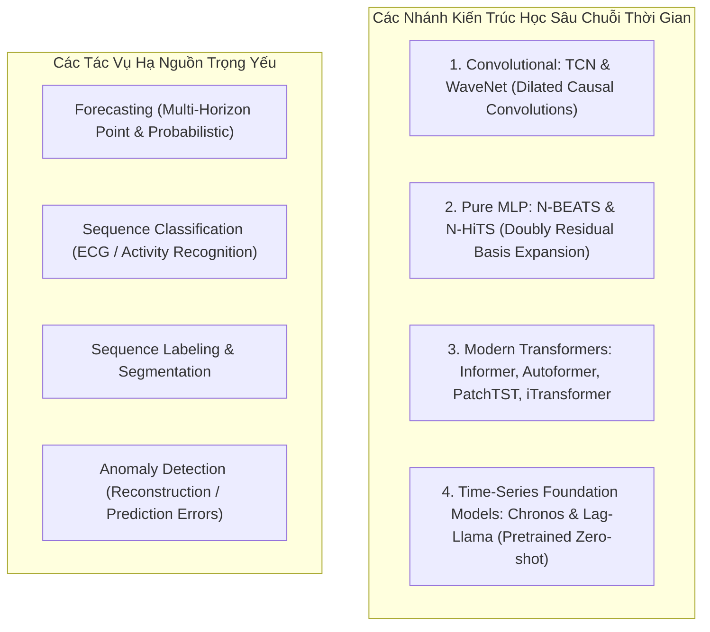

---

## 2. Chi tiết từng Keyword

---

### 23. Temporal Convolutional Networks (TCN)

#### a. Định nghĩa Bản chất Toán học
**Temporal Convolutional Network** (Bai, Kolter, Koltun, 2018) là kiến trúc tích chập 1D kết hợp ba nguyên lý then chốt:
1. **Causal Convolutions (Tích chập Nhân quả)**: Đảm bảo không rò rỉ thông tin tương lai bằng cách chỉ tích chập trên các bước thời gian $t$ và quá khứ $t - d$:
   $$y_t = (x * f)_t = \sum_{k=0}^{K-1} f_k \cdot x_{t - d \cdot k}$$
2. **Dilated Convolutions (Tích chập Mở rộng)**: Đưa khoảng cách bước nhảy (Dilation factor $d$) tăng theo cấp số nhân theo độ sâu tầng:
   $$d = 2^l \quad (\text{với } l = 0, 1, \dots, L-1)$$
   Vùng nhận cảm (Receptive Field) bùng nổ theo hàm mũ theo số tầng mà số lượng tham số chỉ tăng tuyến tính:
   $$\text{Receptive Field} = 1 + \sum_{l=0}^{L-1} 2 (K - 1) \cdot 2^l = 1 + 2(K - 1)(2^L - 1)$$
3. **Residual Connections (Kết nối Phần dư)**: Giữ ổn định gradient cho các mạng TCN sâu.

#### b. Cơ chế Tầng Sâu & Điện toán
- **Song song hóa $100\%$**: Khác với RNN phải tính tuần tự từng bước, TCN tính toán toàn bộ chuỗi thời gian cùng lúc bằng một phép tích chập 1D duy nhất trên GPU.
- Không gặp hiện tượng bùng nổ hoặc triệt tiêu đạo hàm dọc theo trục thời gian (Exploding/Vanishing Gradients).

#### c. Sơ đồ Minh họa
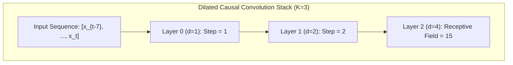

#### d. Code Thực chiến (C++ & Python)
```cpp
// C++17: Dilated 1D Convolution Step
void dilated_conv1d_step(const float* x, const float* filter, float* out, 
                         int t, int K, int dilation) {
    float sum = 0.0f;
    for (int k = 0; k < K; ++k) {
        int idx = t - k * dilation;
        if (idx >= 0) {
            sum += filter[k] * x[idx];
        }
    }
    out[t] = sum;
}
```

```python
import torch
import torch.nn as nn

class TemporalBlock(nn.Module):
    def __init__(self, in_channels: int, out_channels: int, kernel_size: int, dilation: int):
        super().__init__()
        self.padding = (kernel_size - 1) * dilation
        self.conv = nn.Conv1d(in_channels, out_channels, kernel_size, 
                              padding=self.padding, dilation=dilation)
        self.relu = nn.ReLU()
        self.residual = nn.Conv1d(in_channels, out_channels, 1) if in_channels != out_channels else nn.Identity()

    def forward(self, x: torch.Tensor) -> torch.Tensor:
        # Chording causal: Cắt bỏ phần padding ở tương lai bên phải
        out = self.conv(x)
        out = out[:, :, :-self.padding] if self.padding > 0 else out
        return self.relu(out + self.residual(x))
```

#### e. Lỗi Thường gặp & Ổn định Số học
- Dùng `padding="same"` mặc định của PyTorch Conv1d: Sẽ đệm đều ở cả hai đầu trái và phải, vi phạm tính nhân quả (nhìn thấy tương lai).

#### f. Ứng dụng Thực chiến trong AI
- Nhận diện hành vi con người từ cảm biến IMU, dự báo phụ tải điện, và phát hiện bất thường tài chính.

---

### 24. WaveNet

#### a. Định nghĩa Bản chất Toán học
**WaveNet** (van den Oord et al., DeepMind 2016) là kiến trúc tạo sinh tự hồi quy sinh sóng âm thanh thô (Raw Audio) chân thực ở tần số 16,000 mẫu/giây (16kHz).
Kiến trúc cốt lõi:
1. Xếp chồng các khối Dilated Causal Convolutions với dilation lặp chu kỳ:
   $$d \in \{1, 2, 4, 8, \dots, 512, 1, 2, 4, \dots, 512\}$$
2. **Gated Activation Units**: Lấy cảm hứng từ cổng của LSTM:
   $$\mathbf{z} = \tanh(\mathbf{W}_{f, k} * \mathbf{x}) \odot \sigma(\mathbf{W}_{g, k} * \mathbf{x})$$
   (Nhánh $\tanh$ đóng vai trò bộ lọc thông tin, nhánh sigmoid $\sigma$ đóng vai trò cổng đóng mở).
3. **$\mu$-law Companding Transformation**: Lượng tử hóa biên độ sóng âm từ 16-bit liên tục về 8-bit rời rạc (256 bins) phi tuyến tính:
   $$F(x) = \text{sign}(x) \frac{\ln(1 + \mu |x|)}{\ln(1 + \mu)}, \quad \text{với } \mu = 255$$

#### b. Cơ chế Tầng Sâu & Điện toán
- Khi huấn luyện: Cực nhanh vì tính toán song song toàn bộ âm thanh cùng lúc.
- Khi suy luận: Ban đầu rất chậm vì phải sinh từng mẫu âm thanh một ($16,000$ bước forward mỗi giây). Sau này được tăng tốc hàng nghìn lần nhờ Fast WaveNet (lưu trữ bộ đệm tròn FIFO trên GPU).

#### c. Sơ đồ Minh họa
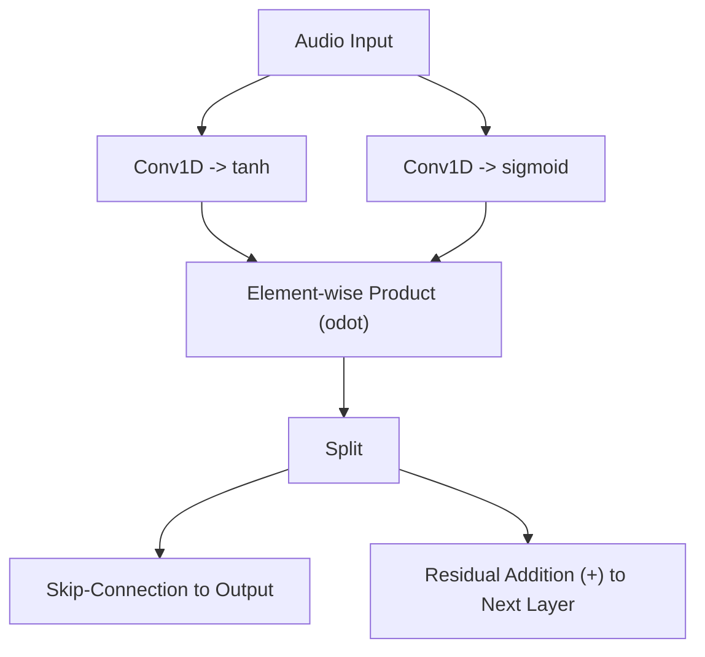

#### d. Code Thực chiến (C++ & Python)
```cpp
// C++17: mu-law Companding Transform
#include <cmath>

int mu_law_encode(float x, int mu = 255) {
    x = std::max(-1.0f, std::min(1.0f, x));
    float sign = (x >= 0.0f) ? 1.0f : -1.0f;
    float magnitude = std::log(1.0f + mu * std::abs(x)) / std::log(1.0f + mu);
    return static_cast<int>((sign * magnitude + 1.0f) * 0.5f * mu + 0.5f);
}
```

```python
import torch
import torch.nn as nn

class WaveNetResidualBlock(nn.Module):
    def __init__(self, channels: int, dilation: int):
        super().__init__()
        self.conv_filter = nn.Conv1d(channels, channels, kernel_size=2, dilation=dilation, padding=dilation)
        self.conv_gate = nn.Conv1d(channels, channels, kernel_size=2, dilation=dilation, padding=dilation)
        self.proj_res = nn.Conv1d(channels, channels, 1)
        self.proj_skip = nn.Conv1d(channels, channels, 1)

    def forward(self, x: torch.Tensor) -> tuple[torch.Tensor, torch.Tensor]:
        # Causal slicing
        filt = torch.tanh(self.conv_filter(x)[:, :, :-self.conv_filter.dilation[0]])
        gate = torch.sigmoid(self.conv_gate(x)[:, :, :-self.conv_gate.dilation[0]])
        z = filt * gate
        res = self.proj_res(z) + x
        skip = self.proj_skip(z)
        return res, skip
```

#### e. Lỗi Thường gặp & Ổn định Số học
- Kích thước Receptive Field không đủ bao trùm ngữ cảnh âm vị (Phoneme Duration): Âm thanh sinh ra sẽ bị ồm và mất kiểm soát ngữ điệu.

#### f. Ứng dụng Thực chiến trong AI
- Xương sống của **Google Assistant Text-to-Speech (TTS)** chất lượng cao.

---

### 25. DeepAR

#### a. Định nghĩa Bản chất Toán học
**DeepAR** (Salinas et al., Amazon Research 2020) là mô hình dự báo xác suất tự hồi quy (Probabilistic Autoregressive Model) dựa trên mạng tuần tự RNN (LSTM/GRU), được thiết kế để học chung trên **hàng triệu chuỗi thời gian liên quan**:
Mô hình ước lượng phân phối có điều kiện:
$$P(\mathbf{y}_{i, t:T} \mid \mathbf{y}_{i, 1:t-1}, \mathbf{x}_{i, 1:T}) = \prod_{\tau=t}^T P(y_{i, \tau} \mid \mathbf{h}_{i, \tau})$$
Trạng thái ẩn cập nhật tuần tự:
$$\mathbf{h}_{i, t} = \text{LSTM}(\mathbf{h}_{i, t-1}, [y_{i, t-1}; \mathbf{x}_{i, t}])$$
Thay vì trực tiếp dự báo giá trị $y_t$, mạng nơ-ron dự báo **các tham số của một phân phối xác suất $\theta_t = (\mu_t, \sigma_t)$**:
$$\mu_t = \mathbf{w}_{\mu}^T \mathbf{h}_t + b_\mu, \quad \sigma_t = \text{softplus}(\mathbf{w}_{\sigma}^T \mathbf{h}_t + b_\sigma)$$
(Sử dụng phân phối Gaussian cho dữ liệu thực hoặc Phân phối Nhị thức Âm - Negative Binomial cho dữ liệu đếm số lượng hàng hóa).

#### b. Cơ chế Tầng Sâu & Điện toán
- **Item-based Scaling Factor**: Chia chuỗi cho hệ số tỉ lệ $\nu_i = 1 + \frac{1}{t-1} \sum_{\tau=1}^{t-1} y_{i, \tau}$ giúp mô hình huấn luyện ổn định trên các mặt hàng có quy mô doanh số chênh lệch nhau hàng triệu lần.
- Dự báo khoảng tin cậy (Prediction Intervals) thông qua mô phỏng Monte Carlo đa đường đi.

#### c. Sơ đồ Minh họa
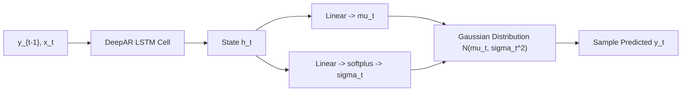

#### d. Code Thực chiến (C++ & Python)
```python
import torch
import torch.nn as nn
import torch.nn.functional as F

class DeepARHead(nn.Module):
    def __init__(self, hidden_dim: int):
        super().__init__()
        self.mu_layer = nn.Linear(hidden_dim, 1)
        self.sigma_layer = nn.Linear(hidden_dim, 1)

    def forward(self, h: torch.Tensor) -> tuple[torch.Tensor, torch.Tensor]:
        mu = self.mu_layer(h)
        sigma = F.softplus(self.sigma_layer(h)) + 1e-4 # Tránh sigma = 0
        return mu, sigma

def gaussian_nll_loss(y_true: torch.Tensor, mu: torch.Tensor, sigma: torch.Tensor) -> torch.Tensor:
    # Negative Log-Likelihood Loss
    return (torch.log(sigma) + 0.5 * ((y_true - mu) / sigma)**2).mean()
```

#### e. Lỗi Thường gặp & Ổn định Số học
- Dự báo Monte Carlo quá ít mẫu: Ước lượng phân vị $P_{10}$ và $P_{90}$ bị nhiễu động lớn (cần ít nhất 100 đến 500 mẫu mô phỏng).

#### f. Ứng dụng Thực chiến trong AI
- Quản lý chuỗi cung ứng khổng lồ của **Amazon Web Services (SageMaker DeepAR)**.

---

### 26. N-BEATS (Neural Basis Expansion Analysis for Interpretable Time Series)

#### a. Định nghĩa Bản chất Toán học
**N-BEATS** (Oreshkin et al., Element AI / NeurIPS 2020) tạo nên cú sốc lớn khi chứng minh rằng một mạng **MLP thuần túy sâu (Pure Deep MLP)** không dùng bất kỳ một tầng Recurrent hay Convolutional nào có thể đánh bại mọi mô hình học máy phức tạp trên benchmark M4.

Hai phát minh kiến trúc mang tính cách mạng:
1. **Doubly Residual Stacking (Xếp chồng Phần dư Kép)**: Mỗi khối (Block) $l$ nhận đầu vào $\mathbf{x}_l$, dự đoán ngược về quá khứ (Backcast $\hat{\mathbf{x}}_l$) và dự đoán tới tương lai (Forecast $\hat{\mathbf{y}}_l$):
   $$\mathbf{x}_l = \mathbf{x}_{l-1} - \hat{\mathbf{x}}_{l-1}$$
   Khối sau chỉ nhận phần dư sai số mà các khối trước chưa giải quyết được!
   Tổng dự báo tương lai là tổng đầu ra forecast của toàn bộ các khối:
   $$\hat{\mathbf{y}} = \sum_l \hat{\mathbf{y}}_l$$
2. **Interpretable Basis Expansion (Khai triển Cơ sở Diễn giải được)**:
   - *Khối Xu hướng (Trend Block)*: Ràng buộc hàm cơ sở là đa thức bậc nhỏ:
     $$\hat{\mathbf{y}}_t = \sum_{p=0}^P \theta_p t^p$$
   - *Khối Mùa vụ (Seasonality Block)*: Ràng buộc hàm cơ sở là chuỗi sóng Fourier:
     $$\hat{\mathbf{y}}_t = \sum_{k=0}^K a_k \cos(2\pi k t / P) + b_k \sin(2\pi k t / P)$$

#### b. Cơ chế Tầng Sâu & Điện toán
- Toàn bộ mạng chỉ bao gồm các phép nhân ma trận Dense GEMM, tận dụng $100\%$ công suất phần cứng GPU với thời gian huấn luyện nhanh hơn RNN hàng chục lần.

#### c. Sơ đồ Minh họa
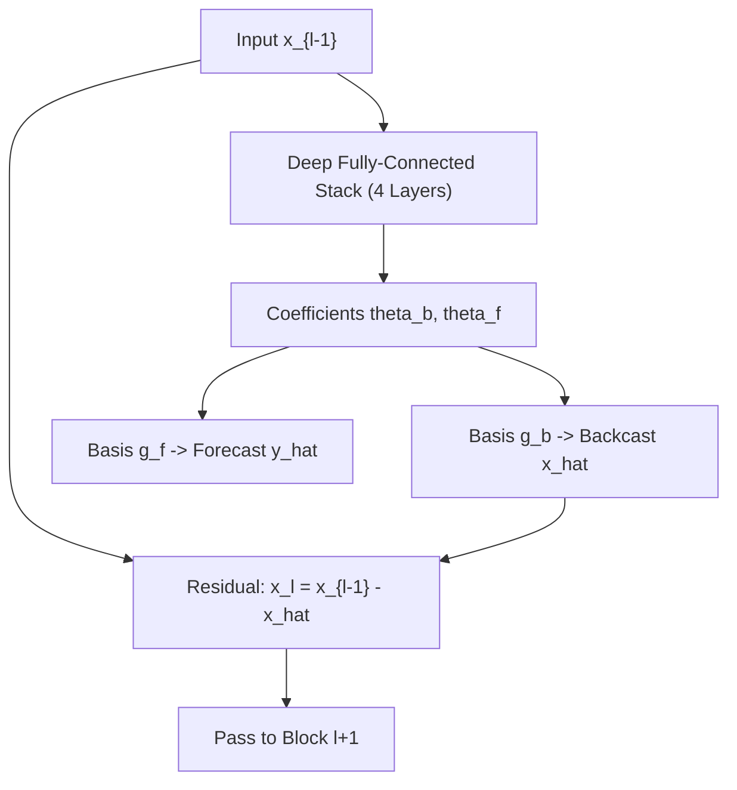

#### d. Code Thực chiến (C++ & Python)
```python
import torch
import torch.nn as nn

class NBeatsBlock(nn.Module):
    def __init__(self, lookback_len: int, horizon_len: int, hidden_dim: int = 256):
        super().__init__()
        self.fc = nn.Sequential(
            nn.Linear(lookback_len, hidden_dim), nn.ReLU(),
            nn.Linear(hidden_dim, hidden_dim), nn.ReLU(),
            nn.Linear(hidden_dim, hidden_dim), nn.ReLU(),
            nn.Linear(hidden_dim, hidden_dim), nn.ReLU()
        )
        self.theta_b = nn.Linear(hidden_dim, lookback_len)
        self.theta_f = nn.Linear(hidden_dim, horizon_len)

    def forward(self, x: torch.Tensor) -> tuple[torch.Tensor, torch.Tensor]:
        h = self.fc(x)
        backcast = self.theta_b(h)
        forecast = self.theta_f(h)
        return x - backcast, forecast # Trả về residual x_new và forecast
```

#### e. Lỗi Thường gặp & Ổn định Số học
- Kích thước cửa sổ Lookback quá ngắn ($< 2 \times \text{Horizon}$): N-BEATS đòi hỏi cửa sổ nhìn lại đủ dài (thường $3\times$ đến $7\times$ horizon) để trích xuất hệ số cơ sở chuẩn xác.

#### f. Ứng dụng Thực chiến trong AI
- Tiêu chuẩn công nghiệp cho dự báo tài chính, chuỗi bán lẻ M4/M5 benchmark.

---

### 27. N-HiTS (Neural Hierarchical Interpolation for Time Series)

#### a. Định nghĩa Bản chất Toán học
**N-HiTS** (Challu et al., 2023) nâng cấp N-BEATS để giải quyết các chân trời dự báo siêu dài (Long-Horizon Forecasting):
- **Phân cấp Tần số Đa tỷ lệ (Multi-Rate Data Sampling)**: Mỗi khối trong N-HiTS chỉ nhìn dữ liệu ở một tỷ lệ lấy mẫu nhất định thông qua cơ chế Max Pooling với kích thước cửa sổ khác nhau (Khối 1: Lấy mẫu thưa tần số thấp; Khối 2: Lấy mẫu trung bình; Khối 3: Lấy mẫu đầy đủ tần số cao).
- **Hierarchical Interpolation**: Dự đoán ở thang đo thời gian thô rồi áp dụng phép nội suy phi tuyến tính để khôi phục về độ phân giải ban đầu.

#### b. Cơ chế Tầng Sâu & Điện toán
- Giảm số lượng tham số và bộ nhớ tính toán tới **$50\times$** so với N-BEATS và Transformer, đồng thời cải thiện độ chính xác dự báo dài hạn lên hơn $20\%$.

#### c. Sơ đồ Minh họa
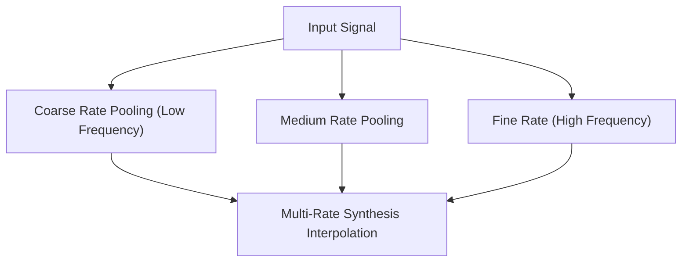

#### d. Code Thực chiến (C++ & Python)
```python
import torch.nn.functional as F

def multi_rate_subsample(x: torch.Tensor, pool_factor: int) -> torch.Tensor:
    # x: [B, Lookback]
    if pool_factor > 1:
        return F.max_pool1d(x.unsqueeze(1), kernel_size=pool_factor, stride=pool_factor).squeeze(1)
    return x
```

#### e. Lỗi Thường gặp & Ổn định Số học
- Hệ số pooling quá thô làm mất các đỉnh nhọn đột biến (Spikes) trong dữ liệu cảm biến công nghiệp.

#### f. Ứng dụng Thực chiến trong AI
- Dự báo dài hạn lưu lượng truy cập mạng và biến động thời tiết.

---

### 28. Temporal Fusion Transformer (TFT)

#### a. Định nghĩa Bản chất Toán học
**Temporal Fusion Transformer** (Lim et al., Google / Oxford, 2021) là một trong những kiến trúc dự báo toàn diện và phức tạp nhất, được thiết kế chuyên biệt để xử lý các nguồn dữ liệu không đồng nhất:
1. **Static Metadata**: Thông tin tĩnh không đổi (ID cửa hàng, vị trí địa lý).
2. **Known Future Inputs**: Các biến số tương lai đã biết trước (Ngày trong tuần, lịch nghỉ lễ, kế hoạch khuyến mãi).
3. **Observed Past Inputs**: Các biến quan sát trong quá khứ chỉ biết tới thời điểm hiện tại.

Các thành phần kiến trúc cốt lõi:
- **Variable Selection Networks (VSN)**: Tự động học trọng số và chọn lọc xem biến số nào quan trọng nhất tại mỗi thời điểm, loại bỏ nhiễu.
- **Gated Residual Networks (GRN)**: Khối phi tuyến tính có cơ chế cổng đóng mở linh hoạt cho phép bỏ qua các tầng không cần thiết.
- **Interpretable Multi-Head Attention**: Cơ chế Attention chia sẻ chung trọng số trên các đầu để cung cấp khả năng giải thích được (Explainability: trực quan hóa xem mô hình đang chú ý vào ngày nào trong quá khứ).

#### b. Cơ chế Tầng Sâu & Điện toán
- Kết hợp xử lý chuỗi cục bộ qua LSTM Sequence-to-Sequence với khả năng kết nối tầm xa của Self-Attention.
- Sinh ra trực tiếp các phân vị xác suất (Quantiles: $10\%, 50\%, 90\%$) qua hàm mất mát Quantile Loss.

#### c. Sơ đồ Minh họa
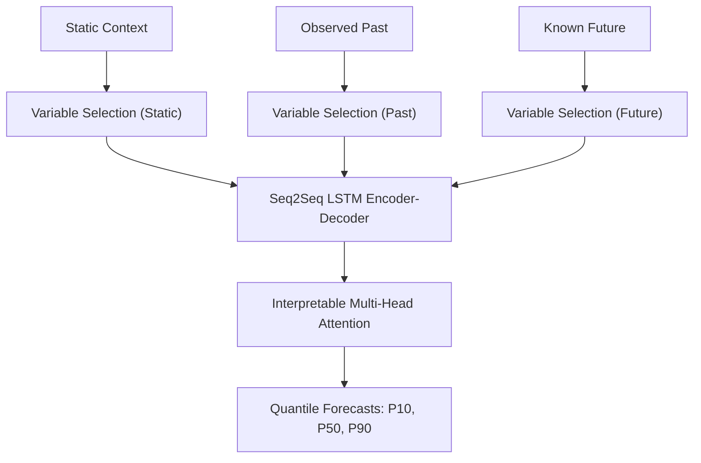

#### d. Code Thực chiến (C++ & Python)
```python
import torch
import torch.nn as nn

class GatedResidualNetwork(nn.Module):
    def __init__(self, dim: int):
        super().__init__()
        self.fc1 = nn.Linear(dim, dim)
        self.fc2 = nn.Linear(dim, dim)
        self.gate = nn.Linear(dim, dim)
        self.norm = nn.LayerNorm(dim)

    def forward(self, x: torch.Tensor) -> torch.Tensor:
        # GLU gating mechanism
        h = torch.relu(self.fc1(x))
        h = self.fc2(h)
        gated = torch.sigmoid(self.gate(x)) * h
        return self.norm(x + gated)
```

#### e. Lỗi Thường gặp & Ổn định Số học
- Thời gian huấn luyện tương đối lâu do kiến trúc cồng kềnh với nhiều mạng con VSN và GRN lồng nhau.

#### f. Ứng dụng Thực chiến trong AI
- Dự báo chuỗi bán lẻ đa chi nhánh, quản lý rủi ro ngân hàng và bảo hiểm.

---

### 29. Informer (Beyond Efficient Transformer for Long Sequence Time-Series)

#### a. Định nghĩa Bản chất Toán học
**Informer** (Zhou et al., AAAI 2021 - Best Paper Award) giải quyết nút thắt bậc hai của Transformer truyền thống trên chuỗi thời gian dài thông qua ba cải tiến:
1. **ProbSparse Self-Attention**:
   Nhận thấy rằng ma trận Attention của chuỗi thời gian cực kỳ thưa (chỉ một số ít Query thực sự quan trọng đóng góp vào việc phân tán phân phối Softmax).
   Informer đo lường mức độ "nổi bật" của Query $\mathbf{q}_i$ qua độ đo xấp xỉ KL Divergence:
   $$M(\mathbf{q}_i, \mathbf{K}) = \ln \sum_{j=1}^{L_K} \exp\left(\frac{\mathbf{q}_i \mathbf{k}_j^T}{\sqrt{d}}\right) - \frac{1}{L_K} \sum_{j=1}^{L_K} \frac{\mathbf{q}_i \mathbf{k}_j^T}{\sqrt{d}}$$
   Chỉ chọn ra $u = c \cdot \ln L_Q$ các Queries có điểm $M$ cao nhất để tính toán Attention đầy đủ, các queries còn lại chỉ nhận giá trị trung bình:
   $$\text{Độ phức tạp giảm từ } \mathcal{O}(L^2) \longrightarrow \mathcal{O}(L \ln L)$$
2. **Self-Attention Distilling**: Sử dụng tầng tích chập 1D kết hợp Max Pooling giữa các tầng để giảm một nửa chiều dài chuỗi sau mỗi tầng ($\frac{L}{2}$), giảm tiêu tốn bộ nhớ VRAM.
3. **Generative Direct Decoder**: Sinh toàn bộ chuỗi tương lai trong một bước forward pass duy nhất.

#### b. Cơ chế Tầng Sâu & Điện toán
- Mở đường cho cuộc đua ứng dụng Transformer vào bài toán dự báo chuỗi thời gian dài (Long-Sequence Time-Series Forecasting - LSTF).

#### c. Sơ đồ Minh họa
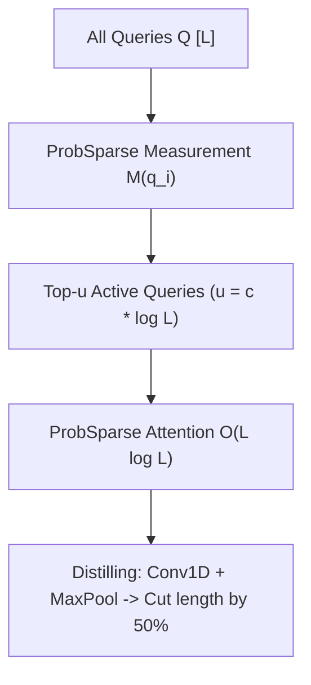

#### d. Code Thực chiến (C++ & Python)
```python
import torch

def sample_probsparse_queries(q: torch.Tensor, k: torch.Tensor, c: int = 5):
    # q: [B, H, L_Q, D], k: [B, H, L_K, D]
    L_Q = q.size(-2)
    L_K = k.size(-2)
    u = int(c * torch.log(torch.tensor(L_Q, dtype=torch.float)).item())
    # Lấy mẫu ngẫu nhiên một tập con của K để ước lượng điểm M
    sample_k_idx = torch.randint(0, L_K, (u,))
    k_sample = k[:, :, sample_k_idx, :]
    # Tính toán xấp xỉ độ phân cực...
    return u
```

#### e. Lỗi Thường gặp & Ổn định Số học
- Việc tính điểm $M(\mathbf{q}_i)$ vẫn đòi hỏi một phép lấy mẫu ngẫu nhiên trên GPU, nếu hệ số $c$ quá nhỏ sẽ bỏ sót các Queries quan trọng.

#### f. Ứng dụng Thực chiến trong AI
- Dự báo giao thông thông minh, phụ tải điện năng và nhiệt độ trung tâm dữ liệu.

---

### 30. Autoformer (Decomposition Transformers with Auto-Correlation)

#### a. Định nghĩa Bản chất Toán học
**Autoformer** (Wu et al., NeurIPS 2021) thay đổi tư duy thiết kế: Thay vì tính toán chú ý giữa từng điểm rời rạc (Point-wise Attention vốn dễ bị nhiễu che lấp), Autoformer tính toán **Độ tự tương quan ở cấp độ chuỗi con (Series-level Auto-Correlation)** dựa trên **Định lý Wiener-Khinchin**:
1. Áp dụng biến đổi Fourier nhanh (FFT) để tìm ra các chu kỳ tiềm ẩn (Lags $\tau_1, \dots, \tau_k$) có năng lượng tương quan cao nhất:
   $$\mathcal{R}_{XX}(\tau) = \lim_{L \to \infty} \frac{1}{L} \sum_{t=1}^L X_t X_{t-\tau} = \mathcal{F}^{-1}(\mathcal{F}(X) \cdot \mathcal{F}^*(X))$$
2. **Time Delay Aggregation**: Dịch chuyển chuỗi theo các độ trễ chu kỳ $\tau_i$ và tổng hợp thông tin có trọng số qua Softmax:
   $$\text{Auto-Correlation} = \sum_{i=1}^k \text{Softmax}(\mathcal{R}_{XX}(\tau_i)) \cdot \text{Roll}(X, \tau_i)$$
3. **Series Decomposition Block**: Tích hợp trực tiếp bộ lọc trung bình trượt vào giữa các tầng Transformer để phân rã liên tục thành phần Trend và Seasonality.

#### b. Cơ chế Tầng Sâu & Điện toán
- Độ phức tạp tính toán $\mathcal{O}(L \log L)$ nhờ thuật toán FFT (Fast Fourier Transform).
- Tách rời hoàn toàn tín hiệu xu hướng dài hạn khỏi các dao động chu kỳ cục bộ.

#### c. Sơ đồ Minh họa
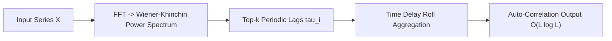

#### d. Code Thực chiến (C++ & Python)
```python
import torch

def auto_correlation_wiener_khinchin(x: torch.Tensor):
    # x: [B, L, D]
    L = x.size(1)
    # 1. FFT
    x_fft = torch.fft.rfft(x, dim=1)
    # 2. Power Spectrum: F(x) * conj(F(x))
    res = x_fft * torch.conj(x_fft)
    # 3. Inverse FFT -> Autocorrelation sequence
    corr = torch.fft.irfft(res, n=L, dim=1)
    return corr
```

#### e. Lỗi Thường gặp & Ổn định Số học
- Kém hiệu quả trên các chuỗi thời gian phi chu kỳ hoàn toàn (như giá chứng khoán ngẫu nhiên).

#### f. Ứng dụng Thực chiến trong AI
- Mô hình hàng đầu cho dự báo khí tượng thủy văn, lưu lượng gió và năng lượng mặt trời.

---

### 31. FEDformer (Frequency Enhanced Decomposed Transformer)

#### a. Định nghĩa Bản chất Toán học
**FEDformer** (Zhou et al., ICML 2022) đưa toàn bộ cơ chế tính toán Attention từ miền thời gian sang **Miền Tần số (Frequency Domain)**:
Nguyên lý: Phần lớn năng lượng và thông tin của chuỗi thời gian thực tập trung ở một số lượng rất nhỏ các thành phần tần số cơ sở (Compact Basis Representation).
FEDformer đề xuất hai cơ chế:
1. **Frequency Enhanced Block with Fourier Transform (FEBF)**: Lấy mẫu ngẫu nhiên $M$ thành phần tần số cơ sở ($M \ll L$), thực hiện phép nhân ma trận chéo trong miền tần số.
2. **Frequency Enhanced Block with Wavelet Transform (FEB-W)**: Sử dụng biến đổi Wavelet rời rạc (DWT) để nắm bắt cả đặc trưng tần số lẫn vị trí thời gian cục bộ.
Độ phức tạp tính toán đạt mức **Tuyến tính tuyệt đối $\mathcal{O}(L)$**!

#### b. Cơ chế Tầng Sâu & Điện toán
- Nhờ biểu diễn trong miền tần số, FEDformer loại bỏ hoàn toàn các thành phần nhiễu tần số cao, đạt độ bền vững số học vượt trội.

#### c. Sơ đồ Minh họa
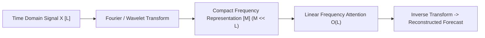

#### d. Code Thực chiến (C++ & Python)
```python
import torch

def fourier_frequency_selection(x: torch.Tensor, modes: int = 32):
    # x: [B, L, D]
    x_ft = torch.fft.rfft(x, dim=1)
    # Giữ lại 'modes' tần số đầu tiên có năng lượng lớn nhất
    out_ft = torch.zeros_like(x_ft)
    out_ft[:, :modes, :] = x_ft[:, :modes, :]
    x_reconstructed = torch.fft.irfft(out_ft, n=x.size(1), dim=1)
    return x_reconstructed
```

#### e. Lỗi Thường gặp & Ổn định Số học
- Cắt bỏ quá nhiều tần số cao (chọn $modes$ quá nhỏ) làm mịn quá mức các biến động cực đoan (Extreme Events).

#### f. Ứng dụng Thực chiến trong AI
- Dự báo nhu cầu vận tải logistic toàn cầu và thị trường chứng khoán.

---

### 32. PatchTST (Patch Time Series Transformer)

#### a. Định nghĩa Bản chất Toán học
**PatchTST** (Nie et al., ICLR 2023) là một trong những phát minh quan trọng nhất tái định nghĩa cách tiếp cận chuỗi thời gian:
Hai nguyên lý cốt lõi:
1. **Patching (Phân mảnh Chuỗi con)**:
   Thay vì coi mỗi điểm thời gian đơn lẻ $x_t$ là 1 token (dễ bị nhiễu và tốn bộ nhớ), PatchTST nhóm $P$ điểm thời gian liên tiếp thành một **Mảnh chuỗi con (Patch)** có bước nhảy $S$:
   $$N = \left\lfloor \frac{L - P}{S} \right\rfloor + 2$$
   Mỗi patch được chiếu tuyến tính thành một vector token embedding.
   Lợi ích kép:
   - Nắm bắt ngữ nghĩa cục bộ (Local Semantic Patterns) tương tự như từ trong câu.
   - **Giảm số lượng token từ $L$ xuống $N \approx L / S$**, làm giảm độ phức tạp Attention bậc hai tới **$S^2$ lần** (ví dụ $S = 8$, giảm $64\times$ FLOPs và bộ nhớ!).
2. **Channel-Independent Architecture (Độc lập Kênh)**:
   Mọi biến số trong chuỗi đa biến đều được nạp độc lập qua cùng một khối Transformer chia sẻ trọng số.

#### b. Cơ chế Tầng Sâu & Điện toán
- Đè bẹp hoàn toàn các Transformer phức tạp trước đó (Informer, Autoformer) trên toàn bộ 8 bộ dữ liệu benchmark chuẩn, vượt qua cả mô hình tuyến tính DLinear.

#### c. Sơ đồ Minh họa
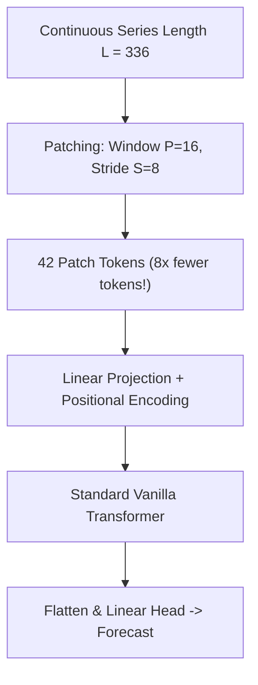

#### d. Code Thực chiến (C++ & Python)
```cpp
// C++17: Patching Extraction Logic
#include <vector>

std::vector<std::vector<float>> extract_patches(const std::vector<float>& series, 
                                                int P, int S) {
    std::vector<std::vector<float>> patches;
    int len = series.size();
    for (int i = 0; i <= len - P; i += S) {
        std::vector<float> patch(series.begin() + i, series.begin() + i + P);
        patches.push_back(patch);
    }
    return patches;
}
```

```python
import torch
import torch.nn as nn

class PatchTSTEmbedding(nn.Module):
    def __init__(self, patch_len: int = 16, stride: int = 8, d_model: int = 128):
        super().__init__()
        self.patch_len = patch_len
        self.stride = stride
        self.proj = nn.Linear(patch_len, d_model)

    def forward(self, x: torch.Tensor) -> torch.Tensor:
        # x: [B, Lookback] (Channel-Independent)
        patches = x.unfold(dimension=-1, size=self.patch_len, step=self.stride) # [B, NumPatches, PatchLen]
        return self.proj(patches) # [B, NumPatches, d_model]
```

#### e. Lỗi Thường gặp & Ổn định Số học
- Chọn Stride $S$ quá lớn làm mất tính liên tục giữa các patch liền kề.

#### f. Ứng dụng Thực chiến trong AI
- Mô hình Transformer mạnh nhất cho bài toán dự báo chuỗi thời gian dài hạn hiện nay.

---

### 33. iTransformer (Inverted Transformer)

#### a. Định nghĩa Bản chất Toán học
**iTransformer** (Liu et al., ICLR 2024 Spotlight) chỉ ra một nghịch lý lớn: Trong các Transformer chuỗi thời gian truyền thống, người ta coi các bước thời gian $t$ là token và các biến số là kênh. Nhưng trong chuỗi thời gian đa biến, các điểm thời gian cùng mốc thường xảy ra đồng thời và không có nhiều tương tác chéo, trong khi **sự tương quan giữa các biến số (Variates)** mới là yếu tố quyết định!

**Ý tưởng Đảo ngược (Inverted Architecture)**:
- **Đảo ngược Token**: Coi **toàn bộ lịch sử chuỗi thời gian của một biến số** $X_{:, m} \in \mathbb{R}^T$ như **MỘT TOKEN DUY NHẤT**!
- Nếu có $M$ biến số, ta có đúng $M$ tokens:
  $$\mathbf{H} \in \mathbb{R}^{M \times d_{\text{model}}}$$
- **Self-Attention được áp dụng trên chiều Biến số (Across Variates)**: Mô hình hóa mối tương quan đa biến phức tạp.
- **FFN được áp dụng trên chiều Thời gian (Across Time)**: Học các đặc trưng biểu diễn thời gian cho từng biến.

#### b. Cơ chế Tầng Sâu & Điện toán
- Số lượng token là $M$ (số biến), hoàn toàn không phụ thuộc vào độ dài chuỗi $T$! Cho phép mở rộng chiều dài nhìn lại (Lookback Window) lên hàng nghìn bước mà chi phí Attention không hề tăng.

#### c. Sơ đồ Minh họa
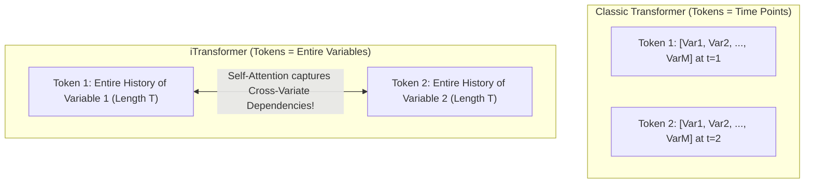

#### d. Code Thực chiến (C++ & Python)
```python
import torch
import torch.nn as nn

class InvertedTransformerBackbone(nn.Module):
    def __init__(self, lookback_len: int, horizon_len: int, num_variates: int, d_model: int = 128):
        super().__init__()
        # Chiếu chiều thời gian T thành d_model
        self.enc_embedding = nn.Linear(lookback_len, d_model)
        self.attention = nn.MultiheadAttention(d_model, num_heads=8, batch_first=True)
        self.proj_out = nn.Linear(d_model, horizon_len)

    def forward(self, x: torch.Tensor) -> torch.Tensor:
        # x: [B, Lookback, M]
        x_inv = x.transpose(1, 2) # [B, M, Lookback] -> M tokens!
        tokens = self.enc_embedding(x_inv) # [B, M, d_model]
        attn_out, _ = self.attention(tokens, tokens, tokens)
        out = self.proj_out(attn_out) # [B, M, Horizon]
        return out.transpose(1, 2) # [B, Horizon, M]
```

#### e. Lỗi Thường gặp & Ổn định Số học
- Dùng iTransformer cho bài toán chỉ có 1 biến số ($M = 1$): Mô hình chỉ có đúng 1 token, làm cơ chế Self-Attention trở nên vô nghĩa.

#### f. Ứng dụng Thực chiến trong AI
- Kiến trúc SOTA thế hệ mới cho dữ liệu đa cảm biến (Multivariate Sensor Monitoring).

---

### 34. TimesNet (Temporal 2D-Variation Modeling)

#### a. Định nghĩa Bản chất Toán học
**TimesNet** (Wu et al., ICLR 2023) tiếp cận chuỗi thời gian dưới góc độ hình học 2D:
Mọi chuỗi thời gian đều bao gồm hai loại biến thiên đồng thời:
1. **Intra-period Variation (Biến thiên trong chu kỳ)**: Các biến động ngắn hạn tức thời trong từng chu kỳ.
2. **Inter-period Variation (Biến thiên giữa các chu kỳ)**: Xu hướng chuyển dịch dài hạn giữa các chu kỳ khác nhau.

Quy trình TimesNet:
1. Sử dụng FFT để tìm ra Top-$k$ chu kỳ nổi bật nhất $\{p_1, \dots, p_k\}$.
2. **Biến đổi 1D thành 2D (1D-to-2D Transformation)**: Gấp (reshape) chuỗi 1D độ dài $T$ thành một tensor 2D kích thước $\frac{T}{p_i} \times p_i$.
3. Áp dụng mạng tích chập 2D **TimesBlock (Inception 2D Convolutions)** để nắm bắt đồng thời cả hai loại biến thiên không-thời gian.
4. Trải phẳng và tổng hợp đầu ra có trọng số từ $k$ chu kỳ.

#### b. Cơ chế Tầng Sâu & Điện toán
- Tận dụng sức mạnh tối đa của các GPU kernel tích chập 2D (cuDNN 2D Convolutions) đã được tối ưu hóa hàng thập kỷ trong xử lý ảnh.

#### c. Sơ đồ Minh họa
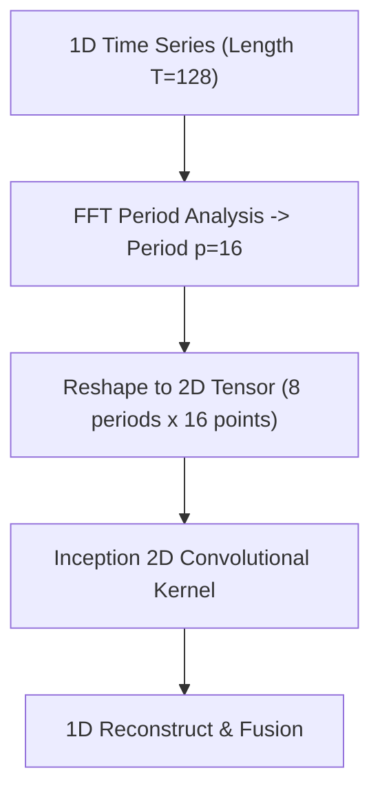

#### d. Code Thực chiến (C++ & Python)
```python
import torch
import torch.nn as nn

def fold_1d_to_2d(x: torch.Tensor, period: int):
    # x: [B, T, D]
    B, T, D = x.shape
    num_periods = T // period
    # [B, D, num_periods, period]
    return x[:, :num_periods * period, :].permute(0, 2, 1).view(B, D, num_periods, period)
```

#### e. Lỗi Thường gặp & Ổn định Số học
- Chuỗi thời gian hoàn toàn không có chu kỳ rõ ràng sẽ khiến kết quả gập 2D tạo ra các biên giả nhân tạo (Artificial Boundary Artifacts).

#### f. Ứng dụng Thực chiến trong AI
- Mô hình vạn năng đạt điểm cao đồng thời trên 5 bài toán: Short/Long Forecasting, Imputation, Classification, Anomaly Detection.

---

### 35. Chronos (Pretrained Time Series Foundation Model)

#### a. Định nghĩa Bản chất Toán học
**Chronos** (Ansari et al., Amazon Research, 2024) đưa mô hình ngôn ngữ lớn vào lĩnh vực chuỗi thời gian thông qua cơ chế **Token hóa Số thực (Real-valued Tokenization)**:
Quy trình:
1. **Scaling**: Chuẩn hóa chuỗi bằng Mean-Absolute Scaling: $\tilde{x}_t = \frac{x_t}{\frac{1}{L} \sum |x_i|}$.
2. **Quantization & Binning**: Chia miền giá trị liên tục thành $B$ khoảng cố định (ví dụ $B = 4096$ bins đều nhau). Mỗi giá trị số thực được ánh xạ thành một Token ID rời rạc trong từ điển:
   $$x_t \in \mathbb{R} \longrightarrow \text{TokenID}_t \in \{0, \dots, B-1\}$$
3. **Huấn luyện Mô hình Ngôn ngữ Tiêu chuẩn**: Sử dụng kiến trúc Transformer Decoder chuẩn (như T5 hoặc LLaMA) và huấn luyện bằng hàm mất mát **Cross-Entropy Loss** thông thường để dự đoán Token tiếp theo (Next Token Prediction)!

#### b. Cơ chế Tầng Sâu & Điện toán
- Được huấn luyện trước trên hàng tỷ chuỗi thời gian thực tế kết hợp với dữ liệu tổng hợp từ các quá trình Gaussian (Synthetic Random Walks).
- **Khả năng Dự báo Zero-shot phi thường**: Có thể nạp vào một chuỗi thời gian bất kỳ và dự báo chính xác ngay lập tức mà hoàn toàn không cần huấn luyện lại hay tinh chỉnh tham số!

#### c. Sơ đồ Minh họa
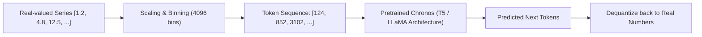

#### d. Code Thực chiến (C++ & Python)
```cpp
// C++17: Uniform Binning Quantization cho Chronos
int quantize_to_bin(float value, float min_val, float max_val, int num_bins) {
    if (value <= min_val) return 0;
    if (value >= max_val) return num_bins - 1;
    float ratio = (value - min_val) / (max_val - min_val);
    return static_cast<int>(ratio * num_bins);
}
```

```python
# Sử dụng Chronos Zero-Shot Pipeline (Amazon)
# from chronos import ChronosPipeline

# pipeline = ChronosPipeline.from_pretrained("amazon/chronos-t5-small", device_map="cuda")
# forecast = pipeline.predict(context_tensor, prediction_length=24)
```

#### e. Lỗi Thường gặp & Ổn định Số học
- Sự mất mát độ chính xác do làm tròn số (Quantization Error): Nếu số lượng bin quá nhỏ ($< 256$), các dao động biên độ nhỏ sẽ bị biến thành hằng số.

#### f. Ứng dụng Thực chiến trong AI
- Kỷ nguyên mới của Foundation Models cho chuỗi thời gian doanh nghiệp.

---

### 36. Lag-Llama

#### a. Định nghĩa Bản chất Toán học
**Lag-Llama** (Rasul et al., Morgan Stanley / Mila, 2024) là mô hình nền tảng dự báo chuỗi thời gian xác suất mở đầu tiên dựa trên kiến trúc **LLaMA**:
- **Lag Features Input**: Thay vì token hóa số thực thành chuỗi rời rạc như Chronos, Lag-Llama giữ nguyên giá trị số thực liên tục và bổ sung một tập hợp các đặc trưng trễ phong phú (Lagged values) tương ứng với các chu kỳ mùa vụ chuẩn:
  $$\text{Lags} = \{1, 2, \dots, 7, 24, 168, 365, \dots\}$$
- **Decoder-Only Transformer**: Sử dụng các tầng Transformer chuẩn với RMSNorm, SwiGLU và RoPE.
- **Student-t Distribution Output Head**: Dự đoán các tham số $(\mu_t, \sigma_t, \nu_t)$ của phân phối Student-t (với $\nu$ là bậc tự do) để chống chịu tốt trước các giá trị ngoại lai có đuôi phân phối dày (Heavy-tailed distribution).

#### b. Cơ chế Tầng Sâu & Điện toán
- Hỗ trợ đánh giá độ bất định (Uncertainty Quantification) chính xác cao thông qua việc lấy mẫu xác suất từ phân phối Student-t.

#### c. Sơ đồ Minh họa
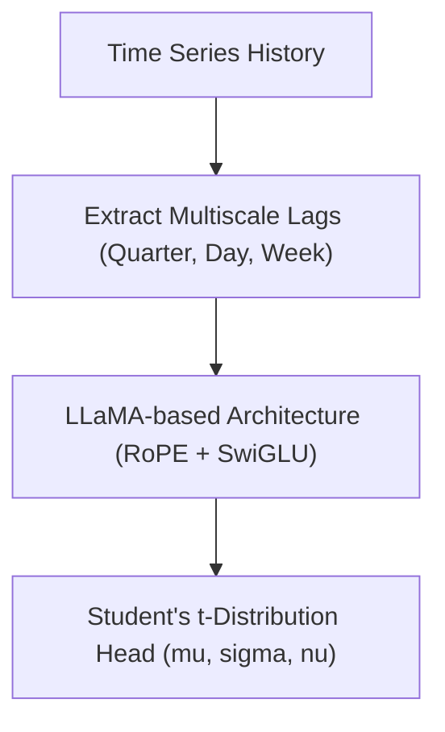

#### d. Code Thực chiến (C++ & Python)
```python
import torch

def student_t_nll_loss(y: torch.Tensor, mu: torch.Tensor, sigma: torch.Tensor, df: torch.Tensor):
    # Hàm mất mát Negative Log-Likelihood của phân phối Student-t
    dist = torch.distributions.StudentT(df=df, loc=mu, scale=sigma)
    return -dist.log_prob(y).mean()
```

#### e. Lỗi Thường gặp & Ổn định Số học
- Tham số bậc tự do $\nu \le 2$ khiến phương sai của phân phối tiến ra vô cực, gây mất ổn định số học trong quá trình tối ưu gradient descent.

#### f. Ứng dụng Thực chiến trong AI
- Dự báo rủi ro danh mục tài chính (Value-at-Risk - VaR) và tối ưu hóa vận tải.

---

### 37. Time-Series Transformers (Bộ Chuyển đổi Dành cho Chuỗi Thời gian)

#### a. Định nghĩa Bản chất Toán học
**Time-Series Transformers** là trường phái nghiên cứu áp dụng cơ chế Self-Attention vào dữ liệu chuỗi liên tục.
Không gian thiết kế (Design Space) bao gồm hai trục quyết định:
1. **Tokenization Space**:
   - *Point-wise*: Mỗi điểm thời gian là 1 token (Informer, Autoformer).
   - *Sub-series / Patch-wise*: Nhóm các đoạn thời gian liên tiếp thành 1 token (PatchTST).
2. **Channel Dependency**:
   - *Channel-Dependent (CD)*: Tính attention trộn lẫn cả biến số và thời gian (dễ bị overfitting khi số biến lớn).
   - *Channel-Independent (CI)*: Tách riêng từng kênh biến số xử lý độc lập qua cùng một backbone (PatchTST chứng minh vượt trội trên đa số benchmark).

#### b. Cơ chế Tầng Sâu & Điện toán
- Loại bỏ inductive bias cục bộ của RNN/CNN, cho phép mô hình trực tiếp kết nối bất kỳ hai thời điểm nào trong lịch sử với chi phí đường truyền $\mathcal{O}(1)$.

#### c. Sơ đồ Minh họa
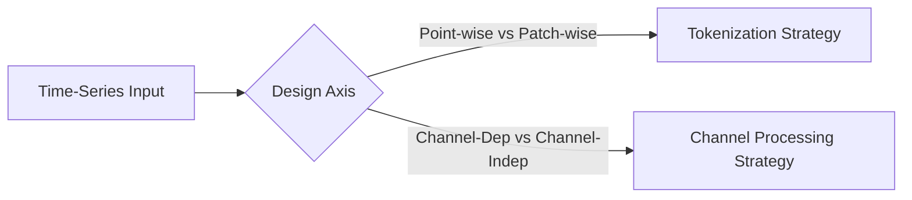

#### d. Code Thực chiến (C++ & Python)
```python
# Khung Channel-Independent wrapper
class ChannelIndependentWrapper(torch.nn.Module):
    def __init__(self, backbone):
        super().__init__()
        self.backbone = backbone

    def forward(self, x):
        # x: [B, L, M]
        B, L, M = x.shape
        x_perm = x.permute(0, 2, 1).reshape(B * M, L) # Đưa M vào chiều Batch!
        out = self.backbone(x_perm)
        return out.view(B, M, -1).permute(0, 2, 1)
```

#### e. Lỗi Thường gặp & Ổn định Số học
- Bỏ qua phép chuẩn hóa cục bộ (RevIN - Reversible Instance Normalization): Phân phối dữ liệu bị trôi (Distribution Drift) giữa tập train và test làm giảm sút nghiêm trọng độ chính xác của Transformer.

#### f. Ứng dụng Thực chiến trong AI
- Nền tảng học sâu chủ đạo cho nghiên cứu chuỗi thời gian giai đoạn 2020–2024.

---

### 38. Sequence Classification (Phân loại Chuỗi)

#### a. Định nghĩa Bản chất Toán học
**Sequence Classification** ánh xạ toàn bộ một chuỗi đầu vào $\mathbf{X} = (\mathbf{x}_1, \dots, \mathbf{x}_T)$ thành một nhãn phân loại đơn lẻ $y \in \{1, \dots, C\}$:
$$P(y = c \mid \mathbf{X}) = \text{Softmax}(\mathbf{W}_c \cdot \text{Pooling}(f_\theta(\mathbf{X})))$$
Ví dụ:
- Phân loại điện tâm đồ (ECG): Chuỗi nhịp tim $\to$ {Bình thường, Loạn nhịp tim, Thiếu máu cơ tim}.
- Nhận diện hành vi con người (HAR): Dữ liệu gia tốc kế điện thoại $\to$ {Đi bộ, Chạy, Leo cầu thang, Nằm}.

#### b. Cơ chế Tầng Sâu & Điện toán
- Kết hợp Global Average Pooling (GAP) hoặc token đặc biệt `[CLS]` ở cuối mạng để nén toàn bộ chuỗi thành một vector đặc trưng duy nhất trước khi đưa vào classifier.

#### c. Sơ đồ Minh họa


#### d. Code Thực chiến (C++ & Python)
```python
import torch
import torch.nn as nn

class SequenceClassifier(nn.Module):
    def __init__(self, in_channels: int, num_classes: int):
        super().__init__()
        self.conv_stack = nn.Sequential(
            nn.Conv1d(in_channels, 64, 5, padding=2), nn.BatchNorm1d(64), nn.ReLU(),
            nn.Conv1d(64, 128, 5, padding=2), nn.BatchNorm1d(128), nn.ReLU()
        )
        self.gap = nn.AdaptiveAvgPool1d(1)
        self.fc = nn.Linear(128, num_classes)

    def forward(self, x: torch.Tensor) -> torch.Tensor:
        # x: [B, Channels, Time]
        h = self.conv_stack(x)
        pooled = self.gap(h).squeeze(-1)
        return self.fc(pooled)
```

#### e. Lỗi Thường gặp & Ổn định Số học
- Chuỗi có độ dài không đồng đều: Việc pad quá nhiều số 0 làm lệch giá trị trung bình sau tầng Global Average Pooling.

#### f. Ứng dụng Thực chiến trong AI
- Chẩn đoán y tế tự động từ cảm biến sinh học, nhận diện cử chỉ thông minh.

---

### 39. Sequence Labeling (Gán nhãn Chuỗi)

#### a. Định nghĩa Bản chất Toán học
Khác với phân loại toàn chuỗi, **Sequence Labeling** gán một nhãn phân loại cụ thể $y_t \in \mathcal{Y}$ cho **từng bước thời gian đơn lẻ $t \in \{1, \dots, T\}$**:
$$\mathbf{X} = (\mathbf{x}_1, \dots, \mathbf{x}_T) \longrightarrow \mathbf{Y} = (y_1, \dots, y_T)$$
Hàm mất mát kết hợp thường sử dụng **Conditional Random Fields (CRF)** để đảm bảo tính hợp lệ của sự chuyển dịch giữa các nhãn liên tiếp:
$$\mathcal{L}_{\text{CRF}} = -\ln P(\mathbf{Y} \mid \mathbf{X}) = -\ln \left( \frac{\exp(\sum_t P_{t, y_t} + \sum_t A_{y_{t-1}, y_t})}{\sum_{\mathbf{Y}'} \exp(\dots)} \right)$$

#### b. Cơ chế Tầng Sâu & Điện toán
- Thuật toán Viterbi được dùng trong pha suy luận để tìm chuỗi nhãn tối ưu toàn cục.

#### c. Sơ đồ Minh họa
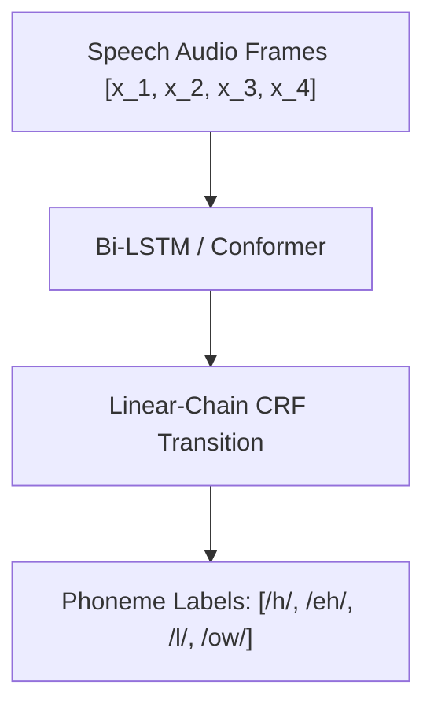

#### d. Code Thực chiến (C++ & Python)
```python
import torch
import torch.nn as nn

class TokenLevelSequenceLabeler(nn.Module):
    def __init__(self, feature_dim: int, num_labels: int):
        super().__init__()
        self.lstm = nn.LSTM(feature_dim, 128, bidirectional=True, batch_first=True)
        self.classifier = nn.Linear(256, num_labels)

    def forward(self, x: torch.Tensor) -> torch.Tensor:
        # x: [B, T, D]
        h, _ = self.lstm(x)
        logits = self.classifier(h) # [B, T, num_labels]
        return logits
```

#### e. Lỗi Thường gặp & Ổn định Số học
- Phân loại độc lập từng bước thời gian bằng Cross-Entropy thuần túy mà không có ma trận chuyển tiếp (Transition Matrix) dẫn đến chuỗi nhãn bị nhảy giật cục bất hợp lý.

#### f. Ứng dụng Thực chiến trong AI
- Nhận dạng thực thể tên trong văn bản (NER), phân đoạn các giai đoạn giấc ngủ từ sóng não EEG.

---

### 40. Sequence Generation (Sinh Dữ liệu Chuỗi)

#### a. Định nghĩa Bản chất Toán học
**Sequence Generation** là bài toán sinh ra các quỹ đạo chuỗi thời gian tổng hợp liên tục mới $\hat{\mathbf{X}} = (\mathbf{x}_1, \dots, \mathbf{x}_T) \sim P_{\text{data}}(\mathbf{X})$.
Các phương pháp hiện đại:
1. **Autoregressive Generative Models**: Sinh từng bước có điều kiện: $P(\mathbf{x}_t \mid \mathbf{x}_{<t})$.
2. **Diffusion Models for Time Series (TimeGrad, Diffusion-TS)**: Bắt đầu từ nhiễu Gauss ngẫu nhiên $\mathbf{x}_T \sim \mathcal{N}(\mathbf{0}, \mathbf{I})$, thực hiện quá trình khử nhiễu đảo ngược thời gian $T \to 0$ để tái tạo chuỗi thời gian thực tế:
   $$\mathbf{x}_{t-1} = \frac{1}{\sqrt{\alpha_t}} \left( \mathbf{x}_t - \frac{1 - \alpha_t}{\sqrt{1 - \bar{\alpha}_t}} \mathbf{\epsilon}_\theta(\mathbf{x}_t, t) \right) + \sigma_t \mathbf{z}$$

#### b. Cơ chế Tầng Sâu & Điện toán
- Sinh dữ liệu chuỗi liên tục phải bảo toàn các tính chất thống kê nâng cao: Tự tương quan (ACF), phân phối biên (Marginal distribution), và phổ công suất (Power Spectrum).

#### c. Sơ đồ Minh họa
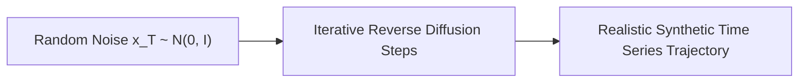

#### d. Code Thực chiến (C++ & Python)
```python
import torch

def sample_random_walk_prior(length: int, sigma: float = 0.1):
    steps = torch.randn(length) * sigma
    return torch.cumsum(steps, dim=0)
```

#### e. Lỗi Thường gặp & Ổn định Số học
- Dữ liệu sinh ra trông mượt mà bằng mắt thường nhưng ma trận hiệp phương sai chéo (Cross-covariance) giữa các kênh bị sụp đổ.

#### f. Ứng dụng Thực chiến trong AI
- Tạo dữ liệu giả lập (Synthetic Data Generation) để kiểm thử thuật toán giao dịch tài chính mà không vi phạm quyền riêng tư dữ liệu thật.

---

### 41. Anomaly Detection in Time Series (Phát hiện Bất thường trong Chuỗi Thời gian)

#### a. Định nghĩa Bản chất Toán học
**Anomaly Detection** xác định các điểm thời gian hoặc các đoạn chuỗi con có hành vi sai lệch đáng kể so với phân phối hoạt động bình thường của hệ thống.
Phân loại bất thường:
1. **Point Anomaly (Bất thường Điểm)**: Một điểm số đột biến vọt lên bất thường (Spike / Dip).
2. **Contextual Anomaly (Bất thường Ngữ cảnh)**: Một mức nhiệt độ $35^\circ\text{C}$ là bình thường vào buổi trưa nhưng là bất thường vào nửa đêm.
3. **Collective / Pattern Anomaly (Bất thường Mẫu chuỗi)**: Toàn bộ các giá trị nằm trong ngưỡng cho phép nhưng hình dạng sóng chu kỳ bị biến dạng (ví dụ điện tâm đồ bị mất nhịp).

Phương pháp Reconstruction Error:
$$\text{AnomalyScore}(t) = \|\mathbf{x}_t - \hat{\mathbf{x}}_t\|_2^2$$
Trong đó $\hat{\mathbf{x}}_t$ là chuỗi được tái tạo lại từ Autoencoder hoặc Anomaly Transformer. Các đoạn bất thường không thể được tái tạo chính xác và sẽ có điểm lỗi vọt cao vượt ngưỡng $\tau$.

#### b. Cơ chế Tầng Sâu & Điện toán
- Mô hình **Anomaly Transformer (Xu et al., ICLR 2022)** sử dụng cơ chế *Association Discrepancy*: Đo lường sự khác biệt giữa khoảng cách chú ý cục bộ (Prior Association) và khoảng cách chú ý toàn chuỗi (Series Association) để làm nổi bật dị thường.

#### c. Sơ đồ Minh họa
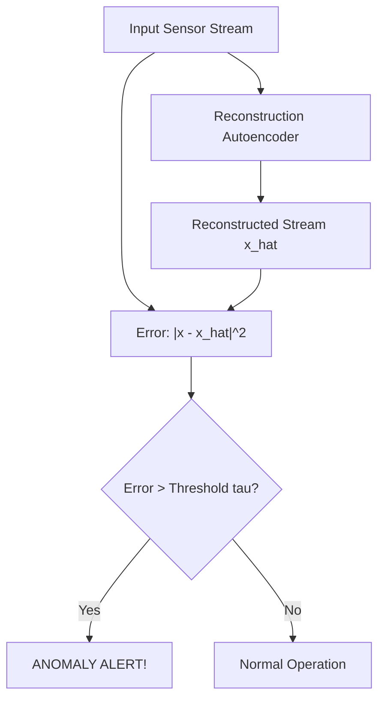

#### d. Code Thực chiến (C++ & Python)
```cpp
// C++17: Anomaly Score Thresholding
#include <vector>

std::vector<bool> detect_anomalies(const std::vector<float>& original, 
                                  const std::vector<float>& recon, 
                                  float threshold) {
    std::vector<bool> is_anomaly(original.size());
    for (size_t i = 0; i < original.size(); ++i) {
        float err = (original[i] - recon[i]) * (original[i] - recon[i]);
        is_anomaly[i] = (err > threshold);
    }
    return is_anomaly;
}
```

```python
import numpy as np

def compute_dynamic_threshold(errors: np.ndarray, num_std: float = 3.0):
    # Dynamic thresholding bằng trung bình + k lần độ lệch chuẩn
    mean = np.mean(errors)
    std = np.std(errors)
    threshold = mean + num_std * std
    return threshold, errors > threshold
```

#### e. Lỗi Thường gặp & Ổn định Số học
- Sự mất cân bằng dữ liệu cực đoan (Data Imbalance): Dữ liệu bất thường chiếm tỷ lệ $< 0.1\%$; nếu dùng hàm Accuracy thông thường sẽ đưa ra kết luận sai lệch (bắt buộc dùng F1-Score hoặc Precision-Recall AUC).

#### f. Ứng dụng Thực chiến trong AI
- Phát hiện xâm nhập mạng (Intrusion Detection), giám sát tuabin gió, bảo trì dự đoán (Predictive Maintenance).

---

### 42. Forecasting Horizons (Chân trời Dự báo)

#### a. Định nghĩa Bản chất Toán học
**Forecasting Horizon** $H \in \mathbb{N}^+$ xác định số lượng bước thời gian tương lai mà mô hình cần đưa ra dự đoán:
$$\hat{\mathbf{y}}_{t+1}, \hat{\mathbf{y}}_{t+2}, \dots, \hat{\mathbf{y}}_{t+H}$$
Phân loại theo quy mô chân trời:
- **Ngắn hạn (Short-term Horizon)**: $H \in [1, 24]$ bước (ví dụ: dự báo giờ tiếp theo, ngày tiếp theo). Chịu chi phối mạnh bởi tính tự tương quan cục bộ (AR).
- **Dài hạn (Long-term / Long-Sequence Horizon - LSTF)**: $H \in [96, 720]$ bước. Chịu chi phối bởi xu hướng vĩ mô và tính mùa vụ chu kỳ lớn.

So sánh hai chiến lược:
- *Iterative Rollout*: $\hat{y}_{t+h} = f(\hat{y}_{t+h-1})$. Sai số $\epsilon$ tích lũy theo cấp số nhân $\mathcal{O}(h^2)$.
- *Direct Multi-step*: $\hat{\mathbf{Y}}_{t+1:t+H} = \mathbf{W} \cdot \mathbf{h}_t$. Sai số các bước độc lập với nhau.

#### b. Cơ chế Tầng Sâu & Điện toán
- Dự báo dài hạn đòi hỏi dung lượng VRAM lớn để lưu trữ các ma trận chú ý và tensor đầu ra $H \times D$.

#### c. Sơ đồ Minh họa
```mermaid
graph LR
    Origin["Time t (Current)"] --> Short["Short Horizon (H=24): High Confidence"]
    Short --> Long["Long Horizon (H=720): Expanding Uncertainty Funnel"]
```

#### d. Code Thực chiến (C++ & Python)
```python
def configure_horizon_slices(total_length: int, lookback: int, horizon: int):
    # Cắt dữ liệu thành các cặp (X, Y) trượt
    pairs = []
    for i in range(total_length - lookback - horizon + 1):
        x = slice(i, i + lookback)
        y = slice(i + lookback, i + lookback + horizon)
        pairs.append((x, y))
    return pairs
```

#### e. Lỗi Thường gặp & Ổn định Số học
- Cố gắng áp dụng mô hình autoregressive sinh từng bước cho chân trời $H = 720$: Kết quả sau 50 bước thường suy biến thành một đường thẳng nằm ngang vô nghĩa.

#### f. Ứng dụng Thực chiến trong AI
- Quy hoạch tài nguyên năng lượng quốc gia, lập kế hoạch ngân sách quý và năm.

---

### 43. Temporal Dependencies (Các Phụ thuộc Thời gian)

#### a. Định nghĩa Bản chất Toán học
**Temporal Dependency** đo lường mức độ ảnh hưởng của trạng thái tại thời điểm quá khứ $t - k$ lên trạng thái hiện tại $t$:
$$\mathcal{I}(X_t; X_{t-k}) = \iint p(x_t, x_{t-k}) \log \frac{p(x_t, x_{t-k})}{p(x_t) p(x_{t-k})} dx_t dx_{t-k}$$
Phân loại:
1. **Phụ thuộc Cận kề (Short-term Markovian)**: Tác động mạnh trong phạm vi vài bước thời gian gần nhất ($k \le 5$).
2. **Phụ thuộc Chu kỳ (Periodic Dependencies)**: Tác động mạnh tại các mốc thời gian cách đúng bội số chu kỳ ($k = s, 2s, 3s$).

#### b. Cơ chế Tầng Sâu & Điện toán
- Mạng nơ-ron tích chập (CNN) rất giỏi bắt phụ thuộc ngắn hạn.
- Mạng Attention rất giỏi bắt phụ thuộc chu kỳ không liên tục nhờ các liên kết trực tiếp.

#### c. Sơ đồ Minh họa
```mermaid
graph LR
    Past["Time t-k"] -->|Decaying Temporal Function| Current["Time t"]
```

#### d. Code Thực chiến (C++ & Python)
```python
import numpy as np

def compute_autocorrelation_lags(series: np.ndarray, max_lag: int = 40):
    n = len(series)
    norm_series = series - np.mean(series)
    autocorr = np.correlate(norm_series, norm_series, mode='full')[n - 1:]
    return autocorr[:max_lag] / autocorr[0]
```

#### e. Lỗi Thường gặp & Ổn định Số học
- Giả định rằng phụ thuộc thời gian luôn suy giảm đơn điệu theo khoảng cách: Thực tế có thể bằng 0 ở cự ly gần nhưng lại cực lớn tại các chu kỳ cách xa.

#### f. Ứng dụng Thực chiến trong AI
- Lựa chọn kích thước cửa sổ nhìn lại (Lookback Window) tối ưu cho mô hình.

---

### 44. Long-Range Dependencies (Các Phụ thuộc Tầm xa)

#### a. Định nghĩa Bản chất Toán học
**Long-Range Dependencies (LRD)** xuất hiện khi hàm tự tương quan suy giảm cực kỳ chậm theo quy luật hàm lũy thừa (Power Law) thay vì suy giảm theo hàm mũ thông thường:
$$\rho_k \sim c \cdot k^{-\alpha}, \quad \text{với } 0 < \alpha < 1 \quad \text{khi } k \to \infty$$
Tổng các hệ số tự tương quan phân kỳ ra vô cực:
$$\sum_{k=0}^\infty \rho_k = \infty$$
Hiện tượng này gắn liền với **Tham số Hurst (Hurst Exponent $H \in (0.5, 1)$)**:
$$H = 1 - \frac{\alpha}{2}$$
Biểu thị một hệ thống có **Bộ nhớ Dài hạn Vĩnh viễn (Long Memory)**: Một sự kiện xảy ra ở quá khứ rất xa (hàng nghìn bước trước) vẫn tiếp tục tác động rõ rệt lên hiện tại.

#### b. Cơ chế Tầng Sâu & Điện toán (Rào cản Gradient trong Mạng Nơ-ron)
- Trong RNN/LSTM: Khi truyền ngược gradient qua $T$ bước thời gian:
  $$\frac{\partial \mathcal{L}}{\partial \mathbf{h}_1} = \frac{\partial \mathcal{L}}{\partial \mathbf{h}_T} \prod_{t=2}^T \frac{\partial \mathbf{h}_t}{\partial \mathbf{h}_{t-1}}$$
  Nếu ma trận Jacobian có giá trị riêng $< 1$, gradient bị triệt tiêu về 0 sau $T > 100$ bước (Vanishing Gradient).
- Giải pháp hiện đại:
  1. **Self-Attention**: Chiều dài đường truyền thông tin giữa hai bước thời gian bất kỳ là $\mathcal{O}(1)$.
  2. **State Space Models (S4, Mamba)**: Sử dụng ma trận chuyển dịch trạng thái HiPPO (High-order Polynomial Projection Operators) tối ưu hóa bộ nhớ liên tục trong không gian đa thức Legendre, giải quyết phụ thuộc lên tới $1,000,000$ bước thời gian!

#### c. Sơ đồ Minh họa
```mermaid
graph LR
    subgraph RNNPath ["RNN: O(T) Sequential Gradient Degradation"]
        R1["h_1"] --> R2["h_2"] --> R3["..."] --> RT["h_T (Gradient Vanished)"]
    end
    subgraph AttentionPath ["Attention & S4: Direct O(1) Shortest Path"]
        A1["Token 1 (Past)"] <-->|"Direct O(1) Connection"| AT["Token T (Future)"]
    end
```

#### d. Code Thực chiến (C++ & Python)
```cpp
// C++17: Ước lượng tham số Hurst qua R/S Analysis cơ bản
#include <vector>
#include <cmath>
#include <numeric>
#include <algorithm>

float estimate_hurst_single_scale(const std::vector<float>& series) {
    int n = series.size();
    float mean = std::accumulate(series.begin(), series.end(), 0.0f) / n;
    std::vector<float> y(n);
    float cum_dev = 0.0f;
    float max_dev = -1e9f, min_dev = 1e9f;
    float sum_sq = 0.0f;
    for (int i = 0; i < n; ++i) {
        cum_dev += (series[i] - mean);
        max_dev = std::max(max_dev, cum_dev);
        min_dev = std::min(min_dev, cum_dev);
        sum_sq += (series[i] - mean) * (series[i] - mean);
    }
    float R = max_dev - min_dev;
    float S = std::sqrt(sum_sq / n);
    return std::log(R / (S + 1e-6f)) / std::log(n);
}
```

```python
import numpy as np

def compute_hurst_exponent(series: np.ndarray) -> float:
    # Ước lượng Hurst Exponent (H > 0.5: Persistent Long-Memory Process)
    lags = range(2, 100)
    tau = [np.std(np.subtract(series[lag:], series[:-lag])) for lag in lags]
    poly = np.polyfit(np.log(lags), np.log(tau), 1)
    return poly[0] # Hurst parameter
```

#### e. Lỗi Thường gặp & Ổn định Số học
- Dùng các mô hình không có cơ chế bộ nhớ dài hạn (như AR thuần túy hoặc Standard RNN) cho các bài toán tài chính hay biến đổi khí hậu có hiệu ứng Hurst cao, khiến dự báo bị kéo về trung bình quá sớm.

#### f. Ứng dụng Thực chiến trong AI
- Nền tảng thiết kế các siêu kiến trúc thời gian dài hạn: **Mamba**, **PatchTST**, **iTransformer**, và mô hình hóa ADN/Protein.
