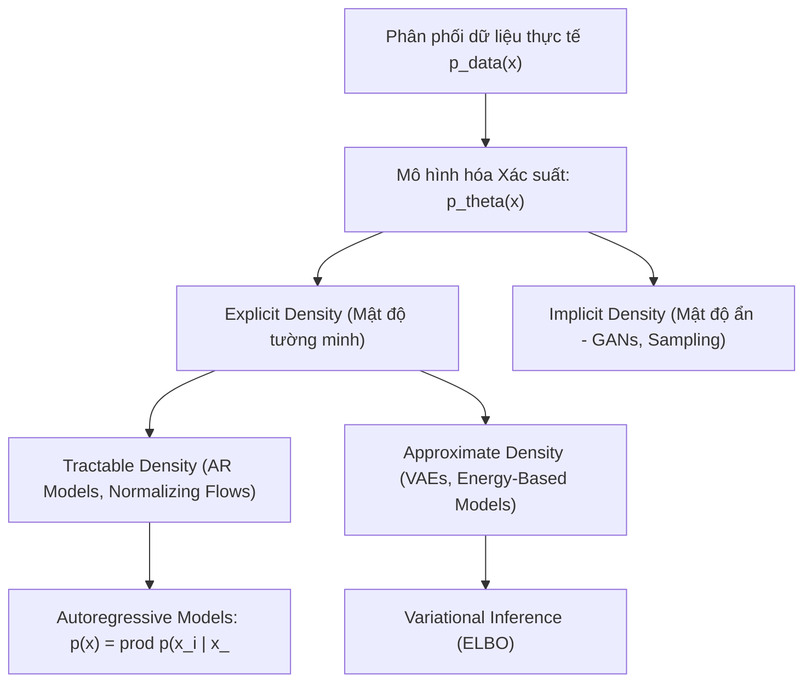
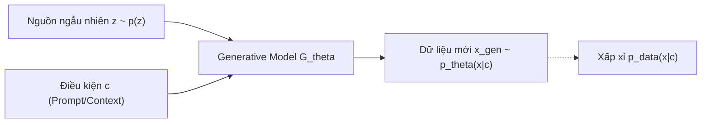
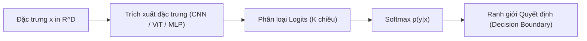
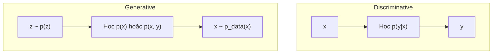
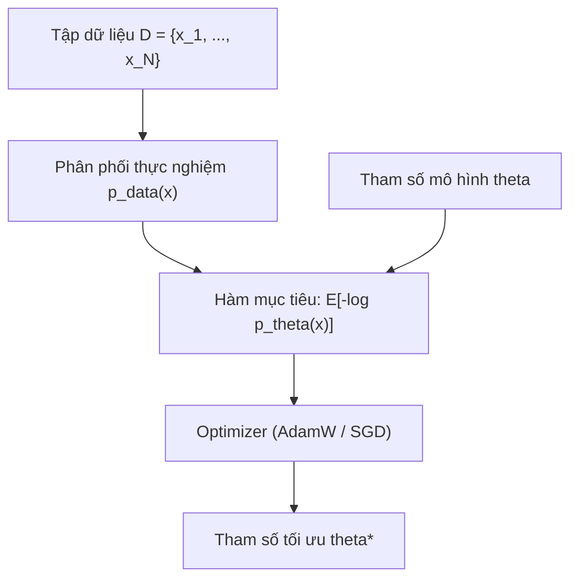
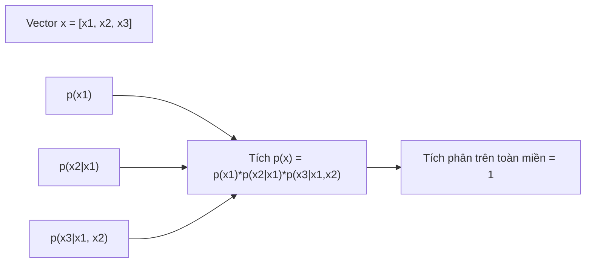
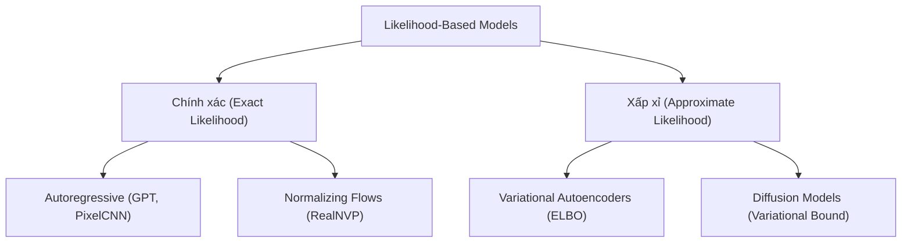
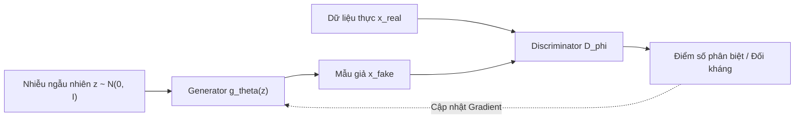
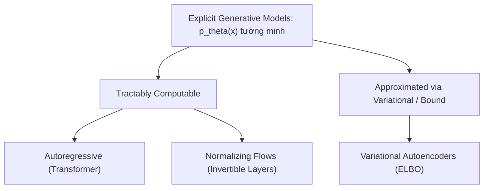
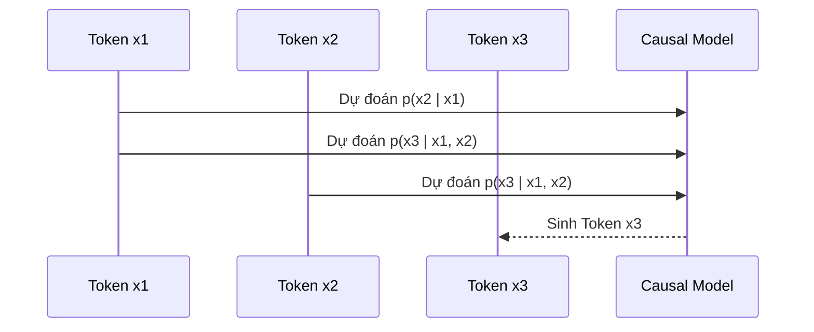

# Chuyên đề: Nền tảng Mô hình Sinh và Mô hình Hóa Phân phối (Generative vs Discriminative & Probabilistic Foundations)

## 1. Tổng quan Chuyên đề
Trong lý thuyết học máy và trí tuệ nhân tạo, bài toán học có giám sát và không giám sát được phân chia thành hai nhánh nền tảng: **Mô hình Phân biệt (Discriminative Models)** và **Mô hình Sinh (Generative Models)**. Trong khi mô hình phân biệt tập trung vào việc mô hình hóa xác suất hậu nghiệm $p(y|\mathbf{x})$ nhằm tìm ra ranh giới quyết định (decision boundary) tối ưu, thì mô hình sinh giải quyết bài toán phức tạp hơn nhiều: học trực tiếp phân phối dữ liệu đa chiều $p(\mathbf{x})$ hoặc phân phối đồng thời $p(\mathbf{x}, y)$ thông qua việc mô hình hóa phân phối xác suất (Probability Distribution Modeling).

Mô hình sinh có thể được phân loại thành **Explicit Generative Models** (có hàm mật độ xác suất tường minh, tối đa hóa likelihood) và **Implicit Generative Models** (không cần định nghĩa hàm mật độ tường minh, học cách lấy mẫu qua cơ chế đối kháng hoặc biến đổi ngẫu nhiên). Chuyên đề này cung cấp cơ sở toán học chặt chẽ, kiến trúc tính toán phần cứng và triển khai mã nguồn C++/Python cho các khái niệm cốt lõi khởi đầu của Kỷ nguyên Generative AI.



---

## 2. Chi tiết từng Keyword

---

### 1. Generative AI (Trí tuệ Nhân tạo Tạo sinh)

#### a. Định nghĩa Bản chất Toán học (Mathematical Formulation)
**Generative AI** là một phân nhánh của Trí tuệ Nhân tạo nghiên cứu các thuật toán có khả năng sinh ra các mẫu dữ liệu mới $\tilde{\mathbf{x}} \sim p_\theta(\mathbf{x})$ sao cho phân phối được mô hình hóa $p_\theta(\mathbf{x})$ xấp xỉ tối ưu phân phối dữ liệu thực $p_{\text{data}}(\mathbf{x})$ trong không gian xác suất đa chiều $\mathbb{R}^D$:
$$\min_{\theta} \mathcal{D}\Big(p_{\text{data}}(\mathbf{x}) \;\parallel\; p_\theta(\mathbf{x})\Big)$$
Trong đó $\mathcal{D}$ là một hàm đo khoảng cách hoặc độ phân kỳ thống kê (như Kullback-Leibler divergence $\mathbb{D}_{\text{KL}}$, Jensen-Shannon divergence $\mathbb{D}_{\text{JS}}$, hoặc Wasserstein distance $\mathcal{W}_1$).

#### b. Cơ chế Tầng Sâu & Điện toán (Under The Hood / Hardware Internals)
- **Tầng tính toán phần cứng**: Quá trình sinh dữ liệu từ Generative AI đòi hỏi tính toán cường độ cao (compute-bound đối với quá trình training và memory-bandwidth-bound đối với suy luận tự hồi quy - autoregressive inference).
- **Phân bổ bộ nhớ**: Chuyển đổi từ một vector nhiễu ngẫu nhiên $\mathbf{z} \in \mathbb{R}^d$ qua mạng nơ-ron sâu yêu cầu cấp phát bộ nhớ tensor lớn trên VRAM GPU/HBM (High Bandwidth Memory), với các phép biến đổi ma trận khối lớn (GEMM - General Matrix Multiply) tận dụng tối đa Tensor Cores.

#### c. Sơ đồ Minh họa (Mermaid / ASCII Diagram)


#### d. Code Thực chiến (Dual-Engine: C++ & Python)

```cpp
// C++20: Cơ chế sinh số ngẫu nhiên đa chiều chuẩn hóa (Lõi lấy mẫu Prior z ~ N(0, I))
#include <iostream>
#include <vector>
#include <random>
#include <cmath>

class StandardGaussianPrior {
private:
    std::mt19937_64 rng_;
    std::normal_distribution<float> dist_;

public:
    explicit StandardGaussianPrior(uint64_t seed = 42) 
        : rng_(seed), dist_(0.0f, 1.0f) {}

    std::vector<float> sample(size_t dim) {
        std::vector<float> z(dim);
        for (size_t i = 0; i < dim; ++i) {
            z[i] = dist_(rng_);
        }
        return z;
    }
};

int main() {
    StandardGaussianPrior prior(1337);
    auto latent_z = prior.sample(8);
    std::cout << "Latent vector z sample [0..3]: " 
              << latent_z[0] << ", " << latent_z[1] << ", " 
              << latent_z[2] << ", " << latent_z[3] << "\n";
    return 0;
}
```

```python
# Python / PyTorch: Đo khoảng cách phân phối sinh và thực nghiệm
import torch
import torch.nn as nn

class ToyGenerativeModel(nn.Module):
    def __init__(self, latent_dim: int, data_dim: int):
        super().__init__()
        self.net = nn.Sequential(
            nn.Linear(latent_dim, 64),
            nn.GELU(),
            nn.Linear(64, data_dim)
        )
        
    def forward(self, z: torch.Tensor) -> torch.Tensor:
        return self.net(z)

latent_dim, data_dim = 16, 2
model = ToyGenerativeModel(latent_dim, data_dim)
z = torch.randn(32, latent_dim) # Batch = 32
generated_samples = model(z)
print(f"Generated samples shape: {generated_samples.shape}")
```

#### e. Lỗi Thường gặp & Ổn định Số học (Pitfalls & Numerical Stability)
- **Mode Collapse (Thu hẹp mode)**: Mô hình chỉ sinh ra một tập hợp con nhỏ các mẫu hợp lệ thay vì bao phủ toàn bộ phân phối dữ liệu đa mode.
- **Tràn số khi tính xác suất**: Tính trực tiếp $\prod_{i} p(x_i)$ dẫn đến underflow số học (về 0.0); bắt buộc phải tính trong không gian logarit $\sum_{i} \log p(x_i)$.

#### f. Ứng dụng Thực chiến trong AI / Deep Learning (AI Applications)
- Cơ chế nền tảng cho Large Language Models (GPT-4, Gemini, Claude), Text-to-Image (Stable Diffusion, Midjourney, FLUX), và Speech Synthesis (Bark, ElevenLabs).

---

### 2. Discriminative Models (Mô hình Phân biệt)

#### a. Định nghĩa Bản chất Toán học (Mathematical Formulation)
**Discriminative Models** mô hình hóa trực tiếp xác suất có điều kiện của nhãn mục tiêu $y \in \mathcal{Y}$ khi biết vector đặc trưng đầu vào $\mathbf{x} \in \mathcal{X}$:
$$p_\theta(y | \mathbf{x}) = \frac{\exp(f_\theta(\mathbf{x})_y)}{\sum_{k=1}^K \exp(f_\theta(\mathbf{x})_k)}$$
Mô hình phân biệt không cố gắng học cách dữ liệu $\mathbf{x}$ được tạo ra như thế nào trong tự nhiên (bỏ qua $p(\mathbf{x})$), mà chỉ tối ưu hóa ranh giới phân tách giữa các lớp (decision boundaries) bằng cách cực tiểu hóa Negative Log-Likelihood:
$$\mathcal{L}_{\text{NLL}}(\theta) = - \mathbb{E}_{(\mathbf{x}, y) \sim \mathcal{D}} [\log p_\theta(y | \mathbf{x})]$$

#### b. Cơ chế Tầng Sâu & Điện toán (Under The Hood / Hardware Internals)
- **Tối ưu hóa bộ nhớ**: Do không cần sinh lại chiều dữ liệu $D$ lớn của $\mathbf{x}$, mô hình phân biệt nén không gian đầu vào thành một vector logits kích thước nhỏ $K \ll D$. Quá trình backward pass chỉ cần truyền gradient từ softmax loss về mạng.
- **Hiệu năng GPU**: Hàm mất mát Cross-Entropy thường được tích hợp cơ chế *Fused Softmax-CrossEntropy* (như trong Flash-Cross-Entropy hoặc Apex) để không cần ghi tensor trung gian kích thước $[B, K]$ lên VRAM, tiết kiệm băng thông bộ nhớ.

#### c. Sơ đồ Minh họa (Mermaid / ASCII Diagram)


#### d. Code Thực chiến (Dual-Engine: C++ & Python)

```cpp
// C++17: Triển khai Softmax ổn định số học (Log-Sum-Exp Trick)
#include <iostream>
#include <vector>
#include <cmath>
#include <algorithm>
#include <numeric>

std::vector<float> stable_softmax(const std::vector<float>& logits) {
    std::vector<float> probs(logits.size());
    float max_logit = *std::max_element(logits.begin(), logits.end());
    
    float sum_exp = 0.0f;
    for (size_t i = 0; i < logits.size(); ++i) {
        probs[i] = std::exp(logits[i] - max_logit); // Ngăn ngừa tràn số dương (Overflow)
        sum_exp += probs[i];
    }
    
    for (size_t i = 0; i < logits.size(); ++i) {
        probs[i] /= sum_exp;
    }
    return probs;
}

int main() {
    std::vector<float> raw_logits = {1000.0f, 1001.0f, 998.0f}; // Cực lớn, dễ tràn số nếu exp trực tiếp
    auto probs = stable_softmax(raw_logits);
    std::cout << "P(y=0|x): " << probs[0] << " | P(y=1|x): " << probs[1] << " | P(y=2|x): " << probs[2] << "\n";
    return 0;
}
```

```python
# Python / PyTorch: Mô hình phân biệt với Negative Log Likelihood
import torch
import torch.nn as nn
import torch.nn.functional as F

class DiscriminativeClassifier(nn.Module):
    def __init__(self, in_features: int, num_classes: int):
        super().__init__()
        self.fc = nn.Linear(in_features, num_classes)
        
    def forward(self, x: torch.Tensor) -> torch.Tensor:
        logits = self.fc(x)
        return logits

model = DiscriminativeClassifier(128, 3)
x = torch.randn(8, 128)
labels = torch.tensor([0, 1, 2, 0, 1, 2, 0, 1])
logits = model(x)
loss = F.cross_entropy(logits, labels)
print(f"Cross-entropy loss: {loss.item():.4f}")
```

#### e. Lỗi Thường gặp & Ổn định Số học (Pitfalls & Numerical Stability)
- **Overconfident Predictions**: Khi kiểm thử trên dữ liệu OOD (Out-of-Distribution), mô hình phân biệt thường đưa ra xác suất dự đoán cực cao sai lầm (softmax saturation).
- **Tràn số lũy thừa**: Tính trực tiếp $\exp(z_i)$ với $z_i > 88.7$ trong hệ số thực `float32` sẽ gây ra `+inf`.

#### f. Ứng dụng Thực chiến trong AI / Deep Learning (AI Applications)
- Hệ thống phân loại ảnh (ResNet, ViT), nhận diện giọng nói (ASR CTC), phát hiện đối tượng (YOLO classification head), và phân loại token trong NLP (BERT NER).

---

### 3. Generative Models (Mô hình Sinh)

#### a. Định nghĩa Bản chất Toán học (Mathematical Formulation)
**Generative Models** học phân phối xác suất đồng thời $p(\mathbf{x}, y)$ hoặc phân phối biên $p(\mathbf{x})$. Dựa vào quy tắc Bayes, mô hình sinh có thể suy ra xác suất hậu nghiệm phục vụ cho việc phân loại:
$$p(y|\mathbf{x}) = \frac{p(\mathbf{x}|y)p(y)}{p(\mathbf{x})} = \frac{p(\mathbf{x}|y)p(y)}{\sum_{y'} p(\mathbf{x}|y')p(y')}$$
Đồng thời, mô hình sinh có khả năng tự sinh mẫu không điều kiện $\mathbf{x} \sim p(\mathbf{x})$ hoặc sinh có điều kiện $\mathbf{x} \sim p(\mathbf{x}|y)$. Mục tiêu chính là học được ánh xạ từ không gian tiềm ẩn đơn giản (prior) sang không gian dữ liệu phức tạp.

#### b. Cơ chế Tầng Sâu & Điện toán (Under The Hood / Hardware Internals)
- **Độ phức tạp tính toán**: Vì $D$ là số chiều của dữ liệu thực (ví dụ ảnh $512 \times 512 \times 3 \approx 786{,}432$ chiều), tích phân tính bằng chứng dữ liệu (evidence) $p(\mathbf{x}) = \int p(\mathbf{x}, \mathbf{z}) d\mathbf{z}$ là hoàn toàn bất khả tri (intractable) đối với các không gian liên tục nhiều chiều.
- **Giải pháp phần cứng**: Các mô hình sinh hiện đại phải xấp xỉ tích phân này thông qua Monte Carlo sampling hoặc biến đổi đại số Jacobian, tận dụng hàng nghìn nhân CUDA để chạy song song các luồng lấy mẫu.

#### c. Sơ đồ Minh họa (Mermaid / ASCII Diagram)


#### d. Code Thực chiến (Dual-Engine: C++ & Python)

```cpp
// C++17: Mô phỏng Gaussian Mixture Generative Model (GMM) - Sinh mẫu x ~ sum pi_k * N(mu_k, sigma_k)
#include <iostream>
#include <vector>
#include <random>

struct GaussianComponent {
    float weight;
    float mean;
    float std;
};

class GaussianMixtureModel1D {
private:
    std::vector<GaussianComponent> components_;
    std::mt19937 rng_;

public:
    GaussianMixtureModel1D(const std::vector<GaussianComponent>& comps, uint32_t seed = 42)
        : components_(comps), rng_(seed) {}

    float sample() {
        std::vector<float> weights;
        for (const auto& c : components_) weights.push_back(c.weight);
        std::discrete_distribution<int> cat_dist(weights.begin(), weights.end());
        
        int k = cat_dist(rng_);
        std::normal_distribution<float> norm_dist(components_[k].mean, components_[k].std);
        return norm_dist(rng_);
    }
};

int main() {
    std::vector<GaussianComponent> comps = {
        {0.3f, -2.0f, 0.5f},
        {0.7f, 3.0f, 1.2f}
    };
    GaussianMixtureModel1D gmm(comps);
    std::cout << "GMM Sample 1: " << gmm.sample() << "\n";
    std::cout << "GMM Sample 2: " << gmm.sample() << "\n";
    return 0;
}
```

```python
# Python / PyTorch: So sánh Likelihood học được trên mô hình sinh dạng 2D
import torch
import torch.distributions as dist

# Thiết lập Gaussian Mixture gồm 2 cụm
mix = dist.Categorical(torch.tensor([0.3, 0.7]))
comp = dist.Normal(torch.tensor([-2.0, 3.0]), torch.tensor([0.5, 1.2]))
gmm = dist.MixtureSameFamily(mix, comp)

samples = gmm.sample((5,))
log_probs = gmm.log_prob(samples)
print("Samples:", samples.numpy())
print("Log Probabilities:", log_probs.numpy())
```

#### e. Lỗi Thường gặp & Ổn định Số học (Pitfalls & Numerical Stability)
- **Curse of Dimensionality**: Trong không gian siêu cao chiều, hầu hết thể tích không gian xác suất đều rỗng; các mẫu sinh dễ rơi vào vùng có mật độ thực tế bằng 0 nếu hàm mất mát không bao hàm thông tin hình học vi phân.
- **Singularity**: Khi độ lệch chuẩn $\sigma \to 0$, mật độ xác suất $p(\mathbf{x}) \to \infty$, dẫn đến gradient bùng nổ (exploding gradients).

#### f. Ứng dụng Thực chiến trong AI / Deep Learning (AI Applications)
- Tổng hợp dữ liệu (data augmentation), sinh ảnh y tế hiếm, mô phỏng môi trường trong Reinforcement Learning (World Models).

---

### 4. Generative Modeling (Phương pháp Mô hình hóa Sinh)

#### a. Định nghĩa Bản chất Toán học (Mathematical Formulation)
**Generative Modeling** là phương pháp luận và quá trình xây dựng hàm mục tiêu toán học nhằm tìm tập tham số $\theta^*$ sao cho mô hình xấp xỉ tốt nhất phân phối sinh ra dữ liệu:
$$\theta^* = \arg\min_\theta \mathbb{E}_{\mathbf{x} \sim p_{\text{data}}} \left[ -\log p_\theta(\mathbf{x}) \right] = \arg\min_\theta \mathbb{D}_{\text{KL}}\Big(p_{\text{data}}(\mathbf{x}) \;\parallel\; p_\theta(\mathbf{x})\Big)$$
Về mặt thông tin học, việc cực tiểu hóa khoảng cách KL tương đương với việc tối đa hóa hàm hợp lý cực đại (Maximum Likelihood Estimation - MLE) trên tập dữ liệu mẫu quan sát $\mathcal{D} = \{\mathbf{x}_1, \dots, \mathbf{x}_N\}$.

#### b. Cơ chế Tầng Sâu & Điện toán (Under The Hood / Hardware Internals)
- **Quản lý đồ thị tính toán (Computation Graph Overhead)**: Trong Generative Modeling, đồ thị đạo hàm tự động (Autograd Graph) thường phức tạp hơn mô hình phân biệt gấp nhiều lần vì liên quan đến sampling ngẫu nhiên (yêu cầu Reparameterization Trick) hoặc unrolling qua nhiều bước thời gian diffusion $T=1000$.
- **Chi phí bộ nhớ Activation**: Bộ nhớ kích hoạt tăng tỷ lệ thuận với số bước tính toán, đòi hỏi áp dụng *Gradient Checkpointing* để tái tính toán activation thay vì lưu toàn bộ trên VRAM.

#### c. Sơ đồ Minh họa (Mermaid / ASCII Diagram)


#### d. Code Thực chiến (Dual-Engine: C++ & Python)

```cpp
// C++17: Tính Negative Log-Likelihood trên tập quan sát 1D
#include <iostream>
#include <vector>
#include <cmath>

double compute_gaussian_nll(const std::vector<double>& data, double mu, double sigma) {
    const double pi = 3.14159265358979323846;
    double nll = 0.0;
    double var = sigma * sigma;
    double log_coeff = 0.5 * std::log(2.0 * pi * var);
    
    for (double x : data) {
        double diff = x - mu;
        nll += log_coeff + (diff * diff) / (2.0 * var);
    }
    return nll / static_cast<double>(data.size());
}

int main() {
    std::vector<double> observations = {1.2, 0.9, 1.1, 1.5, 0.8};
    double nll = compute_gaussian_nll(observations, 1.0, 0.2);
    std::cout << "Mean NLL: " << nll << " nats\n";
    return 0;
}
```

```python
# Python / PyTorch: Vòng lặp Generative Modeling với Maximum Likelihood
import torch

data = torch.randn(1000) * 2.0 + 3.0 # Dữ liệu thực mu=3.0, sigma=2.0
mu_param = torch.nn.Parameter(torch.tensor(0.0))
log_sigma_param = torch.nn.Parameter(torch.tensor(0.0))

optimizer = torch.optim.Adam([mu_param, log_sigma_param], lr=0.05)

for step in range(300):
    sigma = torch.exp(log_sigma_param)
    dist_est = torch.distributions.Normal(mu_param, sigma)
    loss = -dist_est.log_prob(data).mean() # Negative Log-Likelihood
    
    optimizer.zero_grad()
    loss.backward()
    optimizer.step()

print(f"Học được: mu={mu_param.item():.2f}, sigma={torch.exp(log_sigma_param).item():.2f}")
```

#### e. Lỗi Thường gặp & Ổn định Số học (Pitfalls & Numerical Stability)
- **Tối ưu hóa tham số phương sai**: Nếu tối ưu hóa trực tiếp $\sigma$, gradient có thể đẩy $\sigma \le 0$. Giải pháp bắt buộc là tối ưu hóa biến logarit $\log \sigma \in \mathbb{R}$ và chuyển đổi lại bằng $\exp(\log \sigma)$.

#### f. Ứng dụng Thực chiến trong AI / Deep Learning (AI Applications)
- Huấn luyện các mô hình sinh thế hệ mới như Normalizing Flows, Diffusion Models, và GPT.

---

### 5. Probability Distribution Modeling (Mô hình Hóa Phân phối Xác suất)

#### a. Định nghĩa Bản chất Toán học (Mathematical Formulation)
**Probability Distribution Modeling** là việc tìm hàm mật độ xác suất $p_\theta(\mathbf{x})$ xác định trên không gian đo được $(\mathcal{X}, \Sigma)$ thỏa mãn các tiên đề Kolmogorov:
$$p_\theta(\mathbf{x}) \ge 0 \quad \forall \mathbf{x} \in \mathcal{X}, \qquad \int_{\mathcal{X}} p_\theta(\mathbf{x}) d\mathbf{x} = 1$$
Khi chiều của $\mathbf{x}$ tăng lên ($D \gg 1$), phân phối đồng thời thường được phân rã bằng tích chuỗi xác suất có điều kiện (Chain Rule of Probability):
$$p(\mathbf{x}) = p(x_1, x_2, \dots, x_D) = \prod_{i=1}^D p(x_i \mid \mathbf{x}_{<i})$$
hoặc thông qua cấu trúc đồ thị xác suất định hướng (Bayesian Networks) hoặc vô hướng (Markov Random Fields).

#### b. Cơ chế Tầng Sâu & Điện toán (Under The Hood / Hardware Internals)
- **Phân rã chuỗi và Song song hóa**: Việc biểu diễn $p(\mathbf{x}) = \prod_{i=1}^D p(x_i | \mathbf{x}_{<i})$ trong quá trình huấn luyện có thể tính toán song song hoàn toàn trên GPU (nhờ Masked Attention hoặc Causal Convolutions). Tuy nhiên, khi lấy mẫu sinh, nó biến thành chuỗi thao tác tuần tự $D$ bước, dẫn đến hiện tượng nghẽn băng thông bộ nhớ (Memory-bound Inference).

#### c. Sơ đồ Minh họa (Mermaid / ASCII Diagram)


#### d. Code Thực chiến (Dual-Engine: C++ & Python)

```cpp
// C++20: Kiểm chứng chuẩn hóa phân phối xác suất rời rạc
#include <iostream>
#include <vector>
#include <numeric>
#include <cassert>
#include <cmath>

class DiscreteDistributionModel {
private:
    std::vector<float> probabilities_;

public:
    explicit DiscreteDistributionModel(const std::vector<float>& unnormalized) {
        float sum = std::accumulate(unnormalized.begin(), unnormalized.end(), 0.0f);
        assert(sum > 0.0f && "Tổng trọng số phải dương");
        probabilities_.resize(unnormalized.size());
        for (size_t i = 0; i < unnormalized.size(); ++i) {
            probabilities_[i] = unnormalized[i] / sum;
        }
    }

    float get_probability(size_t index) const {
        return (index < probabilities_.size()) ? probabilities_[index] : 0.0f;
    }

    float verify_integral() const {
        return std::accumulate(probabilities_.begin(), probabilities_.end(), 0.0f);
    }
};

int main() {
    DiscreteDistributionModel dist({2.0f, 5.0f, 3.0f});
    std::cout << "P(X=1) = " << dist.get_probability(1) << "\n";
    std::cout << "Sum P(X) = " << dist.verify_integral() << "\n";
    return 0;
}
```

```python
# Python / PyTorch: Xây dựng phân phối đa biến Gaussian với ma trận hiệp phương sai Cholesky
import torch

dim = 3
mu = torch.zeros(dim)
# Tạo ma trận hiệp phương sai dương xác định thông qua A @ A^T
A = torch.randn(dim, dim)
cov = A @ A.T + 1e-3 * torch.eye(dim)

mvn = torch.distributions.MultivariateNormal(loc=mu, covariance_matrix=cov)
x_sample = mvn.sample((10,))
log_density = mvn.log_prob(x_sample)
print(f"Sample shape: {x_sample.shape}, Log density mean: {log_density.mean().item():.3f}")
```

#### e. Lỗi Thường gặp & Ổn định Số học (Pitfalls & Numerical Stability)
- **Hằng số chuẩn hóa khó giải (Intractable Partition Function)**: Trong các mô hình năng lượng $p(\mathbf{x}) = \frac{e^{-E(\mathbf{x})}}{Z}$, hằng số $Z = \int e^{-E(\mathbf{x})} d\mathbf{x}$ không thể tính chính xác trong không gian lớn.

#### f. Ứng dụng Thực chiến trong AI / Deep Learning (AI Applications)
- Nền tảng cho mô hình hóa ngôn ngữ trong Transformer, mô hình hóa âm thanh (WaveNet), và ước lượng mật độ bất thường (Anomaly Detection).

---

### 6. Likelihood-Based Models (Mô hình Dựa trên Hàm Hợp lý)

#### a. Định nghĩa Bản chất Toán học (Mathematical Formulation)
**Likelihood-Based Models** là nhóm mô hình sinh huấn luyện bằng cách tối ưu hóa trực tiếp hàm log-likelihood hoặc cận dưới của nó. Với tập dữ liệu quan sát $\mathcal{D} = \{\mathbf{x}_i\}_{i=1}^N$, hàm hợp lý được định nghĩa là:
$$\mathcal{L}(\theta) = \sum_{i=1}^N \log p_\theta(\mathbf{x}_i)$$
Nhóm mô hình này đảm bảo phân phối học được $p_\theta$ gán xác suất cao cho các mẫu thực tế và triệt tiêu xác suất ở các vùng dữ liệu rác. Nhóm này bao gồm: Autoregressive Models (tính chính xác likelihood), Normalizing Flows (đổi biến tích phân chính xác), VAEs (tối ưu hóa cận dưới biến phân ELBO), và Diffusion Models (xấp xỉ cận dưới tích phân stochastic).

#### b. Cơ chế Tầng Sâu & Điện toán (Under The Hood / Hardware Internals)
- **Tối ưu hóa Băng thông (Kernel Fusion)**: Khi tính log-likelihood trên toàn batch, thao tác tính đạo hàm của hàm mất mát NLL thường được fuse trực tiếp với lớp tuyến tính cuối cùng để tránh việc cấp phát bộ nhớ trung gian cho ma trận xác suất đầy đủ trên VRAM.

#### c. Sơ đồ Minh họa (Mermaid / ASCII Diagram)


#### d. Code Thực chiến (Dual-Engine: C++ & Python)

```cpp
// C++17: Hàm tính toán Perplexity dựa trên Log-Likelihood
#include <iostream>
#include <vector>
#include <cmath>

double compute_perplexity(const std::vector<double>& log_probs) {
    if (log_probs.empty()) return 0.0;
    double sum_log = 0.0;
    for (double lp : log_probs) {
        sum_log += lp;
    }
    double avg_neg_ll = -sum_log / static_cast<double>(log_probs.size());
    return std::exp(avg_neg_ll); // Perplexity = exp(Cross-Entropy)
}

int main() {
    std::vector<double> sample_log_probs = {-1.2, -0.8, -2.1, -1.5};
    double ppl = compute_perplexity(sample_log_probs);
    std::cout << "Perplexity: " << ppl << "\n";
    return 0;
}
```

```python
# Python / PyTorch: Tính toán Exact Negative Log-Likelihood trên mô hình autoregressive đơn giản
import torch
import torch.nn as nn
import torch.nn.functional as F

batch_size, seq_len, vocab_size = 4, 16, 100
logits = torch.randn(batch_size, seq_len, vocab_size)
targets = torch.randint(0, vocab_size, (batch_size, seq_len))

# Tính NLLLoss trên toàn chuỗi
loss = F.cross_entropy(logits.view(-1, vocab_size), targets.view(-1))
print(f"Cross Entropy (NLL): {loss.item():.4f} nats per token")
```

#### e. Lỗi Thường gặp & Ổn định Số học (Pitfalls & Numerical Stability)
- **Hiện tượng gán xác suất sai lầm (Likelihood Fallacy)**: Một mô hình có log-likelihood cực cao trên tập test vẫn có thể sinh ra các mẫu ảnh hoặc văn bản chất lượng trực quan rất tệ (chỉ cần làm mờ nền hoặc bắt đúng nhiễu nền tần số cao).

#### f. Ứng dụng Thực chiến trong AI / Deep Learning (AI Applications)
- Đánh giá chất lượng mô hình thông qua Perplexity trong LLMs, nén dữ liệu phi tổn hao (Lossless Data Compression qua Bits-Back Coding).

---

### 7. Implicit Generative Models (Mô hình Sinh Ẩn)

#### a. Định nghĩa Bản chất Toán học (Mathematical Formulation)
**Implicit Generative Models** không định nghĩa hoặc cố gắng đánh giá hàm mật độ xác suất tường minh $p_\theta(\mathbf{x})$. Thay vào đó, mô hình định nghĩa một quy trình lấy mẫu ngẫu nhiên:
$$\mathbf{x} = g_\theta(\mathbf{z}), \quad \mathbf{z} \sim p(\mathbf{z})$$
Trong đó $g_\theta: \mathbb{R}^d \to \mathbb{R}^D$ là một hàm phi tuyến khả vi (thường là Deep Neural Network). Việc học được thực hiện gián tiếp thông qua việc so sánh các mẫu sinh $g_\theta(\mathbf{z})$ và các mẫu thực thông qua một mạng phân biệt đối kháng (Adversarial Discriminator) hoặc ước lượng khoảng cách không gian mẫu (như MMD - Maximum Mean Discrepancy hoặc Wasserstein GAN).

#### b. Cơ chế Tầng Sâu & Điện toán (Under The Hood / Hardware Internals)
- **Tốc độ Inference siêu tốc**: Khác với Autoregressive cần $D$ bước hay Diffusion cần $T$ bước khử nhiễu, Implicit Models chỉ cần duy nhất 1 lần Forward Pass qua generator $g_\theta$, cho phép đạt thông lượng (throughput) hàng trăm FPS trên GPU.
- **Yêu cầu GPU Cores**: Kiến trúc mạng thường sử dụng các phép tích chập chuyển vị (Transposed Convolutions) hoặc nội suy song tuyến tính (Bilinear Upsampling) kết hợp với Convolution để tăng kích thước không gian.

#### c. Sơ đồ Minh họa (Mermaid / ASCII Diagram)


#### d. Code Thực chiến (Dual-Engine: C++ & Python)

```cpp
// C++17: Khởi tạo Generator tuyến tính đơn giản biến đổi latent z thành x
#include <iostream>
#include <vector>
#include <random>

class LinearImplicitGenerator {
private:
    std::vector<float> weights_; // [D, d]
    size_t in_dim_;
    size_t out_dim_;

public:
    LinearImplicitGenerator(size_t in_dim, size_t out_dim) 
        : in_dim_(in_dim), out_dim_(out_dim), weights_(in_dim * out_dim, 0.5f) {}

    std::vector<float> generate(const std::vector<float>& z) {
        std::vector<float> x(out_dim_, 0.0f);
        for (size_t o = 0; o < out_dim_; ++o) {
            for (size_t i = 0; i < in_dim_; ++i) {
                x[o] += weights_[o * in_dim_ + i] * z[i];
            }
        }
        return x;
    }
};

int main() {
    LinearImplicitGenerator gen(4, 2);
    std::vector<float> z = {1.0f, -0.5f, 0.2f, 0.8f};
    auto x = gen.generate(z);
    std::cout << "Generated sample: [" << x[0] << ", " << x[1] << "]\n";
    return 0;
}
```

```python
# Python / PyTorch: Bộ sinh mẫu ngầm định (Implicit Generator)
import torch
import torch.nn as nn

class ImplicitGenerator(nn.Module):
    def __init__(self, latent_dim=32, output_dim=784):
        super().__init__()
        self.net = nn.Sequential(
            nn.Linear(latent_dim, 128),
            nn.LeakyReLU(0.2),
            nn.Linear(128, output_dim),
            nn.Tanh()
        )
        
    def forward(self, batch_size: int, device="cpu"):
        z = torch.randn(batch_size, self.net[0].in_features, device=device)
        return self.net(z)

gen = ImplicitGenerator()
samples = gen(batch_size=4)
print(f"Generated samples tensor shape: {samples.shape}")
```

#### e. Lỗi Thường gặp & Ổn định Số học (Pitfalls & Numerical Stability)
- **Không đánh giá được Likelihood**: Không thể đo lường trực tiếp $p(\mathbf{x})$ để biết mô hình có bị overfitting hay underfitting hay không.
- **Training Instability**: Quá trình tối ưu hóa trò chơi Minimax giữa Generator và Discriminator dễ rơi vào trạng thái chu kỳ (cycling) hoặc bùng nổ gradient.

#### f. Ứng dụng Thực chiến trong AI / Deep Learning (AI Applications)
- Generative Adversarial Networks (StyleGAN, CycleGAN, BigGAN), Neural Rendering (NeRF), sinh ảnh thời gian thực trong game và VFX.

---

### 8. Explicit Generative Models (Mô hình Sinh Tường minh)

#### a. Định nghĩa Bản chất Toán học (Mathematical Formulation)
**Explicit Generative Models** định nghĩa một hàm mật độ xác suất toán học rõ ràng và tường minh $p_\theta(\mathbf{x})$:
- Hoặc tính được chính xác hàm mật độ: $\log p_\theta(\mathbf{x})$ có công thức giải tích đóng (closed-form), như trong Autoregressive Models ($p(\mathbf{x}) = \prod p(x_i | \mathbf{x}_{<i})$) hoặc Normalizing Flows ($p_X(\mathbf{x}) = p_Z(\mathbf{z}) |\det J_{f^{-1}}(\mathbf{x})|$).
- Hoặc xấp xỉ cận dưới giải tích: Tối ưu hóa Evidence Lower Bound (ELBO) trong VAEs:
$$\log p_\theta(\mathbf{x}) \ge \mathbb{E}_{q_\phi(\mathbf{z}|\mathbf{x})}\left[\log \frac{p_\theta(\mathbf{x}, \mathbf{z})}{q_\phi(\mathbf{z}|\mathbf{x})}\right]$$

#### b. Cơ chế Tầng Sâu & Điện toán (Under The Hood / Hardware Internals)
- **Tính toán Định thức ma trận Jacobian**: Đối với các mô hình Explicit dạng Flow, yêu cầu phần cứng phải tính định thức $|\det J|$. Để tránh độ phức tạp $\mathcal{O}(D^3)$ của phép tính định thức thông thường, kiến trúc mạng phải được thiết kế ma trận tam giác (Triangular Jacobian) để định thức chỉ là tích các phần tử đường chéo, giảm độ phức tạp xuống $\mathcal{O}(D)$.

#### c. Sơ đồ Minh họa (Mermaid / ASCII Diagram)


#### d. Code Thực chiến (Dual-Engine: C++ & Python)

```cpp
// C++17: Tính định thức của ma trận tam giác (Triangular Jacobian Determinant) trong O(N)
#include <iostream>
#include <vector>
#include <cmath>

float compute_triangular_log_det(const std::vector<float>& diag_elements) {
    float log_det = 0.0f;
    for (float val : diag_elements) {
        log_det += std::log(std::abs(val));
    }
    return log_det;
}

int main() {
    std::vector<float> jacobian_diag = {1.5f, 0.8f, 2.0f, 0.5f};
    float log_det = compute_triangular_log_det(jacobian_diag);
    std::cout << "Log Determinant: " << log_det << "\n";
    return 0;
}
```

```python
# Python / PyTorch: Kiểm tra biến đổi Explicit Density của biến ngẫu nhiên qua hàm đơn điệu
import torch

# x = exp(z) -> z = log(x), dx/dz = exp(z) = x
# p_X(x) = p_Z(log(x)) * |dz/dx| = p_Z(log(x)) * (1/x)
z_dist = torch.distributions.Normal(0.0, 1.0)
x = torch.tensor([2.0, 3.0, 0.5])
z = torch.log(x)
log_det_jacobian = -torch.log(x) # log |dz/dx|
log_p_x = z_dist.log_prob(z) + log_det_jacobian

print("Log p_X(x):", log_p_x.numpy())
```

#### e. Lỗi Thường gặp & Ổn định Số học (Pitfalls & Numerical Stability)
- **Ràng buộc kiến trúc khắt khe**: Để giữ cho hàm mật độ có thể tính toán chính xác, kiến trúc mạng phải tuân theo các ràng buộc ngặt nghèo (như nghịch đảo được - invertible, hoặc causal masking), làm hạn chế tính linh hoạt so với các mạng nơ-ron tự do.

#### f. Ứng dụng Thực chiến trong AI / Deep Learning (AI Applications)
- Ước lượng mật độ trong vật lý lượng tử, mô hình hóa phân phối ngôn ngữ tự nhiên (Language Modeling), mô hình nén dữ liệu.

---

### 9. Autoregressive Models (Mô hình Tự hồi quy)

#### a. Định nghĩa Bản chất Toán học (Mathematical Formulation)
**Autoregressive Models** phân rã phân phối xác suất đồng thời nhiều chiều $p(\mathbf{x})$ thành tích của các phân phối có điều kiện đơn biến thông qua quy tắc chuỗi xác suất (Probability Chain Rule):
$$p_\theta(\mathbf{x}) = \prod_{t=1}^T p_\theta(x_t \mid x_1, x_2, \dots, x_{t-1}) = \prod_{t=1}^T p_\theta(x_t \mid \mathbf{x}_{<t})$$
Mỗi biến $x_t$ được dự đoán dựa trên toàn bộ lịch sử các biến phía trước $\mathbf{x}_{<t}$. Hàm mất mát tối ưu là Negative Log-Likelihood trên từng token:
$$\mathcal{L}(\theta) = - \sum_{t=1}^T \log p_\theta(x_t \mid \mathbf{x}_{<t})$$

#### b. Cơ chế Tầng Sâu & Điện toán (Under The Hood / Hardware Internals)
- **Causal Masking trong Training**: Trong quá trình huấn luyện, toàn bộ chuỗi $T$ phần tử được đưa vào cùng lúc. Một ma trận tam giác dưới (Causal Mask) được áp vào ma trận Attention $QK^T$ để chặn thông tin từ tương lai ($j > i$), cho phép tính toán song song $\mathcal{O}(1)$ bước forward.
- **Inference và KV Cache**: Khi suy luận (Inference), mô hình phải sinh từng token một (Step-by-step). Để tránh tính toán lại Key và Value của các token quá khứ với chi phí $\mathcal{O}(T^2)$, phần cứng bắt buộc phải duy trì **KV Cache** trên VRAM GPU, biến tác vụ này thành **Memory-Bandwidth-Bound**.

#### c. Sơ đồ Minh họa (Mermaid / ASCII Diagram)


#### d. Code Thực chiến (Dual-Engine: C++ & Python)

```cpp
// C++17: Bộ đệm KV-Cache tối giản mô phỏng quá trình Autoregressive Generation
#include <iostream>
#include <vector>

struct SimpleKVCache {
    std::vector<float> keys;
    std::vector<float> values;
    size_t current_len = 0;
    size_t dim;

    SimpleKVCache(size_t max_seq_len, size_t d) : dim(d) {
        keys.resize(max_seq_len * d, 0.0f);
        values.resize(max_seq_len * d, 0.0f);
    }

    void append(const std::vector<float>& k_new, const std::vector<float>& v_new) {
        for (size_t i = 0; i < dim; ++i) {
            keys[current_len * dim + i] = k_new[i];
            values[current_len * dim + i] = v_new[i];
        }
        current_len++;
    }
};

int main() {
    SimpleKVCache cache(128, 4);
    cache.append({0.1f, 0.2f, 0.3f, 0.4f}, {1.0f, 1.1f, 1.2f, 1.3f});
    std::cout << "KV Cache stored tokens: " << cache.current_len << "\n";
    return 0;
}
```

```python
# Python / PyTorch: Causal Attention Mask ngăn rò rỉ thông tin tương lai
import torch
import torch.nn.functional as F

seq_len = 4
scores = torch.randn(seq_len, seq_len)

# Tạo Causal Mask (ma trận tam giác trên gán bằng -inf)
causal_mask = torch.triu(torch.full((seq_len, seq_len), float('-inf')), diagonal=1)
masked_scores = scores + causal_mask
attention_weights = F.softmax(masked_scores, dim=-1)

print("Causal Attention Weights (Ma trận tam giác dưới chuẩn hóa):")
print(attention_weights.numpy())
```

#### e. Lỗi Thường gặp & Ổn định Số học (Pitfalls & Numerical Stability)
- **Exposure Bias**: Trong lúc huấn luyện, mô hình luôn được nhận ngữ cảnh hoàn hảo từ ground-truth (Teacher Forcing). Khi sinh thực tế, nếu mô hình đưa ra một token sai, sai số sẽ lan truyền và tích lũy qua từng bước (Error Accumulation).
- **Inference Bottleneck**: Tốc độ sinh bị giới hạn bởi độ trễ truy xuất bộ nhớ (Memory Latency) thay vì sức mạnh tính toán của chip (Compute bound).

#### f. Ứng dụng Thực chiến trong AI / Deep Learning (AI Applications)
- Kiến trúc nền móng của toàn bộ dòng họ Decoder-only Transformers (GPT-3, GPT-4, LLaMA, Mistral, Gemma, DeepSeek), WaveNet trong sinh âm thanh và PixelCNN trong sinh ảnh.
