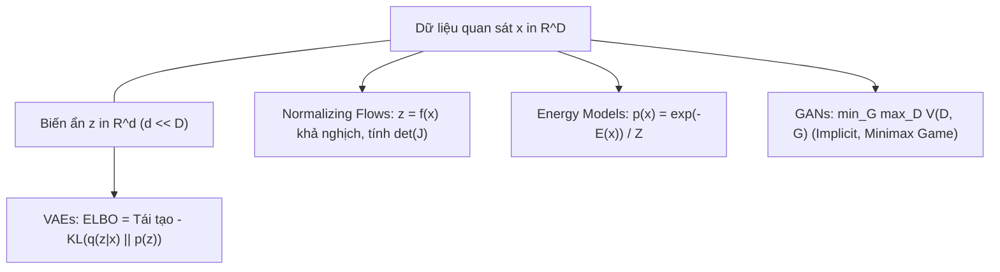
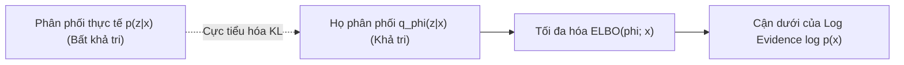
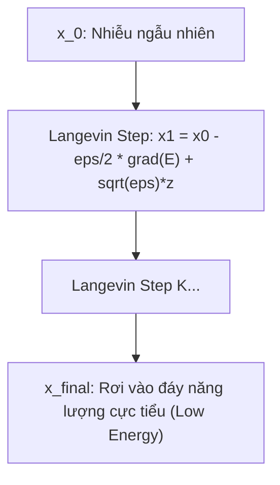
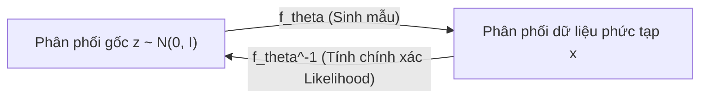
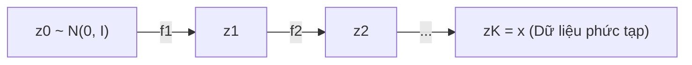
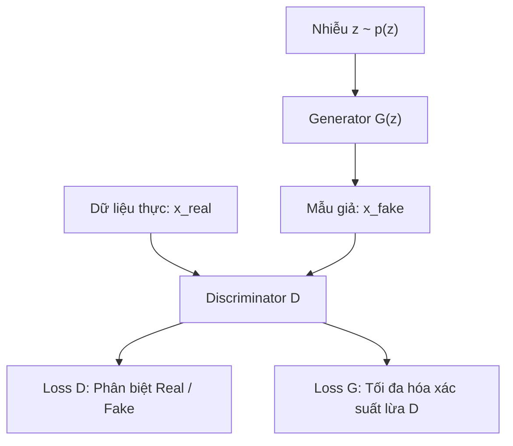
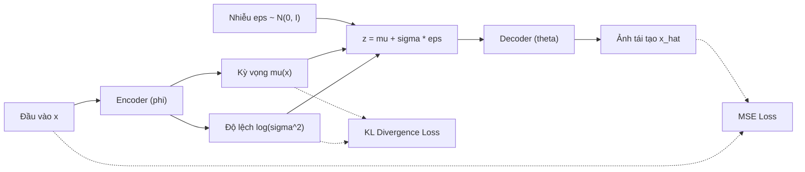

```mermaid
graph TD
    Z["Biến ẩn z ~ p(z) (Không quan sát được)"] -->|"Sinh dữ liệu p_theta(x &#124; z)"| X["Dữ liệu thực x (Quan sát được)"]
    X -.->|"Suy luận biến phân q(z &#124; x)"| Z
```

# Chuyên đề: Biến Ẩn, Biến Phân, Năng lượng, Dòng Chảy & Đối Kháng (Latent Variables, VAEs, Energy & Flow Models)

## 1. Tổng quan Chuyên đề
Trong nhiều bài toán thực tế, dữ liệu quan sát $\mathbf{x} \in \mathbb{R}^D$ có số chiều rất lớn nhưng thực chất lại phân bố trên một đa tạp con (manifold) có số chiều thấp hơn nhiều $\mathbb{R}^d$ ($d \ll D$). **Mô hình Biến Ẩn (Latent Variable Models)** khai thác tính chất này bằng cách giả định sự tồn tại của các biến trạng thái không quan sát được $\mathbf{z} \in \mathbb{R}^d$. Tuy nhiên, việc tính toán phân phối hậu nghiệm thực tế $p(\mathbf{z}|\mathbf{x})$ vấp phải rào cản tích phân bất khả tri (intractable integral).

Để giải quyết vấn đề này, các hướng tiếp cận đột phá đã ra đời:
1. **Suy luận Biến phân (Variational Inference)** và **Variational Autoencoders (VAEs)**: Xấp xỉ hậu nghiệm thông qua cận dưới biến phân ELBO và kỹ thuật tái tham số hóa (reparameterization trick).
2. **Normalizing Flows**: Sử dụng chuỗi các phép biến đổi khả nghịch (invertible) với ma trận Jacobian có thể tính toán chính xác để ánh xạ phân phối phức tạp về phân phối Gauss.
3. **Mô hình Dựa trên Năng lượng (Energy-Based Models - EBMs)**: Định nghĩa hàm mật độ thông qua hàm năng lượng vô hướng của hệ thống vật lý Boltzmann.
4. **Mạng Sinh Đối Kháng (Generative Adversarial Networks - GANs)**: Bỏ qua hàm mật độ xác suất, thiết lập trò chơi hai người minimax giữa Generator và Discriminator.



---

## 2. Chi tiết từng Keyword

---

### 10. Variational Inference (Suy luận Biến phân)

#### a. Định nghĩa Bản chất Toán học (Mathematical Formulation)
**Variational Inference (VI)** là phương pháp xấp xỉ phân phối hậu nghiệm phức tạp, bất khả tri $p(\mathbf{z}|\mathbf{x}) = \frac{p(\mathbf{x}, \mathbf{z})}{p(\mathbf{x})}$ bằng một họ phân phối khả tri $q_\phi(\mathbf{z}|\mathbf{x})$ được tham số hóa bởi $\phi$:
$$q_\phi^*(\mathbf{z}|\mathbf{x}) = \arg\min_\phi \mathbb{D}_{\text{KL}}\Big(q_\phi(\mathbf{z}|\mathbf{x}) \;\parallel\; p(\mathbf{z}|\mathbf{x})\Big)$$
Vì $\mathbb{D}_{\text{KL}}$ chứa $p(\mathbf{x})$ không thể tính được, ta biến đổi đại số:
$$\log p(\mathbf{x}) = \mathbb{E}_{q_\phi(\mathbf{z}|\mathbf{x})}\left[\log \frac{p(\mathbf{x}, \mathbf{z})}{q_\phi(\mathbf{z}|\mathbf{x})}\right] + \mathbb{D}_{\text{KL}}\Big(q_\phi(\mathbf{z}|\mathbf{x}) \;\parallel\; p(\mathbf{z}|\mathbf{x})\Big)$$
Vì $\mathbb{D}_{\text{KL}} \ge 0$, số hạng đầu tiên chính là **Cận dưới Biến phân (Evidence Lower Bound - ELBO)**:
$$\text{ELBO}(\phi, \theta; \mathbf{x}) = \mathbb{E}_{q_\phi(\mathbf{z}|\mathbf{x})}[\log p_\theta(\mathbf{x}|\mathbf{z})] - \mathbb{D}_{\text{KL}}\Big(q_\phi(\mathbf{z}|\mathbf{x}) \;\parallel\; p(\mathbf{z})\Big) \le \log p(\mathbf{x})$$

#### b. Cơ chế Tầng Sâu & Điện toán (Under The Hood / Hardware Internals)
- **Tối ưu hóa Gradient ngẫu nhiên**: Việc tối đa hóa ELBO biến bài toán tính tích phân trên toàn không gian $\mathbb{R}^d$ thành bài toán tối ưu hóa hàm khả vi dựa trên gradient (Stochastic Gradient Variational Bayes - SGVB).
- **Bộ nhớ Cache**: Phân phối $q_\phi(\mathbf{z}|\mathbf{x})$ thường là Gauss đa biến đường chéo (diagonal covariance), chỉ cần dự đoán hai vector kích thước $d$ là $\boldsymbol{\mu}$ và $\log \boldsymbol{\sigma}^2$, tiết kiệm bộ nhớ GPU so với ma trận hiệp phương sai đầy đủ $\mathcal{O}(d^2)$.

#### c. Sơ đồ Minh họa (Mermaid / ASCII Diagram)


#### d. Code Thực chiến (Dual-Engine: C++ & Python)

```cpp
// C++17: Tính KL-Divergence giải tích giữa phân phối Gauss q ~ N(mu, sigma^2) và Prior p ~ N(0, I)
#include <iostream>
#include <vector>
#include <cmath>

float compute_kl_gaussian_prior(const std::vector<float>& mu, const std::vector<float>& logvar) {
    float kl = 0.0f;
    for (size_t i = 0; i < mu.size(); ++i) {
        // KL = -0.5 * sum(1 + log(sigma^2) - mu^2 - sigma^2)
        kl += -0.5f * (1.0f + logvar[i] - mu[i] * mu[i] - std::exp(logvar[i]));
    }
    return kl;
}

int main() {
    std::vector<float> mu = {0.5f, -0.2f, 0.1f};
    std::vector<float> logvar = {-0.1f, 0.2f, -0.05f};
    float kl_div = compute_kl_gaussian_prior(mu, logvar);
    std::cout << "KL Divergence: " << kl_div << " nats\n";
    return 0;
}
```

```python
# Python / PyTorch: Hàm mục tiêu ELBO tiêu chuẩn
import torch
import torch.nn.functional as F

def compute_elbo(x, x_recon, mu, logvar):
    # Reconstruction loss (NLL theo Gaussian hoặc Bernoulli)
    recon_loss = F.mse_loss(x_recon, x, reduction='sum')
    # KL Divergence giải tích
    kl_loss = -0.5 * torch.sum(1 + logvar - mu.pow(2) - logvar.exp())
    # ELBO = -(Recon + KL)
    return -(recon_loss + kl_loss)

x = torch.randn(16, 784)
x_recon = x + 0.1 * torch.randn_like(x)
mu = torch.zeros(16, 32)
logvar = torch.zeros(16, 32)
print(f"ELBO: {compute_elbo(x, x_recon, mu, logvar).item():.2f}")
```

#### e. Lỗi Thường gặp & Ổn định Số học (Pitfalls & Numerical Stability)
- **Posterior Collapse (Sụp đổ Hậu nghiệm)**: Mạng decoder quá mạnh dẫn đến việc bỏ qua biến ẩn $\mathbf{z}$, lúc này $q_\phi(\mathbf{z}|\mathbf{x}) \to p(\mathbf{z})$ và $\mathbb{D}_{\text{KL}} \to 0$. Giải pháp: Áp dụng KL-Annealing hoặc Free Bits.

#### f. Ứng dụng Thực chiến trong AI / Deep Learning (AI Applications)
- Cơ chế suy luận cốt lõi trong Variational Autoencoders (VAEs), Bayesian Neural Networks, và Latent Diffusion Models.

---

### 11. Latent Variable Models (Mô hình Biến Ẩn)

#### a. Định nghĩa Bản chất Toán học (Mathematical Formulation)
**Latent Variable Models (LVMs)** mô tả quá trình sinh dữ liệu thông qua hai bước phân cấp xác suất:
1. Lấy mẫu vector đặc trưng tiềm ẩn từ phân phối tiên nghiệm (prior): $\mathbf{z} \sim p(\mathbf{z})$.
2. Sinh dữ liệu quan sát từ phân phối có điều kiện (likelihood/generator): $\mathbf{x} \sim p_\theta(\mathbf{x} \mid \mathbf{z})$.

Phân phối biên của dữ liệu thực nghiệm là tích phân trên toàn bộ không gian biến ẩn $\mathcal{Z}$:
$$p_\theta(\mathbf{x}) = \int_{\mathcal{Z}} p_\theta(\mathbf{x}, \mathbf{z}) d\mathbf{z} = \int_{\mathcal{Z}} p_\theta(\mathbf{x} \mid \mathbf{z}) p(\mathbf{z}) d\mathbf{z}$$

#### b. Cơ chế Tầng Sâu & Điện toán (Under The Hood / Hardware Internals)
- **Biểu diễn Nén (Disentangled Representation)**: Biến ẩn $\mathbf{z}$ mã hóa các thuộc tính trừu tượng cốt lõi (ví dụ: góc quay, biểu cảm, màu sắc). Khi lưu trữ trên GPU, các vector $\mathbf{z}$ có kích thước rất nhỏ gọn ($d=16, 32, 64$) so với tensor ảnh nguyên bản ($512 \times 512 \times 3$), giảm tải băng thông PCIe khi truyền dữ liệu.

#### c. Sơ đồ Minh họa (Mermaid / ASCII Diagram)


#### d. Code Thực chiến (Dual-Engine: C++ & Python)

```cpp
// C++17: Cấu trúc biểu diễn Latent Space và nội suy tuyến tính (SLERP)
#include <iostream>
#include <vector>
#include <cmath>

std::vector<float> slerp(const std::vector<float>& z1, const std::vector<float>& z2, float t) {
    float dot = 0.0f;
    for (size_t i = 0; i < z1.size(); ++i) dot += z1[i] * z2[i];
    
    // Giới hạn trong [-1, 1]
    dot = std::max(-1.0f, std::min(1.0f, dot));
    float theta = std::acos(dot) * t;
    
    std::vector<float> z_interp(z1.size());
    float sin_full = std::sin(std::acos(dot));
    if (sin_full < 1e-5f) return z1;

    float s1 = std::sin((1.0f - t) * std::acos(dot)) / sin_full;
    float s2 = std::sin(t * std::acos(dot)) / sin_full;
    for (size_t i = 0; i < z1.size(); ++i) {
        z_interp[i] = s1 * z1[i] + s2 * z2[i];
    }
    return z_interp;
}

int main() {
    std::vector<float> z1 = {1.0f, 0.0f};
    std::vector<float> z2 = {0.0f, 1.0f};
    auto z_mid = slerp(z1, z2, 0.5f);
    std::cout << "SLERP midpoint: [" << z_mid[0] << ", " << z_mid[1] << "]\n";
    return 0;
}
```

```python
# Python / PyTorch: Lấy mẫu và nội suy không gian tiềm ẩn
import torch

z_start = torch.randn(1, 16)
z_end = torch.randn(1, 16)
alphas = torch.linspace(0, 1, steps=5)

# Nội suy tuyến tính (Linear Interpolation)
interpolated_latents = torch.stack([(1 - a) * z_start + a * z_end for a in alphas])
print(f"Interpolated latent trajectory shape: {interpolated_latents.shape}")
```

#### e. Lỗi Thường gặp & Ổn định Số học (Pitfalls & Numerical Stability)
- **Intractable Marginal**: Không thể tính tích phân số học trực tiếp (Numerical Quadrature) khi số chiều biến ẩn $d > 4$ do bùng nổ cấp số nhân số điểm lưới (Curse of Dimensionality).

#### f. Ứng dụng Thực chiến trong AI / Deep Learning (AI Applications)
- Phân tích nhân tố (Factor Analysis), Gaussian Mixture Models, VAE, Stable Diffusion Latent Space.

---

### 12. Energy-Based Models (Mô hình Dựa trên Năng lượng)

#### a. Định nghĩa Bản chất Toán học (Mathematical Formulation)
**Energy-Based Models (EBMs)** định nghĩa phân phối xác suất thông qua một hàm năng lượng vô hướng khả vi $E_\theta(\mathbf{x}) \in \mathbb{R}$ gán cho mỗi trạng thái $\mathbf{x}$:
$$p_\theta(\mathbf{x}) = \frac{\exp\big(-E_\theta(\mathbf{x})\big)}{Z(\theta)}$$
Trong đó $Z(\theta) = \int_{\mathcal{X}} \exp\big(-E_\theta(\mathbf{x})\big) d\mathbf{x}$ là **hàm phân phối (Partition Function)**. Các trạng thái có cấu trúc hợp lệ sẽ có mức năng lượng thấp $E_\theta(\mathbf{x}) \to -\infty$, và dữ liệu nhiễu loạn sẽ có năng lượng cao.
Đạo hàm của hàm log-likelihood đối với tham số $\theta$ không cần tính trực tiếp $Z(\theta)$:
$$\nabla_\theta \log p_\theta(\mathbf{x}) = -\nabla_\theta E_\theta(\mathbf{x}) + \mathbb{E}_{\mathbf{x}' \sim p_\theta(\mathbf{x}')}[\nabla_\theta E_\theta(\mathbf{x}')]$$

#### b. Cơ chế Tầng Sâu & Điện toán (Under The Hood / Hardware Internals)
- **Lấy mẫu Markov Chain Monte Carlo (MCMC)**: Để tính kỳ vọng thứ hai, mô hình sử dụng thuật toán **Langevin Dynamics**:
$$\mathbf{x}_{k+1} = \mathbf{x}_k - \frac{\epsilon}{2} \nabla_\mathbf{x} E_\theta(\mathbf{x}_k) + \sqrt{\epsilon} \, \mathbf{z}_k, \quad \mathbf{z}_k \sim \mathcal{N}(0, \mathbf{I})$$
Quá trình này đòi hỏi tính đạo hàm bậc một của năng lượng đối với dữ liệu đầu vào $\nabla_\mathbf{x} E_\theta$, yêu cầu kích hoạt chế độ `create_graph=True` trên GPU, làm tăng gấp đôi thời gian thực thi của một step.

#### c. Sơ đồ Minh họa (Mermaid / ASCII Diagram)


#### d. Code Thực chiến (Dual-Engine: C++ & Python)

```cpp
// C++17: Mô phỏng 1 bước cập nhật Langevin Dynamics
#include <iostream>
#include <vector>
#include <random>

void langevin_step(std::vector<float>& x, const std::vector<float>& grad_energy, float step_size, std::mt19937& rng) {
    std::normal_distribution<float> noise(0.0f, 1.0f);
    float noise_scale = std::sqrt(step_size);
    
    for (size_t i = 0; i < x.size(); ++i) {
        // Gradient descent theo năng lượng + thêm nhiễu Brown
        x[i] -= 0.5f * step_size * grad_energy[i] + noise_scale * noise(rng);
    }
}

int main() {
    std::mt19937 rng(42);
    std::vector<float> x = {2.0f, -1.5f};
    std::vector<float> grad_E = {4.0f, -3.0f}; // Grad của E = x^2
    langevin_step(x, grad_E, 0.01f, rng);
    std::cout << "Next state: [" << x[0] << ", " << x[1] << "]\n";
    return 0;
}
```

```python
# Python / PyTorch: Triển khai Langevin Dynamics lấy mẫu từ Energy Model
import torch
import torch.nn as nn

class EnergyFunction(nn.Module):
    def __init__(self):
        super().__init__()
        self.net = nn.Sequential(nn.Linear(2, 64), nn.SiLU(), nn.Linear(64, 1))
    def forward(self, x):
        return self.net(x)

energy_net = EnergyFunction()
x = torch.randn(10, 2, requires_grad=True)
step_size = 0.05

for step in range(20):
    E = energy_net(x).sum()
    grad_x = torch.autograd.grad(E, x)[0]
    with torch.no_grad():
        x = x - 0.5 * step_size * grad_x + (step_size ** 0.5) * torch.randn_like(x)
    x.requires_grad_(True)

print(f"Sample sau 20 bước Langevin: {x[0].detach().numpy()}")
```

#### e. Lỗi Thường gặp & Ổn định Số học (Pitfalls & Numerical Stability)
- **MCMC Mixing Problem**: Chuỗi Markov dễ bị kẹt trong các hố thế năng cực tiểu cục bộ (local minima), không thể khám phá hết các mode khác của phân phối dữ liệu đa mode.

#### f. Ứng dụng Thực chiến trong AI / Deep Learning (AI Applications)
- Mô hình hóa phân tử hóa học (Molecular Conformation Generation), thiết kế protein, lý thuyết nền tảng tiền thân của Score-Based Diffusion Models.

---

### 13. Flow-Based Models (Mô hình Dựa trên Dòng chảy)

#### a. Định nghĩa Bản chất Toán học (Mathematical Formulation)
**Flow-Based Models** mô hình hóa phân phối phức tạp của dữ liệu $\mathbf{x} \in \mathbb{R}^D$ bằng cách truyền một biến ngẫu nhiên đơn giản $\mathbf{z} \sim p_Z(\mathbf{z})$ (thường là $\mathcal{N}(0, \mathbf{I})$) qua một hàm ánh xạ song ánh (bijective), khả vi hai chiều $f_\theta: \mathcal{Z} \to \mathcal{X}$:
$$\mathbf{x} = f_\theta(\mathbf{z}), \qquad \mathbf{z} = f_\theta^{-1}(\mathbf{x})$$
Dựa vào định lý đổi biến xác suất (Change of Variables Theorem), hàm mật độ chính xác được tính tường minh:
$$p_X(\mathbf{x}) = p_Z\big(f_\theta^{-1}(\mathbf{x})\big) \cdot \left| \det \left( \frac{\partial f_\theta^{-1}(\mathbf{x})}{\partial \mathbf{x}} \right) \right|$$
Lấy logarit tự nhiên:
$$\log p_X(\mathbf{x}) = \log p_Z\big(f_\theta^{-1}(\mathbf{x})\big) + \log \left| \det J_{f_\theta^{-1}}(\mathbf{x}) \right|$$

#### b. Cơ chế Tầng Sâu & Điện toán (Under The Hood / Hardware Internals)
- **Đảo ngược Không cần Huấn luyện (Zero-overhead Inversion)**: Kiến trúc flow cho phép dùng chung trọng số $\theta$ cho cả tác vụ mã hóa (Inference/Density estimation) và giải mã (Generation), đảm bảo không mất mát thông tin (information-preserving transformation).
- **Yêu cầu Băng thông**: Do kích thước không gian biến ẩn $\mathcal{Z}$ bằng đúng kích thước không gian dữ liệu $\mathcal{X}$ ($D = d$), bộ nhớ lưu trữ các trạng thái trung gian trong chuỗi flow rất lớn, đòi hỏi tối ưu bộ nhớ đệm.

#### c. Sơ đồ Minh họa (Mermaid / ASCII Diagram)


#### d. Code Thực chiến (Dual-Engine: C++ & Python)

```cpp
// C++17: Biến đổi 1 chiều khả nghịch f(z) = s*z + t (Affine Flow)
#include <iostream>
#include <cmath>

struct AffineFlow1D {
    float scale;
    float shift;

    float forward(float z) const { return scale * z + shift; }
    float inverse(float x) const { return (x - shift) / scale; }
    float log_det_jacobian() const { return -std::log(std::abs(scale)); }
};

int main() {
    AffineFlow1D flow{2.0f, 1.5f};
    float z = 0.5f;
    float x = flow.forward(z);
    float z_rec = flow.inverse(x);
    std::cout << "Original z: " << z << " -> x: " << x << " -> Reconstructed z: " << z_rec << "\n";
    std::cout << "Log Det Jacobian (inverse): " << flow.log_det_jacobian() << "\n";
    return 0;
}
```

```python
# Python / PyTorch: Affine Coupling Layer trong RealNVP
import torch
import torch.nn as nn

class AffineCoupling(nn.Module):
    def __init__(self, dim):
        super().__init__()
        self.split_dim = dim // 2
        self.s_net = nn.Sequential(nn.Linear(self.split_dim, 64), nn.ReLU(), nn.Linear(64, self.split_dim))
        self.t_net = nn.Sequential(nn.Linear(self.split_dim, 64), nn.ReLU(), nn.Linear(64, self.split_dim))

    def forward(self, x):
        x1, x2 = x[:, :self.split_dim], x[:, self.split_dim:]
        s = torch.tanh(self.s_net(x1))
        t = self.t_net(x1)
        z2 = x2 * torch.exp(s) + t
        z = torch.cat([x1, z2], dim=-1)
        log_det = s.sum(dim=-1)
        return z, log_det

layer = AffineCoupling(4)
x = torch.randn(2, 4)
z, log_det = layer(x)
print("Coupling output shape:", z.shape, "Log det:", log_det.detach().numpy())
```

#### e. Lỗi Thường gặp & Ổn định Số học (Pitfalls & Numerical Stability)
- **Bảo toàn số chiều khắt khe**: Kích thước biến ẩn bắt buộc phải bằng kích thước dữ liệu ảnh đầu vào ($D=d$), không cho phép nén giảm chiều dẫn đến chi phí tính toán rất lớn khi xử lý ảnh phân giải cao.

#### f. Ứng dụng Thực chiến trong AI / Deep Learning (AI Applications)
- RealNVP, Glow (sinh ảnh chân dung chất lượng cao bằng flow), WaveGlow trong tổng hợp tiếng nói âm thanh.

---

### 14. Normalizing Flows (Dòng Chuẩn hóa)

#### a. Định nghĩa Bản chất Toán học (Mathematical Formulation)
**Normalizing Flows** mở rộng mô hình flow đơn lẻ thành một chuỗi $K$ phép biến đổi khả nghịch liên tiếp:
$$\mathbf{x} = \mathbf{z}_K = f_K \circ f_{K-1} \circ \dots \circ f_1(\mathbf{z}_0), \quad \mathbf{z}_0 \sim p_0(\mathbf{z}_0) = \mathcal{N}(0, \mathbf{I})$$
Nhờ quy tắc đạo hàm hàm hợp (Chain Rule), ma trận Jacobian của toàn bộ chuỗi biến đổi là tích của các ma trận Jacobian từng tầng, do đó log định thức chỉ đơn giản là tổng các log định thức cục bộ:
$$\log p_X(\mathbf{x}) = \log p_0\big(f^{-1}(\mathbf{x})\big) - \sum_{k=1}^K \log \left| \det \left( \frac{\partial f_k(\mathbf{z}_{k-1})}{\partial \mathbf{z}_{k-1}} \right) \right|$$
Từ "Normalizing" xuất phát từ việc phép biến đổi ngược $f^{-1}$ biến phân phối dữ liệu thực phức tạp thành một phân phối Gauss chuẩn (Standard Normal).

#### b. Cơ chế Tầng Sâu & Điện toán (Under The Hood / Hardware Internals)
- **ActNorm & Invertible $1 \times 1$ Convolution**: Để tăng khả năng biểu diễn không gian, các kiến trúc như GLOW sử dụng Invertible $1 \times 1$ Convolution với phân rã LU ($W = P L (U + \text{diag}(s))$). Cơ chế này cho phép tính log định thức ma trận trọng số $W$ trong $\mathcal{O}(C)$ thay vì $\mathcal{O}(C^3)$ trên GPU Tensor Cores.

#### c. Sơ đồ Minh họa (Mermaid / ASCII Diagram)


#### d. Code Thực chiến (Dual-Engine: C++ & Python)

```cpp
// C++17: Chuỗi biến đổi Normalizing Flow nhiều tầng
#include <iostream>
#include <vector>
#include <memory>
#include <cmath>

class FlowLayer {
public:
    virtual ~FlowLayer() = default;
    virtual float forward(float z, float& log_det) const = 0;
};

class ScaleShiftLayer : public FlowLayer {
private:
    float scale_, shift_;
public:
    ScaleShiftLayer(float s, float t) : scale_(s), shift_(t) {}
    float forward(float z, float& log_det) const override {
        log_det += std::log(std::abs(scale_));
        return scale_ * z + shift_;
    }
};

int main() {
    std::vector<std::unique_ptr<FlowLayer>> chain;
    chain.push_back(std::make_unique<ScaleShiftLayer>(1.5f, 0.5f));
    chain.push_back(std::make_unique<ScaleShiftLayer>(0.8f, -1.0f));

    float z = 0.0f;
    float total_log_det = 0.0f;
    for (const auto& layer : chain) {
        z = layer->forward(z, total_log_det);
    }
    std::cout << "Transformed z: " << z << " | Total Log Det: " << total_log_det << "\n";
    return 0;
}
```

```python
# Python / PyTorch: Chuỗi Normalizing Flow gồm nhiều Coupling Layers
import torch
import torch.nn as nn

class ToyFlowSequence(nn.Module):
    def __init__(self, layers_count=4, dim=2):
        super().__init__()
        self.scales = nn.ParameterList([nn.Parameter(torch.ones(dim)) for _ in range(layers_count)])
        self.shifts = nn.ParameterList([nn.Parameter(torch.zeros(dim)) for _ in range(layers_count)])

    def forward(self, z):
        log_det_sum = 0.0
        for s, t in zip(self.scales, self.shifts):
            z = z * s.exp() + t
            log_det_sum += s.sum()
        return z, log_det_sum

flow = ToyFlowSequence()
z = torch.randn(5, 2)
x, log_det = flow(z)
print("Flow transform complete. Log Det:", log_det.item())
```

#### e. Lỗi Thường gặp & Ổn định Số học (Pitfalls & Numerical Stability)
- **Ill-conditioned Jacobian**: Nếu giá trị scale $s \to 0$ hoặc $s \to \infty$, nghịch đảo ma trận Jacobian sẽ gặp lỗi chia cho 0 hoặc tràn số làm tê liệt quá trình huấn luyện.

#### f. Ứng dụng Thực chiến trong AI / Deep Learning (AI Applications)
- Ước lượng mật độ trong bài toán vật lý thiên văn, mô hình hóa phân phối tiềm ẩn linh hoạt cho VAEs (Normalizing Flows as Priors).

---

### 15. Generative Adversarial Networks (Mạng Sinh Đối Kháng)

#### a. Định nghĩa Bản chất Toán học (Mathematical Formulation)
**Generative Adversarial Networks (GANs)** thiết lập bài toán tối ưu hóa theo lý thuyết trò chơi hai người có tổng bằng không (Zero-Sum Minimax Game) giữa hai mạng nơ-ron:
- **Generator $G_\theta$**: Ánh xạ vector nhiễu ngẫu nhiên $\mathbf{z} \sim p_z(\mathbf{z})$ thành mẫu giả $\tilde{\mathbf{x}} = G_\theta(\mathbf{z})$ nhằm đánh lừa Discriminator.
- **Discriminator $D_\phi$**: Phân biệt giữa mẫu thực $\mathbf{x} \sim p_{\text{data}}$ và mẫu giả $\tilde{\mathbf{x}} \sim p_g$.

Hàm mục tiêu Minimax:
$$\min_G \max_D V(D, G) = \mathbb{E}_{\mathbf{x} \sim p_{\text{data}}}[\log D(\mathbf{x})] + \mathbb{E}_{\mathbf{z} \sim p_z}[\log(1 - D(G(\mathbf{z})))]$$
Khi Discriminator đạt tối ưu $D^*(\mathbf{x}) = \frac{p_{\text{data}}(\mathbf{x})}{p_{\text{data}}(\mathbf{x}) + p_g(\mathbf{x})}$, hàm mục tiêu của Generator tương đương với việc cực tiểu hóa độ phân kỳ Jensen-Shannon:
$$V(D^*, G) = -\log(4) + 2 \cdot \mathbb{D}_{\text{JS}}\Big(p_{\text{data}} \;\parallel\; p_g\Big)$$

#### b. Cơ chế Tầng Sâu & Điện toán (Under The Hood / Hardware Internals)
- **Chiến lược Huấn luyện Đối nghịch trên GPU**: Mỗi bước lặp đòi hỏi 2 lượt cập nhật gradient riêng biệt (thường cập nhật $D$ một hoặc nhiều lần, sau đó cập nhật $G$).
- **Spectral Normalization**: Để thỏa mãn điều kiện 1-Lipschitz trong Wasserstein GAN (WGAN-GP), ma trận trọng số của Discriminator được chia cho trị riêng cực đại (Spectral Norm $\sigma(W)$), tính toán qua thuật toán Power Iteration trên GPU sau mỗi step.

#### c. Sơ đồ Minh họa (Mermaid / ASCII Diagram)


#### d. Code Thực chiến (Dual-Engine: C++ & Python)

```cpp
// C++17: Thuật toán Power Iteration tìm Spectral Norm (Trị riêng lớn nhất của ma trận W)
#include <iostream>
#include <vector>
#include <cmath>
#include <numeric>

float power_iteration(const std::vector<float>& W, size_t dim, size_t iterations = 5) {
    std::vector<float> u(dim, 1.0f / std::sqrt(static_cast<float>(dim)));
    std::vector<float> v(dim, 0.0f);

    for (size_t it = 0; it < iterations; ++it) {
        // v = W^T * u
        for (size_t j = 0; j < dim; ++j) {
            v[j] = 0.0f;
            for (size_t i = 0; i < dim; ++i) v[j] += W[i * dim + j] * u[i];
        }
        // Chuẩn hóa v
        float norm_v = 0.0f;
        for (float val : v) norm_v += val * val;
        norm_v = std::sqrt(norm_v);
        for (float& val : v) val /= (norm_v + 1e-8f);

        // u = W * v
        for (size_t i = 0; i < dim; ++i) {
            u[i] = 0.0f;
            for (size_t j = 0; j < dim; ++j) u[i] += W[i * dim + j] * v[j];
        }
        // Chuẩn hóa u
        float norm_u = 0.0f;
        for (float val : u) norm_u += val * val;
        norm_u = std::sqrt(norm_u);
        for (float& val : u) val /= (norm_u + 1e-8f);
    }

    // sigma = u^T * W * v
    float sigma = 0.0f;
    for (size_t i = 0; i < dim; ++i) {
        float row_val = 0.0f;
        for (size_t j = 0; j < dim; ++j) row_val += W[i * dim + j] * v[j];
        sigma += u[i] * row_val;
    }
    return sigma;
}

int main() {
    std::vector<float> W = {2.0f, 1.0f, 1.0f, 3.0f}; // 2x2 matrix
    std::cout << "Spectral norm of W: " << power_iteration(W, 2) << "\n";
    return 0;
}
```

```python
# Python / PyTorch: Bước huấn luyện cơ bản của DCGAN
import torch
import torch.nn as nn

D = nn.Sequential(nn.Linear(784, 128), nn.LeakyReLU(0.2), nn.Linear(128, 1), nn.Sigmoid())
G = nn.Sequential(nn.Linear(64, 128), nn.ReLU(), nn.Linear(128, 784), nn.Tanh())

opt_D = torch.optim.Adam(D.parameters(), lr=2e-4)
opt_G = torch.optim.Adam(G.parameters(), lr=2e-4)
criterion = nn.BCELoss()

# 1 Bước Forward-Backward thực chiến
real_data = torch.randn(16, 784)
z = torch.randn(16, 64)

# Huấn luyện Discriminator
D.zero_grad()
loss_real = criterion(D(real_data), torch.ones(16, 1))
fake_data = G(z)
loss_fake = criterion(D(fake_data.detach()), torch.zeros(16, 1))
loss_D = loss_real + loss_fake
loss_D.backward()
opt_D.step()

# Huấn luyện Generator (Đánh lừa D)
G.zero_grad()
loss_G = criterion(D(fake_data), torch.ones(16, 1))
loss_G.backward()
opt_G.step()
print(f"Loss D: {loss_D.item():.4f} | Loss G: {loss_G.item():.4f}")
```

#### e. Lỗi Thường gặp & Ổn định Số học (Pitfalls & Numerical Stability)
- **Gradient Vanishing**: Khi Discriminator quá mạnh ($D \to 1$ với real và $D \to 0$ với fake), $\log(1 - D(G(\mathbf{z})))$ bão hòa dẫn đến đạo hàm triệt tiêu. Giải pháp: Tối đa hóa $\log D(G(\mathbf{z}))$ (Non-saturating heuristic).
- **Mode Collapse**: Generator chỉ tìm ra một ảnh duy nhất đánh lừa được Discriminator và liên tục sinh ra đúng ảnh đó.

#### f. Ứng dụng Thực chiến trong AI / Deep Learning (AI Applications)
- Tăng độ phân giải siêu nét (SRGAN, ESRGAN), chuyển đổi phong cách ảnh (CycleGAN, Pix2Pix), sinh khuôn mặt siêu thực (StyleGAN3).

---

### 16. Variational Autoencoders (Bộ Tự Mã hóa Biến phân)

#### a. Định nghĩa Bản chất Toán học (Mathematical Formulation)
**Variational Autoencoders (VAEs)** là mô hình sinh kết hợp mạng nơ-ron sâu với phương pháp suy luận biến phân ngẫu nhiên. Kiến trúc gồm hai thành phần:
1. **Encoder (Mạng Suy luận)**: $q_\phi(\mathbf{z}|\mathbf{x}) = \mathcal{N}\big(\boldsymbol{\mu}_\phi(\mathbf{x}), \text{diag}(\boldsymbol{\sigma}_\phi^2(\mathbf{x}))\big)$
2. **Decoder (Mạng Sinh)**: $p_\theta(\mathbf{x}|\mathbf{z})$

Hàm mất mát là đối số âm của cận dưới biến phân ELBO:
$$\mathcal{L}_{\text{VAE}}(\theta, \phi; \mathbf{x}) = \mathbb{E}_{q_\phi(\mathbf{z}|\mathbf{x})}[-\log p_\theta(\mathbf{x}|\mathbf{z})] + \mathbb{D}_{\text{KL}}\Big(q_\phi(\mathbf{z}|\mathbf{x}) \;\parallel\; \mathcal{N}(0, \mathbf{I})\Big)$$
**Reparameterization Trick**: Để gradient từ Decoder có thể truyền ngược qua thao tác lấy mẫu ngẫu nhiên về Encoder, biến ngẫu nhiên $\mathbf{z}$ được tách thành thành phần xác định và nhiễu độc lập:
$$\mathbf{z} = \boldsymbol{\mu}_\phi(\mathbf{x}) + \boldsymbol{\sigma}_\phi(\mathbf{x}) \odot \boldsymbol{\epsilon}, \quad \boldsymbol{\epsilon} \sim \mathcal{N}(0, \mathbf{I})$$

#### b. Cơ chế Tầng Sâu & Điện toán (Under The Hood / Hardware Internals)
- **Truyền Gradient xuyên qua phép lấy mẫu (Backpropagation Through Randomness)**: Nhờ có Reparameterization Trick, node lấy mẫu trở thành phép toán số học khả vi: cộng và nhân ma trận элементар (Element-wise). Đồ thị đạo hàm tự động của PyTorch/CUDA không bị đứt gãy.
- **Tính toán song song**: Quá trình tái tạo toàn bộ batch diễn ra song song hoàn toàn trên Tensor Cores mà không cần vòng lặp hồi quy.

#### c. Sơ đồ Minh họa (Mermaid / ASCII Diagram)


#### d. Code Thực chiến (Dual-Engine: C++ & Python)

```cpp
// C++17: Triển khai Reparameterization Trick và Backward Pass cục bộ cho z
#include <iostream>
#include <vector>
#include <random>

struct ReparamOutput {
    std::vector<float> z;
    std::vector<float> eps;
};

ReparamOutput reparameterize(const std::vector<float>& mu, const std::vector<float>& logvar, std::mt19937& rng) {
    std::normal_distribution<float> norm(0.0f, 1.0f);
    size_t dim = mu.size();
    ReparamOutput out{std::vector<float>(dim), std::vector<float>(dim)};

    for (size_t i = 0; i < dim; ++i) {
        out.eps[i] = norm(rng);
        float std = std::exp(0.5f * logvar[i]);
        out.z[i] = mu[i] + std * out.eps[i]; // z = mu + sigma * eps
    }
    return out;
}

int main() {
    std::mt19937 rng(1337);
    std::vector<float> mu = {0.0f, 1.0f};
    std::vector<float> logvar = {0.0f, 0.0f}; // sigma = 1
    auto sample = reparameterize(mu, logvar, rng);
    std::cout << "Latent z: [" << sample.z[0] << ", " << sample.z[1] << "]\n";
    return 0;
}
```

```python
# Python / PyTorch: Kiến trúc chuẩn của một VAE hoàn chỉnh
import torch
import torch.nn as nn
import torch.nn.functional as F

class VAE(nn.Module):
    def __init__(self, in_dim=784, latent_dim=32):
        super().__init__()
        self.encoder = nn.Sequential(nn.Linear(in_dim, 256), nn.ReLU())
        self.fc_mu = nn.Linear(256, latent_dim)
        self.fc_logvar = nn.Linear(256, latent_dim)
        
        self.decoder = nn.Sequential(
            nn.Linear(latent_dim, 256),
            nn.ReLU(),
            nn.Linear(256, in_dim),
            nn.Sigmoid()
        )

    def reparameterize(self, mu, logvar):
        std = torch.exp(0.5 * logvar)
        eps = torch.randn_like(std)
        return mu + eps * std

    def forward(self, x):
        h = self.encoder(x)
        mu, logvar = self.fc_mu(h), self.fc_logvar(h)
        z = self.reparameterize(mu, logvar)
        x_recon = self.decoder(z)
        return x_recon, mu, logvar

model = VAE()
x = torch.rand(4, 784)
x_recon, mu, logvar = model(x)
print(f"Reconstructed shape: {x_recon.shape}, Latent shape: {mu.shape}")
```

#### e. Lỗi Thường gặp & Ổn định Số học (Pitfalls & Numerical Stability)
- **Mờ ảnh tái tạo (Blurriness Problem)**: Việc sử dụng hàm mất mát $\mathcal{L}_2$ (MSE) khiến decoder có xu hướng tính trung bình cộng của tất cả các cấu trúc có thể xảy ra, làm mất các chi tiết tần số cao.
- **Tràn số khi tính $\exp(\text{logvar})$**: Giá trị `logvar` dự đoán từ Linear Layer có thể quá lớn ($>80$), cần kẹp (clamp) trong khoảng $[-30, 20]$.

#### f. Ứng dụng Thực chiến trong AI / Deep Learning (AI Applications)
- Không gian nén tiềm ẩn cho Stable Diffusion (AutoencoderKL), mô hình hóa chuyển động nhân vật trong đồ họa 3D, phát hiện gian lận tài chính.
