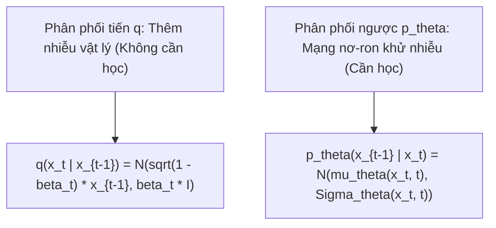
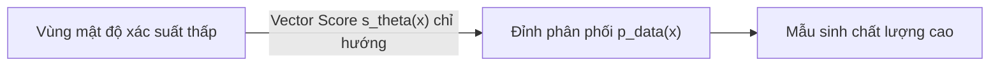
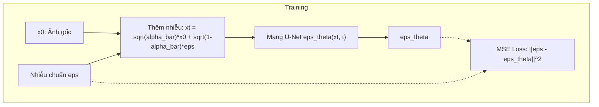
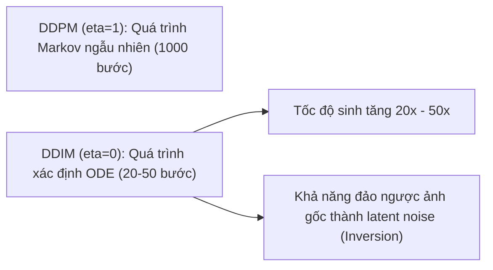
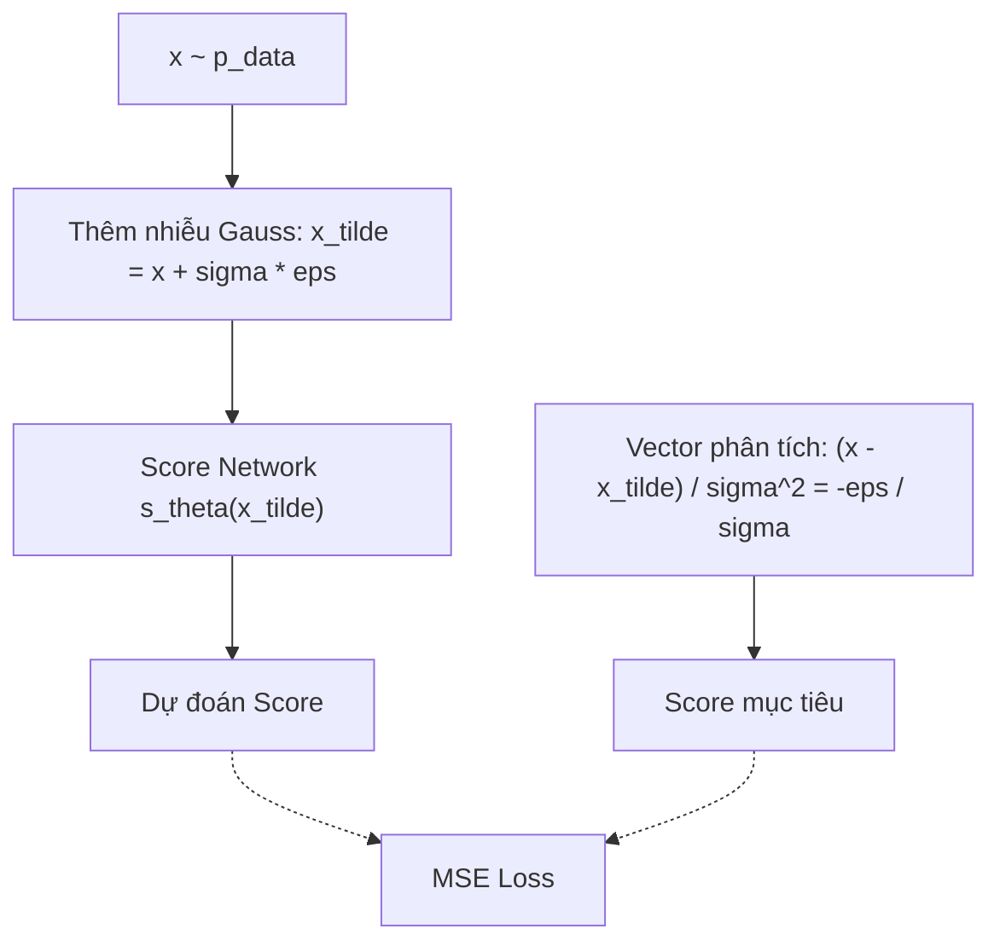
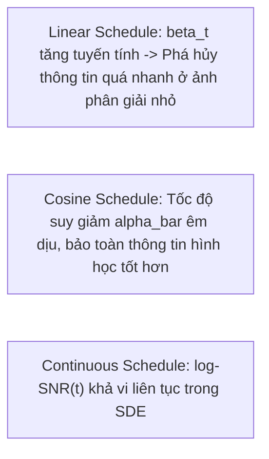
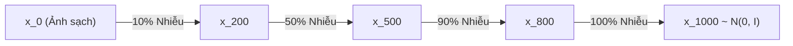
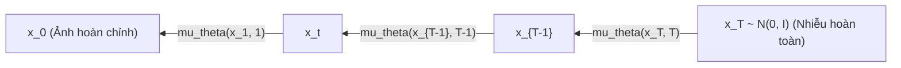
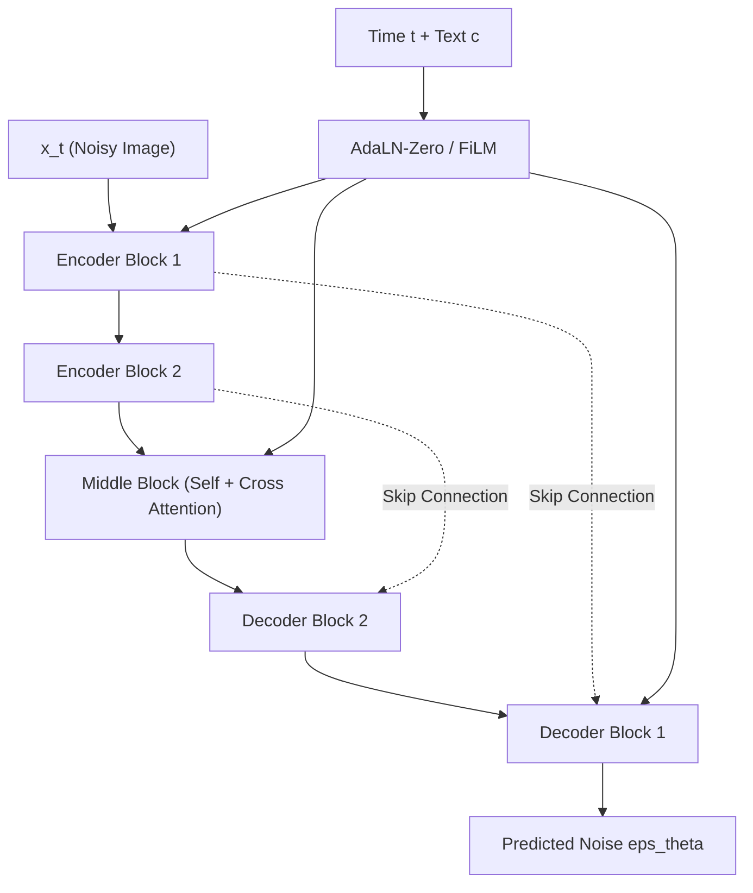

# Chuyên đề: Nền tảng Mô hình Khuếch tán, DDPM, DDIM & Khớp Điểm số (Diffusion Foundations, DDPM, DDIM & Score Matching)

## 1. Tổng quan Chuyên đề
**Mô hình Khuếch tán (Diffusion Models)** là bước đột phá vĩ đại nhất của Generative AI trong thị giác máy tính và sinh dữ liệu đa phương tiện, vượt qua giới hạn về độ ổn định của GANs và chất lượng hình ảnh của VAEs. Xuất phát từ cơ sở nhiệt động lực học phi cân bằng (Non-equilibrium Thermodynamics) và phương trình vi phân ngẫu nhiên (Stochastic Differential Equations - SDEs), mô hình khuếch tán hoạt động dựa trên hai quá trình đối ngẫu:
1. **Quá trình Khuếch tán Tiến (Forward Process)**: Dần dần phá hủy cấu trúc của dữ liệu ban đầu $\mathbf{x}_0$ bằng cách thêm nhiễu Gauss qua $T$ bước thời gian rời rạc hoặc liên tục, biến dữ liệu thành nhiễu trắng thuần túy $\mathbf{x}_T \sim \mathcal{N}(0, \mathbf{I})$.
2. **Quá trình Khuếch tán Ngược (Reverse / Denoising Process)**: Sử dụng một mạng nơ-ron sâu (Denoising Network, điển hình là U-Net hoặc DiT) để học cách đảo ngược từng bước thêm nhiễu, từng bước phục hồi lại cấu trúc nguyên bản từ một mẫu nhiễu ngẫu nhiên.

Chuyên đề này cung cấp toàn cảnh toán học giải tích từ **DDPM (Sohl-Dickstein et al., Ho et al.)**, kỹ thuật tăng tốc lấy mẫu phi ngẫu nhiên **DDIM (Song et al.)**, mối liên hệ sâu sắc với **Score Matching (Hyvärinen, Song & Ermon)** và các chiến lược lập lịch nhiễu (**Noise Schedules**).

```mermaid
graph LR
    x0["Dữ liệu thực x_0"] -->|"Forward Process: q(x_t  &#124;  x_{t-1})"| xt["Trạng thái trung gian x_t"]
    xt -->|Thêm nhiễu Gauss| xT["Nhiễu thuần x_T ~ N(0, I)"]
    xT -->|"Reverse Process: p_theta(x_{t-1}  &#124;  x_t)"| xt_rev["Khử nhiễu từng bước"]
    xt_rev -->|Denoising Network epsilon_theta| x0_hat["Ảnh sinh chất lượng cao x_0*"]
```



---

## 2. Chi tiết từng Keyword

---

### 17. Diffusion Models (Mô hình Khuếch tán)

#### a. Định nghĩa Bản chất Toán học (Mathematical Formulation)
**Diffusion Models** là một lớp mô hình sinh tham số định nghĩa một chuỗi Markov gồm các biến ẩn $\mathbf{x}_1, \dots, \mathbf{x}_T$ có cùng số chiều không gian với dữ liệu quan sát $\mathbf{x}_0 \sim q(\mathbf{x}_0)$.
Mục tiêu là mô hình hóa quá trình ngược $p_\theta(\mathbf{x}_{0:T})$ để xấp xỉ quá trình tiến $q(\mathbf{x}_{1:T} \mid \mathbf{x}_0)$:
$$q(\mathbf{x}_{1:T} \mid \mathbf{x}_0) = \prod_{t=1}^T q(\mathbf{x}_t \mid \mathbf{x}_{t-1}), \qquad p_\theta(\mathbf{x}_{0:T}) = p(\mathbf{x}_T) \prod_{t=1}^T p_\theta(\mathbf{x}_{t-1} \mid \mathbf{x}_t)$$
Hàm mất mát huấn luyện tối ưu hóa cận dưới biến phân âm của hàm hợp lý (Variational Bound on Negative Log-Likelihood):
$$\mathcal{L}_{\text{VLB}} = \mathbb{E}_{q}\left[ -\log p(\mathbf{x}_T) - \sum_{t \ge 1} \log \frac{p_\theta(\mathbf{x}_{t-1} \mid \mathbf{x}_t)}{q(\mathbf{x}_t \mid \mathbf{x}_{t-1})} \right]$$

#### b. Cơ chế Tầng Sâu & Điện toán (Under The Hood / Hardware Internals)
- **Độ phức tạp Tính toán**: Quá trình huấn luyện không cần unroll toàn bộ $T=1000$ bước liên tiếp mà có thể lấy mẫu ngẫu nhiên độc lập từng bước thời gian $t \sim \mathcal{U}(1, T)$ cho mỗi mẫu trong batch, cho phép song song hóa $100\%$ trên GPU.
- **Inference Bottleneck**: Trong suy luận cổ điển, việc giải lặp $T$ bước khử nhiễu tuần tự đòi hỏi $T$ lần forward pass qua mạng tham số lớn (hàng tỷ tham số), dẫn đến độ trễ sinh rất cao (vài giây đến vài chục giây cho một bức ảnh).

#### c. Sơ đồ Minh họa (Mermaid / ASCII Diagram)


#### d. Code Thực chiến (Dual-Engine: C++ & Python)

```cpp
// C++17: Cấu trúc tính toán các hệ số tích lũy alpha_bar trong Diffusion
#include <iostream>
#include <vector>
#include <cmath>

struct DiffusionCoefficients {
    std::vector<float> betas;
    std::vector<float> alphas;
    std::vector<float> alphas_cumprod;
    std::vector<float> sqrt_alphas_cumprod;
    std::vector<float> sqrt_one_minus_alphas_cumprod;

    DiffusionCoefficients(size_t timesteps, float beta_start, float beta_end) {
        betas.resize(timesteps);
        alphas.resize(timesteps);
        alphas_cumprod.resize(timesteps);
        sqrt_alphas_cumprod.resize(timesteps);
        sqrt_one_minus_alphas_cumprod.resize(timesteps);

        float cumprod = 1.0f;
        for (size_t t = 0; t < timesteps; ++t) {
            // Linear schedule
            betas[t] = beta_start + (beta_end - beta_start) * (static_cast<float>(t) / (timesteps - 1));
            alphas[t] = 1.0f - betas[t];
            cumprod *= alphas[t];
            alphas_cumprod[t] = cumprod;
            sqrt_alphas_cumprod[t] = std::sqrt(cumprod);
            sqrt_one_minus_alphas_cumprod[t] = std::sqrt(1.0f - cumprod);
        }
    }
};

int main() {
    DiffusionCoefficients diff(1000, 1e-4f, 0.02f);
    std::cout << "t=0: sqrt(alpha_bar)=" << diff.sqrt_alphas_cumprod[0] << "\n";
    std::cout << "t=999: sqrt(alpha_bar)=" << diff.sqrt_alphas_cumprod[999] << "\n";
    return 0;
}
```

```python
# Python / PyTorch: Thuật toán lấy mẫu bước ngẫu nhiên t độc lập trong huấn luyện Diffusion
import torch

def sample_arbitrary_step(x_0, t, sqrt_alphas_cumprod, sqrt_one_minus_alphas_cumprod):
    noise = torch.randn_like(x_0)
    # Trực tiếp nhảy đến bước t bất kỳ mà không cần lặp qua 1..t-1
    x_t = sqrt_alphas_cumprod[t].view(-1, 1, 1, 1) * x_0 + \
          sqrt_one_minus_alphas_cumprod[t].view(-1, 1, 1, 1) * noise
    return x_t, noise

batch_size, timesteps = 4, 1000
x_0 = torch.randn(batch_size, 3, 64, 64)
t = torch.randint(0, timesteps, (batch_size,))
alphas_cumprod = torch.cumprod(1.0 - torch.linspace(1e-4, 0.02, timesteps), dim=0)
x_t, eps = sample_arbitrary_step(x_0, t, torch.sqrt(alphas_cumprod), torch.sqrt(1.0 - alphas_cumprod))
print(f"Sampled x_t shape: {x_t.shape}")
```

#### e. Lỗi Thường gặp & Ổn định Số học (Pitfalls & Numerical Stability)
- **Tích lũy sai số làm mờ dần (Drift Error)**: Nếu mạng dự đoán nhiễu bị lệch gradient nhẹ, qua hàng trăm bước lặp sai số tích lũy sẽ khiến ảnh cuối cùng ngập tràn sắc tố xám hoặc vỡ hình.

#### f. Ứng dụng Thực chiến trong AI / Deep Learning (AI Applications)
- Kiến trúc nền tảng cho Midjourney v5/v6, Stable Diffusion 1.5/2.1/XL, DALL-E 3, Sora.

---

### 18. Score-Based Generative Models (Mô hình Sinh Dựa trên Hàm Điểm số)

#### a. Định nghĩa Bản chất Toán học (Mathematical Formulation)
**Score-Based Generative Models** không tập trung vào hàm mật độ xác suất $p(\mathbf{x})$ hay hàm năng lượng $E(\mathbf{x})$, mà tập trung vào đại lượng gọi là **Score Function** - trường vector đạo hàm riêng của logarit mật độ xác suất theo dữ liệu:
$$\mathbf{s}(\mathbf{x}) \triangleq \nabla_\mathbf{x} \log p(\mathbf{x}) = -\nabla_\mathbf{x} E(\mathbf{x})$$
Ưu điểm tuyệt đối của Score Function là triệt tiêu hoàn toàn hằng số phân phối bất khả tri $Z$:
$$\nabla_\mathbf{x} \log p(\mathbf{x}) = \nabla_\mathbf{x} \left( \log \tilde{p}(\mathbf{x}) - \log Z \right) = \nabla_\mathbf{x} \log \tilde{p}(\mathbf{x}) - 0 = \nabla_\mathbf{x} \log \tilde{p}(\mathbf{x})$$
Một mạng nơ-ron $\mathbf{s}_\theta(\mathbf{x})$ được huấn luyện để xấp xỉ trường vector này trên toàn bộ không gian dữ liệu.

#### b. Cơ chế Tầng Sâu & Điện toán (Under The Hood / Hardware Internals)
- **Biểu diễn Trường Vector trên GPU**: Vector score có cùng kích thước chính xác với tensor ảnh đầu vào ($[B, C, H, W]$). Mạng nơ-ron nhận tensor ảnh và trả về tensor cùng kích thước biểu diễn hướng di chuyển làm tăng mật độ xác suất nhanh nhất.
- **Hệ phương trình vi phân SDE**: Trong không gian thời gian liên tục, quá trình này được mô hình hóa bởi phương trình vi phân ngược thời gian Itô SDE:
$$d\mathbf{x} = \left[ \mathbf{f}(\mathbf{x}, t) - g(t)^2 \nabla_\mathbf{x} \log p_t(\mathbf{x}) \right] dt + g(t) d\bar{\mathbf{w}}$$

#### c. Sơ đồ Minh họa (Mermaid / ASCII Diagram)


#### d. Code Thực chiến (Dual-Engine: C++ & Python)

```cpp
// C++17: Vector Score Function của phân phối Gauss 2D chuẩn s(x) = -x
#include <iostream>
#include <vector>

std::vector<float> standard_gaussian_score(const std::vector<float>& x) {
    // log p(x) = -0.5 * ||x||^2 + const => grad_x log p(x) = -x
    std::vector<float> score(x.size());
    for (size_t i = 0; i < x.size(); ++i) {
        score[i] = -x[i];
    }
    return score;
}

int main() {
    std::vector<float> point = {2.5f, -1.8f};
    auto score = standard_gaussian_score(point);
    std::cout << "Score vector at [2.5, -1.8]: [" << score[0] << ", " << score[1] << "]\n";
    return 0;
}
```

```python
# Python / PyTorch: Lấy mẫu ngược bằng Score Function với Euler-Maruyama SDE Solver
import torch

def reverse_sde_step(x, score_fn, t, dt, beta_t):
    # Drift = -0.5 * beta_t * (x + 2 * score)
    score = score_fn(x, t)
    drift = -0.5 * beta_t * (x + 2.0 * score)
    diffusion = torch.sqrt(beta_t)
    # Bước Euler-Maruyama ngược thời gian
    dw = torch.randn_like(x) * torch.sqrt(torch.tensor(dt))
    x_prev = x - drift * dt + diffusion * dw
    return x_prev

x = torch.randn(2, 3)
score_dummy = lambda x, t: -x
x_next = reverse_sde_step(x, score_dummy, 0.5, 0.01, 0.1)
print(f"X state after 1 SDE reverse step: {x_next[0].detach().numpy()}")
```

#### e. Lỗi Thường gặp & Ổn định Số học (Pitfalls & Numerical Stability)
- **Vấn đề vùng không gian rỗng (Manifold Hypothesis Pitfall)**: Trong các vùng dữ liệu không có mẫu thực tế, $\nabla_\mathbf{x} \log p(\mathbf{x})$ không được định nghĩa hoặc có giá trị cực kỳ nhiễu loạn. Cần phải khuếch tán nhiễu đa mức (Multiple Noise Scales) để lấp đầy không gian.

#### f. Ứng dụng Thực chiến trong AI / Deep Learning (AI Applications)
- NCSN (Noise Conditional Score Networks), nền tảng toán học của mô hình SDE trong sinh dữ liệu y sinh và mô phỏng vật lý lượng tử.

---

### 19. Denoising Diffusion Probabilistic Models - DDPM (Mô hình Xác suất Khuếch tán Khử nhiễu)

#### a. Định nghĩa Bản chất Toán học (Mathematical Formulation)
**DDPM (Ho et al., 2020)** là mô hình thiết lập nền móng thực tế cho diffusion hiện đại với hai đột phá toán học:
1. **Phân phối bước tiến gộp (Closed-form Forward Step)**:
Cho $\alpha_t = 1 - \beta_t$ và $\bar{\alpha}_t = \prod_{s=1}^t \alpha_s$. Ta có thể lấy mẫu trực tiếp $\mathbf{x}_t$ từ $\mathbf{x}_0$ qua một bước duy nhất:
$$q(\mathbf{x}_t \mid \mathbf{x}_0) = \mathcal{N}\left(\mathbf{x}_t; \sqrt{\bar{\alpha}_t}\mathbf{x}_0, (1 - \bar{\alpha}_t)\mathbf{I}\right) \implies \mathbf{x}_t = \sqrt{\bar{\alpha}_t}\mathbf{x}_0 + \sqrt{1 - \bar{\alpha}_t}\boldsymbol{\epsilon}, \quad \boldsymbol{\epsilon} \sim \mathcal{N}(0, \mathbf{I})$$

2. **Hàm mất mát rút gọn $\mathcal{L}_{\text{simple}}$**:
Thay vì dự đoán trung bình $\boldsymbol{\mu}$, mạng nơ-ron $\boldsymbol{\epsilon}_\theta(\mathbf{x}_t, t)$ được huấn luyện để dự đoán chính xác thành phần nhiễu Gauss $\boldsymbol{\epsilon}$ đã được thêm vào:
$$\mathcal{L}_{\text{simple}}(\theta) = \mathbb{E}_{t \sim \mathcal{U}(1, T), \mathbf{x}_0, \boldsymbol{\epsilon} \sim \mathcal{N}(0, \mathbf{I})}\left[ \big\| \boldsymbol{\epsilon} - \boldsymbol{\epsilon}_\theta(\mathbf{x}_t, t) \big\|^2 \right]$$

Bước lấy mẫu ngược (Sampling):
$$\mathbf{x}_{t-1} = \frac{1}{\sqrt{\alpha_t}} \left( \mathbf{x}_t - \frac{\beta_t}{\sqrt{1 - \bar{\alpha}_t}} \boldsymbol{\epsilon}_\theta(\mathbf{x}_t, t) \right) + \sigma_t \mathbf{z}, \quad \mathbf{z} \sim \mathcal{N}(0, \mathbf{I})$$

#### b. Cơ chế Tầng Sâu & Điện toán (Under The Hood / Hardware Internals)
- **Time Embedding**: Chỉ số bước thời gian $t \in [1, T]$ được mã hóa thành vector đa chiều thông qua Sinusoidal Positional Embeddings tương tự Transformer, sau đó được cộng/nhân trực tiếp vào các khối ResNet Block trong U-Net thông qua phép toán *AdaGN (Adaptive Group Normalization)*.

#### c. Sơ đồ Minh họa (Mermaid / ASCII Diagram)


#### d. Code Thực chiến (Dual-Engine: C++ & Python)

```cpp
// C++17: Thuật toán tính một bước Denoising của DDPM
#include <iostream>
#include <vector>
#include <cmath>
#include <random>

std::vector<float> ddpm_denoise_step(
    const std::vector<float>& x_t, 
    const std::vector<float>& eps_pred, 
    float beta_t, 
    float alpha_t, 
    float alpha_bar_t, 
    bool add_noise,
    std::mt19937& rng) 
{
    size_t dim = x_t.size();
    std::vector<float> x_prev(dim);
    float factor = beta_t / std::sqrt(1.0f - alpha_bar_t);
    float inv_sqrt_alpha = 1.0f / std::sqrt(alpha_t);
    float sigma_t = std::sqrt(beta_t);

    std::normal_distribution<float> norm(0.0f, 1.0f);

    for (size_t i = 0; i < dim; ++i) {
        float mean = inv_sqrt_alpha * (x_t[i] - factor * eps_pred[i]);
        float noise = add_noise ? sigma_t * norm(rng) : 0.0f;
        x_prev[i] = mean + noise;
    }
    return x_prev;
}

int main() {
    std::mt19937 rng(42);
    std::vector<float> x_t = {1.2f, -0.8f};
    std::vector<float> eps = {0.3f, -0.1f};
    auto x_prev = ddpm_denoise_step(x_t, eps, 0.02f, 0.98f, 0.85f, true, rng);
    std::cout << "DDPM x_{t-1}: [" << x_prev[0] << ", " << x_prev[1] << "]\n";
    return 0;
}
```

```python
# Python / PyTorch: Vòng lặp huấn luyện DDPM tinh giản
import torch
import torch.nn as nn
import torch.nn.functional as F

class TinyUNet(nn.Module):
    def __init__(self):
        super().__init__()
        self.conv = nn.Conv2d(3, 3, 3, padding=1)
    def forward(self, x, t):
        return self.conv(x) # Dự đoán eps

unet = TinyUNet()
optimizer = torch.optim.Adam(unet.parameters(), lr=1e-3)

# 1 Bước huấn luyện
x_0 = torch.randn(4, 3, 32, 32)
t = torch.randint(0, 1000, (4,))
eps = torch.randn_like(x_0)
alpha_bar_t = torch.rand(4, 1, 1, 1) # Giả lập alpha_bar
x_t = torch.sqrt(alpha_bar_t) * x_0 + torch.sqrt(1 - alpha_bar_t) * eps

eps_pred = unet(x_t, t)
loss = F.mse_loss(eps_pred, eps)
loss.backward()
optimizer.step()
print(f"DDPM Simple Loss: {loss.item():.4f}")
```

#### e. Lỗi Thường gặp & Ổn định Số học (Pitfalls & Numerical Stability)
- **Tốc độ Inference quá chậm**: Yêu cầu 1000 bước lặp, khiến việc sinh 1 ảnh mất hàng chục giây trên GPU tiêu chuẩn.
- **Tràn số chia khi $1 - \bar{\alpha}_t \to 0$**: Ở các bước đầu tiên ($t \approx 1$), mẫu số cực nhỏ gây dao động gradient mạnh nếu không dùng FP32 cho bước tính mẫu số.

#### f. Ứng dụng Thực chiến trong AI / Deep Learning (AI Applications)
- Kiến trúc cơ sở cho mọi mô hình khuếch tán hình ảnh, sinh giọng nói (WaveGrad, DiffWave).

---

### 20. Denoising Diffusion Implicit Models - DDIM (Mô hình Khuếch tán Khử nhiễu Ẩn)

#### a. Định nghĩa Bản chất Toán học (Mathematical Formulation)
**DDIM (Song et al., 2020)** loại bỏ tính chất ngẫu nhiên Markov của DDPM bằng cách định nghĩa một họ phân phối suy luận tiến **phi-Markov (Non-Markovian Forward Process)** nhưng vẫn có cùng phân phối biên $q(\mathbf{x}_t \mid \mathbf{x}_0)$:
Công thức truy hồi tổng quát của DDIM:
$$\mathbf{x}_{t-1} = \sqrt{\bar{\alpha}_{t-1}} \underbrace{\left( \frac{\mathbf{x}_t - \sqrt{1 - \bar{\alpha}_t} \boldsymbol{\epsilon}_\theta(\mathbf{x}_t, t)}{\sqrt{\bar{\alpha}_t}} \right)}_{\text{Dự đoán } \mathbf{x}_0} + \sqrt{1 - \bar{\alpha}_{t-1} - \sigma_t^2} \, \boldsymbol{\epsilon}_\theta(\mathbf{x}_t, t) + \sigma_t \boldsymbol{\epsilon}_t$$
Trong đó:
$$\sigma_t = \eta \sqrt{\frac{1 - \bar{\alpha}_{t-1}}{1 - \bar{\alpha}_t}} \sqrt{1 - \frac{\bar{\alpha}_t}{\bar{\alpha}_{t-1}}}$$
- Khi $\eta = 1$: DDIM trở về đúng thuật toán ngẫu nhiên DDPM.
- Khi $\eta = 0$: Quá trình sinh trở nên **hoàn toàn xác định (Deterministic Sampling)**, biến mô hình thành một hàm giải tích ODE liên tục.

#### b. Cơ chế Tầng Sâu & Điện toán (Under The Hood / Hardware Internals)
- **Tăng tốc Lấy mẫu 10x - 50x**: Vì quá trình sinh là giải phương trình vi phân xác định, ta có thể nhảy cóc trên một lưới bước thời gian thưa thớt (ví dụ: chỉ lấy 20 hoặc 50 bước trong tổng số 1000 bước: $t \in \{1000, 950, 900, \dots\}$), giảm trực tiếp số lần gọi mạng U-Net trên GPU từ 1000 lần xuống 20 lần mà không cần huấn luyện lại mạng.
- **Inversion Khả nghịch hoàn hảo (DDIM Inversion)**: Do xác định, một bức ảnh thực tế $\mathbf{x}_0$ có thể được đảo ngược ngược dòng thời gian thành một vector nhiễu duy nhất $\mathbf{x}_T$ mà không bị mất thông tin, mở đường cho chỉnh sửa ảnh (Image Editing).

#### c. Sơ đồ Minh họa (Mermaid / ASCII Diagram)


#### d. Code Thực chiến (Dual-Engine: C++ & Python)

```cpp
// C++17: Bước lấy mẫu xác định DDIM (Deterministic Step với eta = 0)
#include <iostream>
#include <vector>
#include <cmath>

std::vector<float> ddim_step(
    const std::vector<float>& x_t,
    const std::vector<float>& eps_pred,
    float alpha_bar_t,
    float alpha_bar_prev) 
{
    size_t dim = x_t.size();
    std::vector<float> x_prev(dim);

    float sqrt_alpha_bar_t = std::sqrt(alpha_bar_t);
    float sqrt_one_minus_alpha_bar_t = std::sqrt(1.0f - alpha_bar_t);
    float sqrt_alpha_bar_prev = std::sqrt(alpha_bar_prev);
    float dir_xt_coef = std::sqrt(1.0f - alpha_bar_prev); // khi sigma_t = 0

    for (size_t i = 0; i < dim; ++i) {
        // 1. Dự đoán x_0
        float pred_x0 = (x_t[i] - sqrt_one_minus_alpha_bar_t * eps_pred[i]) / sqrt_alpha_bar_t;
        // 2. Hướng chỉ đến x_prev
        x_prev[i] = sqrt_alpha_bar_prev * pred_x0 + dir_xt_coef * eps_pred[i];
    }
    return x_prev;
}

int main() {
    std::vector<float> x_t = {0.8f, -1.2f};
    std::vector<float> eps = {0.1f, -0.3f};
    auto x_prev = ddim_step(x_t, eps, 0.5f, 0.6f);
    std::cout << "DDIM deterministic x_{prev}: [" << x_prev[0] << ", " << x_prev[1] << "]\n";
    return 0;
}
```

```python
# Python / PyTorch: Thuật toán nhảy cóc DDIM Sampling (Sub-sequence steps)
import torch

def ddim_sampler(model, shape, schedule_steps, alphas_cumprod):
    device = next(model.parameters()).device
    xt = torch.randn(shape, device=device) # Bắt đầu từ x_T thuần túy
    
    for i in reversed(range(1, len(schedule_steps))):
        t_curr = schedule_steps[i]
        t_prev = schedule_steps[i-1]
        
        ab_curr = alphas_cumprod[t_curr]
        ab_prev = alphas_cumprod[t_prev]
        
        with torch.no_grad():
            eps_pred = model(xt, torch.tensor([t_curr], device=device))
            
        pred_x0 = (xt - torch.sqrt(1.0 - ab_curr) * eps_pred) / torch.sqrt(ab_curr)
        xt = torch.sqrt(ab_prev) * pred_x0 + torch.sqrt(1.0 - ab_prev) * eps_pred
    return xt

print("DDIM Sampler logic defined successfully.")
```

#### e. Lỗi Thường gặp & Ổn định Số học (Pitfalls & Numerical Stability)
- **Tích lũy sai số khi bước nhảy quá lớn**: Nếu giảm xuống dưới 10 bước (ví dụ: chỉ dùng 5 bước DDIM), chất lượng ảnh sẽ bị vỡ vụn hoặc mất các đường viền sắc nét do lỗi xấp xỉ bậc một của phương pháp tích phân Euler.

#### f. Ứng dụng Thực chiến trong AI / Deep Learning (AI Applications)
- Bộ lập lịch suy luận mặc định trong hầu hết các WebUI và framework sinh ảnh: Stable Diffusion, ControlNet, InvokeAI.

---

### 21. Score Matching (Khớp Điểm số)

#### a. Định nghĩa Bản chất Toán học (Mathematical Formulation)
**Score Matching (Hyvärinen, 2005)** là phương pháp ước lượng tham số của mô hình mật độ chưa chuẩn hóa bằng cách khớp trực tiếp hàm điểm số của mô hình $\mathbf{s}_\theta(\mathbf{x})$ với hàm điểm số thực nghiệm $\nabla_\mathbf{x} \log p_{\text{data}}(\mathbf{x})$.
Hàm mục tiêu ban đầu (Explicit Score Matching):
$$J_{\text{ESM}}(\theta) = \frac{1}{2} \mathbb{E}_{\mathbf{x} \sim p_{\text{data}}}\left[ \big\| \mathbf{s}_\theta(\mathbf{x}) - \nabla_\mathbf{x} \log p_{\text{data}}(\mathbf{x}) \big\|^2 \right]$$
Vì $\nabla_\mathbf{x} \log p_{\text{data}}$ không thể biết, Hyvärinen sử dụng định lý tích phân từng phần (Integration by Parts) để đưa về hàm mục tiêu tương đương không chứa đạo hàm của dữ liệu thực (Implicit Score Matching):
$$J_{\text{ISM}}(\theta) = \mathbb{E}_{\mathbf{x} \sim p_{\text{data}}}\left[ \text{tr}\big(\nabla_\mathbf{x} \mathbf{s}_\theta(\mathbf{x})\big) + \frac{1}{2} \big\| \mathbf{s}_\theta(\mathbf{x}) \big\|^2 \right]$$
Trong đó $\text{tr}(\nabla_\mathbf{x} \mathbf{s}_\theta(\mathbf{x}))$ là vết (trace) của ma trận Hessian.
**Denoising Score Matching (Vincent, 2011)** thay thế việc tính vết Hessian tốn kém bằng việc làm nhiễu dữ liệu với phân phối Gauss $q(\tilde{\mathbf{x}}|\mathbf{x}) = \mathcal{N}(\tilde{\mathbf{x}}; \mathbf{x}, \sigma^2 \mathbf{I})$:
$$J_{\text{DSM}}(\theta) = \frac{1}{2} \mathbb{E}_{\mathbf{x} \sim p_{\text{data}}, \tilde{\mathbf{x}} \sim q(\tilde{\mathbf{x}}|\mathbf{x})}\left[ \left\| \mathbf{s}_\theta(\tilde{\mathbf{x}}) - \frac{\mathbf{x} - \tilde{\mathbf{x}}}{\sigma^2} \right\|^2 \right]$$

#### b. Cơ chế Tầng Sâu & Điện toán (Under The Hood / Hardware Internals)
- **Loại bỏ Tính toán Hessian $\mathcal{O}(D^2)$**: Việc chuyển từ Implicit Score Matching sang Denoising Score Matching là bước ngoặt quyết định. Thay vì phải tính $D$ lần đạo hàm tự động (Autograd passes) để tìm vết của Hessian trên GPU, Denoising Score Matching chỉ yêu cầu 1 lần forward pass thông thường.

#### c. Sơ đồ Minh họa (Mermaid / ASCII Diagram)


#### d. Code Thực chiến (Dual-Engine: C++ & Python)

```cpp
// C++17: Tính hàm mục tiêu Denoising Score Matching cho 1 cặp (x, x_tilde)
#include <iostream>
#include <vector>
#include <cmath>

float compute_dsm_loss(const std::vector<float>& s_pred, const std::vector<float>& x, const std::vector<float>& x_tilde, float sigma) {
    float loss = 0.0f;
    float inv_sigma_sq = 1.0f / (sigma * sigma);
    for (size_t i = 0; i < x.size(); ++i) {
        float target_score = (x[i] - x_tilde[i]) * inv_sigma_sq;
        float diff = s_pred[i] - target_score;
        loss += diff * diff;
    }
    return 0.5f * loss;
}

int main() {
    std::vector<float> x = {1.0f, 2.0f};
    std::vector<float> x_tilde = {1.1f, 1.9f};
    std::vector<float> s_pred = {-10.0f, 10.0f}; // Giả sử sigma = 0.1
    float loss = compute_dsm_loss(s_pred, x, x_tilde, 0.1f);
    std::cout << "Denoising Score Matching Loss: " << loss << "\n";
    return 0;
}
```

```python
# Python / PyTorch: Triển khai Denoising Score Matching Loss
import torch

def denoising_score_matching_loss(score_net, x, sigma=0.1):
    noise = torch.randn_like(x)
    x_perturbed = x + sigma * noise
    score_pred = score_net(x_perturbed)
    # Target score: grad_tilde log q(tilde|x) = -(x_perturbed - x) / sigma^2 = -noise / sigma
    target_score = -noise / sigma
    loss = 0.5 * ((score_pred - target_score) ** 2).sum(dim=-1).mean()
    return loss

x = torch.randn(8, 16)
dummy_net = torch.nn.Linear(16, 16)
loss = denoising_score_matching_loss(dummy_net, x)
print(f"DSM Loss value: {loss.item():.4f}")
```

#### e. Lỗi Thường gặp & Ổn định Số học (Pitfalls & Numerical Stability)
- **Lựa chọn độ lệch chuẩn $\sigma$**: Nếu chọn $\sigma$ quá nhỏ, nhiễu không đủ lan tỏa vào vùng mật độ thấp. Nếu chọn $\sigma$ quá lớn, cấu trúc dữ liệu thực tế bị hủy hoại hoàn toàn. Đây là lý do tại sao các kiến trúc hiện đại bắt buộc phải dùng đa mức $\sigma$ (Annealed Score Matching).

#### f. Ứng dụng Thực chiến trong AI / Deep Learning (AI Applications)
- Nền tảng lý thuyết trực tiếp kết nối giữa Energy-Based Models, Score-based SDEs và DDPM.

---

### 22. Noise Schedules (Lịch trình Nhiễu)

#### a. Định nghĩa Bản chất Toán học (Mathematical Formulation)
**Noise Schedules** quy định tốc độ phân rã tín hiệu gốc và tăng cường nhiễu qua các bước thời gian $t \in [0, T]$ thông qua chuỗi tham số phương sai $\beta_1, \beta_2, \dots, \beta_T$.
Các dạng lịch trình kinh điển:
1. **Linear Schedule (Ho et al.)**:
$$\beta_t = \beta_1 + \frac{t - 1}{T - 1}(\beta_T - \beta_1)$$
2. **Cosine Schedule (Nichol & Dhariwal, 2021)**:
Ngăn chặn hiện tượng tín hiệu bị phá hủy quá nhanh ở các bước đầu của Linear Schedule:
$$\bar{\alpha}_t = \frac{f(t)}{f(0)}, \qquad f(t) = \cos^2\left( \frac{t/T + s}{1 + s} \cdot \frac{\pi}{2} \right)$$
với $s = 0.008$ là hệ số offset nhỏ để tránh $\beta_t$ tiệm cận 0 ở $t=0$.
3. **Continuous-time Noise Schedule (SNR Formulation)**:
$$\text{SNR}(t) = \frac{\bar{\alpha}_t}{1 - \bar{\alpha}_t}$$

#### b. Cơ chế Tầng Sâu & Điện toán (Under The Hood / Hardware Internals)
- **Precomputed Lookup Tables trên Tensor Buffer**: Vì toàn bộ các đại lượng $\beta_t, \alpha_t, \bar{\alpha}_t, \sqrt{\bar{\alpha}_t}, \sqrt{1 - \bar{\alpha}_t}$ là hằng số cố định trong suốt quá trình huấn luyện và suy luận, chúng được tính trước 1 lần duy nhất trên CPU và nạp thẳng vào bộ nhớ liên tục (Contiguous Tensor) trên VRAM GPU để truy cập với độ trễ $\mathcal{O}(1)$.

#### c. Sơ đồ Minh họa (Mermaid / ASCII Diagram)


#### d. Code Thực chiến (Dual-Engine: C++ & Python)

```cpp
// C++17: Triển khai Cosine Noise Schedule hoàn chỉnh theo Nichol & Dhariwal
#include <iostream>
#include <vector>
#include <cmath>

std::vector<float> generate_cosine_schedule(size_t timesteps, float s = 0.008f) {
    const float pi = 3.14159265358979323846f;
    std::vector<float> alphas_cumprod(timesteps);
    float f0 = std::cos((s / (1.0f + s)) * (pi / 2.0f));
    f0 = f0 * f0;

    for (size_t t = 0; t < timesteps; ++t) {
        float frac = (static_cast<float>(t) / timesteps + s) / (1.0f + s);
        float ft = std::cos(frac * (pi / 2.0f));
        ft = ft * ft;
        alphas_cumprod[t] = std::min(1.0f, std::max(0.0f, ft / f0));
    }
    return alphas_cumprod;
}

int main() {
    auto cosine_alphas = generate_cosine_schedule(10);
    for (size_t i = 0; i < cosine_alphas.size(); ++i) {
        std::cout << "t=" << i << ": alpha_bar=" << cosine_alphas[i] << "\n";
    }
    return 0;
}
```

```python
# Python / PyTorch: So sánh SNR giữa Linear và Cosine Schedule
import torch
import matplotlib.pyplot as plt

def get_linear_schedule(T=1000):
    betas = torch.linspace(1e-4, 0.02, T)
    return torch.cumprod(1.0 - betas, dim=0)

def get_cosine_schedule(T=1000, s=0.008):
    steps = torch.arange(T + 1, dtype=torch.float64) / T
    f = torch.cos(((steps + s) / (1 + s)) * torch.pi * 0.5) ** 2
    alphas = f / f[0]
    return (alphas[1:] / alphas[:-1]).clamp(max=0.999)

lin_ab = get_linear_schedule()
cos_ab = torch.cumprod(get_cosine_schedule(), dim=0)
print(f"Linear alpha_bar at t=500: {lin_ab[500]:.4f} | Cosine alpha_bar at t=500: {cos_ab[500]:.4f}")
```

#### e. Lỗi Thường gặp & Ổn định Số học (Pitfalls & Numerical Stability)
- **Zero Terminal SNR Problem**: Ở bước cuối cùng $t=T$, $\bar{\alpha}_T$ trong Linear Schedule không thực sự bằng 0 (vẫn còn sót lại $\approx 0.005$ tín hiệu thực). Điều này khiến mô hình không thể sinh ra màu sắc có độ tương phản cực đại (ảnh sinh ra luôn bị mờ đục hoặc xám). Khắc phục: Enforce zero SNR ở bước cuối cùng.

#### f. Ứng dụng Thực chiến trong AI / Deep Learning (AI Applications)
- Lựa chọn then chốt trong Stable Diffusion 2.1, Imagen, Midjourney và các mô hình sinh video phân giải cao.

---

### 23. Forward Diffusion Process (Quá trình Khuếch tán Tiến)

#### a. Định nghĩa Bản chất Toán học (Mathematical Formulation)
**Forward Diffusion Process** (quá trình thêm nhiễu) là một chuỗi Markov cố định biến đổi phân phối dữ liệu thực $q(\mathbf{x}_0)$ thành phân phối Gauss đẳng hướng $\mathcal{N}(0, \mathbf{I})$ mà không cần bất kỳ tham số học nào:
$$q(\mathbf{x}_t \mid \mathbf{x}_{t-1}) = \mathcal{N}\left(\mathbf{x}_t; \sqrt{1 - \beta_t}\mathbf{x}_{t-1}, \beta_t \mathbf{I}\right)$$
Tận dụng tính chất cộng của các biến ngẫu nhiên Gauss độc lập:
Nếu $X \sim \mathcal{N}(\mu_1, \sigma_1^2)$ và $Y \sim \mathcal{N}(\mu_2, \sigma_2^2)$ độc lập, thì $aX + bY \sim \mathcal{N}(a\mu_1 + b\mu_2, a^2\sigma_1^2 + b^2\sigma_2^2)$.
Bằng quy nạp toán học qua $t$ bước:
$$q(\mathbf{x}_t \mid \mathbf{x}_0) = \mathcal{N}\left(\mathbf{x}_t; \sqrt{\bar{\alpha}_t}\mathbf{x}_0, (1 - \bar{\alpha}_t)\mathbf{I}\right)$$

#### b. Cơ chế Tầng Sâu & Điện toán (Under The Hood / Hardware Internals)
- **Zero Memory Retention**: Vì $q(\mathbf{x}_t \mid \mathbf{x}_0)$ tính được trực tiếp từ $\mathbf{x}_0$ qua công thức đóng, phần cứng không cần cấp phát bộ nhớ đệm hay lưu giữ các trạng thái trung gian $\mathbf{x}_1, \dots, \mathbf{x}_{t-1}$ trên RAM/VRAM.

#### c. Sơ đồ Minh họa (Mermaid / ASCII Diagram)


#### d. Code Thực chiến (Dual-Engine: C++ & Python)

```cpp
// C++17: Thực hiện quá trình thêm nhiễu tiến x_0 -> x_t
#include <iostream>
#include <vector>
#include <random>
#include <cmath>

std::vector<float> forward_diffusion_step(
    const std::vector<float>& x_0, 
    float alpha_bar_t, 
    std::mt19937& rng) 
{
    size_t dim = x_0.size();
    std::vector<float> x_t(dim);
    std::normal_distribution<float> norm(0.0f, 1.0f);

    float coef_signal = std::sqrt(alpha_bar_t);
    float coef_noise = std::sqrt(1.0f - alpha_bar_t);

    for (size_t i = 0; i < dim; ++i) {
        float eps = norm(rng);
        x_t[i] = coef_signal * x_0[i] + coef_noise * eps;
    }
    return x_t;
}

int main() {
    std::mt19937 rng(42);
    std::vector<float> x_0 = {10.0f, -5.0f};
    auto x_t = forward_diffusion_step(x_0, 0.25f, rng);
    std::cout << "Noisy x_t at alpha_bar=0.25: [" << x_t[0] << ", " << x_t[1] << "]\n";
    return 0;
}
```

```python
# Python / PyTorch: Forward process áp dụng trên Tensor Batch
import torch

def q_sample(x_0, t, alphas_bar_sqrt, one_minus_alphas_bar_sqrt):
    noise = torch.randn_like(x_0)
    sqrt_ab = alphas_bar_sqrt[t].view(-1, 1, 1, 1)
    sqrt_one_minus_ab = one_minus_alphas_bar_sqrt[t].view(-1, 1, 1, 1)
    return sqrt_ab * x_0 + sqrt_one_minus_ab * noise, noise

x_0 = torch.ones(2, 3, 32, 32)
t = torch.tensor([100, 900])
ab_sqrt = torch.linspace(1.0, 0.01, 1000)
one_minus_ab_sqrt = torch.sqrt(1.0 - ab_sqrt**2)
x_t, eps = q_sample(x_0, t, ab_sqrt, one_minus_ab_sqrt)
print(f"Batch x_t shapes: {x_t.shape}, Variance t=900: {x_t[1].var().item():.3f}")
```

#### e. Lỗi Thường gặp & Ổn định Số học (Pitfalls & Numerical Stability)
- **Sai lệch Scale khi chuẩn hóa ảnh**: Đầu vào $\mathbf{x}_0$ bắt buộc phải được chuẩn hóa về đoạn $[-1, 1]$. Nếu giữ nguyên giá trị pixel $[0, 255]$, biên độ của tín hiệu gốc sẽ áp đảo hoàn toàn biên độ nhiễu Gauss $\mathcal{N}(0, 1)$, phá vỡ các giả định toán học.

#### f. Ứng dụng Thực chiến trong AI / Deep Learning (AI Applications)
- Tạo dữ liệu huấn luyện động (On-the-fly noisy data generation) trong pipeline huấn luyện của Diffusion Models.

---

### 24. Reverse Diffusion Process (Quá trình Khuếch tán Ngược)

#### a. Định nghĩa Bản chất Toán học (Mathematical Formulation)
**Reverse Diffusion Process** là chuỗi đảo ngược thời gian nhằm loại bỏ dần nhiễu để phục hồi lại cấu trúc nguyên bản. Do phân phối hậu nghiệm thực tế $q(\mathbf{x}_{t-1} \mid \mathbf{x}_t)$ phụ thuộc vào toàn bộ phân phối dữ liệu thực $q(\mathbf{x}_0)$ nên không thể tính trực tiếp:
$$q(\mathbf{x}_{t-1} \mid \mathbf{x}_t) = \frac{q(\mathbf{x}_t \mid \mathbf{x}_{t-1}) q(\mathbf{x}_{t-1})}{q(\mathbf{x}_t)}$$
Tuy nhiên, nếu bước thêm nhiễu $\beta_t$ đủ nhỏ, phân phối đảo ngược thời gian $q(\mathbf{x}_{t-1} \mid \mathbf{x}_t)$ cũng có dạng phân phối Gauss. Ta dùng mạng nơ-ron sâu để học xấp xỉ phân phối này:
$$p_\theta(\mathbf{x}_{t-1} \mid \mathbf{x}_t) = \mathcal{N}\left(\mathbf{x}_{t-1}; \boldsymbol{\mu}_\theta(\mathbf{x}_t, t), \boldsymbol{\Sigma}_\theta(\mathbf{x}_t, t)\right)$$
Khi có điều kiện $\mathbf{x}_0$, phân phối hậu nghiệm thực tế lại có công thức giải tích đóng theo định lý Bayes:
$$q(\mathbf{x}_{t-1} \mid \mathbf{x}_t, \mathbf{x}_0) = \mathcal{N}\left(\mathbf{x}_{t-1}; \tilde{\boldsymbol{\mu}}_t(\mathbf{x}_t, \mathbf{x}_0), \tilde{\beta}_t \mathbf{I}\right)$$
với $\tilde{\boldsymbol{\mu}}_t(\mathbf{x}_t, \mathbf{x}_0) = \frac{\sqrt{\bar{\alpha}_{t-1}}\beta_t}{1 - \bar{\alpha}_t} \mathbf{x}_0 + \frac{\sqrt{\alpha_t}(1 - \bar{\alpha}_{t-1})}{1 - \bar{\alpha}_t} \mathbf{x}_t$.

#### b. Cơ chế Tầng Sâu & Điện toán (Under The Hood / Hardware Internals)
- **Truy xuất Tuần tự và GPU Occupancy**: Trong Reverse Process, bước $t-1$ bắt buộc phải chờ kết quả từ bước $t$. Do đó không thể song song hóa theo chiều thời gian. Để tối đa hóa hiệu năng GPU, các kỹ sư sử dụng kỹ thuật *Batched Sampling* (sinh đồng thời nhiều ảnh trên cùng một batch để lấp đầy các SM - Streaming Multiprocessors).

#### c. Sơ đồ Minh họa (Mermaid / ASCII Diagram)


#### d. Code Thực chiến (Dual-Engine: C++ & Python)

```cpp
// C++17: Tính vector kỳ vọng hậu nghiệm giải tích tilde_mu(x_t, x_0)
#include <iostream>
#include <vector>

std::vector<float> compute_posterior_mean(
    const std::vector<float>& x_t, 
    const std::vector<float>& x_0, 
    float alpha_t, 
    float alpha_bar_t, 
    float alpha_bar_prev, 
    float beta_t) 
{
    size_t dim = x_t.size();
    std::vector<float> mu_tilde(dim);

    float coef_x0 = (std::sqrt(alpha_bar_prev) * beta_t) / (1.0f - alpha_bar_t);
    float coef_xt = (std::sqrt(alpha_t) * (1.0f - alpha_bar_prev)) / (1.0f - alpha_bar_t);

    for (size_t i = 0; i < dim; ++i) {
        mu_tilde[i] = coef_x0 * x_0[i] + coef_xt * x_t[i];
    }
    return mu_tilde;
}

int main() {
    std::vector<float> x_t = {1.5f, -0.5f};
    std::vector<float> x_0 = {2.0f, -1.0f};
    auto mu_post = compute_posterior_mean(x_t, x_0, 0.95f, 0.8f, 0.84f, 0.05f);
    std::cout << "Posterior Mean tilde_mu: [" << mu_post[0] << ", " << mu_post[1] << "]\n";
    return 0;
}
```

```python
# Python / PyTorch: Thuật toán khôi phục x_0 và tính x_{t-1}
import torch

def p_sample_step(model, x_t, t, beta_t, alpha_t, alpha_bar_t):
    with torch.no_grad():
        eps_pred = model(x_t, t)
    
    # Dự đoán x_0 từ x_t và eps_pred
    pred_x0 = (x_t - torch.sqrt(1.0 - alpha_bar_t) * eps_pred) / torch.sqrt(alpha_bar_t)
    # Kẹp giá trị ảnh về [-1, 1] để ổn định số học
    pred_x0 = torch.clamp(pred_x0, -1.0, 1.0)
    
    mean = (1.0 / torch.sqrt(alpha_t)) * (x_t - (beta_t / torch.sqrt(1.0 - alpha_bar_t)) * eps_pred)
    noise = torch.randn_like(x_t) if t > 0 else 0.0
    return mean + torch.sqrt(beta_t) * noise

print("Reverse process sampling step implemented.")
```

#### e. Lỗi Thường gặp & Ổn định Số học (Pitfalls & Numerical Stability)
- **Không kẹp giá trị (Unclamped Predictions)**: Dự đoán $\mathbf{x}_0$ từ mạng nơ-ron ở các bước $t$ lớn thường có độ biến động rất cao ($|x_0| > 10$). Nếu không kẹp bằng `clamp(-1.0, 1.0)`, sai số này sẽ bùng nổ cấp số nhân qua các bước tiếp theo.

#### f. Ứng dụng Thực chiến trong AI / Deep Learning (AI Applications)
- Trọng tâm của quá trình tạo ảnh trong Stable Diffusion, Midjourney, DALL-E, Imagen.

---

### 25. Denoising Networks (Mạng Khử nhiễu)

#### a. Định nghĩa Bản chất Toán học (Mathematical Formulation)
**Denoising Network** là một mạng nơ-ron tham số $\mathbf{f}_\theta(\mathbf{x}_t, t, \mathbf{c})$ nhận đầu vào là tensor dữ liệu bị nhiễu $\mathbf{x}_t \in \mathbb{R}^{C \times H \times W}$, nhãn thời gian $t \in \mathbb{R}$, và vector điều kiện ngữ cảnh $\mathbf{c}$ (Text Prompt hoặc Class Label).
Kiến trúc tiêu chuẩn trải qua hai kỷ nguyên:
1. **U-Net Backbone (Ronneberger et al., Ho et al.)**:
Bao gồm khối Co lại (Encoder/Downsampling) và khối Mở rộng (Decoder/Upsampling) liên kết với nhau qua các đường nối tắt (Skip Connections). Skip connections giúp truyền trực tiếp các đặc trưng hình học tần số cao từ encoder sang decoder.
2. **Diffusion Transformer - DiT (Peebles & Xie, 2023)**:
Thay thế toàn bộ khối tích chập U-Net bằng các khối Transformer Blocks chuẩn hóa với cơ chế *AdaLN-Zero (Adaptive Layer Normalization)* điều hòa bởi $t$ và $\mathbf{c}$, mang lại khả năng mở rộng (scaling laws) vượt trội theo số lượng FLOPs tính toán.

#### b. Cơ chế Tầng Sâu & Điện toán (Under The Hood / Hardware Internals)
- **Cross-Attention FLOPs & Memory Footprint**: Trong mỗi tầng của Denoising Network, tensor ảnh đa kênh được chuyển đổi thành chuỗi tokens không gian $[B, HW, C]$ để tương tác với text tokens qua ma trận Cross-Attention:
$$\text{Attention}(Q, K, V) = \text{softmax}\left(\frac{Q K^T}{\sqrt{d_k}}\right) V$$
Áp dụng **FlashAttention** là bắt buộc để tránh lưu ma trận kích thước $[B, \text{Heads}, HW, S_{\text{text}}]$ lên HBM của GPU, giảm mức tiêu hao VRAM từ $\mathcal{O}(N^2)$ xuống $\mathcal{O}(N)$.

#### c. Sơ đồ Minh họa (Mermaid / ASCII Diagram)


#### d. Code Thực chiến (Dual-Engine: C++ & Python)

```cpp
// C++17: Khối AdaLN-Zero (Adaptive Layer Normalization) cơ bản cho DiT
#include <iostream>
#include <vector>

struct AdaLNZeroOutput {
    std::vector<float> gamma;
    std::vector<float> beta;
    std::vector<float> scale;
};

// Mô phỏng việc dự đoán tham số điều hòa từ time embedding
AdaLNZeroOutput project_time_embedding(float t_emb, size_t dim) {
    AdaLNZeroOutput out;
    out.gamma.resize(dim, 1.0f + 0.1f * t_emb);
    out.beta.resize(dim, 0.05f * t_emb);
    out.scale.resize(dim, 0.01f * t_emb);
    return out;
}

int main() {
    auto adaln = project_time_embedding(2.5f, 4);
    std::cout << "AdaLN gamma[0]: " << adaln.gamma[0] << " | beta[0]: " << adaln.beta[0] << "\n";
    return 0;
}
```

```python
# Python / PyTorch: Khối AdaLN-Zero Transformer Block (Lõi của Diffusion Transformer - DiT)
import torch
import torch.nn as nn

class DiTBlock(nn.Module):
    def __init__(self, dim, num_heads=4):
        super().__init__()
        self.norm1 = nn.LayerNorm(dim, elementwise_affine=False)
        self.attn = nn.MultiheadAttention(dim, num_heads, batch_first=True)
        self.norm2 = nn.LayerNorm(dim, elementwise_affine=False)
        self.mlp = nn.Sequential(nn.Linear(dim, dim * 4), nn.GELU(), nn.Linear(dim * 4, dim))
        
        # 6 thông số điều chế từ embedding của (t, c): gamma1, beta1, alpha1, gamma2, beta2, alpha2
        self.adaLN_modulation = nn.Sequential(nn.SiLU(), nn.Linear(dim, 6 * dim))

    def forward(self, x, c):
        shift_msa, scale_msa, gate_msa, shift_mlp, scale_mlp, gate_mlp = self.adaLN_modulation(c).chunk(6, dim=-1)
        # Tầng Attention có điều chế
        norm_x = self.norm1(x) * (1 + scale_msa.unsqueeze(1)) + shift_msa.unsqueeze(1)
        attn_out, _ = self.attn(norm_x, norm_x, norm_x)
        x = x + gate_msa.unsqueeze(1) * attn_out
        
        # Tầng MLP có điều chế
        norm_x2 = self.norm2(x) * (1 + scale_mlp.unsqueeze(1)) + shift_mlp.unsqueeze(1)
        x = x + gate_mlp.unsqueeze(1) * self.mlp(norm_x2)
        return x

block = DiTBlock(dim=64)
x = torch.randn(2, 16, 64) # 16 patches
cond = torch.randn(2, 64) # Điều kiện t + c
out = block(x, cond)
print(f"DiT Block Output shape: {out.shape}")
```

#### e. Lỗi Thường gặp & Ổn định Số học (Pitfalls & Numerical Stability)
- **Khởi tạo trọng số AdaLN (Initialization Failure)**: Nếu lớp tuyến tính cuối cùng của khối AdaLN-Zero không được khởi tạo bằng ma trận trọng số 0 (Zero-initialization), tại bước khởi đầu huấn luyện các khối residual sẽ cộng nhiễu ngẫu nhiên làm sụp đổ gradient.

#### f. Ứng dụng Thực chiến trong AI / Deep Learning (AI Applications)
- Xương sống của kiến trúc Stable Diffusion 3, SDXL, PixArt-alpha, OpenAI Sora, FLUX.1.
