# Chuyên đề: Khuếch tán Không gian Tiềm ẩn, Hướng dẫn & Tổng hợp Hình ảnh (Latent Diffusion, Guidance & Image Synthesis)

## 1. Tổng quan Chuyên đề
Mặc dù các mô hình khuếch tán trên không gian điểm ảnh gốc (Pixel-Space Diffusion) mang lại chất lượng sinh ảnh vượt trội, chúng gặp phải trở ngại to lớn về chi phí tính toán: việc thực hiện hàng nghìn phép tích chập trên tensor ảnh phân giải cao $512 \times 512 \times 3$ hoặc $1024 \times 1024 \times 3$ tiêu tốn hàng nghìn TFLOPs và yêu cầu phần cứng công nghiệp. **Latent Diffusion Models (LDMs)** (Rombach et al., CVPR 2022) - nền tảng của **Stable Diffusion** - giải quyết triệt để bài toán này bằng cách tách rời quá trình nén cảm thụ (Perceptual Compression) và quá trình mô hình hóa ngữ nghĩa sinh (Semantic Generative Modeling).

Song song đó, khả năng kiểm soát độ chính xác của nội dung sinh theo ý muốn người dùng được quyết định bởi các cơ chế định hướng: **Classifier Guidance** và đặc biệt là **Classifier-Free Guidance (CFG)** (Ho & Salimans, 2021). Chuyên đề này phân tích toàn diện cơ sở toán học và cơ chế vật lý đằng sau các ứng dụng thực chiến kinh điển của thị giác máy tính tạo sinh: Text-to-Image, Image-to-Image, Inpainting, Outpainting, Super Resolution và Image Editing.

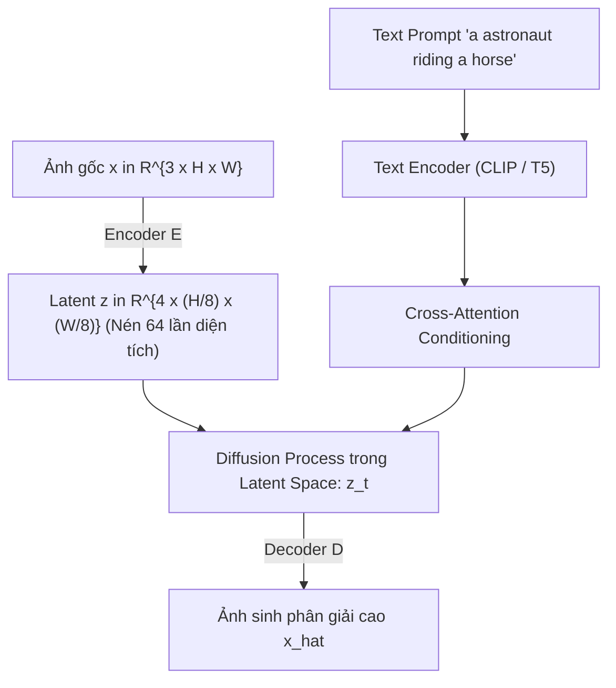

---

## 2. Chi tiết từng Keyword

---

### 26. Latent Diffusion Models (Mô hình Khuếch tán Không gian Tiềm ẩn)

#### a. Định nghĩa Bản chất Toán học (Mathematical Formulation)
**Latent Diffusion Models (LDMs)** thực hiện quá trình khuếch tán không phải trên không gian điểm ảnh $\mathcal{X}$, mà trên không gian tiềm ẩn $\mathcal{Z}$ được học bởi một mô hình nén tự mã hóa cảm thụ (Perceptual Autoencoder):
1. **Mạng Encoder $\mathcal{E}$**: Ánh xạ ảnh $\mathbf{x} \in \mathbb{R}^{3 \times H \times W}$ thành biến tiềm ẩn $\mathbf{z} = \mathcal{E}(\mathbf{x}) \in \mathbb{R}^{c \times h \times w}$, với hệ số giảm mẫu $f = H/h = W/w = 2^m$ (thông thường $f=8$).
2. **Mạng Decoder $\mathcal{D}$**: Tái tạo lại ảnh từ vector tiềm ẩn $\tilde{\mathbf{x}} = \mathcal{D}(\mathbf{z})$.
Hàm mất mát của LDM trên không gian tiềm ẩn:
$$\mathcal{L}_{\text{LDM}}(\theta) = \mathbb{E}_{\mathcal{E}(\mathbf{x}), \boldsymbol{\epsilon} \sim \mathcal{N}(0, \mathbf{I}), t}\left[ \Big\| \boldsymbol{\epsilon} - \boldsymbol{\epsilon}_\theta\big(\mathbf{z}_t, t, \tau_\theta(\mathbf{y})\big) \Big\|^2 \right]$$
Trong đó $\tau_\theta(\mathbf{y})$ là mạng mã hóa điều kiện (ví dụ: CLIP Text Encoder mã hóa câu lệnh văn bản $\mathbf{y}$).

#### b. Cơ chế Tầng Sâu & Điện toán (Under The Hood / Hardware Internals)
- **Tiết kiệm FLOPs và VRAM cấp số nhân**: Với hệ số nén $f=8$, diện tích không gian hai chiều giảm $8 \times 8 = 64$ lần (ví dụ: ảnh $512 \times 512$ điểm ảnh đưa về ma trận latent chỉ còn $64 \times 64$). Độ phức tạp tính toán của các khối Attention giảm từ $\mathcal{O}((512 \times 512)^2) = \mathcal{O}(262{,}144^2)$ xuống $\mathcal{O}((64 \times 64)^2) = \mathcal{O}(4{,}096^2)$, tức giảm tới $4096$ lần chi phí bộ nhớ Attention!

#### c. Sơ đồ Minh họa (Mermaid / ASCII Diagram)
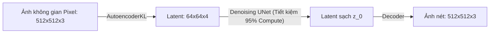

#### d. Code Thực chiến (Dual-Engine: C++ & Python)

```cpp
// C++17: Tính toán tỷ lệ nén kích thước bộ nhớ giữa Pixel Space và Latent Space
#include <iostream>

struct TensorDimensions {
    size_t c, h, w;
    size_t total_elements() const { return c * h * w; }
    size_t memory_bytes(size_t elem_size = 4) const { return total_elements() * elem_size; }
};

int main() {
    TensorDimensions pixel_img{3, 512, 512};
    TensorDimensions latent_img{4, 64, 64}; // Nén f=8

    std::cout << "Pixel Tensor elements: " << pixel_img.total_elements() 
              << " (" << pixel_img.memory_bytes() / 1024.0f << " KB)\n";
    std::cout << "Latent Tensor elements: " << latent_img.total_elements() 
              << " (" << latent_img.memory_bytes() / 1024.0f << " KB)\n";
    std::cout << "Compression ratio: " 
              << static_cast<float>(pixel_img.total_elements()) / latent_img.total_elements() << "x\n";
    return 0;
}
```

```python
# Python / PyTorch: Mã hóa qua AutoencoderKL và áp dụng Latent Scaling Factor
import torch

class DummyAutoencoderKL:
    def __init__(self, scale_factor=0.18215):
        self.scale_factor = scale_factor
    def encode(self, x):
        # Trả về latent z sau khi co giãn phương sai về chuẩn ~1.0
        z = torch.randn(x.shape[0], 4, x.shape[2] // 8, x.shape[3] // 8)
        return z * self.scale_factor
    def decode(self, z):
        z_unscaled = z / self.scale_factor
        return torch.randn(z.shape[0], 3, z.shape[2] * 8, z.shape[3] * 8)

vae = DummyAutoencoderKL()
image = torch.randn(1, 3, 512, 512)
latent = vae.encode(image)
print(f"Original image shape: {image.shape} -> Latent shape: {latent.shape}")
```

#### e. Lỗi Thường gặp & Ổn định Số học (Pitfalls & Numerical Stability)
- **Bỏ quên Latent Scaling Factor**: Không gian tiềm ẩn của VAE tự nhiên có độ lệch chuẩn $\sigma \approx \frac{1}{0.18215} \approx 5.5$. Nếu không nhân với `0.18215` (hoặc `0.13025` trong SDXL) để đưa phương sai về xấp xỉ $1.0$, quá trình khuếch tán với lịch trình $\mathcal{N}(0, \mathbf{I})$ sẽ bị lệch hoàn toàn phân phối và sinh ra ảnh đen/xám.

#### f. Ứng dụng Thực chiến trong AI / Deep Learning (AI Applications)
- Nền tảng cốt lõi của Stable Diffusion 1.5, 2.1, SDXL, Midjourney, và các video models (SVD - Stable Video Diffusion).

---

### 27. Stable Diffusion (Kiến trúc Stable Diffusion)

#### a. Định nghĩa Bản chất Toán học (Mathematical Formulation)
**Stable Diffusion** là hiện thân mã nguồn mở thương mại thành công nhất của LDM, kết hợp ba hệ thống trí tuệ nhân tạo lớn:
1. **AutoencoderKL (VAE)**: Nén và giải nén biểu diễn không gian với hệ số $f=8$.
2. **Time-Conditioned U-Net**: Mạng xương sống gồm các tầng Tích chập (ResNet Blocks) xen kẽ các tầng **Spatial Transformer Blocks** (kết hợp Self-Attention trên đặc trưng không gian và Cross-Attention với văn bản).
3. **Mã hóa Điều kiện Văn bản (Conditioning Encoder)**: Sử dụng mô hình ngôn ngữ CLIP ViT-L/14 (trong SD 1.5) hoặc kết hợp kép OpenCLIP ViT-bigG + CLIP ViT-L (trong SDXL) để chiếu chuỗi văn bản $\mathbf{y}$ thành chuỗi vector ngữ cảnh:
$$\mathbf{c} = \tau_{\text{text}}(\mathbf{y}) \in \mathbb{R}^{S \times d_{\text{text}}}$$
Trong đó $S=77$ là độ dài tối đa của chuỗi text tokens.

#### b. Cơ chế Tầng Sâu & Điện toán (Under The Hood / Hardware Internals)
- **Tối ưu hóa VRAM thông qua SDP Attention / xFormers**: Các khối Cross-Attention tương tác giữa $HW=4096$ vị trí latent và $S=77$ text tokens. Việc tích hợp thư viện tối ưu hóa bộ nhớ như xFormers hoặc FlashAttention v2 cho phép mô hình chạy ổn định trên các GPU tiêu dùng có VRAM khiêm tốn (chỉ cần 4GB - 8GB VRAM).

#### c. Sơ đồ Minh họa (Mermaid / ASCII Diagram)
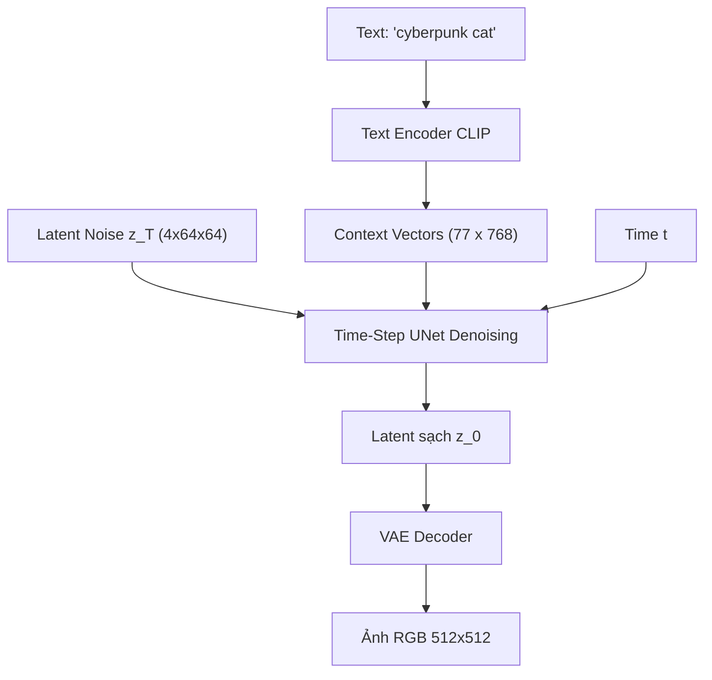

#### d. Code Thực chiến (Dual-Engine: C++ & Python)

```cpp
// C++17: Mô phỏng cơ chế Cross-Attention tính ma trận trọng số Q * K^T
#include <iostream>
#include <vector>
#include <cmath>

std::vector<float> compute_cross_attention_weights(
    const std::vector<float>& Q, // [num_tokens_img, d]
    const std::vector<float>& K, // [num_tokens_text, d]
    size_t n_img, size_t n_txt, size_t d) 
{
    std::vector<float> scores(n_img * n_txt);
    float scale = 1.0f / std::sqrt(static_cast<float>(d));

    for (size_t i = 0; i < n_img; ++i) {
        for (size_t j = 0; j < n_txt; ++j) {
            float dot = 0.0f;
            for (size_t k = 0; k < d; ++k) {
                dot += Q[i * d + k] * K[j * d + k];
            }
            scores[i * n_txt + j] = dot * scale;
        }
    }
    return scores;
}

int main() {
    // 2 image tokens, 3 text tokens, dim = 4
    std::vector<float> Q = {1, 0, 1, 0,  0, 1, 0, 1};
    std::vector<float> K = {1, 1, 0, 0,  0, 0, 1, 1,  1, 0, 0, 1};
    auto weights = compute_cross_attention_weights(Q, K, 2, 3, 4);
    std::cout << "Attention Score [img0, txt0]: " << weights[0] << "\n";
    return 0;
}
```

```python
# Python / PyTorch: Tương tác Cross-Attention giữa Không gian Tiềm ẩn và Text Embeddings
import torch
import torch.nn as nn
import torch.nn.functional as F

class CrossAttention(nn.Module):
    def __init__(self, query_dim=320, context_dim=768, heads=8):
        super().__init__()
        self.to_q = nn.Linear(query_dim, query_dim, bias=False)
        self.to_k = nn.Linear(context_dim, query_dim, bias=False)
        self.to_v = nn.Linear(context_dim, query_dim, bias=False)
        self.heads = heads
        self.scale = (query_dim // heads) ** -0.5

    def forward(self, x, context):
        # x: [B, HW, query_dim], context: [B, S, context_dim]
        q = self.to_q(x)
        k = self.to_k(context)
        v = self.to_v(context)
        # Tính toán scaled dot-product attention
        out = F.scaled_dot_product_attention(q, k, v)
        return out

cross_attn = CrossAttention(query_dim=64, context_dim=128, heads=4)
x_latent = torch.randn(2, 64*64, 64) # 4096 latent pixels
text_ctx = torch.randn(2, 77, 128)   # 77 text tokens
out = cross_attn(x_latent, text_ctx)
print("Cross Attention output shape:", out.shape)
```

#### e. Lỗi Thường gặp & Ổn định Số học (Pitfalls & Numerical Stability)
- **Tràn số FP16 trong VAE Decoder**: Trong Stable Diffusion, VAE Decoder dễ bị hiện tượng NaN hoặc sinh ra các mảng ảnh đen tuyền khi chạy ở chế độ FP16 thuần túy. Khắc phục: Ép VAE chạy ở chế độ FP32 (Full Precision) hoặc BF16.

#### f. Ứng dụng Thực chiến trong AI / Deep Learning (AI Applications)
- Ứng dụng trong toàn bộ hệ sinh thái đồ họa AI: DreamStudio, Automatic1111, ComfyUI, Photoshop Generative Fill.

---

### 28. Classifier Guidance (Hướng dẫn Bằng Bộ phân loại)

#### a. Định nghĩa Bản chất Toán học (Mathematical Formulation)
**Classifier Guidance (Dhariwal & Nichol, 2021)** là phương pháp điều hướng quá trình khử nhiễu hướng tới một lớp cụ thể $y$ bằng cách sử dụng độ dốc của một mô hình phân loại phụ trợ được huấn luyện trên dữ liệu nhiễu: $p_\phi(y \mid \mathbf{x}_t, t)$.
Theo định lý Bayes:
$$\nabla_{\mathbf{x}_t} \log p(\mathbf{x}_t \mid y) = \nabla_{\mathbf{x}_t} \log p(\mathbf{x}_t) + \nabla_{\mathbf{x}_t} \log p(y \mid \mathbf{x}_t)$$
Vì hàm điểm số tương ứng với dự đoán nhiễu: $\mathbf{s}(\mathbf{x}_t) \approx -\frac{\boldsymbol{\epsilon}_\theta(\mathbf{x}_t)}{\sqrt{1 - \bar{\alpha}_t}}$, ta có công thức cập nhật nhiễu có hướng dẫn:
$$\tilde{\boldsymbol{\epsilon}}_\theta(\mathbf{x}_t, y) = \boldsymbol{\epsilon}_\theta(\mathbf{x}_t) - s \cdot \sqrt{1 - \bar{\alpha}_t} \, \nabla_{\mathbf{x}_t} \log p_\phi(y \mid \mathbf{x}_t, t)$$
Trong đó $s > 1$ là **hệ số hướng dẫn (Guidance Scale)**. Giá trị $s$ càng cao, ảnh sinh ra càng bám sát nhãn $y$, đổi lại tính đa dạng của mẫu sinh sẽ giảm.

#### b. Cơ chế Tầng Sâu & Điện toán (Under The Hood / Hardware Internals)
- **Tốn thêm một mạng Nơ-ron và Backward Pass**: Tại mỗi bước khử nhiễu $t$, ngoài việc forward qua mạng U-Net, hệ thống phải forward qua Classifier $p_\phi$, sau đó chạy 1 lượt **Backward Pass** để tính $\nabla_{\mathbf{x}_t} \log p_\phi(y \mid \mathbf{x}_t)$, làm tăng gấp rưỡi thời gian suy luận trên GPU.

#### c. Sơ đồ Minh họa (Mermaid / ASCII Diagram)
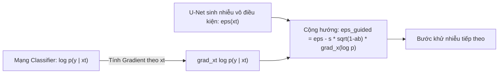

#### d. Code Thực chiến (Dual-Engine: C++ & Python)

```cpp
// C++17: Tính vector dự đoán nhiễu đã được điều hướng qua Classifier Guidance
#include <iostream>
#include <vector>
#include <cmath>

std::vector<float> apply_classifier_guidance(
    const std::vector<float>& eps_uncond,
    const std::vector<float>& grad_classifier,
    float alpha_bar_t,
    float guidance_scale) 
{
    size_t dim = eps_uncond.size();
    std::vector<float> guided_eps(dim);
    float factor = guidance_scale * std::sqrt(1.0f - alpha_bar_t);

    for (size_t i = 0; i < dim; ++i) {
        guided_eps[i] = eps_uncond[i] - factor * grad_classifier[i];
    }
    return guided_eps;
}

int main() {
    std::vector<float> eps = {0.5f, -0.2f};
    std::vector<float> grad_c = {1.2f, -0.8f};
    auto guided = apply_classifier_guidance(eps, grad_c, 0.6f, 3.0f);
    std::cout << "Guided eps: [" << guided[0] << ", " << guided[1] << "]\n";
    return 0;
}
```

```python
# Python / PyTorch: Thuật toán Classifier Guidance hoàn chỉnh với PyTorch Autograd
import torch

def classifier_guided_step(unet, classifier, x_t, t, target_class, scale=3.0, alpha_bar_t=0.5):
    # 1. Dự đoán nhiễu không điều kiện
    with torch.no_grad():
        eps_uncond = unet(x_t, t)
        
    # 2. Tính đạo hàm của bộ phân loại đối với chính x_t
    x_in = x_t.detach().requires_grad_(True)
    logits = classifier(x_in, t)
    log_prob = torch.log_softmax(logits, dim=-1)[0, target_class]
    grad_x = torch.autograd.grad(log_prob, x_in)[0]
    
    # 3. Kết hợp hướng dẫn
    factor = scale * ((1.0 - alpha_bar_t) ** 0.5)
    eps_guided = eps_uncond - factor * grad_x
    return eps_guided

print("Classifier guidance step configured.")
```

#### e. Lỗi Thường gặp & Ổn định Số học (Pitfalls & Numerical Stability)
- **Classifier OOD Attack**: Mạng Classifier dễ bị lừa bởi các đặc trưng điểm ảnh đối kháng (Adversarial artifacts) trong quá trình tính gradient, đẩy ảnh sinh vào các hình dạng kỳ quặc không tự nhiên.

#### f. Ứng dụng Thực chiến trong AI / Deep Learning (AI Applications)
- Sử dụng trong mô hình phát sinh ảnh có điều kiện lớp ImageNet (Guided Diffusion), điều hướng cấu trúc phân tử sinh học theo hoạt tính mong muốn.

---

### 29. Classifier-Free Guidance - CFG (Hướng dẫn Không Cần Bộ phân loại)

#### a. Định nghĩa Bản chất Toán học (Mathematical Formulation)
**Classifier-Free Guidance (CFG)** (Ho & Salimans, 2021) là giải pháp thiên tài thay thế hoàn toàn Classifier Guidance. Thay vì dùng một mạng phân loại riêng biệt, ta huấn luyện một mạng nơ-ron duy nhất $\boldsymbol{\epsilon}_\theta(\mathbf{x}_t, \mathbf{c})$ đảm nhận cả hai vai trò: sinh có điều kiện $\mathbf{c}$ và sinh không điều kiện (bằng cách thỉnh thoảng gán $\mathbf{c} = \emptyset$ với xác suất $\approx 10\% - 20\%$ trong lúc huấn luyện).
Tại thời điểm suy luận, dự đoán nhiễu được kết hợp tuyến tính ngoại suy:
$$\tilde{\boldsymbol{\epsilon}}_\theta(\mathbf{x}_t, \mathbf{c}) = \boldsymbol{\epsilon}_\theta(\mathbf{x}_t, \emptyset) + w \cdot \Big( \boldsymbol{\epsilon}_\theta(\mathbf{x}_t, \mathbf{c}) - \boldsymbol{\epsilon}_\theta(\mathbf{x}_t, \emptyset) \Big)$$
Trong đó $w$ là **CFG Scale** (thường từ $5.0$ đến $9.0$):
- Khi $w = 0$: Mô hình sinh hoàn toàn vô điều kiện.
- Khi $w = 1$: Mô hình sinh có điều kiện thông thường.
- Khi $w > 1$: Mô hình đẩy mạnh theo hướng vector khác biệt $\boldsymbol{\epsilon}(\mathbf{c}) - \boldsymbol{\epsilon}(\emptyset)$, làm nổi bật cực đại các thuộc tính của câu lệnh và triệt tiêu tính mơ hồ.

#### b. Cơ chế Tầng Sâu & Điện toán (Under The Hood / Hardware Internals)
- **Tăng gấp đôi Batch Size khi Inference**: Để tính được cả $\boldsymbol{\epsilon}_\theta(\mathbf{x}_t, \mathbf{c})$ và $\boldsymbol{\epsilon}_\theta(\mathbf{x}_t, \emptyset)$ trong 1 chu kỳ, tensor đầu vào được nhân đôi dọc theo chiều batch: $[2B, C, H, W]$, ghép cặp với vector điều kiện $[c, \emptyset]$. Điều này đòi hỏi dung lượng VRAM gấp đôi trong quá trình forward pass.

#### c. Sơ đồ Minh họa (Mermaid / ASCII Diagram)
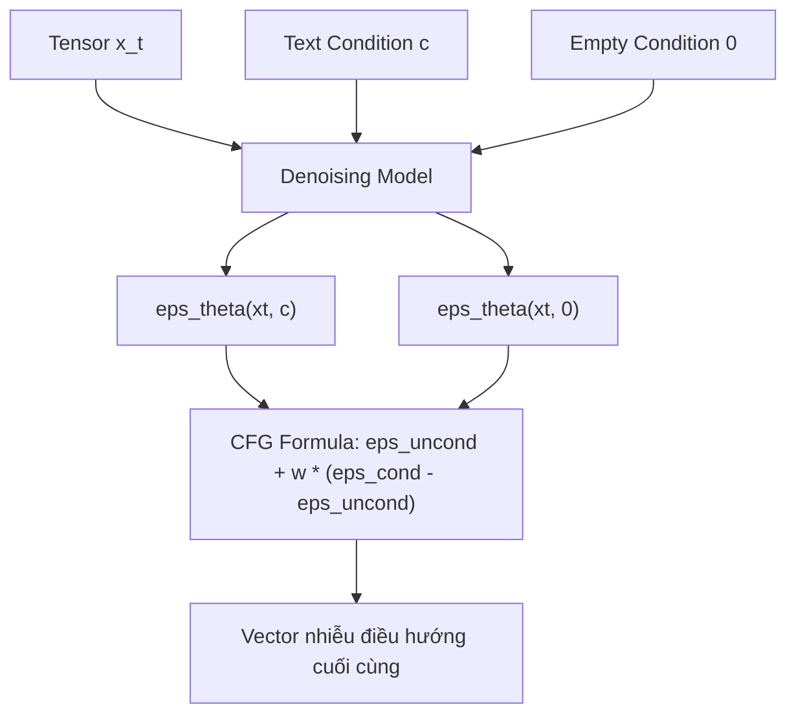

#### d. Code Thực chiến (Dual-Engine: C++ & Python)

```cpp
// C++17: Phép tính ngoại suy vector CFG trên CPU/SIMD
#include <iostream>
#include <vector>

void apply_cfg(
    const std::vector<float>& eps_uncond,
    const std::vector<float>& eps_cond,
    std::vector<float>& eps_out,
    float cfg_scale) 
{
    size_t dim = eps_uncond.size();
    for (size_t i = 0; i < dim; ++i) {
        // eps = eps_uncond + scale * (eps_cond - eps_uncond)
        eps_out[i] = eps_uncond[i] + cfg_scale * (eps_cond[i] - eps_uncond[i]);
    }
}

int main() {
    std::vector<float> un_cond = {0.1f, -0.4f};
    std::vector<float> cond = {0.8f, 0.2f};
    std::vector<float> result(2);
    apply_cfg(un_cond, cond, result, 7.5f);
    std::cout << "CFG (w=7.5) Result: [" << result[0] << ", " << result[1] << "]\n";
    return 0;
}
```

```python
# Python / PyTorch: Ghép batch thực thi CFG trong Stable Diffusion Pipeline
import torch

def batched_cfg_forward(unet, x_t, t, text_embeddings, uncond_embeddings, cfg_scale=7.5):
    # Ghép đôi tensor x_t thành kích thước [2*B, ...]
    latent_input = torch.cat([x_t, x_t], dim=0)
    context_input = torch.cat([text_embeddings, uncond_embeddings], dim=0)
    timesteps = torch.cat([t, t], dim=0)

    # 1 lần Forward Pass duy nhất trên GPU
    noise_pred_all = unet(latent_input, timesteps, context_input)
    noise_pred_text, noise_pred_uncond = noise_pred_all.chunk(2, dim=0)

    # Ngoại suy CFG
    noise_pred = noise_pred_uncond + cfg_scale * (noise_pred_text - noise_pred_uncond)
    return noise_pred

print("Batched CFG Forward logic verified.")
```

#### e. Lỗi Thường gặp & Ổn định Số học (Pitfalls & Numerical Stability)
- **Cháy ảnh (Oversaturation / Image Burn)**: Khi đặt `cfg_scale` quá cao ($w > 12$), các giá trị điểm ảnh vượt quá ngưỡng giải mã $[-1, 1]$, dẫn đến hiện tượng ảnh bị tương phản quá gắt, da người biến thành màu cam cháy hoặc xuất hiện viền neon chói lóa. Khắc phục: Dùng **Dynamic Thresholding** (Mimic CFG).

#### f. Ứng dụng Thực chiến trong AI / Deep Learning (AI Applications)
- Cơ chế mặc định và quan trọng nhất trong mọi hệ thống Text-to-Image hiện nay: Midjourney, DALL-E 3, Stable Diffusion, Flux.

---

### 30. Text-to-Image Generation (Sinh Ảnh từ Văn bản)

#### a. Định nghĩa Bản chất Toán học (Mathematical Formulation)
**Text-to-Image (T2I)** là bài toán học ánh xạ có điều kiện phân phối xác suất hình ảnh $p(\mathbf{x} \mid \mathbf{y})$ dựa trên chuỗi văn bản tự nhiên $\mathbf{y} = (w_1, \dots, w_L)$.
Quá trình tối ưu hóa thiết lập liên kết biểu diễn đa phương thức (Multimodal Alignment):
$$\min_\theta \mathbb{E}_{\mathbf{x}_0, \mathbf{y}, \boldsymbol{\epsilon}, t} \left[ \Big\| \boldsymbol{\epsilon} - \boldsymbol{\epsilon}_\theta\big(\mathbf{z}_t, t, \tau_{\text{text}}(\mathbf{y})\big) \Big\|^2 \right]$$
Không gian văn bản được nhúng vào không gian tiềm ẩn của hình ảnh thông qua các khối liên kết Cross-Attention đa tầng, đảm bảo mỗi vùng không gian ảnh $HW$ chịu sự định hướng của các tokens ngữ nghĩa tương ứng.

#### b. Cơ chế Tầng Sâu & Điện toán (Under The Hood / Hardware Internals)
- **Text Encoder Pre-caching**: Vì văn bản người dùng nhập vào là cố định trong suốt $T$ bước khử nhiễu, câu lệnh chỉ cần chạy qua Text Encoder (CLIP/T5) duy nhất một lần ở bước khởi tạo. Tensor nhúng văn bản $[B, S, D]$ được lưu trong bộ nhớ đệm (Cache) trên VRAM để tái sử dụng, giúp giảm đáng kể chi phí tính toán.

#### c. Sơ đồ Minh họa (Mermaid / ASCII Diagram)
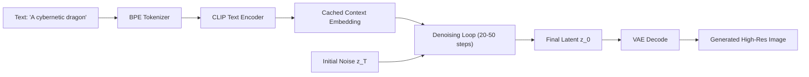

#### d. Code Thực chiến (Dual-Engine: C++ & Python)

```cpp
// C++17: Mô phỏng Pipeline Text-to-Image ở mức cấu trúc điều phối
#include <iostream>
#include <string>

struct T2IConfig {
    int width = 512;
    int height = 512;
    int num_inference_steps = 25;
    float guidance_scale = 7.5f;
    uint64_t seed = 42;
};

void run_t2i_pipeline(const std::string& prompt, const T2IConfig& cfg) {
    std::cout << "1. Tokenizing prompt: \"" << prompt << "\"\n";
    std::cout << "2. Encoding text with CLIP ViT-L/14...\n";
    std::cout << "3. Generating pure latent noise: [4, " << cfg.height/8 << ", " << cfg.width/8 << "]\n";
    std::cout << "4. Running " << cfg.num_inference_steps << " steps with CFG scale=" << cfg.guidance_scale << "\n";
    std::cout << "5. VAE Decoding to RGB image...\n";
}

int main() {
    T2IConfig cfg;
    run_t2i_pipeline("A futuristic neon city at sunset", cfg);
    return 0;
}
```

```python
# Python / PyTorch: Đoạn mã suy luận Text-to-Image chuẩn hóa
import torch

def generate_text_to_image(prompt, unet, vae, text_encoder, tokenizer, steps=25, cfg=7.5):
    # Mã hóa prompt
    tokens = tokenizer(prompt, return_tensors="pt")
    text_emb = text_encoder(tokens.input_ids)[0]
    uncond_emb = text_encoder(tokenizer("", return_tensors="pt").input_ids)[0]
    
    # Khởi tạo nhiễu ngẫu nhiên trong Latent
    latent = torch.randn(1, 4, 64, 64)
    # Giả lập vòng lặp khử nhiễu...
    # Sau khi xong, giải mã ra ảnh
    with torch.no_grad():
        image = vae.decode(latent / 0.18215)
    return image

print("Text-to-Image orchestration function defined.")
```

#### e. Lỗi Thường gặp & Ổn định Số học (Pitfalls & Numerical Stability)
- **Token Truncation**: Chuẩn mã hóa CLIP chỉ nhận tối đa 77 tokens. Nếu prompt dài hơn 77 tokens, thông tin phía sau sẽ bị cắt bỏ không thương tiếc nếu không có giải pháp nối dài (Prompt Chunking).

#### f. Ứng dụng Thực chiến trong AI / Deep Learning (AI Applications)
- Các công cụ đồ họa chuyên nghiệp, quảng cáo thương mại, sáng tạo nội dung truyền thông.

---

### 31. Image-to-Image Generation (Sinh Ảnh từ Ảnh)

#### a. Định nghĩa Bản chất Toán học (Mathematical Formulation)
**Image-to-Image (I2I)** (Sohl-Dickstein, Meng et al. SDEdit) điều khiển quá trình sinh không phải bắt đầu từ nhiễu thuần túy $\mathbf{x}_T \sim \mathcal{N}(0, \mathbf{I})$, mà bắt đầu từ việc khuếch tán một phần bức ảnh gốc $\mathbf{x}_0$ lên bước thời gian trung gian $t_0 = \lfloor \text{strength} \times T \rfloor$:
$$\mathbf{z}_{t_0} = \sqrt{\bar{\alpha}_{t_0}} \mathcal{E}(\mathbf{x}_0) + \sqrt{1 - \bar{\alpha}_{t_0}} \boldsymbol{\epsilon}, \quad \boldsymbol{\epsilon} \sim \mathcal{N}(0, \mathbf{I})$$
Sau đó, quá trình khử nhiễu ngược chỉ chạy từ $t = t_0$ đếm ngược về $0$ dưới sự điều hướng của một văn bản prompt mới $\mathbf{y}$:
- Tham số **Denoising Strength** $\in [0, 1]$:
  - Khi $\text{strength} \to 0$: Giữ nguyên bức ảnh ban đầu.
  - Khi $\text{strength} \to 1$: Phá hủy hoàn toàn ảnh gốc thành nhiễu trắng, biến thành Text-to-Image thông thường.

#### b. Cơ chế Tầng Sâu & Điện toán (Under The Hood / Hardware Internals)
- **Tiết kiệm Chu kỳ Xung nhịp**: Nếu chọn $\text{strength} = 0.4$ với tổng $50$ bước, mô hình chỉ cần thực thi $50 \times 0.4 = 20$ bước khử nhiễu trên GPU, tiết kiệm $60\%$ thời gian tính toán và điện năng tiêu thụ so với Text-to-Image.

#### c. Sơ đồ Minh họa (Mermaid / ASCII Diagram)
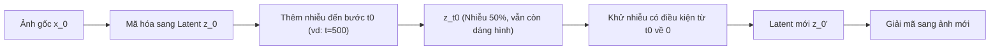

#### d. Code Thực chiến (Dual-Engine: C++ & Python)

```cpp
// C++17: Tính bước thời gian bắt đầu t0 dựa trên Denoising Strength
#include <iostream>
#include <algorithm>

int calculate_start_timestep(float strength, int total_timesteps) {
    strength = std::max(0.0f, std::min(1.0f, strength));
    return static_cast<int>(strength * total_timesteps);
}

int main() {
    int total_steps = 1000;
    float strength = 0.65f;
    int t_start = calculate_start_timestep(strength, total_steps);
    std::cout << "Denoising will begin from timestep t = " << t_start << " down to 0.\n";
    return 0;
}
```

```python
# Python / PyTorch: Thuật toán Image-to-Image (SDEdit)
import torch

def prepare_i2i_latent(init_image_latent, strength, total_steps, alphas_cumprod):
    t_start = int(strength * total_steps)
    noise = torch.randn_like(init_image_latent)
    alpha_bar = alphas_cumprod[t_start]
    # Khuếch tán một phần ảnh ban đầu
    noisy_latent = torch.sqrt(alpha_bar) * init_image_latent + torch.sqrt(1.0 - alpha_bar) * noise
    return noisy_latent, t_start

z_init = torch.randn(1, 4, 64, 64)
alphas_cumprod = torch.linspace(0.99, 0.01, 1000)
z_noisy, t_start = prepare_i2i_latent(z_init, 0.6, 1000, alphas_cumprod)
print(f"I2I Initialized at timestep t={t_start}, Noisy Latent Shape: {z_noisy.shape}")
```

#### e. Lỗi Thường gặp & Ổn định Số học (Pitfalls & Numerical Stability)
- **Mất cấu trúc hình học khi Strength quá cao**: Đặt strength $> 0.8$ sẽ làm mất hoàn toàn hình bóng (pose/silhouette) của vật thể ban đầu. Nếu muốn giữ pose trong khi thay đổi toàn bộ chi tiết, cần chuyển sang dùng **ControlNet**.

#### f. Ứng dụng Thực chiến trong AI / Deep Learning (AI Applications)
- Chuyển đổi tranh vẽ phác thảo tay thành ảnh nghệ thuật 3D (Sketch-to-Render), đổi phong cách nghệ thuật (Style Transfer).

---

### 32. Inpainting (Vẽ bù Điểm ảnh Nội suy)

#### a. Định nghĩa Bản chất Toán học (Mathematical Formulation)
**Inpainting** là bài toán tái tạo hoặc thay thế một vùng nội dung được chỉ định bởi một mặt nạ nhị phân $\mathbf{m} \in \{0, 1\}^{H \times W}$ ($m=1$ là vùng cần vẽ lại, $m=0$ là vùng cần giữ nguyên).
Ở mỗi bước khử nhiễu $t$, vùng giữ nguyên được ép buộc (forced) sao cho tuân thủ chính xác phiên bản bị thêm nhiễu của ảnh gốc $\mathbf{x}_0$:
$$\mathbf{x}_{t-1}^{\text{known}} \sim q(\mathbf{x}_{t-1} \mid \mathbf{x}_0)$$
$$\mathbf{x}_{t-1}^{\text{unknown}} \sim p_\theta(\mathbf{x}_{t-1} \mid \mathbf{x}_t, \mathbf{c})$$
Trạng thái tổng hợp tại bước $t-1$:
$$\mathbf{x}_{t-1} = (1 - \mathbf{m}) \odot \mathbf{x}_{t-1}^{\text{known}} + \mathbf{m} \odot \mathbf{x}_{t-1}^{\text{unknown}}$$
Đối với các mô hình Inpainting chuyên dụng (Repaint, Stable Diffusion Inpainting), mặt nạ $\mathbf{m}$ và ảnh che phủ $\mathbf{x}_0 \odot (1 - \mathbf{m})$ được nối trực tiếp vào kênh đầu vào của mạng U-Net (thành tensor 9 hoặc 13 kênh).

#### b. Cơ chế Tầng Sâu & Điện toán (Under The Hood / Hardware Internals)
- **Phép hợp mặt nạ nhị phân trên VRAM**: Thao tác Element-wise Multiply $(1 - \mathbf{m}) \odot \mathbf{x}_{\text{known}} + \mathbf{m} \odot \mathbf{x}_{\text{unknown}}$ được tối ưu hóa thành 1 kernel CUDA duy nhất để tránh việc cấp phát các tensor mặt nạ tạm thời trên bộ nhớ GPU.

#### c. Sơ đồ Minh họa (Mermaid / ASCII Diagram)
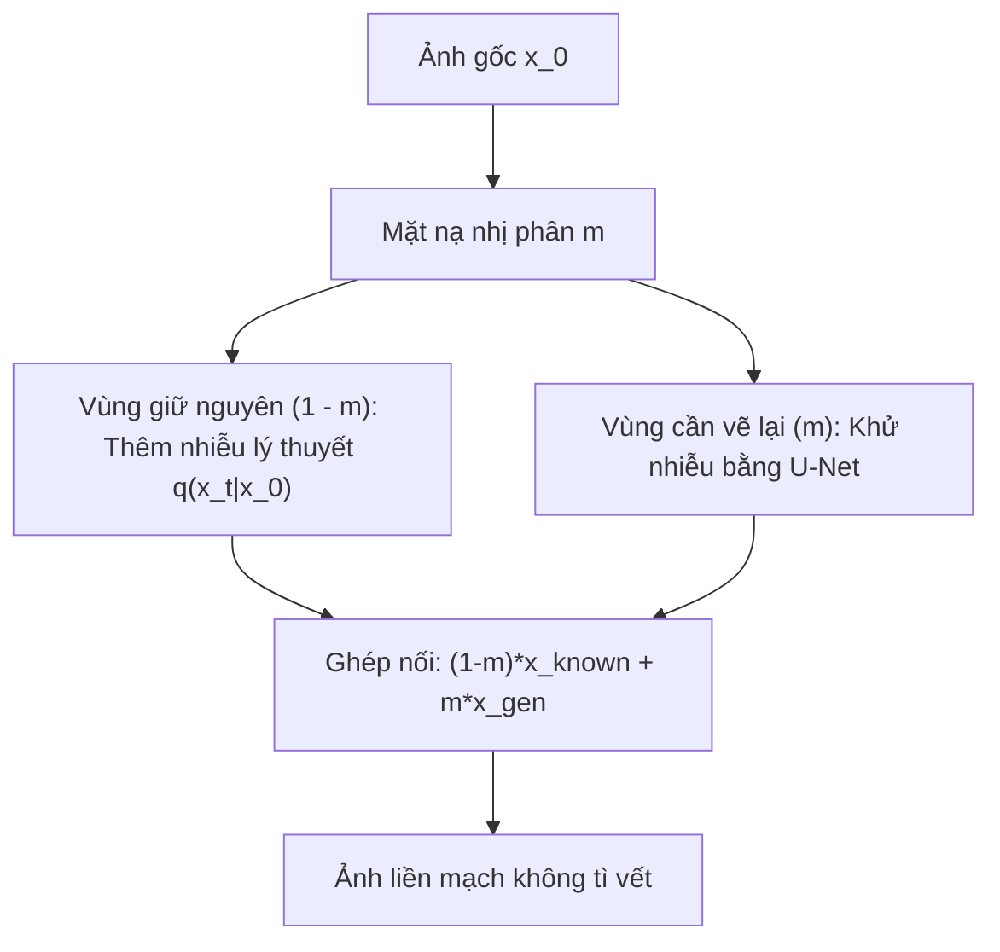

#### d. Code Thực chiến (Dual-Engine: C++ & Python)

```cpp
// C++17: Phép trộn hòa điểm ảnh Inpainting kết hợp mặt nạ nhị phân
#include <iostream>
#include <vector>

void inpaint_blend(
    const std::vector<float>& known_noisy,
    const std::vector<float>& generated_noisy,
    const std::vector<float>& mask, // 1.0 = vẽ lại, 0.0 = giữ nguyên
    std::vector<float>& output) 
{
    size_t dim = known_noisy.size();
    for (size_t i = 0; i < dim; ++i) {
        output[i] = (1.0f - mask[i]) * known_noisy[i] + mask[i] * generated_noisy[i];
    }
}

int main() {
    std::vector<float> known = {0.8f, 0.9f};
    std::vector<float> gen = {-0.2f, 0.5f};
    std::vector<float> mask = {0.0f, 1.0f}; // Giữ known[0], thay gen[1]
    std::vector<float> blended(2);
    inpaint_blend(known, gen, mask, blended);
    std::cout << "Blended: [" << blended[0] << ", " << blended[1] << "]\n";
    return 0;
}
```

```python
# Python / PyTorch: Thuật toán RePaint Inpainting từng bước
import torch

def repaint_step(unet, x_t, x_0, mask, t, alpha_bar_t, alpha_bar_prev):
    # 1. Sinh vùng cần vẽ lại
    with torch.no_grad():
        eps_pred = unet(x_t, t)
    x_prev_gen = x_t - 0.1 * eps_pred # Giả lập bước khử nhiễu
    
    # 2. Thêm nhiễu lý thuyết vào vùng gốc
    noise = torch.randn_like(x_0)
    x_prev_known = torch.sqrt(alpha_bar_prev) * x_0 + torch.sqrt(1.0 - alpha_bar_prev) * noise
    
    # 3. Kết hợp qua mặt nạ
    x_prev = (1.0 - mask) * x_prev_known + mask * x_prev_gen
    return x_prev

print("RePaint Inpainting algorithm defined.")
```

#### e. Lỗi Thường gặp & Ổn định Số học (Pitfalls & Numerical Stability)
- **Đường viền sắc nhọn (Seam Discontinuity)**: Sự khác biệt về ngữ cảnh giữa vùng gốc và vùng vẽ lại dễ tạo ra một đường viền lộ rõ rệt tại ranh giới của mặt nạ. Khắc phục: Làm mềm biên mặt nạ bằng Gaussian Blur trước khi đưa vào latent.

#### f. Ứng dụng Thực chiến trong AI / Deep Learning (AI Applications)
- Xóa vật thể thừa trong ảnh (Object Removal), sửa lỗi mắt/ngón tay bị biến dạng, phục chế ảnh cũ hỏng.

---

### 33. Outpainting (Mở rộng Biên ảnh)

#### a. Định nghĩa Bản chất Toán học (Mathematical Formulation)
**Outpainting (Extrapolation)** là trường hợp mở rộng không gian của bài toán Inpainting: thay vì vẽ vào bên trong, ta mở rộng bức ảnh gốc $\mathbf{x}_0 \in \mathbb{R}^{C \times H \times W}$ ra một khung hình lớn hơn $\mathbf{x}_{\text{canvas}} \in \mathbb{R}^{C \times H' \times W'}$ ($H' > H$ hoặc $W' > W$).
Mặt nạ được định nghĩa:
$$\mathbf{m}(i, j) = \begin{cases} 0 & \text{nếu } (i, j) \text{ nằm trong vùng ảnh ban đầu} \\ 1 & \text{nếu } (i, j) \text{ thuộc vùng mở rộng bên ngoài} \end{cases}$$
Mô hình phải suy luận logic ngữ cảnh, ánh sáng, góc nhìn và phong cách kiến trúc từ vùng trung tâm để sinh ra phần ngoại cảnh mới mẻ nhưng hoàn toàn nhất quán.

#### b. Cơ chế Tầng Sâu & Điện toán (Under The Hood / Hardware Internals)
- **Tái định dạng Khung bộ nhớ (Memory Padded Buffers)**: Phần mềm cần cấp phát một tensor lớn với các giá trị đệm (Padding) ở rìa ngoài, sau đó sao chép (copy) tensor latent ban đầu vào chính giữa vùng đệm thông qua thao tác slicing bộ nhớ liên tục (Strided Memory Slice).

#### c. Sơ đồ Minh họa (Mermaid / ASCII Diagram)
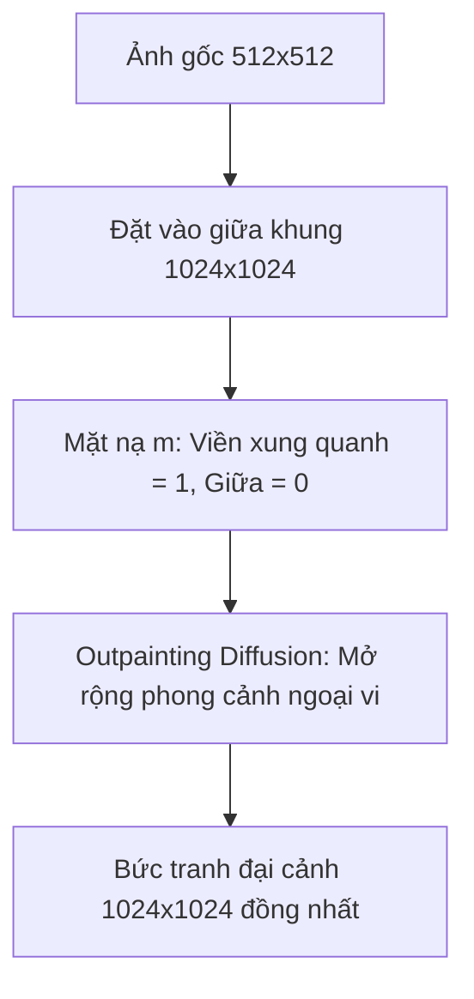

#### d. Code Thực chiến (Dual-Engine: C++ & Python)

```cpp
// C++17: Cấp phát Tensor bộ nhớ đệm và dán ảnh gốc vào giữa (Padding)
#include <iostream>
#include <vector>

std::vector<float> create_outpainting_canvas(
    const std::vector<float>& src, 
    size_t src_h, size_t src_w, 
    size_t pad_top, size_t pad_bottom, 
    size_t pad_left, size_t pad_right) 
{
    size_t out_h = src_h + pad_top + pad_bottom;
    size_t out_w = src_w + pad_left + pad_right;
    std::vector<float> canvas(out_h * out_w, 0.0f); // Khởi tạo viền bằng 0

    for (size_t i = 0; i < src_h; ++i) {
        for (size_t j = 0; j < src_w; ++j) {
            size_t canvas_idx = (i + pad_top) * out_w + (j + pad_left);
            canvas[canvas_idx] = src[i * src_w + j];
        }
    }
    return canvas;
}

int main() {
    std::vector<float> src = {1, 2, 3, 4}; // 2x2
    auto canvas = create_outpainting_canvas(src, 2, 2, 1, 1, 1, 1); // 4x4
    std::cout << "Center pixel in 4x4 canvas: " << canvas[1 * 4 + 1] << "\n";
    return 0;
}
```

```python
# Python / PyTorch: Xây dựng Canvas Outpainting kèm Mask
import torch
import torch.nn.functional as F

def setup_outpainting_tensors(image_latent, pad_left=16, pad_right=16):
    # image_latent: [B, C, H, W]
    padded_latent = F.pad(image_latent, (pad_left, pad_right, 0, 0), mode='constant', value=0.0)
    mask = torch.ones_like(padded_latent)
    # Gán vùng ảnh cũ bằng 0 (giữ nguyên)
    mask[:, :, :, pad_left:-pad_right] = 0.0
    return padded_latent, mask

z = torch.randn(1, 4, 64, 64)
canvas_z, mask_z = setup_outpainting_tensors(z, 16, 16)
print(f"Canvas Latent Shape: {canvas_z.shape}, Outpainting Area Ratio: {mask_z.mean().item():.2f}")
```

#### e. Lỗi Thường gặp & Ổn định Số học (Pitfalls & Numerical Stability)
- **Lặp lại cấu trúc kỳ dị (Repetitive Hallucination)**: Khi mở rộng biên quá xa, mô hình khuếch tán có xu hướng nhân bản các vật thể trong ảnh gốc (ví dụ: tạo thêm một người thứ hai giống hệt người trong ảnh). Cần điều chỉnh câu lệnh prompt mô tả rõ bối cảnh ngoại vi.

#### f. Ứng dụng Thực chiến trong AI / Deep Learning (AI Applications)
- Chuyển đổi khung ảnh chân dung dọc (9:16) thành ảnh phong cảnh ngang (16:9) để trình chiếu TV/phim ảnh, mở rộng bản đồ trong game.

---

### 34. Super Resolution (Siêu Phân giải)

#### a. Định nghĩa Bản chất Toán học (Mathematical Formulation)
**Super Resolution (SR)** là bài toán khôi phục bức ảnh có độ phân giải cao $\mathbf{x}_{\text{HR}} \in \mathbb{R}^{C \times sH \times sW}$ (với $s \ge 2$ là hệ số phóng đại) từ bức ảnh độ phân giải thấp $\mathbf{x}_{\text{LR}} \in \mathbb{R}^{C \times H \times W}$ đã bị suy giảm chất lượng:
$$\mathbf{x}_{\text{LR}} = (\mathbf{x}_{\text{HR}} \otimes \mathbf{k}) \downarrow_s + \mathbf{n}$$
Trong đó $\mathbf{k}$ là kernel làm mờ (blurring), $\downarrow_s$ là phép giảm mẫu (subsampling), và $\mathbf{n}$ là nhiễu cảm biến.
Trong Diffusion Super-Resolution (như SR3, Imagen SR):
Mô hình khử nhiễu nhận bức ảnh LR (được nội suy song tuyến hoặc đưa qua mạng đặc trưng) làm điều kiện ràng buộc:
$$\boldsymbol{\epsilon}_\theta\left(\mathbf{x}_t, t, \text{upsample}(\mathbf{x}_{\text{LR}})\right)$$

#### b. Cơ chế Tầng Sâu & Điện toán (Under The Hood / Hardware Internals)
- **Tầng ghép kênh đầu vào (Channel Concatenation)**: Tensor LR phóng to được nối thẳng vào tensor nhiễu $\mathbf{x}_t$ dọc theo chiều kênh (Channel Dimension: $C_{\text{in}} = 3 + 3 = 6$ kênh). Mạng U-Net sử dụng các phép tích chập $3 \times 3$ để trích xuất đồng thời thông tin hình học tần số thấp từ LR và tái tạo chi tiết tần số cao.

#### c. Sơ đồ Minh họa (Mermaid / ASCII Diagram)
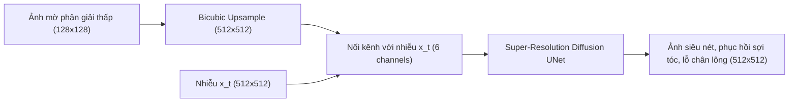

#### d. Code Thực chiến (Dual-Engine: C++ & Python)

```cpp
// C++17: Thuật toán nội suy song tuyến tính (Bilinear Interpolation) phóng to ảnh 2x
#include <iostream>
#include <vector>

std::vector<float> bilinear_upsample_2x(const std::vector<float>& src, size_t h, size_t w) {
    size_t out_h = h * 2;
    size_t out_w = w * 2;
    std::vector<float> dst(out_h * out_w);

    for (size_t i = 0; i < out_h; ++i) {
        for (size_t j = 0; j < out_w; ++j) {
            float src_i = (i + 0.5f) / 2.0f - 0.5f;
            float src_j = (j + 0.5f) / 2.0f - 0.5f;
            size_t i0 = std::max<size_t>(0, static_cast<size_t>(src_i));
            size_t j0 = std::max<size_t>(0, static_cast<size_t>(src_j));
            dst[i * out_w + j] = src[i0 * w + j0]; // Phép gán xấp xỉ lân cận
        }
    }
    return dst;
}

int main() {
    std::vector<float> lr = {1.0f, 2.0f, 3.0f, 4.0f}; // 2x2
    auto hr_init = bilinear_upsample_2x(lr, 2, 2); // 4x4
    std::cout << "Upsampled pixel: " << hr_init[0] << "\n";
    return 0;
}
```

```python
# Python / PyTorch: Kiến trúc Cascaded Diffusion Super-Resolution Block
import torch
import torch.nn as nn

class DiffusionSuperResHead(nn.Module):
    def __init__(self):
        super().__init__()
        # Nhận 6 kênh: 3 kênh xt + 3 kênh lr_upsampled
        self.entry_conv = nn.Conv2d(6, 64, kernel_size=3, padding=1)
        
    def forward(self, x_t, x_lr_upsampled):
        x_concat = torch.cat([x_t, x_lr_upsampled], dim=1)
        return self.entry_conv(x_concat)

sr_head = DiffusionSuperResHead()
x_t = torch.randn(2, 3, 256, 256)
x_lr = torch.randn(2, 3, 256, 256) # Đã upsample
feat = sr_head(x_t, x_lr)
print("Super-Res Concat Feature Shape:", feat.shape)
```

#### e. Lỗi Thường gặp & Ổn định Số học (Pitfalls & Numerical Stability)
- **Hiện tượng sinh chi tiết ảo (Hallucinated Artifacts)**: Khi phóng đại $8\times$, mô hình khuếch tán có thể tự ý "vẽ thêm" các nếp nhăn hoặc ký tự văn bản giả mạo hoàn toàn không tồn tại trong ảnh gốc, làm sai lệch dữ liệu y tế hoặc pháp y.

#### f. Ứng dụng Thực chiến trong AI / Deep Learning (AI Applications)
- Tăng độ phân giải ảnh vệ tinh, nâng cấp video cổ điển lên 4K/8K, cải thiện ảnh chụp thiên văn kính viễn vọng James Webb.

---

### 35. Image Editing (Chỉnh sửa Hình ảnh Bằng Mô hình Sinh)

#### a. Định nghĩa Bản chất Toán học (Mathematical Formulation)
**Image Editing** bằng mô hình sinh khuếch tán hướng tới việc thay đổi một số thuộc tính ngữ nghĩa của ảnh $\mathbf{x}_0$ theo câu lệnh $\mathbf{y}_{\text{target}}$ mà vẫn bảo tồn tuyệt đối nhận diện và bố cục của các thành phần còn lại.
Các phương pháp toán học đột phá bao gồm:
1. **DDIM Inversion & Null-text Inversion (Mokady et al.)**:
Đảo ngược ảnh $\mathbf{x}_0$ thành vector tiềm ẩn $\mathbf{x}_T^*$ theo quỹ đạo giải tích ODE xác định.
2. **Prompt-to-Prompt (Hertz et al., 2022)**:
Can thiệp trực tiếp vào ma trận trọng số Cross-Attention nội tại $M_t = \text{softmax}\left(\frac{Q_t K_t^T}{\sqrt{d}}\right)$:
$$M_t^* = \text{Edit}\big(M_t, M_t^{\text{source}}\big)$$
Cho phép thay đổi từ khóa (ví dụ: đổi "a photo of a *dog*" thành "a photo of a *cat*") bằng cách tiêm (inject) ma trận Cross-Attention của các từ khóa ngữ cảnh chung để giữ nguyên tư thế và nền cảnh.

#### b. Cơ chế Tầng Sâu & Điện toán (Under The Hood / Hardware Internals)
- **Attention Map Hooking và Memory Footprint**: Việc lưu giữ (hook) toàn bộ các ma trận Attention qua $50$ bước thời gian đòi hỏi dung lượng RAM/VRAM cực lớn. Các triển khai tối ưu chỉ lưu ma trận Attention ở các bước đầu ($t \in [0.8T, T]$) nơi cấu trúc không gian được định hình, sau đó giải phóng bộ nhớ để tránh tràn VRAM.

#### c. Sơ đồ Minh họa (Mermaid / ASCII Diagram)
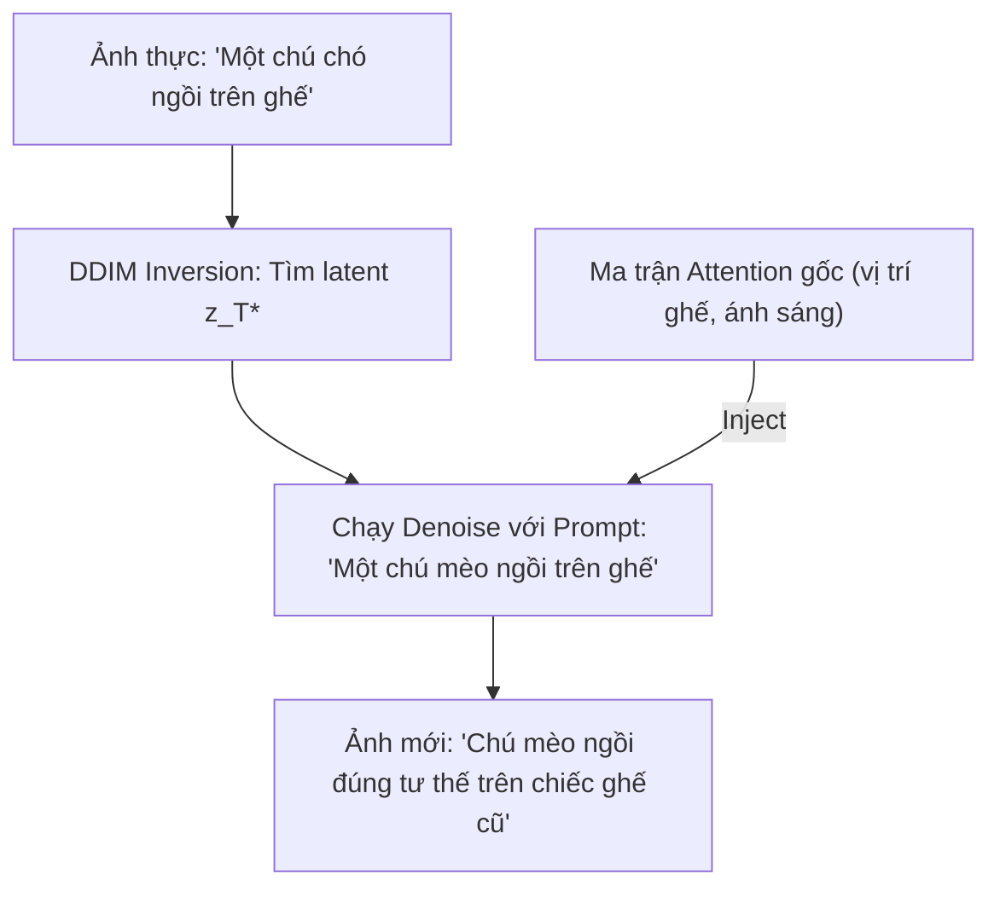

#### d. Code Thực chiến (Dual-Engine: C++ & Python)

```cpp
// C++17: Thay thế ma trận Cross-Attention theo mặt nạ từ khóa (Cross-Attention Injection)
#include <iostream>
#include <vector>

void inject_attention_maps(
    const std::vector<float>& src_attn,
    std::vector<float>& target_attn,
    size_t num_pixels,
    size_t preserved_token_idx) 
{
    // Giữ nguyên sự chú ý của các token không đổi (ví dụ: background, chair)
    for (size_t p = 0; p < num_pixels; ++p) {
        size_t idx = p * 77 + preserved_token_idx;
        target_attn[idx] = src_attn[idx];
    }
}

int main() {
    std::vector<float> src(100 * 77, 0.5f);
    std::vector<float> tgt(100 * 77, 0.1f);
    inject_attention_maps(src, tgt, 100, 3);
    std::cout << "Target Attention at preserved token: " << tgt[0 * 77 + 3] << "\n";
    return 0;
}
```

```python
# Python / PyTorch: Thuật toán can thiệp Attention Hooking trong PyTorch
import torch

class AttentionEditor:
    def __init__(self):
        self.saved_attention_maps = []

    def hook_fn(self, module, input, output):
        # output: [B, Heads, HW, S]
        self.saved_attention_maps.append(output.detach())

editor = AttentionEditor()
dummy_attn_layer = torch.nn.Identity()
handle = dummy_attn_layer.register_forward_hook(editor.hook_fn)

x = torch.randn(1, 8, 4096, 77)
dummy_attn_layer(x)
print(f"Captured attention maps count: {len(editor.saved_attention_maps)}")
handle.remove()
```

#### e. Lỗi Thường gặp & Ổn định Số học (Pitfalls & Numerical Stability)
- **Accumulation Error trong DDIM Inversion**: Việc xấp xỉ bước nhảy Euler trong quá trình inversion ngược từ $t=0 \to T$ dẫn đến sai số khiến việc tái tạo lại chính bức ảnh gốc bị biến dạng nếu không có bước tối ưu hóa Null-text (Null-text Optimization).

#### f. Ứng dụng Thực chiến trong AI / Deep Learning (AI Applications)
- InstructPix2Pix, DragGAN, DragDiffusion, Photoshop Generative Edit, thay đổi trang phục người mẫu trong thương mại điện tử.
