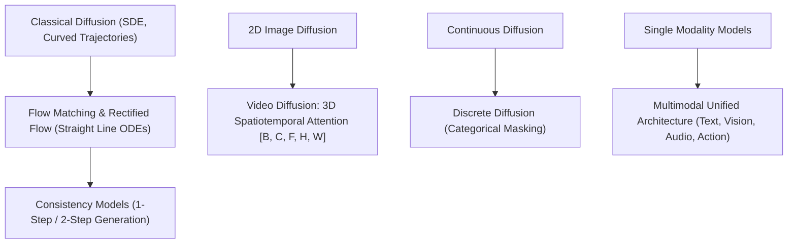
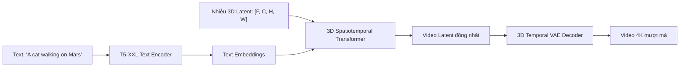
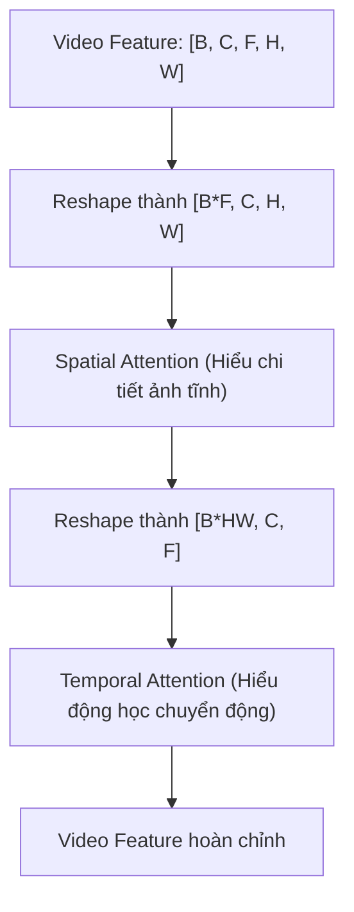
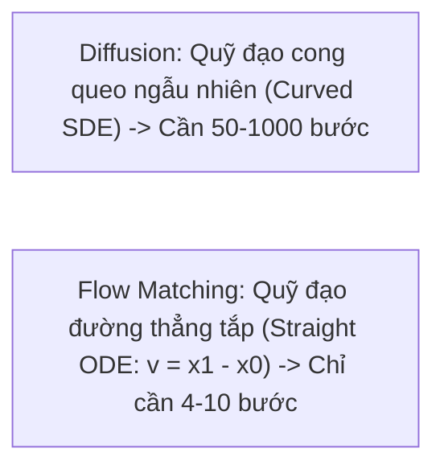
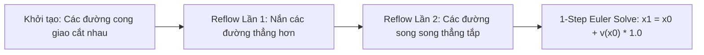
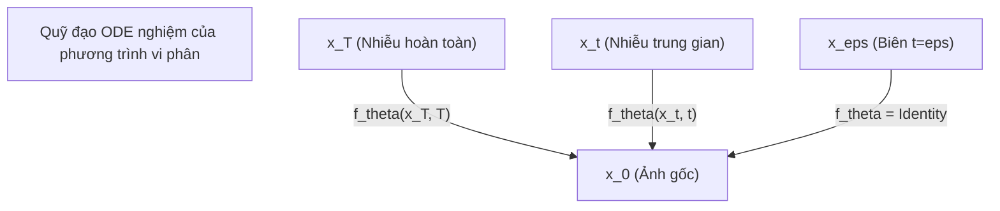
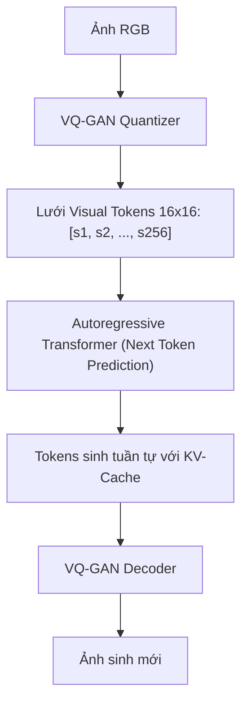
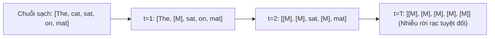
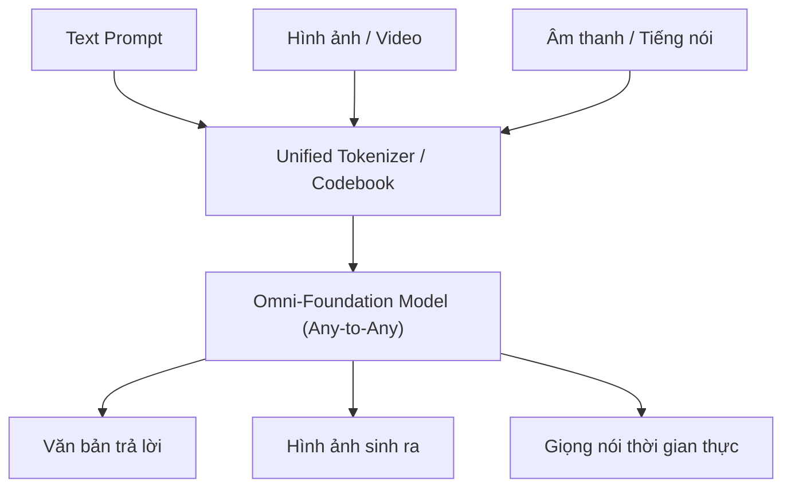

# Chuyên đề: Các Mô hình Sinh Tiên tiến, Video, Khớp Dòng chảy & Đa phương thức (Advanced Generative Paradigms: Video, Flow Matching, Consistency & Multimodal)

## 1. Tổng quan Chuyên đề
Sự phát triển của Generative AI không dừng lại ở việc sinh ảnh tĩnh 2D mà đang mở rộng sang các chiều không thời gian phức tạp hơn: sinh video liên tục (**Text-to-Video**, **Video Diffusion**), các phương pháp toán học thay thế hoàn toàn quá trình khuếch tán truyền thống nhằm tăng tốc sinh mẫu tức thời (**Flow Matching**, **Rectified Flow**, **Consistency Models**), và sự hội tụ giữa mô hình sinh tự hồi quy (**Autoregressive Image Generation**) và mô hình sinh rời rạc (**Discrete Diffusion**).

Đỉnh cao của tiến trình này là **Thế hệ Đa phương thức (Multimodal Generation)**, nơi một mô hình nền tảng duy nhất có thể tiếp nhận và sinh đồng thời văn bản, hình ảnh, âm thanh, video và hành động 3D trong một không gian ngữ nghĩa thống nhất. Chuyên đề này phân tích sâu sắc các phương trình vi phân dòng chảy ODE, cơ chế Attention không-thời gian (Spatiotemporal Attention) và kiến trúc điện toán phân tán trên các cụm siêu máy tính.



---

## 2. Chi tiết từng Keyword

---

### 36. Text-to-Video Generation (Sinh Video từ Văn bản)

#### a. Định nghĩa Bản chất Toán học (Mathematical Formulation)
**Text-to-Video (T2V)** là bài toán sinh một chuỗi $F$ khung hình liên tiếp $\mathbf{V} = (\mathbf{x}_1, \dots, \mathbf{x}_F) \in \mathbb{R}^{F \times C \times H \times W}$ từ một mô tả văn bản $\mathbf{y}$, thỏa mãn hai điều kiện nghiêm ngặt:
1. **Semantic Alignment (Khớp ngữ nghĩa)**: Từng khung hình phải tuân thủ nội dung mô tả trong câu lệnh prompt $\mathbf{y}$.
2. **Temporal Consistency (Nhất quán thời gian)**: Sự biến đổi giữa các khung hình kề nhau $\mathbf{x}_{f}$ và $\mathbf{x}_{f+1}$ phải mượt mà, tuân thủ các quy luật vật lý chuyển động tự nhiên (quán tính, trọng lực, bảo toàn danh tính đối tượng) mà không bị hiện tượng nhấp nháy (flickering).

Hàm mục tiêu khuếch tán trên không gian video tiềm ẩn $\mathcal{Z}_{\text{video}} \in \mathbb{R}^{F \times c \times h \times w}$:
$$\mathcal{L}_{\text{T2V}}(\theta) = \mathbb{E}_{\mathbf{z}_0, \mathbf{y}, \boldsymbol{\epsilon}, t} \left[ \Big\| \boldsymbol{\epsilon} - \boldsymbol{\epsilon}_\theta\big(\mathbf{z}_t, t, \tau_{\text{text}}(\mathbf{y})\big) \Big\|^2 \right]$$

#### b. Cơ chế Tầng Sâu & Điện toán (Under The Hood / Hardware Internals)
- **Bùng nổ Kích thước Tensor (Tensor Memory Explosion)**: Một đoạn video 4 giây gồm 96 khung hình ($24\text{ fps}$) ở độ phân giải $1080\text{p}$ đòi hỏi bộ nhớ tensor nguyên bản khổng lồ:
$$96 \times 3 \times 1080 \times 1920 \times 4\text{ bytes} \approx 2.39\text{ GB per sample!}$$
Quá trình huấn luyện bắt buộc phải sử dụng **3D Causal VAE** (nén cả chiều không gian và thời gian) và song song hóa không thời gian (Spatiotemporal Pipeline Parallelism).

#### c. Sơ đồ Minh họa (Mermaid / ASCII Diagram)


#### d. Code Thực chiến (Dual-Engine: C++ & Python)

```cpp
// C++17: Tính toán dung lượng bộ nhớ của Tensor Video 5D [Batch, Frames, Channels, Height, Width]
#include <iostream>

struct VideoTensor5D {
    size_t b, f, c, h, w;
    size_t element_count() const { return b * f * c * h * w; }
    double memory_mb(size_t bytes_per_elem = 2) const { // 2 bytes cho FP16
        return (element_count() * bytes_per_elem) / (1024.0 * 1024.0);
    }
};

int main() {
    VideoTensor5D v{1, 64, 3, 512, 512}; // 64 khung hình
    std::cout << "5D Video Tensor elements: " << v.element_count() << "\n";
    std::cout << "VRAM requirement (FP16): " << v.memory_mb() << " MB\n";
    return 0;
}
```

```python
# Python / PyTorch: Kiến trúc 3D Causal VAE nén chiều thời gian
import torch
import torch.nn as nn

class CausalConv3d(nn.Module):
    def __init__(self, in_c, out_c, kernel_size=(3, 3, 3), padding=(2, 1, 1)):
        super().__init__()
        # Causal padding theo chiều thời gian để tránh rò rỉ tương lai
        self.conv = nn.Conv3d(in_c, out_c, kernel_size=kernel_size, padding=padding)
        self.pad_time = kernel_size[0] - 1

    def forward(self, x):
        # x: [B, C, F, H, W]
        out = self.conv(x)
        # Cắt bỏ phần padding thời gian dư thừa ở tương lai
        return out[:, :, :-self.pad_time, :, :]

causal_conv = CausalConv3d(4, 8)
video_latent = torch.randn(1, 4, 16, 64, 64) # 16 frames
out_feat = causal_conv(video_latent)
print(f"Video Causal Conv output: {out_feat.shape}")
```

#### e. Lỗi Thường gặp & Ổn định Số học (Pitfalls & Numerical Stability)
- **Vật thể tự biến hình (Morphing / Jitter)**: Đối tượng chuyển động bị biến dạng thành vật thể khác qua từng khung hình do mô hình thiếu liên kết Attention dọc theo trục thời gian dài (Long-range Temporal Attention).

#### f. Ứng dụng Thực chiến trong AI / Deep Learning (AI Applications)
- OpenAI Sora, Runway Gen-2 / Gen-3, Pika Labs, Kuaishou Kling AI, Google Veo.

---

### 37. Video Diffusion (Khuếch tán Video)

#### a. Định nghĩa Bản chất Toán học (Mathematical Formulation)
**Video Diffusion Models (VDMs)** (Ho et al., 2022) mở rộng kiến trúc mô hình khuếch tán sang trường dữ liệu không-thời gian bằng cách sử dụng **Phân rã Chú ý Không - Thời gian (Factorized Spatiotemporal Attention)**:
Thay vì tính Attention trên toàn bộ tensor kích thước $(F \cdot H \cdot W)$ với chi phí bất khả thi $\mathcal{O}(F^2 H^2 W^2)$, mô hình phân tách thành hai bước liên tiếp:
1. **Spatial Self-Attention**: Tính trên từng khung hình độc lập với chi phí $\mathcal{O}(F \cdot (HW)^2)$.
2. **Temporal Self-Attention**: Giữ nguyên vị trí không gian và tính Attention xuyên suốt $F$ khung hình với chi phí $\mathcal{O}((HW) \cdot F^2)$:
$$\text{Attention}_{\text{temporal}}(Q_t, K_t, V_t) = \text{softmax}\left(\frac{Q_t K_t^T}{\sqrt{d_k}}\right) V_t$$
với $Q_t, K_t, V_t \in \mathbb{R}^{(HW) \times F \times d}$.

#### b. Cơ chế Tầng Sâu & Điện toán (Under The Hood / Hardware Internals)
- **Giao tiếp liên Node qua Ring-Attention**: Khi video có độ dài hàng trăm khung hình, tensor vượt quá dung lượng VRAM của 1 GPU (80GB). Các nhà nghiên cứu sử dụng **Ring-Attention** để chia chuỗi thời gian thành các khối (chunks) chạy trên một vòng tròn các GPU liên kết qua NVLink/InfiniBand, truyền Key/Value theo vòng tròn trong khi tính Attention cục bộ.

#### c. Sơ đồ Minh họa (Mermaid / ASCII Diagram)


#### d. Code Thực chiến (Dual-Engine: C++ & Python)

```cpp
// C++17: Hoán vị trục bộ nhớ (Tensor Transpose) giữa Spatial và Temporal Layouts
#include <iostream>
#include <vector>

void transpose_spatial_to_temporal(
    const std::vector<float>& src, 
    std::vector<float>& dst, 
    size_t F, size_t HW, size_t C) 
{
    // Chuyển từ [F, HW, C] sang [HW, F, C]
    for (size_t f = 0; f < F; ++f) {
        for (size_t hw = 0; hw < HW; ++hw) {
            for (size_t c = 0; c < C; ++c) {
                size_t src_idx = f * (HW * C) + hw * C + c;
                size_t dst_idx = hw * (F * C) + f * C + c;
                dst[dst_idx] = src[src_idx];
            }
        }
    }
}

int main() {
    std::vector<float> spatial_tensor(4 * 16 * 8, 1.0f); // F=4, HW=16, C=8
    std::vector<float> temporal_tensor(4 * 16 * 8);
    transpose_spatial_to_temporal(spatial_tensor, temporal_tensor, 4, 16, 8);
    std::cout << "Tensor successfully transposed for Temporal Attention.\n";
    return 0;
}
```

```python
# Python / PyTorch: Khối Factorized Spatiotemporal Attention hoàn chỉnh
import torch
import torch.nn as nn

class SpatioTemporalBlock(nn.Module):
    def __init__(self, dim):
        super().__init__()
        self.spatial_attn = nn.MultiheadAttention(dim, num_heads=4, batch_first=True)
        self.temporal_attn = nn.MultiheadAttention(dim, num_heads=4, batch_first=True)

    def forward(self, x):
        # x: [B, F, HW, C]
        B, F, HW, C = x.shape
        
        # 1. Spatial Attention (B*F chuỗi, mỗi chuỗi độ dài HW)
        x_spatial = x.view(B * F, HW, C)
        out_spatial, _ = self.spatial_attn(x_spatial, x_spatial, x_spatial)
        x = x + out_spatial.view(B, F, HW, C)
        
        # 2. Temporal Attention (B*HW chuỗi, mỗi chuỗi độ dài F)
        x_temporal = x.permute(0, 2, 1, 3).reshape(B * HW, F, C)
        out_temporal, _ = self.temporal_attn(x_temporal, x_temporal, x_temporal)
        x = x + out_temporal.view(B, HW, F, C).permute(0, 2, 1, 3)
        return x

block = SpatioTemporalBlock(dim=32)
sample_video = torch.randn(2, 8, 16, 32) # B=2, F=8, HW=16, C=32
out = block(sample_video)
print(f"Spatio-Temporal Output shape: {out.shape}")
```

#### e. Lỗi Thường gặp & Ổn định Số học (Pitfalls & Numerical Stability)
- **Tập hợp thời gian bị nổ Gradient (Temporal Explosion)**: Khi chuỗi khung hình dài, phép nhân ma trận Attention theo chiều thời gian dễ gây bùng nổ gradient. Khắc phục: Áp dụng QK-Norm hoặc Residual Gating scale khởi tạo bằng 0.

#### f. Ứng dụng Thực chiến trong AI / Deep Learning (AI Applications)
- Stable Video Diffusion (SVD), AnimateDiff, Luma Dream Machine, sinh hoạt hình 3D.

---

### 38. Flow Matching (Khớp Dòng chảy)

#### a. Định nghĩa Bản chất Toán học (Mathematical Formulation)
**Flow Matching (Lipman et al., 2022; Albergo & Vanden-Eijnden, 2022)** là phương pháp luận hiện đại dựa trên Phương trình Vi phân Thường (Continuous Normalizing Flows - CNFs) thay thế toàn bộ lý thuyết khuếch tán dựa trên SDE phức tạp.
Xét đường đi xác suất (Probability Path) $p_t(\mathbf{x})$ biến đổi từ phân phối tiên nghiệm $p_0 = \mathcal{N}(0, \mathbf{I})$ sang phân phối dữ liệu thực $p_1 = p_{\text{data}}$. Đường đi này được sinh ra bởi một trường vector vận tốc thời gian $\mathbf{v}_t(\mathbf{x})$ thông qua phương trình liên tục (Continuity Equation):
$$\frac{\partial p_t(\mathbf{x})}{\partial t} + \nabla \cdot \big( p_t(\mathbf{x}) \mathbf{v}_t(\mathbf{x}) \big) = 0$$
Thay vì tính toán hàm mục tiêu toàn cục bất khả tri, Flow Matching định nghĩa **Conditional Flow Matching (CFM)** dọc theo quỹ đạo thẳng nối từ $\mathbf{x}_0 \sim \mathcal{N}(0, \mathbf{I})$ tới $\mathbf{x}_1 \sim p_{\text{data}}$:
$$\psi_t(\mathbf{x}) = (1 - t)\mathbf{x}_0 + t \mathbf{x}_1, \qquad \frac{d\psi_t}{dt} = \mathbf{x}_1 - \mathbf{x}_0$$
Hàm mất mát CFM cực kỳ đơn giản và thanh lịch:
$$\mathcal{L}_{\text{CFM}}(\theta) = \mathbb{E}_{t \sim \mathcal{U}[0, 1], \mathbf{x}_0, \mathbf{x}_1}\left[ \Big\| \mathbf{v}_\theta\big(\psi_t(\mathbf{x}), t\big) - (\mathbf{x}_1 - \mathbf{x}_0) \Big\|^2 \right]$$

#### b. Cơ chế Tầng Sâu & Điện toán (Under The Hood / Hardware Internals)
- **Quỹ đạo Đường Thẳng Tuyệt Đối**: Do trường vector đích là hằng số $\mathbf{x}_1 - \mathbf{x}_0$ không đổi theo thời gian, quỹ đạo nghiệm của phương trình ODE là một đường thẳng (Straight Trajectory). Bộ giải số ODE (như Euler hay RK4) có thể đi các bước nhảy thời gian cực lớn mà không sợ bị trượt khỏi quỹ đạo, giảm số bước sinh xuống chỉ còn 4 - 10 bước.

#### c. Sơ đồ Minh họa (Mermaid / ASCII Diagram)


#### d. Code Thực chiến (Dual-Engine: C++ & Python)

```cpp
// C++17: Thuật toán Euler giải ODE tích phân trường vận tốc Flow Matching
#include <iostream>
#include <vector>

std::vector<float> euler_ode_solve(
    const std::vector<float>& x_0,
    const std::vector<float>& v_pred,
    float dt) 
{
    size_t dim = x_0.size();
    std::vector<float> x_next(dim);
    for (size_t i = 0; i < dim; ++i) {
        x_next[i] = x_0[i] + v_pred[i] * dt; // x_{t+dt} = x_t + v * dt
    }
    return x_next;
}

int main() {
    std::vector<float> x_t = {0.1f, -0.2f};
    std::vector<float> v = {1.5f, 2.0f}; // Vận tốc x_1 - x_0
    auto x_next = euler_ode_solve(x_t, v, 0.1f);
    std::cout << "ODE State at t+0.1: [" << x_next[0] << ", " << x_next[1] << "]\n";
    return 0;
}
```

```python
# Python / PyTorch: Vòng lặp huấn luyện Conditional Flow Matching (CFM)
import torch
import torch.nn as nn
import torch.nn.functional as F

class VelocityNet(nn.Module):
    def __init__(self, dim=16):
        super().__init__()
        self.net = nn.Sequential(nn.Linear(dim + 1, 64), nn.SiLU(), nn.Linear(64, dim))
    def forward(self, x, t):
        # Nối vector trạng thái x và thời gian t
        xt = torch.cat([x, t.view(-1, 1)], dim=-1)
        return self.net(xt)

model = VelocityNet(dim=8)
optimizer = torch.optim.Adam(model.parameters(), lr=1e-3)

# 1 Bước huấn luyện CFM
x_1 = torch.randn(4, 8) # Data point thực tế
x_0 = torch.randn(4, 8) # Gaussian prior
t = torch.rand(4, 1)

# Điểm nội suy tuyến tính: psi_t = (1 - t)*x_0 + t*x_1
x_t = (1.0 - t) * x_0 + t * x_1
# Vận tốc đích: v = x_1 - x_0
target_v = x_1 - x_0

v_pred = model(x_t, t.squeeze(-1))
loss = F.mse_loss(v_pred, target_v)
loss.backward()
optimizer.step()
print(f"Flow Matching Loss: {loss.item():.4f}")
```

#### e. Lỗi Thường gặp & Ổn định Số học (Pitfalls & Numerical Stability)
- **Giao cắt Quỹ đạo (Trajectory Crossing)**: Nếu không dùng kỹ thuật Optimal Transport (OT-CFM), các đường thẳng nối giữa các cặp ngẫu nhiên $(\mathbf{x}_0, \mathbf{x}_1)$ có thể cắt chéo nhau trong không gian, làm trường vector $\mathbf{v}$ bị đa trị tại điểm giao cắt.

#### f. Ứng dụng Thực chiến trong AI / Deep Learning (AI Applications)
- Kiến trúc nền móng của **Stable Diffusion 3**, **FLUX.1 (Black Forest Labs)**, Voicebox (Meta Speech).

---

### 39. Rectified Flow (Dòng Hiệu chỉnh)

#### a. Định nghĩa Bản chất Toán học (Mathematical Formulation)
**Rectified Flow (Liu et al., 2022)** giải quyết triệt để vấn đề giao cắt quỹ đạo của Flow Matching thông qua một thuật toán lặp có tên là **Reflow (Hiệu chỉnh dòng)**.
Bắt đầu từ một trường dòng chảy ban đầu $Z_1 = \text{Flow}(Z_0)$, thuật toán Reflow lấy lại các cặp điểm đầu và điểm cuối sinh ra bởi chính mô hình:
$$(X_0, X_1) = \big(Z_0, \text{ODE-Solve}(Z_0)\big)$$
Sau đó, huấn luyện lại một trường vector mới $\mathbf{v}_{\theta}^{(k+1)}$ trên các cặp $(X_0, X_1)$ này.
**Định lý Nắn thẳng (Straightening Theorem)** chứng minh rằng: Sau mỗi vòng lặp Reflow, độ cong của các quỹ đạo tích phân giảm đơn điệu:
$$\text{Cost}(\text{Flow}^{(k+1)}) \le \text{Cost}(\text{Flow}^{(k)})$$
Khi quỹ đạo tiệm cận thành các đường thẳng tuyệt đối không giao cắt, mô hình có thể sinh mẫu hoàn hảo chỉ với **1 bước giải Euler duy nhất (1-step generation)**:
$$\mathbf{x}_1 = \mathbf{x}_0 + \mathbf{v}_\theta(\mathbf{x}_0, 0)$$

#### b. Cơ chế Tầng Sâu & Điện toán (Under The Hood / Hardware Internals)
- **Tối ưu hóa Băng thông 1-Step Inference**: Sinh ảnh bằng 1 bước Euler biến mô hình sinh khuếch tán thành một mạng Feedforward thông thường. Không còn vòng lặp while, không còn lưu giữ trạng thái, giải phóng toàn bộ áp lực băng thông bộ nhớ VRAM trên các thiết bị Edge/Mobile.

#### c. Sơ đồ Minh họa (Mermaid / ASCII Diagram)


#### d. Code Thực chiến (Dual-Engine: C++ & Python)

```cpp
// C++17: Sinh mẫu ảnh siêu tốc 1-Step bằng Rectified Flow
#include <iostream>
#include <vector>

std::vector<float> rectified_one_step_sample(
    const std::vector<float>& z_prior, 
    const std::vector<float>& v_pred) 
{
    std::vector<float> x_gen(z_prior.size());
    for (size_t i = 0; i < z_prior.size(); ++i) {
        // Với dt = 1.0: x_1 = z_0 + v * 1.0
        x_gen[i] = z_prior[i] + v_pred[i];
    }
    return x_gen;
}

int main() {
    std::vector<float> z0 = {-0.5f, 1.2f};
    std::vector<float> v = {1.0f, -0.8f};
    auto img = rectified_one_step_sample(z0, v);
    std::cout << "1-Step Generated Sample: [" << img[0] << ", " << img[1] << "]\n";
    return 0;
}
```

```python
# Python / PyTorch: Thuật toán Reflow tạo cặp dữ liệu đường thẳng
import torch

def generate_reflow_dataset(model_ode_solver, num_samples=100, dim=8):
    # Lấy mẫu z_0 từ Prior
    z_0 = torch.randn(num_samples, dim)
    # Dùng mô hình hiện tại giải ODE tìm z_1 tương ứng
    with torch.no_grad():
        z_1 = model_ode_solver(z_0)
    # Trả về cặp (z_0, z_1) thẳng hàng làm tập train mới cho vòng lặp tiếp theo
    return z_0, z_1

print("Reflow pair generator ready.")
```

#### e. Lỗi Thường gặp & Ổn định Số học (Pitfalls & Numerical Stability)
- **Tích lũy lỗi phân phối ở Reflow bậc cao**: Nếu giải ODE để tìm $X_1$ với dung sai quá thô (tolerance lớn), dữ liệu huấn luyện mới sẽ bị lệch khỏi phân phối thực, làm chất lượng mẫu sinh bị suy giảm sau nhiều lần Reflow.

#### f. Ứng dụng Thực chiến trong AI / Deep Learning (AI Applications)
- Kiến trúc lõi của **InstaFlow**, **SD3-Turbo**, và các mô hình sinh hình ảnh siêu thời gian thực trên điện thoại thông minh.

---

### 40. Consistency Models (Mô hình Nhất quán)

#### a. Định nghĩa Bản chất Toán học (Mathematical Formulation)
**Consistency Models (Song et al., OpenAI 2023)** được thiết kế với mục tiêu sinh dữ liệu chất lượng cao chỉ trong 1 hoặc vài bước mà không cần giải ODE lặp lại.
Mô hình định nghĩa một hàm nhất quán $\mathbf{f}_\theta(\mathbf{x}_t, t)$ ánh xạ bất kỳ điểm nào $\mathbf{x}_t$ trên cùng một quỹ đạo ODE về đúng điểm khởi đầu $\mathbf{x}_0$:
$$\mathbf{f}_\theta(\mathbf{x}_t, t) = \mathbf{f}_\theta(\mathbf{x}_{t'}, t') = \mathbf{x}_0 \quad \forall t, t' \in [\epsilon, T]$$
Điều kiện biên bắt buộc (Boundary Condition):
$$\mathbf{f}_\theta(\mathbf{x}, \epsilon) = \mathbf{x}$$
Để thỏa mãn điều kiện biên một cách tự nhiên, mô hình được tham số hóa thông qua hàm bỏ qua (Skip-connection parameterization):
$$\mathbf{f}_\theta(\mathbf{x}, t) = c_{\text{skip}}(t)\mathbf{x} + c_{\text{out}}(t) F_\theta(\mathbf{x}, t)$$
với $c_{\text{skip}}(\epsilon) = 1$ và $c_{\text{out}}(\epsilon) = 0$.

Hàm mất mát **Consistency Training (CT)**:
$$\mathcal{L}_{\text{CT}}(\theta) = \mathbb{E}\left[ d\Big(\mathbf{f}_\theta(\mathbf{x}_{t_{n+1}}, t_{n+1}), \; \mathbf{f}_{\theta^-}(\hat{\mathbf{x}}_{t_n}, t_n)\Big) \right]$$
Trong đó $\theta^-$ là mạng trung bình trượt trọng số (EMA), và $\hat{\mathbf{x}}_{t_n}$ là bước nhảy Euler từ $t_{n+1}$ về $t_n$.

#### b. Cơ chế Tầng Sâu & Điện toán (Under The Hood / Hardware Internals)
- **Thời gian suy luận cỡ Mili-giây (Sub-100ms Latency)**: Bằng cách loại bỏ hoàn toàn các bước lặp, Consistency Models cho phép tạo ra hình ảnh $512 \times 512$ trong dưới $50\text{ms}$ trên GPU NVIDIA RTX 4090, mở ra kỷ nguyên tạo video và tạo thế giới ảo 3D trực tiếp tương tác theo thời gian thực (Interactive Real-time Rendering).

#### c. Sơ đồ Minh họa (Mermaid / ASCII Diagram)


#### d. Code Thực chiến (Dual-Engine: C++ & Python)

```cpp
// C++17: Tính toán các hệ số Skip và Out thỏa mãn điều kiện biên Consistency Model
#include <iostream>
#include <cmath>

struct ConsistencyCoefficients {
    float c_skip;
    float c_out;

    ConsistencyCoefficients(float t, float sigma_data = 0.5f, float epsilon = 0.002f) {
        float var_data = sigma_data * sigma_data;
        float diff_t = t - epsilon;
        c_skip = var_data / (diff_t * diff_t + var_data);
        c_out = (sigma_data * diff_t) / std::sqrt(var_data + t * t);
    }
};

int main() {
    ConsistencyCoefficients boundary(0.002f); // t = epsilon
    std::cout << "At t=eps: c_skip = " << boundary.c_skip << " (Target: 1.0)\n";
    std::cout << "At t=eps: c_out  = " << boundary.c_out  << " (Target: 0.0)\n";
    return 0;
}
```

```python
# Python / PyTorch: Kiến trúc hàm tham số hóa Consistency Model
import torch
import torch.nn as nn

class ConsistencyModelWrapper(nn.Module):
    def __init__(self, backbone_net, sigma_data=0.5, eps=0.002):
        super().__init__()
        self.net = backbone_net
        self.sigma_data = sigma_data
        self.eps = eps

    def forward(self, x, t):
        # Tính c_skip và c_out giải tích
        c_skip = (self.sigma_data**2) / ((t - self.eps)**2 + self.sigma_data**2)
        c_out = (self.sigma_data * (t - self.eps)) / torch.sqrt(self.sigma_data**2 + t**2)
        
        c_skip = c_skip.view(-1, 1, 1, 1)
        c_out = c_out.view(-1, 1, 1, 1)
        # f_theta(x, t) = c_skip * x + c_out * F_theta(x, t)
        return c_skip * x + c_out * self.net(x, t)

dummy_unet = lambda x, t: torch.zeros_like(x)
cm = ConsistencyModelWrapper(dummy_unet)
x = torch.randn(2, 3, 32, 32)
t = torch.tensor([0.002, 0.002]) # Tại t=eps
out = cm(x, t)
print("Difference from identity at t=eps:", torch.norm(out - x).item())
```

#### e. Lỗi Thường gặp & Ổn định Số học (Pitfalls & Numerical Stability)
- **Chất lượng chi tiết khi sinh 1 bước**: Sinh 1 bước duy nhất đôi khi bị mất các hoa văn tần số cao (mặt người hoặc chi tiết chữ viết). Người ta thường kết hợp **Multistep Consistency Sampling** (2 đến 3 bước) để dung hòa giữa tốc độ và độ sắc nét hoàn mỹ.

#### f. Ứng dụng Thực chiến trong AI / Deep Learning (AI Applications)
- Latent Consistency Models (LCM), LCM-LoRA, ứng dụng trong livestreaming AI avatar và tạo ảnh thời gian thực khi đang vẽ (Real-time Canvas Painting).

---

### 41. Autoregressive Image Generation (Sinh Ảnh Tự hồi quy)

#### a. Định nghĩa Bản chất Toán học (Mathematical Formulation)
**Autoregressive Image Generation** tiếp cận bài toán thị giác máy tính dưới lăng kính của Xử lý Ngôn ngữ Tự nhiên: Biến bức ảnh thành một chuỗi các "Visual Tokens" rời rạc thông qua một bộ mã hóa Vector Quantized Codebook (như **VQ-VAE** hoặc **VQ-GAN**):
$$\mathbf{x} \in \mathbb{R}^{3 \times H \times W} \xrightarrow{\text{VQ-GAN}} \mathbf{s} = (s_1, s_2, \dots, s_N) \in \mathcal{V}^N$$
Trong đó $\mathcal{V}$ là từ điển hữu hạn các mã token thị giác (ví dụ $|\mathcal{V}| = 8192$), và $N = \frac{H}{16} \times \frac{W}{16}$.
Sau đó, một mạng Transformer chuẩn (Decoder-only) được sử dụng để dự đoán token tiếp theo theo thứ tự đọc quét từ trái sang phải, từ trên xuống dưới (Raster-Scan Order):
$$p(\mathbf{s}) = \prod_{i=1}^N p(s_i \mid s_1, s_2, \dots, s_{i-1})$$
Hàm mất mát là Cross-Entropy truyền thống:
$$\mathcal{L}_{\text{AR}}(\theta) = -\sum_{i=1}^N \log p_\theta(s_i \mid \mathbf{s}_{<i})$$

#### b. Cơ chế Tầng Sâu & Điện toán (Under The Hood / Hardware Internals)
- **Tận dụng Trực tiếp KV-Cache Kernel**: Vì cấu trúc toán học giống hệt LLMs, các kỹ sư có thể tận dụng toàn bộ hạ tầng phần mềm tăng tốc suy luận của LLM (như vLLM, TensorRT-LLM, FlashDecoding) để sinh ảnh tự hồi quy với thông lượng token cực lớn mà không cần viết lại kernel tính toán riêng.

#### c. Sơ đồ Minh họa (Mermaid / ASCII Diagram)


#### d. Code Thực chiến (Dual-Engine: C++ & Python)

```cpp
// C++17: Chuyển đổi chỉ số ma trận không gian 2D thành thứ tự Raster-Scan 1D
#include <iostream>
#include <vector>

size_t raster_scan_index(size_t row, size_t col, size_t width) {
    return row * width + col;
}

int main() {
    size_t H = 16, W = 16;
    std::cout << "Token at row 2, col 5 has 1D sequence index: " 
              << raster_scan_index(2, 5, W) << " / " << H * W << "\n";
    return 0;
}
```

```python
# Python / PyTorch: Vòng lặp dự đoán Next Visual Token với Cross-Entropy
import torch
import torch.nn as nn
import torch.nn.functional as F

vocab_size = 1024
seq_len = 256 # 16x16 visual grid
transformer_head = nn.Linear(64, vocab_size)

# Giả lập hidden states từ Transformer
hidden_states = torch.randn(2, seq_len, 64)
target_tokens = torch.randint(0, vocab_size, (2, seq_len))

logits = transformer_head(hidden_states)
loss = F.cross_entropy(logits.view(-1, vocab_size), target_tokens.view(-1))
print(f"Autoregressive Visual Token Cross-Entropy: {loss.item():.4f}")
```

#### e. Lỗi Thường gặp & Ổn định Số học (Pitfalls & Numerical Stability)
- **Tích lũy Sai lệch Ngữ cảnh (Error Propagation)**: Khi một token ở góc trên bên trái bị chọn sai, toàn bộ phần còn lại của bức ảnh sẽ bị ảnh hưởng theo hiệu ứng domino (ví dụ: cơ thể người bị kéo dài bất thường hoặc méo mó).

#### f. Ứng dụng Thực chiến trong AI / Deep Learning (AI Applications)
- DALL-E 1 (OpenAI), Parti (Google), Muse, Chameleon (Meta), Llama 3-Vision generation head.

---

### 42. Discrete Diffusion (Khuếch tán Rời rạc)

#### a. Định nghĩa Bản chất Toán học (Mathematical Formulation)
**Discrete Diffusion Models (D3PM - Austin et al., 2021)** mở rộng lý thuyết khuếch tán sang không gian các biến trạng thái rời rạc $\mathbf{x}_t \in \{1, 2, \dots, K\}^N$ (như text tokens hoặc visual codebook tokens).
Quá trình thêm nhiễu được định nghĩa bởi ma trận xác suất chuyển trạng thái Markov $Q_t \in \mathbb{R}^{K \times K}$:
$$q(\mathbf{x}_t \mid \mathbf{x}_{t-1}) = \mathbf{x}_{t-1} Q_t$$
với $[Q_t]_{ij} = q(x_t = j \mid x_{t-1} = i)$.
Các chiến lược chuyển trạng thái phổ biến:
1. **Uniform Transition**: Thay thế token bằng một token ngẫu nhiên bất kỳ với xác suất $\beta_t$.
2. **Masked Transition (Absorbing State)**: Thay thế token bằng một ký tự mặt nạ đặc biệt `[MASK]` với xác suất $\beta_t$. Một khi đã bị mask, token không thể đổi lại (trạng thái hấp thụ).
Hàm mất mát huấn luyện tối ưu hóa cận dưới biến phân rời rạc (Categorical KL Divergence):
$$\mathcal{L}_{\text{VLB}} = \mathbb{D}_{\text{KL}}\Big( q(\mathbf{x}_{t-1} \mid \mathbf{x}_t, \mathbf{x}_0) \;\parallel\; p_\theta(\mathbf{x}_{t-1} \mid \mathbf{x}_t) \Big)$$

#### b. Cơ chế Tầng Sâu & Điện toán (Under The Hood / Hardware Internals)
- **Tốc độ Song song hóa Phi hồi quy**: Khác với Autoregressive phải sinh tuần tự từng token một, Discrete Diffusion cho phép giải phóng và dự đoán đồng thời hàng trăm tokens trong 1 bước khử mặt nạ, mang lại thông lượng sinh văn bản/code vượt trội trên GPU.

#### c. Sơ đồ Minh họa (Mermaid / ASCII Diagram)


#### d. Code Thực chiến (Dual-Engine: C++ & Python)

```cpp
// C++17: Mô phỏng quá trình Masking rời rạc (Absorbing State Transition)
#include <iostream>
#include <vector>
#include <random>

std::vector<int> discrete_mask_step(
    const std::vector<int>& tokens, 
    float mask_prob, 
    int mask_token_id, 
    std::mt19937& rng) 
{
    std::uniform_real_distribution<float> dist(0.0f, 1.0f);
    std::vector<int> noisy_tokens = tokens;
    for (size_t i = 0; i < tokens.size(); ++i) {
        if (dist(rng) < mask_prob) {
            noisy_tokens[i] = mask_token_id;
        }
    }
    return noisy_tokens;
}

int main() {
    std::mt19937 rng(42);
    std::vector<int> seq = {101, 2054, 1037, 4937, 102}; // IDs văn bản
    auto noisy_seq = discrete_mask_step(seq, 0.4f, 9999, rng);
    std::cout << "Noisy discrete tokens: ";
    for (int id : noisy_seq) std::cout << id << " ";
    std::cout << "\n";
    return 0;
}
```

```python
# Python / PyTorch: Thuật toán D3PM Masked Diffusion Loss
import torch
import torch.nn.functional as F

def discrete_diffusion_loss(model, token_ids, mask_token_id=0, num_timesteps=100):
    batch_size, seq_len = token_ids.shape
    t = torch.randint(1, num_timesteps, (batch_size,))
    
    # Xác suất mask tăng theo thời gian t/T
    mask_prob = t.float() / num_timesteps
    mask_matrix = torch.rand(batch_size, seq_len) < mask_prob.unsqueeze(1)
    
    noisy_tokens = torch.where(mask_matrix, torch.tensor(mask_token_id), token_ids)
    logits = model(noisy_tokens, t) # [B, S, Vocab]
    
    # Chỉ tính loss trên các vị trí đã bị mask
    loss = F.cross_entropy(logits.view(-1, logits.size(-1)), token_ids.view(-1), reduction='none')
    loss = (loss.view(batch_size, seq_len) * mask_matrix.float()).sum() / (mask_matrix.sum() + 1e-8)
    return loss

print("Discrete diffusion categorical loss defined.")
```

#### e. Lỗi Thường gặp & Ổn định Số học (Pitfalls & Numerical Stability)
- **Token Disconnection (Mất liên kết ngữ pháp)**: Nếu khử mặt nạ quá nhiều token cùng lúc trong 1 bước, mô hình có thể điền các từ có nghĩa cục bộ nhưng hoàn toàn mâu thuẫn ngữ pháp với nhau.

#### f. Ứng dụng Thực chiến trong AI / Deep Learning (AI Applications)
- Sinh văn bản không hồi quy (Non-Autoregressive Text Generation), thiết kế trình tự kháng thể/protein (EvoDiff), sinh mã nguồn đa luồng.

---

### 43. Multimodal Generation (Thế hệ Đa phương thức Thống nhất)

#### a. Định nghĩa Bản chất Toán học (Mathematical Formulation)
**Multimodal Generation** là đỉnh cao hội tụ của Trí tuệ Nhân tạo Tạo sinh, nơi mô hình ánh xạ các luồng dữ liệu từ các không gian phương thức khác nhau $\mathcal{X}_{\text{text}}, \mathcal{X}_{\text{image}}, \mathcal{X}_{\text{audio}}, \mathcal{X}_{\text{video}}$ vào một không gian biểu diễn ẩn chung (Unified Representation Space) $\mathcal{H}$:
$$\mathbf{h} = \text{Encoder}_m(\mathbf{x}_m) \in \mathbb{R}^d, \quad m \in \{\text{text, vision, audio}\}$$
Quá trình sinh mẫu chung mô hình hóa phân phối xác suất đồng thời có điều kiện chéo bất kỳ:
$$p(\mathbf{x}_{\text{target}} \mid \mathbf{x}_{\text{context}}) \quad \forall \text{context, target} \in \{\text{text, image, audio, video}\}$$
Kiến trúc thống nhất này thường được hiện thực hóa qua:
1. **Any-to-Any Autoregressive Transformers**: Xem tất cả các phương thức đều là chuỗi tokens rời rạc (Text tokens, VQ Image tokens, EnCodec Audio tokens).
2. **Unified Diffusion Transformers (MM-DiT)**: Sử dụng các khối Transformer với hai luồng tham số riêng biệt cho Text và Image nhưng trao đổi thông tin chéo thông qua ma trận Joint Self-Attention.

#### b. Cơ chế Tầng Sâu & Điện toán (Under The Hood / Hardware Internals)
- **Cân bằng Chiều dài Chuỗi Không đồng nhất**: Chuỗi text thường ngắn ($S \approx 100 - 1000$), trong khi chuỗi hình ảnh ($64 \times 64 = 4096$) và chuỗi âm thanh ($75\text{ tokens/sec} \times 10\text{s} = 750$) có độ dài rất chênh lệch. Việc ghép nối chúng vào cùng một tensor chung $[B, S_{\text{total}}, D]$ đòi hỏi các cơ chế phân nhóm **Cross-Modality Packing** và **Masked Rotary Positional Embeddings (Multimodal RoPE)** để bảo toàn cấu trúc tọa độ 2D của ảnh và 1D của chữ viết.

#### c. Sơ đồ Minh họa (Mermaid / ASCII Diagram)


#### d. Code Thực chiến (Dual-Engine: C++ & Python)

```cpp
// C++17: Cấu trúc đóng gói Token đa phương thức (Multimodal Unified Token Container)
#include <iostream>
#include <vector>
#include <string>

enum class ModalityType { TEXT, VISION, AUDIO };

struct UnifiedToken {
    int token_id;
    ModalityType modality;
    int pos_x; // Tọa độ không gian x (cho ảnh)
    int pos_y; // Tọa độ không gian y (cho ảnh)
    int pos_t; // Tọa độ thời gian (cho video/audio/text)
};

int main() {
    std::vector<UnifiedToken> sequence;
    // 1 Text token
    sequence.push_back({1054, ModalityType::TEXT, 0, 0, 0});
    // 1 Vision token ở tọa độ (3, 4)
    sequence.push_back({812, ModalityType::VISION, 3, 4, 0});

    std::cout << "Unified Multimodal Sequence packed with " << sequence.size() << " tokens.\n";
    return 0;
}
```

```python
# Python / PyTorch: Khối Joint Attention hợp nhất giữa Văn bản và Hình ảnh (MM-DiT)
import torch
import torch.nn as nn

class JointAttentionBlock(nn.Module):
    def __init__(self, dim):
        super().__init__()
        self.qkv_text = nn.Linear(dim, 3 * dim)
        self.qkv_img = nn.Linear(dim, 3 * dim)
        self.proj_text = nn.Linear(dim, dim)
        self.proj_img = nn.Linear(dim, dim)

    def forward(self, text_tokens, img_tokens):
        # text: [B, S_txt, D], img: [B, S_img, D]
        q_t, k_t, v_t = self.qkv_text(text_tokens).chunk(3, dim=-1)
        q_i, k_i, v_i = self.qkv_img(img_tokens).chunk(3, dim=-1)
        
        # Nối chung thành 1 không gian Attention toàn vẹn
        q = torch.cat([q_t, q_i], dim=1)
        k = torch.cat([k_t, k_i], dim=1)
        v = torch.cat([v_t, v_i], dim=1)
        
        # Scaled dot-product attention
        attn_out = nn.functional.scaled_dot_product_attention(q, k, v)
        
        # Tách lại về từng luồng phương thức ban đầu
        S_txt = text_tokens.size(1)
        out_txt = self.proj_text(attn_out[:, :S_txt])
        out_img = self.proj_img(attn_out[:, S_txt:])
        return out_txt, out_img

block = JointAttentionBlock(dim=64)
txt = torch.randn(2, 10, 64)
img = torch.randn(2, 64, 64)
txt_out, img_out = block(txt, img)
print("MM-DiT Joint Attention Output shapes:", txt_out.shape, img_out.shape)
```

#### e. Lỗi Thường gặp & Ổn định Số học (Pitfalls & Numerical Stability)
- **Hiện tượng thống trị phương thức (Modality Dominance)**: Văn bản thường có mật độ thông tin ngữ nghĩa cao hơn hình ảnh rất nhiều, khiến mô hình có xu hướng học thiên vị text và coi nhẹ các đặc trưng hình ảnh/âm thanh nếu không có cơ chế cân bằng trọng số mất mát (Loss Balancing / Gradient Normalization).

#### f. Ứng dụng Thực chiến trong AI / Deep Learning (AI Applications)
- GPT-4o (Omni), Google Gemini 1.5 Pro, Meta Chameleon, Stable Diffusion 3 (MM-DiT), Fuyu-8B.
