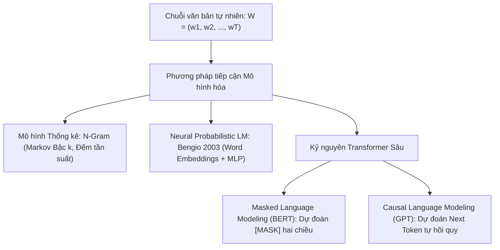
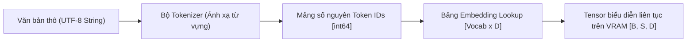
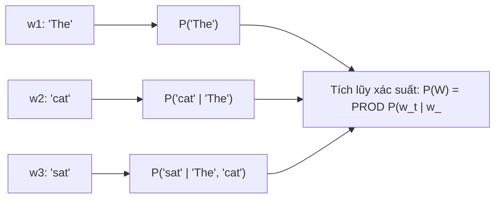
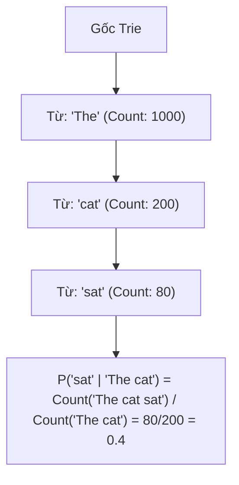
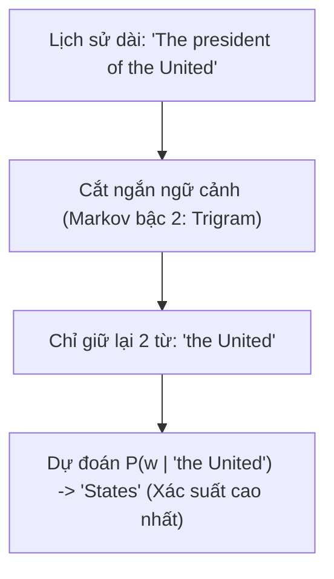
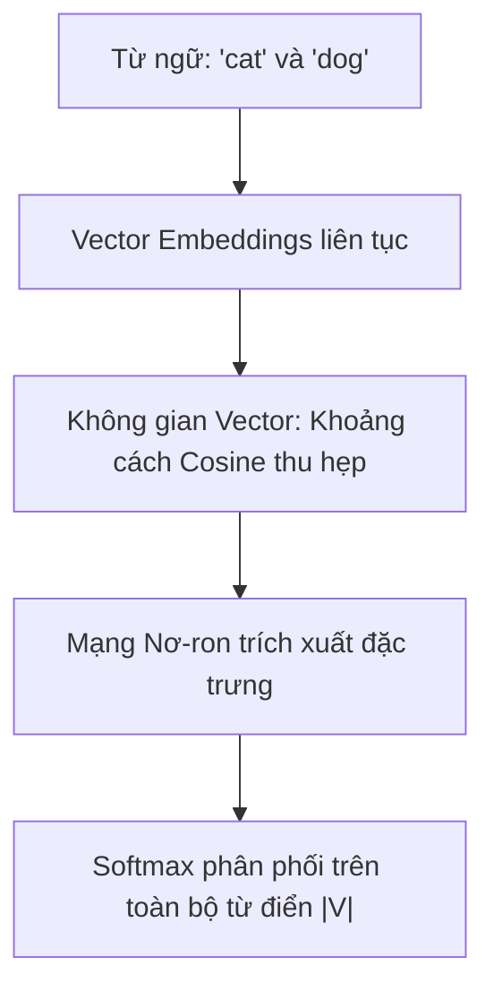
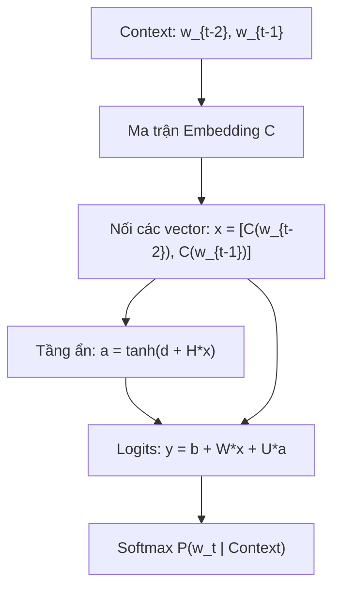
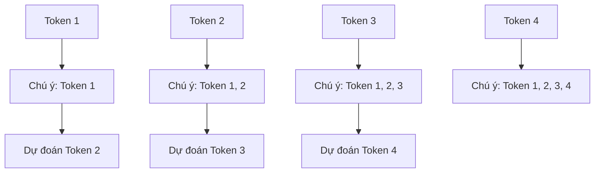
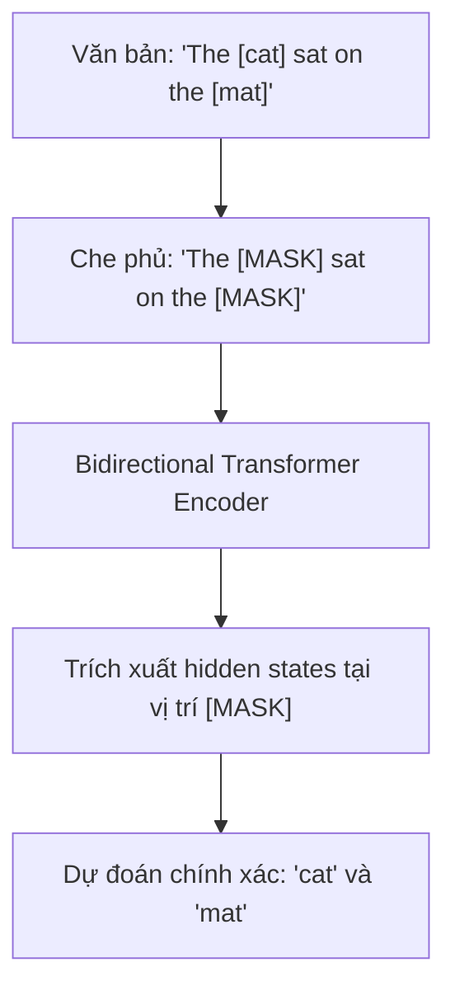
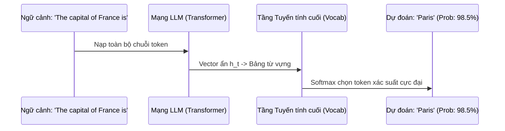

# Chuyên đề: Xử lý Ngôn ngữ Tự nhiên & Mô hình Hóa Ngôn ngữ Thống kê - Nơ-ron (NLP, Statistical & Neural Language Models)

## 1. Tổng quan Chuyên đề
Ngôn ngữ tự nhiên là phương tiện phức tạp và tinh vi nhất để con người giao tiếp, truyền đạt tri thức và tư duy logic. **Mô hình hóa Ngôn ngữ (Language Modeling)** là bài toán trung tâm của **Xử lý Ngôn ngữ Tự nhiên (Natural Language Processing - NLP)**, hướng tới việc gán một phân phối xác suất toán học $P(W)$ cho một chuỗi các từ hoặc ký hiệu ngôn ngữ $W = (w_1, w_2, \dots, w_T)$.

Lịch sử phát triển của Language Modeling trải qua ba giai đoạn tiến hóa mang tính cách mạng:
1. **Mô hình Thống kê Cổ điển (Statistical & N-Gram Models)**: Dựa trên tần suất đếm rời rạc và chuỗi Markov bậc thấp kết hợp các kỹ thuật làm mờ (smoothing).
2. **Mô hình Ngôn ngữ Nơ-ron Tiên phong (Neural Probabilistic Language Models - Bengio et al., 2003)**: Thay thế biểu diễn rời rạc bằng các vector đặc trưng liên tục (Distributed Word Embeddings), giải quyết bài toán bùng nổ chiều dữ liệu (Curse of Dimensionality).
3. **Mô hình Ngôn ngữ Hiện đại (Causal vs Masked Language Modeling)**: Sự phân hóa giữa kiến trúc hai chiều (Bidirectional Masked LM như BERT) phục vụ hiểu ngôn ngữ sâu sắc và kiến trúc một chiều nhân quả (Causal Next Token Prediction như GPT) mở đường cho kỷ nguyên suy luận và sinh văn bản tự do của Large Language Models (LLMs).



---

## 2. Chi tiết từng Keyword

---

### 1. Natural Language Processing - NLP (Xử lý Ngôn ngữ Tự nhiên)

#### a. Định nghĩa Bản chất Toán học (Mathematical Formulation)
**Natural Language Processing (NLP)** là liên ngành giữa khoa học máy tính, trí tuệ nhân tạo và ngôn ngữ học, nghiên cứu các thuật toán cho phép máy tính xử lý, thấu hiểu, phân tích và sinh ra ngôn ngữ của con người dưới dạng văn bản và giọng nói.
Về mặt toán học, NLP tìm hàm ánh xạ khả vi $f_\theta: \mathcal{X}_{\text{text}} \to \mathcal{Y}$:
- Trong bài toán Hiểu Ngôn ngữ (NLU): $\mathcal{Y}$ là không gian nhãn rời rạc hoặc cấu trúc ngữ nghĩa (cú pháp, cảm xúc, thực thể).
- Trong bài toán Sinh Ngôn ngữ (NLG): $\mathcal{Y} \equiv \mathcal{X}_{\text{text}}$ là không gian các chuỗi từ vựng hợp lệ được lấy mẫu từ phân phối $p_\theta(W)$.

#### b. Cơ chế Tầng Sâu & Điện toán (Under The Hood / Hardware Internals)
- **Biểu diễn Ký hiệu Rời rạc sang Ma trận Liên tục**: Phần cứng máy tính (ALU, GPU) chỉ có thể thực hiện số học dấu phẩy động trên tensor số học. Toàn bộ chuỗi ký tự Unicode UTF-8 phải trải qua các tầng tiền xử lý: BPE Tokenizer biến chuỗi ký tự thành mảng số nguyên 64-bit `int64`, sau đó tầng nhúng (Embedding Lookup Table) chuyển thành tensor số thực liên tục `[Batch, Seq_Len, Hidden_Dim]` lưu trữ trên GPU VRAM.

#### c. Sơ đồ Minh họa (Mermaid / ASCII Diagram)


#### d. Code Thực chiến (Dual-Engine: C++ & Python)

```cpp
// C++17: Cấu trúc cơ bản biểu diễn Token và Bảng tra cứu Embedding đơn giản
#include <iostream>
#include <vector>
#include <string>
#include <unordered_map>

class SimpleVocabulary {
private:
    std::unordered_map<std::string, int> word_to_id_;
    std::vector<std::string> id_to_word_;

public:
    int add_word(const std::string& word) {
        if (word_to_id_.find(word) == word_to_id_.end()) {
            int new_id = static_cast<int>(id_to_word_.size());
            word_to_id_[word] = new_id;
            id_to_word_.push_back(word);
            return new_id;
        }
        return word_to_id_[word];
    }

    int get_id(const std::string& word) const {
        auto it = word_to_id_.find(word);
        return (it != word_to_id_.end()) ? it->second : -1;
    }
};

int main() {
    SimpleVocabulary vocab;
    vocab.add_word("<pad>");
    vocab.add_word("artificial");
    vocab.add_word("intelligence");

    std::cout << "Token ID for 'intelligence': " << vocab.get_id("intelligence") << "\n";
    return 0;
}
```

```python
# Python / PyTorch: Chuyển đổi chuỗi văn bản thành Tensor nhúng qua nn.Embedding
import torch
import torch.nn as nn

vocab_size = 1000
embed_dim = 128
embedding_layer = nn.Embedding(num_embeddings=vocab_size, embedding_dim=embed_dim)

# Chuỗi token IDs đại diện cho 1 câu gồm 4 từ
input_ids = torch.tensor([[12, 450, 89, 3]], dtype=torch.long)
embeddings = embedding_layer(input_ids)
print(f"Embedding Tensor Shape: {embeddings.shape} (Batch=1, SeqLen=4, Dim={embed_dim})")
```

#### e. Lỗi Thường gặp & Ổn định Số học (Pitfalls & Numerical Stability)
- **Từ ngoài từ điển (Out-Of-Vocabulary - OOV)**: Nếu gặp các từ mới chưa từng xuất hiện trong tập huấn luyện, các mô hình cổ điển gán thành token rác `<UNK>`, dẫn đến mất mát thông tin nghiêm trọng.

#### f. Ứng dụng Thực chiến trong AI / Deep Learning (AI Applications)
- Nền tảng cho mọi hệ thống tìm kiếm thông tin, trợ lý ảo, dịch máy, phân tích tài liệu tự động.

---

### 2. Language Modeling (Mô hình Hóa Ngôn ngữ)

#### a. Định nghĩa Bản chất Toán học (Mathematical Formulation)
**Language Modeling (LM)** là bài toán xác định phân phối xác suất chung trên không gian tất cả các chuỗi từ vựng có thể có $W = (w_1, w_2, \dots, w_T) \in \mathcal{V}^*$:
$$P(W) = P(w_1, w_2, \dots, w_T)$$
Áp dụng quy tắc chuỗi xác suất (Chain Rule of Probability):
$$P(W) = P(w_1) P(w_2 \mid w_1) P(w_3 \mid w_1, w_2) \dots P(w_T \mid w_1, \dots, w_{T-1}) = \prod_{t=1}^T P(w_t \mid w_{<t})$$
Mục tiêu là gán xác suất cao cho các câu hợp ngữ pháp, có ý nghĩa logic trong thế giới thực ("The sun rises in the east") và gán xác suất tiệm cận 0 cho các câu vô nghĩa hoặc sai cú pháp ("east sun the rises in").

#### b. Cơ chế Tầng Sâu & Điện toán (Under The Hood / Hardware Internals)
- **Tối ưu hóa Băng thông tính Log-Likelihood**: Khi tính xác suất của chuỗi $P(W)$, phép nhân liên tiếp $\prod P(w_t | w_{<t})$ trên máy tính sẽ gây ra lỗi mất dần số thực (Underflow). Bắt buộc phải chuyển sang tính tổng các log xác suất: $\log P(W) = \sum_{t=1}^T \log P(w_t \mid w_{<t})$. Thao tác này được thực hiện trực tiếp trong thanh ghi CPU/GPU thông qua các tập lệnh FMA (Fused Multiply-Add).

#### c. Sơ đồ Minh họa (Mermaid / ASCII Diagram)


#### d. Code Thực chiến (Dual-Engine: C++ & Python)

```cpp
// C++17: Tính Log Probability của chuỗi ngôn ngữ trong không gian Log
#include <iostream>
#include <vector>
#include <cmath>

double compute_sequence_log_prob(const std::vector<double>& conditional_probs) {
    double total_log_prob = 0.0;
    for (double p : conditional_probs) {
        if (p <= 0.0) return -std::numeric_limits<double>::infinity();
        total_log_prob += std::log(p);
    }
    return total_log_prob;
}

int main() {
    std::vector<double> cond_probs = {0.05, 0.25, 0.15, 0.40};
    double seq_log_p = compute_sequence_log_prob(cond_probs);
    std::cout << "Sequence Log Probability: " << seq_log_p << " nats\n";
    std::cout << "Natural Probability P(W): " << std::exp(seq_log_p) << "\n";
    return 0;
}
```

```python
# Python / PyTorch: Đo xác suất chuỗi qua mô hình ngôn ngữ
import torch
import torch.nn.functional as F

logits = torch.randn(4, 100) # Chuỗi 4 tokens, từ điển 100 từ
target_tokens = torch.tensor([5, 82, 19, 44])

# Chuyển logits sang log-softmax
log_probs = F.log_softmax(logits, dim=-1)
# Lấy log prob tại đúng target token
selected_log_probs = log_probs[torch.arange(4), target_tokens]
total_seq_log_prob = selected_log_probs.sum().item()
print(f"Total Sequence Log-Probability: {total_seq_log_prob:.4f}")
```

#### e. Lỗi Thường gặp & Ổn định Số học (Pitfalls & Numerical Stability)
- **Zero-Probability Multiplication**: Nếu chỉ cần 1 từ trong câu có xác suất bằng 0 ($P(w_k \mid w_{<k}) = 0$), toàn bộ tích $\prod P(w_t)$ sẽ sụp đổ về 0. Bắt buộc phải áp dụng kỹ thuật làm mờ (Smoothing) hoặc kẹp epsilon $\max(p, 10^{-12})$.

#### f. Ứng dụng Thực chiến trong AI / Deep Learning (AI Applications)
- Trái tim của toàn bộ các hệ thống LLM: đánh giá độ tự nhiên của văn bản sinh ra, lựa chọn giữa các đường đi trong Beam Search.

---

### 3. Statistical Language Models (Mô hình Ngôn ngữ Thống kê)

#### a. Định nghĩa Bản chất Toán học (Mathematical Formulation)
**Statistical Language Models (SLMs)** sử dụng các nguyên lý thống kê mô tả và tần suất đếm trên các kho ngữ liệu (corpora) lớn để ước lượng các xác suất có điều kiện:
$$P(w_t \mid w_1, \dots, w_{t-1}) \approx \frac{\text{Count}(w_1, \dots, w_t)}{\text{Count}(w_1, \dots, w_{t-1})}$$
Do số lượng chuỗi ngữ cảnh dài tăng theo cấp số nhân $|\mathcal{V}|^t$, các mô hình thống kê bắt buộc phải đưa vào các giả định Markov về tính độc lập có điều kiện cục bộ hoặc các mô hình tối đa hóa Entropy (Maximum Entropy Models).

#### b. Cơ chế Tầng Sâu & Điện toán (Under The Hood / Hardware Internals)
- **Cấu trúc Cây Tiền tố (Trie / Prefix Tree)**: Để lưu trữ hàng trăm triệu cụm từ thống kê kèm tần suất đếm trong RAM, các hệ thống SLM cổ điển (như SRILM, KenLM) xây dựng các cấu trúc dữ liệu Trie nén tối ưu bộ nhớ hoặc mảng tĩnh (Static Probing Hash Tables) với ánh xạ nhị phân đĩa cứng thông qua `mmap()`, cho phép tra cứu với độ trễ cỡ nano-giây.

#### c. Sơ đồ Minh họa (Mermaid / ASCII Diagram)


#### d. Code Thực chiến (Dual-Engine: C++ & Python)

```cpp
// C++17: Tra cứu đếm tần suất đơn giản cho Statistical LM
#include <iostream>
#include <string>
#include <unordered_map>

class BigramStatsLM {
private:
    std::unordered_map<std::string, int> unigram_counts_;
    std::unordered_map<std::string, int> bigram_counts_;

public:
    void train_pair(const std::string& w1, const std::string& w2) {
        unigram_counts_[w1]++;
        bigram_counts_[w1 + " " + w2]++;
    }

    double get_conditional_prob(const std::string& w1, const std::string& w2) const {
        auto it_uni = unigram_counts_.find(w1);
        if (it_uni == unigram_counts_.end() || it_uni->second == 0) return 0.0;
        
        auto it_bi = bigram_counts_.find(w1 + " " + w2);
        int bi_count = (it_bi != bigram_counts_.end()) ? it_bi->second : 0;
        return static_cast<double>(bi_count) / it_uni->second;
    }
};

int main() {
    BigramStatsLM lm;
    lm.train_pair("machine", "learning");
    lm.train_pair("machine", "learning");
    lm.train_pair("machine", "translation");

    std::cout << "P(learning | machine): " << lm.get_conditional_prob("machine", "learning") << "\n";
    std::cout << "P(translation | machine): " << lm.get_conditional_prob("machine", "translation") << "\n";
    return 0;
}
```

```python
# Python / Collections: Ước lượng hợp lý cực đại Bigram Model
from collections import defaultdict, Counter

corpus = "machine learning is great machine learning is fun machine intelligence".split()
unigram = Counter(corpus)
bigram = Counter(zip(corpus[:-1], corpus[1:]))

def get_mle_prob(w1, w2):
    return bigram[(w1, w2)] / unigram[w1] if unigram[w1] > 0 else 0.0

print("P(learning | machine):", get_mle_prob("machine", "learning"))
```

#### e. Lỗi Thường gặp & Ổn định Số học (Pitfalls & Numerical Stability)
- **Data Sparsity (Dữ liệu Thưa thớt)**: Đại đa số các chuỗi từ vựng hợp lệ không hề xuất hiện trong tập huấn luyện (Count = 0), khiến mô hình gán xác suất 0 cho các câu hoàn toàn đúng ngữ pháp.

#### f. Ứng dụng Thực chiến trong AI / Deep Learning (AI Applications)
- Bàn phím gợi ý từ trên điện thoại di động cấu hình yếu, bộ lọc chính tả nhanh trong các hệ thống soạn thảo.

---

### 4. N-Gram Models (Mô hình N-Gram)

#### a. Định nghĩa Bản chất Toán học (Mathematical Formulation)
**N-Gram Models** áp dụng **Giả định Markov Bậc $n-1$ (Markov Assumption of Order $n-1$)**, giả thiết rằng xác suất xuất hiện của từ hiện tại $w_t$ chỉ phụ thuộc duy nhất vào $n-1$ từ liền trước nó thay vì toàn bộ lịch sử:
$$P(w_t \mid w_1, w_2, \dots, w_{t-1}) \approx P(w_t \mid w_{t-n+1}, \dots, w_{t-1})$$
- Unigram ($n=1$): $P(w_t)$ (độc lập hoàn toàn).
- Bigram ($n=2$): $P(w_t \mid w_{t-1})$.
- Trigram ($n=3$): $P(w_t \mid w_{t-2}, w_{t-1})$.

Để xử lý bài toán Count = 0, các phương pháp làm mờ ra đời:
1. **Laplace Smoothing (Add-1)**:
$$P_{\text{Laplace}}(w_t \mid w_{t-1}) = \frac{\text{Count}(w_{t-1}, w_t) + 1}{\text{Count}(w_{t-1}) + |\mathcal{V}|}$$
2. **Kneser-Ney Smoothing**: Phương pháp thống kê tối thượng kết hợp xác suất tiếp nối (Continuation Probability) của từ cấp dưới.

#### b. Cơ chế Tầng Sâu & Điện toán (Under The Hood / Hardware Internals)
- **Không gian Trạng thái Bùng nổ**: Số lượng tham số của mô hình N-Gram tăng theo cấp số nhân $\mathcal{O}(|\mathcal{V}|^n)$. Với từ điển $|\mathcal{V}| = 100{,}000$, một mô hình 5-Gram đòi hỏi lưu trữ tới $100{,}000^5 = 10^{25}$ tham số - vượt xa dung lượng toàn bộ các trung tâm dữ liệu trên thế giới gộp lại.

#### c. Sơ đồ Minh họa (Mermaid / ASCII Diagram)


#### d. Code Thực chiến (Dual-Engine: C++ & Python)

```cpp
// C++17: Triển khai Laplace Add-1 Smoothing cho Bigram Model
#include <iostream>
#include <string>
#include <unordered_map>

class LaplaceBigramLM {
private:
    std::unordered_map<std::string, int> uni_counts_;
    std::unordered_map<std::string, int> bi_counts_;
    size_t vocab_size_;

public:
    explicit LaplaceBigramLM(size_t vocab_size) : vocab_size_(vocab_size) {}

    void add_bigram(const std::string& w1, const std::string& w2) {
        uni_counts_[w1]++;
        bi_counts_[w1 + "_" + w2]++;
    }

    double probability(const std::string& w1, const std::string& w2) const {
        int count_w1 = uni_counts_.count(w1) ? uni_counts_.at(w1) : 0;
        int count_w1_w2 = bi_counts_.count(w1 + "_" + w2) ? bi_counts_.at(w1 + "_" + w2) : 0;
        // Công thức Laplace: (Count + 1) / (Count + |V|)
        return static_cast<double>(count_w1_w2 + 1) / (count_w1 + vocab_size_);
    }
};

int main() {
    LaplaceBigramLM lm(10000);
    lm.add_bigram("deep", "learning");
    std::cout << "P(learning | deep): " << lm.probability("deep", "learning") << "\n";
    std::cout << "P(unknown | deep):  " << lm.probability("deep", "unknown") << " (> 0 nhờ Laplace)\n";
    return 0;
}
```

```python
# Python / NLTK: Ước lượng xác suất với Add-k Smoothing
def add_k_smoothing(bigram_count, unigram_count, vocab_size, k=0.1):
    return (bigram_count + k) / (unigram_count + k * vocab_size)

prob = add_k_smoothing(bigram_count=5, unigram_count=20, vocab_size=5000, k=0.1)
print(f"Smoothed Bigram Probability: {prob:.6f}")
```

#### e. Lỗi Thường gặp & Ổn định Số học (Pitfalls & Numerical Stability)
- **Mất Ngữ cảnh Dài (Loss of Long-term Context)**: Vì chỉ nhìn lại $n-1$ từ, mô hình N-Gram hoàn toàn không thể nhớ chủ ngữ của một câu dài 20 từ để chia động từ số ít/số nhiều ở cuối câu.

#### f. Ứng dụng Thực chiến trong AI / Deep Learning (AI Applications)
- N-gram Language Model dùng làm bộ lọc chấm điểm văn phong nhanh (Perplexity Filtering) trong quá trình lọc sạch dữ liệu tiền huấn luyện của LLMs.

---

### 5. Neural Language Models (Mô hình Ngôn ngữ Nơ-ron)

#### a. Định nghĩa Bản chất Toán học (Mathematical Formulation)
**Neural Language Models (NLMs)** sử dụng mạng nơ-ron nhân tạo có tham số $\theta$ để xấp xỉ hàm phi tuyến tính dự đoán xác suất có điều kiện:
$$P_\theta(w_t \mid w_{<t}) = \text{Softmax}\Big(\mathbf{W}_{\text{out}} \, \mathbf{h}_t + \mathbf{b}_{\text{out}}\Big)_{w_t}$$
Trong đó $\mathbf{h}_t \in \mathbb{R}^d$ là vector trạng thái ẩn (Hidden State) tổng hợp toàn bộ thông tin ngữ nghĩa của các từ đi trước $w_{<t}$.
Mô hình giải quyết triệt để vấn đề phân mảnh dữ liệu của N-Gram bằng cách biểu diễn các từ dưới dạng các vector số thực liên tục trong không gian Euclidean $\mathbb{R}^d$. Các từ có nghĩa tương tự nhau (như "cat" và "dog") sẽ có các vector nằm gần nhau, cho phép chia sẻ tri thức thống kê tự động.

#### b. Cơ chế Tầng Sâu & Điện toán (Under The Hood / Hardware Internals)
- **Tính toán Tầng Đầy đủ (Dense GEMM)**: Thay vì tra cứu bảng băm rời rạc, NLMs chuyển toàn bộ tính toán sang các phép nhân ma trận dày đặc (General Matrix Multiply - GEMM). Đây là dạng tính toán đạt hiệu suất cực đại trên GPU Tensor Cores, giúp tăng tốc độ xử lý hàng nghìn lần so với CPU.

#### c. Sơ đồ Minh họa (Mermaid / ASCII Diagram)


#### d. Code Thực chiến (Dual-Engine: C++ & Python)

```cpp
// C++17: Phép chiếu tuyến tính từ Hidden State sang Logits qua ma trận W_out
#include <iostream>
#include <vector>

std::vector<float> project_hidden_to_logits(
    const std::vector<float>& h, // [d]
    const std::vector<float>& W, // [vocab_size, d]
    size_t vocab_size, size_t d) 
{
    std::vector<float> logits(vocab_size, 0.0f);
    for (size_t v = 0; v < vocab_size; ++v) {
        for (size_t i = 0; i < d; ++i) {
            logits[v] += W[v * d + i] * h[i];
        }
    }
    return logits;
}

int main() {
    std::vector<float> h = {0.5f, -1.0f};
    std::vector<float> W = {1.0f, 2.0f,  -0.5f, 0.5f,  0.0f, 1.0f}; // 3 từ, dim=2
    auto logits = project_hidden_to_logits(h, W, 3, 2);
    std::cout << "Word 0 Logit: " << logits[0] << " | Word 1 Logit: " << logits[1] << "\n";
    return 0;
}
```

```python
# Python / PyTorch: Kiến trúc Neural Language Model đơn giản
import torch
import torch.nn as nn

class SimpleNeuralLM(nn.Module):
    def __init__(self, vocab_size=100, embed_dim=32, hidden_dim=64):
        super().__init__()
        self.embedding = nn.Embedding(vocab_size, embed_dim)
        self.linear = nn.Linear(embed_dim, hidden_dim)
        self.out_head = nn.Linear(hidden_dim, vocab_size)

    def forward(self, token_id):
        emb = self.embedding(token_id)
        h = torch.relu(self.linear(emb))
        logits = self.out_head(h)
        return logits

model = SimpleNeuralLM()
logits = model(torch.tensor([42]))
print(f"Logits output shape: {logits.shape}")
```

#### e. Lỗi Thường gặp & Ổn định Số học (Pitfalls & Numerical Stability)
- **Bottleneck tầng Softmax**: Khi từ điển $|\mathcal{V}|$ lên tới hàng trăm nghìn từ, phép nhân $\mathbf{W}_{\text{out}} \mathbf{h}_t$ và hàm Softmax chiếm tới $60\%$ tổng số FLOPs của toàn bộ mạng.

#### f. Ứng dụng Thực chiến trong AI / Deep Learning (AI Applications)
- RNN-LM, LSTM-LM, kiến trúc khởi nguyên mở đường cho Transformer và LLM ngày nay.

---

### 6. Neural Probabilistic Language Models - NPLM (Mô hình Ngôn ngữ Xác suất Nơ-ron)

#### a. Định nghĩa Bản chất Toán học (Mathematical Formulation)
**NPLM (Yoshua Bengio et al., JMLR 2003)** là công trình kinh điển đặt nền móng cho toàn bộ cuộc cách mạng Deep Learning trong NLP. Mô hình kết hợp ngữ cảnh cố định $n-1$ từ với mạng truyền thẳng MLP:
1. Mỗi từ $w_{t-i}$ được ánh xạ thành vector đặc trưng: $\mathbf{e}_i = \mathbf{C}(w_{t-i}) \in \mathbb{R}^m$, với $\mathbf{C} \in \mathbb{R}^{|\mathcal{V}| \times m}$ là ma trận biểu diễn phân tán (Distributed Representation Matrix).
2. Ghép nối các vector ngữ cảnh: $\mathbf{x} = [\mathbf{e}_1, \mathbf{e}_2, \dots, \mathbf{e}_{n-1}] \in \mathbb{R}^{(n-1)m}$.
3. Truyền qua tầng ẩn phi tuyến với hàm kích hoạt $\tanh$:
$$\mathbf{a} = \tanh(\mathbf{d} + \mathbf{H} \mathbf{x})$$
4. Tính toán Logits đầu ra với kết nối thẳng (Direct Skip-Connection):
$$\mathbf{y} = \mathbf{b} + \mathbf{W} \mathbf{x} + \mathbf{U} \mathbf{a}$$
5. Phân phối xác suất: $P(w_t \mid w_{t-n+1:t-1}) = \frac{\exp(y_{w_t})}{\sum_j \exp(y_j)}$.

#### b. Cơ chế Tầng Sâu & Điện toán (Under The Hood / Hardware Internals)
- **Sự ra đời của Word Vectors (Distributed Semantics)**: Lần đầu tiên trong lịch sử khoa học máy tính, ngữ nghĩa của một từ không còn là một con số nguyên rời rạc (ID) mà là một điểm trong không gian hình học đa chiều liên tục. Đạo hàm của hàm mất mát có thể truyền ngược trực tiếp để cập nhật bảng tra cứu $\mathbf{C}$ thông qua thao tác *Sparse Gradient Accumulation*.

#### c. Sơ đồ Minh họa (Mermaid / ASCII Diagram)


#### d. Code Thực chiến (Dual-Engine: C++ & Python)

```cpp
// C++17: Ghép nối vector embedding (Vector Concatenation) trong NPLM
#include <iostream>
#include <vector>

std::vector<float> concat_embeddings(const std::vector<std::vector<float>>& embeddings) {
    size_t total_dim = 0;
    for (const auto& vec : embeddings) total_dim += vec.size();
    
    std::vector<float> concatenated;
    concatenated.reserve(total_dim);
    for (const auto& vec : embeddings) {
        concatenated.insert(concatenated.end(), vec.begin(), vec.end());
    }
    return concatenated;
}

int main() {
    std::vector<float> e1 = {0.1f, 0.2f};
    std::vector<float> e2 = {-0.5f, 0.8f};
    auto x = concat_embeddings({e1, e2});
    std::cout << "Concatenated feature vector dimension: " << x.size() << "\n";
    return 0;
}
```

```python
# Python / PyTorch: Tái hiện kiến trúc Bengio 2003 NPLM
import torch
import torch.nn as nn

class Bengio2003NPLM(nn.Module):
    def __init__(self, vocab_size, context_size, embed_dim, hidden_dim):
        super().__init__()
        self.C = nn.Embedding(vocab_size, embed_dim)
        self.H = nn.Linear(context_size * embed_dim, hidden_dim)
        self.U = nn.Linear(hidden_dim, vocab_size)
        self.W = nn.Linear(context_size * embed_dim, vocab_size, bias=False) # Direct connection
        
    def forward(self, context_ids):
        # context_ids: [Batch, context_size]
        embs = self.C(context_ids).view(context_ids.size(0), -1) # Flatten
        hidden = torch.tanh(self.H(embs))
        logits = self.U(hidden) + self.W(embs)
        return logits

nplm = Bengio2003NPLM(vocab_size=1000, context_size=3, embed_dim=16, hidden_dim=64)
context = torch.tensor([[5, 12, 88]])
logits = nplm(context)
print(f"Bengio NPLM Output Logits Shape: {logits.shape}")
```

#### e. Lỗi Thường gặp & Ổn định Số học (Pitfalls & Numerical Stability)
- **Kích thước Cửa sổ Cố định**: Do sử dụng tầng nối vector phẳng `view(B, -1)`, mô hình chỉ nhận đúng số lượng từ ngữ cảnh cố định $n-1$, không thể mở rộng cho chuỗi có độ dài tùy biến.

#### f. Ứng dụng Thực chiến trong AI / Deep Learning (AI Applications)
- Khởi xướng các nghiên cứu về Word2Vec, GloVe, FastText và các mạng nơ-ron hồi quy sau này.

---

### 7. Causal Language Modeling - CLM (Mô hình Ngôn ngữ Nhân quả)

#### a. Định nghĩa Bản chất Toán học (Mathematical Formulation)
**Causal Language Modeling (CLM)** là phương thức huấn luyện mô hình ngôn ngữ trong đó mạng nơ-ron chỉ được phép nhìn về quá khứ và chính nó tại thời điểm hiện tại:
$$P(w_1, \dots, w_T) = \prod_{t=1}^T P(w_t \mid w_1, \dots, w_{t-1})$$
Từ "Causal" (nhân quả) phản ánh tính chất thời gian một chiều của tự nhiên: tương lai không thể tác động tới quá khứ.
Trong kiến trúc Transformer, tính nhân quả được thực thi tuyệt đối bằng **Causal Attention Mask**:
$$\text{Attention}(Q, K, V) = \text{softmax}\left( \frac{Q K^T}{\sqrt{d_k}} + M \right) V$$
Trong đó ma trận mặt nạ nhân quả $M \in \mathbb{R}^{T \times T}$ được định nghĩa:
$$M_{ij} = \begin{cases} 0 & \text{khi } j \le i \\ -\infty & \text{khi } j > i \end{cases}$$

#### b. Cơ chế Tầng Sâu & Điện toán (Under The Hood / Hardware Internals)
- **Tận dụng FlashAttention Causal Flag**: Trong các kernel CUDA hiện đại (FlashAttention-2), cờ `is_causal=True` cho phép GPU bỏ qua hoàn toàn việc tính toán các khối phía trên đường chéo chính của ma trận $QK^T$, giảm ngay lập tức $50\%$ số phép tính FLOPs và tiết kiệm một nửa thời gian xử lý Attention!

#### c. Sơ đồ Minh họa (Mermaid / ASCII Diagram)


#### d. Code Thực chiến (Dual-Engine: C++ & Python)

```cpp
// C++17: Tạo ma trận Causal Mask tam giác trên gán bằng -inf
#include <iostream>
#include <vector>
#include <limits>

std::vector<float> create_causal_mask(size_t seq_len) {
    const float neg_inf = -std::numeric_limits<float>::infinity();
    std::vector<float> mask(seq_len * seq_len, 0.0f);

    for (size_t i = 0; i < seq_len; ++i) {
        for (size_t j = 0; j < seq_len; ++j) {
            if (j > i) {
                mask[i * seq_len + j] = neg_inf;
            }
        }
    }
    return mask;
}

int main() {
    auto mask = create_causal_mask(3);
    std::cout << "Causal Mask (3x3):\n";
    for (size_t i = 0; i < 3; ++i) {
        for (size_t j = 0; j < 3; ++j) {
            std::cout << (mask[i * 3 + j] == 0.0f ? " 0.0 " : "-inf ") << " ";
        }
        std::cout << "\n";
    }
    return 0;
}
```

```python
# Python / PyTorch: Causal Self-Attention Block chuẩn GPT
import torch
import torch.nn as nn
import torch.nn.functional as F

class CausalSelfAttention(nn.Module):
    def __init__(self, dim, heads=4):
        super().__init__()
        self.heads = heads
        self.qkv = nn.Linear(dim, 3 * dim)
        self.out_proj = nn.Linear(dim, dim)

    def forward(self, x):
        B, S, D = x.shape
        q, k, v = self.qkv(x).chunk(3, dim=-1)
        # Sử dụng API F.scaled_dot_product_attention tích hợp sẵn cờ is_causal
        out = F.scaled_dot_product_attention(
            q.view(B, S, self.heads, -1).transpose(1, 2),
            k.view(B, S, self.heads, -1).transpose(1, 2),
            v.view(B, S, self.heads, -1).transpose(1, 2),
            is_causal=True
        )
        return self.out_proj(out.transpose(1, 2).reshape(B, S, D))

attn = CausalSelfAttention(dim=64)
x = torch.randn(2, 8, 64)
out = attn(x)
print(f"Causal Attention Output Shape: {out.shape}")
```

#### e. Lỗi Thường gặp & Ổn định Số học (Pitfalls & Numerical Stability)
- **Thiếu Causal Mask trong quá trình Đánh giá**: Nếu vô tình tắt mặt nạ nhân quả khi tính loss trên tập validation, mô hình sẽ "nhìn trộm" token tương lai, dẫn đến giá trị Perplexity đẹp giả tạo (PPL $\approx 1.0$) nhưng hoàn toàn mất khả năng sinh tự do.

#### f. Ứng dụng Thực chiến trong AI / Deep Learning (AI Applications)
- Phương pháp luận cốt lõi của GPT-1/2/3/4, LLaMA-1/2/3, Mistral, Gemma, DeepSeek-V3.

---

### 8. Masked Language Modeling - MLM (Mô hình Ngôn ngữ Che phủ Mặt nạ)

#### a. Định nghĩa Bản chất Toán học (Mathematical Formulation)
**Masked Language Modeling (MLM)** (Devlin et al., BERT 2018) là cơ chế huấn luyện không giám sát hai chiều (Bidirectional Representation).
Thay vì dự đoán từ tiếp theo theo một chiều, mô hình làm hỏng chuỗi văn bản đầu vào bằng cách ngẫu nhiên che phủ (mask) $15\%$ các tokens bằng ký tự đặc biệt `[MASK]`:
$$\tilde{\mathbf{w}} = \text{Corrupt}(\mathbf{w})$$
Trong $15\%$ tokens được chọn:
- $80\%$ trường hợp thay bằng `[MASK]`.
- $10\%$ trường hợp thay bằng một token ngẫu nhiên bất kỳ.
- $10\%$ trường hợp giữ nguyên token ban đầu.

Mục tiêu huấn luyện là cực tiểu hóa hàm mất mát Cross-Entropy chỉ tại các vị trí đã bị che phủ:
$$\mathcal{L}_{\text{MLM}}(\theta) = -\sum_{i \in \text{Masked}} \log P_\theta(w_i \mid \tilde{\mathbf{w}})$$
Khác với CLM, MLM cho phép mỗi token được chú ý tự do tới cả hai phía: quá khứ và tương lai (Full Bidirectional Attention).

#### b. Cơ chế Tầng Sâu & Điện toán (Under The Hood / Hardware Internals)
- **Tập hợp Chỉ số Thưa thớt (Sparse Index Gathering)**: Vì chỉ có $15\%$ số vị trí được tính loss, việc tính Softmax trên toàn bộ chuỗi sẽ rất lãng phí. Triển khai cấp thấp sử dụng lệnh `torch.gather()` hoặc index selection trong kernel CUDA để chỉ trích xuất các vector ẩn tại các vị trí mask, giảm tải băng thông bộ nhớ.

#### c. Sơ đồ Minh họa (Mermaid / ASCII Diagram)


#### d. Code Thực chiến (Dual-Engine: C++ & Python)

```cpp
// C++17: Thuật toán chọn ngẫu nhiên 15% tokens theo quy tắc 80/10/10 của BERT
#include <iostream>
#include <vector>
#include <random>

void apply_bert_masking(std::vector<int>& tokens, int mask_token_id, int vocab_size, std::mt19937& rng) {
    std::uniform_real_distribution<float> prob_dist(0.0f, 1.0f);
    std::uniform_int_distribution<int> vocab_dist(0, vocab_size - 1);

    for (int& t : tokens) {
        if (prob_dist(rng) < 0.15f) { // 15% xác suất chọn
            float rule = prob_dist(rng);
            if (rule < 0.80f) {
                t = mask_token_id; // 80% thành [MASK]
            } else if (rule < 0.90f) {
                t = vocab_dist(rng); // 10% thành từ ngẫu nhiên
            } // 10% giữ nguyên
        }
    }
}

int main() {
    std::mt19937 rng(42);
    std::vector<int> tokens = {101, 1996, 4937, 2003, 1037, 2779, 102};
    apply_bert_masking(tokens, 103, 30522, rng);
    std::cout << "Masked tokens: ";
    for (int t : tokens) std::cout << t << " ";
    std::cout << "\n";
    return 0;
}
```

```python
# Python / PyTorch: Tính loss Masked Language Modeling chuẩn xác
import torch
import torch.nn.functional as F

logits = torch.randn(2, 10, 30000) # [Batch, SeqLen, Vocab]
labels = torch.full((2, 10), -100) # -100 là ignore_index mặc định của PyTorch
# Chỉ gán nhãn thực tế tại các vị trí bị mask (vd: vị trí 2 và 7)
labels[0, 2] = 450
labels[0, 7] = 899

loss = F.cross_entropy(logits.view(-1, 30000), labels.view(-1), ignore_index=-100)
print(f"MLM Cross-Entropy Loss: {loss.item():.4f}")
```

#### e. Lỗi Thường gặp & Ổn định Số học (Pitfalls & Numerical Stability)
- **Pretrain-Finetune Discrepancy**: Ký tự `[MASK]` chỉ xuất hiện trong quá trình tiền huấn luyện nhưng hoàn toàn không bao giờ xuất hiện trong dữ liệu thực tế khi tinh chỉnh (downstream tasks). Đây chính là lý do tác giả đề xuất quy tắc giữ nguyên $10\%$ và thay ngẫu nhiên $10\%$.
- **Không có khả năng sinh văn bản tự do**: Do được thiết kế hiểu ngữ cảnh hai chiều, MLM không thể sinh văn bản tự hồi quy từ trái sang phải một cách tự nhiên như CLM.

#### f. Ứng dụng Thực chiến trong AI / Deep Learning (AI Applications)
- BERT, RoBERTa, DeBERTa, ELECTRA, nền tảng cho các bài toán phân loại văn bản, trích xuất thực thể (NER), và tìm kiếm văn bản theo ngữ nghĩa (Dense Retrieval).

---

### 9. Next Token Prediction (Dự đoán Token Tiếp theo)

#### a. Định nghĩa Bản chất Toán học (Mathematical Formulation)
**Next Token Prediction** là mục tiêu tối thượng và nhiệm vụ phổ quát đơn giản nhất nhưng sở hữu sức mạnh vĩ đại nhất của Kỷ nguyên Trí tuệ Nhân tạo hiện đại.
Cho trước chuỗi ngữ cảnh $t$ tokens $(x_1, x_2, \dots, x_t)$, nhiệm vụ của mô hình là ước lượng xác suất của token tiếp theo $x_{t+1}$:
$$p_\theta(x_{t+1} \mid x_1, \dots, x_t) = \text{Softmax}\big(f_\theta(x_1, \dots, x_t)\big)_{x_{t+1}}$$
Hàm mất mát trên toàn bộ kho ngữ liệu huấn luyện:
$$\mathcal{L}(\theta) = -\frac{1}{T} \sum_{t=1}^T \log p_\theta(x_t \mid x_{<t})$$
Mặc dù mục tiêu bề mặt chỉ đơn giản là đoán từ tiếp theo, nhưng để làm được điều đó với độ chính xác cao trên mọi chủ đề, mô hình buộc phải nén toàn bộ tri thức của nhân loại, học quy luật logic, học lập trình, suy luận toán học và hiểu tâm lý con người ẩn chứa trong cấu trúc ngôn ngữ.

#### b. Cơ chế Tầng Sâu & Điện toán (Under The Hood / Hardware Internals)
- **Teacher Forcing trên Tensor Cores**: Trong lúc huấn luyện, token đích $x_{t+1}$ luôn được biết trước. Toàn bộ chuỗi được nạp đồng thời vào GPU. Mô hình dự đoán đồng thời $T$ vị trí tiếp theo chỉ trong 1 lần forward pass duy nhất, tối đa hóa thông lượng xử lý (Tokens Per Second - TPS) trên hàng nghìn cụm chip GPU liên kết.

#### c. Sơ đồ Minh họa (Mermaid / ASCII Diagram)


#### d. Code Thực chiến (Dual-Engine: C++ & Python)

```cpp
// C++17: Tìm Token có xác suất dự đoán cao nhất (Argmax Greedy Prediction)
#include <iostream>
#include <vector>
#include <algorithm>

int predict_next_token_greedy(const std::vector<float>& logits) {
    if (logits.empty()) return -1;
    auto max_it = std::max_element(logits.begin(), logits.end());
    return static_cast<int>(std::distance(logits.begin(), max_it));
}

int main() {
    std::vector<float> final_logits = {0.2f, 1.8f, -0.5f, 5.4f, 2.1f};
    int next_token = predict_next_token_greedy(final_logits);
    std::cout << "Predicted Next Token ID: " << next_token 
              << " (Logit = " << final_logits[next_token] << ")\n";
    return 0;
}
```

```python
# Python / PyTorch: Mô phỏng vòng lặp Next Token Prediction huấn luyện LLM
import torch
import torch.nn as nn

batch_size, seq_len, vocab_size = 2, 4, 1000
model_head = nn.Linear(64, vocab_size)

# Giả lập hidden states từ Transformer
hidden_states = torch.randn(batch_size, seq_len, 64)
# Chuỗi tokens thực tế: input là x[:, :-1], target là x[:, 1:]
tokens = torch.randint(0, vocab_size, (batch_size, seq_len))

input_tokens = tokens[:, :-1]
target_tokens = tokens[:, 1:]

# Dự đoán logits cho tất cả các bước tiếp theo
logits = model_head(hidden_states[:, :-1, :])

loss = nn.functional.cross_entropy(logits.reshape(-1, vocab_size), target_tokens.reshape(-1))
print(f"Next Token Prediction Training Loss: {loss.item():.4f}")
```

#### e. Lỗi Thường gặp & Ổn định Số học (Pitfalls & Numerical Stability)
- **Học vẹt bề mặt (Superficial Memorization)**: Nếu tập dữ liệu chứa quá nhiều dữ liệu trùng lặp (duplicates), mô hình sẽ học thuộc lòng nguyên văn chuỗi thay vì khái quát hóa các quy luật suy luận logic bên dưới.

#### f. Ứng dụng Thực chiến trong AI / Deep Learning (AI Applications)
- Mục tiêu tiền huấn luyện duy nhất vận hành tất cả các mô hình biên giới hiện đại: GPT-4, Claude 3.5 Sonnet, Gemini 1.5, Llama 3, DeepSeek-R1.
