# Chuyên đề: Thuật toán Tách từ, Mã hóa Token & Cấu trúc Từ vựng (Tokenization Algorithms & Vocabularies)

## 1. Tổng quan Chuyên đề
Để mạng nơ-ron sâu có thể xử lý văn bản, mọi chuỗi ký tự tự nhiên phải được chuyển đổi thành các đại lượng toán học rời rạc thông qua quá trình **Tách từ (Tokenization)**. Tokenizer đóng vai trò là "cặp mắt" đầu tiên của Mô hình Ngôn ngữ Lớn (LLM). Chất lượng của bộ Tokenizer quyết định trực tiếp hiệu năng ngôn ngữ, khả năng lập trình, tính đa ngôn ngữ, độ dài ngữ cảnh hiệu dụng và chi phí tính toán trên mỗi token.

Sự phát triển của Tokenization đã đi từ các phương pháp tiếp cận ngây thơ như **Character Tokenization** (chuỗi quá dài, thiếu thông tin ngữ nghĩa) và **Word Tokenization** (bùng nổ kích thước từ điển, gãy đổ khi gặp từ mới OOV) đến cuộc cách mạng của **Subword Tokenization (Tách từ cấp độ từ con)**:
1. **Byte Pair Encoding (BPE)**: Nén dữ liệu thông qua ghép cặp byte phổ biến nhất (Sennrich et al., GPT-2/3/4, LLaMA).
2. **WordPiece**: Tối ưu hóa hàm hợp lý cực đại khi gộp từ tố (Schuster & Nakajima, BERT).
3. **Unigram Language Model**: Khởi tạo từ điển cực lớn và tỉa dần dựa trên hàm mất mát (Kudo, 2018).
4. **SentencePiece**: Xử lý văn bản thuần túy không phụ thuộc vào khoảng trắng ngôn ngữ (Language-independent raw text processing).
5. **Byte-Level Tokenization (BBPE)**: Xử lý trực tiếp 256 giá trị byte nhị phân của chuẩn mã hóa UTF-8, triệt tiêu $100\%$ lỗi Out-Of-Vocabulary.

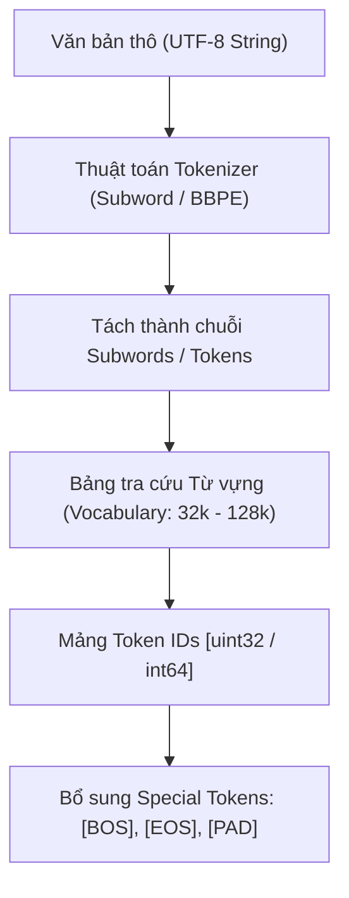

---

## 2. Chi tiết từng Keyword

---

### 10. Tokenization (Quá trình Tách từ)

#### a. Định nghĩa Bản chất Toán học (Mathematical Formulation)
**Tokenization** là một hàm ánh xạ khả nghịch (hoặc gần như khả nghịch) $\mathcal{T}$ biến đổi một chuỗi ký tự liên tục $S \in \Sigma^*$ trên bảng chữ cái $\Sigma$ thành một chuỗi hữu hạn các đơn vị ngữ nghĩa nguyên tử gọi là tokens $T = (t_1, t_2, \dots, t_N)$:
$$\mathcal{T}: \Sigma^* \to \mathcal{V}^*$$
với $\mathcal{V}$ là tập từ vựng hữu hạn cố định (Vocabulary).
Quá trình ngược lại gọi là **Detokenization**:
$$\mathcal{T}^{-1}: \mathcal{V}^* \to \Sigma^*$$
Một bộ tokenizer lý tưởng phải thỏa mãn tính chất bảo toàn chuỗi $\mathcal{T}^{-1}(\mathcal{T}(S)) = S$ (Lossless reconstruction) trên mọi chuỗi Unicode UTF-8 hợp lệ.

#### b. Cơ chế Tầng Sâu & Điện toán (Under The Hood / Hardware Internals)
- **Tốc độ Xử lý C++ / Rust (Tiktoken / HuggingFace Tokenizers)**: Trong các pipeline nạp dữ liệu huấn luyện hàng nghìn tỷ tokens (Multi-terabyte data loaders), bộ tokenizer viết bằng Python sẽ trở thành nút thắt cổ chai CPU nghiêm trọng. Do đó, các bộ tokenizer hiện đại bắt buộc phải được viết bằng Rust hoặc C++ sử dụng đa luồng (Rayon / OpenMP), bảng tra cứu băm SIMD-accelerated regex để đạt tốc độ xử lý hơn $1\text{ triệu tokens/giây}$ trên mỗi luồng CPU.

#### c. Sơ đồ Minh họa (Mermaid / ASCII Diagram)
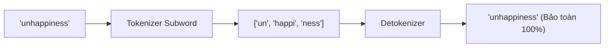

#### d. Code Thực chiến (Dual-Engine: C++ & Python)

```cpp
// C++17: Hàm tách chuỗi văn bản theo dấu khoảng trắng cơ bản
#include <iostream>
#include <string>
#include <vector>
#include <sstream>

std::vector<std::string> simple_whitespace_tokenize(const std::string& text) {
    std::vector<std::string> tokens;
    std::istringstream stream(text);
    std::string token;
    while (stream >> token) {
        tokens.push_back(token);
    }
    return tokens;
}

int main() {
    std::string text = "Artificial Intelligence is transforming the world.";
    auto tokens = simple_whitespace_tokenize(text);
    std::cout << "Tokenized into " << tokens.size() << " tokens:\n";
    for (const auto& t : tokens) std::cout << "[" << t << "] ";
    std::cout << "\n";
    return 0;
}
```

```python
# Python / Tiktoken: Tokenize văn bản thực tế với chuẩn BPE của GPT-4
import tiktoken

# Sử dụng bộ mã hóa cl100k_base của GPT-4
enc = tiktoken.get_encoding("cl100k_base")
text = "Tokenization in modern LLMs is super fast!"
token_ids = enc.encode(text)
tokens = [enc.decode_single_token_bytes(i).decode('utf-8', errors='replace') for i in token_ids]

print("Token IDs:", token_ids)
print("Tokens:", tokens)
```

#### e. Lỗi Thường gặp & Ổn định Số học (Pitfalls & Numerical Stability)
- **Khoảng trắng biến mất (Whitespace Loss)**: Nếu thuật toán tách từ vội vã loại bỏ các ký tự khoảng trắng hoặc dấu cách (`\s+`), quá trình Detokenize sẽ làm dính các chữ vào nhau, phá vỡ định dạng thụt đầu dòng (indentation) cực kỳ nhạy cảm trong lập trình Python.

#### f. Ứng dụng Thực chiến trong AI / Deep Learning (AI Applications)
- Bước tiền xử lý đầu vào bắt buộc của mọi mô hình ngôn ngữ lớn và mô hình sinh văn bản.

---

### 11. Tokens (Đơn vị Token)

#### a. Định nghĩa Bản chất Toán học (Mathematical Formulation)
**Token** $t \in \mathcal{V}$ là phần tử cơ bản nhỏ nhất của ngôn ngữ mà mô hình LLM có thể tiếp nhận và sinh ra tại mỗi bước tính toán.
Một token không nhất thiết phải là một từ trọn vẹn; nó có thể là:
- Một từ hoàn chỉnh: `"apple"`, `"hello"`.
- Một từ con (Subword): `"trans"`, `"form"`, `"er"`.
- Một ký tự đơn lẻ: `"a"`, `"b"`, `"\n"`.
- Một byte nhị phân thô: `0xE1`, `0x8E`.

Tỷ lệ nén token (Compression Ratio) được đo bằng số lượng byte trên mỗi token:
$$r_{\text{comp}} = \frac{\text{Tổng số Bytes}}{\text{Tổng số Tokens}}$$
Tiếng Anh thường đạt $r_{\text{comp}} \approx 4.0 - 4.5\text{ bytes/token}$, trong khi các ngôn ngữ ít tài nguyên hoặc có dấu phức tạp như tiếng Việt chỉ đạt $\approx 1.5 - 2.5\text{ bytes/token}$.

#### b. Cơ chế Tầng Sâu & Điện toán (Under The Hood / Hardware Internals)
- **Tác động tới Cửa sổ Ngữ cảnh (Effective Context Window)**: Nếu một ngôn ngữ có tỷ lệ nén thấp (ví dụ: mất 3 tokens để biểu diễn 1 từ tiếng Việt, so với 1 token cho 1 từ tiếng Anh), thì cửa sổ ngữ cảnh 8k tokens của mô hình sẽ bị lấp đầy nhanh gấp 3 lần, làm giảm khả năng ghi nhớ tài liệu dài và tăng gấp 3 lần chi phí API gọi mô hình.

#### c. Sơ đồ Minh họa (Mermaid / ASCII Diagram)
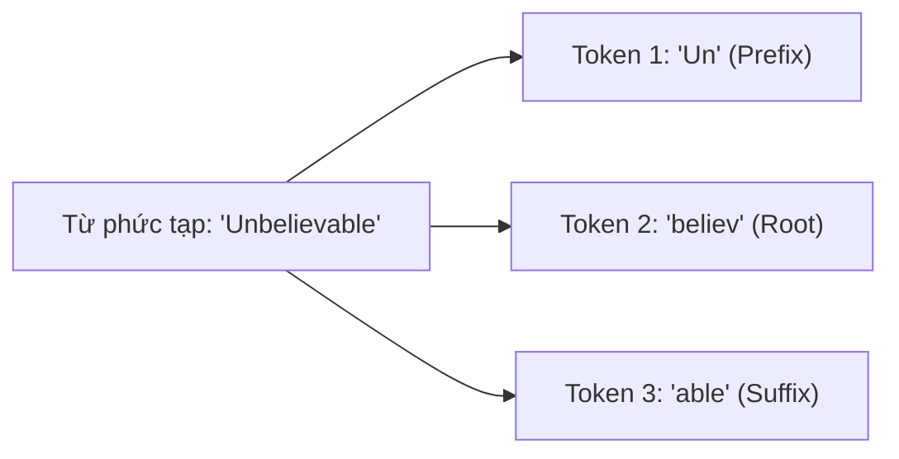

#### d. Code Thực chiến (Dual-Engine: C++ & Python)

```cpp
// C++17: Tính toán tỷ lệ nén Token (Bytes per Token)
#include <iostream>
#include <string>

double calculate_compression_ratio(const std::string& raw_text, size_t num_tokens) {
    if (num_tokens == 0) return 0.0;
    return static_cast<double>(raw_text.size()) / static_cast<double>(num_tokens);
}

int main() {
    std::string text = "Large Language Models"; // 21 bytes
    size_t tokens_count = 4; // ["Large", " Language", " Models"]
    std::cout << "Bytes per Token: " << calculate_compression_ratio(text, tokens_count) << "\n";
    return 0;
}
```

```python
# Python / Transformers: Đo số lượng tokens của các ngôn ngữ khác nhau
from transformers import AutoTokenizer

tokenizer = AutoTokenizer.from_pretrained("gpt2")
text_en = "Artificial intelligence will change the entire world."
text_vi = "Trí tuệ nhân tạo sẽ thay đổi toàn bộ thế giới."

tokens_en = tokenizer.tokenize(text_en)
tokens_vi = tokenizer.tokenize(text_vi)
print(f"English: {len(text_en)} bytes -> {len(tokens_en)} tokens")
print(f"Vietnamese (GPT-2): {len(text_vi.encode('utf-8'))} bytes -> {len(tokens_vi)} tokens (Bị phân mảnh)")
```

#### e. Lỗi Thường gặp & Ổn định Số học (Pitfalls & Numerical Stability)
- **Tokenizer Fertility (Màu mỡ Tokenizer)**: Hiện tượng một từ bị phân mảnh thành quá nhiều token vô nghĩa do từ điển không hỗ trợ tốt ngôn ngữ đó, làm mô hình suy giảm khả năng suy luận logic.

#### f. Ứng dụng Thực chiến trong AI / Deep Learning (AI Applications)
- Đơn vị tính toán chi phí API của các nhà cung cấp AI (OpenAI, Anthropic, Google), đơn vị đo lường độ dài đầu vào/đầu ra.

---

### 12. Vocabulary (Tập Từ vựng)

#### a. Định nghĩa Bản chất Toán học (Mathematical Formulation)
**Vocabulary** $\mathcal{V}$ là tập hợp hữu hạn tất cả các tokens hợp lệ mà mô hình ngôn ngữ có thể nhận biết:
$$\mathcal{V} = \{t_1, t_2, \dots, t_{|\mathcal{V}|}\}$$
Kích thước từ điển $|\mathcal{V}|$ là một siêu tham số kiến trúc quan trọng:
- GPT-2: $|\mathcal{V}| = 50{,}257$
- LLaMA-1 / LLaMA-2: $|\mathcal{V}| = 32{,}000$
- LLaMA-3: $|\mathcal{V}| = 128{,}256$
- Gemma: $|\mathcal{V}| = 256{,}000$

Đánh đổi toán học:
- $|\mathcal{V}|$ nhỏ: Bảng Embedding gọn nhẹ, nhưng chuỗi token bị dài ra (tăng chi phí Attention $\mathcal{O}(S^2)$).
- $|\mathcal{V}|$ lớn: Chuỗi ngắn lại, nhưng ma trận Embedding $\mathbf{W}_{\text{emb}} \in \mathbb{R}^{|\mathcal{V}| \times d}$ và tầng chiếu cuối $\mathbf{W}_{\text{head}} \in \mathbb{R}^{|\mathcal{V}| \times d}$ chiếm dung lượng tham số và VRAM cực lớn.

#### b. Cơ chế Tầng Sâu & Điện toán (Under The Hood / Hardware Internals)
- **Cân đối Bộ nhớ Tham số**: Với Gemma có $|\mathcal{V}| = 256{,}000$ và $d = 2048$:
Ma trận Embedding chiếm:
$$256{,}000 \times 2048 \times 2\text{ bytes (BF16)} \approx 1.05\text{ GB VRAM}$$
chỉ riêng cho bảng tra cứu từ vựng! Các kiến trúc thường áp dụng **Weight Tying** (dùng chung trọng số giữa Embedding đầu vào và LM Head đầu ra) để tiết kiệm bộ nhớ.

#### c. Sơ đồ Minh họa (Mermaid / ASCII Diagram)
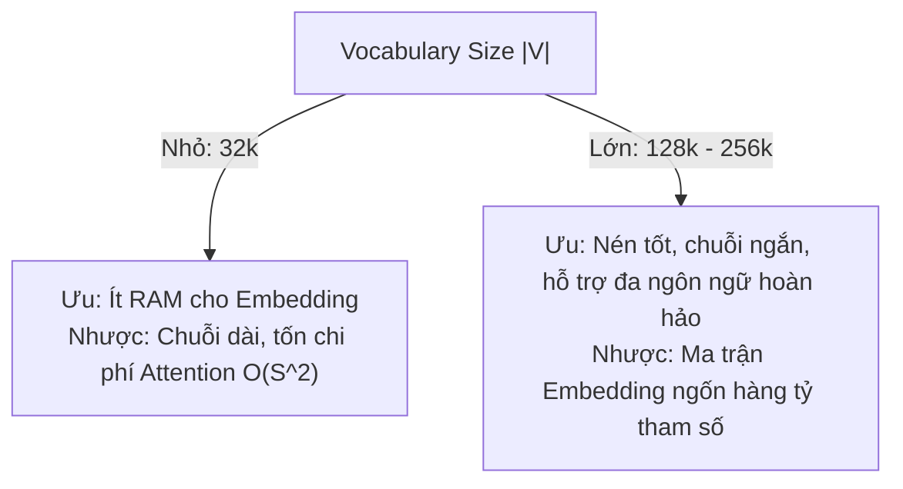

#### d. Code Thực chiến (Dual-Engine: C++ & Python)

```cpp
// C++17: Tra cứu hai chiều ID <-> Token tối ưu hiệu năng
#include <iostream>
#include <vector>
#include <string>
#include <unordered_map>

class VocabularyManager {
private:
    std::unordered_map<std::string, int> token_to_id_;
    std::vector<std::string> id_to_token_;

public:
    void insert(const std::string& token) {
        int id = static_cast<int>(id_to_token_.size());
        token_to_id_[token] = id;
        id_to_token_.push_back(token);
    }

    size_t size() const { return id_to_token_.size(); }
    int get_id(const std::string& token) const { return token_to_id_.at(token); }
    const std::string& get_token(int id) const { return id_to_token_.at(id); }
};

int main() {
    VocabularyManager vm;
    vm.insert("<bos>");
    vm.insert("the");
    vm.insert("algorithm");

    std::cout << "Vocabulary Size: " << vm.size() << "\n";
    std::cout << "ID of 'algorithm': " << vm.get_id("algorithm") 
              << " -> Token: " << vm.get_token(2) << "\n";
    return 0;
}
```

```python
# Python / PyTorch: Đo kích thước tham số của Embedding Layer dựa trên Vocab Size
import torch
import torch.nn as nn

vocab_sizes = [32000, 128256, 256000]
hidden_dim = 4096

for vs in vocab_sizes:
    emb = nn.Embedding(vs, hidden_dim)
    params = sum(p.numel() for p in emb.parameters())
    vram_mb = (params * 2) / (1024 * 1024) # BF16 (2 bytes)
    print(f"Vocab: {vs:6d} | Params: {params/1e6:6.2f}M | VRAM: {vram_mb:7.2f} MB")
```

#### e. Lỗi Thường gặp & Ổn định Số học (Pitfalls & Numerical Stability)
- **Chỉ số Vượt quá Kích thước Từ điển (Index Out-Of-Bounds)**: Nếu đưa một Token ID $\ge |\mathcal{V}|$ vào tầng Embedding, GPU sẽ gặp lỗi phần cứng `CUDA error: device-side assert triggered` khiến toàn bộ tiến trình Python bị hủy đột ngột.

#### f. Ứng dụng Thực chiến trong AI / Deep Learning (AI Applications)
- Thiết kế cốt lõi khi tạo dựng nền tảng LLM mới, quyết định chiến lược cân bằng giữa các ngôn ngữ.

---

### 13. Token IDs (Mã Định danh Token)

#### a. Định nghĩa Bản chất Toán học (Mathematical Formulation)
**Token ID** là một số nguyên không âm $i \in \{0, 1, \dots, |\mathcal{V}| - 1\}$ đóng vai trò là chỉ số định danh duy nhất (Unique Index) của một token trong từ điển $\mathcal{V}$.
Về mặt đại số tuyến tính, Token ID $i$ tương đương với một vector One-Hot $\mathbf{e}_i \in \{0, 1\}^{|\mathcal{V}|}$:
$$\mathbf{e}_i = [0, \dots, 0, \underbrace{1}_{\text{Vị trí } i}, 0, \dots, 0]^T$$
Phép lấy vector nhúng tương ứng với việc nhân ma trận:
$$\mathbf{h} = \mathbf{W}_{\text{emb}}^T \mathbf{e}_i = \mathbf{W}_{\text{emb}}[i, :]$$

#### b. Cơ chế Tầng Sâu & Điện toán (Under The Hood / Hardware Internals)
- **Tối ưu hóa Truy xuất Dữ liệu (Direct Pointer Offsetting)**: Thay vì nhân ma trận One-Hot tốn kém $\mathcal{O}(|\mathcal{V}| \times d)$, GPU xử lý tầng Embedding như một phép lấy giá trị trực tiếp theo con trỏ bộ nhớ (Memory Pointer Arithmetic):
$$\text{Address}(\mathbf{h}) = \text{BasePtr} + i \times d \times \text{sizeof}(\text{dtype})$$
Phép toán này có độ phức tạp thời gian tuyệt đối $\mathcal{O}(1)$ và băng thông truy xuất cực cao.

#### c. Sơ đồ Minh họa (Mermaid / ASCII Diagram)
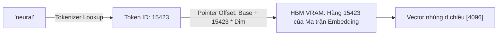

#### d. Code Thực chiến (Dual-Engine: C++ & Python)

```cpp
// C++17: Mô phỏng cơ chế Pointer Arithmetic của Embedding Lookup
#include <iostream>
#include <vector>

void embedding_lookup(
    const float* emb_matrix, // [Vocab, Dim]
    int token_id, 
    size_t dim, 
    float* out_vector) 
{
    const float* row_ptr = emb_matrix + (token_id * dim);
    for (size_t i = 0; i < dim; ++i) {
        out_vector[i] = row_ptr[i];
    }
}

int main() {
    // 3 tokens, dim = 2
    std::vector<float> matrix = {
        0.1f, 0.2f,  // ID 0
        0.8f, -0.4f, // ID 1
        1.5f, 2.0f   // ID 2
    };
    std::vector<float> out(2);
    embedding_lookup(matrix.data(), 1, 2, out.data());
    std::cout << "Embedding for ID 1: [" << out[0] << ", " << out[1] << "]\n";
    return 0;
}
```

```python
# Python / PyTorch: Kiểm chứng One-Hot Multiplication tương đương Embedding Lookup
import torch
import torch.nn as nn

vocab_size, dim = 10, 4
emb = nn.Embedding(vocab_size, dim)

token_id = torch.tensor([3])
# Phương pháp 1: Embedding Lookup chuẩn
vec_lookup = emb(token_id)

# Phương pháp 2: One-Hot Matrix Multiply
one_hot = torch.zeros(1, vocab_size)
one_hot[0, 3] = 1.0
vec_matmul = one_hot @ emb.weight

print("Khớp tuyệt đối:", torch.allclose(vec_lookup, vec_matmul))
```

#### e. Lỗi Thường gặp & Ổn định Số học (Pitfalls & Numerical Stability)
- **Sai kiểu dữ liệu (Data Type Mismatch)**: Truyền Token ID dưới dạng `float32` thay vì `int64` (LongTensor trong PyTorch) sẽ gây lỗi ép kiểu biên dịch đồ thị.

#### f. Ứng dụng Thực chiến trong AI / Deep Learning (AI Applications)
- Định dạng giao tiếp chuẩn giữa phần mềm ứng dụng và runtime của LLMs (vLLM, Ollama, TensorRT).

---

### 14. Byte Pair Encoding - BPE (Mã hóa Cặp Byte)

#### a. Định nghĩa Bản chất Toán học (Mathematical Formulation)
**Byte Pair Encoding (BPE)** (Gage 1994; Sennrich et al., 2015) ban đầu là một thuật toán nén dữ liệu phi tổn hao, sau đó được ứng dụng làm xương sống tách từ trong Deep Learning.
Thuật toán xây dựng từ điển qua quá trình gộp cặp tham lam (Greedy Merging):
1. **Khởi tạo**: Tập từ điển ban đầu $\mathcal{V}_0$ gồm toàn bộ các ký tự đơn lẻ xuất hiện trong kho ngữ liệu. Mỗi từ được tách thành chuỗi các ký tự phân cách: ví dụ `"low"` $\to$ `['l', 'o', 'w']`.
2. **Lặp lại $K$ bước gộp**:
Tại mỗi bước lặp $k$:
   - Đếm tần suất xuất hiện của tất cả các cặp ký tự liền kề $(c_i, c_{i+1})$ trên toàn bộ kho ngữ liệu.
   - Chọn cặp có tần suất xuất hiện cao nhất:
$$(c_A, c_B)^* = \arg\max_{(c_A, c_B)} \text{Count}(c_A, c_B)$$
   - Tạo token mới $c_{\text{new}} = c_A c_B$ và thêm vào từ điển: $\mathcal{V}_{k+1} = \mathcal{V}_k \cup \{c_{\text{new}}\}$.
   - Thay thế mọi sự xuất hiện của cặp $(c_A, c_B)$ trong ngữ liệu bằng token mới $c_{\text{new}}$.

Quá trình dừng lại khi đạt đủ số lượt gộp mong muốn hoặc kích thước từ điển định trước.

#### b. Cơ chế Tầng Sâu & Điện toán (Under The Hood / Hardware Internals)
- **Cấu trúc Hàng đợi Ưu tiên (Priority Queue / Min-Heap)**: Khi huấn luyện BPE trên kho ngữ liệu 100GB, việc duyệt tuyến tính để tìm cặp phổ biến nhất có độ phức tạp $\mathcal{O}(N)$. Các triển khai tối ưu sử dụng danh sách liên kết đôi (Doubly Linked List) kết hợp bảng băm và Max-Heap để cập nhật tần suất cục bộ trong $\mathcal{O}(\log |\mathcal{V}|)$.

#### c. Sơ đồ Minh họa (Mermaid / ASCII Diagram)
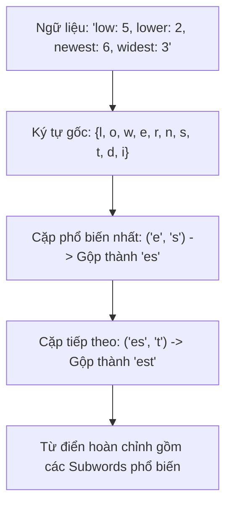

#### d. Code Thực chiến (Dual-Engine: C++ & Python)

```cpp
// C++17: Thuật toán tìm cặp ký hiệu phổ biến nhất trong BPE
#include <iostream>
#include <vector>
#include <string>
#include <map>

std::pair<std::string, std::string> find_most_frequent_pair(
    const std::vector<std::vector<std::string>>& corpus_words) 
{
    std::map<std::pair<std::string, std::string>, int> pair_counts;
    for (const auto& word : corpus_words) {
        if (word.size() < 2) continue;
        for (size_t i = 0; i < word.size() - 1; ++i) {
            pair_counts[{word[i], word[i+1]}]++;
        }
    }

    std::pair<std::string, std::string> best_pair;
    int max_count = -1;
    for (const auto& [pair, count] : pair_counts) {
        if (count > max_count) {
            max_count = count;
            best_pair = pair;
        }
    }
    return best_pair;
}

int main() {
    std::vector<std::vector<std::string>> words = {
        {"l", "o", "w"},
        {"l", "o", "w", "e", "r"},
        {"n", "e", "w"}
    };
    auto best = find_most_frequent_pair(words);
    std::cout << "Top BPE Pair to merge: ('" << best.first << "', '" << best.second << "')\n";
    return 0;
}
```

```python
# Python / BPE Implementation: Vòng lặp gộp cặp BPE tiêu chuẩn
from collections import defaultdict

def get_stats(vocab):
    pairs = defaultdict(int)
    for word, freq in vocab.items():
        symbols = word.split()
        for i in range(len(symbols) - 1):
            pairs[symbols[i], symbols[i+1]] += freq
    return pairs

def merge_vocab(pair, v_in):
    v_out = {}
    bigram = ' '.join(pair)
    replacement = ''.join(pair)
    for word in v_in:
        w_out = word.replace(bigram, replacement)
        v_out[w_out] = v_in[word]
    return v_out

vocab = {'l o w </w>': 5, 'l o w e r </w>': 2, 'n e w e s t </w>': 6}
pairs = get_stats(vocab)
best_pair = max(pairs, key=pairs.get)
vocab = merge_vocab(best_pair, vocab)
print(f"Merged pair: {best_pair} -> New Vocab sample: {list(vocab.keys())[0]}")
```

#### e. Lỗi Thường gặp & Ổn định Số học (Pitfalls & Numerical Stability)
- **Token biến thể do viết hoa/thường**: BPE cổ điển phân biệt nghiêm ngặt giữa `"The"` và `"the"`, tạo ra hai token hoàn toàn độc lập, làm phân mảnh không gian biểu diễn nếu không có bước tiền xử lý chuẩn hóa chữ thường.

#### f. Ứng dụng Thực chiến trong AI / Deep Learning (AI Applications)
- Thuật toán tách từ chính thức của GPT-2, GPT-3, GPT-4, LLaMA-1/2/3, Mistral, RoBERTa.

---

### 15. WordPiece (Thuật toán WordPiece)

#### a. Định nghĩa Bản chất Toán học (Mathematical Formulation)
**WordPiece** (Schuster & Nakajima, 2012; Wu et al., 2016) là biến thể tối ưu hóa của BPE được sử dụng trong mô hình **BERT**.
Thay vì chọn cặp ký hiệu có tần suất thô lớn nhất $\text{Count}(c_A, c_B)$, WordPiece chọn cặp giúp tối đa hóa hàm hợp lý của dữ liệu (Likelihood) theo mô hình ngôn ngữ Unigram:
$$(c_A, c_B)^* = \arg\max_{(c_A, c_B)} \frac{\text{Count}(c_A, c_B)}{\text{Count}(c_A) \times \text{Count}(c_B)}$$
Công thức này chính là **Mutual Information (Thông tin Hỗ tương Điểm)** giữa $c_A$ và $c_B$. Nó chỉ ưu tiên gộp hai ký hiệu nếu chúng xuất hiện cùng nhau thường xuyên hơn rất nhiều so với kỳ vọng ngẫu nhiên của từng ký hiệu đơn lẻ.
Quy ước ký hiệu: WordPiece dùng tiền tố `##` để chỉ định một subword nằm ở giữa hoặc cuối từ (ví dụ: `"playing"` $\to$ `["play", "##ing"]`).

#### b. Cơ chế Tầng Sâu & Điện toán (Under The Hood / Hardware Internals)
- **Tra cứu Tiền tố Lâu dài (Longest-Match-First / Greedy Matching)**: Khi tokenize một từ, WordPiece bắt đầu duyệt từ đầu từ đến cuối từ để tìm subword dài nhất có mặt trong từ điển, nếu không tìm thấy sẽ gắn nhãn `[UNK]`.

#### c. Sơ đồ Minh họa (Mermaid / ASCII Diagram)
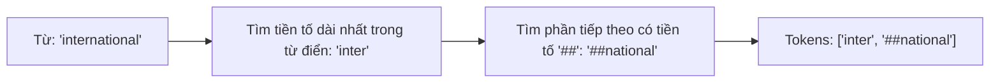

#### d. Code Thực chiến (Dual-Engine: C++ & Python)

```cpp
// C++17: Thuật toán Longest-Match-First của WordPiece Tokenizer
#include <iostream>
#include <string>
#include <vector>
#include <unordered_set>

std::vector<std::string> wordpiece_tokenize_word(
    const std::string& word, 
    const std::unordered_set<std::string>& vocab) 
{
    std::vector<std::string> tokens;
    size_t start = 0;
    while (start < word.size()) {
        size_t end = word.size();
        std::string cur_substr = "";
        while (start < end) {
            std::string sub = word.substr(start, end - start);
            if (start > 0) sub = "##" + sub; // Tiền tố WordPiece
            if (vocab.find(sub) != vocab.end()) {
                cur_substr = sub;
                break;
            }
            end--;
        }
        if (cur_substr.empty()) return {"[UNK]"}; // Không tìm thấy
        tokens.push_back(cur_substr);
        start = end;
    }
    return tokens;
}

int main() {
    std::unordered_set<std::string> vocab = {"play", "##ing", "smart"};
    auto tokens = wordpiece_tokenize_word("playing", vocab);
    std::cout << "WordPiece Tokens: ";
    for (const auto& t : tokens) std::cout << "[" << t << "] ";
    std::cout << "\n";
    return 0;
}
```

```python
# Python / Transformers: Tokenize văn bản bằng BERT WordPiece
from transformers import BertTokenizer

tokenizer = BertTokenizer.from_pretrained("bert-base-uncased")
tokens = tokenizer.tokenize("Transformers are unbelievable!")
print("WordPiece Tokens:", tokens)
# Kết quả sẽ có dạng: ['transformers', 'are', 'un', '##believ', '##able', '!']
```

#### e. Lỗi Thường gặp & Ổn định Số học (Pitfalls & Numerical Stability)
- **Token `[UNK]` khi gặp từ lạ**: Nếu một chuỗi ký tự chứa các ký tự Unicode lạ không có trong bảng chữ cái khởi tạo, WordPiece sẽ biến toàn bộ từ thành `[UNK]`.

#### f. Ứng dụng Thực chiến trong AI / Deep Learning (AI Applications)
- BERT, DistilBERT, MobileBERT, Google Translate NMT.

---

### 16. Unigram Language Model Tokenizer (Mô hình Tách từ Unigram)

#### a. Định nghĩa Bản chất Toán học (Mathematical Formulation)
**Unigram Language Model Tokenizer (Kudo, 2018)** tiếp cận bài toán theo hướng ngược lại hoàn toàn so với BPE:
- BPE: Bắt đầu từ từ điển nhỏ $\to$ Gộp dần để mở rộng (Bottom-up).
- Unigram: Bắt đầu từ một từ điển hạt nhân cực lớn $\mathcal{V}_{\text{huge}}$ (chứa mọi từ đơn và hàng triệu subwords) $\to$ Cắt tỉa dần (Top-down pruning).

Giả định mọi subword $x_i$ xuất hiện độc lập theo mô hình Unigram:
$$P(\mathbf{x}) = \prod_{i=1}^M P(x_i), \qquad \sum_{x \in \mathcal{V}} P(x) = 1$$
Với một từ $W$, có rất nhiều cách phân rã thành các subwords khác nhau $\mathbf{x} \in \mathcal{S}(W)$. Phân rã tối ưu được tìm bằng thuật toán quy hoạch động **Viterbi**:
$$\mathbf{x}^* = \arg\max_{\mathbf{x} \in \mathcal{S}(W)} P(\mathbf{x})$$
Sau mỗi vòng lặp, Unigram tính toán mức độ suy giảm hàm hợp lý nếu một token bị loại bỏ, sau đó loại bỏ $10\% - 20\%$ số tokens ít quan trọng nhất cho đến khi đạt kích thước mục tiêu.

#### b. Cơ chế Tầng Sâu & Điện toán (Under The Hood / Hardware Internals)
- **Thuật toán Quy hoạch động Viterbi trên C++**: Đồ thị các cách cắt từ được biểu diễn dưới dạng Đồ thị Không có Chu trình Định hướng (DAG). Thuật toán Viterbi tìm đường đi ngắn nhất (Shortest Path) trong DAG với độ phức tạp thời gian $\mathcal{O}(L^2)$ với $L$ là độ dài từ.

#### c. Sơ đồ Minh họa (Mermaid / ASCII Diagram)
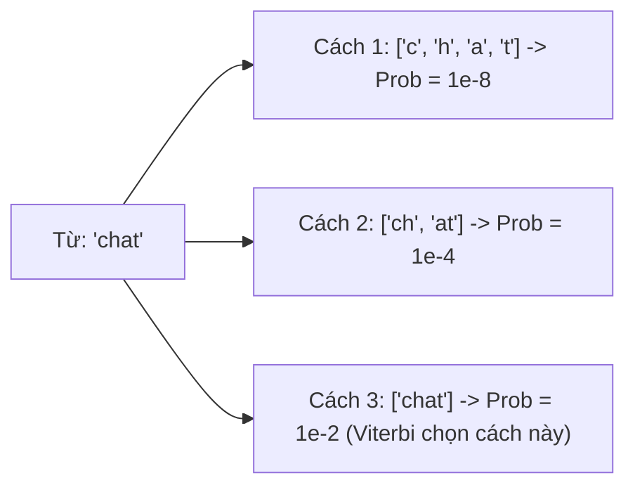

#### d. Code Thực chiến (Dual-Engine: C++ & Python)

```cpp
// C++17: Thuật toán Viterbi tìm cách cắt từ tối ưu theo điểm số âm log-likelihood
#include <iostream>
#include <string>
#include <vector>
#include <unordered_map>
#include <limits>

struct ViterbiResult {
    double best_cost;
    std::vector<std::string> best_tokens;
};

ViterbiResult viterbi_unigram_segment(
    const std::string& text, 
    const std::unordered_map<std::string, double>& neg_log_probs) 
{
    size_t n = text.size();
    std::vector<double> dp(n + 1, std::numeric_limits<double>::infinity());
    std::vector<int> prev(n + 1, -1);
    dp[0] = 0.0;

    for (size_t i = 0; i < n; ++i) {
        if (dp[i] == std::numeric_limits<double>::infinity()) continue;
        for (size_t len = 1; i + len <= n; ++len) {
            std::string sub = text.substr(i, len);
            if (neg_log_probs.find(sub) != neg_log_probs.end()) {
                double cost = dp[i] + neg_log_probs.at(sub);
                if (cost < dp[i + len]) {
                    dp[i + len] = cost;
                    prev[i + len] = static_cast<int>(i);
                }
            }
        }
    }

    std::vector<std::string> tokens;
    int curr = static_cast<int>(n);
    while (curr > 0) {
        int p = prev[curr];
        tokens.insert(tokens.begin(), text.substr(p, curr - p));
        curr = p;
    }
    return {dp[n], tokens};
}

int main() {
    std::unordered_map<std::string, double> costs = {
        {"c", 5.0}, {"h", 5.0}, {"at", 3.0}, {"chat", 2.0}
    };
    auto res = viterbi_unigram_segment("chat", costs);
    std::cout << "Best segmentation: ";
    for (const auto& t : res.best_tokens) std::cout << "[" << t << "] ";
    std::cout << "with cost: " << res.best_cost << "\n";
    return 0;
}
```

```python
# Python / SentencePiece: Huấn luyện mô hình Unigram
import io

# Mô phỏng tính xác suất của chuỗi phân rã Unigram
token_costs = {"un": 2.5, "break": 3.0, "able": 2.0, "unbreakable": 6.0}
# Phân rã 1: ["un", "break", "able"] -> Tổng cost = 2.5 + 3.0 + 2.0 = 7.5
# Phân rã 2: ["unbreakable"] -> Tổng cost = 6.0 (Tối ưu hơn vì chi phí âm log nhỏ nhất)
print("Unigram favors shorter/more probable valid words.")
```

#### e. Lỗi Thường gặp & Ổn định Số học (Pitfalls & Numerical Stability)
- **Tập con rỗng khi cắt từ**: Nếu có một ký tự không thể ghép với bất kỳ token nào trong từ điển, đồ thị DAG bị đứt gãy và thuật toán Viterbi trả về đường đi vô cùng (`inf`).

#### f. Ứng dụng Thực chiến trong AI / Deep Learning (AI Applications)
- T5 (Text-to-Text Transfer Transformer), ALBERT, Whisper (OpenAI Audio ASR).

---

### 17. SentencePiece (Bộ Tách từ Độc lập Ngôn ngữ)

#### a. Định nghĩa Bản chất Toán học (Mathematical Formulation)
**SentencePiece** (Kudo & Richardson, Google 2018) là giải pháp mang tính cách mạng loại bỏ sự phụ thuộc vào các công cụ tách từ tiền định theo ngôn ngữ (Language-dependent pre-tokenizers).
Các tokenizer cổ điển coi dấu cách (whitespace) là ký tự phân cách đặc biệt. Điều này gây thất bại hoàn toàn trên các ngôn ngữ không dùng dấu cách giữa các từ như tiếng Nhật, tiếng Trung, tiếng Thái.
SentencePiece coi toàn bộ văn bản đầu vào là một **chuỗi ký tự liên tục (Raw Character Stream)**, và coi dấu cách như một ký tự thông thường bằng cách thay thế bằng ký hiệu đặc biệt `_` (U+2581 Meta Symbol):
$$\text{"Hello World"} \xrightarrow{\text{SentencePiece}} \text{"_Hello _World"}$$
Sau đó, các thuật toán BPE hoặc Unigram được áp dụng trực tiếp trên chuỗi này mà không cần bất kỳ bước tách từ hay tiền xử lý ngôn ngữ nào.
Tính chất quan trọng nhất: **Hoàn nguyên Tuyệt đối (Lossless Tokenization)**:
$$\text{Detokenize}(Tokens) = \text{Replace}(Tokens, \text{"_"}, \text{" "}).\text{Strip}()$$

#### b. Cơ chế Tầng Sâu & Điện toán (Under The Hood / Hardware Internals)
- **Chuẩn hóa Unicode NFKC Tự động**: SentencePiece tích hợp sẵn bộ chuẩn hóa văn bản NFKC (Normalization Form Compatibility Composition) viết bằng C++, biến đổi các ký tự tương đương hình ảnh (như chữ số La Mã hay ký hiệu toàn phần full-width) về dạng chuẩn trước khi mã hóa.

#### c. Sơ đồ Minh họa (Mermaid / ASCII Diagram)
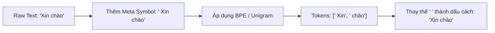

#### d. Code Thực chiến (Dual-Engine: C++ & Python)

```cpp
// C++17: Chuyển đổi dấu cách sang ký tự Meta Symbol U+2581 của SentencePiece
#include <iostream>
#include <string>

std::string replace_spaces_with_metasymbol(const std::string& input) {
    std::string result = "";
    bool first = true;
    for (char c : input) {
        if (c == ' ') {
            result += " "; // Ký tự UTF-8 U+2581
        } else {
            if (first) {
                result += " ";
                first = false;
            }
            result += c;
        }
    }
    return result;
}

int main() {
    std::string text = "Deep Learning";
    std::cout << "SentencePiece format: " << replace_spaces_with_metasymbol(text) << "\n";
    return 0;
}
```

```python
# Python / SentencePiece: Minh họa tính hoàn nguyên nguyên bản (Lossless Detokenization)
text = "Artificial Intelligence: What's next?"
# Giả lập SentencePiece tokens
sp_tokens = [' Art', 'ificial', ' Intelligence', ':', ' What', "'", 's', ' next', '?']

# Detokenize đơn giản chỉ là ghép chuỗi và đổi   thành space
restored_text = "".join(sp_tokens).replace(" ", " ").strip()
print("Original:", text)
print("Restored:", restored_text)
print("Hoàn nguyên 100%:", text == restored_text)
```

#### e. Lỗi Thường gặp & Ổn định Số học (Pitfalls & Numerical Stability)
- **Lỗi hiển thị Terminal**: Ký tự UTF-8 ` ` (3 bytes: `\xe2\x96\x81`) có thể bị hiển thị sai thành ký tự rác trên các console không hỗ trợ chuẩn UTF-8 đầy đủ.

#### f. Ứng dụng Thực chiến trong AI / Deep Learning (AI Applications)
- LLaMA, Mistral, Gemma, T5, MarianMT.

---

### 18. Byte-Level Tokenization - BBPE (Tách từ Cấp độ Byte)

#### a. Định nghĩa Bản chất Toán học (Mathematical Formulation)
**Byte-Level Byte Pair Encoding (BBPE)** (Radford et al., GPT-2 2019) đưa bảng chữ cái khởi tạo $\mathcal{V}_0$ về mức vật lý thấp nhất: **256 giá trị Byte nhị phân** của một byte dữ liệu:
$$\mathcal{V}_0 = \{0x00, 0x01, \dots, 0xFF\}$$
Mọi ký tự trên thế giới (dù là ký tự tượng hình tiếng Trung, emoji, hay ký tự điều khiển) đều được biểu diễn bằng một chuỗi từ 1 đến 4 bytes theo chuẩn mã hóa UTF-8.
Do 256 bytes ban đầu bao phủ toàn bộ không gian nhị phân:
$$P(\text{OOV}) \equiv 0$$
Mô hình hoàn toàn **không bao giờ gặp lỗi Out-Of-Vocabulary**, có thể tiếp nhận và sinh ra mọi định dạng dữ liệu, từ văn bản mọi ngôn ngữ đến mã hex, file nhị phân và mã máy.

#### b. Cơ chế Tầng Sâu & Điện toán (Under The Hood / Hardware Internals)
- **Ánh xạ Byte sang Ký tự In được (Byte-to-Unicode Mapping)**: Trong chuẩn BPE, các thuật toán xử lý chuỗi thường giả định token là ký tự in được (printable characters). GPT-2 giải quyết điều này bằng cách tạo một bảng ánh xạ song ánh cố định chuyển 256 giá trị byte (kể cả các byte điều khiển như null byte `0x00`) thành 256 ký tự Unicode in được tương ứng.

#### c. Sơ đồ Minh họa (Mermaid / ASCII Diagram)
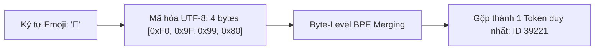

#### d. Code Thực chiến (Dual-Engine: C++ & Python)

```cpp
// C++17: Phân rã chuỗi UTF-8 bất kỳ thành các giá trị Byte nhị phân [0..255]
#include <iostream>
#include <string>
#include <vector>
#include <iomanip>

std::vector<uint8_t> string_to_bytes(const std::string& str) {
    std::vector<uint8_t> bytes;
    for (unsigned char c : str) {
        bytes.push_back(static_cast<uint8_t>(c));
    }
    return bytes;
}

int main() {
    std::string text = "AI 🤖";
    auto bytes = string_to_bytes(text);
    std::cout << "Raw Bytes (" << bytes.size() << " bytes): ";
    for (uint8_t b : bytes) {
        std::cout << "0x" << std::hex << std::uppercase << static_cast<int>(b) << " ";
    }
    std::cout << std::dec << "\n";
    return 0;
}
```

```python
# Python / Tiktoken: Kiểm tra Byte-Level BPE với chuỗi Byte bất kỳ
import tiktoken

enc = tiktoken.get_encoding("cl100k_base")
# Chuỗi byte nhị phân thô không phải văn bản chuẩn
raw_bytes = b"\xff\xfe\x00\x01\x10"
token_ids = enc.encode(raw_bytes.decode('latin1'))
print(f"Encoded arbitrary bytes into tokens: {token_ids}")
```

#### e. Lỗi Thường gặp & Ổn định Số học (Pitfalls & Numerical Stability)
- **Cắt đứt ký tự Unicode đa byte**: Một ký tự tiếng Việt (như `"ế"`) gồm 3 bytes. Nếu quá trình cắt chuỗi (truncation) cắt trúng byte thứ 2, chuỗi byte còn lại sẽ không hợp lệ theo chuẩn UTF-8 và gây lỗi giải mã `UnicodeDecodeError`.

#### f. Ứng dụng Thực chiến trong AI / Deep Learning (AI Applications)
- Kiến trúc tokenizer phổ biến nhất thế giới hiện nay: GPT-4, LLaMA-3, Mistral, Qwen, DeepSeek.

---

### 19. Character Tokenization (Tách từ Cấp độ Ký tự)

#### a. Định nghĩa Bản chất Toán học (Mathematical Formulation)
**Character Tokenization** phân rã văn bản thành các ký tự đơn lẻ:
$$S = "cat" \xrightarrow{\mathcal{T}} ("c", "a", "t")$$
Tập từ điển $\mathcal{V}$ cực kỳ nhỏ gọn (chỉ gồm bảng chữ cái và các ký tự đặc biệt, $|\mathcal{V}| \approx 100 - 256$).
Ưu điểm: Hầu như không có từ ngoài từ điển (OOV).
Nhược điểm toán học chí mạng: Độ dài chuỗi $T$ tăng vọt từ $4\times$ đến $10\times$ so với Subword Tokenization. Vì độ phức tạp tính toán của cơ chế Self-Attention trong Transformer là bậc hai $\mathcal{O}(T^2)$, việc tăng chiều dài chuỗi lên 5 lần khiến chi phí tính toán tăng tới $25$ lần!

#### b. Cơ chế Tầng Sâu & Điện toán (Under The Hood / Hardware Internals)
- **Thách thức Lưu trữ Attention Matrix**: Một đoạn văn bản $2000$ từ (khoảng $2500$ subword tokens) sẽ biến thành $12{,}000$ character tokens. Ma trận Attention kích thước $[12000, 12000]$ đòi hỏi lưu trữ tới $144\text{ triệu phần tử}$ dấu phẩy động cho mỗi Attention Head, gây cạn kiệt VRAM GPU ngay lập tức.

#### c. Sơ đồ Minh họa (Mermaid / ASCII Diagram)
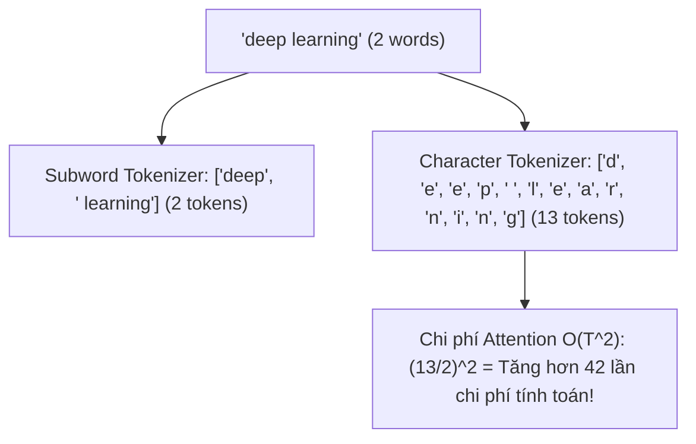

#### d. Code Thực chiến (Dual-Engine: C++ & Python)

```cpp
// C++17: Tách văn bản thành danh sách các ký tự ASCII đơn giản
#include <iostream>
#include <vector>
#include <string>

std::vector<char> character_tokenize(const std::string& text) {
    return std::vector<char>(text.begin(), text.end());
}

int main() {
    std::string text = "Transformer";
    auto chars = character_tokenize(text);
    std::cout << "Character count: " << chars.size() << "\n";
    return 0;
}
```

```python
# Python: So sánh độ dài chuỗi giữa Character Tokenizer và BPE Tokenizer
import tiktoken

enc = tiktoken.get_encoding("cl100k_base")
text = "Artificial Intelligence represents the pinnacle of computer science."

char_tokens = list(text)
bpe_tokens = enc.encode(text)

print(f"Original Text Length: {len(text)} chars")
print(f"Character Tokens Count: {len(char_tokens)}")
print(f"BPE Subword Tokens Count: {len(bpe_tokens)} (Nén ngắn hơn {len(char_tokens)/len(bpe_tokens):.2f}x)")
```

#### e. Lỗi Thường gặp & Ổn định Số học (Pitfalls & Numerical Stability)
- **Mất Ngữ nghĩa Tầng Thấp**: Một ký tự đơn lẻ như `"c"` không mang bất kỳ thông tin ngữ nghĩa nào, buộc mô hình phải tiêu tốn nhiều tầng Transformer đầu tiên chỉ để học cách ghép các ký tự lại thành một từ hoàn chỉnh.

#### f. Ứng dụng Thực chiến trong AI / Deep Learning (AI Applications)
- Mô hình nhận diện ký tự quang học (OCR), sửa lỗi chính tả ở cấp độ ký tự (Spell Checker), Canine (Google).

---

### 20. Subword Tokenization (Tách từ Cấp độ Từ con)

#### a. Định nghĩa Bản chất Toán học (Mathematical Formulation)
**Subword Tokenization** là điểm cân bằng toán học tối ưu giữa Character Tokenization (từ điển quá nhỏ, chuỗi quá dài) và Word Tokenization (từ điển quá lớn, bùng nổ OOV).
Nguyên lý cốt lõi:
- Các từ thường gặp (High-frequency words) được gán làm một token duy nhất: `"the"`, `"world"`.
- Các từ hiếm gặp (Rare words) được phân rã thành các thành phần từ tố (morphemes) quen thuộc:
$$\text{"unhappiness"} \to \text{"un"} + \text{"happi"} + \text{"ness"}$$
Cân bằng giữa kích thước từ điển $|\mathcal{V}| \approx 32{,}000 - 128{,}000$ và độ dài chuỗi $T$, cho phép mô hình dễ dàng khái quát hóa và suy luận ra ý nghĩa của các từ mới dựa trên các gốc từ đã biết.

#### b. Cơ chế Tầng Sâu & Điện toán (Under The Hood / Hardware Internals)
- **Tối ưu hóa Băng thông Truyền thông DDP**: Bằng cách giữ kích thước chuỗi ở mức vừa phải ($1\text{ từ} \approx 1.3\text{ tokens}$), Subword Tokenization tối ưu hóa việc phân bổ bộ nhớ cho các tensor kích hoạt (Activation Tensors), cho phép tăng Batch Size khi huấn luyện song song phân tán (Distributed Data Parallel).

#### c. Sơ đồ Minh họa (Mermaid / ASCII Diagram)
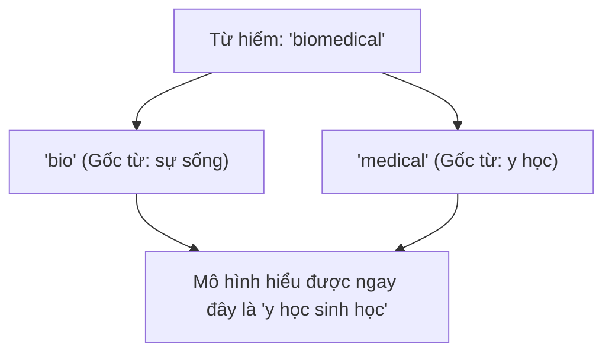

#### d. Code Thực chiến (Dual-Engine: C++ & Python)

```cpp
// C++17: Mô phỏng quy tắc phân rã Subword đơn giản dựa trên Prefix/Suffix
#include <iostream>
#include <string>
#include <vector>

std::vector<std::string> rule_based_subword_split(const std::string& word) {
    if (word.rfind("un", 0) == 0 && word.size() > 2) {
        return {"un", word.substr(2)};
    }
    return {word};
}

int main() {
    auto tokens = rule_based_subword_split("unlock");
    std::cout << "Subword split: [" << tokens[0] << "] [" << tokens[1] << "]\n";
    return 0;
}
```

```python
# Python / Transformers: Minh họa khả năng phân rã từ mới của Subword Tokenizer
from transformers import AutoTokenizer

tokenizer = AutoTokenizer.from_pretrained("gpt2")
word = "neurocomputational"
tokens = tokenizer.tokenize(word)
print(f"Word: '{word}' -> Subwords: {tokens}")
```

#### e. Lỗi Thường gặp & Ổn định Số học (Pitfalls & Numerical Stability)
- **Phân mảnh quá mức (Over-segmentation)**: Khi gặp các từ chuyên ngành y sinh hoặc toán học bị chia thành 10 subwords nhỏ, mô hình có thể mất liên kết ngữ cảnh giữa các phần.

#### f. Ứng dụng Thực chiến trong AI / Deep Learning (AI Applications)
- Tiêu chuẩn công nghiệp phổ quát được áp dụng trong $100\%$ các mô hình LLM tiên tiến hiện nay.

---

### 21. Special Tokens (Các Token Đặc biệt)

#### a. Định nghĩa Bản chất Toán học (Mathematical Formulation)
**Special Tokens** là các ký hiệu cấu trúc được đưa vào từ điển $\mathcal{V}$ không nhằm mục đích đại diện cho ngôn ngữ tự nhiên mà để điều phối luồng điều khiển, phân cách ranh giới câu, và báo hiệu trạng thái cho mô hình:
- `[BOS]` / `<s>` (Beginning of Sequence): Đánh dấu điểm bắt đầu của một chuỗi.
- `[EOS]` / `</s>` (End of Sequence): Báo hiệu kết thúc chuỗi văn bản hoặc lượt nói. Khi mô hình sinh ra token này, thuật toán suy luận phải **dừng việc sinh thêm token**.
- `[PAD]` (Padding): Dùng để chèn vào các chuỗi ngắn trong một batch để đưa tất cả về cùng độ dài $S_{\max}$ khi tính toán ma trận song song.
- `[UNK]` (Unknown): Đại diện cho các ký tự không thể nhận biết.
- `[MASK]`: Vị trí bị che phủ trong Masked Language Modeling.
- **Chat Template Tokens** (trong Instruct/Chat LLMs):
  - `<|im_start|>system`, `<|im_start|>user`, `<|im_start|>assistant`, `<|im_end|>`.

#### b. Cơ chế Tầng Sâu & Điện toán (Under The Hood / Hardware Internals)
- **Padding Mask trên GPU**: Khi đưa một batch các câu có độ dài khác nhau vào GPU, các vị trí có token `[PAD]` phải được gắn mặt nạ (Padding Mask) với giá trị $-\infty$ trong ma trận Attention để ngăn các token thật không chú ý vào token rác, triệt tiêu ảnh hưởng của chúng lên gradient.

#### c. Sơ đồ Minh họa (Mermaid / ASCII Diagram)
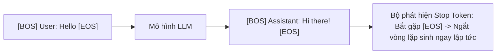

#### d. Code Thực chiến (Dual-Engine: C++ & Python)

```cpp
// C++17: Kiểm tra điều kiện ngắt vòng lặp suy luận khi gặp EOS Token ID
#include <iostream>
#include <vector>

bool is_generation_finished(int predicted_token_id, int eos_token_id) {
    return predicted_token_id == eos_token_id;
}

int main() {
    const int EOS_ID = 2;
    std::vector<int> generated = {1054, 492, 8820, 2}; // Kết thúc bằng EOS_ID

    for (int t : generated) {
        if (is_generation_finished(t, EOS_ID)) {
            std::cout << "Encountered EOS Token (" << t << "). Stopping generation!\n";
            break;
        }
        std::cout << "Token: " << t << " ";
    }
    return 0;
}
```

```python
# Python / Transformers: Thiết lập Padding Mask loại bỏ Special Token PAD
import torch
import torch.nn.functional as F

PAD_ID = 0
input_ids = torch.tensor([[101, 2054, 102, 0, 0]]) # 2 tokens cuối là PAD
# Tạo Attention Mask: 1 cho token thật, 0 cho token PAD
attention_mask = (input_ids != PAD_ID).long()

print("Input IDs:", input_ids)
print("Attention Mask (Bỏ qua PAD trên GPU):", attention_mask)
```

#### e. Lỗi Thường gặp & Ổn định Số học (Pitfalls & Numerical Stability)
- **Vòng lặp Vô tận (Infinite Generation)**: Nếu trong quá trình Fine-tuning (SFT), tập dữ liệu bị thiếu mất token `[EOS]` ở cuối câu trả lời của trợ lý, mô hình sẽ không bao giờ học được cách dừng lại và sẽ tiếp tục sinh văn bản rác cho đến khi chạm giới hạn `max_tokens`.

#### f. Ứng dụng Thực chiến trong AI / Deep Learning (AI Applications)
- Quản lý hội thoại đa lượt trong Chatbot (ChatML Format), phân tách bối cảnh trong RAG, điều khiển Function Calling / Tool Use.
