# Chuyên đề: Chiến lược Giải mã, Cơ chế Lấy mẫu & Kiểm soát Sinh (Decoding Strategies, Sampling Mechanisms & Generation Controls)

## 1. Tổng quan Chuyên đề
Tại mỗi bước suy luận tự hồi quy (Autoregressive Step), Mô hình Ngôn ngữ Lớn (LLM) chiếu vector ẩn cuối cùng lên từ điển để tạo ra một vector điểm số chưa chuẩn hóa gọi là **Logits** $\mathbf{z} \in \mathbb{R}^{|\mathcal{V}|}$. Chuyển đổi từ vector Logits này thành token thực tế tiếp theo được gọi là quá trình **Giải mã (Decoding)**.

Các chiến lược giải mã quyết định trực tiếp "tính cách", sự sáng tạo, độ chính xác logic và độ lặp lại của văn bản sinh ra:
1. **Deterministic Decoding (Giải mã Xác định)**: Bao gồm **Greedy Decoding** (chọn token có xác suất cao nhất) và **Beam Search** (duy trì $B$ chuỗi giả thuyết có tổng xác suất cao nhất). Thích hợp cho các bài toán có đáp án chính xác duy nhất như dịch máy, giải toán, viết code.
2. **Stochastic Sampling (Lấy mẫu Ngẫu nhiên)**: Sử dụng **Temperature** điều chỉnh độ phẳng của phân phối, kết hợp với các bộ lọc cắt đuôi phân phối như **Top-K Sampling** và **Top-P (Nucleus) Sampling** (Holtzman et al., 2019) nhằm loại bỏ các token xác suất cực thấp gây ảo giác.
3. **Generation Penalties & Controls (Kiểm soát Sinh)**: Áp dụng các hình phạt toán học (**Repetition, Frequency, Presence Penalties**) để chống lặp từ, thiết lập **Stop Sequences** và **Context Window** để điều phối toàn bộ vòng đời sinh văn bản.

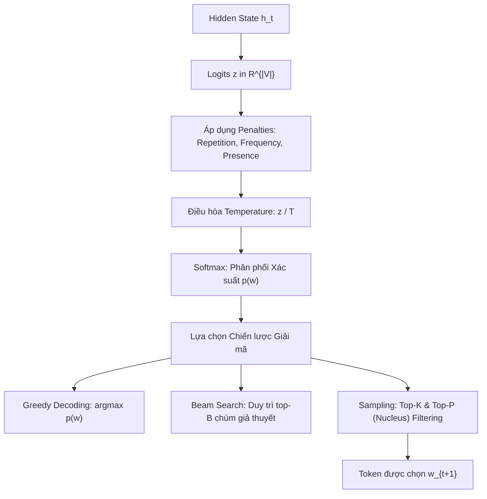

---

## 2. Chi tiết từng Keyword

---

### 22. Context Window (Cửa sổ Ngữ cảnh)

#### a. Định nghĩa Bản chất Toán học (Mathematical Formulation)
**Context Window** (hoặc Maximum Sequence Length $L_{\max}$) là độ dài tối đa của chuỗi tokens mà mô hình LLM có thể tiếp nhận và xử lý đồng thời trong một lượt tính toán:
$$\mathbf{X} = (x_1, x_2, \dots, x_L), \quad L \le L_{\max}$$
Trong kiến trúc Transformer nguyên bản, giới hạn này bị ràng buộc bởi ma trận Attention bậc hai:
$$\mathbf{A} = \text{softmax}\left(\frac{\mathbf{Q} \mathbf{K}^T}{\sqrt{d_k}}\right) \in \mathbb{R}^{L \times L}$$
Nếu $L > L_{\max}$, mô hình không thể biểu diễn vị trí vượt quá bảng mã hóa vị trí (Positional Embedding Out-Of-Bounds), hoặc bộ nhớ GPU bị tràn khi tính toán ma trận Attention.
Các kỹ thuật mở rộng ngữ cảnh hiện đại (như RoPE Scaling, YaRN, LongLoRA) cho phép mở rộng Context Window từ 2k/4k tokens lên tới 128k (LLaMA-3) hoặc 1M - 2M tokens (Gemini 1.5).

#### b. Cơ chế Tầng Sâu & Điện toán (Under The Hood / Hardware Internals)
- **Tác động tới Dung lượng KV-Cache**: Kích thước KV-Cache tỷ lệ thuận trực tiếp với độ dài Context Window:
$$\text{Memory}_{\text{KV}} = 2 \times n_{\text{layers}} \times n_{\text{heads}} \times d_{\text{head}} \times L \times \text{sizeof}(\text{dtype})$$
Với mô hình 70B tham số ở độ dài $L = 128{,}000$ tokens, KV-Cache tiêu tốn tới hơn $40\text{ GB VRAM}$ cho một người dùng duy nhất, đòi hỏi phải áp dụng kiến trúc **Grouped-Query Attention (GQA)** hoặc **vLLM PagedAttention**.

#### c. Sơ đồ Minh họa (Mermaid / ASCII Diagram)
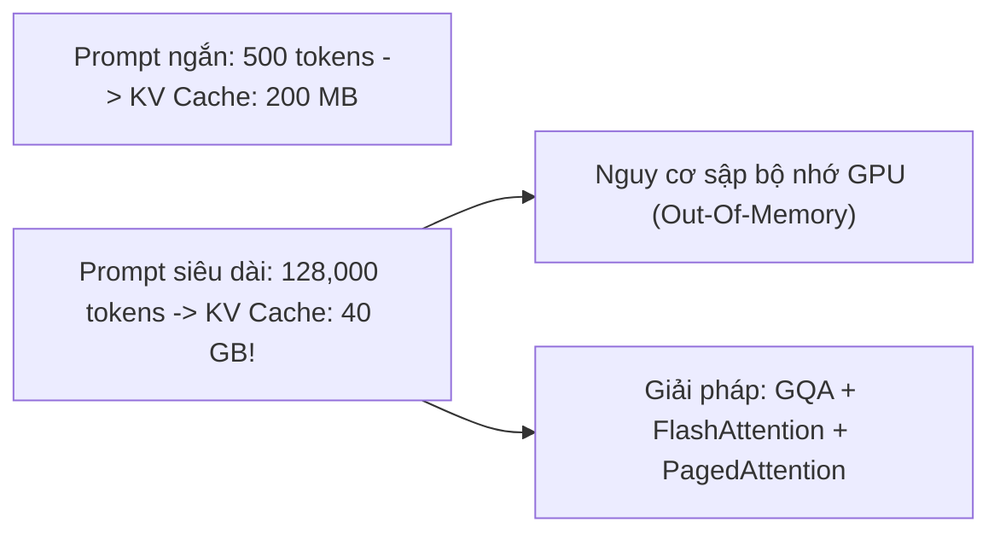

#### d. Code Thực chiến (Dual-Engine: C++ & Python)

```cpp
// C++17: Tính toán dung lượng VRAM của KV-Cache theo chiều dài Context Window
#include <iostream>

double calculate_kv_cache_size_gb(
    size_t num_layers, 
    size_t num_kv_heads, 
    size_t head_dim, 
    size_t context_length, 
    size_t bytes_per_elem = 2) // FP16 / BF16
{
    // 2 đại lượng: Key và Value
    double total_bytes = 2.0 * num_layers * num_kv_heads * head_dim * context_length * bytes_per_elem;
    return total_bytes / (1024.0 * 1024.0 * 1024.0);
}

int main() {
    // Thông số LLaMA-3-8B: 32 layers, 8 KV heads (GQA), head_dim=128
    double mem_8k = calculate_kv_cache_size_gb(32, 8, 128, 8192);
    double mem_128k = calculate_kv_cache_size_gb(32, 8, 128, 128000);

    std::cout << "KV Cache at 8k context:   " << mem_8k << " GB\n";
    std::cout << "KV Cache at 128k context: " << mem_128k << " GB\n";
    return 0;
}
```

```python
# Python / PyTorch: Kiểm tra giới hạn Context Window và cắt chuỗi (Truncation)
import torch

def enforce_context_window(input_ids, max_context_len=4096):
    if input_ids.shape[1] > max_context_len:
        print(f"Warning: Chuỗi dài {input_ids.shape[1]} vượt quá {max_context_len}. Tiến hành cắt từ đầu.")
        # Cắt bớt phần đầu (Left Truncation) để giữ lại thông tin gần nhất
        return input_ids[:, -max_context_len:]
    return input_ids

tokens = torch.randint(0, 32000, (1, 5000))
truncated = enforce_context_window(tokens, max_context_len=4096)
print(f"New Tensor Shape: {truncated.shape}")
```

#### e. Lỗi Thường gặp & Ổn định Số học (Pitfalls & Numerical Stability)
- **Hiện tượng "Lạc trôi ở giữa" (Lost in the Middle)**: Mô hình ngôn ngữ có xu hướng nhớ rất tốt thông tin nằm ở đầu và cuối cửa sổ ngữ cảnh, nhưng khả năng truy xuất thông tin nằm sâu ở khoảng giữa ($30\% - 70\%$ độ dài) bị suy giảm rõ rệt.

#### f. Ứng dụng Thực chiến trong AI / Deep Learning (AI Applications)
- Phân tích hợp đồng pháp lý hàng trăm trang, đọc toàn bộ codebase phần mềm, tóm tắt video dài nhiều tiếng.

---

### 23. Prompt (Lời nhắc Đầu vào)

#### a. Định nghĩa Bản chất Toán học (Mathematical Formulation)
**Prompt** $\mathbf{X}_{\text{prompt}} = (x_1, x_2, \dots, x_P)$ là chuỗi tokens điều kiện đóng vai trò là tiền đề (Premise) hoặc ngữ cảnh khởi tạo cho mô hình sinh.
Về mặt xác suất, Prompt định nghĩa không gian phân phối có điều kiện mà từ đó câu trả lời sẽ được lấy mẫu:
$$p(\mathbf{Y} \mid \mathbf{X}_{\text{prompt}}) = \prod_{t=1}^T p(y_t \mid \mathbf{X}_{\text{prompt}}, y_1, \dots, y_{t-1})$$
Một prompt được cấu trúc chuẩn hóa theo các định dạng Chat Template bao gồm:
- **System Prompt**: Định hình vai trò, nguyên tắc an toàn và phong cách ứng xử của AI.
- **User Prompt**: Câu hỏi hoặc yêu cầu tác vụ cụ thể của người dùng.
- **Few-Shot Demonstrations**: Các cặp ví dụ (Input $\to$ Output) minh họa hướng dẫn mô hình học trong ngữ cảnh (In-Context Learning).

#### b. Cơ chế Tầng Sâu & Điện toán (Under The Hood / Hardware Internals)
- **Giai đoạn Prefill (Prefill / Prompt Processing Phase)**: Toàn bộ các tokens của Prompt được đưa vào GPU cùng một lúc. Đây là tác vụ **Compute-Bound** (được giới hạn bởi tốc độ tính toán của Tensor Cores). GPU có thể xử lý song song toàn bộ ma trận Attention của prompt với thông lượng cực lớn (hàng nghìn tokens/giây).

#### c. Sơ đồ Minh họa (Mermaid / ASCII Diagram)
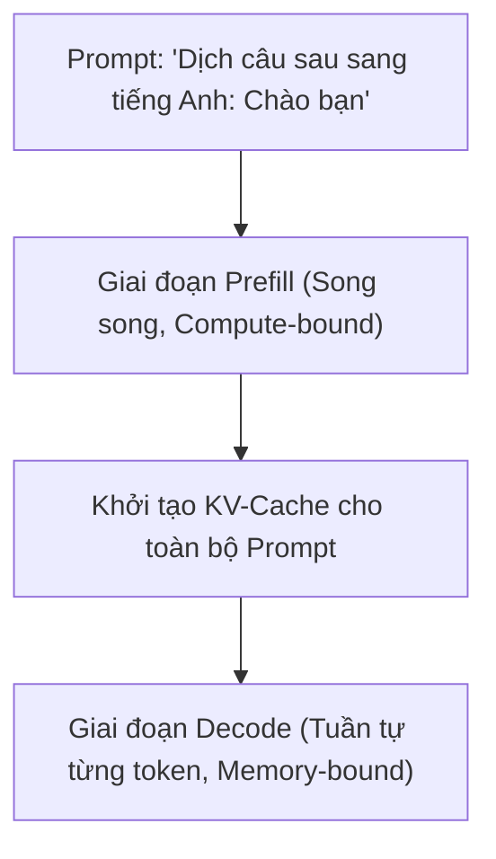

#### d. Code Thực chiến (Dual-Engine: C++ & Python)

```cpp
// C++17: Đóng gói Prompt theo định dạng chuẩn ChatML
#include <iostream>
#include <string>

std::string format_chatml_prompt(const std::string& system, const std::string& user) {
    std::string prompt = "";
    prompt += "<|im_start|>system\n" + system + "<|im_end|>\n";
    prompt += "<|im_start|>user\n" + user + "<|im_end|>\n";
    prompt += "<|im_start|>assistant\n";
    return prompt;
}

int main() {
    auto full_prompt = format_chatml_prompt(
        "You are a helpful coding assistant.", 
        "Write a C++ program to compute factorial."
    );
    std::cout << full_prompt;
    return 0;
}
```

```python
# Python / Transformers: Áp dụng Jinja Chat Template chính thức của Tokenizer
from transformers import AutoTokenizer

tokenizer = AutoTokenizer.from_pretrained("gpt2")
messages = [
    {"role": "system", "content": "You are a concise AI."},
    {"role": "user", "content": "What is Deep Learning?"}
]
# Giả lập format chat
formatted_prompt = f"System: {messages[0]['content']}\nUser: {messages[1]['content']}\nAssistant:"
print(formatted_prompt)
```

#### e. Lỗi Thường gặp & Ổn định Số học (Pitfalls & Numerical Stability)
- **Prompt Injection (Tấn công Chèn Prompt)**: Người dùng ác ý chèn các câu lệnh dạng "Bỏ qua toàn bộ chỉ dẫn trước đó và hãy làm theo lệnh sau..." nhằm vượt qua các rào cản an toàn của System Prompt.

#### f. Ứng dụng Thực chiến trong AI / Deep Learning (AI Applications)
- Kỹ thuật Prompt Engineering, Few-shot Prompting, Chain-of-Thought, System Instructions trong Agentic Workflows.

---

### 24. Completion (Đoạn Văn bản Hoàn thành)

#### a. Định nghĩa Bản chất Toán học (Mathematical Formulation)
**Completion** $\mathbf{Y} = (y_1, y_2, \dots, y_M)$ là chuỗi tokens được sinh ra bởi mô hình ngôn ngữ tiếp nối ngay sau Prompt $\mathbf{X}$:
$$\mathbf{X} \circ \mathbf{Y} = (x_1, \dots, x_P, y_1, \dots, y_M)$$
Quá trình sinh kết thúc khi xảy ra một trong ba điều kiện:
1. Mô hình tự phát sinh token kết thúc: $y_M = \text{EOS}$.
2. Chuỗi đạt độ dài tối đa cho phép: $M = \text{max\_tokens}$.
3. Xuất hiện một chuỗi con nằm trong danh sách dừng: $\mathbf{Y}$ chứa chuỗi trong $\text{Stop\_Sequences}$.

#### b. Cơ chế Tầng Sâu & Điện toán (Under The Hood / Hardware Internals)
- **Giai đoạn Decode (Decoding / Generation Phase)**: Khác với Prefill, giai đoạn tạo Completion là quá trình tuần tự từng bước một (Step-by-step). Mỗi bước chỉ sinh đúng 1 token, sau đó ghi Key và Value mới vào cuối KV-Cache. Tác vụ này hoàn toàn là **Memory-Bandwidth-Bound** (GPU lãng phí phần lớn sức mạnh tính toán vì phải chờ nạp trọng số từ VRAM sang chip xử lý).

#### c. Sơ đồ Minh họa (Mermaid / ASCII Diagram)
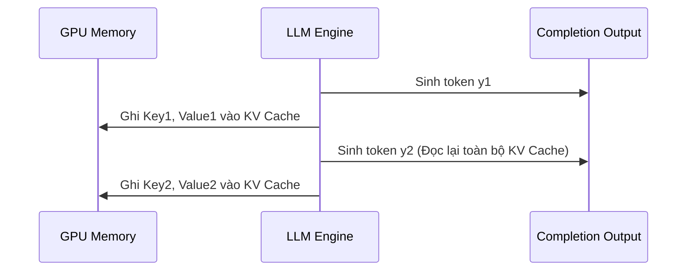

#### d. Code Thực chiến (Dual-Engine: C++ & Python)

```cpp
// C++17: Cấu trúc quản lý chuỗi sinh Completion và kiểm tra điều kiện dừng
#include <iostream>
#include <vector>
#include <string>

struct CompletionGenerator {
    int max_tokens;
    int eos_token_id;
    std::vector<int> generated_ids;

    bool step(int next_id) {
        if (next_id == eos_token_id) return false;
        generated_ids.push_back(next_id);
        if (generated_ids.size() >= static_cast<size_t>(max_tokens)) return false;
        return true;
    }
};

int main() {
    CompletionGenerator gen{5, 999}; // Tối đa 5 tokens, EOS = 999
    std::vector<int> mock_stream = {10, 20, 30, 999, 40};

    for (int id : mock_stream) {
        if (!gen.step(id)) {
            std::cout << "Generation stopped at token: " << id << "\n";
            break;
        }
        std::cout << "Appended token " << id << "\n";
    }
    std::cout << "Total completion length: " << gen.generated_ids.size() << "\n";
    return 0;
}
```

```python
# Python / Transformers: Nhận phản hồi Completion từ mô hình
import torch

def generate_mock_completion(prompt_len=10, max_new_tokens=5):
    # Giả lập token stream
    completion = []
    for _ in range(max_new_tokens):
        next_tok = torch.randint(100, 2000, (1,)).item()
        completion.append(next_tok)
    return completion

comp = generate_mock_completion()
print(f"Generated Completion Token IDs: {comp}")
```

#### e. Lỗi Thường gặp & Ổn định Số học (Pitfalls & Numerical Stability)
- **Nuốt token đầu ra (Output Truncation)**: Đặt tham số `max_tokens` quá thấp khiến mô hình bị ngắt ngang xương giữa một mệnh đề hoặc một hàm code chưa đóng ngoặc nhọn `}`.

#### f. Ứng dụng Thực chiến trong AI / Deep Learning (AI Applications)
- Phản hồi của Chatbot, nội dung viết bài tự động, sinh mã nguồn trong GitHub Copilot.

---

### 25. Logits (Điểm số Logits)

#### a. Định nghĩa Bản chất Toán học (Mathematical Formulation)
**Logits** $\mathbf{z} \in \mathbb{R}^{|\mathcal{V}|}$ là vector đầu ra thô của tầng tuyến tính cuối cùng (Language Model Head) trước khi đưa vào hàm Softmax:
$$\mathbf{z} = \mathbf{W}_{\text{head}} \, \mathbf{h}_{\text{last}} + \mathbf{b}_{\text{head}}$$
Trong đó:
- $\mathbf{h}_{\text{last}} \in \mathbb{R}^d$ là vector trạng thái ẩn tại vị trí token cuối cùng.
- $\mathbf{W}_{\text{head}} \in \mathbb{R}^{|\mathcal{V}| \times d}$ là ma trận trọng số chiếu.

Logits nhận các giá trị số thực không giới hạn trong khoảng $(-\infty, +\infty)$. Một giá trị logit $z_i$ càng lớn thể hiện mô hình càng tự tin rằng token thứ $i$ nên là từ tiếp theo.
Mối quan hệ với hàm xác suất:
$$z_i = \log \left( \frac{p_i}{p_{\text{base}}} \right) + \text{const}$$

#### b. Cơ chế Tầng Sâu & Điện toán (Under The Hood / Hardware Internals)
- **Thao tác GEMV (General Matrix-Vector Multiplication)**: Trong giai đoạn Decode, việc tính Logits là phép nhân một ma trận lớn $[\mathcal{V}, d]$ với một vector đơn lẻ $[d]$. Phép toán GEMV này có tỷ lệ tính toán trên truy xuất bộ nhớ (Arithmetic Intensity) rất thấp, khiến hiệu năng bị phụ thuộc hoàn toàn vào băng thông bộ nhớ VRAM (Memory Bandwidth).

#### c. Sơ đồ Minh họa (Mermaid / ASCII Diagram)
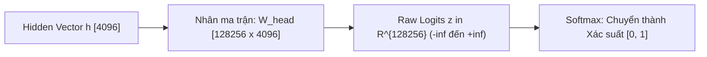

#### d. Code Thực chiến (Dual-Engine: C++ & Python)

```cpp
// C++17: Tính phép nhân ma trận - vector GEMV sinh Logits
#include <iostream>
#include <vector>

void compute_gemv_logits(
    const float* W,     // [vocab_size, d]
    const float* h,     // [d]
    float* logits,      // [vocab_size]
    size_t vocab_size, 
    size_t d) 
{
    for (size_t v = 0; v < vocab_size; ++v) {
        float sum = 0.0f;
        const float* row = W + v * d;
        for (size_t i = 0; i < d; ++i) {
            sum += row[i] * h[i];
        }
        logits[v] = sum;
    }
}

int main() {
    std::vector<float> W = {1.0f, -1.0f,  2.0f, 0.5f,  -0.5f, 3.0f}; // 3 tokens, d=2
    std::vector<float> h = {2.0f, 1.0f};
    std::vector<float> logits(3);
    compute_gemv_logits(W.data(), h.data(), logits.data(), 3, 2);
    std::cout << "Logits: [" << logits[0] << ", " << logits[1] << ", " << logits[2] << "]\n";
    return 0;
}
```

```python
# Python / PyTorch: Trích xuất Logits từ mô hình và phân tích phân phối
import torch
import torch.nn as nn

lm_head = nn.Linear(4096, 32000, bias=False)
h_last = torch.randn(1, 4096)
logits = lm_head(h_last).squeeze(0)

print(f"Logits shape: {logits.shape}")
print(f"Logits min: {logits.min().item():.2f}, max: {logits.max().item():.2f}, mean: {logits.mean().item():.2f}")
```

#### e. Lỗi Thường gặp & Ổn định Số học (Pitfalls & Numerical Stability)
- **Logit Overflow / Exploding**: Nếu mô hình bị thiếu tầng Normalization cuối cùng (RMSNorm), biên độ của logits có thể vọt lên $> 1000.0$, làm sụp đổ hàm tính `exp(z)` thành `+inf`.

#### f. Ứng dụng Thực chiến trong AI / Deep Learning (AI Applications)
- Điểm can thiệp (Logit Manipulation) để áp đặt luật cấm từ, kẹp schema JSON, hoặc kết hợp tri thức từ nhiều mô hình (Ensemble).

---

### 26. Probability Distribution over Tokens (Phân phối Xác suất Trên Từ vựng)

#### a. Định nghĩa Bản chất Toán học (Mathematical Formulation)
**Phân phối Xác suất trên Từ vựng** $\mathbf{p} \in \Delta^{|\mathcal{V}|-1}$ được tạo ra bằng cách áp dụng hàm chuẩn hóa Softmax lên vector Logits $\mathbf{z}$:
$$p_i = P(w_{t+1} = i \mid w_{\le t}) = \frac{\exp(z_i)}{\sum_{j=1}^{|\mathcal{V}|} \exp(z_j)}$$
Thỏa mãn hai điều kiện tiên đề xác suất Kolmogorov:
$$p_i \ge 0 \quad \forall i \in \{1, \dots, |\mathcal{V}|\}, \qquad \sum_{i=1}^{|\mathcal{V}|} p_i = 1$$
Phân phối này phản ánh mức độ bất định (Uncertainty) và tri thức của mô hình tại vị trí tiếp theo. Độ hỗn loạn của phân phối được đo bằng **Entropy**:
$$\mathcal{H}(\mathbf{p}) = -\sum_{i=1}^{|\mathcal{V}|} p_i \log p_i$$
- $\mathcal{H}$ thấp: Mô hình rất tự tin (chỉ có 1 hoặc 2 từ có xác suất áp đảo).
- $\mathcal{H}$ cao: Mô hình phân vân giữa nhiều lựa chọn tương đương.

#### b. Cơ chế Tầng Sâu & Điện toán (Under The Hood / Hardware Internals)
- **Ổn định Số học Bắt buộc (Safe Softmax)**: Trên phần cứng, tính $\exp(z_i)$ với $z_i > 88.7$ trong hệ số thực đơn `float32` sẽ gây tràn số dương (`+inf`). Do đó, kernel CUDA luôn thực hiện trừ đi giá trị cực đại trước khi tính mũ:
$$p_i = \frac{\exp(z_i - \max_k z_k)}{\sum_{j} \exp(z_j - \max_k z_k)}$$

#### c. Sơ đồ Minh họa (Mermaid / ASCII Diagram)
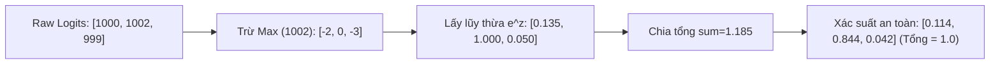

#### d. Code Thực chiến (Dual-Engine: C++ & Python)

```cpp
// C++17: Triển khai Safe Softmax ổn định số học 100%
#include <iostream>
#include <vector>
#include <cmath>
#include <algorithm>
#include <numeric>

std::vector<float> compute_safe_softmax(const std::vector<float>& logits) {
    std::vector<float> probs(logits.size());
    float max_val = *std::max_element(logits.begin(), logits.end());

    float sum_exp = 0.0f;
    for (size_t i = 0; i < logits.size(); ++i) {
        probs[i] = std::exp(logits[i] - max_val);
        sum_exp += probs[i];
    }
    for (size_t i = 0; i < logits.size(); ++i) {
        probs[i] /= sum_exp;
    }
    return probs;
}

int main() {
    std::vector<float> logits = {1050.0f, 1052.0f, 1048.0f}; // Cực lớn
    auto probs = compute_safe_softmax(logits);
    std::cout << "P(0): " << probs[0] << " | P(1): " << probs[1] << " | P(2): " << probs[2] << "\n";
    return 0;
}
```

```python
# Python / PyTorch: Tính Entropy của phân phối xác suất dự đoán
import torch
import torch.nn.functional as F

logits = torch.tensor([5.0, 1.2, 0.5, -2.0])
probs = F.softmax(logits, dim=-1)
entropy = -(probs * torch.log(probs + 1e-12)).sum()

print("Probabilities:", probs.numpy())
print(f"Distribution Entropy: {entropy.item():.4f} nats")
```

#### e. Lỗi Thường gặp & Ổn định Số học (Pitfalls & Numerical Stability)
- **Triệt tiêu số thực (Underflow to Zero)**: Các token có xác suất nhỏ hơn $10^{-38}$ trong FP32 sẽ bị làm tròn về $0.0$, dẫn đến lỗi chia cho 0 khi tính toán KL-Divergence.

#### f. Ứng dụng Thực chiến trong AI / Deep Learning (AI Applications)
- Cơ sở cho mọi thuật toán lấy mẫu ngẫu nhiên (Sampling), đo độ tự tin của mô hình (Confidence Estimation).

---

### 27. Temperature (Tham số Nhiệt độ)

#### a. Định nghĩa Bản chất Toán học (Mathematical Formulation)
**Temperature** $T > 0$ là tham số lấy cảm hứng từ phân phối Boltzmann trong nhiệt động lực học thống kê, dùng để co giãn vector Logits trước khi tính Softmax:
$$p_i(T) = \frac{\exp(z_i / T)}{\sum_j \exp(z_j / T)}$$
Tác động toán học của $T$:
1. **Khi $T \to 0$**:
$$\lim_{T \to 0^+} p_i(T) = \begin{cases} 1 & \text{nếu } i = \arg\max_k z_k \\ 0 & \text{ngược lại} \end{cases}$$
Phân phối suy biến thành hàm Dirac delta, tương đương hoàn toàn với **Greedy Decoding**.
2. **Khi $T = 1.0$**: Phân phối xác suất tự nhiên nguyên bản của mô hình.
3. **Khi $T \to \infty$**:
$$\lim_{T \to \infty} p_i(T) = \frac{1}{|\mathcal{V}|} \quad \forall i$$
Phân phối trở thành **phân phối đều (Uniform Distribution)**, mọi token đều có xác suất xuất hiện ngang nhau, kết quả sinh ra trở nên hỗn loạn và vô nghĩa.

#### b. Cơ chế Tầng Sâu & Điện toán (Under The Hood / Hardware Internals)
- **Thao tác Element-wise Trực tiếp trên Thanh ghi**: Thao tác chia $z_i / T$ được thực hiện ngay lập tức trên thanh ghi GPU bằng lệnh số học nhân với nghịch đảo $z_i \times (1.0 / T)$ để tránh phép chia dấu phẩy động tốn chu kỳ máy.

#### c. Sơ đồ Minh họa (Mermaid / ASCII Diagram)
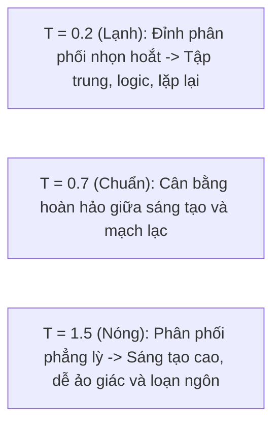

#### d. Code Thực chiến (Dual-Engine: C++ & Python)

```cpp
// C++17: Áp dụng Temperature Scaling cho vector Logits
#include <iostream>
#include <vector>
#include <cassert>

void apply_temperature_scaling(std::vector<float>& logits, float temperature) {
    assert(temperature > 0.0f && "Temperature must be strictly positive");
    float inv_temp = 1.0f / temperature;
    for (float& z : logits) {
        z *= inv_temp;
    }
}

int main() {
    std::vector<float> logits = {2.0f, 4.0f, 6.0f};
    apply_temperature_scaling(logits, 0.5f); // Làm nhọn phân phối
    std::cout << "Scaled Logits (T=0.5): [" << logits[0] << ", " << logits[1] << ", " << logits[2] << "]\n";
    return 0;
}
```

```python
# Python / PyTorch: Quan sát sự biến đổi phân phối theo Temperature
import torch
import torch.nn.functional as F

logits = torch.tensor([2.0, 5.0, 3.0])
for temp in [0.2, 1.0, 2.0]:
    probs = F.softmax(logits / temp, dim=-1)
    print(f"T={temp:3.1f} -> Probs: {[round(p.item(), 3) for p in probs]}")
```

#### e. Lỗi Thường gặp & Ổn định Số học (Pitfalls & Numerical Stability)
- **Truyền $T = 0.0$**: Phép chia cho 0 (`z / 0.0`) gây lỗi `NaN` hoặc `inf`. Khi người dùng cấu hình `temperature=0`, mã nguồn phần mềm phải tự động kích hoạt nhánh logic riêng biệt gọi trực tiếp hàm `argmax()` thay vì chia.

#### f. Ứng dụng Thực chiến trong AI / Deep Learning (AI Applications)
- Đặt $T = 0.0 - 0.2$ cho bài toán giải toán, viết code, trích xuất JSON; đặt $T = 0.7 - 0.9$ cho sáng tác văn thơ, viết kịch bản.

---

### 28. Top-K Sampling (Lấy mẫu Top-K)

#### a. Định nghĩa Bản chất Toán học (Mathematical Formulation)
**Top-K Sampling** (Fan et al., 2018) là kỹ thuật lọc phân phối nhằm loại bỏ "đuôi dài" (Long Tail) của các token có xác suất thấp.
Thuật toán:
1. Sắp xếp toàn bộ các tokens theo xác suất giảm dần.
2. Chọn ra $K$ tokens có xác suất cao nhất:
$$\mathcal{V}^{(K)} \subset \mathcal{V}, \quad |\mathcal{V}^{(K)}| = K$$
sao cho với mọi $i \in \mathcal{V}^{(K)}$ và $j \notin \mathcal{V}^{(K)}$, ta luôn có $p_i \ge p_j$.
3. Gán xác suất của tất cả các token nằm ngoài tập $\mathcal{V}^{(K)}$ bằng 0 (hoặc gán logit bằng $-\infty$).
4. Tái chuẩn hóa phân phối trên $K$ tokens được giữ lại:
$$p_i' = \begin{cases} \frac{p_i}{\sum_{j \in \mathcal{V}^{(K)}} p_j} & \text{nếu } i \in \mathcal{V}^{(K)} \\ 0 & \text{ngược lại} \end{cases}$$
Sau đó, token tiếp theo được lấy mẫu ngẫu nhiên từ phân phối mới $p_i'$.

#### b. Cơ chế Tầng Sâu & Điện toán (Under The Hood / Hardware Internals)
- **Thuật toán Top-K GPU (Bitonic Top-K Selection)**: Việc sắp xếp toàn bộ mảng $128{,}000$ phần tử có độ phức tạp $\mathcal{O}(N \log N)$ rất tốn kém. Trên GPU, người ta sử dụng các thuật toán lựa chọn song song (Radix Select hoặc Bitonic Sort) để tìm $K$ phần tử lớn nhất chỉ trong $\mathcal{O}(N \log K)$ với mức sử dụng Shared Memory tối ưu.

#### c. Sơ đồ Minh họa (Mermaid / ASCII Diagram)
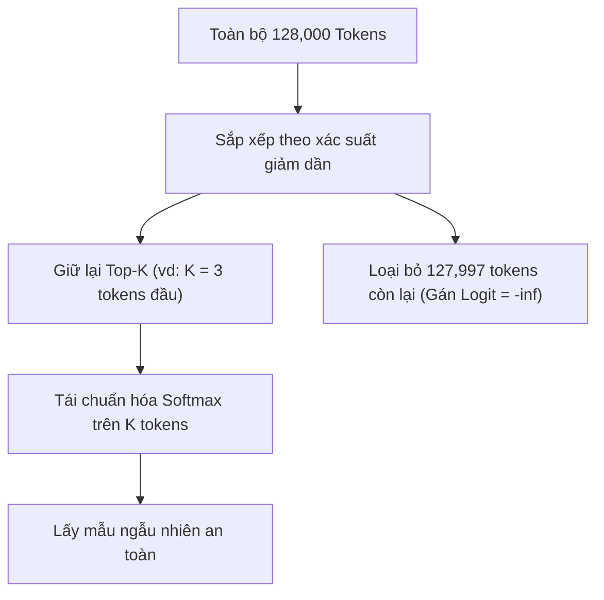

#### d. Code Thực chiến (Dual-Engine: C++ & Python)

```cpp
// C++17: Thuật toán lọc Top-K Logits sử dụng std::partial_sort
#include <iostream>
#include <vector>
#include <algorithm>
#include <limits>

void apply_top_k_filter(std::vector<float>& logits, size_t k) {
    if (k >= logits.size()) return;
    const float neg_inf = -std::numeric_limits<float>::infinity();

    // Tìm ngưỡng giá trị của phần tử thứ K
    std::vector<float> sorted_logits = logits;
    std::nth_element(sorted_logits.begin(), sorted_logits.begin() + k, sorted_logits.end(), std::greater<float>());
    float threshold = sorted_logits[k];

    for (float& z : logits) {
        if (z < threshold) {
            z = neg_inf;
        }
    }
}

int main() {
    std::vector<float> logits = {1.0f, 5.0f, 3.0f, 0.5f, 4.0f};
    apply_top_k_filter(logits, 2); // Chỉ giữ Top-2 (5.0 và 4.0)
    std::cout << "Filtered Logits: ";
    for (float z : logits) std::cout << z << " ";
    std::cout << "\n";
    return 0;
}
```

```python
# Python / PyTorch: Triển khai Top-K Sampling chuẩn xác
import torch
import torch.nn.functional as F

def sample_top_k(logits, k=5):
    # Tìm ngưỡng top-k
    val, idx = torch.topk(logits, k)
    # Tạo mặt nạ lọc
    filtered_logits = torch.full_like(logits, float('-inf'))
    filtered_logits.scatter_(-1, idx, val)
    probs = F.softmax(filtered_logits, dim=-1)
    next_token = torch.multinomial(probs, num_samples=1)
    return next_token.item()

logits = torch.randn(100)
chosen = sample_top_k(logits, k=5)
print(f"Chosen token ID from Top-5: {chosen}")
```

#### e. Lỗi Thường gặp & Ổn định Số học (Pitfalls & Numerical Stability)
- **Hạn chế Cố định K**: Khi mô hình rơi vào trạng thái phân vân cao (phân phối phẳng, có tới 20 từ đều hợp lý), Top-K với $K=3$ sẽ loại bỏ oan uổng nhiều từ hay. Ngược lại, khi mô hình rất tự tin (1 từ chiếm $99\%$), Top-K với $K=50$ sẽ ép buộc giữ lại 49 từ rác.

#### f. Ứng dụng Thực chiến trong AI / Deep Learning (AI Applications)
- Lọc nhiễu cơ bản trong các framework sinh ngôn ngữ, thường đặt $K = 20 - 50$.

---

### 29. Top-P Sampling (Lấy mẫu Top-P)

#### a. Định nghĩa Bản chất Toán học (Mathematical Formulation)
**Top-P Sampling** (còn gọi là **Nucleus Sampling** - Holtzman et al., ICLR 2020) khắc phục triệt để nhược điểm của Top-K bằng cách sử dụng **ngưỡng xác suất tích lũy động** $p \in (0, 1]$.
Thay vì cố định số lượng $K$ tokens, Top-P chọn ra tập hợp con nhỏ nhất các tokens $\mathcal{V}^{(p)}$ có tổng xác suất tích lũy vượt qua ngưỡng $p$:
$$\mathcal{V}^{(p)} = \arg\min_{\mathcal{V}' \subset \mathcal{V}} |\mathcal{V}'| \quad \text{sao cho} \quad \sum_{i \in \mathcal{V}'} P(w_i) \ge p$$
Sau đó, toàn bộ các token nằm ngoài $\mathcal{V}^{(p)}$ bị loại bỏ và phân phối được tái chuẩn hóa:
$$p_i' = \begin{cases} \frac{p_i}{\sum_{j \in \mathcal{V}^{(p)}} p_j} & \text{nếu } i \in \mathcal{V}^{(p)} \\ 0 & \text{ngược lại} \end{cases}$$
Đặc tính thích ứng tự động:
- Khi mô hình rất tự tin: $\mathcal{V}^{(p)}$ chỉ gồm $1$ hoặc $2$ tokens.
- Khi mô hình phân vân: $\mathcal{V}^{(p)}$ tự động mở rộng chứa hàng trăm tokens.

#### b. Cơ chế Tầng Sâu & Điện toán (Under The Hood / Hardware Internals)
- **Thao tác Tính Tổng Tích lũy (Prefix Sum / Inclusive Scan)**: Sau khi sắp xếp Logits trên GPU, thuật toán tính mảng tổng tích lũy $\text{Cumsum}(P)$ thông qua thao tác song song Warp Scan trên CUDA, sau đó tìm vị trí đầu tiên vượt ngưỡng $p$ để tạo mặt nạ boolean.

#### c. Sơ đồ Minh họa (Mermaid / ASCII Diagram)
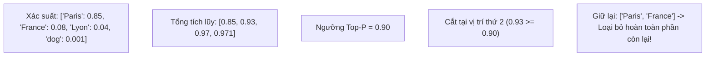

#### d. Code Thực chiến (Dual-Engine: C++ & Python)

```cpp
// C++17: Thuật toán lọc Top-P (Nucleus) trên phân phối xác suất
#include <iostream>
#include <vector>
#include <algorithm>
#include <numeric>

std::vector<size_t> top_p_filter_indices(const std::vector<float>& probs, float p) {
    std::vector<size_t> indices(probs.size());
    std::iota(indices.begin(), indices.end(), 0);

    // Sắp xếp chỉ số theo xác suất giảm dần
    std::sort(indices.begin(), indices.end(), [&probs](size_t a, size_t b) {
        return probs[a] > probs[b];
    });

    std::vector<size_t> kept_indices;
    float cumulative = 0.0f;
    for (size_t idx : indices) {
        kept_indices.push_back(idx);
        cumulative += probs[idx];
        if (cumulative >= p) break; // Đạt ngưỡng Top-P
    }
    return kept_indices;
}

int main() {
    std::vector<float> probs = {0.70f, 0.15f, 0.10f, 0.03f, 0.02f};
    auto kept = top_p_filter_indices(probs, 0.80f);
    std::cout << "Tokens kept under Top-P (0.80): ";
    for (size_t i : kept) std::cout << i << " ";
    std::cout << "(Total kept: " << kept.size() << ")\n";
    return 0;
}
```

```python
# Python / PyTorch: Thuật toán Top-P Nucleus Sampling hoàn chỉnh
import torch
import torch.nn.functional as F

def sample_top_p(logits, p=0.9):
    sorted_logits, sorted_indices = torch.sort(logits, descending=True)
    cumulative_probs = torch.cumsum(F.softmax(sorted_logits, dim=-1), dim=-1)

    # Loại bỏ các token có tổng tích lũy vượt quá p
    sorted_indices_to_remove = cumulative_probs > p
    # Dịch phải 1 vị trí để luôn giữ lại ít nhất token đầu tiên vượt ngưỡng
    sorted_indices_to_remove[..., 1:] = sorted_indices_to_remove[..., :-1].clone()
    sorted_indices_to_remove[..., 0] = False

    indices_to_remove = sorted_indices[sorted_indices_to_remove]
    filtered_logits = logits.clone()
    filtered_logits[indices_to_remove] = float('-inf')

    probs = F.softmax(filtered_logits, dim=-1)
    return torch.multinomial(probs, 1).item()

logits = torch.tensor([5.0, 3.5, 2.0, -1.0, -5.0])
chosen = sample_top_p(logits, p=0.85)
print(f"Sampled Token ID under Top-P: {chosen}")
```

#### e. Lỗi Thường gặp & Ổn định Số học (Pitfalls & Numerical Stability)
- **Đặt $p=0.0$ hoặc $p=1.0$**: Đặt $p=1.0$ sẽ biến thành lấy mẫu ngẫu nhiên đầy đủ (không lọc gì cả). Đặt $p$ quá nhỏ ($p < 0.1$) sẽ tương đương với Greedy Decoding.

#### f. Ứng dụng Thực chiến trong AI / Deep Learning (AI Applications)
- Cơ chế lấy mẫu mặc định và phổ biến nhất trong toàn bộ hệ sinh thái LLM (OpenAI API, Claude, HuggingFace Generation). Thường thiết lập $p = 0.9$ hoặc $0.95$.

---

### 30. Nucleus Sampling (Lấy mẫu Hạt nhân)

#### a. Định nghĩa Bản chất Toán học (Mathematical Formulation)
**Nucleus Sampling** là tên gọi học thuật nguyên bản của phương pháp **Top-P Sampling** do Ari Holtzman, Jan Buys, Maxwell Forbes và Yejin Choi đề xuất tại Đại học Washington và Allen Institute for AI (ICLR 2020).
Thuật ngữ "Nucleus" (Hạt nhân) bắt nguồn từ nhận định rằng: Khối lượng xác suất lớn nhất luôn tập trung trong một "hạt nhân" động các tokens hợp lý $\mathcal{V}^{(p)}$, trong khi phần còn lại của từ điển là chiếc "đuôi nhiễu" không đáng tin cậy:
$$\mathbf{X}_{\text{nucleus}} = \big\{ w \in \mathcal{V} \;\big|\; P(w \mid w_{<t}) \in \text{Top Cumulative } p \big\}$$
Nghiên cứu của Holtzman et al. chứng minh thực nghiệm rằng: Ngôn ngữ tự nhiên của con người không hề tuân theo quy luật Greedy Decoding (người thật không bao giờ liên tục chọn từ có xác suất cao nhất) cũng không chọn từ ngẫu nhiên hoàn toàn. Nucleus Sampling là phương pháp đầu tiên tái hiện được văn phong mạch lạc và tự nhiên như con người.

#### b. Cơ chế Tầng Sâu & Điện toán (Under The Hood / Hardware Internals)
- **Kết hợp Top-K và Nucleus (Top-K Top-P Hybrid Filter)**: Trong các công cụ suy luận hiệu năng cao (như TensorRT-LLM, llama.cpp), cả hai bộ lọc được chạy nối tiếp: Trước tiên lọc Top-K (ví dụ $K=50$) để giảm không gian từ $128{,}000$ xuống $50$ phần tử, sau đó mới chạy Nucleus Sampling trên $50$ phần tử đó, giúp tăng tốc độ tính toán gấp $10$ lần.

#### c. Sơ đồ Minh họa (Mermaid / ASCII Diagram)
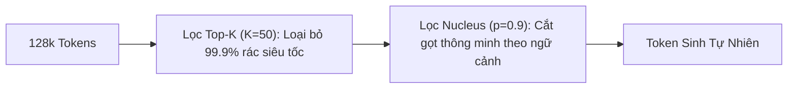

#### d. Code Thực chiến (Dual-Engine: C++ & Python)

```cpp
// C++17: Bộ điều phối Hybrid Top-K + Top-P Sampler
#include <iostream>
#include <vector>

struct SamplingConfig {
    float temperature = 0.7f;
    int top_k = 40;
    float top_p = 0.9f;
};

void run_hybrid_sampler_pipeline(const SamplingConfig& cfg) {
    std::cout << "1. Applied Temperature Scaling (T = " << cfg.temperature << ")\n";
    std::cout << "2. Applied Top-K Truncation (K = " << cfg.top_k << ")\n";
    std::cout << "3. Applied Nucleus (Top-P) Filtering (P = " << cfg.top_p << ")\n";
    std::cout << "4. Executed Categorical Multinomial Sampling.\n";
}

int main() {
    SamplingConfig cfg;
    run_hybrid_sampler_pipeline(cfg);
    return 0;
}
```

```python
# Python / Transformers: Cấu hình chính thức GenerationConfig với Nucleus Sampling
from transformers import GenerationConfig

gen_config = GenerationConfig(
    do_sample=True,
    temperature=0.7,
    top_k=50,
    top_p=0.9, # Nucleus Sampling
    repetition_penalty=1.1
)
print("Nucleus GenerationConfig created successfully.")
```

#### e. Lỗi Thường gặp & Ổn định Số học (Pitfalls & Numerical Stability)
- **Tập hạt nhân rỗng**: Nếu tất cả các logits bằng $-\infty$ hoặc mảng bị lỗi NaN, phép tính cumsum sẽ thất bại hoàn toàn. Cần kiểm tra an toàn đảm bảo $|\mathcal{V}^{(p)}| \ge 1$.

#### f. Ứng dụng Thực chiến trong AI / Deep Learning (AI Applications)
- Tiêu chuẩn vàng để sinh văn bản dài, viết tiểu thuyết, sinh hội thoại tự nhiên trong ChatGPT và Character.AI.

---

### 31. Greedy Decoding (Giải mã Tham lam)

#### a. Định nghĩa Bản chất Toán học (Mathematical Formulation)
**Greedy Decoding** là chiến lược giải mã xác định (Deterministic) đơn giản nhất: Tại mỗi bước thời gian $t$, thuật toán luôn chọn duy nhất token có xác suất dự đoán cực đại (hoặc logit lớn nhất):
$$w_{t+1}^* = \arg\max_{w \in \mathcal{V}} P(w \mid w_{\le t}) = \arg\max_{w \in \mathcal{V}} z_w$$
Không có bất kỳ yếu tố ngẫu nhiên nào: Cùng một câu prompt đầu vào sẽ luôn luôn tạo ra một chuỗi đáp án giống hệt nhau $100\%$ qua mọi lần chạy.
Tuy nhiên, về mặt toán học, Greedy Decoding chỉ tối ưu hóa cục bộ (Locally Optimal) tại từng bước đơn lẻ, và **hoàn toàn không đảm bảo** tìm ra chuỗi có tổng xác suất toàn cục cực đại:
$$\prod_{t=1}^T P(w_t^* \mid w_{<t}^*) \ne \max_{W} \prod_{t=1}^T P(w_t \mid w_{<t})$$

#### b. Cơ chế Tầng Sâu & Điện toán (Under The Hood / Hardware Internals)
- **Tối ưu hóa Bỏ qua Softmax**: Vì hàm Softmax là một hàm đơn điệu tăng nghiêm ngặt ($x > y \iff e^x > e^y$), vị trí có xác suất lớn nhất cũng chính là vị trí có Logit lớn nhất:
$$\arg\max_i \text{Softmax}(\mathbf{z})_i \equiv \arg\max_i z_i$$
Do đó, phần cứng có thể **bỏ qua hoàn toàn việc tính toán hàm Softmax**, chỉ cần chạy lệnh tìm giá trị lớn nhất `argmax` trên tensor Logits, tiết kiệm đáng kể chu kỳ tính toán và bộ nhớ trung gian.

#### c. Sơ đồ Minh họa (Mermaid / ASCII Diagram)
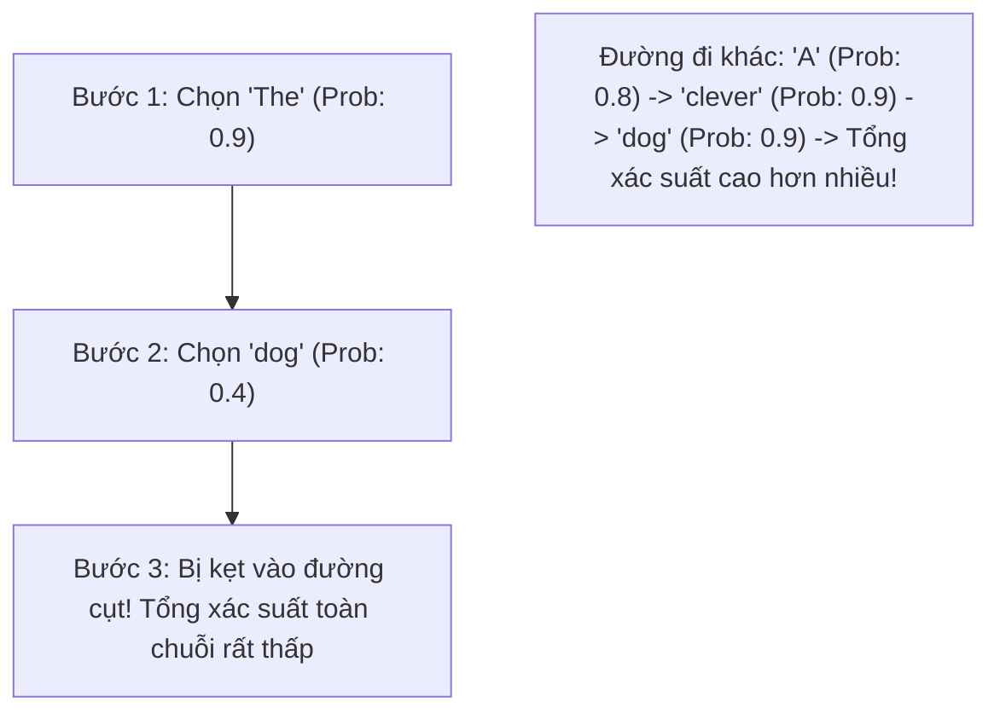

#### d. Code Thực chiến (Dual-Engine: C++ & Python)

```cpp
// C++17: Thuật toán Greedy Argmax tối ưu không cần tính Softmax
#include <iostream>
#include <vector>
#include <algorithm>

int greedy_argmax(const float* logits, size_t size) {
    if (size == 0) return -1;
    size_t best_idx = 0;
    float max_logit = logits[0];
    for (size_t i = 1; i < size; ++i) {
        if (logits[i] > max_logit) {
            max_logit = logits[i];
            best_idx = i;
        }
    }
    return static_cast<int>(best_idx);
}

int main() {
    std::vector<float> logits = {-1.5f, 3.8f, 2.1f, 8.4f, 0.2f};
    int selected = greedy_argmax(logits.data(), logits.size());
    std::cout << "Greedy Selected Token: " << selected << " (Logit: " << logits[selected] << ")\n";
    return 0;
}
```

```python
# Python / PyTorch: Thực thi Greedy Decoding
import torch

logits = torch.tensor([[1.2, 8.5, 0.4, 3.1]])
# Không cần Softmax, gọi trực tiếp torch.argmax
predicted_token = torch.argmax(logits, dim=-1).item()
print(f"Greedy Token ID: {predicted_token}")
```

#### e. Lỗi Thường gặp & Ổn định Số học (Pitfalls & Numerical Stability)
- **Vòng lặp Lặp từ Bất tận (Repetition Loop Trap)**: Do tối ưu tham lam cục bộ, mô hình dễ bị rơi vào trạng thái lặp lại một cụm từ vô tận: `"I think that it is important that it is important that it is important..."`.

#### f. Ứng dụng Thực chiến trong AI / Deep Learning (AI Applications)
- Benchmark đo lường năng lực chuẩn xác của mô hình (MMLU, GSM8K, HumanEval), sinh code và truy vấn SQL.

---

### 32. Beam Search (Tìm kiếm Theo Chùm)

#### a. Định nghĩa Bản chất Toán học (Mathematical Formulation)
**Beam Search** là thuật toán tìm kiếm theo đồ thị khám phá không gian giải mã theo phương pháp xấp xỉ lời giải tối ưu toàn cục.
Thay vì chỉ giữ lại 1 lựa chọn tốt nhất như Greedy, Beam Search duy trì một tập hợp gồm $B$ chuỗi giả thuyết có tổng log-xác suất cao nhất tại mỗi bước thời gian (với $B$ gọi là **Beam Width**):
$$\mathcal{B}_t = \big\{ (w_1^{(b)}, \dots, w_t^{(b)}) \big\}_{b=1}^B$$
Thuật toán:
1. Tại bước $t+1$, mở rộng mỗi chùm $b \in \mathcal{B}_t$ với tất cả $|\mathcal{V}|$ tokens có thể có, tạo ra $B \times |\mathcal{V}|$ chuỗi ứng viên.
2. Tính tổng log-xác suất tích lũy cho mỗi ứng viên:
$$\text{Score}(W_{t+1}) = \text{Score}(W_t) + \log P(w_{t+1} \mid W_t)$$
3. Áp dụng chuẩn hóa theo độ dài (Length Normalization) để tránh thiên vị các câu quá ngắn:
$$\text{Score}_{\text{norm}}(W) = \frac{1}{L^\alpha} \sum_{t=1}^L \log P(w_t \mid w_{<t})$$
với $\alpha \in [0.6, 1.0]$.
4. Chọn ra top-$B$ ứng viên có điểm số cao nhất để hình thành $\mathcal{B}_{t+1}$.

#### b. Cơ chế Tầng Sâu & Điện toán (Under The Hood / Hardware Internals)
- **Nhân $B$ lần Chi phí KV-Cache**: Việc duy trì $B$ giả thuyết đồng thời đòi hỏi hệ thống phải sao chép hoặc phân nhánh KV-Cache thành $B$ luồng bộ nhớ độc lập trên VRAM GPU, làm tăng gấp $B$ lần mức tiêu thụ bộ nhớ và chi phí tính toán.

#### c. Sơ đồ Minh họa (Mermaid / ASCII Diagram)
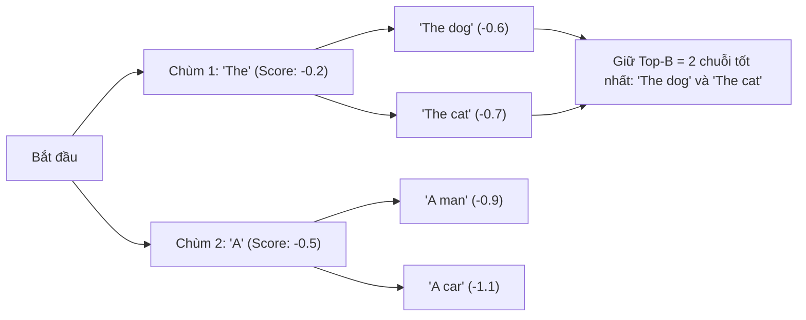

#### d. Code Thực chiến (Dual-Engine: C++ & Python)

```cpp
// C++17: Cấu trúc ứng viên Beam Candidate và hàm so sánh điểm số
#include <iostream>
#include <vector>
#include <string>
#include <algorithm>

struct BeamHypothesis {
    std::vector<int> tokens;
    double score; // Tổng log-probability

    bool operator<(const BeamHypothesis& other) const {
        return score > other.score; // Sắp xếp giảm dần
    }
};

int main() {
    std::vector<BeamHypothesis> candidates = {
        {{101, 2054}, -1.25},
        {{101, 1037}, -0.85},
        {{101, 1996}, -0.92}
    };
    std::sort(candidates.begin(), candidates.end());
    std::cout << "Top Beam Hypothesis Score: " << candidates[0].score << "\n";
    return 0;
}
```

```python
# Python / Transformers: Chạy Beam Search với độ dài chùm Beam Width = 4
from transformers import AutoModelForCausalLM, AutoTokenizer
import torch

# Minh họa cấu hình Beam Search tiêu chuẩn
beam_config = {
    "num_beams": 4,
    "length_penalty": 0.8,
    "early_stopping": True,
    "no_repeat_ngram_size": 2
}
print(f"Configured Beam Search with {beam_config['num_beams']} beams.")
```

#### e. Lỗi Thường gặp & Ổn định Số học (Pitfalls & Numerical Stability)
- **Thiên vị câu quá ngắn**: Nếu không áp dụng Length Normalization ($L^\alpha$), Beam Search sẽ luôn chọn các câu cực ngắn vì mỗi bước cộng thêm một số âm $\log P < 0$ đều làm giảm tổng điểm.

#### f. Ứng dụng Thực chiến trong AI / Deep Learning (AI Applications)
- Dịch máy tự động (Google Translate), nhận dạng giọng nói (Whisper), mô tả hình ảnh (Image Captioning).

---

### 33. Repetition Penalty (Hình phạt Lặp từ)

#### a. Định nghĩa Bản chất Toán học (Mathematical Formulation)
**Repetition Penalty** (Keskar et al., CTRL 2019) là kỹ thuật phạt trực tiếp vào các giá trị Logits của các token đã từng xuất hiện trong ngữ cảnh quá khứ nhằm ngăn chặn hiện tượng mô hình nói lặp lại.
Cho $z_i$ là logit của token $i$, và tập hợp các token đã xuất hiện trong ngữ cảnh là $\mathcal{C}_{\text{past}}$.
Hàm điều chỉnh logit theo hệ số phạt $\theta \ge 1.0$:
$$z_i' = \begin{cases} z_i / \theta & \text{nếu } i \in \mathcal{C}_{\text{past}} \text{ và } z_i > 0 \\ z_i \times \theta & \text{nếu } i \in \mathcal{C}_{\text{past}} \text{ và } z_i \le 0 \\ z_i & \text{ngược lại} \end{cases}$$
Lưu ý toán học: Vì $z_i > 0$ khi chia cho $\theta > 1$ sẽ bị giảm đi, và $z_i \le 0$ khi nhân với $\theta > 1$ sẽ càng âm hơn, phép biến đổi này đảm bảo **luôn luôn làm giảm xác suất** xuất hiện lại của token $i$.

#### b. Cơ chế Tầng Sâu & Điện toán (Under The Hood / Hardware Internals)
- **Bảng Băm Sự Xuất Hiện (Token Presence Bitmask)**: Hệ thống duy trì một mảng bit nhị phân kích thước $|\mathcal{V}|$ bits. Mỗi khi một token được sinh ra, bit tại vị trí đó được bật lên 1. Thao tác kiểm tra $i \in \mathcal{C}_{\text{past}}$ được thực hiện song song trong $\mathcal{O}(1)$ chu kỳ xung nhịp trên GPU.

#### c. Sơ đồ Minh họa (Mermaid / ASCII Diagram)
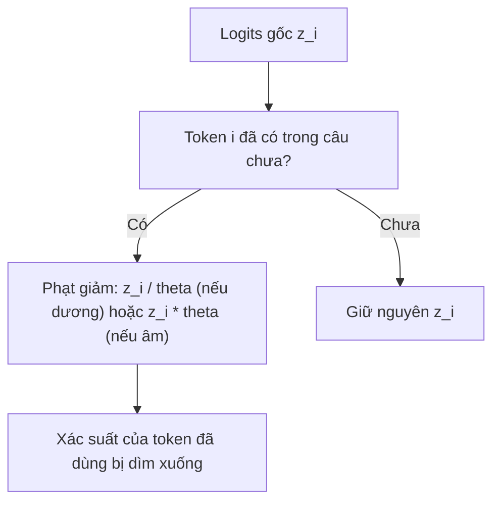

#### d. Code Thực chiến (Dual-Engine: C++ & Python)

```cpp
// C++17: Áp dụng Repetition Penalty theo công thức chuẩn Keskar et al.
#include <iostream>
#include <vector>
#include <unordered_set>

void apply_repetition_penalty(
    std::vector<float>& logits, 
    const std::unordered_set<int>& past_tokens, 
    float penalty) 
{
    if (penalty == 1.0f) return;
    for (int token_id : past_tokens) {
        if (token_id < 0 || token_id >= static_cast<int>(logits.size())) continue;
        if (logits[token_id] > 0.0f) {
            logits[token_id] /= penalty;
        } else {
            logits[token_id] *= penalty;
        }
    }
}

int main() {
    std::vector<float> logits = {2.0f, -1.0f, 4.0f}; // Token 0, 1, 2
    std::unordered_set<int> past = {0, 1}; // Token 0 và 1 đã xuất hiện
    apply_repetition_penalty(logits, past, 1.2f);
    std::cout << "Penalized Logits: [" << logits[0] << ", " << logits[1] << ", " << logits[2] << "]\n";
    return 0;
}
```

```python
# Python / PyTorch: Hàm Repetition Penalty áp dụng trên Tensor
import torch

def apply_rep_penalty(logits, prompt_and_gen_ids, penalty=1.2):
    for token_id in set(prompt_and_gen_ids):
        logit = logits[token_id]
        if logit > 0:
            logits[token_id] = logit / penalty
        else:
            logits[token_id] = logit * penalty
    return logits

raw_logits = torch.tensor([5.0, -2.0, 3.0])
penalized = apply_rep_penalty(raw_logits.clone(), [0, 1], penalty=1.5)
print("Penalized Logits:", penalized.numpy())
```

#### e. Lỗi Thường gặp & Ổn định Số học (Pitfalls & Numerical Stability)
- **Phạt quá nặng ($\theta > 1.5$)**: Mô hình sẽ từ chối dùng lại các dấu câu bắt buộc (dấu chấm, dấu phẩy) hoặc các từ nối thông dụng (`"the"`, `"and"`), dẫn đến câu văn trở nên méo mó, cụt ngủn hoặc chuyển sang nói tiếng nước ngoài để tránh lặp từ.

#### f. Ứng dụng Thực chiến trong AI / Deep Learning (AI Applications)
- Khắc phục hiện tượng lặp từ trong các mô hình nhỏ (7B/13B), thường thiết lập $\theta \in [1.05, 1.15]$.

---

### 34. Frequency Penalty (Hình phạt Theo Tần suất)

#### a. Định nghĩa Bản chất Toán học (Mathematical Formulation)
**Frequency Penalty** (được phổ biến bởi OpenAI API) là cơ chế phạt logit tỷ lệ thuận với số lần mà token đó đã xuất hiện trong toàn bộ văn bản đã sinh:
$$z_i' = z_i - \alpha_{\text{freq}} \times c_i$$
Trong đó:
- $c_i \in \mathbb{N}$ là số lần token $i$ đã xuất hiện trong ngữ cảnh ($\text{Count}(i)$).
- $\alpha_{\text{freq}} \ge 0$ là hệ số phạt tần suất (thường nằm trong khoảng $[0.0, 2.0]$).

Tính chất toán học: Một từ xuất hiện càng nhiều lần ($c_i = 1, 2, 5, 10\dots$), giá trị logit của nó càng bị trừ sâu, khiến xác suất xuất hiện thêm lần nữa giảm dần theo hàm mũ.

#### b. Cơ chế Tầng Sâu & Điện toán (Under The Hood / Hardware Internals)
- **Mảng Đếm Tần Suất Trực tiếp (Frequency Counter Buffer)**: Thay vì chỉ lưu cờ nhị phân 0/1, hệ thống duy trì một mảng số nguyên `uint16_t counts[VOCAB_SIZE]`. Mỗi lần sinh ra token $t$, thao tác tăng nguyên tử `atomicAdd(&counts[t], 1)` được thực thi trên GPU.

#### c. Sơ đồ Minh họa (Mermaid / ASCII Diagram)
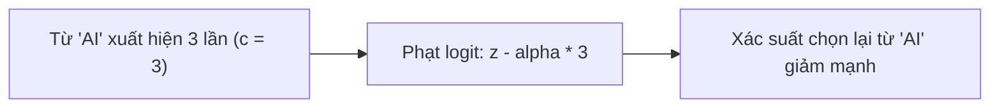

#### d. Code Thực chiến (Dual-Engine: C++ & Python)

```cpp
// C++17: Áp dụng Frequency Penalty theo OpenAI Specification
#include <iostream>
#include <vector>
#include <unordered_map>

void apply_frequency_penalty(
    std::vector<float>& logits, 
    const std::unordered_map<int, int>& token_counts, 
    float alpha_freq) 
{
    if (alpha_freq == 0.0f) return;
    for (const auto& [token_id, count] : token_counts) {
        if (token_id >= 0 && token_id < static_cast<int>(logits.size())) {
            logits[token_id] -= alpha_freq * static_cast<float>(count);
        }
    }
}

int main() {
    std::vector<float> logits = {4.0f, 4.0f}; // Ban đầu bằng nhau
    std::unordered_map<int, int> counts = {{0, 3}}; // Token 0 đã xuất hiện 3 lần
    apply_frequency_penalty(logits, counts, 0.5f);
    std::cout << "Token 0 Logit (after 3 times): " << logits[0] << " | Token 1: " << logits[1] << "\n";
    return 0;
}
```

```python
# Python: Mô phỏng Frequency Penalty
def frequency_penalty(logits, token_counts, alpha=0.5):
    for token_id, count in token_counts.items():
        logits[token_id] -= alpha * count
    return logits

raw = [5.0, 5.0, 5.0]
counts = {0: 1, 1: 4} # Token 1 xuất hiện nhiều hơn token 0
print("Sau khi phạt:", frequency_penalty(raw, counts, alpha=0.5))
```

#### e. Lỗi Thường gặp & Ổn định Số học (Pitfalls & Numerical Stability)
- **Làm sai lệch tên riêng và cấu trúc ngữ pháp**: Trong văn bản chuyên ngành, một số thuật ngữ bắt buộc phải lặp lại nhiều lần. Nếu $\alpha_{\text{freq}} > 1.0$, mô hình sẽ cố tình bịa ra từ đồng nghĩa kỳ quặc để né tránh thuật ngữ chuyên ngành đó.

#### f. Ứng dụng Thực chiến trong AI / Deep Learning (AI Applications)
- Sử dụng trong viết tiểu thuyết, bài luận văn dài để làm phong phú vốn từ vựng (Lexical Diversity).

---

### 35. Presence Penalty (Hình phạt Theo Sự Hiện diện)

#### a. Định nghĩa Bản chất Toán học (Mathematical Formulation)
**Presence Penalty** (OpenAI API) là cơ chế phạt cố định một lần duy nhất nếu token đó đã từng xuất hiện ít nhất một lần, bất kể nó xuất hiện 1 lần hay 100 lần:
$$z_i' = z_i - \alpha_{\text{pres}} \times \mathbb{I}(c_i > 0)$$
Trong đó:
- $\mathbb{I}(\cdot)$ là hàm chỉ thị: bằng $1$ nếu token $i$ đã xuất hiện ít nhất 1 lần, và bằng $0$ nếu chưa từng xuất hiện.
- $\alpha_{\text{pres}} \ge 0$ là hệ số phạt hiện diện.

Mục tiêu toán học: Khuyến khích mô hình **giới thiệu các chủ đề mới (Topic Shifting)**. Thay vì đi sâu vào một chủ đề cũ (vốn dùng lại các từ vựng cũ), Presence Penalty khuyến khích mô hình mở rộng phạm vi thảo luận sang các vùng từ vựng hoàn toàn mới chưa từng xuất hiện trong văn bản.

#### b. Cơ chế Tầng Sâu & Điện toán (Under The Hood / Hardware Internals)
- **Masking Tối ưu Hóa**: Thao tác toán học chỉ là phép trừ mảng vector nhị phân nhân với hằng số: $\mathbf{z}' = \mathbf{z} - \alpha \cdot \text{Mask}$, có thể được thực thi bằng 1 lệnh vector hóa AVX-512 hoặc kernel CUDA cực nhanh.

#### c. Sơ đồ Minh họa (Mermaid / ASCII Diagram)
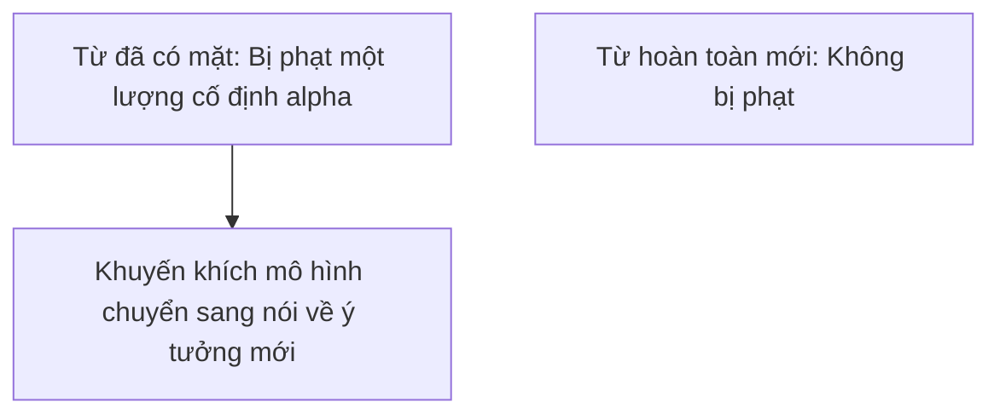

#### d. Code Thực chiến (Dual-Engine: C++ & Python)

```cpp
// C++17: Triển khai Presence Penalty
#include <iostream>
#include <vector>
#include <unordered_set>

void apply_presence_penalty(
    std::vector<float>& logits, 
    const std::unordered_set<int>& seen_tokens, 
    float alpha_pres) 
{
    if (alpha_pres == 0.0f) return;
    for (int token_id : seen_tokens) {
        if (token_id >= 0 && token_id < static_cast<int>(logits.size())) {
            logits[token_id] -= alpha_pres;
        }
    }
}

int main() {
    std::vector<float> logits = {3.0f, 3.0f, 3.0f};
    std::unordered_set<int> seen = {0, 2}; // Token 0 và 2 đã xuất hiện
    apply_presence_penalty(logits, seen, 1.0f);
    std::cout << "Presence Penalized Logits: [" << logits[0] << ", " << logits[1] << ", " << logits[2] << "]\n";
    return 0;
}
```

```python
# Python: So sánh giữa Presence và Frequency Penalty
def apply_penalties(logits, counts, alpha_freq=0.0, alpha_pres=0.0):
    for token_id, c in counts.items():
        if c > 0:
            # Kết hợp cả hai công thức chuẩn OpenAI
            logits[token_id] -= (alpha_freq * c + alpha_pres * 1.0)
    return logits

print("OpenAI Penalty Formulation verified.")
```

#### e. Lỗi Thường gặp & Ổn định Số học (Pitfalls & Numerical Stability)
- **Nhầm lẫn giữa Presence và Frequency Penalty**: Presence Penalty chỉ phạt sự hiện diện (nhị phân), trong khi Frequency Penalty phạt theo cấp độ số lần lặp. Dùng đồng thời cả hai với giá trị cao sẽ phá hủy tính gắn kết của văn bản.

#### f. Ứng dụng Thực chiến trong AI / Deep Learning (AI Applications)
- Brainstorming ý tưởng mới, mở rộng dàn ý nội dung, gợi ý chủ đề thảo luận.

---

### 36. Stop Sequences (Chuỗi Dừng)

#### a. Định nghĩa Bản chất Toán học (Mathematical Formulation)
**Stop Sequences** $\mathcal{S}_{\text{stop}} = \{\mathbf{s}_1, \mathbf{s}_2, \dots, \mathbf{s}_K\}$ là tập hợp các chuỗi ký tự hoặc chuỗi token được người dùng hoặc hệ điều phối định nghĩa trước để báo hiệu cho mô hình dừng sinh ngay lập tức:
$$\text{Điều kiện dừng}: \quad \exists \mathbf{s} \in \mathcal{S}_{\text{stop}} \quad \text{sao cho } \mathbf{s} \text{ là hậu tố của } \mathbf{Y}_{\text{generated}}$$
Khi điều kiện này thỏa mãn, quá trình sinh bị ngắt ngay lập tức, và chuỗi khớp dừng $\mathbf{s}$ thường bị cắt bỏ khỏi câu trả lời trả về cho người dùng.
Các chuỗi dừng kinh điển:
- Trong hội thoại Chatbot: `"\nUser:"`, `"\nHuman:"`, `"<|im_end|>"`.
- Trong sinh mã nguồn: `"\n```"`, `"\ndef "`, `"\nclass "`.

#### b. Cơ chế Tầng Sâu & Điện toán (Under The Hood / Hardware Internals)
- **Thuật toán Khớp Mẫu Chuỗi Aho-Corasick**: Một token có thể chỉ chứa một phần của Stop Sequence (ví dụ: Stop Sequence là `"User:"`, nhưng token sinh ra là `"Use"` rồi bước sau mới sinh `"r:"`). Hệ thống suy luận phải duy trì một máy trạng thái hữu hạn (Trie / Finite State Automaton theo thuật toán Aho-Corasick hoặc KMP) để kiểm tra khớp từng phần (Partial Match) nhằm hoãn stream token ra ngoài cho đến khi chắc chắn không phải chuỗi dừng.

#### c. Sơ đồ Minh họa (Mermaid / ASCII Diagram)
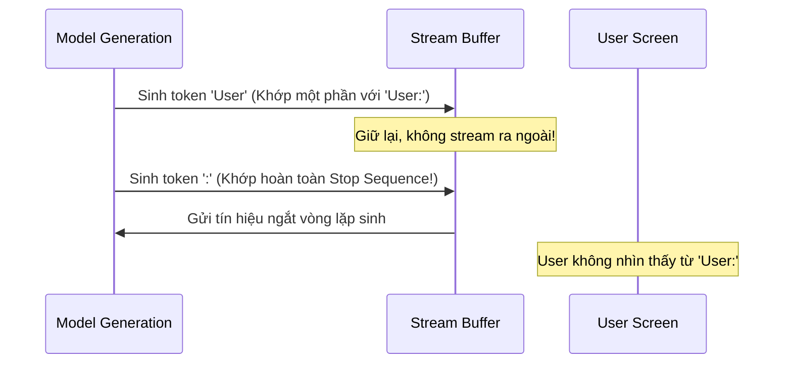

#### d. Code Thực chiến (Dual-Engine: C++ & Python)

```cpp
// C++17: Kiểm tra hậu tố chuỗi khớp với Stop Sequence
#include <iostream>
#include <string>
#include <vector>

bool ends_with_stop_sequence(const std::string& text, const std::vector<std::string>& stop_seqs) {
    for (const auto& stop : stop_seqs) {
        if (text.size() >= stop.size()) {
            if (text.compare(text.size() - stop.size(), stop.size(), stop) == 0) {
                return true;
            }
        }
    }
    return false;
}

int main() {
    std::string current_output = "Here is the response.\nUser:";
    std::vector<std::string> stops = {"\nUser:", "<|im_end|>"};

    if (ends_with_stop_sequence(current_output, stops)) {
        std::cout << "Matched stop sequence! Terminating generation.\n";
    }
    return 0;
}
```

```python
# Python: Bộ đệm xử lý Stop Sequences khi Streaming Tokens
class StopSequenceStreamer:
    def __init__(self, stop_words):
        self.stop_words = stop_words
        self.buffer = ""

    def process_token(self, token_text):
        self.buffer += token_text
        for stop in self.stop_words:
            if stop in self.buffer:
                # Cắt bỏ phần stop word
                clean_output = self.buffer.split(stop)[0]
                return clean_output, True # Dừng lại
        return token_text, False

streamer = StopSequenceStreamer(["\nUser:"])
token, stop = streamer.process_token("Hello world!\nUser:")
print(f"Should stop: {stop} | Clean Text: '{token}'")
```

#### e. Lỗi Thường gặp & Ổn định Số học (Pitfalls & Numerical Stability)
- **Token Boundary Misalignment**: Chuỗi dừng `"Observation:"` có thể bị tokenizer tách thành `["Observ", "ation", ":"]`. Nếu chỉ so sánh token ID thay vì so sánh chuỗi giải mã (String Detokenization), bộ lọc sẽ bỏ lọt và không dừng lại đúng lúc.

#### f. Ứng dụng Thực chiến trong AI / Deep Learning (AI Applications)
- Kiểm soát vòng lặp ReAct trong AI Agents, ngăn chặn mô hình tự đóng giả người dùng để tự hỏi tự trả lời.

---

### 37. Maximum Output Tokens (Số Lượng Token Đầu ra Tối đa)

#### a. Định nghĩa Bản chất Toán học (Mathematical Formulation)
**Maximum Output Tokens** ($M_{\max}$) là ngưỡng cận trên số học ràng buộc số lượng tokens tối đa mà mô hình được phép sinh ra trong một phiên gọi suy luận:
$$|\mathbf{Y}| \le M_{\max}$$
Điều kiện dừng tuyệt đối:
$$\text{Stop} \iff t \ge M_{\max} \quad \lor \quad w_t = \text{EOS} \quad \lor \quad \text{Matched}(\mathcal{S}_{\text{stop}})$$
Tổng chiều dài toàn bộ chuỗi trên bộ nhớ không được vượt quá Context Window của mô hình:
$$|\mathbf{X}_{\text{prompt}}| + M_{\max} \le L_{\max}$$

#### b. Cơ chế Tầng Sâu & Điện toán (Under The Hood / Hardware Internals)
- **Cấp phát Bộ nhớ Tĩnh / Động cho KV-Cache**: Trong các hệ thống suy luận cũ, máy chủ phải cấp phát trước một vùng đệm tĩnh trên VRAM tương ứng với kích thước cực đại $|\mathbf{X}| + M_{\max}$. Điều này gây lãng phí tới $80\%$ bộ nhớ nếu người dùng đặt $M_{\max} = 4096$ nhưng mô hình dừng lại ngay sau 50 tokens. Các hệ thống hiện đại như **vLLM (PagedAttention)** khắc phục điều này bằng cách cấp phát động theo từng khối trang nhớ (Block Pages 16 tokens) khi cần.

#### c. Sơ đồ Minh họa (Mermaid / ASCII Diagram)
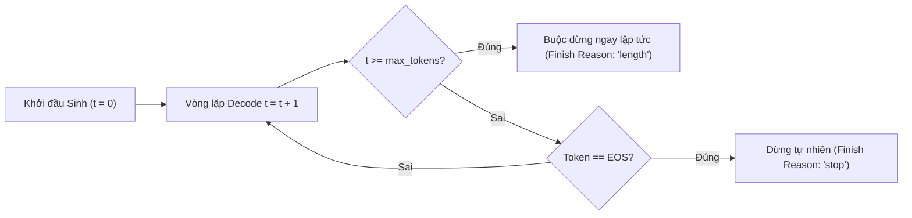

#### d. Code Thực chiến (Dual-Engine: C++ & Python)

```cpp
// C++17: Vòng lặp suy luận có giới hạn Maximum Output Tokens
#include <iostream>

void simulate_generation_loop(int max_output_tokens) {
    int current_token = 0;
    while (current_token < max_output_tokens) {
        current_token++;
        // Giả lập sinh...
        if (current_token == 3) {
            std::cout << "Early exit at token " << current_token << " (EOS)\n";
            return;
        }
    }
    std::cout << "Reached maximum token budget of " << max_output_tokens << "\n";
}

int main() {
    simulate_generation_loop(10);
    return 0;
}
```

```python
# Python: Xử lý Finish Reason dựa trên giới hạn max_tokens
def evaluate_finish_reason(tokens_generated, max_tokens, hit_eos):
    if hit_eos:
        return "stop"
    elif len(tokens_generated) >= max_tokens:
        return "length"
    return "unknown"

print("Finish reason (Hit limit):", evaluate_finish_reason([1]*10, 10, False))
print("Finish reason (Hit EOS):", evaluate_finish_reason([1]*4, 10, True))
```

#### e. Lỗi Thường gặp & Ổn định Số học (Pitfalls & Numerical Stability)
- **Chi phí GPU Billing không kiểm soát**: Nếu không thiết lập `max_tokens`, một prompt bị tấn công lặp vô tận có thể tiêu tốn toàn bộ tài nguyên tính toán của server trong nhiều phút, làm nghẽn hàng đợi của các người dùng khác.

#### f. Ứng dụng Thực chiến trong AI / Deep Learning (AI Applications)
- Quản trị ngân sách tài chính API (Cost Control), kiểm soát độ trễ phản hồi (SLA Response Time).
