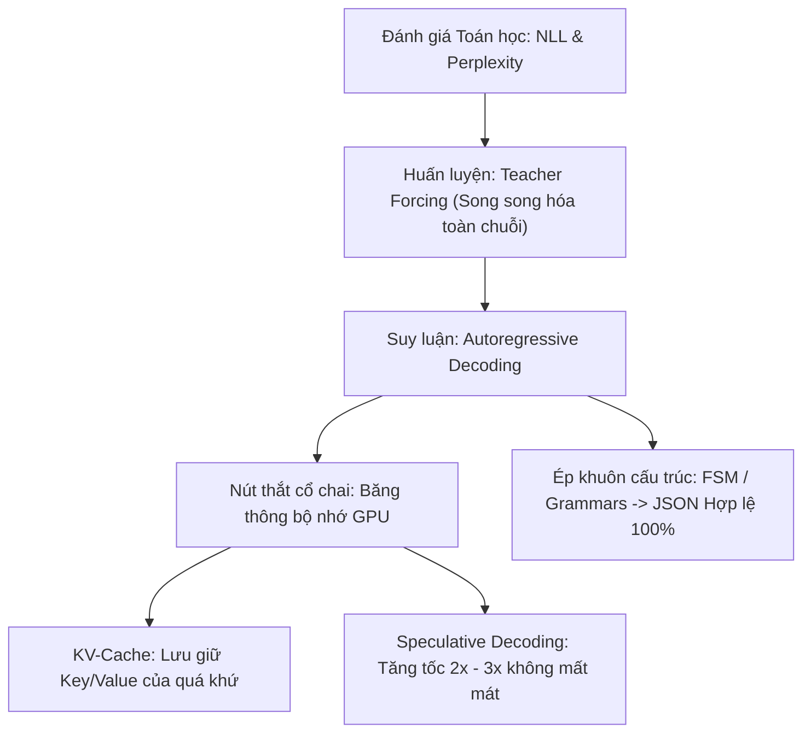
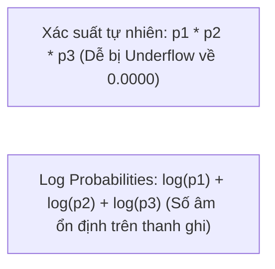
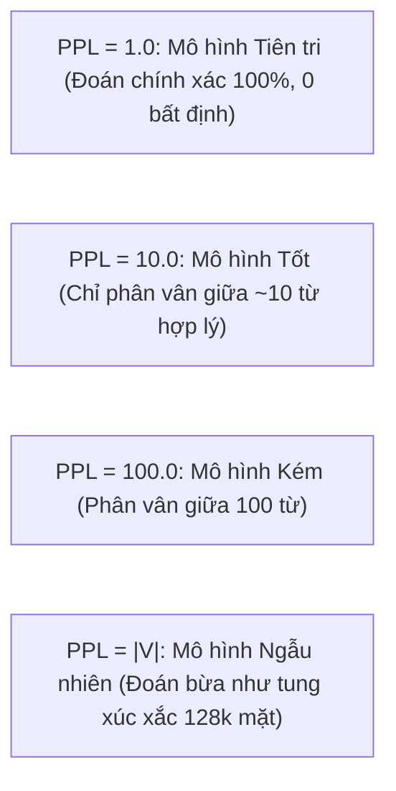
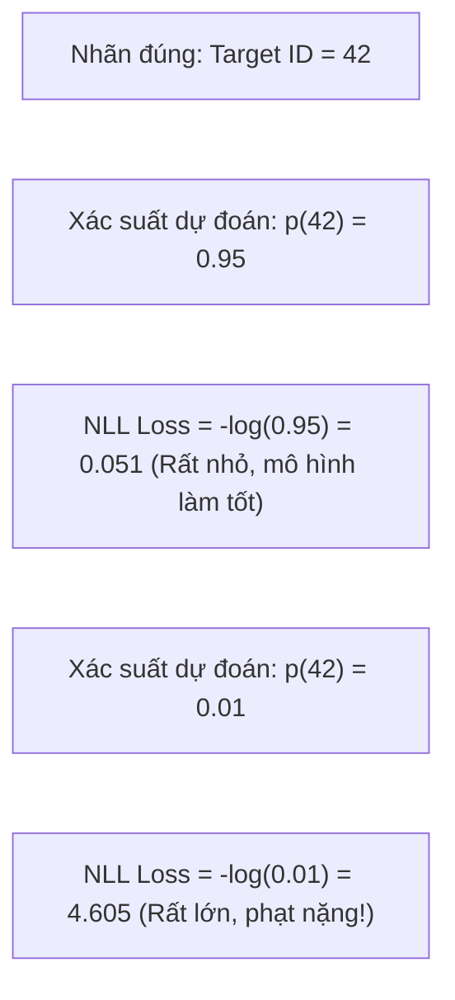
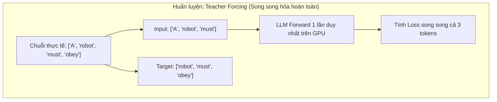
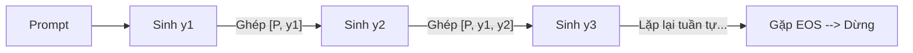
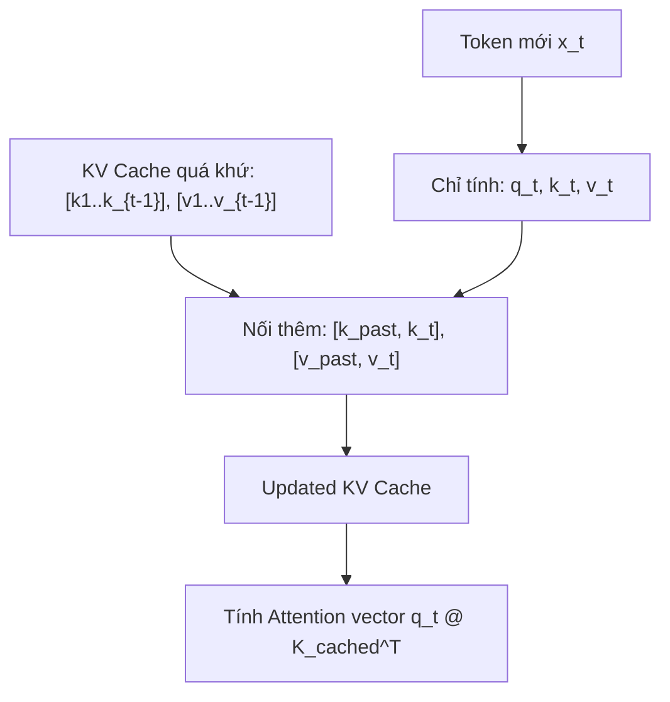
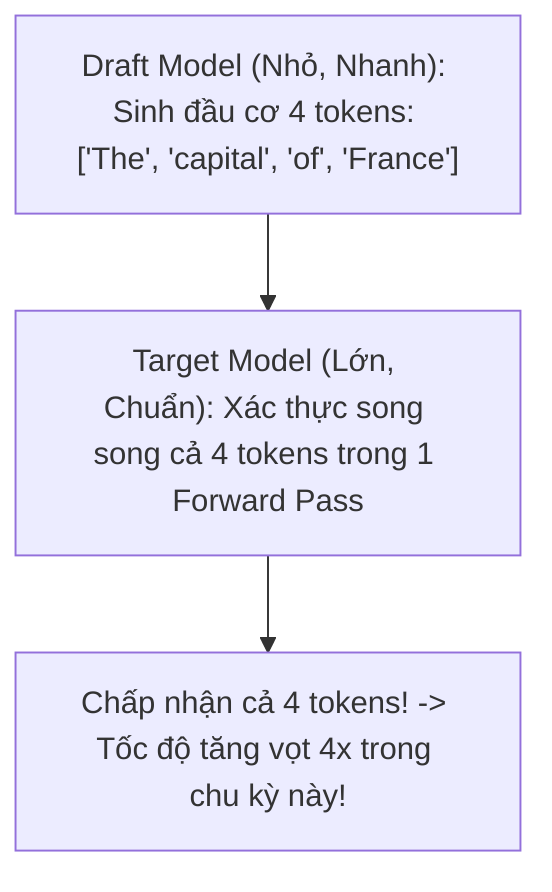
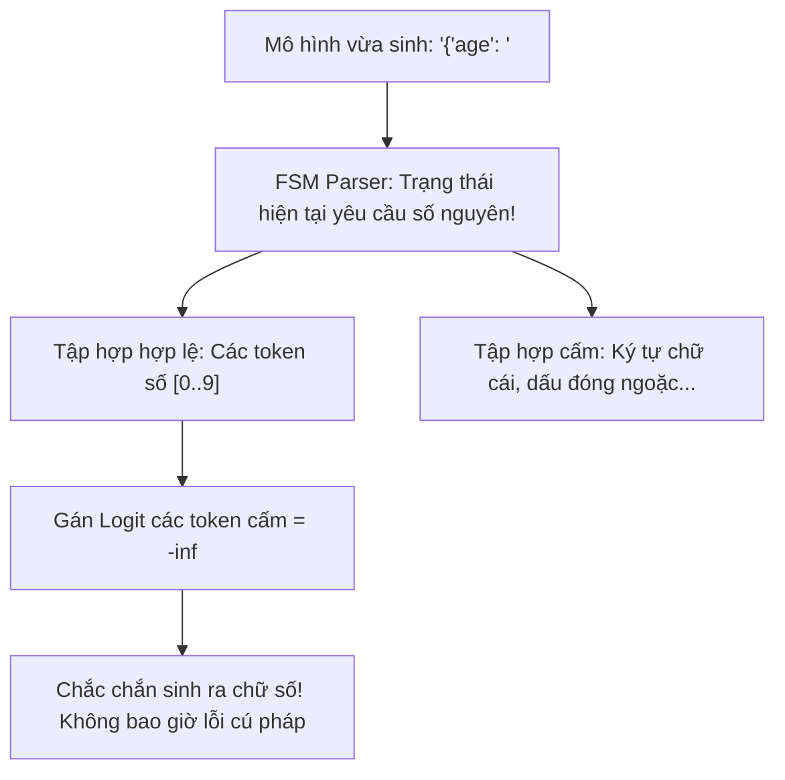
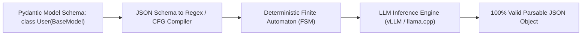

# Chuyên đề: Hàm Mất mát, Độ hỗn loạn & Tăng tốc Suy luận (Loss, Perplexity & Inference Acceleration)

## 1. Tổng quan Chuyên đề
Hiệu quả của một Mô hình Ngôn ngữ Lớn (LLM) được đo lường thông qua các chỉ số toán học lý thuyết như **Log Probabilities**, **Negative Log-Likelihood (NLL)** và **Độ hỗn loạn (Perplexity - PPL)**. Trong giai đoạn huấn luyện, phương pháp **Teacher Forcing** cho phép mô hình tiếp thu tri thức cực nhanh bằng cách song song hóa việc dự đoán trên toàn bộ chuỗi token dưới sự hướng dẫn của dữ liệu thực tế (Ground Truth).

Tuy nhiên, khi bước vào giai đoạn suy luận thực chiến trong sản phẩm, bản chất tuần tự của **Autoregressive Decoding** biến mô hình thành một hệ thống nghẽn băng thông bộ nhớ (Memory-Bandwidth-Bound). Để vượt qua rào cản vật lý này, các kỹ thuật tối ưu hóa và tăng tốc suy luận mang tính bước ngoặt đã được phát triển:
1. **KV Cache**: Lưu trữ trạng thái Key và Value trên VRAM để giảm độ phức tạp tính toán từ $\mathcal{O}(N^2)$ xuống $\mathcal{O}(N)$.
2. **Speculative Decoding (Suy luận Đầu cơ)**: Sử dụng một mô hình nhỏ (Draft Model) sinh nhanh một cụm token và dùng mô hình lớn (Target Model) để xác thực song song trong một chu kỳ xung nhịp.
3. **Constrained Decoding & Structured Output Generation**: Can thiệp trực tiếp vào Logits bằng các cấu trúc đồ thị ngữ pháp (Grammars / CFG) và máy trạng thái hữu hạn (FSM / Regex) để ép buộc mô hình sinh ra định dạng JSON/YAML chuẩn xác $100\%$.



---

## 2. Chi tiết từng Keyword

---

### 38. Log Probabilities (Xác suất Logarit)

#### a. Định nghĩa Bản chất Toán học (Mathematical Formulation)
**Log Probabilities (Log-Probs)** là giá trị logarit tự nhiên của xác suất có điều kiện được mô hình gán cho một token:
$$\log p_i = \log P(w_t = i \mid w_{<t}) = z_i - \log \left( \sum_{j=1}^{|\mathcal{V}|} \exp(z_j) \right) = \text{LogSoftmax}(\mathbf{z})_i$$
Vì xác suất $p_i \in (0, 1]$, giá trị log-prob luôn là một số âm:
$$\log p_i \in (-\infty, 0]$$
- $\log p_i = 0 \iff p_i = 1.0$ (chắc chắn tuyệt đối).
- $\log p_i \to -\infty \iff p_i \to 0.0$ (cực kỳ bất khả thi).

Tính chất cộng logarit thay cho phép nhân xác suất:
$$\log P(w_1, w_2, \dots, w_T) = \sum_{t=1}^T \log P(w_t \mid w_{<t})$$

#### b. Cơ chế Tầng Sâu & Điện toán (Under The Hood / Hardware Internals)
- **Log-Sum-Exp Trick**: Để tính toán $\log \sum_j \exp(z_j)$ mà không bị tràn số dương khi $z_j > 88.7$ hoặc tràn số âm khi $z_j < -88.7$, phần cứng luôn áp dụng công thức đồng nhất toán học:
$$\text{LSE}(\mathbf{z}) = c + \log \left( \sum_j \exp(z_j - c) \right), \quad \text{với } c = \max_k z_k$$
Phép toán này được tích hợp trực tiếp thành lệnh nội tại trong thư viện CUDA C++ (`__logf`, `__expf`).

#### c. Sơ đồ Minh họa (Mermaid / ASCII Diagram)


#### d. Code Thực chiến (Dual-Engine: C++ & Python)

```cpp
// C++17: Triển khai Log-Sum-Exp và LogSoftmax chuẩn xác
#include <iostream>
#include <vector>
#include <cmath>
#include <algorithm>

std::vector<float> compute_log_softmax(const std::vector<float>& logits) {
    std::vector<float> log_probs(logits.size());
    float max_z = *std::max_element(logits.begin(), logits.end());

    float sum_exp = 0.0f;
    for (float z : logits) {
        sum_exp += std::exp(z - max_z);
    }
    float lse = max_z + std::log(sum_exp);

    for (size_t i = 0; i < logits.size(); ++i) {
        log_probs[i] = logits[i] - lse; // log(p_i) = z_i - LSE
    }
    return log_probs;
}

int main() {
    std::vector<float> logits = {10.0f, 12.0f, 9.0f};
    auto log_probs = compute_log_softmax(logits);
    std::cout << "Log-Probs: [" << log_probs[0] << ", " << log_probs[1] << ", " << log_probs[2] << "]\n";
    std::cout << "Natural Prob for top token: " << std::exp(log_probs[1]) << "\n";
    return 0;
}
```

```python
# Python / PyTorch: Trích xuất Log-Probs của chuỗi từ OpenAI-compatible Engine
import torch
import torch.nn.functional as F

logits = torch.randn(1, 5, 1000) # [B, SeqLen, Vocab]
target_ids = torch.tensor([[10, 25, 88, 400, 12]])

log_probs_all = F.log_softmax(logits, dim=-1)
# Trích xuất log-prob của đúng target token
selected_log_probs = log_probs_all.gather(dim=-1, index=target_ids.unsqueeze(-1)).squeeze(-1)
print("Log Probabilities per token:", selected_log_probs[0].numpy())
```

#### e. Lỗi Thường gặp & Ổn định Số học (Pitfalls & Numerical Stability)
- **Tính $\log(\text{Softmax}(z))$**: Tính hàm `Softmax` trước rồi mới gọi hàm `log` sẽ gây lỗi $\log(0) = -\infty$ nếu có phần tử bị underflow về 0. Bắt buộc phải gọi trực tiếp hàm gộp `LogSoftmax`.

#### f. Ứng dụng Thực chiến trong AI / Deep Learning (AI Applications)
- Đo độ tự tin của câu trả lời trong kiểm thử thực tế, định hướng thuật toán Reinforcement Learning (PPO / DPO Policy Ratios).

---

### 39. Perplexity - PPL (Độ Hỗn loạn)

#### a. Định nghĩa Bản chất Toán học (Mathematical Formulation)
**Perplexity (PPL)** là thước đo tiêu chuẩn vàng nội tại (Intrinsic Metric) để đánh giá chất lượng của một mô hình ngôn ngữ trên một tập dữ liệu văn bản kiểm thử $W = (w_1, w_2, \dots, w_N)$.
Về mặt toán học, Perplexity là hàm lũy thừa cơ số tự nhiên của độ mất mát Cross-Entropy trung bình trên mỗi token:
$$\text{PPL}(W) = \exp\left( -\frac{1}{N} \sum_{i=1}^N \log P_\theta(w_i \mid w_{<i}) \right) = \exp\big(\mathcal{L}_{\text{CE}}\big)$$
Hoặc biểu diễn dưới dạng nghịch đảo của căn bậc $N$ xác suất chung:
$$\text{PPL}(W) = P_\theta(w_1, w_2, \dots, w_N)^{-\frac{1}{N}} = \sqrt[N]{\frac{1}{\prod_{i=1}^N P(w_i \mid w_{<i})}}$$
**Ý nghĩa trực quan thống kê**: Perplexity đại diện cho **số lượng lựa chọn tương đương nhau (Branching Factor)** mà mô hình đang phân vân tại mỗi bước đoán từ:
- Nếu $\text{PPL} = 10$: Mô hình bối rối tương đương với việc phải tung một con xúc xắc 10 mặt để chọn từ tiếp theo.
- $\text{PPL}$ càng thấp $\implies$ Mô hình càng am hiểu sâu sắc quy luật của dữ liệu và dự đoán càng chuẩn xác.

#### b. Cơ chế Tầng Sâu & Điện toán (Under The Hood / Hardware Internals)
- **Sliding-Window PPL Evaluation trên GPU**: Khi đánh giá Perplexity trên một cuốn sách dài $50{,}000$ tokens vượt quá Context Window $4096$, việc chia văn bản thành các đoạn rời rạc không chồng lấn sẽ làm mất ngữ cảnh ở các ranh giới đoạn. Người ta sử dụng kỹ thuật cửa sổ trượt (Sliding Window with Stride $\approx 512$) để đánh giá chính xác từng đoạn và lấy trung bình trượt trên GPU.

#### c. Sơ đồ Minh họa (Mermaid / ASCII Diagram)


#### d. Code Thực chiến (Dual-Engine: C++ & Python)

```cpp
// C++17: Tính toán Perplexity từ danh sách Log-Probabilities của chuỗi
#include <iostream>
#include <vector>
#include <cmath>
#include <numeric>

double calculate_perplexity(const std::vector<double>& token_log_probs) {
    if (token_log_probs.empty()) return 0.0;
    double sum_log = std::accumulate(token_log_probs.begin(), token_log_probs.end(), 0.0);
    double avg_neg_log_likelihood = -sum_log / static_cast<double>(token_log_probs.size());
    return std::exp(avg_neg_log_likelihood);
}

int main() {
    // Giả sử có 4 tokens với xác suất lần lượt là: 0.5, 0.25, 0.8, 0.1
    std::vector<double> log_probs = {std::log(0.5), std::log(0.25), std::log(0.8), std::log(0.1)};
    double ppl = calculate_perplexity(log_probs);
    std::cout << "Cross-Entropy Loss: " << -std::accumulate(log_probs.begin(), log_probs.end(), 0.0)/4.0 << " nats\n";
    std::cout << "Calculated Perplexity: " << ppl << "\n";
    return 0;
}
```

```python
# Python / PyTorch: Tính Perplexity chính thức cho mô hình Causal LM
import torch
import torch.nn.functional as F

def compute_model_perplexity(model_logits, target_token_ids):
    # model_logits: [SeqLen, Vocab], target_token_ids: [SeqLen]
    loss = F.cross_entropy(model_logits, target_token_ids)
    ppl = torch.exp(loss)
    return ppl.item()

logits = torch.randn(10, 32000)
targets = torch.randint(0, 32000, (10,))
print(f"Perplexity: {compute_model_perplexity(logits, targets):.2f}")
```

#### e. Lỗi Thường gặp & Ổn định Số học (Pitfalls & Numerical Stability)
- **So sánh PPL giữa các Tokenizer khác nhau**: Không bao giờ được so sánh Perplexity giữa hai mô hình sử dụng hai bộ Tokenizer khác nhau (ví dụ: mô hình có $|\mathcal{V}|=32\text{k}$ và mô hình có $|\mathcal{V}|=128\text{k}$). Bộ tokenizer nén từ nhiều hơn sẽ có số lượng token ít hơn, dẫn đến điểm PPL bị biến thiên sai lệch. Khắc phục: Chuẩn hóa theo Bits-Per-Byte (BPB).

#### f. Ứng dụng Thực chiến trong AI / Deep Learning (AI Applications)
- Theo dõi sự hội tụ của mô hình trong quá trình Pretraining (Loss curves monitoring), lọc dữ liệu rác trong web scraping.

---

### 40. Negative Log-Likelihood - NLL (Hàm Khả năng Log Âm)

#### a. Định nghĩa Bản chất Toán học (Mathematical Formulation)
**Negative Log-Likelihood (NLL)** là hàm mất mát cơ bản nhất trong việc tối ưu hóa các mô hình xác suất tham số $\theta$:
$$\mathcal{L}_{\text{NLL}}(\theta) = -\mathbb{E}_{\mathbf{x} \sim p_{\text{data}}} [\log p_\theta(\mathbf{x})] \approx -\frac{1}{N} \sum_{i=1}^N \log p_\theta(\mathbf{x}_i)$$
Đối với bài toán phân loại rời rạc trên từ vựng, hàm NLL chính là hàm **Cross-Entropy Loss**:
$$\mathcal{L}_{\text{NLL}} = -\sum_{k=1}^{|\mathcal{V}|} y_k \log p_k = -\log p_{\text{target}}$$
(vì vector nhãn $y$ là one-hot, chỉ có 1 vị trí mục tiêu bằng 1).
Cực tiểu hóa NLL tương đương hoàn toàn với việc tối đa hóa hàm hợp lý cực đại (MLE) và cực tiểu hóa khoảng cách Kullback-Leibler:
$$\arg\min_\theta \mathcal{L}_{\text{NLL}}(\theta) \equiv \arg\min_\theta \mathbb{D}_{\text{KL}}\Big(p_{\text{data}} \;\parallel\; p_\theta\Big)$$

#### b. Cơ chế Tầng Sâu & Điện toán (Under The Hood / Hardware Internals)
- **Fused Cross-Entropy CUDA Kernel**: Trong quá trình huấn luyện phân tán, phép tính LogSoftmax và CrossEntropy được gộp chung thành một kernel CUDA duy nhất (Fused Kernel như trong Flash-Cross-Entropy của Tri Dao hoặc Apex). Kernel này không ghi ma trận Logits đầy đủ kích thước khổng lồ $[B \times S, |\mathcal{V}|]$ lên VRAM mà chỉ tính toán trực tiếp gradient dựa trên vị trí target, tiết kiệm hàng chục GB bộ nhớ.

#### c. Sơ đồ Minh họa (Mermaid / ASCII Diagram)


#### d. Code Thực chiến (Dual-Engine: C++ & Python)

```cpp
// C++17: Hàm tính NLL Loss cho 1 mẫu duy nhất
#include <iostream>
#include <cmath>
#include <cassert>

double compute_nll_loss(double predicted_target_prob) {
    assert(predicted_target_prob > 0.0 && predicted_target_prob <= 1.0);
    return -std::log(predicted_target_prob);
}

int main() {
    std::cout << "NLL for p=0.99: " << compute_nll_loss(0.99) << " nats\n";
    std::cout << "NLL for p=0.10: " << compute_nll_loss(0.10) << " nats\n";
    std::cout << "NLL for p=0.001: " << compute_nll_loss(0.001) << " nats\n";
    return 0;
}
```

```python
# Python / PyTorch: Tính NLLLoss chính thức của PyTorch
import torch
import torch.nn as nn

nll_loss = nn.NLLLoss()
# Giả lập log-probabilities từ LogSoftmax
log_probs = torch.tensor([[-0.2, -2.5, -4.0]]) # Token 0 có prob cao nhất: exp(-0.2) ~ 0.82
target = torch.tensor([0]) # Nhãn đúng là 0

loss = nll_loss(log_probs, target)
print(f"Calculated NLL Loss: {loss.item():.4f}")
```

#### e. Lỗi Thường gặp & Ổn định Số học (Pitfalls & Numerical Stability)
- **Tràn số khi tính log(0)**: Nếu xác suất gán cho nhãn đúng bị triệt tiêu về $0.0$, $\log(0) = -\infty$, phép toán sẽ trả về giá trị mất mát `inf`, kéo theo toàn bộ gradient của batch bị biến thành `NaN`. Bắt buộc phải áp dụng Label Smoothing hoặc kẹp epsilon.

#### f. Ứng dụng Thực chiến trong AI / Deep Learning (AI Applications)
- Hàm mất mát cốt lõi của $100\%$ các thuật toán huấn luyện LLM: Pretraining, SFT, DPO.

---

### 41. Teacher Forcing (Cơ chế Dạy Kèm)

#### a. Định nghĩa Bản chất Toán học (Mathematical Formulation)
**Teacher Forcing** (Williams & Zipser, 1989) là phương pháp huấn luyện mô hình sinh tuần tự mà trong đó, tại mỗi bước thời gian $t$, đầu vào của mô hình **luôn luôn là token thật trong tập dữ liệu chuẩn (Ground-Truth Token $y_t^*)** thay vì token do chính mô hình tự dự đoán ở bước trước $\hat{y}_t$:
$$\mathbf{x}_{t+1} = y_t^* \quad (\text{Teacher Forcing})$$
trái ngược với quá trình suy luận thực tế (Free Run):
$$\mathbf{x}_{t+1} = \hat{y}_t \sim p_\theta(\cdot \mid \mathbf{x}_{\le t}) \quad (\text{Autoregressive Inference})$$
Nhờ tính chất này, quá trình huấn luyện trên toàn bộ chuỗi $T$ tokens được phân rã thành $T$ bài toán phân loại độc lập có điều kiện, cho phép **tính toán song song hoàn toàn trong 1 bước duy nhất**:
$$\mathcal{L}(\theta) = -\sum_{t=1}^T \log p_\theta(y_t^* \mid y_1^*, y_2^*, \dots, y_{t-1}^*)$$

#### b. Cơ chế Tầng Sâu & Điện toán (Under The Hood / Hardware Internals)
- **Tối đa hóa Thông lượng GPU (Maximum GPU Utilization)**: Nhờ có Teacher Forcing kết hợp với Causal Mask, toàn bộ chuỗi huấn luyện không cần phải chạy vòng lặp tuần tự `for t in range(T)`. Toàn bộ văn bản được biểu diễn thành ma trận lớn đưa vào Tensor Cores, biến tác vụ huấn luyện thành tác vụ thuần túy **Compute-Bound** đạt hiệu suất FLOPs cực đại của phần cứng.

#### c. Sơ đồ Minh họa (Mermaid / ASCII Diagram)


#### d. Code Thực chiến (Dual-Engine: C++ & Python)

```cpp
// C++17: Chuẩn bị cặp Input và Target cho Teacher Forcing từ 1 chuỗi token
#include <iostream>
#include <vector>

struct TrainingPair {
    std::vector<int> inputs;
    std::vector<int> targets;
};

TrainingPair prepare_teacher_forcing_pair(const std::vector<int>& sequence) {
    if (sequence.size() < 2) return {{}, {}};
    // Input là toàn bộ trừ token cuối
    std::vector<int> inputs(sequence.begin(), sequence.end() - 1);
    // Target là toàn bộ trừ token đầu
    std::vector<int> targets(sequence.begin() + 1, sequence.end());
    return {inputs, targets};
}

int main() {
    std::vector<int> seq = {101, 2054, 1037, 4937, 102};
    auto pair = prepare_teacher_forcing_pair(seq);
    std::cout << "Inputs size:  " << pair.inputs.size() << " [101 .. 4937]\n";
    std::cout << "Targets size: " << pair.targets.size() << " [2054 .. 102]\n";
    return 0;
}
```

```python
# Python / PyTorch: Teacher Forcing Masking trong Training Loop
import torch
import torch.nn as nn

batch_tokens = torch.tensor([[12, 45, 89, 100, 3]])
# Cắt đôi thành Input và Target
inputs = batch_tokens[:, :-1]   # [12, 45, 89, 100]
targets = batch_tokens[:, 1:]   # [45, 89, 100, 3]

print("Teacher Forcing Input Shape: ", inputs.shape)
print("Teacher Forcing Target Shape:", targets.shape)
```

#### e. Lỗi Thường gặp & Ổn định Số học (Pitfalls & Numerical Stability)
- **Thiên lệch Phơi nhiễm (Exposure Bias)**: Trong lúc học, mô hình luôn được "mớm" ngữ cảnh hoàn hảo từ ground truth. Nhưng khi suy luận thực tế, nếu mô hình tự sinh sai một từ, nó chưa từng được học cách phục hồi từ sai lầm đó, dẫn đến sai số bị khuếch đại cấp số nhân qua các bước tiếp theo.

#### f. Ứng dụng Thực chiến trong AI / Deep Learning (AI Applications)
- Cơ chế huấn luyện mặc định của toàn bộ các kiến trúc Transformer tự hồi quy, Seq2Seq, RNN/LSTM.

---

### 42. Autoregressive Decoding (Giải mã Tự hồi quy)

#### a. Định nghĩa Bản chất Toán học (Mathematical Formulation)
**Autoregressive Decoding** là quá trình suy luận sinh văn bản theo chuỗi thời gian đệ quy:
$$\mathbf{y}_t \sim p_\theta(\mathbf{y}_t \mid \mathbf{X}_{\text{prompt}}, \mathbf{y}_1, \dots, \mathbf{y}_{t-1})$$
Token được sinh ra tại bước $t$ sẽ lập tức được nối vào cuối chuỗi ngữ cảnh để trở thành một phần đầu vào cho bước $t+1$:
$$\text{Ngữ cảnh}_{t+1} = \text{Ngữ cảnh}_t \cup \{\mathbf{y}_t\}$$
Vòng lặp này tiếp tục tuần tự cho đến khi gặp token dừng `EOS` hoặc chạm ngưỡng `max_tokens`.
Độ phức tạp thời gian thuật toán:
- Nếu không có KV-Cache: $\mathcal{O}(T^2)$ phép tính Attention do phải tính lại toàn bộ lịch sử.
- Nếu có KV-Cache: $\mathcal{O}(T)$ phép tính Attention cho mỗi token mới.

#### b. Cơ chế Tầng Sâu & Điện toán (Under The Hood / Hardware Internals)
- **Nút Thắt Băng Thông Bộ Nhớ (Memory-Bandwidth Bound)**: Trong mỗi bước sinh 1 token, GPU phải nạp toàn bộ các ma trận trọng số hàng chục tỷ tham số của mô hình từ VRAM (HBM3) vào bộ nhớ đệm SRAM của chip xử lý. Tốc độ sinh token (Tokens Per Second - TPS) không bị giới hạn bởi số lượng TFLOPs của chip mà bị giới hạn bởi **Băng thông Bộ nhớ (Memory Bandwidth in GB/s)**:
$$\text{TPS}_{\max} \approx \frac{\text{Băng thông VRAM (GB/s)}}{\text{Dung lượng Mô hình (GB)}}$$
Ví dụ: Mô hình 70B FP16 nặng 140GB, chạy trên GPU có băng thông 2000 GB/s chỉ có thể đạt tối đa: $\frac{2000}{140} \approx 14.2\text{ tokens/giây}$ cho 1 luồng đơn lẻ!

#### c. Sơ đồ Minh họa (Mermaid / ASCII Diagram)


#### d. Code Thực chiến (Dual-Engine: C++ & Python)

```cpp
// C++17: Mô phỏng vòng lặp Autoregressive Decoding tuần tự
#include <iostream>
#include <vector>

class MockAutoregressiveModel {
public:
    int predict_next(const std::vector<int>& context) {
        // Giả lập logic sinh: sinh tuần tự 101, 102, 103...
        return 100 + static_cast<int>(context.size());
    }
};

int main() {
    MockAutoregressiveModel model;
    std::vector<int> sequence = {1, 2}; // Prompt
    size_t steps = 3;

    std::cout << "Prompt tokens: ";
    for (int t : sequence) std::cout << t << " ";
    std::cout << "\n--- Autoregressive Decoding Loop ---\n";

    for (size_t i = 0; i < steps; ++i) {
        int next_token = model.predict_next(sequence);
        sequence.push_back(next_token); // Đưa trở lại làm đầu vào
        std::cout << "Step " << i + 1 << ": Generated token " << next_token << "\n";
    }
    return 0;
}
```

```python
# Python / PyTorch: Vòng lặp Autoregressive Generation thuần túy
import torch

def mock_autoregressive_generate(model, prompt_ids, max_new_tokens=4):
    generated = prompt_ids.clone()
    for step in range(max_new_tokens):
        # Forward toàn bộ chuỗi hiện tại
        logits = model(generated)
        # Lấy logit của vị trí cuối cùng
        next_token_logits = logits[:, -1, :]
        next_token = torch.argmax(next_token_logits, dim=-1, keepdim=True)
        # Nối vào chuỗi ngữ cảnh
        generated = torch.cat([generated, next_token], dim=1)
    return generated

dummy_model = lambda x: torch.randn(x.shape[0], x.shape[1], 100) # [B, S, Vocab]
prompt = torch.tensor([[5, 8, 12]])
output = mock_autoregressive_generate(dummy_model, prompt)
print(f"Generated sequence length: {output.shape[1]}")
```

#### e. Lỗi Thường gặp & Ổn định Số học (Pitfalls & Numerical Stability)
- **Tái tính toán lãng phí (Recomputing Past Keys)**: Nếu quên sử dụng KV-Cache, mỗi bước $t$ mô hình sẽ phải tính toán lại ma trận $Q, K, V$ của tất cả các token từ $1$ đến $t-1$, khiến thời gian sinh bùng nổ bậc hai $\mathcal{O}(T^2)$.

#### f. Ứng dụng Thực chiến trong AI / Deep Learning (AI Applications)
- Cơ chế suy luận của toàn bộ dòng họ GPT, LLaMA, Claude, Gemini, DeepSeek.

---

### 43. KV Cache (Bộ đệm Khóa - Giá trị)

#### a. Định nghĩa Bản chất Toán học (Mathematical Formulation)
**KV Cache** là kỹ thuật tối ưu hóa bộ nhớ cốt tử trong suy luận Transformer tự hồi quy.
Tại bước sinh thứ $t$, ma trận Self-Attention cần tính:
$$\mathbf{A}_t = \text{softmax}\left(\frac{\mathbf{q}_t \mathbf{K}_{\le t}^T}{\sqrt{d_k}}\right) \mathbf{V}_{\le t}$$
Trong đó:
- $\mathbf{q}_t \in \mathbb{R}^{1 \times d_k}$ là Query duy nhất của token hiện tại.
- $\mathbf{K}_{\le t} = [\mathbf{k}_1, \dots, \mathbf{k}_{t-1}, \mathbf{k}_t] \in \mathbb{R}^{t \times d_k}$ là tập hợp Keys của toàn bộ quá khứ.
- $\mathbf{V}_{\le t} = [\mathbf{v}_1, \dots, \mathbf{v}_{t-1}, \mathbf{v}_t] \in \mathbb{R}^{t \times d_k}$ là tập hợp Values của toàn bộ quá khứ.

Nhận xét toán học: Các vector $\mathbf{k}_1, \dots, \mathbf{k}_{t-1}$ và $\mathbf{v}_1, \dots, \mathbf{v}_{t-1}$ của các token cũ hoàn toàn không đổi qua các bước thời gian.
Do đó, thay vì tính lại chúng, ta **lưu trữ chúng trên VRAM thành KV Cache**. Tại mỗi bước $t$, mô hình chỉ cần:
1. Tính toán duy nhất một bộ vector mới: $(\mathbf{q}_t, \mathbf{k}_t, \mathbf{v}_t)$ cho token hiện tại.
2. Ghi thêm $\mathbf{k}_t$ và $\mathbf{v}_t$ vào cuối bộ nhớ đệm KV Cache.
3. Nhân $\mathbf{q}_t$ với ma trận Cache $\mathbf{K}_{\le t}$ và $\mathbf{V}_{\le t}$.

Độ phức tạp tính toán cho mỗi token giảm từ $\mathcal{O}(t \cdot d)$ xuống $\mathcal{O}(d)$ cho bước trích xuất đặc trưng.

#### b. Cơ chế Tầng Sâu & Điện toán (Under The Hood / Hardware Internals)
- **PagedAttention (vLLM Architecture)**: Trong quản trị bộ nhớ truyền thống, KV Cache đòi hỏi cấp phát các vùng nhớ liên tục (Contiguous Memory Buffers). Điều này gây phân mảnh bộ nhớ VRAM nghiêm trọng (lãng phí tới $60\% - 80\%$ VRAM). Thuật toán **PagedAttention** (Kwon et al., SOSP 2023) mô phỏng cơ chế Phân trang Bộ nhớ Ảo (Virtual Memory Paging) của Hệ Điều Hành: chia nhỏ KV Cache thành các khối trang nhớ (Blocks/Pages 16 tokens) nằm rải rác trên VRAM và dùng bảng trang (Page Table) để ánh xạ, cho phép phục vụ hàng trăm người dùng đồng thời (High Batching Concurrency).

#### c. Sơ đồ Minh họa (Mermaid / ASCII Diagram)


#### d. Code Thực chiến (Dual-Engine: C++ & Python)

```cpp
// C++17: Bộ đệm động KV-Cache tối ưu cho 1 Attention Head
#include <iostream>
#include <vector>

class SingleHeadKVCache {
private:
    std::vector<float> k_cache_;
    std::vector<float> v_cache_;
    size_t head_dim_;

public:
    explicit SingleHeadKVCache(size_t head_dim) : head_dim_(head_dim) {}

    void append(const std::vector<float>& k_new, const std::vector<float>& v_new) {
        k_cache_.insert(k_cache_.end(), k_new.begin(), k_new.end());
        v_cache_.insert(v_cache_.end(), v_new.begin(), v_new.end());
    }

    size_t current_seq_len() const {
        return k_cache_.size() / head_dim_;
    }

    const float* get_k_ptr() const { return k_cache_.data(); }
    const float* get_v_ptr() const { return v_cache_.data(); }
};

int main() {
    SingleHeadKVCache cache(4); // head_dim = 4
    cache.append({0.1f, 0.2f, 0.3f, 0.4f}, {1.0f, 1.1f, 1.2f, 1.3f});
    cache.append({0.5f, 0.6f, 0.7f, 0.8f}, {2.0f, 2.1f, 2.2f, 2.3f});

    std::cout << "Stored tokens in KV Cache: " << cache.current_seq_len() << "\n";
    return 0;
}
```

```python
# Python / PyTorch: Mô phỏng cơ chế cập nhật KV-Cache trong Decoder Layer
import torch
import torch.nn as nn

def attention_with_kv_cache(q_t, k_t, v_t, past_kv=None):
    # q_t, k_t, v_t: [B, 1, Dim]
    if past_kv is not None:
        past_k, past_v = past_kv
        # Nối vector mới vào cuối Cache
        k_full = torch.cat([past_k, k_t], dim=1)
        v_full = torch.cat([past_v, v_t], dim=1)
    else:
        k_full, v_full = k_t, v_t

    # Tính Attention cho duy nhất token hiện tại: [B, 1, SeqLen]
    scores = torch.matmul(q_t, k_full.transpose(-1, -2)) / (q_t.shape[-1] ** 0.5)
    attn_weights = torch.softmax(scores, dim=-1)
    out = torch.matmul(attn_weights, v_full)
    
    return out, (k_full, v_full)

q_new = torch.randn(1, 1, 64)
k_new = torch.randn(1, 1, 64)
v_new = torch.randn(1, 1, 64)
out, current_kv = attention_with_kv_cache(q_new, k_new, v_new, past_kv=None)
print(f"Step 1 Output shape: {out.shape}, Cache SeqLen: {current_kv[0].shape[1]}")
```

#### e. Lỗi Thường gặp & Ổn định Số học (Pitfalls & Numerical Stability)
- **Cạn kiệt VRAM do rò rỉ KV Cache (KV Cache OOM)**: Nếu không giải phóng hoặc tái sử dụng vùng đệm KV Cache sau khi phiên gọi kết thúc, máy chủ sẽ nhanh chóng sập vì hết bộ nhớ GPU khi xử lý tải cao.

#### f. Ứng dụng Thực chiến trong AI / Deep Learning (AI Applications)
- Linh hồn của các engine suy luận tốc độ cao: vLLM, TensorRT-LLM, TGI, SGLang, llama.cpp.

---

### 44. Speculative Decoding (Suy luận Đầu cơ)

#### a. Định nghĩa Bản chất Toán học (Mathematical Formulation)
**Speculative Decoding** (Leviathan et al., Chen et al., 2023) là kỹ thuật đột phá giúp tăng tốc độ suy luận LLM từ $2\times$ đến $3\times$ mà **hoàn toàn không làm suy giảm chất lượng đầu ra** (Lossless Acceleration).
Ý tưởng cốt lõi:
1. Sử dụng một mô hình nhỏ gọn, tốc độ cực nhanh (gọi là **Draft Model** $M_q$, ví dụ LLaMA-3-8B) để suy luận tự hồi quy đầu cơ $K$ tokens liên tiếp:
$$\tilde{x}_1, \tilde{x}_2, \dots, \tilde{x}_K \sim q(\cdot)$$
2. Đưa toàn bộ $K$ tokens này vào mô hình mục tiêu lớn, chất lượng cao (gọi là **Target Model** $M_p$, ví dụ LLaMA-3-70B) để chạy **một lượt Forward Pass song song duy nhất**.
3. Thuật toán **Chấp nhận / Bác bỏ có Điều chỉnh (Modified Rejection Sampling)**:
Tại mỗi vị trí $i \in \{1, \dots, K\}$, token $\tilde{x}_i$ được chấp nhận với xác suất:
$$\alpha = \min\left(1, \frac{p(\tilde{x}_i)}{q(\tilde{x}_i)}\right)$$
- Nếu được chấp nhận: Giữ lại token và kiểm tra tiếp vị trí $i+1$.
- Nếu bị từ chối tại vị trí $j$: Bác bỏ toàn bộ các token từ $j$ đến $K$, lấy mẫu lại một token thay thế từ phân phối hiệu chỉnh:
$$p' = \text{normalize}\big(\max(0, p(x) - q(x))\big)$$
và kết thúc chu kỳ.

**Định lý Toán học**: Phân phối xác suất của chuỗi sinh cuối cùng được chứng minh **trùng khớp $100\%$** với phân phối xác suất gốc của Target Model $M_p$.

#### b. Cơ chế Tầng Sâu & Điện toán (Under The Hood / Hardware Internals)
- **Biến tác vụ Memory-Bound thành Compute-Bound**: Thay vì chạy $K$ lượt truy xuất VRAM cho $K$ tokens trên mô hình lớn 70B, hệ thống chỉ chạy 1 lượt truy xuất duy nhất để kiểm tra đồng thời $K$ tokens. Lợi dụng năng lực tính toán còn dư thừa của Tensor Cores để kiểm tra song song, tiết kiệm thời gian nạp trọng số từ HBM.

#### c. Sơ đồ Minh họa (Mermaid / ASCII Diagram)


#### d. Code Thực chiến (Dual-Engine: C++ & Python)

```cpp
// C++17: Thuật toán Rejection Sampling trong Speculative Decoding
#include <iostream>
#include <random>
#include <algorithm>

bool evaluate_speculative_acceptance(float p_target, float q_draft, std::mt19937& rng) {
    if (p_target >= q_draft) return true; // Luôn chấp nhận nếu Target tự tin hơn
    float alpha = p_target / q_draft;
    std::uniform_real_distribution<float> dist(0.0f, 1.0f);
    return dist(rng) < alpha;
}

int main() {
    std::mt19937 rng(42);
    // Draft đoán xác suất 0.6, Target gán xác suất 0.5
    bool accepted = evaluate_speculative_acceptance(0.5f, 0.6f, rng);
    std::cout << "Speculative token accepted: " << (accepted ? "YES" : "NO") << "\n";
    return 0;
}
```

```python
# Python / PyTorch: Thuật toán Speculative Decoding Logic
import torch

def speculative_step(p_probs, q_probs, draft_tokens):
    # p_probs, q_probs: [K, Vocab]
    accepted_tokens = []
    for i, token in enumerate(draft_tokens):
        p = p_probs[i, token].item()
        q = q_probs[i, token].item()
        r = torch.rand(1).item()
        if r < min(1.0, p / q):
            accepted_tokens.append(token)
        else:
            # Bị từ chối -> Lấy mẫu token thay thế
            res_prob = torch.clamp(p_probs[i] - q_probs[i], min=0.0)
            res_prob /= res_prob.sum()
            correct_token = torch.multinomial(res_prob, 1).item()
            accepted_tokens.append(correct_token)
            break
    return accepted_tokens

print("Speculative Verification Step defined successfully.")
```

#### e. Lỗi Thường gặp & Ổn định Số học (Pitfalls & Numerical Stability)
- **Tỷ lệ chấp nhận thấp (Low Acceptance Rate)**: Nếu Draft Model có phong cách từ vựng quá khác biệt so với Target Model, tỷ lệ chấp nhận $\alpha$ tụt xuống dưới $30\%$, khiến chi phí chạy Draft Model trở thành gánh nặng làm suy luận bị chậm hơn so với giải mã thông thường.

#### f. Ứng dụng Thực chiến trong AI / Deep Learning (AI Applications)
- Tăng tốc suy luận trong vLLM, Medusa, Apple Intelligence trên chip M-series.

---

### 45. Constrained Decoding (Giải mã Có Ràng buộc)

#### a. Định nghĩa Bản chất Toán học (Mathematical Formulation)
**Constrained Decoding** là kỹ thuật can thiệp vào quá trình giải mã nhằm ép buộc chuỗi đầu ra phải thỏa mãn một tập hợp các quy tắc định thức (Deterministic Constraints) hoặc ngữ pháp hình thức $\mathcal{G}$.
Tại mỗi bước thời gian $t$, dựa trên trạng thái của máy phân tích cú pháp (Parser State), thuật toán xác định tập hợp các token hợp lệ được phép xuất hiện tiếp theo:
$$\mathcal{V}_{\text{valid}}^{(t)} \subset \mathcal{V}$$
Vector Logits được điều chỉnh thông qua một mặt nạ ràng buộc (Constraint Mask):
$$z_i' = \begin{cases} z_i & \text{nếu } i \in \mathcal{V}_{\text{valid}}^{(t)} \\ -\infty & \text{nếu } i \notin \mathcal{V}_{\text{valid}}^{(t)} \end{cases}$$
Hàm Softmax tính trên $z_i'$ sẽ gán xác suất bằng 0 tuyệt đối cho mọi token vi phạm cú pháp:
$$P(w_{t+1} \notin \mathcal{V}_{\text{valid}}^{(t)}) \equiv 0$$
Đảm bảo chuỗi sinh ra tuân thủ chính xác $100\%$ các cấu trúc logic mà không bao giờ bị lỗi cú pháp.

#### b. Cơ chế Tầng Sâu & Điện toán (Under The Hood / Hardware Internals)
- **Biên dịch Ngữ pháp thành Máy trạng thái FSM (Grammar-to-FSM Compilation)**: Việc phân tích cú pháp phức tạp bằng Python ở mỗi bước sinh sẽ làm giảm tốc độ suy luận. Các thư viện hiện đại (như Outlines, Guidance, llama.cpp Grammars) biên dịch trước ngữ pháp hoặc biểu thức chính quy (Regex) thành một **Máy Trạng thái Hữu hạn Xác định (DFA / FSM)** viết bằng C++/Rust. Thao tác tìm $\mathcal{V}_{\text{valid}}$ chỉ đơn giản là tra cứu bảng chuyển trạng thái trong $\mathcal{O}(1)$ chu kỳ máy.

#### c. Sơ đồ Minh họa (Mermaid / ASCII Diagram)


#### d. Code Thực chiến (Dual-Engine: C++ & Python)

```cpp
// C++17: Áp dụng Constraint Masking lên vector Logits
#include <iostream>
#include <vector>
#include <unordered_set>
#include <limits>

void apply_constraint_mask(
    std::vector<float>& logits, 
    const std::unordered_set<int>& valid_token_ids) 
{
    const float neg_inf = -std::numeric_limits<float>::infinity();
    for (size_t i = 0; i < logits.size(); ++i) {
        if (valid_token_ids.find(static_cast<int>(i)) == valid_token_ids.end()) {
            logits[i] = neg_inf;
        }
    }
}

int main() {
    std::vector<float> logits = {2.5f, 4.0f, 1.8f, 5.2f};
    std::unordered_set<int> valid_ids = {0, 2}; // Chỉ cho phép token 0 và 2
    apply_constraint_mask(logits, valid_ids);

    std::cout << "Masked Logits: ";
    for (float z : logits) std::cout << z << " ";
    std::cout << "\n";
    return 0;
}
```

```python
# Python / Outlines Framework: Định nghĩa cấu trúc sinh bằng Regex Constraint
import re

# Minh họa nguyên lý: Chỉ cho phép sinh chuỗi thỏa mãn định dạng Số điện thoại
valid_first_chars = [str(d) for d in range(10)] + ["+"]
print(f"Tokens allowed at start of phone number: {valid_first_chars}")
```

#### e. Lỗi Thường gặp & Ổn định Số học (Pitfalls & Numerical Stability)
- **Tập hợp hợp lệ rỗng (Deadlock State)**: Nếu ngữ pháp bị mâu thuẫn hoặc từ điển không có token nào tương ứng với trạng thái tiếp theo của FSM, $\mathcal{V}_{\text{valid}} = \emptyset$, tất cả logits đều bằng $-\infty$, gây sụp đổ hàm Softmax.

#### f. Ứng dụng Thực chiến trong AI / Deep Learning (AI Applications)
- Sinh mã SQL hợp lệ theo đúng lược đồ cơ sở dữ liệu, sinh code tuân thủ ngữ pháp Abstract Syntax Tree (AST), trích xuất thông tin có cấu trúc.

---

### 46. Structured Output Generation (Sinh Dữ liệu Có Cấu trúc)

#### a. Định nghĩa Bản chất Toán học (Mathematical Formulation)
**Structured Output Generation** là trường hợp ứng dụng thực tế quan trọng nhất của Constrained Decoding, trong đó mô hình ngôn ngữ lớn được bảo đảm về mặt toán học rằng văn bản sinh ra luôn khớp hoàn hảo với một lược đồ hình thức (Formal Schema $\mathcal{S}$), phổ biến nhất là **JSON Schema** hoặc **Pydantic Model**:
$$\mathbf{Y} \in \mathcal{L}(\mathcal{S})$$
với $\mathcal{L}(\mathcal{S})$ là tập hợp tất cả các chuỗi hợp lệ theo schema $\mathcal{S}$.
Ví dụ, nếu Schema yêu cầu:
```json
{"name": string, "age": integer, "skills": array[string]}
```
Mô hình sẽ không thể sinh ra bất kỳ ký tự nào làm sai cấu trúc dấu ngoặc `{`, dấu hai chấm `:`, dấu phẩy `,` hay kiểu dữ liệu của từng trường.
Các bước thực hiện:
1. Chuyển đổi JSON Schema thành Biểu thức Chính quy (Regex) hoặc Ngữ pháp Phi ngữ cảnh (Context-Free Grammar - CFG).
2. Xây dựng FSM để điều hướng Masking Logits tại từng bước token.

#### b. Cơ chế Tầng Sâu & Điện toán (Under The Hood / Hardware Internals)
- **Khử bỏ Chi phí Gọi lại API (Zero-Retry Guarantee)**: Trong các hệ thống thông thường, nếu LLM trả về JSON bị thiếu dấu ngoặc nhọn `}` hoặc lỗi kiểu dữ liệu, hệ thống backend phải gọi lại API (Retry), làm tăng gấp đôi chi phí và độ trễ. Structured Output giải quyết triệt để vấn đề này ở mức tầng tính toán CUDA kernel, mang lại độ tin cậy $100\%$ cho hệ thống Enterprise.

#### c. Sơ đồ Minh họa (Mermaid / ASCII Diagram)


#### d. Code Thực chiến (Dual-Engine: C++ & Python)

```cpp
// C++17: Máy trạng thái FSM đơn giản ép cấu trúc JSON {"key": number}
#include <iostream>
#include <string>
#include <vector>

enum class JsonFsmState { START, AFTER_BRACE, IN_KEY, AFTER_KEY, IN_VALUE, END };

struct JsonStateMachine {
    JsonFsmState current_state = JsonFsmState::START;

    bool step(char c) {
        switch (current_state) {
            case JsonFsmState::START:
                if (c == '{') { current_state = JsonFsmState::AFTER_BRACE; return true; }
                return false;
            case JsonFsmState::AFTER_BRACE:
                if (c == '\"') { current_state = JsonFsmState::IN_KEY; return true; }
                return false;
            case JsonFsmState::IN_KEY:
                if (c == '\"') { current_state = JsonFsmState::AFTER_KEY; return true; }
                return true; // Chấp nhận ký tự trong key
            case JsonFsmState::AFTER_KEY:
                if (c == ':') { current_state = JsonFsmState::IN_VALUE; return true; }
                return false;
            case JsonFsmState::IN_VALUE:
                if (c >= '0' && c <= '9') return true;
                if (c == '}') { current_state = JsonFsmState::END; return true; }
                return false;
            case JsonFsmState::END:
                return false;
        }
        return false;
    }
};

int main() {
    JsonStateMachine fsm;
    std::string json_str = "{\"id\":42}";
    bool valid = true;
    for (char c : json_str) {
        if (!fsm.step(c)) { valid = false; break; }
    }
    std::cout << "JSON String \"" << json_str << "\" is valid under FSM: " << (valid ? "YES" : "NO") << "\n";
    return 0;
}
```

```python
# Python / Pydantic: Định nghĩa Schema cho OpenAI Structured Outputs
from pydantic import BaseModel
from typing import List

class UserProfile(BaseModel):
    name: str
    age: int
    programming_languages: List[str]

# Lấy cấu trúc JSON Schema chuẩn tắc
json_schema = UserProfile.model_json_schema()
print("Generated JSON Schema for Structured Generation:")
print(json_schema["properties"])
```

#### e. Lỗi Thường gặp & Ổn định Số học (Pitfalls & Numerical Stability)
- **Hiện tượng suy giảm năng lực tư duy khi bị ép khuôn quá sớm**: Nếu ép mô hình sinh ngay lập tức vào cấu trúc JSON ngắn gọn mà không cho nó không gian để "suy nghĩ" (Scratchpad / Reasoning tokens), chất lượng logic của nội dung bên trong các trường JSON có thể bị giảm sút. Khắc phục: Cho phép sinh một trường `"reasoning": string` trước khi đưa ra các trường dữ liệu kết luận.

#### f. Ứng dụng Thực chiến trong AI / Deep Learning (AI Applications)
- Function Calling / Tool Use trong AI Agents, tích hợp dữ liệu AI an toàn vào hệ thống cơ sở dữ liệu Backend Production.
