# Chuyên đề: Kỹ nghệ Ngữ liệu, Chất lượng Dữ liệu & Giáo trình Tiền Huấn luyện (Corpus Engineering, Data Quality & Pretraining Curriculum)

## 1. Tổng quan Chuyên đề
Trong Kỷ nguyên Mô hình Ngôn ngữ Lớn, một tiên đề kỹ thuật đã được khẳng định: *"Chất lượng của một Foundation Model được định đoạt bởi chất lượng dữ liệu tiền huấn luyện trước khi nó được định đoạt bởi kiến trúc mạng."* Quá trình **Tiền Huấn luyện (Pretraining)** trên quy mô hàng nghìn tỷ tokens (Trillion-Token Scale) tiêu tốn hàng triệu USD điện toán và hàng tháng tính toán liên tục trên các cụm siêu máy tính hàng chục nghìn GPU liên kết qua mạng InfiniBand.

Để đảm bảo hiệu quả của nguồn vốn đầu tư khổng lồ này, **Kỹ nghệ Ngữ liệu (Corpus Engineering)** đã trở thành một ngành khoa học độc lập khắt khe:
1. **Thu thập & Tinh lọc Dữ liệu (Collection, Cleaning & Filtering)**: Thu thập hàng Petabyte dữ liệu từ Common Crawl, Wikipedia, GitHub, ArXiv, sau đó áp dụng các thuật toán lọc ngôn ngữ, loại bỏ nội dung độc hại (NSFW/Toxicity), và lọc văn phong dựa trên điểm số Perplexity.
2. **Khử trùng lặp Cực độ (Deduplication)**: Sử dụng các thuật toán băm nhạy cảm vị trí (MinHash, LSH, Suffix Arrays) để loại bỏ hàng tỷ tài liệu trùng lặp hoàn toàn hoặc gần giống nhau, ngăn chặn hiện tượng học vẹt và ghi nhớ dữ liệu.
3. **Phối trộn & Giáo trình Học tập (Data Mixture, Sampling & Curriculum)**: Cân bằng tỷ lệ vàng giữa các miền tri thức (Web, Code, Math, Academic) và điều phối thứ tự nạp dữ liệu theo giáo trình từ cơ bản đến chuyên sâu, tích hợp **Dữ liệu Tổng hợp (Synthetic Data)** chất lượng cao từ các mô hình tiên tiến.

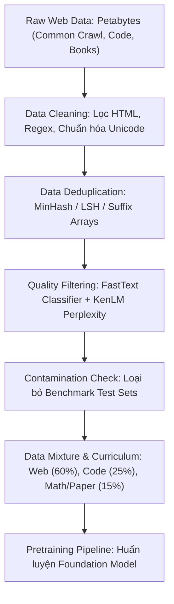

---

## 2. Chi tiết từng Keyword

---

### 1. Pretraining (Tiền Huấn luyện)

#### a. Định nghĩa Bản chất Toán học (Mathematical Formulation)
**Pretraining** là giai đoạn huấn luyện nền tảng đầu tiên và tốn kém tài nguyên tính toán nhất trong vòng đời của LLM. Mô hình được khởi tạo với các trọng số ngẫu nhiên $\theta_0$ và được tối ưu hóa trên một kho ngữ liệu khổng lồ không gắn nhãn $\mathcal{D}_{\text{pretrain}} = \{\mathbf{x}^{(1)}, \mathbf{x}^{(2)}, \dots, \mathbf{x}^{(N)}\}$ (với $N \approx 10^{12} - 10^{13}$ tokens) thông qua mục tiêu Next Token Prediction:
$$\theta^* = \arg\min_\theta \sum_{\mathbf{x} \in \mathcal{D}_{\text{pretrain}}} \sum_{t=1}^{|\mathbf{x}|} -\log p_\theta(x_t \mid x_{<t})$$
Mục đích là nén toàn bộ các cấu trúc ngữ pháp, tri thức bách khoa thế giới, lý luận logic và khả năng biểu diễn toán học vào không gian trọng số của mạng nơ-ron sâu.

#### b. Cơ chế Tầng Sâu & Điện toán (Under The Hood / Hardware Internals)
- **Cụm Siêu Máy tính Phân tán (Supercomputing Scale)**: Quá trình Pretraining các mô hình như LLaMA-3-405B tiêu tốn hơn $3.8 \times 10^{25}$ FLOPs, chạy liên tục trên $16{,}384$ GPU NVIDIA H100 kết nối qua mạng InfiniBand Quantum-2 ($3.2\text{ Tbps}$ mỗi node). Hệ thống đòi hỏi cơ chế đồng bộ hóa checkpoint tự động để chịu lỗi (Fault Tolerance) khi có GPU bị hỏng phần cứng giữa chừng.

#### c. Sơ đồ Minh họa (Mermaid / ASCII Diagram)
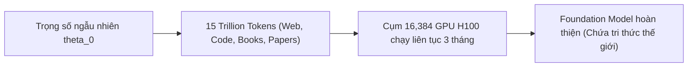

#### d. Code Thực chiến (Dual-Engine: C++ & Python)

```cpp
// C++17: Tính toán ngân sách FLOPs lý thuyết cho Pretraining theo quy tắc Kaplan
#include <iostream>

double calculate_pretraining_flops(double num_params_billions, double num_tokens_trillions) {
    // Quy tắc xấp xỉ kinh điển: FLOPs ≈ 6 * N * D
    double N = num_params_billions * 1e9;
    double D = num_tokens_trillions * 1e12;
    return 6.0 * N * D;
}

int main() {
    // LLaMA-3-8B huấn luyện trên 15 Trillion tokens
    double flops = calculate_pretraining_flops(8.0, 15.0);
    std::cout << "LLaMA-3-8B Pretraining Budget: " << flops / 1e24 << " YottaFLOPs (10^24)\n";
    return 0;
}
```

```python
# Python / PyTorch: Khung vòng lặp Pretraining tiêu chuẩn với Gradient Accumulation
import torch
import torch.nn as nn

def pretraining_step(model, optimizer, batch_tokens, grad_accum_steps=4):
    inputs = batch_tokens[:, :-1]
    targets = batch_tokens[:, 1:]
    
    logits = model(inputs)
    loss = nn.functional.cross_entropy(logits.reshape(-1, logits.size(-1)), targets.reshape(-1))
    loss = loss / grad_accum_steps # Chuẩn hóa theo số bước tích lũy
    loss.backward()
    
    return loss.item() * grad_accum_steps

print("Pretraining Step execution logic defined.")
```

#### e. Lỗi Thường gặp & Ổn định Số học (Pitfalls & Numerical Stability)
- **Mất mát Phân kỳ Đột ngột (Loss Spikes)**: Giữa quá trình Pretraining sau nhiều tuần chạy êm ả, hàm Loss bỗng nhiên nhảy vọt từ $1.8$ lên $10.0$ hoặc biến thành `NaN` do một batch dữ liệu bẩn hoặc một GPU bị lỗi bộ nhớ bit-flip.

#### f. Ứng dụng Thực chiến trong AI / Deep Learning (AI Applications)
- Bước khởi nguyên sinh ra GPT-4 base, LLaMA-3 base, Mistral base, DeepSeek-V3 base.

---

### 2. Foundation Models (Mô hình Nền tảng)

#### a. Định nghĩa Bản chất Toán học (Mathematical Formulation)
**Foundation Models** (thuật ngữ do Viện HAI Đại học Stanford khởi xướng, Bommasani et al., 2021) là các mô hình nơ-ron quy mô khổng lồ được huấn luyện trên dữ liệu đa dạng quy mô lớn bằng phương pháp tự giám sát (Self-Supervision), có khả năng thích ứng linh hoạt (Adaptability) với hàng loạt tác vụ hạ nguồn khác nhau:
$$M_{\text{foundation}}: \mathcal{X} \to \mathcal{H}$$
Trong đó $\mathcal{H}$ là không gian biểu diễn tri thức vạn năng. Với cùng một mô hình $M_{\text{foundation}}$, ta có thể điều chỉnh nhẹ (Adaptation) thông qua Prompting, In-Context Learning hoặc Fine-Tuning để giải quyết: dịch thuật, phân tích cảm xúc, lập trình, tóm tắt, giải toán, và điều khiển robot:
$$\text{Task}_k(\mathbf{x}) = g_k\big(M_{\text{foundation}}(\mathbf{x})\big)$$

#### b. Cơ chế Tầng Sâu & Điện toán (Under The Hood / Hardware Internals)
- **Tính Chuyển giao Tri thức (Cross-Domain Transferability)**: Bằng cách chia sẻ chung toàn bộ các tầng Transformer sâu, tri thức ngữ pháp từ tiếng Anh hỗ trợ mô hình học cú pháp ngôn ngữ lập trình Python; logic toán học hỗ trợ khả năng suy luận pháp lý mà không cần xây dựng các mô hình chuyên biệt riêng lẻ.

#### c. Sơ đồ Minh họa (Mermaid / ASCII Diagram)
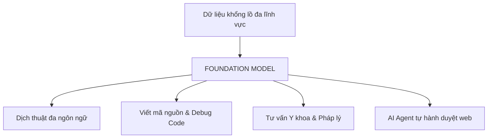

#### d. Code Thực chiến (Dual-Engine: C++ & Python)

```cpp
// C++17: Mô hình hóa cấu trúc Task Adapter gắn trên Foundation Model
#include <iostream>
#include <string>
#include <memory>

class FoundationModelCore {
public:
    std::string encode(const std::string& input) const {
        return "Universal_Representation(" + input + ")";
    }
};

class DownstreamTaskAdapter {
private:
    std::shared_ptr<FoundationModelCore> core_;
public:
    explicit DownstreamTaskAdapter(std::shared_ptr<FoundationModelCore> core) : core_(core) {}
    void execute_classification(const std::string& text) {
        std::cout << "Task output based on: " << core_->encode(text) << " -> Label: POSITIVE\n";
    }
};

int main() {
    auto fm = std::make_shared<FoundationModelCore>();
    DownstreamTaskAdapter task(fm);
    task.execute_classification("This product is amazing!");
    return 0;
}
```

```python
# Python / HuggingFace: Tải Foundation Model Base và gắn các Heads tác vụ khác nhau
from transformers import AutoModelForCausalLM, AutoModelForSequenceClassification

model_name = "gpt2"
# 1 Foundation Backbone dùng cho 2 mục đích hoàn toàn khác biệt
gen_model = AutoModelForCausalLM.from_pretrained(model_name)
cls_model = AutoModelForSequenceClassification.from_pretrained(model_name, num_labels=2)

print("Foundation Model successfully adapted to Generation and Classification.")
```

#### e. Lỗi Thường gặp & Ổn định Số học (Pitfalls & Numerical Stability)
- **Điểm Lỗi Đơn lẻ (Single Point of Failure)**: Nếu một Foundation Model bị thiên lệch văn hóa hoặc có lỗ hổng bảo mật, toàn bộ hàng nghìn ứng dụng hạ nguồn xây dựng trên nó đều sẽ kế thừa nguyên vẹn lỗ hổng này.

#### f. Ứng dụng Thực chiến trong AI / Deep Learning (AI Applications)
- Llama 3, Gemma, Mistral, GPT-4, Claude 3.5 Sonnet.

---

### 3. Large-Scale Language Modeling (Mô hình Hóa Ngôn ngữ Quy mô Lớn)

#### a. Định nghĩa Bản chất Toán học (Mathematical Formulation)
**Large-Scale Language Modeling** là sự chuyển dịch mô hình hóa ngôn ngữ từ quy mô nhỏ (triệu tham số, GB dữ liệu) sang quy mô cực lớn (hàng chục đến hàng trăm tỷ tham số $N > 10^{10}$, hàng chục Terabyte dữ liệu $D > 10^{12}$ tokens).
Mục tiêu là khai thác định luật lũy thừa (Power Laws) của lý thuyết thông tin:
Khi tăng đồng thời quy mô tham số $N$ và dữ liệu $D$, hàm mất mát kiểm thử giảm đơn điệu theo hàm mũ mượt mà mà không có dấu hiệu bão hòa:
$$\mathcal{L}(N, D) \approx \left(\frac{N_c}{N}\right)^{\alpha_N} + \left(\frac{D_c}{D}\right)^{\alpha_D}$$
Tại quy mô này, mô hình vượt qua ngưỡng năng lực đơn giản để bộc lộ các khả năng tư duy logic chưa từng có.

#### b. Cơ chế Tầng Sâu & Điện toán (Under The Hood / Hardware Internals)
- **Thách thức Truyền thông All-Reduce**: Khi mô hình vượt quá dung lượng 1 GPU ($80\text{ GB}$), bắt buộc phải chia nhỏ mô hình qua các cơ chế song song hóa: Tensor Parallelism (TP - Megatron-LM), Pipeline Parallelism (PP), và Data Parallelism (FSDP / ZeRO-3). Chi phí truyền thông giữa các chip GPU qua NVLink đạt hàng trăm Gigabyte/giây.

#### c. Sơ đồ Minh họa (Mermaid / ASCII Diagram)
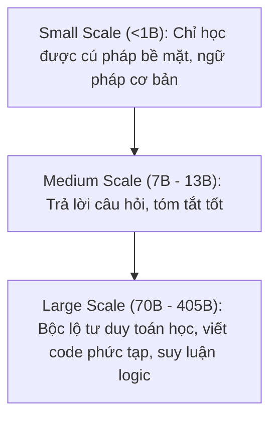

#### d. Code Thực chiến (Dual-Engine: C++ & Python)

```cpp
// C++17: Ước tính dung lượng bộ nhớ tối thiểu để chứa trọng số mô hình lớn
#include <iostream>

void print_model_memory_footprint(double params_billions) {
    double bytes_fp32 = params_billions * 1e9 * 4.0;
    double bytes_fp16 = params_billions * 1e9 * 2.0;
    double bytes_int4 = params_billions * 1e9 * 0.5;

    std::cout << "Model Size: " << params_billions << "B parameters\n";
    std::cout << "  - FP32: " << bytes_fp32 / (1024*1024*1024) << " GB\n";
    std::cout << "  - FP16 / BF16: " << bytes_fp16 / (1024*1024*1024) << " GB\n";
    std::cout << "  - INT4 Quantized: " << bytes_int4 / (1024*1024*1024) << " GB\n";
}

int main() {
    print_model_memory_footprint(70.0); // 70B Model
    return 0;
}
```

```python
# Python / DeepSpeed: Minh họa cấu hình ZeRO-3 chia nhỏ trọng số mô hình lớn
ds_config = {
    "zero_optimization": {
        "stage": 3,
        "offload_optimizer": {"device": "cpu"},
        "offload_param": {"device": "cpu"},
        "overlap_comm": True,
        "contiguous_gradients": True
    },
    "train_micro_batch_size_per_gpu": 1
}
print("ZeRO-3 configuration ready for large-scale modeling.")
```

#### e. Lỗi Thường gặp & Ổn định Số học (Pitfalls & Numerical Stability)
- **Nút thắt Băng thông Mạng liên Node (Inter-Node Bandwidth BottleNeck)**: Nếu đường truyền mạng giữa các máy chủ (Node-to-Node) không dùng InfiniBand mà dùng mạng Ethernet thông thường, GPU sẽ phải chờ truyền thông tới $80\%$ thời gian, làm suy giảm hiệu năng cụm tính toán nghiêm trọng.

#### f. Ứng dụng Thực chiến trong AI / Deep Learning (AI Applications)
- Huấn luyện các siêu mô hình hàng đầu thế giới: LLaMA-3.1 405B, DeepSeek-V3 671B MoE.

---

### 4. Corpus Construction (Xây dựng Kho Ngữ liệu)

#### a. Định nghĩa Bản chất Toán học (Mathematical Formulation)
**Corpus Construction** là quy trình kỹ thuật chuyển đổi hàng chục Petabyte dữ liệu Internet hỗn tạp thành một tập dữ liệu token hóa sạch sẽ $\mathcal{D}$ có phân phối xác suất cân bằng:
$$\mathcal{D} = \bigcup_{k=1}^K \mathcal{D}_k^{\text{processed}}, \quad \text{với } \sum_{k=1}^K |\mathcal{D}_k^{\text{processed}}| \ge 10^{13} \text{ tokens}$$
Trong đó mỗi miền dữ liệu $k$ đại diện cho một danh mục tri thức: trang web chất lượng cao, sách số hóa, mã nguồn phần mềm, bài báo khoa học, từ điển bách khoa và diễn đàn thảo luận.
Hệ thống phải đảm bảo các chỉ số đo lường độ bao phủ tri thức (Knowledge Coverage) và độ đa dạng ngữ nghĩa (Semantic Diversity).

#### b. Cơ chế Tầng Sâu & Điện toán (Under The Hood / Hardware Internals)
- **Hệ thống Xử lý Dữ liệu Phân tán (Apache Spark / Ray Data)**: Để xử lý 50TB dữ liệu văn bản thô mỗi ngày, các kỹ sư sử dụng các cụm máy chủ hàng nghìn CPU cores chạy Apache Spark hoặc Ray trên định dạng file nén columnar tối ưu bộ nhớ như **Parquet** hoặc **Arrow IPC**, đọc ghi dữ liệu trực tiếp qua hệ thống lưu trữ phân tán hiệu năng cao (Ceph / AWS S3 / Google Cloud Storage).

#### c. Sơ đồ Minh họa (Mermaid / ASCII Diagram)
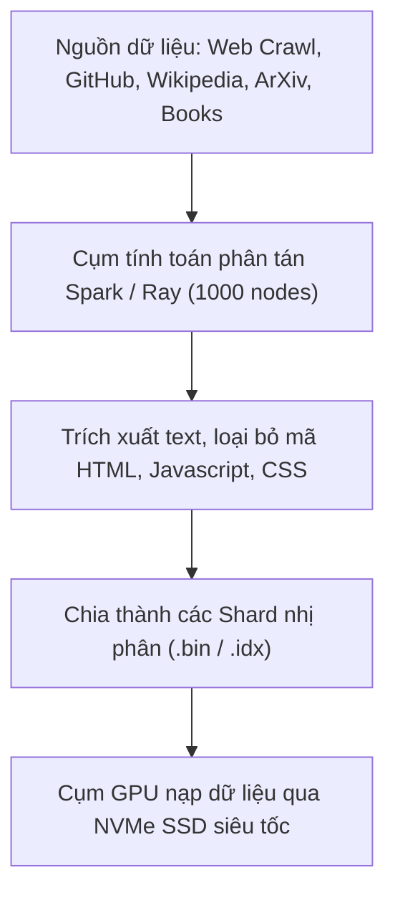

#### d. Code Thực chiến (Dual-Engine: C++ & Python)

```cpp
// C++17: Ghi và đọc file nhị phân Tokenized Dataset (.bin) tối ưu I/O
#include <iostream>
#include <fstream>
#include <vector>
#include <cstdint>

void save_tokens_binary(const std::string& filename, const std::vector<uint32_t>& tokens) {
    std::ofstream out(filename, std::ios::binary);
    uint64_t size = tokens.size();
    out.write(reinterpret_cast<const char*>(&size), sizeof(size));
    out.write(reinterpret_cast<const char*>(tokens.data()), size * sizeof(uint32_t));
}

std::vector<uint32_t> load_tokens_binary(const std::string& filename) {
    std::ifstream in(filename, std::ios::binary);
    uint64_t size = 0;
    in.read(reinterpret_cast<char*>(&size), sizeof(size));
    std::vector<uint32_t> tokens(size);
    in.read(reinterpret_cast<char*>(tokens.data()), size * sizeof(uint32_t));
    return tokens;
}

int main() {
    std::vector<uint32_t> sample_tokens = {101, 2054, 4937, 102};
    save_tokens_binary("tokens.bin", sample_tokens);
    auto loaded = load_tokens_binary("tokens.bin");
    std::cout << "Loaded " << loaded.size() << " tokens from binary shard.\n";
    return 0;
}
```

```python
# Python / Datasets: Pipeline xử lý dữ liệu với Apache Arrow (HuggingFace Datasets)
from datasets import Dataset

raw_data = {"text": ["Machine learning is fascinating.", "Corpus engineering is crucial."]}
dataset = Dataset.from_dict(raw_data)

# Ánh xạ Tokenize song song đa tiến trình
def tokenize_fn(batch):
    return {"token_count": [len(t.split()) for t in batch["text"]]}

processed = dataset.map(tokenize_fn, batched=True, num_proc=2)
print("Processed Dataset Features:", processed.features)
```

#### e. Lỗi Thường gặp & Ổn định Số học (Pitfalls & Numerical Stability)
- **Dữ liệu Rác Boilerplate**: Dữ liệu web thường chứa hàng triệu thông báo "Chấp nhận Cookie", "Chính sách Bảo mật" hoặc thanh điều hướng menu lặp đi lặp lại hàng tỷ lần, làm suy giảm nghiêm trọng mật độ tri thức của kho ngữ liệu.

#### f. Ứng dụng Thực chiến trong AI / Deep Learning (AI Applications)
- Quá trình xây dựng kho dữ liệu RedPajama (Together AI), The Pile (EleutherAI), FineWeb (HuggingFace), RefinedWeb (Falcon).

---

### 5. Data Collection (Thu thập Dữ liệu)

#### a. Định nghĩa Bản chất Toán học (Mathematical Formulation)
**Data Collection** là bước đầu tiên trong chuỗi cung ứng dữ liệu, thu thập các mẫu văn bản từ không gian dữ liệu mở toàn cầu $\Omega$:
$$\mathcal{D}_{\text{raw}} = \big\{ d \in \Omega \;\big|\; \text{ValidFormat}(d) \land \text{Accessible}(d) \big\}$$
Các kênh thu thập chính:
1. **Web Crawling**: Common Crawl (hàng chục tỷ trang web lưu trữ từ năm 2008 đến nay).
2. **Code Repositories**: GitHub, GitLab, StackOverflow (các dự án mã nguồn mở có giấy phép phù hợp).
3. **Scientific Literature**: ArXiv, PubMed, Semantic Scholar (các bài báo nghiên cứu khoa học chuyên sâu).
4. **Digital Books & Encyclopedia**: Wikipedia, Project Gutenberg.

#### b. Cơ chế Tầng Sâu & Điện toán (Under The Hood / Hardware Internals)
- **Tối ưu hóa Băng thông Mạng và Phân tích Cú pháp WARC**: Các tệp nén của Common Crawl có định dạng WARC (Web ARChive). Việc giải nén và phân tích cú pháp HTML của hàng triệu tệp WARC đòi hỏi các bộ parser viết bằng C++ (như Gumbo, Lexbor) để bóc tách text thuần từ DOM tree mà không bị rò rỉ bộ nhớ.

#### c. Sơ đồ Minh họa (Mermaid / ASCII Diagram)
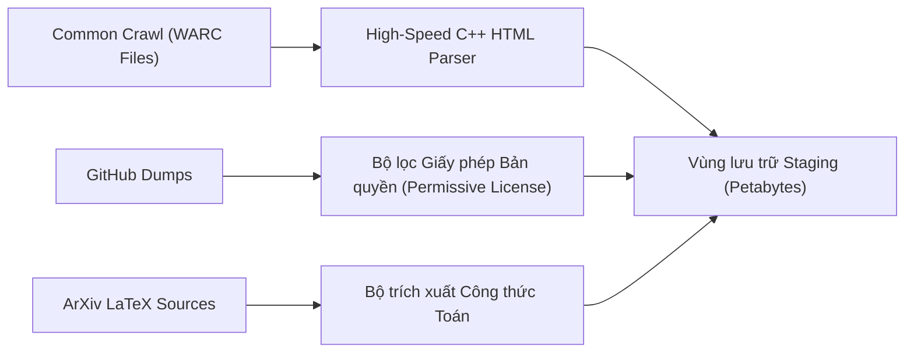

#### d. Code Thực chiến (Dual-Engine: C++ & Python)

```cpp
// C++17: Kiểm tra định dạng đuôi file hợp lệ khi thu thập dữ liệu
#include <iostream>
#include <string>
#include <vector>

bool is_supported_data_format(const std::string& filepath) {
    std::vector<std::string> valid_extensions = {".txt", ".jsonl", ".parquet", ".md", ".cpp", ".py"};
    for (const auto& ext : valid_extensions) {
        if (filepath.size() >= ext.size() && 
            filepath.compare(filepath.size() - ext.size(), ext.size(), ext) == 0) {
            return true;
        }
    }
    return false;
}

int main() {
    std::cout << "code.py valid: " << (is_supported_data_format("code.py") ? "YES" : "NO") << "\n";
    std::cout << "image.png valid: " << (is_supported_data_format("image.png") ? "YES" : "NO") << "\n";
    return 0;
}
```

```python
# Python: Tải và giải nén dữ liệu từ Common Crawl WARC Stream
import zlib

def mock_read_warc_record(compressed_bytes):
    # Giải nén Gzip/Zlib
    try:
        decompressed = zlib.decompress(compressed_bytes, 16 + zlib.MAX_WBITS)
        return decompressed.decode('utf-8', errors='ignore')
    except Exception as e:
        return ""

print("WARC Reader function ready.")
```

#### e. Lỗi Thường gặp & Ổn định Số học (Pitfalls & Numerical Stability)
- **Rủi ro Vi phạm Bản quyền (Copyright Infringement)**: Thu thập nhầm các tài liệu có bản quyền nghiêm ngặt hoặc dữ liệu mã nguồn có giấy phép copyleft (GPL) có thể dẫn đến các vụ kiện tụng pháp lý lớn buộc phải tiêu hủy toàn bộ mô hình đã huấn luyện.

#### f. Ứng dụng Thực chiến trong AI / Deep Learning (AI Applications)
- Xây dựng hạ tầng thu thập dữ liệu cho các phòng thí nghiệm AI (Meta FAIR, Mistral AI, OpenAI).

---

### 6. Data Cleaning (Làm sạch Dữ liệu)

#### a. Định nghĩa Bản chất Toán học (Mathematical Formulation)
**Data Cleaning** là chuỗi các phép biến đổi tiền xử lý $\mathcal{C}$ loại bỏ nhiễu cú pháp và định dạng hỏng từ văn bản thô $d_{\text{raw}}$:
$$d_{\text{clean}} = \mathcal{C}(d_{\text{raw}})$$
Các bước làm sạch tiêu chuẩn:
1. **HTML & Tag Stripping**: Loại bỏ các thẻ HTML (`<script>`, `<style>`, `<div>`), giải mã các ký tự thực thể (`&amp;` $\to$ `&`, `&lt;` $\to$ `<`).
2. **Unicode Normalization**: Chuyển đổi toàn bộ văn bản về dạng chuẩn **NFKC** (Normalization Form Compatibility Composition) để đồng nhất các ký tự đồng hình.
3. **Filtering Control Characters**: Loại bỏ các ký tự điều khiển ASCII vô hình (`\x00` - `\x1F` trừ dấu xuống dòng `\n` và tab `\t`).
4. **Line-Level Heuristics**: Loại bỏ các dòng quá ngắn, các dòng chứa toàn số hoặc ký tự đặc biệt lặp lại (ví dụ: `--------`).

#### b. Cơ chế Tầng Sâu & Điện toán (Under The Hood / Hardware Internals)
- **Tối ưu hóa Bằng Biểu thức Chính quy SIMD (Hyperscan / PCRE2)**: Việc áp dụng hàng trăm biểu thức chính quy (Regex) trên hàng tỷ trang web bằng thư viện `re` của Python sẽ mất hàng tuần. Các kỹ sư sử dụng thư viện **Intel Hyperscan** (viết bằng C++/Assembly) sử dụng tập lệnh AVX-512 để quét song song hàng chục regex cùng lúc trên luồng byte dữ liệu với tốc độ hàng Gigabyte/giây.

#### c. Sơ đồ Minh họa (Mermaid / ASCII Diagram)
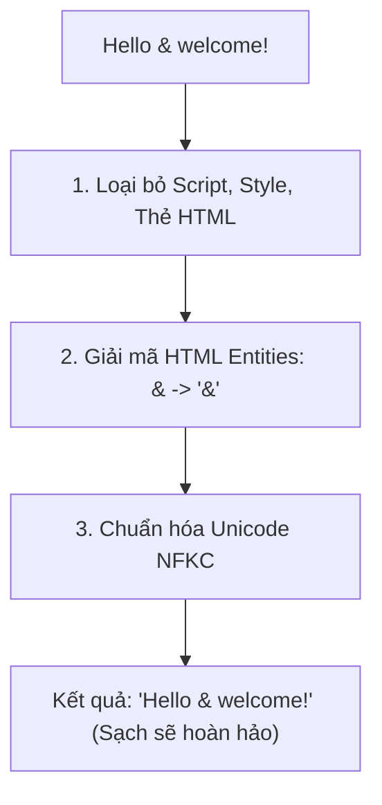

#### d. Code Thực chiến (Dual-Engine: C++ & Python)

```cpp
// C++17: Bộ lọc loại bỏ các ký tự điều khiển ASCII không hợp lệ
#include <iostream>
#include <string>

std::string remove_control_characters(const std::string& input) {
    std::string clean = "";
    clean.reserve(input.size());
    for (unsigned char c : input) {
        // Giữ lại ký tự in được (>= 32) cùng với '\n' (10) và '\t' (9)
        if (c >= 32 || c == '\n' || c == '\t') {
            clean += c;
        }
    }
    return clean;
}

int main() {
    std::string dirty = "Text with null byte \x00 and control \x07 bell.";
    std::cout << "Cleaned: " << remove_control_characters(dirty) << "\n";
    return 0;
}
```

```python
# Python / Regex: Pipeline làm sạch văn bản cơ bản
import re
import html
import unicodedata

def clean_web_text(raw_html: str) -> str:
    # 1. Loại bỏ các thẻ script và style
    text = re.sub(r'<(script|style)[^>]*>.*?</\1>', '', raw_html, flags=re.DOTALL)
    # 2. Loại bỏ toàn bộ thẻ HTML
    text = re.sub(r'<[^>]+>', ' ', text)
    # 3. Giải mã HTML entities
    text = html.unescape(text)
    # 4. Chuẩn hóa Unicode NFKC
    text = unicodedata.normalize('NFKC', text)
    # 5. Thu gọn khoảng trắng thừa
    text = re.sub(r'[ \t]+', ' ', text)
    return text.strip()

dirty = "<p>Deep Learning &amp; AI is <b>awesome</b>!</p>"
print("Cleaned text:", clean_web_text(dirty))
```

#### e. Lỗi Thường gặp & Ổn định Số học (Pitfalls & Numerical Stability)
- **Làm sạch Quá đà (Over-Cleaning)**: Vội vàng xóa các dòng có ký tự đặc biệt sẽ vô tình xóa sạch các đoạn mã nguồn lập trình C++ (`#include <iostream>`), công thức toán học LaTeX (`$$\int f(x)dx$$`), hoặc mã Markdown.

#### f. Ứng dụng Thực chiến trong AI / Deep Learning (AI Applications)
- Bước tiền xử lý bắt buộc trong mọi pipeline làm sạch dữ liệu của HuggingFace, Meta, Google.

---

### 7. Data Deduplication (Khử Trùng lặp Dữ liệu)

#### a. Định nghĩa Bản chất Toán học (Mathematical Formulation)
**Data Deduplication** là quá trình loại bỏ các tài liệu trùng lặp hoàn toàn (Exact Duplicates) hoặc gần như trùng lặp (Near Duplicates) trong kho ngữ liệu.
Nghiên cứu của Lee et al. (ACL 2022) chứng minh rằng: Dữ liệu web có tới $30\% - 50\%$ nội dung bị trùng lặp. Việc không khử trùng lặp sẽ khiến mô hình bị suy giảm tính tổng quát, học vẹt, tăng nguy cơ rò rỉ dữ liệu riêng tư (Memorization Attacks) và lãng phí tới $30\%$ chi phí tính toán.
Các phương pháp toán học:
1. **Exact Deduplication**: Băm mã hóa SHA-256 trên từng dòng hoặc từng văn bản:
$$\text{Duplicate}(d_1, d_2) \iff \text{SHA256}(d_1) == \text{SHA256}(d_2)$$
2. **Near Deduplication (MinHash LSH)**: Đo độ tương đồng Jaccard giữa hai tập hợp $k$-shingles (tập các cụm $k$ từ liên tiếp):
$$J(A, B) = \frac{|A \cap B|}{|A \cup B|}$$
Định lý MinHash chứng minh: Xác suất để giá trị băm nhỏ nhất của hai tập hợp bằng nhau chính bằng độ tương đồng Jaccard:
$$P\big(\min h(A) = \min h(B)\big) = J(A, B)$$
Sử dụng $M$ hàm băm độc lập để tạo chữ ký MinHash (MinHash Signature), sau đó nhóm các chữ ký vào các băng (Bands) trong thuật toán **Locality Sensitive Hashing (LSH)** để tìm các cặp văn bản tương đồng trong thời gian $\mathcal{O}(N)$ thay vì $\mathcal{O}(N^2)$.

#### b. Cơ chế Tầng Sâu & Điện toán (Under The Hood / Hardware Internals)
- **Suffix Array Substring Deduplication**: Để tìm các đoạn văn bản trùng lặp dài $\ge 50$ ký tự xuất hiện ở giữa các tài liệu khác nhau, người ta xây dựng **Mảng Hậu tố (Suffix Array)** và mảng LCP (Longest Common Prefix). Cấu trúc dữ liệu này được tối ưu hóa bộ nhớ RAM trên máy chủ 1TB RAM để quét toàn bộ kho dữ liệu hàng trăm tỷ tokens.

#### c. Sơ đồ Minh họa (Mermaid / ASCII Diagram)
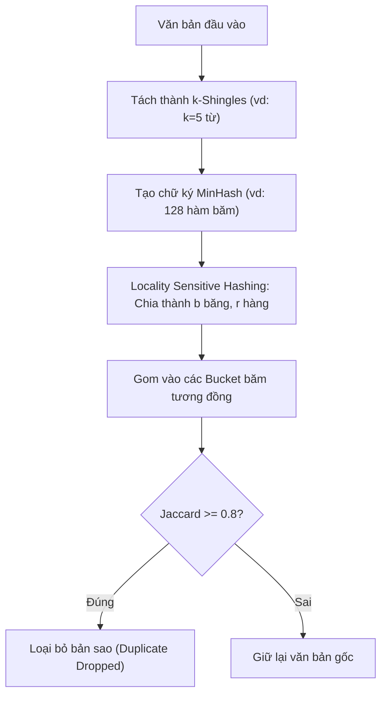

#### d. Code Thực chiến (Dual-Engine: C++ & Python)

```cpp
// C++17: Thuật toán MinHash cơ bản ước tính độ tương đồng Jaccard
#include <iostream>
#include <vector>
#include <string>
#include <unordered_set>
#include <algorithm>
#include <cstdint>

uint32_t simple_hash(const std::string& str, uint32_t seed) {
    uint32_t h = seed;
    for (char c : str) {
        h = (h * 31) + static_cast<unsigned char>(c);
    }
    return h;
}

std::vector<uint32_t> compute_minhash_signature(
    const std::vector<std::string>& shingles, 
    const std::vector<uint32_t>& hash_seeds) 
{
    std::vector<uint32_t> signature(hash_seeds.size(), UINT32_MAX);
    for (size_t i = 0; i < hash_seeds.size(); ++i) {
        for (const auto& s : shingles) {
            uint32_t h = simple_hash(s, hash_seeds[i]);
            signature[i] = std::min(signature[i], h);
        }
    }
    return signature;
}

int main() {
    std::vector<std::string> doc1_shingles = {"artificial", "intelligence", "deep", "learning"};
    std::vector<uint32_t> seeds = {42, 1337, 9999, 7777};
    auto sig1 = compute_minhash_signature(doc1_shingles, seeds);

    std::cout << "MinHash Signature doc1: [" << sig1[0] << ", " << sig1[1] << ", " << sig1[2] << "]\n";
    return 0;
}
```

```python
# Python / Datasketch: Đo độ tương đồng Jaccard bằng MinHash
from datasketch import MinHash

def get_minhash(text, num_perm=128):
    m = MinHash(num_perm=num_perm)
    words = text.lower().split()
    # Shingles bậc 3 (3-grams)
    for i in range(len(words) - 2):
        shingle = " ".join(words[i:i+3])
        m.update(shingle.encode('utf-8'))
    return m

doc1 = "The quick brown fox jumps over the lazy dog repeatedly"
doc2 = "The quick brown fox jumps over that lazy dog repeatedly"

m1 = get_minhash(doc1)
m2 = get_minhash(doc2)
jaccard_est = m1.jaccard(m2)
print(f"Estimated Jaccard Similarity: {jaccard_est:.4f} (Near Duplicate!)")
```

#### e. Lỗi Thường gặp & Ổn định Số học (Pitfalls & Numerical Stability)
- **Số lượng Hàm Băm Quá Ít**: Nếu chỉ dùng $M = 16$ hàm băm, phương sai của ước lượng Jaccard rất lớn $\text{Var} \approx \frac{1}{M}$, dẫn đến việc nhận nhầm hai tài liệu khác nhau là trùng lặp (False Positives) và xóa nhầm dữ liệu quý. Chuẩn công nghiệp khuyến nghị dùng $M = 128$ hoặc $256$.

#### f. Ứng dụng Thực chiến trong AI / Deep Learning (AI Applications)
- Khử trùng lặp kho dữ liệu của GPT-3, LLaMA-1/2/3, FineWeb (loại bỏ hơn $40\%$ số trang rác).

---

### 8. Data Filtering (Lọc Dữ liệu)

#### a. Định nghĩa Bản chất Toán học (Mathematical Formulation)
**Data Filtering** áp dụng các mô hình phân loại xác suất và các quy tắc heuristic để loại bỏ các tài liệu có chất lượng thấp, văn bản máy dịch rác (machine translation artifacts), hoặc nội dung độc hại:
$$\text{Retain}(d) \iff \text{QualityScore}(d) \ge \tau_{\text{quality}} \quad \land \quad \text{ToxicityScore}(d) \le \tau_{\text{toxic}}$$
Các phương pháp lọc hàng đầu:
1. **Heuristic Filters (Gopher / C4 Rules)**:
   - Tỷ lệ từ dừng (Stop words): Văn bản tiếng Anh tự nhiên phải có tỷ lệ từ dừng $\ge 30\%$.
   - Tỷ lệ dấu câu và biểu tượng đặc biệt: Không vượt quá $15\%$.
   - Tỷ lệ ký tự số hoặc viết hoa bất thường.
2. **Statistical Quality Filtering (KenLM Perplexity)**:
   Huấn luyện một mô hình ngôn ngữ 5-gram nhỏ (KenLM) trên tập dữ liệu chất lượng cao (như Wikipedia). Đo Perplexity của văn bản cần lọc:
   - Nếu $\text{PPL}$ quá cao $\implies$ Văn bản vô nghĩa, spam từ khóa SEO $\implies$ Loại bỏ.
   - Nếu $\text{PPL}$ quá thấp $\implies$ Văn bản lặp đi lặp lại một từ duy nhất $\implies$ Loại bỏ.
3. **Machine Learning Classifiers**: Huấn luyện bộ phân loại FastText hoặc RoBERTa để chấm điểm độ tương đồng với nguồn tài liệu học thuật (Positive class: Wikipedia/Books, Negative class: Unfiltered Common Crawl).

#### b. Cơ chế Tầng Sâu & Điện toán (Under The Hood / Hardware Internals)
- **Thông lượng Xử lý CPU Siêu tốc của FastText**: Mô hình phân loại FastText (Joulin et al., Meta) sử dụng kiến trúc túi từ tuyến tính kết hợp băm n-gram. Một mô hình FastText nạp trên CPU có thể chấm điểm hơn $50{,}000\text{ tài liệu/giây}$ trên một core CPU đơn lẻ, biến nó thành bộ lọc phân loại tối ưu nhất cho các kho ngữ liệu hàng Terabyte.

#### c. Sơ đồ Minh họa (Mermaid / ASCII Diagram)
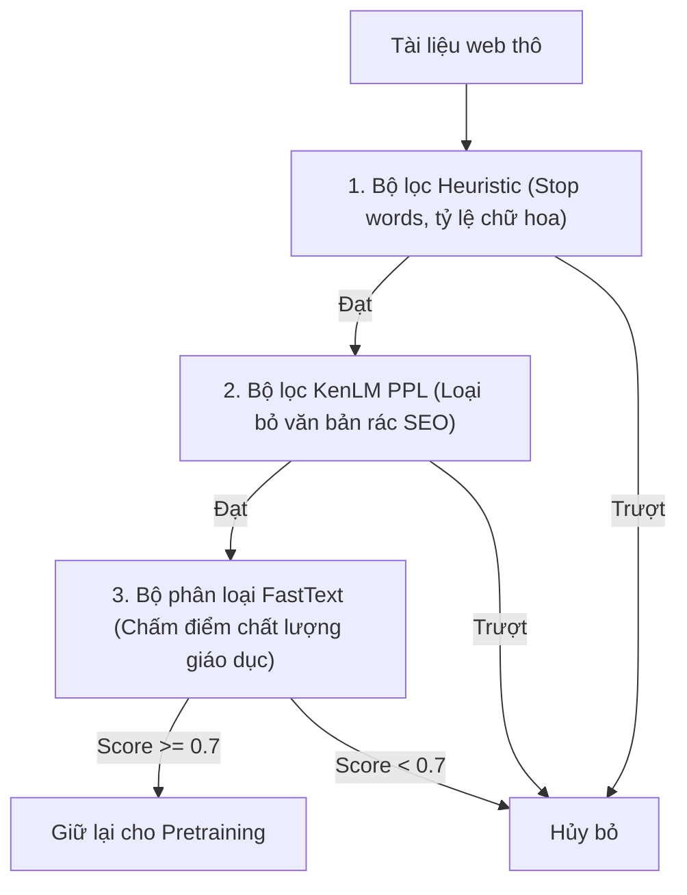

#### d. Code Thực chiến (Dual-Engine: C++ & Python)

```cpp
// C++17: Bộ lọc Heuristic kiểm tra tỷ lệ từ dừng (Stop-word ratio)
#include <iostream>
#include <string>
#include <vector>
#include <sstream>
#include <unordered_set>

bool pass_stopword_filter(const std::string& text, double min_ratio = 0.2) {
    std::unordered_set<std::string> stopwords = {"the", "is", "at", "which", "on", "and", "a", "an", "in", "to"};
    std::istringstream stream(text);
    std::string word;
    size_t total_words = 0;
    size_t stop_words_count = 0;

    while (stream >> word) {
        total_words++;
        if (stopwords.find(word) != stopwords.end()) {
            stop_words_count++;
        }
    }
    if (total_words == 0) return false;
    double ratio = static_cast<double>(stop_words_count) / total_words;
    return ratio >= min_ratio;
}

int main() {
    std::string natural_text = "the quick brown fox is jumping on a lazy dog and looking at the sky";
    std::string spam_seo = "buy cheap rolex discount rolex best rolex sale free shipping";

    std::cout << "Natural text passed: " << (pass_stopword_filter(natural_text) ? "YES" : "NO") << "\n";
    std::cout << "Spam text passed:    " << (pass_stopword_filter(spam_seo) ? "YES" : "NO") << "\n";
    return 0;
}
```

```python
# Python / FastText: Mô phỏng bộ phân loại chấm điểm chất lượng văn bản
class MockQualityClassifier:
    def predict(self, text: str):
        # Giả lập chấm điểm chất lượng từ 0.0 đến 1.0
        words = text.split()
        if len(words) < 10:
            return 0.1 # Quá ngắn
        return 0.85 # Chất lượng tốt

clf = MockQualityClassifier()
score = clf.predict("Artificial intelligence foundation models require rigorous pretraining pipelines.")
print(f"Document Quality Score: {score} -> {'ACCEPTED' if score >= 0.7 else 'REJECTED'}")
```

#### e. Lỗi Thường gặp & Ổn định Số học (Pitfalls & Numerical Stability)
- **Thiên vị Văn hóa / Phương ngữ (Dialect Bias)**: Các bộ lọc chất lượng được huấn luyện trên Wikipedia tiếng Anh chuẩn (Standard American English) thường gán nhãn điểm chất lượng thấp sai lầm cho các phương ngữ tiếng Anh của người da màu (AAVE) hoặc tiếng Anh của các nước đang phát triển.

#### f. Ứng dụng Thực chiến trong AI / Deep Learning (AI Applications)
- Quá trình lọc dữ liệu của Falcon RefinedWeb, LLaMA-3 (tăng gấp đôi chất lượng so với LLaMA-2 nhờ lọc khắt khe hơn).

---

### 9. Data Contamination (Nhiễm bẩn Dữ liệu)

#### a. Định nghĩa Bản chất Toán học (Mathematical Formulation)
**Data Contamination** (hoặc Benchmark Leakage) là hiện tượng các câu hỏi hoặc đáp án của các bộ dữ liệu kiểm thử (Evaluation Benchmarks như MMLU, GSM8K, HumanEval, ARC) vô tình bị rò rỉ và lọt vào kho ngữ liệu tiền huấn luyện $\mathcal{D}_{\text{pretrain}}$:
$$\mathcal{D}_{\text{pretrain}} \cap \mathcal{D}_{\text{test}} \ne \emptyset$$
Hệ quả: Mô hình đạt điểm số benchmark cao ngất ngưởng trên các bảng xếp hạng nhưng thực chất là do **học thuộc lòng (Memorization)** chứ không phải do năng lực khái quát hóa hay suy luận logic thực sự.
Phát hiện nhiễm bẩn bằng phương pháp toán học:
- **N-Gram Overlap**: Đếm tỷ lệ trùng khớp $N$-gram liên tiếp (thường chọn $N=8$ hoặc $13$ từ liên tiếp giữa tập train và test).
- **MinHash Match**: Quét toàn bộ tập test qua tập train để phát hiện các câu hỏi bị paraphrase nhẹ.

#### b. Cơ chế Tầng Sâu & Điện toán (Under The Hood / Hardware Internals)
- **Bloom Filters trên VRAM/RAM**: Để kiểm tra hàng nghìn câu hỏi benchmark với hàng chục tỷ dòng text của tập train, người ta nạp tất cả các chuỗi 8-gram của tập test vào một **Bộ lọc Bloom (Bloom Filter)** trong RAM. Thao tác kiểm tra tồn tại diễn ra trong $\mathcal{O}(k)$ phép tính băm, cho phép rà soát toàn bộ kho dữ liệu Terabyte chỉ trong vài giờ.

#### c. Sơ đồ Minh họa (Mermaid / ASCII Diagram)
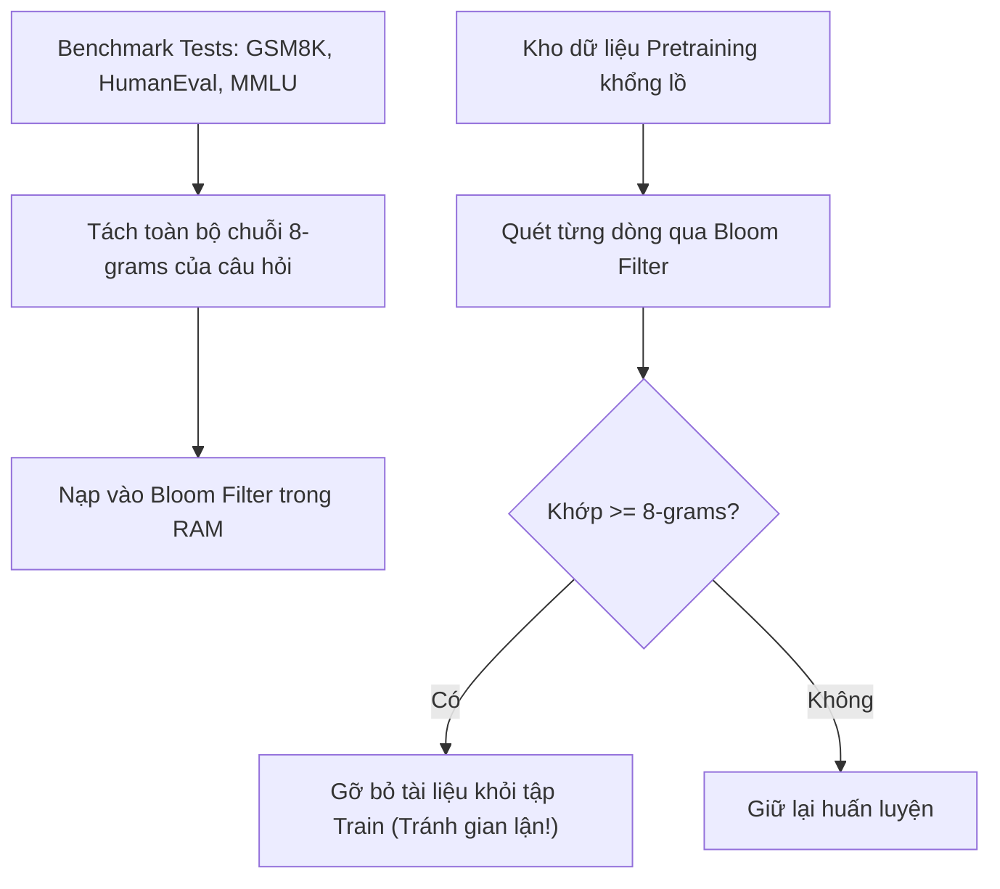

#### d. Code Thực chiến (Dual-Engine: C++ & Python)

```cpp
// C++17: Thuật toán kiểm tra trùng khớp N-Gram liên tiếp (Contamination Detection)
#include <iostream>
#include <string>
#include <vector>
#include <unordered_set>

class ContaminationDetector {
private:
    std::unordered_set<std::string> test_ngrams_;
    size_t n_;

public:
    explicit ContaminationDetector(size_t n) : n_(n) {}

    void index_test_data(const std::vector<std::string>& words) {
        if (words.size() < n_) return;
        for (size_t i = 0; i <= words.size() - n_; ++i) {
            std::string gram = "";
            for (size_t j = 0; j < n_; ++j) gram += words[i + j] + " ";
            test_ngrams_.insert(gram);
        }
    }

    bool is_contaminated(const std::vector<std::string>& train_words) const {
        if (train_words.size() < n_) return false;
        for (size_t i = 0; i <= train_words.size() - n_; ++i) {
            std::string gram = "";
            for (size_t j = 0; j < n_; ++j) gram += train_words[i + j] + " ";
            if (test_ngrams_.find(gram) != test_ngrams_.end()) {
                return true; // Phát hiện rò rỉ!
            }
        }
        return false;
    }
};

int main() {
    ContaminationDetector detector(3); // 3-gram
    detector.index_test_data({"what", "is", "the", "capital", "of", "france"});

    std::vector<std::string> train_doc = {"tell", "me", "what", "is", "the", "capital", "of", "france", "please"};
    std::cout << "Train Document Contaminated: " 
              << (detector.is_contaminated(train_doc) ? "DETECTED!" : "CLEAN") << "\n";
    return 0;
}
```

```python
# Python: Kiểm tra mức độ trùng khớp 8-Gram giữa tập Train và Benchmark Test
def check_ngram_contamination(train_text, test_text, n=8):
    train_words = train_text.lower().split()
    test_words = test_text.lower().split()
    
    test_ngrams = set(tuple(test_words[i:i+n]) for i in range(len(test_words) - n + 1))
    
    for i in range(len(train_words) - n + 1):
        gram = tuple(train_words[i:i+n])
        if gram in test_ngrams:
            return True, " ".join(gram)
    return False, None

contaminated, leak = check_ngram_contamination(
    "Solve this math problem: if John has 5 apples and eats 2 how many apples are left?",
    "If John has 5 apples and eats 2 how many apples are left?"
)
print(f"Leakage Status: {contaminated} | Leaked Sequence: '{leak}'")
```

#### e. Lỗi Thường gặp & Ổn định Số học (Pitfalls & Numerical Stability)
- **Synthetic Benchmark Contamination**: Các tập dữ liệu tổng hợp (Synthetic Data) do mô hình AI khác sinh ra có thể đã vô tình chứa các câu trả lời của benchmark từ trước mà người thu thập không hề hay biết.

#### f. Ứng dụng Thực chiến trong AI / Deep Learning (AI Applications)
- Quy trình khử nhiễm bắt buộc trong báo cáo kỹ thuật của LLaMA-3, GPT-4, Claude 3, DeepSeek-V3 để khẳng định tính trung thực của kết quả benchmark.

---

### 10. Data Quality (Chất lượng Dữ liệu)

#### a. Định nghĩa Bản chất Toán học (Mathematical Formulation)
**Data Quality** trong huấn luyện mô hình nền tảng là một khái niệm đa chiều biểu diễn **Mật độ Thông tin (Information Density)** và **Độ chính xác Ngữ nghĩa (Factual & Syntactic Accuracy)** của văn bản.
Một tài liệu có chất lượng cao thỏa mãn các tiêu chí:
1. **High Token Utility**: Tỷ lệ thông tin hữu ích trên mỗi token cao (ngược lại với văn bản dài dòng vô nghĩa).
2. **Grammatical & Logical Coherence**: Cấu trúc ngữ pháp hoàn chỉnh, suy luận nguyên nhân - kết quả rõ ràng.
3. **Diverse Lexical Distribution**: Phân phối từ vựng phong phú, không lặp lại đơn điệu.
4. **Factual Correctness**: Tri thức phản ánh đúng sự thật vật lý và khoa học.

Theo nghiên cứu từ dự án Phi (Textbooks Are All You Need - Li et al., Microsoft 2023): Một mô hình nhỏ 1.3B tham số huấn luyện trên dữ liệu chất lượng cực cao (chọn lọc như sách giáo khoa) có thể đánh bại các mô hình 7B huấn luyện trên dữ liệu web thô!

#### b. Cơ chế Tầng Sâu & Điện toán (Under The Hood / Hardware Internals)
- **Tiết kiệm Chi phí Điện toán (Compute Efficiency)**: Huấn luyện trên dữ liệu chất lượng cao cho phép mô hình hội tụ tới cùng một mức Loss với số lượng tokens ít hơn từ $2\times$ đến $5\times$, tiết kiệm hàng triệu USD chi phí thuê GPU.

#### c. Sơ đồ Minh họa (Mermaid / ASCII Diagram)
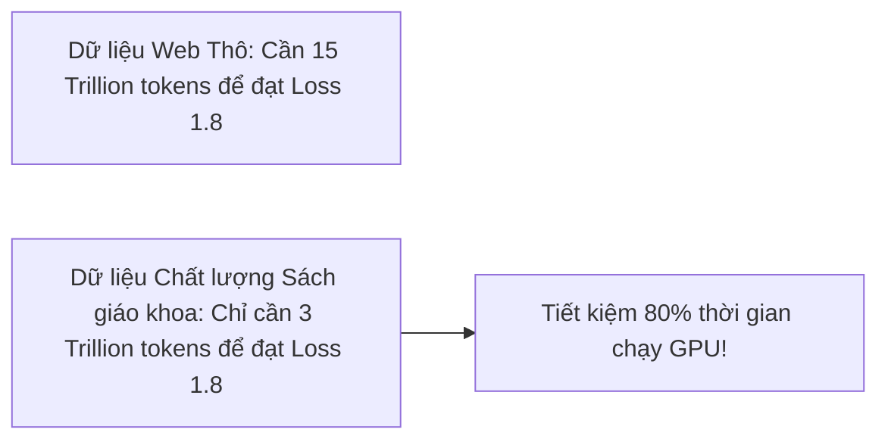

#### d. Code Thực chiến (Dual-Engine: C++ & Python)

```cpp
// C++17: Tính chỉ số đa dạng từ vựng Type-Token Ratio (TTR) đo lường chất lượng
#include <iostream>
#include <string>
#include <vector>
#include <sstream>
#include <unordered_set>

double calculate_type_token_ratio(const std::string& text) {
    std::istringstream stream(text);
    std::string word;
    size_t total_tokens = 0;
    std::unordered_set<std::string> unique_types;

    while (stream >> word) {
        total_tokens++;
        unique_types.insert(word);
    }
    if (total_tokens == 0) return 0.0;
    // TTR = Unique Words / Total Words
    return static_cast<double>(unique_types.size()) / total_words;
}

int main() {
    std::string high_quality = "Quantum mechanics describes the fundamental physical properties of nature.";
    std::string low_quality = "good product good quality very good good good price good";

    std::cout << "High quality TTR: " << calculate_type_token_ratio(high_quality) << "\n";
    std::cout << "Low quality TTR:  " << calculate_type_token_ratio(low_quality) << "\n";
    return 0;
}
```

```python
# Python: Đánh giá chất lượng văn bản bằng LLM-as-a-Judge Scorer
def mock_llm_quality_judge(text: str) -> dict:
    # Đánh giá 3 tiêu chí: Ngữ pháp, Logic, Mật độ tri thức (Thang điểm 1-5)
    return {
        "grammar": 5,
        "coherence": 5,
        "educational_value": 4.5,
        "overall_quality": 4.8
    }

metrics = mock_llm_quality_judge("A differential equation relates a function with its derivatives.")
print("Quality Assessment:", metrics)
```

#### e. Lỗi Thường gặp & Ổn định Số học (Pitfalls & Numerical Stability)
- **Đánh đổi giữa Chất lượng và Số lượng**: Nếu đặt tiêu chuẩn lọc chất lượng quá cao, lượng dữ liệu còn lại sẽ quá ít ($< 500\text{B}$ tokens), khiến mô hình bị overfitting khi phải lặp lại dữ liệu nhiều epochs.

#### f. Ứng dụng Thực chiến trong AI / Deep Learning (AI Applications)
- Chiến lược "Textbooks Are All You Need" của Microsoft Phi-1/Phi-2/Phi-3, mô hình Nemotron của NVIDIA.

---

### 11. Data Mixture (Phối trộn Dữ liệu)

#### a. Định nghĩa Bản chất Toán học (Mathematical Formulation)
**Data Mixture** là bài toán tối ưu hóa tỷ lệ pha trộn trọng số $\mathbf{\alpha} = (\alpha_1, \alpha_2, \dots, \alpha_K)$ giữa $K$ nguồn dữ liệu khác nhau trong tập huấn luyện:
$$\sum_{k=1}^K \alpha_k = 1, \quad \alpha_k \ge 0$$
Phân phối xác suất lấy mẫu một batch dữ liệu:
$$P(\text{Sample from domain } k) = \alpha_k$$
Các miền dữ liệu tiêu biểu:
- $\mathcal{D}_{\text{web}}$ (Văn bản web tổng hợp): $\approx 50\% - 60\%$
- $\mathcal{D}_{\text{code}}$ (Mã nguồn lập trình): $\approx 15\% - 25\%$ (Tăng cường năng lực tư duy logic và suy luận)
- $\mathcal{D}_{\text{math}}$ (Toán học & Khoa học tự nhiên): $\approx 5\% - 10\%$
- $\mathcal{D}_{\text{books}}$ (Sách văn học & học thuật): $\approx 5\%$
- $\mathcal{D}_{\text{multilingual}}$ (Đa ngôn ngữ): $\approx 10\%$

Tỷ lệ $\mathbf{\alpha}^*$ tối ưu thường được tìm thông qua các thí nghiệm mô hình nhỏ (Small-scale Proxy Models $\approx 1\text{B}$) trước khi áp dụng lên mô hình lớn 70B/405B.

#### b. Cơ chế Tầng Sâu & Điện toán (Under The Hood / Hardware Internals)
- **Dynamic Sampling Shuffler**: Trong quá trình nạp dữ liệu phân tán, các worker nạp dữ liệu (DataLoader Workers) duy trì $K$ con trỏ luồng dữ liệu độc lập và lấy mẫu ngẫu nhiên có trọng số (Weighted Sampling) để tạo ra các batch dữ liệu hỗn hợp liên tục mà không làm gián đoạn dòng chảy dữ liệu lên GPU.

#### c. Sơ đồ Minh họa (Mermaid / ASCII Diagram)
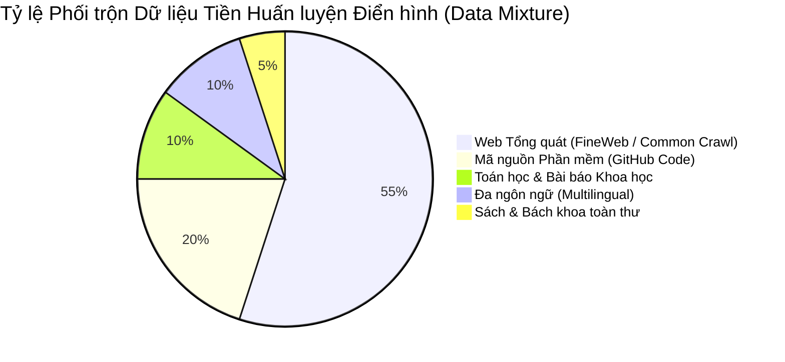

#### d. Code Thực chiến (Dual-Engine: C++ & Python)

```cpp
// C++17: Lấy mẫu chỉ số miền dữ liệu theo phân phối trọng số Data Mixture
#include <iostream>
#include <vector>
#include <random>

class DataMixtureSampler {
private:
    std::discrete_distribution<int> dist_;
    std::mt19937 rng_;

public:
    explicit DataMixtureSampler(const std::vector<double>& weights, uint32_t seed = 42)
        : dist_(weights.begin(), weights.end()), rng_(seed) {}

    int sample_domain() {
        return dist_(rng_);
    }
};

int main() {
    // 0: Web (50%), 1: Code (30%), 2: Math (20%)
    std::vector<double> weights = {0.5, 0.3, 0.2};
    DataMixtureSampler sampler(weights);

    std::vector<int> counts(3, 0);
    for (int i = 0; i < 1000; ++i) counts[sampler.sample_domain()]++;

    std::cout << "Sampled 1000 batches:\n";
    std::cout << "  - Web (Domain 0):  " << counts[0] << " (Target: ~500)\n";
    std::cout << "  - Code (Domain 1): " << counts[1] << " (Target: ~300)\n";
    std::cout << "  - Math (Domain 2): " << counts[2] << " (Target: ~200)\n";
    return 0;
}
```

```python
# Python / PyTorch: DataLoader kết hợp nhiều tập dữ liệu có trọng số
import torch
from torch.utils.data import WeightedRandomSampler

domain_weights = [0.55, 0.25, 0.10, 0.10] # Web, Code, Math, Multi
domain_indices = torch.multinomial(torch.tensor(domain_weights), num_samples=10, replacement=True)
print("Sampled domain sequence for batches:", domain_indices.tolist())
```

#### e. Lỗi Thường gặp & Ổn định Số học (Pitfalls & Numerical Stability)
- **Thiếu Dữ liệu Mã nguồn (Code Neglect)**: Nếu chỉ phối trộn văn bản văn học mà thiếu mã nguồn lập trình, mô hình sẽ hoàn toàn mất khả năng giải quyết các bài toán suy luận logic nhiều bước (Chain of Thought reasoning).

#### f. Ứng dụng Thực chiến trong AI / Deep Learning (AI Applications)
- Chiến lược cốt lõi tạo nên sự vượt trội của LLaMA-3 (Meta tăng tỷ lệ code lên gấp 4 lần so với LLaMA-2).

---

### 12. Data Sampling (Lấy mẫu Dữ liệu)

#### a. Định nghĩa Bản chất Toán học (Mathematical Formulation)
**Data Sampling** là kỹ thuật giải quyết bài toán mất cân bằng kích thước giữa các miền dữ liệu khác nhau.
Nếu một miền dữ liệu quan trọng nhưng có kích thước tự nhiên rất nhỏ (ví dụ: các bài báo toán học chất lượng cao chỉ có $50\text{B}$ tokens, trong khi dữ liệu web có $5000\text{B}$ tokens), việc lấy mẫu ngẫu nhiên đồng đều sẽ làm loãng miền toán học xuống chỉ còn $1\%$.
Kỹ thuật lấy mẫu điều chỉnh xác suất của miền $k$ có kích thước tự nhiên $S_k$:
$$P_k = \frac{S_k^\alpha}{\sum_j S_j^\alpha}$$
Trong đó $\alpha \in [0, 1]$ là **hệ số làm mịn nhiệt độ (Temperature Smoothing)**:
- Khi $\alpha = 1.0$: Lấy mẫu tỷ lệ thuận chính xác với kích thước tự nhiên.
- Khi $\alpha = 0.0$: Lấy mẫu đều nhau giữa tất cả các miền (Uniform).
- Khi $\alpha \in (0, 1)$ (thường chọn $\alpha = 0.7$): **Oversampling** các miền dữ liệu nhỏ quan trọng (cho phép lặp lại vài lần) và **Downsampling** các miền dữ liệu web quá lớn.

#### b. Cơ chế Tầng Sâu & Điện toán (Under The Hood / Hardware Internals)
- **Đóng gói Chuỗi Hiệu quả (Sample Packing / Sequence Packing)**: Các văn bản ngắn thường có độ dài nhỏ hơn Context Window (ví dụ: đoạn văn dài 100 tokens, trong khi context là 8192). Nếu chèn `[PAD]`, GPU sẽ lãng phí tới $90\%$ tính toán cho token rác. Thuật toán **Sample Packing** ghép nhiều tài liệu ngắn liên tiếp vào cùng 1 chuỗi 8192 tokens và sử dụng cơ chế Cross-Document Masking (hoặc cuDNN FlashAttention `varlen`) để ngăn rò rỉ Attention giữa các tài liệu khác nhau.

#### c. Sơ đồ Minh họa (Mermaid / ASCII Diagram)
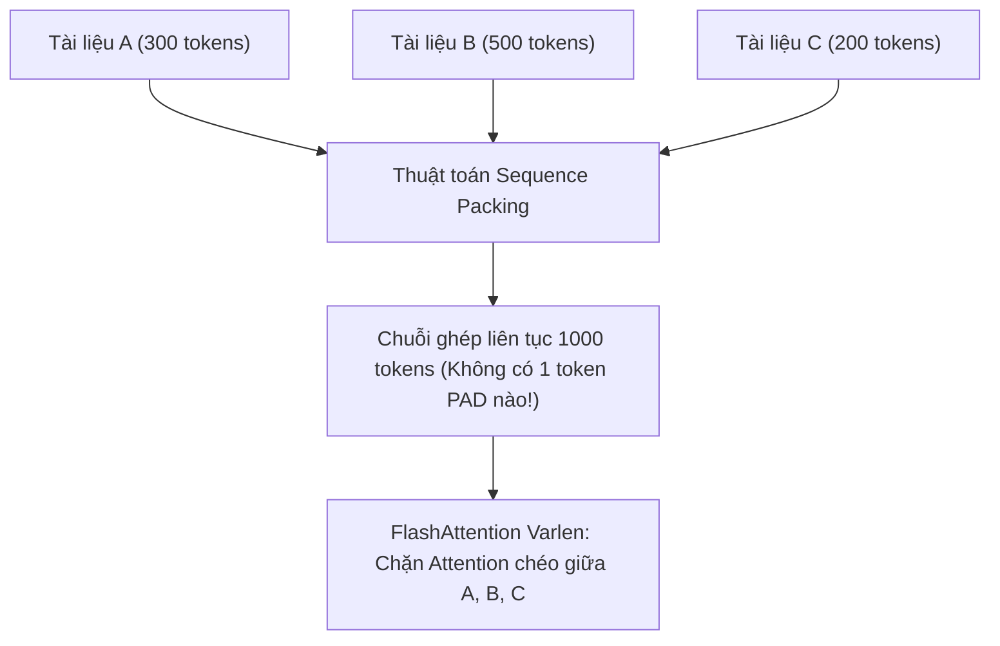

#### d. Code Thực chiến (Dual-Engine: C++ & Python)

```cpp
// C++17: Tính xác suất lấy mẫu sau khi làm mịn nhiệt độ alpha (Temperature Smoothing)
#include <iostream>
#include <vector>
#include <cmath>
#include <numeric>

std::vector<double> compute_smoothed_sampling_probs(const std::vector<double>& sizes, double alpha) {
    std::vector<double> powered(sizes.size());
    double sum = 0.0;
    for (size_t i = 0; i < sizes.size(); ++i) {
        powered[i] = std::pow(sizes[i], alpha);
        sum += powered[i];
    }
    for (size_t i = 0; i < sizes.size(); ++i) {
        powered[i] /= sum;
    }
    return powered;
}

int main() {
    std::vector<double> token_sizes = {5000.0, 50.0}; // Web: 5000B, Math: 50B (Tỷ lệ 100:1)
    auto probs_alpha_1 = compute_smoothed_sampling_probs(token_sizes, 1.0);
    auto probs_alpha_07 = compute_smoothed_sampling_probs(token_sizes, 0.7);

    std::cout << "Alpha = 1.0: Math prob = " << probs_alpha_1[1] * 100 << "%\n";
    std::cout << "Alpha = 0.7: Math prob = " << probs_alpha_07[1] * 100 << "% (Oversampled 4x!)\n";
    return 0;
}
```

```python
# Python / Transformers: Sequence Packing mô phỏng ghép văn bản
def pack_sequences(tokenized_docs, max_seq_len=8):
    packed_batches = []
    current_pack = []
    
    for doc in tokenized_docs:
        if len(current_pack) + len(doc) <= max_seq_len:
            current_pack.extend(doc)
        else:
            packed_batches.append(current_pack)
            current_pack = list(doc)
    if current_pack:
        packed_batches.append(current_pack)
    return packed_batches

docs = [[1, 2], [3, 4, 5], [6], [7, 8]]
print("Packed sequences:", pack_sequences(docs, max_seq_len=5))
```

#### e. Lỗi Thường gặp & Ổn định Số học (Pitfalls & Numerical Stability)
- **Overfitting do Lặp lại quá 4 Epochs**: Nếu oversample một tập dữ liệu nhỏ quá 4 lần, mô hình sẽ bắt đầu học vẹt và mất dần khả năng khái quát hóa (Muennighoff et al., 2023).

#### f. Ứng dụng Thực chiến trong AI / Deep Learning (AI Applications)
- Quản trị dòng dữ liệu huấn luyện trong Megatron-LM, Nanotron, vLLM Training.

---

### 13. Data Curriculum (Giáo trình Học tập Dữ liệu)

#### a. Định nghĩa Bản chất Toán học (Mathematical Formulation)
**Data Curriculum** (Bengio et al., 2009) áp dụng nguyên lý sư phạm của con người vào việc huấn luyện AI: Thay vì xáo trộn ngẫu nhiên dữ liệu trong suốt quá trình huấn luyện, mô hình được tiếp xúc với dữ liệu theo một lộ trình được lập lịch toán học (Curriculum Schedule):
$$\mathbf{\alpha}(t) = f(t), \quad t \in [0, T_{\text{total}}]$$
Các giai đoạn tiêu biểu của Data Curriculum hiện đại:
1. **Giai đoạn Khởi động (Foundation Phase - $0\% \to 70\%$ thời gian)**: Huấn luyện trên văn bản web tổng quát, đa dạng để mô hình học cú pháp ngôn ngữ và tri thức thế giới rộng khắp.
2. **Giai đoạn Nâng cao (Specialization Phase - $70\% \to 95\%$)**: Tăng mạnh tỷ lệ dữ liệu chất lượng cao, mã nguồn lập trình, bài báo toán học và suy luận logic.
3. **Giai đoạn Tinh chế Cuối (Cool-down Phase / Annealing - $5\%$ cuối cùng)**: Đột ngột chuyển sang huấn luyện trên dữ liệu siêu tinh khiết (High-quality synthetic reasoning data, Wikipedia, instruction data) kết hợp hạ Learning Rate về 0. Giai đoạn này tạo ra bước nhảy vọt về năng lực giải toán và benchmark.

#### b. Cơ chế Tầng Sâu & Điện toán (Under The Hood / Hardware Internals)
- **Chuyển đổi Luồng Dữ liệu Động Không Dừng Cụm (Zero-Downtime Data Swapping)**: Để chuyển giáo trình mà không phải dừng cụm siêu máy tính hàng nghìn GPU, hệ thống lưu trữ phân tán sử dụng các bộ điều phối luồng dữ liệu mềm (Dynamic Streaming Checkpoints) thay đổi con trỏ thư mục dữ liệu ngay trong quá trình nạp.

#### c. Sơ đồ Minh họa (Mermaid / ASCII Diagram)
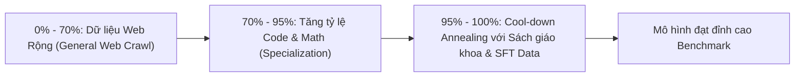

#### d. Code Thực chiến (Dual-Engine: C++ & Python)

```cpp
// C++17: Lập lịch tỷ lệ dữ liệu toán học thay đổi theo tiến trình huấn luyện
#include <iostream>
#include <algorithm>

float get_math_data_ratio(int current_step, int total_steps) {
    float progress = static_cast<float>(current_step) / total_steps;
    if (progress < 0.7f) {
        return 0.10f; // 10% ở giai đoạn đầu
    } else if (progress < 0.95f) {
        return 0.25f; // Tăng lên 25% ở giai đoạn nâng cao
    } else {
        return 0.50f; // Giai đoạn Cool-down: 50% dữ liệu toán
    }
}

int main() {
    int total = 100000;
    std::cout << "Step 10,000  (Early):     Math ratio = " << get_math_data_ratio(10000, total) * 100 << "%\n";
    std::cout << "Step 80,000  (Mid-Late):   Math ratio = " << get_math_data_ratio(80000, total) * 100 << "%\n";
    std::cout << "Step 98,000  (Cool-down):  Math ratio = " << get_math_data_ratio(98000, total) * 100 << "%\n";
    return 0;
}
```

```python
# Python: Mô phỏng điều chỉnh trọng số Data Curriculum theo thời gian
def get_curriculum_weights(progress: float):
    # progress in [0.0, 1.0]
    if progress < 0.7:
        return {"web": 0.70, "code": 0.20, "math": 0.10}
    elif progress < 0.95:
        return {"web": 0.40, "code": 0.40, "math": 0.20}
    else: # Cool-down phase
        return {"web": 0.10, "code": 0.40, "math": 0.50}

print("Cool-down phase weights:", get_curriculum_weights(0.98))
```

#### e. Lỗi Thường gặp & Ổn định Số học (Pitfalls & Numerical Stability)
- **Hiện tượng Quên Lãng Cú pháp (Catastrophic Forgetting during Cool-down)**: Nếu ở giai đoạn Cool-down loại bỏ hoàn toàn dữ liệu ngôn ngữ thông thường ($0\%$ Web), mô hình có thể bị suy giảm khả năng trò chuyện tự nhiên và mất khả năng đa ngôn ngữ.

#### f. Ứng dụng Thực chiến trong AI / Deep Learning (AI Applications)
- Kỹ thuật quyết định thành công của LLaMA-3 (Cool-down Phase với 40M tokens chất lượng cao), MiniCPM, Qwen-2.5.

---

### 14. Synthetic Data (Dữ liệu Tổng hợp)

#### a. Định nghĩa Bản chất Toán học (Mathematical Formulation)
**Synthetic Data** là dữ liệu văn bản, mã nguồn hoặc bài toán được sinh ra tự động bởi các mô hình AI tiên tiến (như GPT-4, Claude 3.5) thay vì được viết bởi con người:
$$\mathcal{D}_{\text{synth}} = \big\{ (\mathbf{x}, \mathbf{y}) \sim p_{\text{TeacherModel}}(\cdot \mid \mathbf{c}) \big\}$$
Lý do sống còn: Toàn bộ kho dữ liệu văn bản chất lượng cao do con người tạo ra trên Internet dự kiến sẽ bị khai thác cạn kiệt trong giai đoạn 2026 - 2028. Dữ liệu tổng hợp mở ra tiềm năng dữ liệu vô tận.
Các phương pháp sinh dữ liệu tổng hợp:
1. **Self-Instruct / Evol-Instruct (WizardLM)**: Tự động nâng cấp độ phức tạp của câu hỏi bằng cách thêm ràng buộc, làm sâu sắc yêu cầu.
2. **Textbook Synthesis (Microsoft Phi series)**: Dùng mô hình lớn viết các bài giảng giải thích cặn kẽ từng khái niệm khoa học từ đầu.
3. **Execution-Verified Code & Math**: Tự sinh ra hàng triệu bài toán kèm mã kiểm tra (Unit Tests). Chỉ giữ lại các bài toán mà code vượt qua $100\%$ các bài kiểm tra thực tế (Compiler Verification).

#### b. Cơ chế Tầng Sâu & Điện toán (Under The Hood / Hardware Internals)
- **Hạ tầng Lọc Song Song Phân Tán (Filtering Pipelines)**: Sinh dữ liệu tổng hợp đòi hỏi hàng nghìn lượt gọi API mô hình lớn hoặc cụm GPU tự sinh mẫu. Để tránh dữ liệu rác, hệ thống sử dụng các bộ kiểm tra định dạng JSON, trình biên dịch Python/C++ thực tế trong môi trường cô lập (Sandboxed Containers) để xác minh tính đúng đắn trước khi nạp vào tập train.

#### c. Sơ đồ Minh họa (Mermaid / ASCII Diagram)
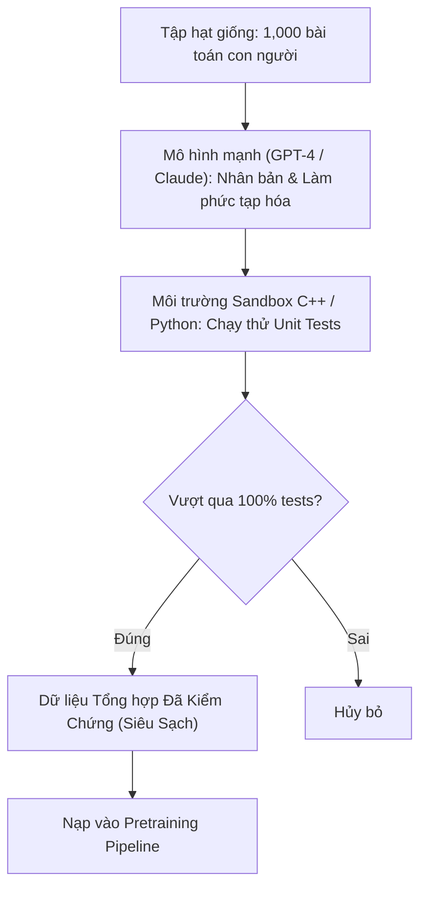

#### d. Code Thực chiến (Dual-Engine: C++ & Python)

```cpp
// C++17: Kiểm tra tính hợp lệ cơ bản của dữ liệu tổng hợp (Format & Length Verification)
#include <iostream>
#include <string>

bool verify_synthetic_sample(const std::string& question, const std::string& answer) {
    if (question.size() < 10 || answer.size() < 20) return false;
    // Kiểm tra có chứa từ khóa giải thích
    if (answer.find("because") == std::string::npos && 
        answer.find("therefore") == std::string::npos &&
        answer.find("step") == std::string::npos) {
        return false;
    }
    return true;
}

int main() {
    std::string q = "What is 15 * 12?";
    std::string a = "To calculate this, step 1 is 15 * 10 = 150. Therefore, 150 + 30 = 180.";
    std::cout << "Synthetic sample valid: " << (verify_synthetic_sample(q, a) ? "PASS" : "FAIL") << "\n";
    return 0;
}
```

```python
# Python: Triển khai kỹ thuật Evol-Instruct mở rộng câu hỏi đơn giản
def evol_instruct_prompt(simple_prompt: str) -> str:
    return f"""I want you to act as an Instruction Rewriter.
Your task is to take this simple question and rewrite it to make it more complex, detailed, and challenging.
Original Question: {simple_prompt}
Rewritten Complex Question:"""

print(evol_instruct_prompt("How does a binary search tree work?"))
```

#### e. Lỗi Thường gặp & Ổn định Số học (Pitfalls & Numerical Stability)
- **Model Collapse (Sụp đổ Mô hình)**: Nghiên cứu toán học trên tạp chí Nature (Shumailov et al., 2024) chứng minh rằng: Nếu huấn luyện mô hình thế hệ sau trên dữ liệu tổng hợp không được kiểm chứng sinh ra từ mô hình thế hệ trước, qua nhiều thế hệ các mode ở đuôi phân phối sẽ biến mất hoàn toàn, dẫn đến suy thoái không thể phục hồi (Model Collapse). Bắt buộc phải có **Verifiable Feedback Loop**.

#### f. Ứng dụng Thực chiến trong AI / Deep Learning (AI Applications)
- Microsoft Phi-3/Phi-4, DeepSeek-R1 (dùng dữ liệu tổng hợp Reasoning từ mô hình lớn), UltraChat.

---

### 15. Instruction Data (Dữ liệu Câu lệnh)

#### a. Định nghĩa Bản chất Toán học (Mathematical Formulation)
**Instruction Data** là định dạng dữ liệu có cấu trúc cặp đôi (hoặc bộ ba) mô phỏng tương tác giữa người dùng và trợ lý trí tuệ nhân tạo:
$$z = (\mathbf{x}_{\text{prompt}}, \mathbf{y}_{\text{completion}})$$
hoặc bao gồm cả chỉ dẫn hệ thống:
$$z = (\mathbf{s}_{\text{system}}, \mathbf{u}_{\text{user}}, \mathbf{r}_{\text{response}})$$
Mặc dù Instruction Data là trọng tâm của giai đoạn Tinh chỉnh Giám sát (SFT), nhưng trong các kiến trúc LLM hiện đại, một tỷ lệ nhỏ Instruction Data chất lượng cao ($\approx 2\% - 5\%$) được đưa trực tiếp vào **giai đoạn cuối của quá trình Pretraining (Pretraining Annealing)**:
$$\mathcal{L}_{\text{blend}}(\theta) = (1 - \lambda)\mathcal{L}_{\text{pretrain}} + \lambda \mathcal{L}_{\text{instruction}}$$
Việc này giúp mô hình hình thành khả năng tuân thủ mệnh lệnh và đối thoại ngay từ trong không gian trọng số gốc.

#### b. Cơ chế Tầng Sâu & Điện toán (Under The Hood / Hardware Internals)
- **Masking Prompt Loss (Hủy Gradient trên Prompt)**: Khi huấn luyện trên Instruction Data, mô hình không cần phải học cách dự đoán lại câu hỏi của người dùng mà chỉ cần học cách sinh ra câu trả lời. Trong hàm mất mát, toàn bộ các token thuộc phần Prompt được gán nhãn $-100$ (`ignore_index` trong PyTorch), chỉ truyền gradient trên các token thuộc phần Response.

#### c. Sơ đồ Minh họa (Mermaid / ASCII Diagram)
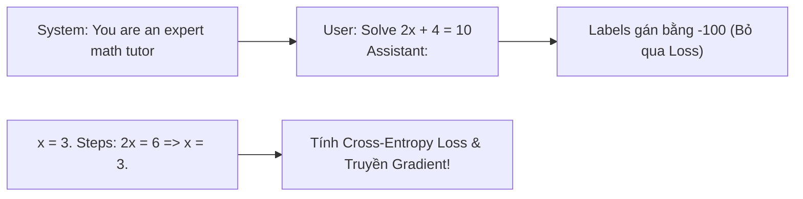

#### d. Code Thực chiến (Dual-Engine: C++ & Python)

```cpp
// C++17: Gán nhãn -100 cho các token Prompt để bỏ qua tính Gradient
#include <iostream>
#include <vector>

std::vector<int> mask_prompt_labels(
    const std::vector<int>& full_sequence, 
    size_t prompt_token_count) 
{
    const int IGNORE_INDEX = -100;
    std::vector<int> labels = full_sequence;
    for (size_t i = 0; i < prompt_token_count && i < labels.size(); ++i) {
        labels[i] = IGNORE_INDEX;
    }
    return labels;
}

int main() {
    std::vector<int> seq = {10, 20, 30, 40, 50}; // 3 tokens prompt, 2 tokens response
    auto labels = mask_prompt_labels(seq, 3);
    std::cout << "Training Labels: ";
    for (int l : labels) std::cout << l << " ";
    std::cout << "\n";
    return 0;
}
```

```python
# Python / PyTorch: Thiết lập Labels che phủ Prompt trong Data Collator
import torch
import torch.nn.functional as F

def collate_instruction_pair(prompt_ids, response_ids, vocab_size=1000):
    input_ids = torch.cat([prompt_ids, response_ids], dim=0)
    # Target giống input_ids nhưng prompt bị gán bằng -100
    labels = torch.cat([
        torch.full_like(prompt_ids, -100),
        response_ids
    ], dim=0)
    return input_ids, labels

p = torch.tensor([101, 2054, 102])
r = torch.tensor([2003, 1037, 4937])
inputs, targets = collate_instruction_pair(p, r)
print("Input IDs:", inputs.tolist())
print("Labels (Prompt Masked):", targets.tolist())
```

#### e. Lỗi Thường gặp & Ổn định Số học (Pitfalls & Numerical Stability)
- **Rò rỉ Loss trên System Prompt**: Nếu tính loss trên toàn bộ chuỗi bao gồm cả System Prompt, mô hình sẽ học thói quen tự sinh lại cấu trúc mẫu câu của chính mình thay vì tập trung vào nội dung trả lời.

#### f. Ứng dụng Thực chiến trong AI / Deep Learning (AI Applications)
- FLAN (Wei et al., Google), OpenAssistant, LMSYS Chatbot Arena datasets, UltraFeedback.
