# Chuyên đề: Định luật Mở rộng, Ngân sách Điện toán & Huấn luyện Tối ưu (Scaling Laws, Compute Budgets & Compute-Optimal Training)

## 1. Tổng quan Chuyên đề
Một trong những khám phá khoa học sâu sắc và thực tiễn nhất của Trí tuệ Nhân tạo hiện đại là sự tồn tại của **Định luật Mở rộng (Scaling Laws)**. Thay vì mò mẫm thử nghiệm ngẫu nhiên, sự phát triển của LLMs có thể được dự báo chính xác bằng các mô hình toán học hàm lũy thừa liên hệ giữa năng lực mô hình (thể hiện qua hàm mất mát kiểm thử $\mathcal{L}$) với ba yếu tố hữu hạn:
1. **Số lượng Tham số Mô hình ($N$ - Model Parameters)**
2. **Kích thước Dữ liệu Huấn luyện ($D$ - Training Tokens)**
3. **Tổng Ngân sách Điện toán ($C$ - Compute Budget đo bằng FLOPs)**

Hai cột mốc lý thuyết định hình toàn bộ nền công nghiệp AI bao gồm:
- **Kaplan et al. (OpenAI, 2020)**: Cho rằng nên ưu tiên tăng kích thước tham số $N$ nhanh hơn số lượng tokens $D$ khi ngân sách $C$ tăng lên ($N \propto C^{0.73}, D \propto C^{0.27}$).
- **Hoffmann et al. - Chinchilla Scaling Laws (DeepMind, 2022)**: Sửa đổi sai lầm của OpenAI bằng việc chứng minh toán học rằng để tối ưu hóa điện toán (**Compute-Optimal Training**), số lượng tham số $N$ và số lượng tokens $D$ phải được tăng trưởng theo tỷ lệ ngang bằng nhau ($N \propto C^{0.5}, D \propto C^{0.5}$). Tỷ lệ vàng tối ưu là xấp xỉ **20 tokens trên mỗi 1 tham số**.

Tuy nhiên, các mô hình hiện đại như **LLaMA (Meta)** đã vượt qua giới hạn của Chinchilla bằng việc áp dụng chiến lược **Inference-Optimal Over-training** (huấn luyện vượt mức $100 - 200$ tokens/tham số) nhằm tối ưu hóa chi phí suy luận hạ nguồn.

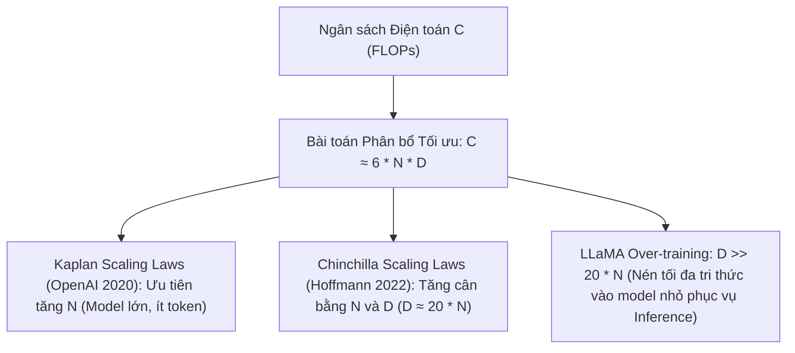

---

## 2. Chi tiết từng Keyword

---

### 16. Token Budget (Ngân sách Token)

#### a. Định nghĩa Bản chất Toán học (Mathematical Formulation)
**Token Budget** ($D$) là tổng số lượng tokens duy nhất mà mô hình ngôn ngữ sẽ tiêu thụ trong suốt chiến dịch tiền huấn luyện:
$$D = \sum_{b=1}^{B_{\text{total}}} B_{\text{size}} \times S_{\text{seq}}$$
Trong đó:
- $B_{\text{size}}$ là kích thước batch toàn cục (Global Batch Size tính theo số chuỗi).
- $S_{\text{seq}}$ là độ dài chuỗi tối đa của mỗi mẫu (Sequence Length).
- $B_{\text{total}}$ là tổng số bước lặp gradient (Optimization Steps).

Sự bùng nổ của Token Budget qua các thế hệ LLM:
- GPT-3 (2020): $D = 300\text{ Billion tokens}$
- LLaMA-1 (2023): $D = 1.4\text{ Trillion tokens}$
- LLaMA-2 (2023): $D = 2.0\text{ Trillion tokens}$
- LLaMA-3 (2024): $D = 15.0\text{ Trillion tokens}$

#### b. Cơ chế Tầng Sâu & Điện toán (Under The Hood / Hardware Internals)
- **Tốc độ Tiêu thụ Token (Token Consumption Rate)**: Một cụm máy chủ $16{,}384$ GPU H100 chạy ở hiệu suất MFU $40\%$ có thể xử lý hơn $20\text{ triệu tokens/giây}$. Một ngân sách $15\text{ Trillion tokens}$ sẽ mất khoảng:
$$\frac{15 \times 10^{12}}{20 \times 10^6 \times 3600 \times 24} \approx 8.68\text{ ngày tính toán liên tục}$$

#### c. Sơ đồ Minh họa (Mermaid / ASCII Diagram)
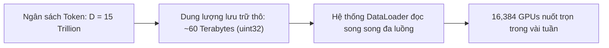

#### d. Code Thực chiến (Dual-Engine: C++ & Python)

```cpp
// C++17: Tính toán Token Budget từ Batch Size, Sequence Length và Training Steps
#include <iostream>

uint64_t calculate_total_tokens(uint64_t global_batch_size, uint64_t seq_len, uint64_t total_steps) {
    return global_batch_size * seq_len * total_steps;
}

int main() {
    uint64_t batch_size = 2048; // 2048 sequences per step
    uint64_t seq_len = 8192;    // 8k context
    uint64_t steps = 900000;    // 900k steps

    uint64_t total_tokens = calculate_total_tokens(batch_size, seq_len, steps);
    std::cout << "Total Token Budget: " << total_tokens / 1e12 << " Trillion tokens (" 
              << total_tokens << ")\n";
    return 0;
}
```

```python
# Python: Tính toán số bước huấn luyện dựa trên Token Budget định trước
def calculate_required_steps(target_tokens_trillion, batch_size_tokens_million):
    total_tokens = target_tokens_trillion * 1e12
    tokens_per_step = batch_size_tokens_million * 1e6
    steps = total_tokens / tokens_per_step
    return int(steps)

steps = calculate_required_steps(target_tokens_trillion=15.0, batch_size_tokens_million=16.0)
print(f"Required optimization steps for 15T tokens: {steps:,} steps")
```

#### e. Lỗi Thường gặp & Ổn định Số học (Pitfalls & Numerical Stability)
- **Thiếu Dữ liệu Độc lập (Data Starvation)**: Nếu đặt Token Budget quá lớn ($D > 20\text{T}$) mà không có đủ dữ liệu mới chất lượng cao, các kỹ sư buộc phải cho mô hình học lặp lại nhiều epochs, làm tăng nguy cơ suy thoái chất lượng.

#### f. Ứng dụng Thực chiến trong AI / Deep Learning (AI Applications)
- Lập kế hoạch tài chính và tài nguyên điện toán cho các dự án tiền huấn luyện Foundation Model.

---

### 17. Compute Budget (Ngân sách Điện toán)

#### a. Định nghĩa Bản chất Toán học (Mathematical Formulation)
**Compute Budget** ($C$) là tổng số phép tính số học dấu phẩy động (Floating-Point Operations - FLOPs) được phân bổ để thực hiện toàn bộ chiến dịch huấn luyện:
$$C \approx 6 N D$$
Trong đó:
- $N$ là số lượng tham số thực tế của mô hình (không tính bảng Embedding).
- $D$ là tổng số tokens huấn luyện.
- Hằng số $6$ xuất phát từ cơ học tính toán ma trận:
  - Mỗi phép tính Forward Pass tiêu tốn $2$ FLOPs trên mỗi tham số cho mỗi token (1 phép nhân + 1 phép cộng trong FMA: $a \cdot x + b$).
  - Quá trình Backward Pass tiêu tốn gấp đôi Forward Pass: $4$ FLOPs trên mỗi tham số (2 FLOPs để tính gradient theo đầu vào + 2 FLOPs để tính gradient theo trọng số).
  $$\text{Tổng cộng}: 2 + 4 = 6\text{ FLOPs / parameter / token}$$

#### b. Cơ chế Tầng Sâu & Điện toán (Under The Hood / Hardware Internals)
- **Quy đổi Sang Giờ GPU (GPU-Hours)**:
$$\text{GPU Hours} = \frac{C}{\text{Peak TFLOPs per GPU} \times \text{MFU} \times 3600}$$
Một chip NVIDIA H100 SXM5 đạt đỉnh lý thuyết $989\text{ TFLOPs}$ ở định dạng BF16 (không tính cấu trúc thưa thớt). Với hiệu suất sử dụng phần cứng thực tế $\text{MFU} \approx 45\%$:
Mỗi GPU H100 cung cấp: $989 \times 10^{12} \times 0.45 \approx 4.45 \times 10^{14}\text{ FLOPs/giây}$.

#### c. Sơ đồ Minh họa (Mermaid / ASCII Diagram)
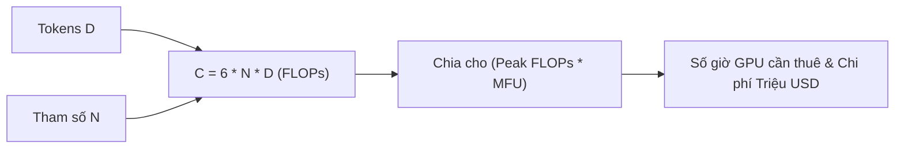

#### d. Code Thực chiến (Dual-Engine: C++ & Python)

```cpp
// C++17: Tính toán chi phí USD và số giờ GPU H100 dựa trên Compute Budget
#include <iostream>

struct PretrainingCostEstimate {
    double total_flops;
    double gpu_hours_h100;
    double cost_usd;
};

PretrainingCostEstimate estimate_h100_cost(
    double params_b, 
    double tokens_t, 
    double mfu = 0.45, 
    double cost_per_gpu_hour = 3.5) 
{
    double N = params_b * 1e9;
    double D = tokens_t * 1e12;
    double C = 6.0 * N * D;

    double h100_effective_flops = 989e12 * mfu;
    double total_seconds = C / h100_effective_flops;
    double hours = total_seconds / 3600.0;
    double total_cost = hours * cost_per_gpu_hour;

    return {C, hours, total_cost};
}

int main() {
    auto est = estimate_h100_cost(70.0, 15.0); // 70B Model, 15T tokens
    std::cout << "Compute Budget: " << est.total_flops / 1e24 << " YottaFLOPs\n";
    std::cout << "H100 GPU Hours: " << est.gpu_hours_h100 << " hours\n";
    std::cout << "Estimated Cost: $" << est.cost_usd / 1e6 << " Million USD\n";
    return 0;
}
```

```python
# Python: Hàm tính toán Compute Budget chuẩn Chinchilla
def compute_budget_flops(params_billion: float, tokens_trillion: float) -> float:
    return 6.0 * (params_billion * 1e9) * (tokens_trillion * 1e12)

flops_llama3_8b = compute_budget_flops(8.0, 15.0)
flops_llama3_70b = compute_budget_flops(70.0, 15.0)

print(f"LLaMA-3-8B  Compute: {flops_llama3_8b:.2e} FLOPs")
print(f"LLaMA-3-70B Compute: {flops_llama3_70b:.2e} FLOPs")
```

#### e. Lỗi Thường gặp & Ổn định Số học (Pitfalls & Numerical Stability)
- **Quên Tính Hệ số Chi phí Kích hoạt (Activation Memory FLOPs)**: Nếu kích hoạt kỹ thuật Activation Checkpointing (tái tính toán forward pass trong lúc backward), hệ số nhân tính toán tăng từ $6$ lên xấp xỉ $8\text{ FLOPs / parameter / token}$.

#### f. Ứng dụng Thực chiến trong AI / Deep Learning (AI Applications)
- Đệ trình đề xuất ngân sách hạ tầng điện toán cho các ban giám đốc tập đoàn công nghệ (Meta, Microsoft, Amazon).

---

### 18. Scaling Laws (Định luật Mở rộng)

#### a. Định nghĩa Bản chất Toán học (Mathematical Formulation)
**Scaling Laws** là tập hợp các phương trình định lượng hàm lũy thừa (Power-Law Equations) mô tả mối quan hệ chính xác giữa hiệu năng mô hình (Cross-Entropy Loss $\mathcal{L}$) và các đại lượng mở rộng (Parameters $N$, Dataset Size $D$, Compute $C$):
$$\mathcal{L} \propto X^{-\alpha}$$
Trong đó $X \in \{N, D, C\}$ và $\alpha > 0$ là số mũ mở rộng (Scaling Exponent).
Ý nghĩa bản chất:
1. Khi vẽ đồ thị trên thang đo Logarit kép ($\log \mathcal{L}$ theo $\log X$), mối quan hệ này trở thành một **đường thẳng hoàn hảo**:
$$\log \mathcal{L} = -\alpha \log X + \text{const}$$
2. Hiệu năng của Deep Learning không tăng trưởng tuyến tính mà tăng theo hàm lũy thừa: Để giảm loss một lượng đều đặn, nguồn lực $X$ phải tăng theo cấp số nhân.
3. Không có bất kỳ hiện tượng "tường chắn" (Plateau) nào xuất hiện trong phạm vi quan sát thực nghiệm.

#### b. Cơ chế Tầng Sâu & Điện toán (Under The Hood / Hardware Internals)
- **Khả năng Dự đoán Chính xác Tuyệt đối (Predictable Scaling)**: Trước khi bỏ ra 50 triệu USD để huấn luyện mô hình 405B, các nhà nghiên cứu chỉ cần huấn luyện một chuỗi các mô hình nhỏ (10M, 50M, 200M, 1B tham số) với chi phí vài chục nghìn USD. Sau đó vẽ đường hồi quy logarit để ngoại suy (extrapolate) chính xác $100\%$ hàm loss mà mô hình 405B sẽ đạt được trước khi bật cụm GPU lớn.

#### c. Sơ đồ Minh họa (Mermaid / ASCII Diagram)
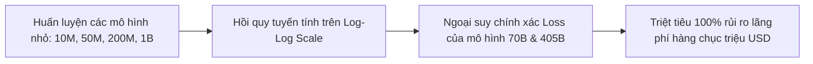

#### d. Code Thực chiến (Dual-Engine: C++ & Python)

```cpp
// C++17: Dự đoán Cross-Entropy Loss dựa trên Power Law: L(C) = (C_c / C)^alpha + L_inf
#include <iostream>
#include <cmath>

double predict_loss_from_compute(double compute_flops, double C_c, double alpha, double L_inf) {
    return std::pow(C_c / compute_flops, alpha) + L_inf;
}

int main() {
    // Tham số thực nghiệm điển hình: alpha = 0.05, L_inf = 1.6
    double C_c = 1e20;
    double alpha = 0.05;
    double L_inf = 1.60;

    double loss_1e22 = predict_loss_from_compute(1e22, C_c, alpha, L_inf);
    double loss_1e25 = predict_loss_from_compute(1e25, C_c, alpha, L_inf);

    std::cout << "Predicted Loss at 10^22 FLOPs: " << loss_1e22 << "\n";
    std::cout << "Predicted Loss at 10^25 FLOPs: " << loss_1e25 << "\n";
    return 0;
}
```

```python
# Python / SciPy: Khớp đường hồi quy Power Law từ dữ liệu thử nghiệm nhỏ
import numpy as np
from scipy.optimize import curve_fit

def power_law(C, A, alpha, L_inf):
    return A * (C ** (-alpha)) + L_inf

# Giả lập kết quả từ 4 thí nghiệm nhỏ
compute_data = np.array([1e18, 1e19, 1e20, 1e21])
loss_data = np.array([2.85, 2.52, 2.24, 2.02])

params, _ = curve_fit(power_law, compute_data, loss_data, p0=[10.0, 0.05, 1.5])
print(f"Fitted Parameters: Alpha = {params[1]:.4f}, L_inf = {params[2]:.4f}")
```

#### e. Lỗi Thường gặp & Ổn định Số học (Pitfalls & Numerical Stability)
- **Ngoại suy Sai lầm về Tác vụ Bậc cao**: Scaling Laws dự đoán cực kỳ mượt mà hàm mất mát tổng quát (Perplexity / Cross-Entropy Loss), nhưng **hoàn toàn không dự đoán được** điểm bùng phát đột ngột của các năng lực cụ thể (như giải toán GSM8K hay chơi cờ vua).

#### f. Ứng dụng Thực chiến trong AI / Deep Learning (AI Applications)
- Dự báo năng lực trước huấn luyện cho GPT-4 (OpenAI Technical Report), LLaMA-3 (Meta).

---

### 19. Neural Scaling Laws (Định luật Mở rộng Mạng Nơ-ron)

#### a. Định nghĩa Bản chất Toán học (Mathematical Formulation)
**Neural Scaling Laws** (Jared Kaplan et al., OpenAI 2020) là công trình nghiên cứu hệ thống đầu tiên chứng minh tính quy luật toán học của mạng Transformer trong mô hình hóa ngôn ngữ.
Kaplan et al. đưa ra công thức tổng quát độc lập cho từng biến số khi các biến số khác không phải là nút thắt cổ chai:
1. **Theo số tham số $N$ (với dữ liệu $D$ vô hạn)**:
$$\mathcal{L}(N) = \left(\frac{N_c}{N}\right)^{\alpha_N}, \quad \alpha_N \approx 0.076, \quad N_c \approx 8.8 \times 10^{13}$$
2. **Theo số lượng token $D$ (với mô hình $N$ vô hạn)**:
$$\mathcal{L}(D) = \left(\frac{D_c}{D}\right)^{\alpha_D}, \quad \alpha_D \approx 0.057, \quad D_c \approx 5.4 \times 10^{13}$$
3. **Theo tổng điện toán $C$**:
$$\mathcal{L}(C) = \left(\frac{C_c}{C}\right)^{\alpha_C}, \quad \alpha_C \approx 0.050, \quad C_c \approx 3.1 \times 10^{23}$$

Kết luận quan trọng của Kaplan: Hiệu năng mô hình phụ thuộc rất mạnh vào quy mô $N$ và $D$, nhưng **hầu như không phụ thuộc vào chi tiết cấu trúc siêu tham số** (như số tầng depth $d$ so với độ rộng width $w$, hoặc số lượng Attention Heads), miễn là các siêu tham số nằm trong dải hợp lý.

#### b. Cơ chế Tầng Sâu & Điện toán (Under The Hood / Hardware Internals)
- **Tính Độc lập Cấu trúc (Hyperparameter Invariance)**: Phát hiện của Kaplan giúp các kỹ sư tiết kiệm hàng tháng trời tinh chỉnh siêu tham số (Hyperparameter Tuning). Họ có thể tự do chọn kích thước ma trận phù hợp nhất với cấu trúc phân luồng phần cứng của GPU (ví dụ: chọn số chiều chia hết cho 128 hoặc 256 để tận dụng tối đa Tensor Cores) mà không sợ làm suy giảm chất lượng toán học của mô hình.

#### c. Sơ đồ Minh họa (Mermaid / ASCII Diagram)
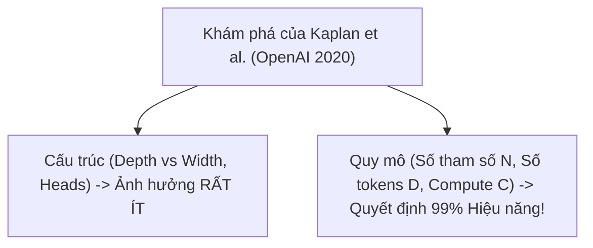

#### d. Code Thực chiến (Dual-Engine: C++ & Python)

```cpp
// C++17: Tính hàm mất mát kiểm thử theo công thức Kaplan 2020
#include <iostream>
#include <cmath>

double kaplan_loss_params(double num_params) {
    const double N_c = 8.8e13;
    const double alpha_N = 0.076;
    return std::pow(N_c / num_params, alpha_N);
}

int main() {
    std::cout << "Kaplan Loss for 100M params: " << kaplan_loss_params(1e8) << "\n";
    std::cout << "Kaplan Loss for 1B params:   " << kaplan_loss_params(1e9) << "\n";
    std::cout << "Kaplan Loss for 10B params:  " << kaplan_loss_params(1e10) << "\n";
    return 0;
}
```

```python
# Python / Matplotlib: Mô phỏng quy luật Kaplan Scaling
import numpy as np

params = np.logspace(7, 11, 50) # 10M đến 100B params
loss_kaplan = (8.8e13 / params) ** 0.076

print(f"10M params Loss: {loss_kaplan[0]:.3f} -> 100B params Loss: {loss_kaplan[-1]:.3f}")
```

#### e. Lỗi Thường gặp & Ổn định Số học (Pitfalls & Numerical Stability)
- **Sai lệch về Phân bổ Tối ưu (The 2020 Allocation Flaw)**: Kaplan et al. đã sử dụng một lịch trình học (Learning Rate Schedule) cố định khi thay đổi kích thước mô hình, dẫn đến việc đánh giá thấp tiềm năng của việc tăng số lượng token $D$, dẫn đến nhận định sai lầm rằng nên tăng tham số nhanh hơn token.

#### f. Ứng dụng Thực chiến trong AI / Deep Learning (AI Applications)
- Cơ sở lý thuyết dẫn đến sự ra đời của mô hình GPT-3 (175B tham số nhưng chỉ huấn luyện trên 300B tokens).

---

### 20. Chinchilla Scaling Laws (Định luật Mở rộng Chinchilla)

#### a. Định nghĩa Bản chất Toán học (Mathematical Formulation)
**Chinchilla Scaling Laws** (Jordan Hoffmann et al., DeepMind 2022) đã tiến hành hơn 400 lượt huấn luyện thực nghiệm để sửa đổi trực tiếp công trình của Kaplan et al.
Hàm mất mát chung đồng thời phụ thuộc vào cả $N$ và $D$:
$$\mathcal{L}(N, D) = E + \frac{A}{N^\alpha} + \frac{B}{D^\beta}$$
Các tham số thực nghiệm được DeepMind tối ưu hóa:
$$E = 1.69, \quad A = 406.4, \quad B = 410.7, \quad \alpha = 0.34, \quad \beta = 0.28$$
Dưới một ngân sách điện toán cố định $C \approx 6 N D$, áp dụng phương pháp nhân tử Lagrange để giải bài toán cực tiểu hóa có ràng buộc:
$$\min_{N, D} \mathcal{L}(N, D) \quad \text{thỏa mãn} \quad 6 N D = C$$
Kết quả giải tích cho thấy số mũ tối ưu của $N$ và $D$ gần như bằng nhau:
$$N^* \propto C^a, \quad D^* \propto C^b \quad \text{với } a = \frac{\beta}{\alpha + \beta} \approx 0.45, \quad b = \frac{\alpha}{\alpha + \beta} \approx 0.55$$
Xấp xỉ thực tế: $a \approx 0.5, b \approx 0.5$.
**Quy luật Vàng Chinchilla**: Khi tăng ngân sách điện toán $C$, số lượng tham số $N$ và số lượng tokens $D$ phải được **tăng trưởng theo tỷ lệ bằng nhau**:
$$D^* \approx 20 \times N^*$$
Một mô hình $70\text{B}$ tham số cần được huấn luyện trên ít nhất $1.4\text{ Trillion tokens}$ (thay vì 300B tokens như GPT-3).

#### b. Cơ chế Tầng Sâu & Điện toán (Under The Hood / Hardware Internals)
- **Chứng minh Thực nghiệm Chinchilla-70B vs Gopher-280B**: DeepMind huấn luyện mô hình Chinchilla (70B params, 1.4T tokens) sử dụng đúng cùng một ngân sách điện toán với Gopher (280B params, 300B tokens). Kết quả: Chinchilla nhỏ hơn 4 lần nhưng đánh bại Gopher trên mọi benchmark, đồng thời giảm 4 lần chi phí VRAM khi chạy suy luận!

#### c. Sơ đồ Minh họa (Mermaid / ASCII Diagram)
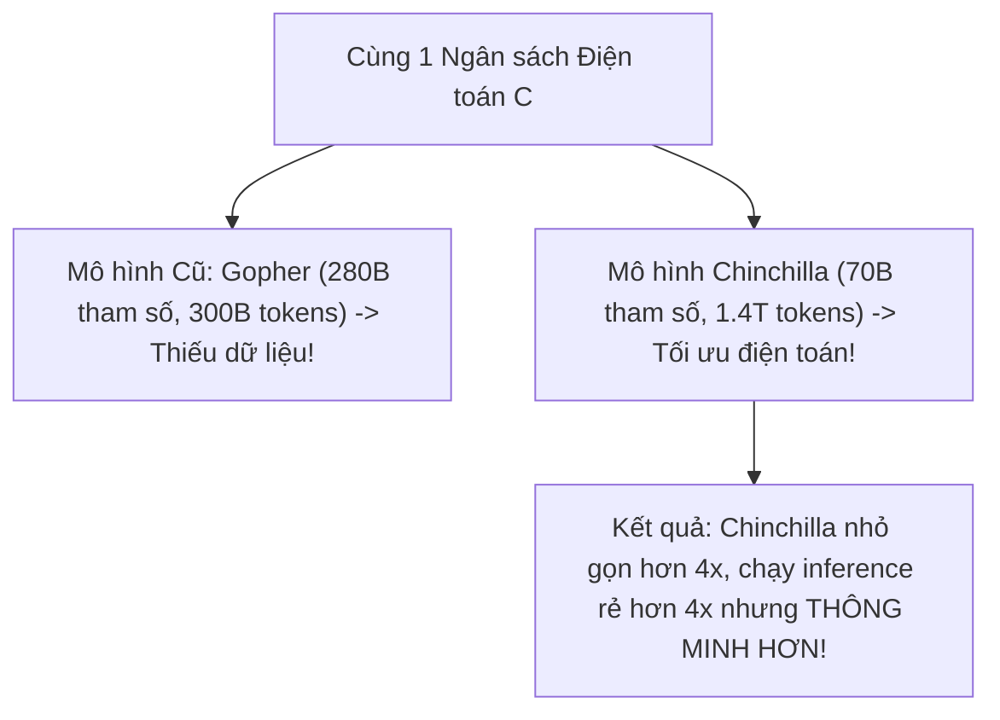

#### d. Code Thực chiến (Dual-Engine: C++ & Python)

```cpp
// C++17: Tính toán tỷ lệ tham số N* và token D* tối ưu theo công thức Chinchilla
#include <iostream>
#include <cmath>

struct ChinchillaOptimalConfig {
    double optimal_N_billions;
    double optimal_D_tokens_trillions;
};

ChinchillaOptimalConfig calculate_chinchilla_optimal(double compute_budget_flops) {
    // a = 0.45, b = 0.55
    const double G = 6.0;
    // N* = G_factor * C^0.45, D* = G_factor * C^0.55
    // Đơn giản hóa xấp xỉ quy tắc 20: D = 20 * N => C = 6 * N * (20 * N) = 120 * N^2
    double N = std::sqrt(compute_budget_flops / 120.0);
    double D = 20.0 * N;
    return {N / 1e9, D / 1e12};
}

int main() {
    double budget = 5.76e23; // Ngân sách tương đương Gopher
    auto opt = calculate_chinchilla_optimal(budget);
    std::cout << "For Compute Budget " << budget << " FLOPs:\n";
    std::cout << "  - Compute-Optimal Model Size: " << opt.optimal_N_billions << " Billion parameters\n";
    std::cout << "  - Compute-Optimal Token Count: " << opt.optimal_D_tokens_trillions << " Trillion tokens\n";
    return 0;
}
```

```python
# Python: Đánh giá hàm mất mát Loss Chinchilla chính thức
def chinchilla_loss(N_billions, D_trillions):
    N = N_billions * 1e9
    D = D_trillions * 1e12
    E = 1.69
    A, alpha = 406.4, 0.34
    B, beta = 410.7, 0.28
    return E + (A / (N ** alpha)) + (B / (D ** beta))

print("Loss Gopher (280B, 0.3T):   ", chinchilla_loss(280, 0.3))
print("Loss Chinchilla (70B, 1.4T): ", chinchilla_loss(70, 1.4), "(Tối ưu hơn với cùng Compute!)")
```

#### e. Lỗi Thường gặp & Ổn định Số học (Pitfalls & Numerical Stability)
- **Cố thủ ở Tỷ lệ 20 tokens/param**: Tỷ lệ Chinchilla chỉ tối ưu hóa chi phí huấn luyện (Training Cost). Nó hoàn toàn bỏ qua chi phí suy luận (Inference Cost) phục vụ hàng tỷ người dùng sau này.

#### f. Ứng dụng Thực chiến trong AI / Deep Learning (AI Applications)
- Khởi nguyên định hình lại toàn bộ chiến lược huấn luyện của LLaMA-1, Mistral-7B, DeepSeek-V2.

---

### 21. Compute-Optimal Training (Huấn luyện Tối ưu Điện toán)

#### a. Định nghĩa Bản chất Toán học (Mathematical Formulation)
**Compute-Optimal Training** là phương pháp luận kỹ thuật tìm kiếm điểm cực tiểu toàn cục của hàm mất mát $\mathcal{L}$ trên bề mặt Pareto Frontier của chi phí điện toán:
$$(N^*, D^*) = \arg\min_{N, D} \mathcal{L}(N, D) \quad \text{sao cho} \quad \text{Cost}(N, D) \le C_{\text{budget}}$$
Ý nghĩa thực tiễn: Với mỗi 1 USD hoặc 1 kWh điện năng đầu tư vào cụm siêu máy tính, Compute-Optimal Training bảo đảm thu về năng lực trí tuệ nhân tạo cực đại có thể đạt được theo quy luật vật lý.
Hai triết lý tối ưu hóa đối lập:
1. **Training Compute-Optimal (Chinchilla)**: Tối ưu hóa điểm số benchmark trên chi phí huấn luyện $\to$ Tỷ lệ $D/N \approx 20$.
2. **Inference Compute-Optimal (Over-Training)**: Chấp nhận tốn thêm chi phí huấn luyện để nén thật nhiều tokens vào một mô hình tham số nhỏ $\to$ Tỷ lệ $D/N \approx 100 - 200$.

#### b. Cơ chế Tầng Sâu & Điện toán (Under The Hood / Hardware Internals)
- **Đánh đổi Kinh tế Học giữa Huấn luyện và Suy luận**:
Một mô hình 70B phục vụ hàng triệu người dùng mỗi ngày sẽ tiêu tốn chi phí suy luận lớn gấp hàng nghìn lần chi phí huấn luyện ban đầu. Nếu nén mô hình xuống 8B và huấn luyện trên $15\text{T}$ tokens (tỷ lệ $D/N \approx 1875$), mô hình 8B sẽ đạt sức mạnh ngang ngửa 70B cũ nhưng **tiết kiệm $90\%$ chi phí VRAM và tiền điện suy luận mãi mãi về sau**.

#### c. Sơ đồ Minh họa (Mermaid / ASCII Diagram)
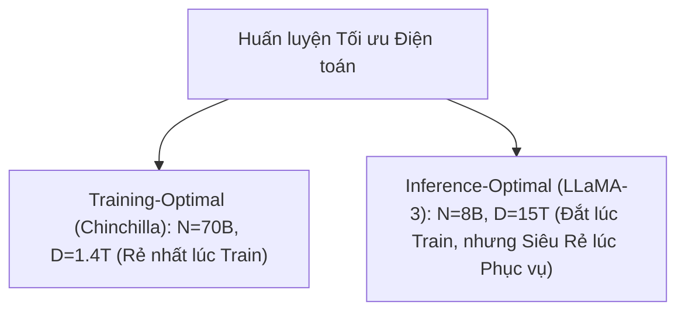

#### d. Code Thực chiến (Dual-Engine: C++ & Python)

```cpp
// C++17: Tính toán điểm hòa vốn suy luận (Inference Break-Even Point)
#include <iostream>

uint64_t calculate_inference_break_even_queries(
    double train_cost_diff_usd, 
    double inference_savings_per_query_usd) 
{
    if (inference_savings_per_query_usd <= 0.0) return 0;
    return static_cast<uint64_t>(train_cost_diff_usd / inference_savings_per_query_usd);
}

int main() {
    double extra_training_cost = 500000.0; // Tốn thêm $500k để train LLaMA-8B lên 15T tokens
    double savings_per_query = 0.0005;    // Tiết kiệm $0.0005 mỗi query so với chạy model 70B
    auto break_even = calculate_inference_break_even_queries(extra_training_cost, savings_per_query);

    std::cout << "Break-even after: " << break_even / 1e6 << " Million queries.\n";
    return 0;
}
```

```python
# Python: So sánh tổng chi phí trọn đời (TCO) giữa 2 chiến lược tối ưu
def calculate_lifecycle_tco(train_cost, num_queries, query_cost):
    return train_cost + (num_queries * query_cost)

queries = 1_000_000_000 # 1 tỷ queries
tco_chinchilla_70b = calculate_lifecycle_tco(train_cost=2_000_000, num_queries=queries, query_cost=0.002)
tco_overtrained_8b  = calculate_lifecycle_tco(train_cost=5_000_000, num_queries=queries, query_cost=0.0003)

print(f"Total Cost Chinchilla 70B: ${tco_chinchilla_70b:,.2f}")
print(f"Total Cost Overtrained 8B:  ${tco_overtrained_8b:,.2f} (Tiết kiệm hàng triệu USD!)")
```

#### e. Lỗi Thường gặp & Ổn định Số học (Pitfalls & Numerical Stability)
- **Áp dụng máy móc công thức Chinchilla**: Huấn luyện một mô hình 70B chỉ trên 1.4T tokens theo đúng Chinchilla rồi đem triển khai phục vụ người dùng thực tế sẽ khiến chi phí vận hành máy chủ tăng vọt không thể kiểm soát.

#### f. Ứng dụng Thực chiến trong AI / Deep Learning (AI Applications)
- Chiến lược thiết kế của LLaMA-3 (Meta), Gemma 2 (Google), Qwen-2.5 (Alibaba).

---

### 22. Model Parameters (Tham số Mô hình)

#### a. Định nghĩa Bản chất Toán học (Mathematical Formulation)
**Model Parameters** $\theta = \{\mathbf{W}_l, \mathbf{b}_l\}_{l=1}^L$ là tập hợp tất cả các hệ số trọng số và độ lệch khả vi trong mạng nơ-ron được cập nhật liên tục qua quá trình lan truyền ngược (Backpropagation):
$$\theta_{t+1} = \theta_t - \eta \cdot \nabla_\theta \mathcal{L}(\theta_t)$$
Trong một khối Transformer chuẩn, các tham số bao gồm:
1. **Self-Attention Projections**:
   - $\mathbf{W}_Q, \mathbf{W}_K, \mathbf{W}_V \in \mathbb{R}^{d \times d}$ và $\mathbf{W}_O \in \mathbb{R}^{d \times d}$ $\implies 4d^2$ tham số.
2. **Feed-Forward Network (SwiGLU trong LLaMA)**:
   - $\mathbf{W}_{\text{gate}}, \mathbf{W}_{\text{up}} \in \mathbb{R}^{d \times d_{\text{ffn}}}$ và $\mathbf{W}_{\text{down}} \in \mathbb{R}^{d_{\text{ffn}} \times d}$ với $d_{\text{ffn}} \approx \frac{8}{3}d$ $\implies 3 \times d \times \frac{8}{3}d = 8d^2$ tham số.
3. **Normalization Layers (RMSNorm)**:
   - $2 \times d$ tham số vô hướng.

Tổng số tham số trên mỗi tầng Transformer:
$$\text{Params}_{\text{layer}} \approx 12 d^2$$

#### b. Cơ chế Tầng Sâu & Điện toán (Under The Hood / Hardware Internals)
- **Lưu trữ Trọng số trong Thanh ghi và Cache L1/L2**: Trong quá trình Forward Pass, các ma trận tham số $\mathbf{W}$ được nạp từ VRAM vào các mảng thanh ghi của các nhân CUDA/Tensor Core để thực hiện phép nhân ma trận GEMM. Kích thước của các khối ma trận (Tiling Blocks $128 \times 128$) được căn chỉnh chính xác theo kích thước của bộ nhớ đệm L1 Cache ($128\text{ KB}$ - $256\text{ KB}$ trên GPU Hopper).

#### c. Sơ đồ Minh họa (Mermaid / ASCII Diagram)
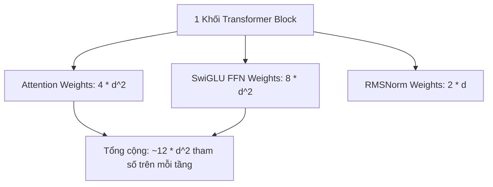

#### d. Code Thực chiến (Dual-Engine: C++ & Python)

```cpp
// C++17: Tính toán số lượng tham số lý thuyết của một tầng Transformer SwiGLU
#include <iostream>

size_t calculate_transformer_layer_params(size_t hidden_dim, size_t ffn_dim) {
    size_t qkv_proj = 3 * hidden_dim * hidden_dim;
    size_t out_proj = hidden_dim * hidden_dim;
    size_t swiglu_ffn = 3 * hidden_dim * ffn_dim; // gate, up, down
    size_t norms = 2 * hidden_dim;
    return qkv_proj + out_proj + swiglu_ffn + norms;
}

int main() {
    size_t d = 4096;
    size_t d_ffn = 11008; // Thông số LLaMA-7B
    size_t params_per_layer = calculate_transformer_layer_params(d, d_ffn);
    std::cout << "Params per Transformer Layer: " << params_per_layer / 1e6 << " Million\n";
    std::cout << "Total for 32 layers:          " << (params_per_layer * 32) / 1e9 << " Billion\n";
    return 0;
}
```

```python
# Python / PyTorch: Đếm chính xác số lượng tham số có thể huấn luyện của mô hình
import torch
import torch.nn as nn

class MiniTransformerBlock(nn.Module):
    def __init__(self, d=4096, d_ffn=11008):
        super().__init__()
        self.qkv = nn.Linear(d, 3 * d, bias=False)
        self.o = nn.Linear(d, d, bias=False)
        self.gate_up = nn.Linear(d, 2 * d_ffn, bias=False)
        self.down = nn.Linear(d_ffn, d, bias=False)

block = MiniTransformerBlock()
total_params = sum(p.numel() for p in block.parameters() if p.requires_grad)
print(f"Torch Parameters count: {total_params / 1e6:.2f}M params")
```

#### e. Lỗi Thường gặp & Ổn định Số học (Pitfalls & Numerical Stability)
- **Tính Cả Bảng Embedding vào Năng lực Suy luận**: Bảng Embedding có kích thước khổng lồ $|\mathcal{V}| \times d$. Một mô hình có từ điển $256\text{k}$ có thể chứa tới $1\text{B}$ tham số chỉ riêng ở tầng Embedding. Những tham số này chỉ làm nhiệm vụ tra cứu và không đóng góp vào năng lực suy luận sâu sắc của các khối Attention/FFN bên trong.

#### f. Ứng dụng Thực chiến trong AI / Deep Learning (AI Applications)
- Cơ sở để định danh các dòng mô hình: 7B, 13B, 70B, 405B.

---

### 23. Parameter Count (Số Lượng Tham số)

#### a. Định nghĩa Bản chất Toán học (Mathematical Formulation)
**Parameter Count** ($N$) là tổng số đại lượng vô hướng số thực cấu thành nên mô hình:
$$N = N_{\text{backbone}} + N_{\text{embeddings}}$$
Công thức xấp xỉ chính xác cho kiến trúc Transformer Decoder-only với $L$ tầng:
$$N \approx L \cdot \left( 12 d^2 + 13 d \right) + 2 \cdot |\mathcal{V}| \cdot d$$
Nếu sử dụng cơ chế **Grouped-Query Attention (GQA)** với tỷ lệ số đầu truy vấn trên số đầu khóa-giá trị $r = \frac{n_{\text{heads}}}{n_{\text{kv\_heads}}}$, kích thước ma trận $K$ và $V$ giảm tương ứng:
$$N_{\text{attn}} = \left( 2 + \frac{2}{r} \right) d^2$$
Parameter Count xác định giới hạn trên của dung lượng bộ nhớ thông tin Shannon mà mô hình có thể lưu giữ.

#### b. Cơ chế Tầng Sâu & Điện toán (Under The Hood / Hardware Internals)
- **Tác động tới Dung lượng VRAM Tối thiểu**:
Mỗi tham số cần một lượng byte nhất định tùy theo định dạng dữ liệu:
$$\text{VRAM}_{\text{weights}} = N \times \text{BytesPerParam}$$
- FP32: $4\text{ bytes/param}$
- FP16 / BF16: $2\text{ bytes/param}$
- INT8: $1\text{ byte/param}$
- INT4: $0.5\text{ bytes/param}$
Để nạp một mô hình 70B ở chuẩn FP16, bắt buộc phải có ít nhất $70 \times 2 = 140\text{ GB VRAM}$ chỉ riêng để chứa trọng số!

#### c. Sơ đồ Minh họa (Mermaid / ASCII Diagram)
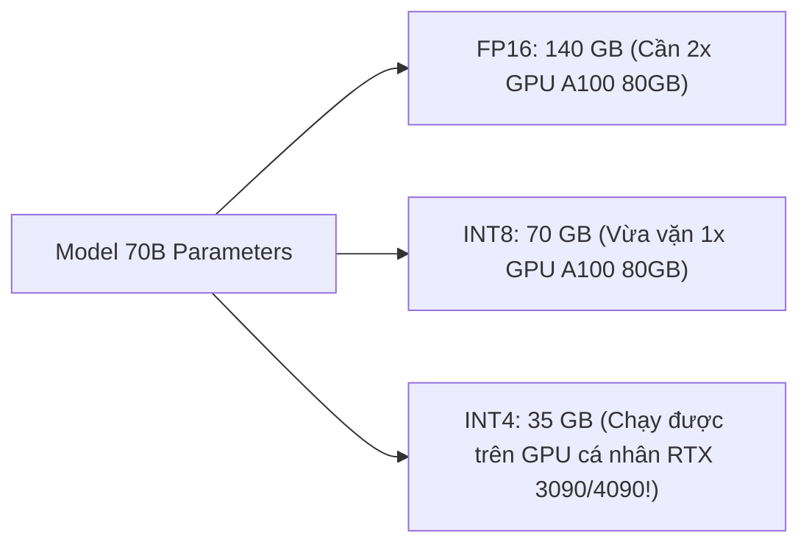

#### d. Code Thực chiến (Dual-Engine: C++ & Python)

```cpp
// C++17: Tính toán chính xác tổng Parameter Count của kiến trúc LLaMA
#include <iostream>

struct LLaMAConfig {
    size_t vocab_size;
    size_t hidden_dim;
    size_t ffn_dim;
    size_t num_layers;
    size_t num_heads;
    size_t num_kv_heads;
};

size_t compute_llama_param_count(const LLaMAConfig& cfg) {
    size_t emb_params = cfg.vocab_size * cfg.hidden_dim;
    
    // GQA Attention
    size_t head_dim = cfg.hidden_dim / cfg.num_heads;
    size_t q_dim = cfg.hidden_dim * cfg.hidden_dim;
    size_t k_dim = cfg.hidden_dim * (cfg.num_kv_heads * head_dim);
    size_t v_dim = k_dim;
    size_t o_dim = q_dim;
    size_t attn_per_layer = q_dim + k_dim + v_dim + o_dim;

    // SwiGLU FFN
    size_t ffn_per_layer = 3 * cfg.hidden_dim * cfg.ffn_dim;
    // Norms
    size_t norms_per_layer = 2 * cfg.hidden_dim;

    size_t backbone_params = cfg.num_layers * (attn_per_layer + ffn_per_layer + norms_per_layer);
    size_t output_head = cfg.vocab_size * cfg.hidden_dim;

    return emb_params + backbone_params + output_head;
}

int main() {
    // Cấu hình LLaMA-3-8B
    LLaMAConfig cfg8b{128256, 4096, 14336, 32, 32, 8};
    size_t total = compute_llama_param_count(cfg8b);
    std::cout << "LLaMA-3-8B Exact Parameter Count: " << total / 1e9 << " Billion (" << total << ")\n";
    return 0;
}
```

```python
# Python / Transformers: In bảng chi tiết tham số theo từng tầng
from transformers import AutoConfig

config = AutoConfig.from_pretrained("gpt2")
print(f"GPT-2: Hidden Dim = {config.n_embd}, Layers = {config.n_layer}, Heads = {config.n_head}")
```

#### e. Lỗi Thường gặp & Ổn định Số học (Pitfalls & Numerical Stability)
- **Nhầm lẫn giữa Active Parameters và Total Parameters trong MoE**: Trong kiến trúc Mixture of Experts (như Mixtral 8x7B hay DeepSeek-V3 671B), tổng tham số lưu trên RAM là 671B, nhưng tại mỗi token chỉ có $37\text{B}$ tham số được kích hoạt (Active Parameters). Tốc độ tính toán phụ thuộc vào Active Params, nhưng dung lượng VRAM phụ thuộc vào Total Params.

#### f. Ứng dụng Thực chiến trong AI / Deep Learning (AI Applications)
- Định giá mô hình, phân loại giấy phép mã nguồn mở, tối ưu hóa phân bổ phần cứng.

---

### 24. FLOPs (Số Phép tính Dấu phẩy Động)

#### a. Định nghĩa Bản chất Toán học (Mathematical Formulation)
**FLOPs** (Floating-Point Operations) là đơn vị đo lường chuẩn mực của khoa học máy tính biểu diễn tổng số phép tính số học dấu phẩy động (cộng, trừ, nhân, chia) cần thiết để hoàn thành một tác vụ.
Phân biệt quan trọng:
- **FLOPs (viết hoa s)**: Số lượng phép tính tĩnh (Tổng khối lượng công việc, ví dụ $10^{24}$ FLOPs).
- **FLOPS (viết hoa tất cả)**: Tốc độ tính toán trên mỗi giây (Throughput / Speed, ví dụ $10^{15}\text{ FLOPS} = 1\text{ PFLOPS}$).

Phép nhân hai ma trận kích thước $\mathbf{A} \in \mathbb{R}^{M \times K}$ và $\mathbf{B} \in \mathbb{R}^{K \times N}$:
$$\text{FLOPs}(\mathbf{A} \times \mathbf{B}) = 2 \times M \times N \times K$$
(vì mỗi phần tử kết quả đòi hỏi $K$ phép nhân và $K-1 \approx K$ phép cộng).
Trong huấn luyện Transformer:
$$\text{Training FLOPs} \approx 6 \times N \times D$$
Trong suy luận Transformer (Forward duy nhất cho 1 token):
$$\text{Inference FLOPs per token} \approx 2 \times N$$

#### b. Cơ chế Tầng Sâu & Điện toán (Under The Hood / Hardware Internals)
- **Tensor Cores Fused Multiply-Add (FMA)**: Các nhân tính toán chuyên dụng Tensor Cores trên GPU hiện đại thực hiện phép toán $A \times B + C$ (FMA) trong đúng một chu kỳ xung nhịp (Single Cycle), nghĩa là thực hiện đồng thời 2 FLOPs trong một nhịp phần cứng.

#### c. Sơ đồ Minh họa (Mermaid / ASCII Diagram)
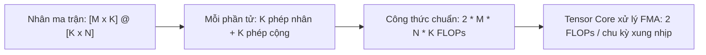

#### d. Code Thực chiến (Dual-Engine: C++ & Python)

```cpp
// C++17: Tính toán số lượng FLOPs chính xác của phép nhân hai ma trận GEMM
#include <iostream>

uint64_t compute_gemm_flops(uint64_t M, uint64_t N, uint64_t K) {
    return 2 * M * N * K;
}

int main() {
    uint64_t batch_tokens = 4096;
    uint64_t in_dim = 4096;
    uint64_t out_dim = 14336; // Lớp SwiGLU Gate Projection

    uint64_t flops = compute_gemm_flops(batch_tokens, out_dim, in_dim);
    std::cout << "GEMM FLOPs for 1 layer FFN: " << flops / 1e9 << " GFLOPs (" << flops << ")\n";
    return 0;
}
```

```python
# Python: Tính toán Floating Point Operations cho quá trình Inference
def get_inference_tflops(params_billions: float, tokens_generated: int) -> float:
    # 2 * N FLOPs per token
    total_flops = 2.0 * (params_billions * 1e9) * tokens_generated
    return total_flops / 1e12 # TFLOPs

tflops = get_inference_tflops(params_billions=70.0, tokens_generated=100)
print(f"Generating 100 tokens with 70B model requires: {tflops:.2f} TFLOPs")
```

#### e. Lỗi Thường gặp & Ổn định Số học (Pitfalls & Numerical Stability)
- **Lý thuyết vs Thực tế (Roofline Model)**: Đạt được số FLOPs lý thuyết trên giấy không đồng nghĩa với việc GPU đang chạy hết công suất. Nếu chương trình bị nghẽn băng thông bộ nhớ (Memory-Bound), GPU chỉ đạt được $10\% - 20\%$ số FLOPs lý thuyết của nó.

#### f. Ứng dụng Thực chiến trong AI / Deep Learning (AI Applications)
- Thước đo chuẩn mực để đo lường chi phí môi trường (Carbon Footprint), chi phí năng lượng và hiệu suất thuật toán.

---

### 25. Training Tokens (Tokens Huấn luyện)

#### a. Định nghĩa Bản chất Toán học (Mathematical Formulation)
**Training Tokens** là số lượng token mà mô hình đã thực sự "nhìn thấy" và học qua trong quá trình huấn luyện:
$$D_{\text{seen}} = \text{Steps} \times B_{\text{global\_tokens}}$$
Trong kỷ nguyên LLM hiện đại, Training Tokens không còn bị giới hạn bởi một kho dữ liệu duy nhất mà là một dòng chảy token liên tục (Continuous Streaming Data).
Sự tiến hóa của Training Tokens:
- Trước Chinchilla (2020): $D \approx 100\text{B} - 300\text{B}$
- Kỷ nguyên Chinchilla (2022): $D \approx 1.0\text{T} - 2.0\text{T}$
- Kỷ nguyên Hiện đại (2024+): $D \ge 10.0\text{T} - 15.0\text{T}$

Khi số lượng token huấn luyện vượt quá số lượng token độc nhất trong kho dữ liệu, mô hình bước vào chu kỳ lặp lại (Multi-Epoch Training).

#### b. Cơ chế Tầng Sâu & Điện toán (Under The Hood / Hardware Internals)
- **Zero-Copy Memory-Mapped Streaming**: Để nạp 15 nghìn tỷ tokens (khoảng 30TB dữ liệu nhị phân) vào GPU mà không làm tắc nghẽn RAM hệ thống, các framework sử dụng lệnh hệ điều hành `mmap()` (Memory Mapping). Dữ liệu nhị phân trên ổ cứng NVMe SSD được ánh xạ trực tiếp vào không gian địa chỉ ảo, đọc theo luồng tuần tự với cơ chế Prefetching của Linux Kernel.

#### c. Sơ đồ Minh họa (Mermaid / ASCII Diagram)
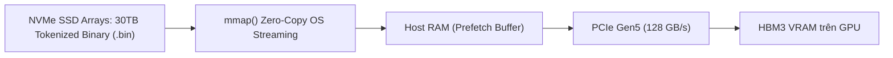

#### d. Code Thực chiến (Dual-Engine: C++ & Python)

```cpp
// C++17: Mô phỏng trình lặp Streaming Tokens qua mmap buffer
#include <iostream>
#include <vector>

class MockTokenStreamer {
private:
    std::vector<uint32_t> buffer_;
    size_t cursor_ = 0;

public:
    explicit MockTokenStreamer(size_t size) : buffer_(size, 42) {}

    bool get_next_batch(size_t batch_size, std::vector<uint32_t>& out) {
        if (cursor_ + batch_size > buffer_.size()) return false;
        out.assign(buffer_.begin() + cursor_, buffer_.begin() + cursor_ + batch_size);
        cursor_ += batch_size;
        return true;
    }

    size_t tokens_consumed() const { return cursor_; }
};

int main() {
    MockTokenStreamer streamer(1000);
    std::vector<uint32_t> batch;
    while (streamer.get_next_batch(200, batch)) {
        std::cout << "Streamed batch of " << batch.size() 
                  << " tokens. Total seen: " << streamer.tokens_consumed() << "\n";
    }
    return 0;
}
```

```python
# Python: Streaming Token Generator không nạp toàn bộ vào RAM
def token_stream_generator(total_tokens=1_000_000, batch_size=4096):
    current = 0
    while current < total_tokens:
        yield [current + i for i in range(min(batch_size, total_tokens - current))]
        current += batch_size

stream = token_stream_generator(total_tokens=10000, batch_size=2500)
for i, batch in enumerate(stream):
    print(f"Batch {i+1}: Processed {len(batch)} training tokens.")
```

#### e. Lỗi Thường gặp & Ổn định Số học (Pitfalls & Numerical Stability)
- **Token Shuffling Overhead**: Xáo trộn ngẫu nhiên toàn bộ 15 nghìn tỷ tokens là bất khả thi trong bộ nhớ RAM. Nếu không có thuật toán xáo trộn theo khối phân tán (Distributed Block Shuffling), mô hình sẽ học các mẫu dữ liệu liên tiếp bị thiên lệch theo thứ tự nguồn.

#### f. Ứng dụng Thực chiến trong AI / Deep Learning (AI Applications)
- Chỉ số cốt lõi xác định thời điểm kết thúc Pretraining (Training Completion Criterion).

---

### 26. Training Throughput (Thông lượng Huấn luyện)

#### a. Định nghĩa Bản chất Toán học (Mathematical Formulation)
**Training Throughput** là tốc độ xử lý dữ liệu thực tế của toàn bộ cụm máy tính trong quá trình huấn luyện, thường được đo bằng hai chỉ số:
1. **Tokens Per Second (TPS)**: Số lượng token được forward và backward thành công trong mỗi giây:
$$\text{TPS} = \frac{\text{Global Batch Size in Tokens}}{\Delta t_{\text{step}}}$$
2. **Model FLOPs Utilization (MFU)**: Tỷ lệ phần trăm giữa tốc độ tính toán thực tế và tốc độ tính toán lý thuyết cực đại của toàn bộ phần cứng trong cụm:
$$\text{MFU} = \frac{\text{Actual FLOPs / sec}}{\text{Peak Theoretical FLOPs}} = \frac{6 \times N \times \text{TPS}}{N_{\text{GPUs}} \times \text{Peak FLOPs per GPU}}$$
Thang đo hiệu năng công nghiệp:
- $\text{MFU} < 30\%$: Kém (nghẽn truyền thông hoặc I/O nghiêm trọng).
- $\text{MFU} \approx 35\% - 45\%$: Tiêu chuẩn công nghiệp tốt (LLaMA-1 / LLaMA-2).
- $\text{MFU} \ge 50\% - 55\%$: Đỉnh cao thế giới hiện nay (LLaMA-3, DeepSeek-V3 với FlashAttention-3 và overlap truyền thông cực độ).

#### b. Cơ chế Tầng Sâu & Điện toán (Under The Hood / Hardware Internals)
- **Chồng lấn Tính toán và Truyền thông (Computation-Communication Overlap)**: Để đẩy MFU lên trên $50\%$, các kỹ sư sử dụng các kernel CUDA bất đồng bộ để vừa tính toán Attention của tầng hiện tại, vừa truyền ma trận All-Reduce của tầng trước qua mạng NVLink/InfiniBand ngầm bên dưới mà không làm dừng các nhân tính toán (Zero Idle Cycles).

#### c. Sơ đồ Minh họa (Mermaid / ASCII Diagram)
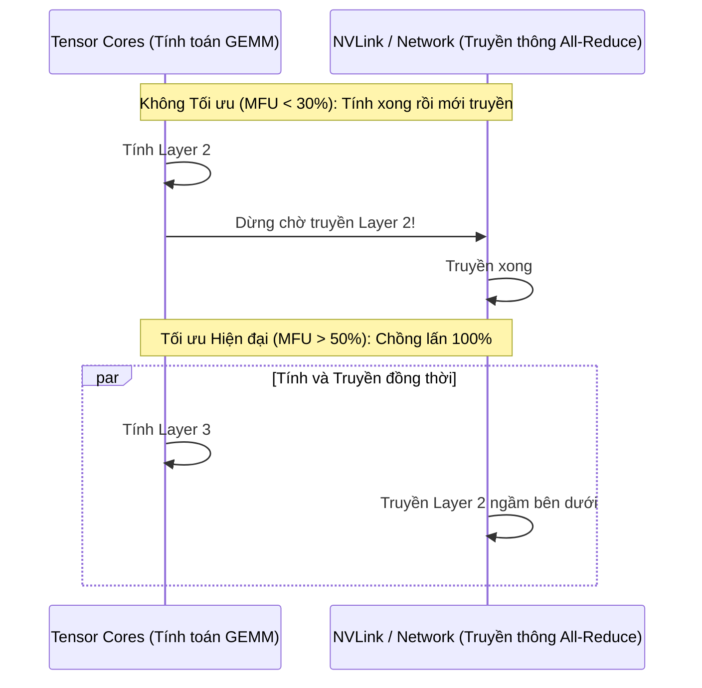

#### d. Code Thực chiến (Dual-Engine: C++ & Python)

```cpp
// C++17: Tính toán chỉ số Model FLOPs Utilization (MFU) của cụm GPU
#include <iostream>

double calculate_mfu(
    double model_params_b, 
    double tokens_per_sec, 
    int num_gpus, 
    double peak_tflops_per_gpu = 989.0) // H100 BF16 Dense Peak
{
    double actual_flops_per_sec = 6.0 * (model_params_b * 1e9) * tokens_per_sec;
    double total_peak_flops = num_gpus * (peak_tflops_per_gpu * 1e12);
    return (actual_flops_per_sec / total_peak_flops) * 100.0; // %
}

int main() {
    // Huấn luyện mô hình 70B trên 1024 H100 đạt 80,000 tokens/sec
    double mfu = calculate_mfu(70.0, 80000.0, 1024, 989.0);
    std::cout << "Cluster Throughput: 80,000 tokens/s\n";
    std::cout << "Calculated MFU:     " << mfu << "% (Excellent Efficiency!)\n";
    return 0;
}
```

```python
# Python: Đo đạc Throughput thực tế và tính MFU trong Training Loop
import time

def benchmark_training_throughput(step_time_seconds, batch_size_tokens, num_params=70e9, num_gpus=8):
    tps = batch_size_tokens / step_time_seconds
    peak_flops = num_gpus * 989e12
    actual_flops = 6 * num_params * tps
    mfu = actual_flops / peak_flops
    return tps, mfu

tps, mfu = benchmark_training_throughput(step_time_seconds=2.5, batch_size_tokens=16384, num_params=8e9, num_gpus=8)
print(f"Throughput: {tps:,.1f} tokens/s | MFU: {mfu*100:.2f}%")
```

#### e. Lỗi Thường gặp & Ổn định Số học (Pitfalls & Numerical Stability)
- **Nghẽn cổ chai CPU DataLoader (Straggler Nodes)**: Nếu một máy chủ trong cụm $1024$ nodes bị lỗi ổ đĩa đọc dữ liệu chậm, toàn bộ $1023$ máy chủ còn lại sẽ phải dừng lại chờ tại rào cản đồng bộ hóa (Barrier Synchronization), kéo tụt Throughput toàn cụm về 0.

#### f. Ứng dụng Thực chiến trong AI / Deep Learning (AI Applications)
- Đánh giá hiệu quả phần cứng và tối ưu hóa hệ thống trong các framework phân tán: Megatron-DeepSpeed, PyTorch FSDP-2, JAX.
