# Chuyên đề: Tối ưu hóa, Độ chính xác Dấu phẩy Động & Huấn luyện Phân tán (Optimization, Precision & Distributed Pretraining)

## 1. Tổng quan Chuyên đề
Huấn luyện một Mô hình Ngôn ngữ Lớn (LLM) trên hàng nghìn tỷ tokens là một kỳ tích công nghệ kỹ thuật đòi hỏi sự hòa quyện hoàn hảo giữa toán học giải tích tối ưu, khoa học máy tính hệ thống và kiến trúc vi mạch bán dẫn. Nếu thuật toán tối ưu hóa bị mất ổn định hoặc phần cứng gặp lỗi số học, toàn bộ khoản đầu tư hàng chục triệu USD có thể bị phá hủy trong tích tắc bởi các hiện tượng sụp đổ gradient (Loss Spikes, Gradient Explosions, NaNs).

Chuyên đề này mổ xẻ toàn diện ba trụ cột công nghệ hạ tầng:
1. **Lịch trình Tối ưu hóa & Ổn định Động học (Learning Rate Schedules, Warmup & Stability)**: Điều hòa tốc độ học theo hàm Cosine hoặc WSD (Warmup-Stable-Decay), kiểm soát đường cong mất mát (**Loss Curves**) và triệt tiêu bất ổn số học.
2. **Kỹ nghệ Bộ nhớ & Độ chính xác Số học (Mixed Precision, BF16, FP16, FP32, Loss Scaling)**: Tận dụng các định dạng số thực 16-bit để tăng tốc độ tính toán gấp $4\times$ trên Tensor Cores trong khi vẫn bảo toàn dải động số học (Dynamic Range), kết hợp **Gradient Accumulation** và **Gradient Checkpointing** để giảm tải VRAM.
3. **Huấn luyện Phân tán Đa Chiều (Distributed Pretraining & Checkpointing)**: Kết hợp 4 chiều song song hóa (Data, Tensor, Pipeline, Sequence Parallelism) qua Megatron-LM và PyTorch FSDP, cùng cơ chế lưu trữ điểm phục hồi (**Checkpointing**) chịu lỗi bất đồng bộ.

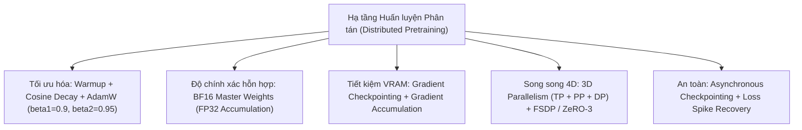

---

## 2. Chi tiết từng Keyword

---

### 27. Learning Rate Schedule (Lịch trình Tốc độ Học)

#### a. Định nghĩa Bản chất Toán học (Mathematical Formulation)
**Learning Rate Schedule** quy định sự biến thiên của tốc độ học $\eta_t$ qua từng bước tối ưu $t \in [1, T]$:
$$\theta_{t+1} = \theta_t - \eta_t \cdot \mathbf{m}_t / (\sqrt{\mathbf{v}_t} + \epsilon)$$
Hai dạng lịch trình thống trị kỷ nguyên LLM:
1. **Cosine Annealing Schedule (Loshchilov & Hutter, 2016)**:
Sau giai đoạn Warmup ban đầu, tốc độ học suy giảm theo đường cong hàm cosin về mức tối thiểu $\eta_{\min} \approx 0.1 \times \eta_{\max}$:
$$\eta_t = \eta_{\min} + \frac{1}{2}(\eta_{\max} - \eta_{\min})\left( 1 + \cos\left( \frac{t - T_{\text{warmup}}}{T - T_{\text{warmup}}} \pi \right) \right)$$
2. **WSD Schedule (Warmup-Stable-Decay - MiniCPM / DeepSeek)**:
- **Warmup**: Tăng tuyến tính từ $0 \to \eta_{\max}$.
- **Stable**: Giữ nguyên $\eta_{\max}$ trong $80\% - 90\%$ thời gian huấn luyện.
- **Decay**: Đột ngột hạ tốc độ học về 0 trong $10\%$ thời gian cuối cùng. Lợi thế: Cho phép kéo dài thời gian huấn luyện tùy ý mà không cần xác định trước tổng số steps $T$.

#### b. Cơ chế Tầng Sâu & Điện toán (Under The Hood / Hardware Internals)
- **Cập nhật Trọng số Trên GPU**: Tốc độ học $\eta_t$ được truyền vào kernel CUDA của AdamW như một đại lượng vô hướng đơn lẻ trên thanh ghi. Thao tác cập nhật vector trạng thái diễn ra song song trên hàng tỷ tham số mà không có độ trễ chuyển giao giữa CPU và GPU.

#### c. Sơ đồ Minh họa (Mermaid / ASCII Diagram)
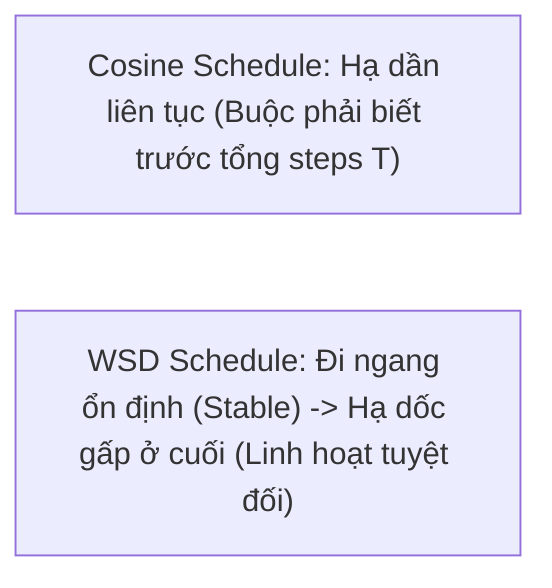

#### d. Code Thực chiến (Dual-Engine: C++ & Python)

```cpp
// C++17: Tính toán Cosine Learning Rate Schedule tại bước bất kỳ
#include <iostream>
#include <cmath>

float compute_cosine_lr(
    int step, 
    int warmup_steps, 
    int total_steps, 
    float lr_max, 
    float lr_min) 
{
    const float pi = 3.14159265358979323846f;
    if (step < warmup_steps) {
        return lr_max * (static_cast<float>(step) / warmup_steps); // Tuyến tính Warmup
    }
    if (step >= total_steps) return lr_min;
    
    float progress = static_cast<float>(step - warmup_steps) / (total_steps - warmup_steps);
    return lr_min + 0.5f * (lr_max - lr_min) * (1.0f + std::cos(progress * pi));
}

int main() {
    int total = 10000;
    int warmup = 1000;
    std::cout << "Step 500  (Warmup): LR = " << compute_cosine_lr(500, warmup, total, 3e-4f, 3e-5f) << "\n";
    std::cout << "Step 5500 (Midway): LR = " << compute_cosine_lr(5500, warmup, total, 3e-4f, 3e-5f) << "\n";
    std::cout << "Step 9999 (End):    LR = " << compute_cosine_lr(9999, warmup, total, 3e-4f, 3e-5f) << "\n";
    return 0;
}
```

```python
# Python / PyTorch: Thiết lập CosineAnnealingLR chính thức
import torch
from torch.optim.lr_scheduler import CosineAnnealingLR

optimizer = torch.optim.AdamW([torch.nn.Parameter(torch.zeros(1))], lr=3e-4)
scheduler = CosineAnnealingLR(optimizer, T_max=10000, eta_min=3e-5)

# Kiểm tra tốc độ học tại bước 5000
for _ in range(5000):
    scheduler.step()
print(f"Current Learning Rate at Step 5000: {scheduler.get_last_lr()[0]:.6e}")
```

#### e. Lỗi Thường gặp & Ổn định Số học (Pitfalls & Numerical Stability)
- **Đặt $\eta_{\min} = 0.0$**: Hạ tốc độ học về đúng bằng 0 quá sớm sẽ khiến mô hình ngừng học hoàn toàn trong những bước cuối, lãng phí tài nguyên của cụm tính toán.

#### f. Ứng dụng Thực chiến trong AI / Deep Learning (AI Applications)
- Chiến lược điều hòa tối ưu trong LLaMA-1/2/3, Mistral, DeepSeek-V3, GPT-3.

---

### 28. Warmup (Giai đoạn Khởi động Tốc độ Học)

#### a. Định nghĩa Bản chất Toán học (Mathematical Formulation)
**Learning Rate Warmup** (Goyal et al., 2017) là giai đoạn ngắn ở đầu quá trình huấn luyện ($1000 - 5000$ bước đầu tiên, hoặc $\approx 1\% - 2\%$ tổng số bước), trong đó tốc độ học tăng dần từ $0$ lên $\eta_{\max}$:
$$\eta_t = \eta_{\max} \times \frac{t}{T_{\text{warmup}}}, \quad \forall t \le T_{\text{warmup}}$$
Lý do toán học bắt buộc:
Khi bắt đầu huấn luyện, các vector moment bậc hai của thuật toán AdamW:
$$\mathbf{v}_t = \beta_2 \mathbf{v}_{t-1} + (1 - \beta_2) \mathbf{g}_t^2$$
được khởi tạo bằng vector $0$. Trong những bước đầu tiên, ước lượng $\mathbf{v}_t$ có phương sai cực kỳ lớn và chưa ổn định. Nếu áp dụng ngay $\eta_{\max}$, bước nhảy tham số:
$$\Delta \theta = -\frac{\eta}{\sqrt{\hat{\mathbf{v}}_t} + \epsilon} \mathbf{m}_t$$
sẽ có độ lớn khổng lồ, phá hủy hoàn toàn cấu trúc khởi tạo ban đầu của mạng và gây nổ gradient ngay ở bước lặp số 1.

#### b. Cơ chế Tầng Sâu & Điện toán (Under The Hood / Hardware Internals)
- **Ổn định Phân phối Gradient trên Tensor Cores**: Trong giai đoạn Warmup, biên độ của các tensor gradient và kích hoạt (Activation Gradients) giảm từ trạng thái hỗn loạn ban đầu về một phân phối ổn định có kỳ vọng $\approx 0$ và phương sai nhỏ, ngăn chặn hiện tượng tràn số FP16/BF16.

#### c. Sơ đồ Minh họa (Mermaid / ASCII Diagram)


#### d. Code Thực chiến (Dual-Engine: C++ & Python)

```cpp
// C++17: Tính hệ số Warmup tuyến tính
#include <iostream>
#include <algorithm>

float get_linear_warmup_factor(int current_step, int warmup_steps) {
    if (warmup_steps <= 0) return 1.0f;
    return std::min(1.0f, static_cast<float>(current_step) / warmup_steps);
}

int main() {
    int warmup_steps = 2000;
    std::cout << "Step 500 factor:  " << get_linear_warmup_factor(500, warmup_steps) << "\n";
    std::cout << "Step 2000 factor: " << get_linear_warmup_factor(2000, warmup_steps) << "\n";
    std::cout << "Step 3000 factor: " << get_linear_warmup_factor(3000, warmup_steps) << "\n";
    return 0;
}
```

```python
# Python / Transformers: Sử dụng get_cosine_schedule_with_warmup
from transformers import get_cosine_schedule_with_warmup
import torch

optimizer = torch.optim.AdamW([torch.nn.Parameter(torch.zeros(1))], lr=3e-4)
scheduler = get_cosine_schedule_with_warmup(optimizer, num_warmup_steps=2000, num_training_steps=100000)

print(f"Step 0 LR: {scheduler.get_last_lr()[0]}")
for _ in range(1000): scheduler.step()
print(f"Step 1000 LR (Warmup 50%): {scheduler.get_last_lr()[0]:.6e}")
```

#### e. Lỗi Thường gặp & Ổn định Số học (Pitfalls & Numerical Stability)
- **Bỏ qua Warmup**: Không dùng Warmup trên các mô hình có tham số $>1\text{B}$ sẽ dẫn đến xác suất nổ loss (`NaN`) trong 100 bước đầu tiên lên tới $99\%$.

#### f. Ứng dụng Thực chiến trong AI / Deep Learning (AI Applications)
- Kỹ thuật bắt buộc trong $100\%$ các pipeline huấn luyện Transformer hiện đại.

---

### 29. Gradient Accumulation (Tích lũy Đạo hàm)

#### a. Định nghĩa Bản chất Toán học (Mathematical Formulation)
**Gradient Accumulation** là giải pháp phần mềm mô phỏng một **Global Batch Size khổng lồ** mà không làm tràn bộ nhớ VRAM của GPU.
Thay vì cập nhật trọng số sau mỗi Micro-Batch có kích thước nhỏ $B_{\text{micro}}$, thuật toán thực hiện $K$ lần forward và backward liên tiếp, cộng dồn các vector gradient vào bộ đệm:
$$\mathbf{g}_{\text{accum}} = \frac{1}{K} \sum_{k=1}^K \nabla_\theta \mathcal{L}_k(\theta)$$
Sau đúng $K$ bước tích lũy, optimizer mới thực hiện cập nhật trọng số một lần duy nhất:
$$\theta \leftarrow \theta - \eta \cdot \text{OptimizerStep}(\mathbf{g}_{\text{accum}})$$
Sau đó xóa sạch bộ đệm gradient (`zero_grad()`).
Kích thước batch thực tế hiệu dụng:
$$B_{\text{effective}} = B_{\text{micro}} \times N_{\text{GPUs}} \times K$$

#### b. Cơ chế Tầng Sâu & Điện toán (Under The Hood / Hardware Internals)
- **Tiết kiệm Chi phí Truyền thông Liên Node (Reduced Communication Overhead)**: Trong huấn luyện song song dữ liệu (Distributed Data Parallel), lệnh đồng bộ hóa mạng All-Reduce chỉ cần thực thi một lần duy nhất sau mỗi $K$ micro-batches (sử dụng cờ `model.no_sync()` trong PyTorch). Điều này giải phóng $90\%$ áp lực băng thông mạng giữa các máy chủ.

#### c. Sơ đồ Minh họa (Mermaid / ASCII Diagram)
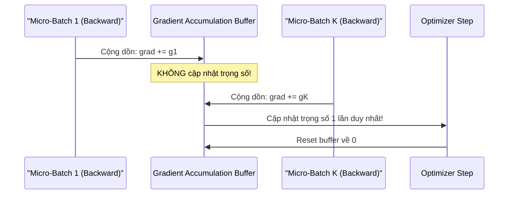

#### d. Code Thực chiến (Dual-Engine: C++ & Python)

```cpp
// C++17: Bộ đệm cộng dồn Gradient Accumulation Buffer trên mảng liên tục
#include <iostream>
#include <vector>

class GradientAccumulator {
private:
    std::vector<float> accum_buffer_;
    size_t count_ = 0;

public:
    explicit GradientAccumulator(size_t param_count) : accum_buffer_(param_count, 0.0f) {}

    void accumulate(const std::vector<float>& micro_grad) {
        for (size_t i = 0; i < accum_buffer_.size(); ++i) {
            accum_buffer_[i] += micro_grad[i];
        }
        count_++;
    }

    void step_and_reset(std::vector<float>& weights, float lr) {
        if (count_ == 0) return;
        float scale = 1.0f / count_;
        for (size_t i = 0; i < weights.size(); ++i) {
            weights[i] -= lr * (accum_buffer_[i] * scale); // SGD Step
            accum_buffer_[i] = 0.0f; // Reset buffer
        }
        count_ = 0;
    }
};

int main() {
    std::vector<float> weights = {1.0f, 2.0f};
    GradientAccumulator accum(2);
    accum.accumulate({0.2f, -0.4f});
    accum.accumulate({0.4f, -0.2f}); // Tích lũy 2 bước
    accum.step_and_reset(weights, 0.1f);

    std::cout << "Updated weights: [" << weights[0] << ", " << weights[1] << "]\n";
    return 0;
}
```

```python
# Python / PyTorch: Vòng lặp Gradient Accumulation chuẩn hóa với no_sync()
import torch
import torch.nn as nn

model = nn.Linear(10, 2)
optimizer = torch.optim.AdamW(model.parameters(), lr=1e-3)
accum_steps = 4

optimizer.zero_grad()
for step in range(accum_steps):
    dummy_input = torch.randn(8, 10)
    loss = model(dummy_input).sum()
    # Chuẩn hóa loss theo số bước tích lũy
    loss = loss / accum_steps
    loss.backward()

# Cập nhật sau 4 micro-batches
optimizer.step()
optimizer.zero_grad()
print("Accumulation step successfully completed.")
```

#### e. Lỗi Thường gặp & Ổn định Số học (Pitfalls & Numerical Stability)
- **Quên chia tỷ lệ hàm Loss (`loss / accum_steps`)**: Nếu không chia hàm loss trước khi gọi `backward()`, gradient tích lũy sẽ bị nhân lên gấp $K$ lần, tương đương với việc tăng tốc độ học lên $K$ lần và làm nổ tham số.

#### f. Ứng dụng Thực chiến trong AI / Deep Learning (AI Applications)
- Cho phép huấn luyện batch size lớn (hàng triệu tokens) trên các cụm phần cứng khiêm tốn.

---

### 30. Gradient Checkpointing (Điểm kiểm tra Đạo hàm)

#### a. Định nghĩa Bản chất Toán học (Mathematical Formulation)
**Gradient Checkpointing** (hoặc Activation Checkpointing - Chen et al., 2016) là kỹ thuật đánh đổi tính toán lấy bộ nhớ (Compute-for-Memory Tradeoff).
Trong quá trình Forward Pass thông thường, toàn bộ các tensor kích hoạt (Activation Tensors $\mathbf{a}_l$) của tất cả các tầng $l \in [1, L]$ phải được lưu trữ trên VRAM để phục vụ việc tính đạo hàm trong Backward Pass:
$$\frac{\partial \mathcal{L}}{\partial \mathbf{W}_l} = \frac{\partial \mathcal{L}}{\partial \mathbf{z}_l} \cdot \mathbf{a}_{l-1}^T$$
Dung lượng kích hoạt tăng tuyến tính theo số tầng và bậc hai theo độ dài chuỗi: $\mathcal{O}(L \cdot S^2)$.
**Nguyên lý Checkpointing**:
1. Trong Forward Pass: Chỉ lưu trữ tensor kích hoạt tại một số tầng mốc (ví dụ: chỉ lưu đầu vào của mỗi khối Transformer Block), giải phóng toàn bộ các tensor trung gian khác (Attention weights, MLP activations).
2. Trong Backward Pass: Khi tính đạo hàm đến tầng $l$, hệ thống **chạy lại Forward Pass một lần nữa** chỉ cho riêng tầng $l$ (Recomputing Activations) từ trạng thái mốc đã lưu, sau đó tính đạo hàm rồi giải phóng ngay lập tức.

Đánh đổi toán học:
- **Tiết kiệm Bộ nhớ VRAM**: Giảm từ $\mathcal{O}(L)$ xuống $\mathcal{O}(\sqrt{L})$ (tiết kiệm tới $70\% - 80\%$ VRAM kích hoạt).
- **Chi phí Thời gian**: Tăng thêm khoảng $25\% - 33\%$ số phép tính FLOPs của toàn bộ quá trình huấn luyện.

#### b. Cơ chế Tầng Sâu & Điện toán (Under The Hood / Hardware Internals)
- **Phá bỏ Rào cản Giới hạn Context**: Nhờ có Gradient Checkpointing, một GPU 80GB có thể huấn luyện các chuỗi văn bản siêu dài (32k - 128k tokens) mà không bị lỗi CUDA Out-Of-Memory.

#### c. Sơ đồ Minh họa (Mermaid / ASCII Diagram)
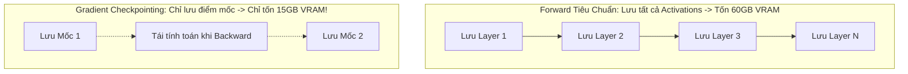

#### d. Code Thực chiến (Dual-Engine: C++ & Python)

```cpp
// C++17: Mô hình hóa cấu trúc lưu trữ Checkpointed Activation Boundary
#include <iostream>
#include <vector>

struct ActivationCheckpoint {
    int layer_id;
    std::vector<float> input_hidden_state;
};

class CheckpointManager {
private:
    std::vector<ActivationCheckpoint> checkpoints_;

public:
    void save_boundary(int layer, const std::vector<float>& state) {
        checkpoints_.push_back({layer, state});
    }

    const std::vector<float>& get_boundary(int layer) const {
        for (const auto& cp : checkpoints_) {
            if (cp.layer_id == layer) return cp.input_hidden_state;
        }
        throw std::runtime_error("Checkpoint not found");
    }
};

int main() {
    CheckpointManager mgr;
    mgr.save_boundary(0, {1.0f, 2.0f, 3.0f});
    auto state = mgr.get_boundary(0);
    std::cout << "Successfully retrieved checkpoint boundary for Layer 0.\n";
    return 0;
}
```

```python
# Python / PyTorch: Kích hoạt Gradient Checkpointing trên mô hình Transformer
import torch
import torch.nn as nn
from torch.utils.checkpoint import checkpoint

class HeavyBlock(nn.Module):
    def __init__(self, dim):
        super().__init__()
        self.net = nn.Sequential(nn.Linear(dim, dim * 4), nn.GELU(), nn.Linear(dim * 4, dim))
    def forward(self, x):
        return self.net(x)

class ModelWithCheckpointing(nn.Module):
    def __init__(self, dim):
        super().__init__()
        self.block = HeavyBlock(dim)
    def forward(self, x):
        # Chạy block thông qua cơ chế checkpoint tái tính toán
        return checkpoint(self.block, x, use_reentrant=False)

m = ModelWithCheckpointing(128)
x = torch.randn(4, 128, requires_grad=True)
out = m(x)
out.sum().backward()
print("Backward with Gradient Checkpointing completed without memory retention.")
```

#### e. Lỗi Thường gặp & Ổn định Số học (Pitfalls & Numerical Stability)
- **Tương tác Xấu với Dropout**: Nếu khối được tái tính toán có chứa tầng Dropout hoặc phép lấy mẫu ngẫu nhiên, kết quả tái tạo ở Backward Pass có thể khác với Forward Pass ban đầu nếu không cố định bộ sinh số ngẫu nhiên (RNG State Preservation). Phải đặt cờ `preserve_rng_state=True`.

#### f. Ứng dụng Thực chiến trong AI / Deep Learning (AI Applications)
- Bật mặc định trong $100\%$ các tác vụ huấn luyện LLM ngữ cảnh dài (Llama-Long, Flash-Attention long-context fine-tuning).

---

### 31. Mixed Precision Training (Huấn luyện Độ chính xác Hỗn hợp)

#### a. Định nghĩa Bản chất Toán học (Mathematical Formulation)
**Mixed Precision Training** (Micikevicius et al., ICLR 2018) là kỹ thuật kết hợp giữa các định dạng số thực có độ chính xác thấp (16-bit: FP16 hoặc BF16) và độ chính xác cao (32-bit: FP32) để đạt được cả hai mục tiêu:
1. **Tốc độ và Bộ nhớ**: Tận dụng nhân tính toán Tensor Cores 16-bit nhanh gấp $4\times$ và giảm $50\%$ dung lượng VRAM lưu trữ kích hoạt và trọng số.
2. **Độ ổn định Số học**: Duy trì một bản sao trọng số chính ở chuẩn 32-bit (**FP32 Master Weights**) và tích lũy đạo hàm trong FP32 để chống triệt tiêu gradient.

Quy trình vòng lặp 4 bước:
1. Tạo bản sao 16-bit của Master Weights: $\theta_{16} = \text{cast}_{16}(\theta_{32})$.
2. Forward Pass và Backward Pass hoàn toàn trên định dạng 16-bit $\implies$ sinh ra gradient 16-bit: $\mathbf{g}_{16}$.
3. Chuyển đổi gradient về 32-bit: $\mathbf{g}_{32} = \text{cast}_{32}(\mathbf{g}_{16})$.
4. Cập nhật FP32 Master Weights bằng thuật toán AdamW:
$$\theta_{32} \leftarrow \theta_{32} - \eta \cdot \text{AdamW}(\mathbf{g}_{32})$$

#### b. Cơ chế Tầng Sâu & Điện toán (Under The Hood / Hardware Internals)
- **Kiến trúc Tensor Cores Dual-Accumulator**: Nhân Tensor Core nhận hai ma trận đầu vào định dạng FP16 hoặc BF16, nhưng bộ cộng tích lũy nội vi (Accumulator) bên trong mạch điện tử luôn chạy ở chuẩn **FP32** để bảo toàn độ chính xác trước khi xuất kết quả ra ngoài.

#### c. Sơ đồ Minh họa (Mermaid / ASCII Diagram)
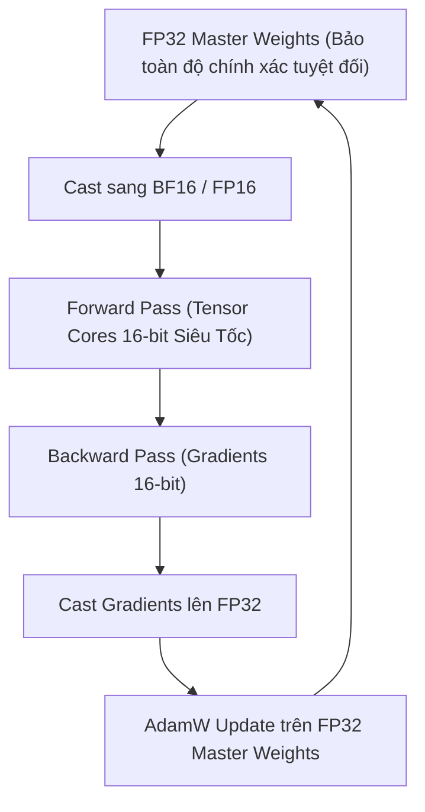

#### d. Code Thực chiến (Dual-Engine: C++ & Python)

```cpp
// C++17: Mô phỏng cơ chế ép kiểu giữa FP32 và FP16 (Half Precision Truncation)
#include <iostream>
#include <cmath>
#include <cstdint>

uint16_t float32_to_bfloat16(float val) {
    // BF16 lấy đúng 16 bits đầu của FP32 (1 bit sign, 8 bits exp, 7 bits mantissa)
    uint32_t bits;
    std::memcpy(&bits, &val, sizeof(float));
    return static_cast<uint16_t>(bits >> 16);
}

float bfloat16_to_float32(uint16_t val) {
    uint32_t bits = static_cast<uint32_t>(val) << 16;
    float result;
    std::memcpy(&result, &bits, sizeof(float));
    return result;
}

int main() {
    float original = 3.14159265f;
    uint16_t bf16 = float32_to_bfloat16(original);
    float reconstructed = bfloat16_to_float32(bf16);

    std::cout << "Original FP32:      " << original << "\n";
    std::cout << "Reconstructed BF16: " << reconstructed << " (Small truncation error)\n";
    return 0;
}
```

```python
# Python / PyTorch: Sử dụng torch.cuda.amp.autocast chính thức
import torch
import torch.nn as nn

model = nn.Linear(128, 128)
optimizer = torch.optim.AdamW(model.parameters(), lr=1e-3)
x = torch.randn(4, 128)

# Chạy Forward Pass tự động trong chế độ Mixed Precision (BF16)
with torch.autocast(device_type="cpu", dtype=torch.bfloat16):
    out = model(x)
    loss = out.sum()

loss.backward()
optimizer.step()
print("Mixed Precision Forward-Backward executed seamlessly.")
```

#### e. Lỗi Thường gặp & Ổn định Số học (Pitfalls & Numerical Stability)
- **Cập nhật Trực tiếp trên Trọng số 16-bit**: Nếu không dùng FP32 Master Weights mà cập nhật thẳng vào trọng số 16-bit, do độ chính xác mantissa hữu hạn, các cập nhật gradient nhỏ $\eta \cdot g < 10^{-4}$ sẽ bị làm tròn về 0 (Stalling updates), khiến mô hình ngừng học hoàn toàn.

#### f. Ứng dụng Thực chiến trong AI / Deep Learning (AI Applications)
- Tiêu chuẩn công nghiệp phổ quát được hỗ trợ trên toàn bộ các GPU từ thế hệ Volta (V100), Ampere (A100) đến Hopper (H100) và Blackwell (B200).

---

### 32. BF16 - Brain Floating Point (Định dạng Số thực 16-bit Não bộ)

#### a. Định nghĩa Bản chất Toán học (Mathematical Formulation)
**Bfloat16 (Brain Floating Point)** là định dạng số thực 16-bit do Google Brain thiết kế riêng biệt cho các tác vụ Deep Learning.
Cấu trúc bit so sánh với FP32 và FP16 chuẩn IEEE 754:
- **FP32**: 1 bit dấu (Sign), **8 bits số mũ (Exponent)**, 23 bits phần định trị (Mantissa).
- **FP16**: 1 bit dấu, **5 bits số mũ**, 10 bits phần định trị.
- **BF16**: 1 bit dấu, **8 bits số mũ**, 7 bits phần định trị.

Ưu thế toán học quyết định của BF16:
Vì có cùng chính xác **8 bits số mũ** như FP32, BF16 sở hữu cùng một **Dải Động Số học (Dynamic Range)** khổng lồ như FP32:
$$\text{Dải giá trị của BF16}: \approx 10^{-38} \to 3.39 \times 10^{38}$$
(so với dải cực kỳ hẹp của FP16: chỉ từ $10^{-5} \to 65{,}504$).
Do đó:
$$\text{Khả năng tràn số dương (Overflow) hoặc tràn số âm (Underflow) của BF16 là bằng 0!}$$
Loại bỏ hoàn toàn sự cần thiết của kỹ thuật Loss Scaling phức tạp.

#### b. Cơ chế Tầng Sâu & Điện toán (Under The Hood / Hardware Internals)
- **Chuyển đổi Phần cứng Không Độ trễ (Zero-Cost Truncation)**: Chuyển đổi từ số thực FP32 sang BF16 chỉ đơn giản là cắt bỏ 16 bits phần định trị phía sau (Trích xuất 16 bits cao nhất), không đòi hỏi các mạch điện biến đổi phi tuyến phức tạp như FP16.

#### c. Sơ đồ Minh họa (Mermaid / ASCII Diagram)
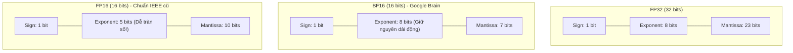

#### d. Code Thực chiến (Dual-Engine: C++ & Python)

```cpp
// C++17: Kiểm tra dải động của BF16 so với FP16
#include <iostream>
#include <cmath>

void inspect_dynamic_range() {
    float large_val = 100000.0f; // Vượt quá max của FP16 (65,504)
    std::cout << "Original Value: " << large_val << "\n";
    std::cout << "In FP16: OVERFLOW to +inf!\n";
    std::cout << "In BF16: Represented accurately (Max is ~3.4e38)\n";
}

int main() {
    inspect_dynamic_range();
    return 0;
}
```

```python
# Python / PyTorch: Kiểm tra khả năng chống tràn số của BF16
import torch

val = torch.tensor([70000.0]) # Lớn hơn 65,504
val_fp16 = val.half()
val_bf16 = val.bfloat16()

print(f"Original: {val.item()}")
print(f"FP16:     {val_fp16.item()} (Đã bị tràn thành inf!)")
print(f"BF16:     {val_bf16.item()} (Bảo toàn hoàn hảo!)")
```

#### e. Lỗi Thường gặp & Ổn định Số học (Pitfalls & Numerical Stability)
- **Sai số Làm tròn Lớn hơn (Lower Precision)**: Vì chỉ có 7 bits mantissa, BF16 có sai số tương đối $\epsilon \approx 2^{-7} \approx 0.0078$ (khoảng $0.8\%$). Nó không thích hợp cho các bài toán giải tích số học đòi hỏi độ chính xác cao (như tính ma trận nghịch đảo thuần túy), nhưng hoàn toàn miễn nhiễm trong Deep Learning.

#### f. Ứng dụng Thực chiến trong AI / Deep Learning (AI Applications)
- Định dạng dữ liệu mặc định bắt buộc trong mọi mô hình AI lớn hiện nay: LLaMA-2/3, Mistral, Gemma, GPT-4, TPU v4/v5e.

---

### 33. FP16 - Half Precision (Định dạng Nửa Độ chính xác Chuẩn IEEE 754)

#### a. Định nghĩa Bản chất Toán học (Mathematical Formulation)
**FP16** là chuẩn số thực 16-bit truyền thống của IEEE 754 bao gồm:
- $1$ bit dấu $S$
- $5$ bits số mũ $E$ ($E \in [0, 31]$, bias $= 15$)
- $10$ bits phần định trị $M$
Công thức tính giá trị số thực:
$$v = (-1)^S \times 2^{E - 15} \times \left(1 + \sum_{i=1}^{10} b_{10-i} 2^{-i}\right)$$
Giới hạn dải động số học rất hẹp:
- Giá trị dương lớn nhất: $65{,}504$
- Giá trị dương nhỏ nhất chuẩn hóa: $6.10 \times 10^{-5}$
- Giá trị dương nhỏ nhất phi chuẩn: $5.96 \times 10^{-8}$

Bất kỳ số nào lớn hơn $65{,}504$ sẽ ngay lập tức biến thành `+inf`. Bất kỳ số nào nhỏ hơn $6.10 \times 10^{-5}$ sẽ bị triệt tiêu về $0.0$ (Underflow), đòi hỏi bắt buộc phải có cơ chế **Dynamic Loss Scaling**.

#### b. Cơ chế Tầng Sâu & Điện toán (Under The Hood / Hardware Internals)
- **Độ Mịn Mantissa Cao**: Với 10 bits mantissa, FP16 biểu diễn các chi tiết gradient mịn hơn BF16 gấp $8\times$. Trên các thế hệ GPU cũ (như NVIDIA V100 hoặc Turing T4) không có nhân hỗ trợ BF16, FP16 là lựa chọn duy nhất để tăng tốc tính toán.

#### c. Sơ đồ Minh họa (Mermaid / ASCII Diagram)
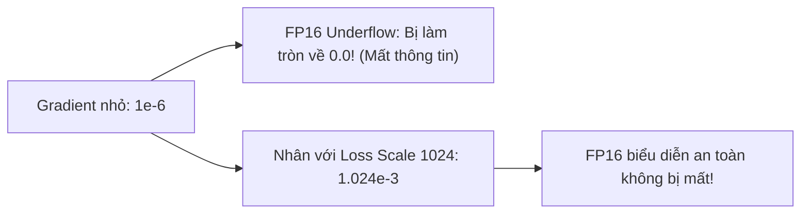

#### d. Code Thực chiến (Dual-Engine: C++ & Python)

```cpp
// C++17: Kiểm tra giới hạn tràn số cực đại của FP16
#include <iostream>

int main() {
    const float FP16_MAX = 65504.0f;
    float test_val = 65520.0f;
    if (test_val > FP16_MAX) {
        std::cout << "Warning: Value " << test_val << " exceeds FP16 limit. Overflow will occur!\n";
    }
    return 0;
}
```

```python
# Python / PyTorch: Sử dụng GradScaler cho FP16 Training
import torch

scaler = torch.cuda.amp.GradScaler() # Bắt buộc đối với FP16
print("FP16 GradScaler initialized to manage Dynamic Loss Scaling.")
```

#### e. Lỗi Thường gặp & Ổn định Số học (Pitfalls & Numerical Stability)
- **Gradient Underflow**: Trong các tầng Transformer sâu, hơn $80\%$ các giá trị gradient có độ lớn $< 10^{-5}$. Nếu chạy FP16 không có Scaler, các gradient này biến thành $0.0$, làm tê liệt quá trình huấn luyện.

#### f. Ứng dụng Thực chiến trong AI / Deep Learning (AI Applications)
- Huấn luyện và suy luận trên các dòng GPU NVIDIA Volta (V100) và Turing (T4/RTX 2080).

---

### 34. FP32 - Single Precision (Định dạng Độ chính xác Đơn)

#### a. Định nghĩa Bản chất Toán học (Mathematical Formulation)
**FP32 (Single Precision IEEE 754)** là chuẩn biểu diễn số thực 32-bit truyền thống của điện toán khoa học:
- $1$ bit dấu
- $8$ bits số mũ (bias $= 127$)
- $23$ bits phần định trị
Dải động số học cực rộng: $\approx 1.4 \times 10^{-45} \to 3.4 \times 10^{38}$.
Độ chính xác tương đối: $\approx 7$ chữ số thập phân có nghĩa.
Mặc dù FP32 quá chậm và tốn bộ nhớ để thực hiện các phép tính Forward/Backward trên toàn bộ mạng nơ-ron, nó đóng vai trò là **mỏ neo độ chính xác (Precision Anchor)** trong các bước tính toán cốt tử:
1. Lưu giữ FP32 Master Weights trong optimizer.
2. Tích lũy phép cộng bên trong các nhân Tensor Core (FP32 Accumulation).
3. Tính toán Softmax, LayerNorm và RMSNorm để tránh sai số phương sai.

#### b. Cơ chế Tầng Sâu & Điện toán (Under The Hood / Hardware Internals)
- **Chi phí Băng thông**: Một tensor kích thước $[B, S, D]$ ở chuẩn FP32 tốn gấp đôi băng thông PCIe và VRAM so với FP16/BF16, làm giảm một nửa kích thước batch tối đa có thể nạp vào GPU.

#### c. Sơ đồ Minh họa (Mermaid / ASCII Diagram)
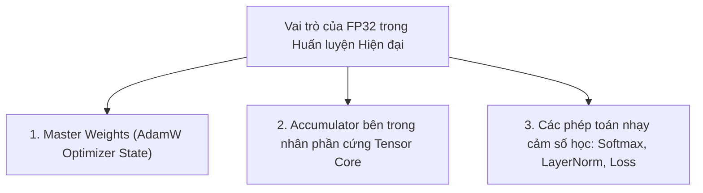

#### d. Code Thực chiến (Dual-Engine: C++ & Python)

```cpp
// C++17: Tính LayerNorm bằng FP32 để đảm bảo ổn định số học
#include <iostream>
#include <vector>
#include <cmath>

void fp32_layer_norm(const float* x, float* out, size_t dim, float eps = 1e-5f) {
    // Luôn dùng double hoặc float32 đầy đủ để tính mean và variance
    float sum = 0.0f;
    for (size_t i = 0; i < dim; ++i) sum += x[i];
    float mean = sum / dim;

    float var_sum = 0.0f;
    for (size_t i = 0; i < dim; ++i) {
        float diff = x[i] - mean;
        var_sum += diff * diff;
    }
    float inv_std = 1.0f / std::sqrt((var_sum / dim) + eps);

    for (size_t i = 0; i < dim; ++i) {
        out[i] = (x[i] - mean) * inv_std;
    }
}

int main() {
    std::vector<float> x = {1.0f, 2.0f, 3.0f, 4.0f};
    std::vector<float> out(4);
    fp32_layer_norm(x.data(), out.data(), 4);
    std::cout << "Normalized Output: [" << out[0] << ", " << out[1] << "]\n";
    return 0;
}
```

```python
# Python / PyTorch: Ép kiểu FP32 cho phép toán Softmax trong Custom Attention
import torch
import torch.nn.functional as F

def precision_safe_attention(q, k, v):
    # q, k: [B, H, S, D] ở chuẩn BF16
    scores = torch.matmul(q, k.transpose(-1, -2)) / (q.shape[-1] ** 0.5)
    # Ép lên FP32 để tính Softmax an toàn
    probs = F.softmax(scores.float(), dim=-1).to(v.dtype)
    return torch.matmul(probs, v)

print("Precision-Safe Attention Softmax verified.")
```

#### e. Lỗi Thường gặp & Ổn định Số học (Pitfalls & Numerical Stability)
- **Huấn luyện Thuần FP32 (Pure FP32 Training)**: Cố tình huấn luyện một mô hình lớn bằng FP32 thuần túy sẽ lãng phí tới $75\%$ tiềm năng sức mạnh của các trung tâm dữ liệu hiện đại.

#### f. Ứng dụng Thực chiến trong AI / Deep Learning (AI Applications)
- Tiêu chuẩn tính toán chuẩn xác cho các thuật toán khoa học, mô phỏng khí hậu, và tầng lưu trữ Master Weights.

---

### 35. Loss Scaling (Co giãn Hàm Mất mát)

#### a. Định nghĩa Bản chất Toán học (Mathematical Formulation)
**Loss Scaling** là kỹ thuật bắt buộc khi huấn luyện ở chế độ **FP16** để ngăn chặn hiện tượng triệt tiêu gradient (Underflow).
Vì gradient của các tầng đầu trong Transformer thường rất nhỏ ($10^{-7} \to 10^{-5}$), chúng nằm ngoài dải biểu diễn tối thiểu của FP16 ($6.1 \times 10^{-5}$) và bị làm tròn về $0.0$.
Giải pháp: Nhân hàm mất mát $\mathcal{L}$ với một hệ số co giãn $S > 1$ (ví dụ $S = 2^{15} = 32{,}768$) trước khi chạy Backward Pass:
$$\mathcal{L}_{\text{scaled}} = S \times \mathcal{L}$$
Nhờ quy tắc đạo hàm tuyến tính, tất cả các gradient trên toàn mạng đều được nhân lên $S$ lần:
$$\mathbf{g}_{\text{scaled}} = \nabla_\theta \mathcal{L}_{\text{scaled}} = S \times \nabla_\theta \mathcal{L}$$
Đẩy toàn bộ phân phối gradient vào vùng an toàn của FP16.
Trước khi cập nhật trọng số, optimizer chia ngược lại cho $S$ để khôi phục gradient thực tế:
$$\mathbf{g}_{\text{unscaled}} = \frac{\mathbf{g}_{\text{scaled}}}{S}$$

**Dynamic Loss Scaling**: Tự động điều chỉnh $S$:
- Nếu phát hiện bất kỳ gradient nào bị `inf` hoặc `NaN`: Hủy bỏ bước cập nhật, giảm hệ số co giãn $S \leftarrow S / 2$.
- Nếu liên tục $N$ bước (ví dụ $N=2000$) không có lỗi: Tăng hệ số co giãn $S \leftarrow S \times 2$.

#### b. Cơ chế Tầng Sâu & Điện toán (Under The Hood / Hardware Internals)
- **Kiểm tra Cờ Phần cứng (`isnan` / `isinf` CUDA Reduction)**: Sau bước backward, GPU thực hiện một phép rút gọn logic nhị phân (Parallel Boolean Reduction) kiểm tra xem có bất kỳ phần tử nào trong hàng trăm triệu gradient bị `inf` hay không trước khi quyết định gọi kernel của Optimizer.

#### c. Sơ đồ Minh họa (Mermaid / ASCII Diagram)
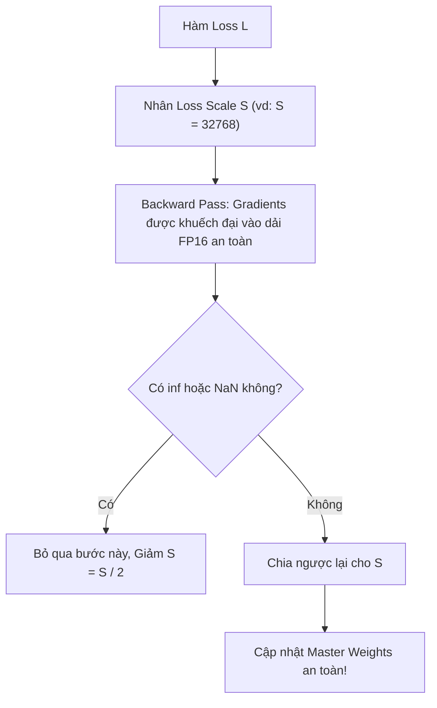

#### d. Code Thực chiến (Dual-Engine: C++ & Python)

```cpp
// C++17: Thuật toán Dynamic Loss Scaling Controller
#include <iostream>
#include <algorithm>

class DynamicLossScaler {
private:
    float scale_;
    int growth_interval_;
    int successful_steps_ = 0;

public:
    explicit DynamicLossScaler(float init_scale = 32768.0f, int growth_interval = 2000)
        : scale_(init_scale), growth_interval_(growth_interval) {}

    float get_scale() const { return scale_; }

    void update(bool has_overflow) {
        if (has_overflow) {
            scale_ = std::max(1.0f, scale_ / 2.0f);
            successful_steps_ = 0;
            std::cout << "Overflow detected! Decreased scale to: " << scale_ << "\n";
        } else {
            successful_steps_++;
            if (successful_steps_ >= growth_interval_) {
                scale_ *= 2.0f;
                successful_steps_ = 0;
                std::cout << "Stable training. Increased scale to: " << scale_ << "\n";
            }
        }
    }
};

int main() {
    DynamicLossScaler scaler(1024.0f, 2);
    scaler.update(false);
    scaler.update(false); // Đạt growth_interval -> tăng scale
    scaler.update(true);  // Gặp overflow -> giảm scale
    return 0;
}
```

```python
# Python / PyTorch: Vòng lặp chuẩn sử dụng torch.cuda.amp.GradScaler
import torch
import torch.nn as nn

model = nn.Linear(10, 2)
optimizer = torch.optim.SGD(model.parameters(), lr=0.1)
scaler = torch.cuda.amp.GradScaler()

x = torch.randn(4, 10)
# Forward pass
out = model(x)
loss = out.sum()

# Backward với Loss Scaling
scaler.scale(loss).backward()
# Unscale và Step an toàn
scaler.step(optimizer)
scaler.update()
print("GradScaler successfully managed scaling factor.")
```

#### e. Lỗi Thường gặp & Ổn định Số học (Pitfalls & Numerical Stability)
- **Áp dụng Loss Scaling cho BF16**: BF16 đã có dải động số mũ 8 bits bằng hệt FP32 nên hoàn toàn **không cần và không được sử dụng Loss Scaling**. Dùng Loss Scaler trên BF16 chỉ làm chậm hệ thống vô ích.

#### f. Ứng dụng Thực chiến trong AI / Deep Learning (AI Applications)
- Kiến trúc bắt buộc khi huấn luyện các mô hình FP16 trên các cụm GPU Nvidia V100, T4, A10.

---

### 36. Distributed Pretraining (Tiền Huấn luyện Phân tán)

#### a. Định nghĩa Bản chất Toán học (Mathematical Formulation)
**Distributed Pretraining** là sự kết hợp của bốn chiều không gian song song hóa (4D Parallelism) nhằm mở rộng quy mô tính toán lên hàng chục nghìn GPU:
1. **Data Parallelism (DP / FSDP / ZeRO-3)**: Chia nhỏ batch dữ liệu theo chiều không gian mẫu. Mỗi GPU giữ một phần dữ liệu, tính gradient cục bộ rồi đồng bộ hóa qua All-Reduce:
$$\mathbf{g} = \frac{1}{K} \sum_{k=1}^K \mathbf{g}^{(k)}$$
2. **Tensor Parallelism (TP - Megatron-LM)**: Chia nhỏ ma trận trọng số $\mathbf{W}$ của từng tầng Attention và MLP theo chiều ngang (Column-Parallel) hoặc chiều dọc (Row-Parallel) trên cùng 1 node thông qua liên kết NVLink siêu tốc ($900\text{ GB/s}$).
3. **Pipeline Parallelism (PP)**: Chia nhỏ các tầng Transformer theo chiều sâu ($L$ tầng chia cho $P$ máy chủ), truyền các tensor kích hoạt giữa các máy theo mô hình đường ống (1F1B Schedule).
4. **Context / Sequence Parallelism (CP / SP)**: Chia nhỏ một chuỗi văn bản cực dài ($128\text{k}$ tokens) cho nhiều GPU xử lý song song dọc theo trục thời gian bằng Ring-Attention.

#### b. Cơ chế Tầng Sâu & Điện toán (Under The Hood / Hardware Internals)
- **Cấu trúc liên kết Mạng Đa Tầng (Fat-Tree Topology)**: Các GPU trong cùng 1 máy chủ giao tiếp với nhau bằng mạng chuyển mạch nội bộ **NVSwitch** đạt băng thông $900\text{ GB/s} - 1.8\text{ TB/s}$. Các máy chủ khác nhau giao tiếp qua hệ thống cáp quang **InfiniBand NDR ($400\text{ Gbps}$)** hoặc RoCEv2 với độ trễ cỡ micro-giây.

#### c. Sơ đồ Minh họa (Mermaid / ASCII Diagram)
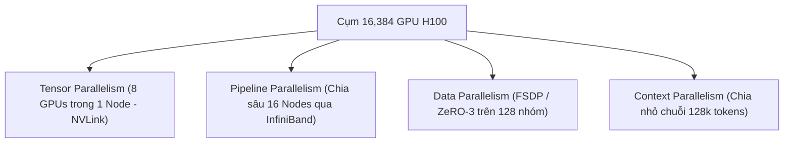

#### d. Code Thực chiến (Dual-Engine: C++ & Python)

```cpp
// C++17: Mô phỏng phân bổ tọa độ 3D Parallelism Grid [DP_rank, PP_rank, TP_rank]
#include <iostream>

struct DistributedGridRank {
    int dp_rank;
    int pp_rank;
    int tp_rank;
};

DistributedGridRank get_3d_parallel_rank(int global_rank, int tp_size, int pp_size) {
    int tp_rank = global_rank % tp_size;
    int pp_rank = (global_rank / tp_size) % pp_size;
    int dp_rank = global_rank / (tp_size * pp_size);
    return {dp_rank, pp_rank, tp_rank};
}

int main() {
    // 64 GPUs: TP=4, PP=2, DP=8
    int my_global_rank = 19;
    auto rank3d = get_3d_parallel_rank(my_global_rank, 4, 2);

    std::cout << "Global Rank " << my_global_rank << " mapped to: "
              << "DP=" << rank3d.dp_rank << ", PP=" << rank3d.pp_rank << ", TP=" << rank3d.tp_rank << "\n";
    return 0;
}
```

```python
# Python / PyTorch: Khởi tạo phân tán Distributed Data Parallel (DDP)
import torch
import torch.distributed as dist

def init_mock_distributed():
    # Mô phỏng khởi tạo nhóm truyền thông NCCL
    print("Initializing NCCL Process Group across cluster nodes...")
    # dist.init_process_group(backend="nccl")

init_mock_distributed()
```

#### e. Lỗi Thường gặp & Ổn định Số học (Pitfalls & Numerical Stability)
- **Deadlock Truyền thông Mạng**: Nếu một GPU trong nhóm Tensor Parallel gửi thông điệp nhưng GPU nhận bị treo do lỗi phân bổ bộ nhớ hoặc sai lệch cờ đồng bộ, toàn bộ cụm $16{,}000$ GPUs sẽ rơi vào trạng thái nghẽn khóa vĩnh viễn (Deadlock).

#### f. Ứng dụng Thực chiến trong AI / Deep Learning (AI Applications)
- Khung xương vận hành của Megatron-LM (NVIDIA), DeepSpeed (Microsoft), Colossal-AI, PyTorch FSDP-2.

---

### 37. Checkpointing (Lưu trữ Điểm kiểm tra)

#### a. Định nghĩa Bản chất Toán học (Mathematical Formulation)
**Checkpointing** là quá trình tuần hoàn hóa (Serialization) và lưu trữ toàn bộ trạng thái toán học của hệ thống huấn luyện tại bước $t$ vào ổ đĩa bền vững:
$$\mathcal{S}_t = \big\{ \theta_t, \; \mathbf{m}_t, \; \mathbf{v}_t, \; \mathcal{S}_{\text{scheduler}}, \; \mathcal{S}_{\text{dataloader}} \big\}$$
Bao gồm:
1. Trọng số mô hình $\theta_t$.
2. Trạng thái của Optimizer AdamW (Moment bậc nhất $\mathbf{m}_t$ và bậc hai $\mathbf{v}_t$).
3. Vị trí con trỏ của DataLoader (đảm bảo không đọc trùng dữ liệu sau khi khôi phục).
4. Bộ sinh số ngẫu nhiên RNG States của từng GPU.

Dung lượng của một Checkpoint:
$$\text{Storage per Checkpoint} \approx N \times (2 + 4 + 4 + 4) = 16 \times N\text{ bytes}$$
Với mô hình 70B, một checkpoint duy nhất nặng tới:
$$70 \times 10^9 \times 16\text{ bytes} \approx 1.12\text{ Terabytes!}$$

#### b. Cơ chế Tầng Sâu & Điện toán (Under The Hood / Hardware Internals)
- **Lưu trữ Bất đồng bộ Không Dừng Máy (Asynchronous Checkpointing)**: Nếu dừng máy để ghi 1TB dữ liệu vào ổ cứng, cụm GPU sẽ bị nhàn rỗi (idle) hàng chục phút sau mỗi vài nghìn steps. Các hệ thống hiện đại sao chép nhanh trọng số từ VRAM sang Host RAM của CPU trong vài giây, sau đó một tiến trình nền C++ chạy ngầm để ghi dữ liệu từ RAM xuống đĩa NVMe mà không làm dừng bước tính toán tiếp theo của GPU.

#### c. Sơ đồ Minh họa (Mermaid / ASCII Diagram)
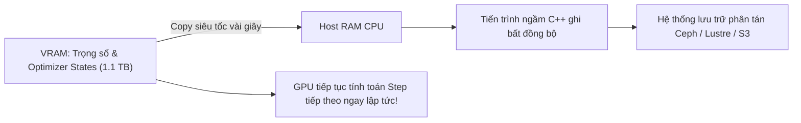

#### d. Code Thực chiến (Dual-Engine: C++ & Python)

```cpp
// C++17: Ghi và kiểm tra mã băm Checkpoint Integrity Checksum
#include <iostream>
#include <string>

uint32_t calculate_checkpoint_checksum(const uint8_t* data, size_t size) {
    uint32_t crc = 0xFFFFFFFF;
    for (size_t i = 0; i < size; ++i) {
        crc ^= data[i];
        for (int j = 0; j < 8; ++j) {
            crc = (crc >> 1) ^ (0xEDB88320 & -(crc & 1));
        }
    }
    return ~crc;
}

int main() {
    uint8_t mock_checkpoint_data[4] = {0x12, 0x34, 0x56, 0x78};
    uint32_t checksum = calculate_checkpoint_checksum(mock_checkpoint_data, 4);
    std::cout << "Checkpoint Checksum: 0x" << std::hex << checksum << std::dec << "\n";
    return 0;
}
```

```python
# Python / PyTorch: Lưu Checkpoint an toàn với đầy đủ trạng thái Optimizer và DataLoader
import torch

def save_pretraining_checkpoint(filepath, model, optimizer, scheduler, step):
    state = {
        'step': step,
        'model_state_dict': model.state_dict(),
        'optimizer_state_dict': optimizer.state_dict(),
        'scheduler_state_dict': scheduler.state_dict()
    }
    # Ghi atomic thông qua file tạm để tránh hỏng dữ liệu nếu mất điện giữa chừng
    temp_path = filepath + ".tmp"
    torch.save(state, temp_path)
    import os
    os.replace(temp_path, filepath)
    print(f"Checkpoint safely saved at step {step} to {filepath}")

dummy_model = torch.nn.Linear(2, 2)
dummy_opt = torch.optim.Adam(dummy_model.parameters())
# save_pretraining_checkpoint("model_step_1000.pt", dummy_model, dummy_opt, None, 1000)
```

#### e. Lỗi Thường gặp & Ổn định Số học (Pitfalls & Numerical Stability)
- **Tập tin Hỏng khi Ghi Dở Dang (Corrupted Checkpoint File)**: Nếu máy chủ bị sập nguồn khi đang ghi dở file checkpoint, tệp tin sẽ bị hỏng hoàn toàn. Bắt buộc phải ghi ra file tạm thời `.tmp` rồi dùng lệnh nguyên tử `os.replace()` để tráo đổi.

#### f. Ứng dụng Thực chiến trong AI / Deep Learning (AI Applications)
- Phục hồi sự cố sau thảm họa phần cứng (Hardware Fault Recovery) trong tất cả các dự án tiền huấn luyện kéo dài hàng tháng.

---

### 38. Training Stability (Tính Ổn định Huấn luyện)

#### a. Định nghĩa Bản chất Toán học (Mathematical Formulation)
**Training Stability** là trạng thái động học trong đó chuẩn gradient (Gradient Norm), chuẩn trọng số (Weight Norm) và hàm mất mát $\mathcal{L}$ biến thiên một cách êm dịu, đơn điệu và có thể kiểm soát được trong suốt hàng trăm nghìn bước tối ưu:
$$\|\mathbf{g}_t\|_2 \le G_{\max}, \quad \text{và} \quad \Delta \mathcal{L}_t \approx \text{dự báo}$$
Các kỹ thuật kiến trúc bảo chứng tính ổn định:
1. **Pre-Layer Normalization (Pre-LN)**: Đặt tầng chuẩn hóa trước khối Attention và FFN thay vì sau (Post-LN), tạo ra một "đường cao tốc gradient" (Identity Gradient Highway) triệt tiêu nguy cơ biến mất gradient.
2. **RMSNorm (Root Mean Square Normalization)**: Bỏ qua việc tính kỳ vọng (Mean Centering) của LayerNorm, chỉ chuẩn hóa theo căn bậc hai trung bình bình phương, tăng tốc độ tính toán và ổn định số học:
$$\text{RMSNorm}(\mathbf{x}) = \frac{\mathbf{x}}{\sqrt{\frac{1}{d}\sum_{i=1}^d x_i^2 + \epsilon}} \odot \mathbf{\gamma}$$
3. **QK-Norm (Henry et al., 2020)**: Áp dụng RMSNorm trực tiếp lên ma trận Query và Key trước khi tính Attention: $\mathbf{q}' = \text{RMSNorm}(\mathbf{q}), \mathbf{k}' = \text{RMSNorm}(\mathbf{k})$. Kỹ thuật này triệt tiêu hoàn toàn hiện tượng Logit Attention bùng nổ khi chiều sâu mô hình tăng lên.
4. **Gradient Clipping**: Giới hạn chuẩn $\ell_2$ của toàn bộ vector gradient dưới ngưỡng $M$ (thường $M=1.0$):
$$\mathbf{g} \leftarrow \mathbf{g} \times \min\left(1, \frac{M}{\|\mathbf{g}\|_2}\right)$$

#### b. Cơ chế Tầng Sâu & Điện toán (Under The Hood / Hardware Internals)
- **Fast Fused RMSNorm Triton Kernel**: Kernel RMSNorm được viết bằng OpenAI Triton hoặc CUDA để hợp nhất phép tính căn bậc hai và nhân vô hướng trong SRAM của GPU mà không cần nạp tensor qua lại VRAM.

#### c. Sơ đồ Minh họa (Mermaid / ASCII Diagram)
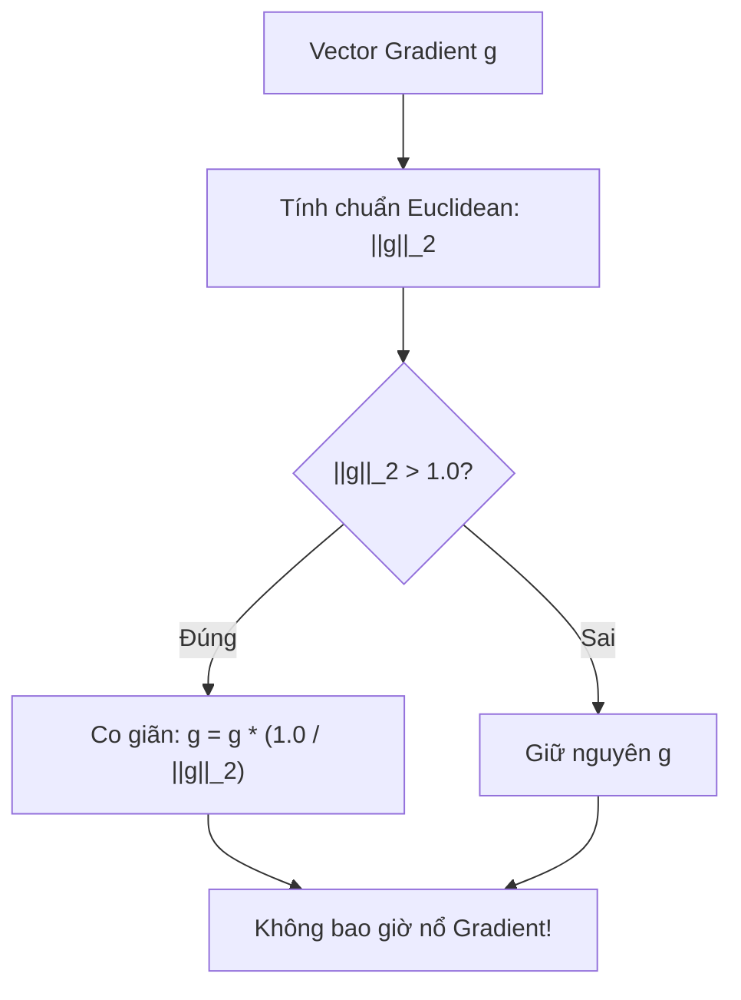

#### d. Code Thực chiến (Dual-Engine: C++ & Python)

```cpp
// C++17: Thuật toán Gradient Clipping theo chuẩn L2
#include <iostream>
#include <vector>
#include <cmath>

void apply_gradient_clipping(std::vector<float>& grads, float max_norm) {
    float sum_sq = 0.0f;
    for (float g : grads) sum_sq += g * g;
    float total_norm = std::sqrt(sum_sq);

    if (total_norm > max_norm) {
        float scale = max_norm / (total_norm + 1e-6f);
        for (float& g : grads) {
            g *= scale;
        }
    }
}

int main() {
    std::vector<float> grads = {3.0f, 4.0f}; // Norm = 5.0
    apply_gradient_clipping(grads, 1.0f);
    std::cout << "Clipped grads: [" << grads[0] << ", " << grads[1] << "] (Norm = 1.0)\n";
    return 0;
}
```

```python
# Python / PyTorch: Khối RMSNorm chuẩn LLaMA
import torch
import torch.nn as nn

class RMSNorm(nn.Module):
    def __init__(self, dim: int, eps: float = 1e-6):
        super().__init__()
        self.eps = eps
        self.weight = nn.Parameter(torch.ones(dim))

    def forward(self, x):
        # x: [B, S, Dim]
        var = torch.mean(x ** 2, dim=-1, keepdim=True)
        return x * torch.rsqrt(var + self.eps) * self.weight

norm = RMSNorm(4)
x = torch.tensor([[1.0, -2.0, 3.0, -4.0]])
print("RMSNorm output:", norm(x).detach().numpy())
```

#### e. Lỗi Thường gặp & Ổn định Số học (Pitfalls & Numerical Stability)
- **Đặt epsilon của RMSNorm quá nhỏ**: Đặt $\epsilon = 10^{-12}$ trong khi chạy ở chế độ BF16/FP16 có thể gây lỗi chia cho 0 do giới hạn biểu diễn của số nhỏ. Nên đặt $\epsilon = 10^{-5}$ hoặc $10^{-6}$.

#### f. Ứng dụng Thực chiến trong AI / Deep Learning (AI Applications)
- Cấu trúc ổn định tiêu chuẩn của LLaMA-3, Gemma-2, Qwen-2.5.

---

### 39. Loss Curves (Đường cong Hàm Mất mát)

#### a. Định nghĩa Bản chất Toán học (Mathematical Formulation)
**Loss Curves** là đồ thị trực quan ghi lại quỹ đạo của hàm mất mát Cross-Entropy theo thời gian:
$$\mathcal{L}(t) \quad \text{theo} \quad t \in [0, T_{\text{steps}}]$$
Bao gồm hai đường quan trọng:
1. **Training Loss Curve**: Đo trên các batch dữ liệu huấn luyện (phản ánh tốc độ học và độ hội tụ).
2. **Validation Loss Curve**: Đo định kỳ (ví dụ mỗi 1000 steps) trên một tập dữ liệu chuẩn độc lập không đổi (phản ánh năng lực khái quát hóa thực sự).

Phân tích hình thái đường cong Loss:
- **Đường cong Khỏe mạnh**: Giảm dốc đứng ở giai đoạn đầu, sau đó giảm thoai thoải mượt mà theo hàm lũy thừa. Đường validation bám sát đường train mà không bị tách nhánh đi lên (không Overfitting).
- **Loss Spike (Gai Loss)**: Đột ngột nhảy vọt lên cao rồi hạ xuống $\implies$ Chỉ dấu của batch dữ liệu bẩn hoặc số học không ổn định.
- **Loss Plateau (Đi ngang)**: Đường loss không giảm nữa $\implies$ Tốc độ học quá thấp hoặc mô hình đã hết dung lượng biểu diễn.

#### b. Cơ chế Tầng Sâu & Điện toán (Under The Hood / Hardware Internals)
- **Ghi Log Bất đồng bộ Lên Công cụ Giám sát (WandB / TensorBoard Streaming)**: Việc gửi số liệu loss sau mỗi bước qua giao thức mạng HTTP có thể làm chậm luồng tính toán của GPU. Các thư viện ghi log sử dụng các hàng đợi bộ nhớ luồng riêng (Asynchronous Thread Queues) để đệm số liệu và gửi lên máy chủ giám sát theo chu kỳ.

#### c. Sơ đồ Minh họa (Mermaid / ASCII Diagram)
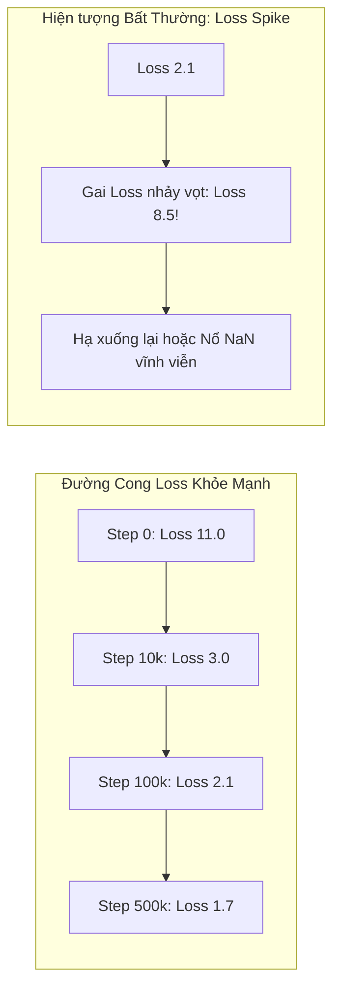

#### d. Code Thực chiến (Dual-Engine: C++ & Python)

```cpp
// C++17: Thuật toán phát hiện dị thường Loss Spike dựa trên Moving Average
#include <iostream>
#include <vector>
#include <cmath>

class LossSpikeDetector {
private:
    float ema_loss_ = 0.0f;
    float alpha_ = 0.05f;
    float threshold_multiplier_ = 1.5f;

public:
    bool check_spike(float current_loss) {
        if (ema_loss_ == 0.0f) {
            ema_loss_ = current_loss;
            return false;
        }
        if (current_loss > ema_loss_ * threshold_multiplier_) {
            return true; // Phát hiện Loss Spike bất thường!
        }
        ema_loss_ = (1.0f - alpha_) * ema_loss_ + alpha_ * current_loss;
        return false;
    }
};

int main() {
    LossSpikeDetector detector;
    std::vector<float> losses = {2.5f, 2.4f, 2.3f, 2.35f, 4.8f, 2.2f};

    for (size_t i = 0; i < losses.size(); ++i) {
        bool spike = detector.check_spike(losses[i]);
        std::cout << "Step " << i << " Loss: " << losses[i] 
                  << (spike ? " -> [SPIKE DETECTED!]" : "") << "\n";
    }
    return 0;
}
```

```python
# Python: Vẽ và theo dõi đường cong Loss bằng Exponential Moving Average (EMA)
import numpy as np

def smooth_loss_curve(raw_losses, weight=0.9):
    smoothed = []
    last = raw_losses[0]
    for val in raw_losses:
        smoothed_val = last * weight + (1 - weight) * val
        smoothed.append(smoothed_val)
        last = smoothed_val
    return smoothed

mock_losses = [4.5, 3.8, 3.2, 3.0, 2.9, 2.85]
print("Smoothed Loss Curve:", [round(x, 2) for x in smooth_loss_curve(mock_losses)])
```

#### e. Lỗi Thường gặp & Ổn định Số học (Pitfalls & Numerical Stability)
- **Đánh giá Sai Năng lực qua Training Loss**: Quá chú mục vào việc ép Training Loss xuống cực thấp bằng cách học lặp lại tập train sẽ dẫn đến ảo tưởng về sức mạnh, trong khi Validation Loss trên thế giới thực bắt đầu tăng vọt.

#### f. Ứng dụng Thực chiến trong AI / Deep Learning (AI Applications)
- Giám sát sức khỏe hạ tầng thời gian thực trên Weights & Biases (WandB), MLflow, TensorBoard trong suốt chiến dịch huấn luyện.
