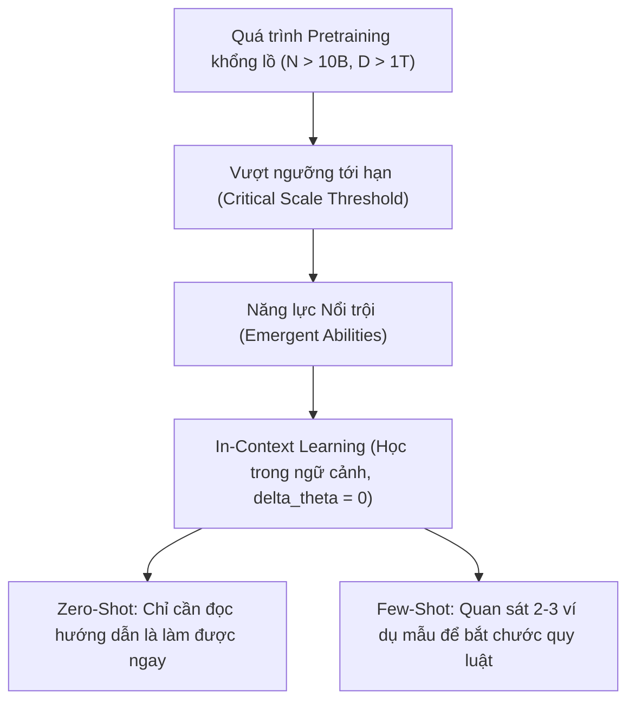
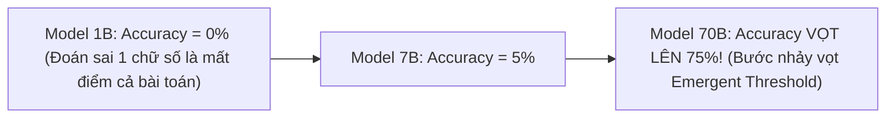
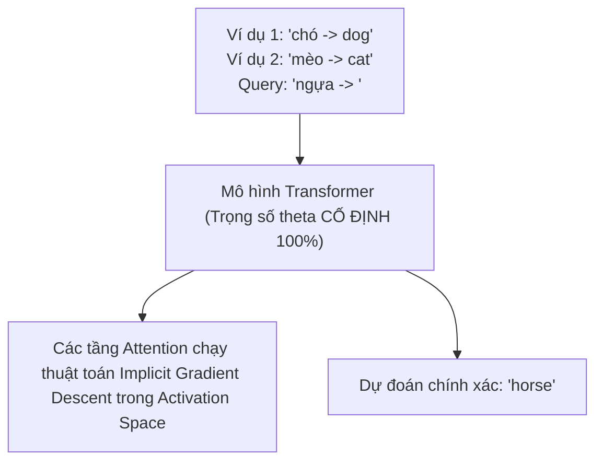
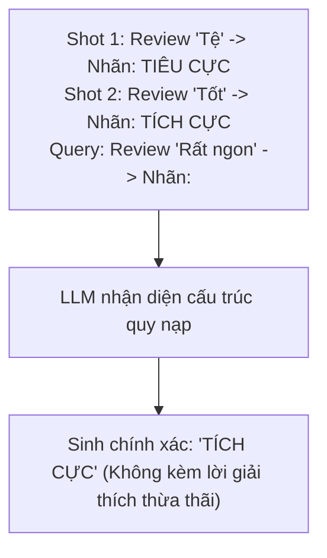
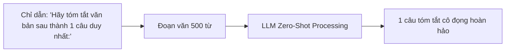

# Chuyên đề: Động học Tiền Huấn luyện & Khả năng Học trong Ngữ cảnh (Pretraining Dynamics & In-Context Capabilities)

## 1. Tổng quan Chuyên đề
Khi quy mô tham số $N$, dữ liệu huấn luyện $D$ và ngân sách điện toán $C$ vượt qua một ngưỡng tới hạn nhất định (Critical Threshold), Mô hình Ngôn ngữ Lớn (LLM) bộc lộ sự chuyển pha kỳ diệu (Phase Transition) từ các mô hình ghi nhớ thống kê đơn giản thành các hệ thống sở hữu **Khả năng Nổi trội (Emergent Abilities)**. Những khả năng này không hề được lập trình rõ ràng trong hàm mất mát mà tự động nảy sinh từ mục tiêu Next Token Prediction trên không gian đa chiều.

Biểu hiện vĩ đại nhất của sự chuyển pha này là **Khả năng Học trong Ngữ cảnh (In-Context Learning - ICL)** (Brown et al., GPT-3 2020). Mô hình có thể tiếp thu và thực thi một tác vụ hoàn toàn mới ngay lập tức tại thời điểm suy luận chỉ bằng cách quan sát một vài ví dụ mẫu (**Few-Shot Prompting**) hoặc chỉ cần đọc hiểu câu lệnh trực tiếp (**Zero-Shot Prompting**) mà **không cần cập nhật bất kỳ một trọng số nào** ($\Delta \theta = 0$).

Chuyên đề này phân tích sâu sắc cơ sở toán học của hiện tượng Emergence, cơ chế ẩn tối ưu hóa độ dốc ngầm (Implicit Gradient Descent) đằng sau In-Context Learning, và các kỹ thuật thiết kế Prompting hiện đại.



---

## 2. Chi tiết từng Keyword

---

### 40. Emergent Abilities (Khả năng Nổi trội)

#### a. Định nghĩa Bản chất Toán học (Mathematical Formulation)
**Emergent Abilities** (Wei et al., TMLR 2022) được định nghĩa chính thức: *"Một khả năng được gọi là nổi trội nếu nó hoàn toàn không xuất hiện ở các mô hình quy mô nhỏ nhưng lại xuất hiện một cách đột ngột, mạnh mẽ ở các mô hình quy mô lớn hơn."*
Về mặt định lượng:
Cho metric đánh giá tác vụ là $M(\text{Scale})$.
- Khi $\text{Scale} < \text{Scale}^*$: Hiệu năng mô hình tương đương với đoán ngẫu nhiên:
$$M(\text{Scale}) \approx M_{\text{random}}$$
- Khi $\text{Scale} \ge \text{Scale}^*$: Hiệu năng tăng vọt phi tuyến tính:
$$\frac{d M}{d (\log \text{Scale})} \gg 0$$

Các ví dụ kinh điển về năng lực nổi trội:
- Phép tính số học nhiều chữ số (Multi-digit arithmetic).
- Dịch ngược mã hóa (Rot13, Pig Latin).
- Suy luận logic biểu tượng và giải toán đa bước (Chain of Thought).

Tranh luận khoa học (Schaeffer et al., NeurIPS 2023 - "Are Emergent Abilities of LLMs a Mirage?"):
Nhiều nhà khoa học chỉ ra rằng hiện tượng "đột ngột" này phần lớn là **ảo giác đo lường (Metric Artifact)** do sử dụng các thang đo phi tuyến không liên tục (như Accuracy hay Exact Match đòi hỏi $100\%$ token phải đúng). Nếu chuyển sang các thang đo liên tục (như Token Edit Distance hay Brier Score), năng lực của mô hình thực chất tăng trưởng đều đặn và mượt mà theo Scaling Laws!

#### b. Cơ chế Tầng Sâu & Điện toán (Under The Hood / Hardware Internals)
- **Tập hợp Mạch Nơ-ron Phức hợp (Circuit Compositionality)**: Khi số lượng tầng $L$ và chiều sâu Transformer tăng lên, các khối Attention Heads đơn lẻ bắt đầu tự động kết nối với nhau thành các mạch logic phức hợp (Induction Heads, Circuits) có khả năng thực hiện các thuật toán tìm kiếm và so khớp mẫu hai chiều ngay trong các lớp ẩn.

#### c. Sơ đồ Minh họa (Mermaid / ASCII Diagram)


#### d. Code Thực chiến (Dual-Engine: C++ & Python)

```cpp
// C++17: Mô phỏng hàm bước nhảy phi tuyến tính của Emergent Ability
#include <iostream>
#include <cmath>

double evaluate_emergent_accuracy(double log_compute, double threshold = 23.0) {
    if (log_compute < threshold) {
        return 0.02; // Đoán ngẫu nhiên (Random guess 2%)
    }
    // Chuyển pha mạnh mẽ sau ngưỡng
    double delta = log_compute - threshold;
    return 0.02 + 0.90 / (1.0 + std::exp(-2.5 * delta));
}

int main() {
    std::cout << "Compute 10^21 FLOPs: Accuracy = " << evaluate_emergent_accuracy(21.0) * 100 << "%\n";
    std::cout << "Compute 10^23 FLOPs: Accuracy = " << evaluate_emergent_accuracy(23.0) * 100 << "%\n";
    std::cout << "Compute 10^25 FLOPs: Accuracy = " << evaluate_emergent_accuracy(25.0) * 100 << "% (EMERGED!)\n";
    return 0;
}
```

```python
# Python / Matplotlib: Minh họa sự khác biệt giữa Metric Rời rạc (Discontinuous) và Liên tục
import numpy as np

compute = np.linspace(20, 25, 100)
# Năng lực cơ bản tăng trưởng tuyến tính liên tục
latent_ability = 1.0 / (1.0 + np.exp(-1.5 * (compute - 22.5)))

# Metric rời rạc (Exact Match: đúng cả 3 bước mới được tính điểm)
exact_match_metric = latent_ability ** 3

print(f"At Scale 22.0 -> Latent Ability: {latent_ability[40]:.2f} | Exact Match: {exact_match_metric[40]:.2f}")
print(f"At Scale 24.0 -> Latent Ability: {latent_ability[80]:.2f} | Exact Match: {exact_match_metric[80]:.2f} (Nhảy vọt phi tuyến!)")
```

#### e. Lỗi Thường gặp & Ổn định Số học (Pitfalls & Numerical Stability)
- **Kỳ vọng Năng lực Nổi trội trên Mô hình Nhỏ**: Cố gắng ép một mô hình 1B tham số thực hiện suy luận đa bước phức tạp bằng cách đổi prompt là điều bất khả thi, vì mô hình nhỏ chưa đủ số lượng tham số để hình thành các mạch nơ-ron phức hợp cần thiết.

#### f. Ứng dụng Thực chiến trong AI / Deep Learning (AI Applications)
- Động lực thúc đẩy cuộc đua mở rộng quy mô siêu mô hình (GPT-4, Claude 3.5 Sonnet, Gemini 1.5 Pro).

---

### 41. In-Context Learning - ICL (Học trong Ngữ cảnh)

#### a. Định nghĩa Bản chất Toán học (Mathematical Formulation)
**In-Context Learning (ICL)** (Brown et al., GPT-3 2020) là hiện tượng mô hình ngôn ngữ có thể tiếp nhận ngữ cảnh gồm một chuỗi các cặp ví dụ minh họa:
$$\mathcal{C} = (x_1, y_1, x_2, y_2, \dots, x_k, y_k)$$
và sau đó dự đoán chính xác nhãn mục tiêu cho câu hỏi mới $x_{\text{query}}$:
$$\hat{y}_{\text{query}} = \arg\max_y P_\theta(y \mid \mathcal{C}, x_{\text{query}})$$
mà **hoàn toàn không cập nhật bất kỳ trọng số nào của mạng ($\Delta \theta \equiv 0$)**.
Cơ chế bản chất dưới lăng kính toán học (von Oswald et al., Dai et al., 2023):
Các nghiên cứu lý thuyết chứng minh rằng: **Cơ chế Attention trong Transformer thực chất đang mô phỏng thuật toán Tối ưu hóa Độ dốc Ngầm (Implicit Gradient Descent)** bên trong các biểu diễn kích hoạt:
$$\text{Attention}(Q, K, V) \approx \mathbf{W}_0 - \eta \cdot \nabla_{\mathbf{W}} \mathcal{L}_{\text{in-context}}$$
Nghĩa là: Mô hình sử dụng các tầng Transformer để "huấn luyện ngầm" một mạng nơ-ron ảo nhỏ bên trong các vector kích hoạt của chính nó dựa trên các ví dụ trong prompt!

#### b. Cơ chế Tầng Sâu & Điện toán (Under The Hood / Hardware Internals)
- **Tận dụng Tối đa KV-Cache Prefix Caching**: Khi chạy ICL với một tập ví dụ mẫu cố định $\mathcal{C}$ cho hàng nghìn câu hỏi khác nhau, hệ thống suy luận chỉ cần tính toán và lưu KV-Cache của tập ví dụ mẫu $\mathcal{C}$ đúng một lần duy nhất trên GPU (**Prompt Caching**). Với mỗi câu hỏi mới, GPU chỉ cần nạp lại con trỏ KV-Cache này, giảm độ trễ từ hàng giây xuống vài phần nghìn giây.

#### c. Sơ đồ Minh họa (Mermaid / ASCII Diagram)


#### d. Code Thực chiến (Dual-Engine: C++ & Python)

```cpp
// C++17: Cấu trúc đóng gói Prompt In-Context Learning chuẩn hóa
#include <iostream>
#include <vector>
#include <string>

struct ExamplePair {
    std::string input;
    std::string output;
};

std::string build_icl_prompt(const std::vector<ExamplePair>& examples, const std::string& query) {
    std::string prompt = "Perform the task based on examples:\n\n";
    for (const auto& ex : examples) {
        prompt += "Input: " + ex.input + "\nOutput: " + ex.output + "\n\n";
    }
    prompt += "Input: " + query + "\nOutput:";
    return prompt;
}

int main() {
    std::vector<ExamplePair> shots = {
        {"cold", "hot"},
        {"big", "small"}
    };
    std::string full_prompt = build_icl_prompt(shots, "fast");
    std::cout << full_prompt << "\n";
    return 0;
}
```

```python
# Python / Transformers: Thực thi In-Context Learning với mô hình ngôn ngữ
from transformers import pipeline

generator = pipeline('text-generation', model='gpt2')
prompt = """French: bonjour -> English: hello
French: chat -> English: cat
French: merci -> English:"""

output = generator(prompt, max_new_tokens=2, pad_token_id=50256)
print(output[0]['generated_text'])
```

#### e. Lỗi Thường gặp & Ổn định Số học (Pitfalls & Numerical Stability)
- **Nhạy cảm với Thứ tự Ví dụ (Order Sensitivity)**: Hoán đổi vị trí của các cặp ví dụ trong prompt (ví dụ: đưa ví dụ B lên trước ví dụ A) có thể làm biến thiên độ chính xác của mô hình từ $70\%$ xuống $40\%$.

#### f. Ứng dụng Thực chiến trong AI / Deep Learning (AI Applications)
- Tạo mẫu nhanh ứng dụng AI không cần đào tạo (Zero-code Prototyping), xây dựng hệ thống phân loại dữ liệu tức thời.

---

### 42. Few-Shot Prompting (Lời nhắc Vài Ví dụ Mẫu)

#### a. Định nghĩa Bản chất Toán học (Mathematical Formulation)
**Few-Shot Prompting** là kỹ thuật cụ thể hóa của In-Context Learning, trong đó người dùng cung cấp một số lượng nhỏ $k$ ví dụ mẫu ($k \in [1, 10]$) ngay bên trong câu lệnh Prompt trước khi đưa ra câu hỏi cần giải quyết:
$$\mathbf{X}_{\text{prompt}} = \mathbf{x}_1 \oplus \mathbf{y}_1 \oplus \mathbf{x}_2 \oplus \mathbf{y}_2 \oplus \dots \oplus \mathbf{x}_k \oplus \mathbf{y}_k \oplus \mathbf{x}_{\text{target}}$$
Trong đó $\oplus$ là phép ghép chuỗi có định dạng rõ ràng.
Tác động xác suất của Few-Shot:
Việc chèn $k$ ví dụ giúp "khóa" (condition) phân phối xác suất của mô hình vào đúng không gian định dạng mong muốn:
$$p(\text{Format} \mid \mathbf{X}_{\text{few-shot}}) \to 1.0$$
Ngăn chặn hiện tượng mô hình trả lời lan man, lạc đề hoặc sai cấu trúc.

#### b. Cơ chế Tầng Sâu & Điện toán (Under The Hood / Hardware Internals)
- **Sự Tham lam Ngữ cảnh của Attention (Induction Head Mechanics)**: Các Attention Heads chuyên dụng (Induction Heads) tìm kiếm vị trí xuất hiện trước đó của từ khóa và sao chép trực tiếp token tiếp theo. Cơ chế này hoạt động cực kỳ mạnh mẽ khi có từ 2 ví dụ trở lên ($k \ge 2$), giúp mô hình bắt chước văn phong chính xác.

#### c. Sơ đồ Minh họa (Mermaid / ASCII Diagram)


#### d. Code Thực chiến (Dual-Engine: C++ & Python)

```cpp
// C++17: Trình tạo Few-Shot Prompt định dạng JSON Extraction
#include <iostream>
#include <string>

std::string create_few_shot_json_prompt(const std::string& text) {
    std::string p = "";
    p += "Extract name and age:\n";
    p += "Text: John is 25 years old.\nJSON: {\"name\": \"John\", \"age\": 25}\n\n";
    p += "Text: Alice was born 30 years ago.\nJSON: {\"name\": \"Alice\", \"age\": 30}\n\n";
    p += "Text: " + text + "\nJSON:";
    return p;
}

int main() {
    std::cout << create_few_shot_json_prompt("Bob is 42.") << "\n";
    return 0;
}
```

```python
# Python: Đánh giá tác động của Few-Shot đối với độ chính xác định dạng
def evaluate_few_shot_prompting():
    few_shot_template = (
        "Tweet: I love this phone! -> Sentiment: Positive\n"
        "Tweet: Terrible battery life. -> Sentiment: Negative\n"
        "Tweet: Works as expected. -> Sentiment:"
    )
    return few_shot_template

print(evaluate_few_shot_prompting())
```

#### e. Lỗi Thường gặp & Ổn định Số học (Pitfalls & Numerical Stability)
- **Thiên vị Nhãn Đa số (Majority Label Bias)**: Nếu trong $k$ ví dụ có 4 ví dụ nhãn TÍCH CỰC và chỉ 1 ví dụ nhãn TIÊU CỰC, mô hình sẽ bị thiên lệch và có xu hướng đoán TÍCH CỰC cho câu hỏi mới bất kể nội dung.

#### f. Ứng dụng Thực chiến trong AI / Deep Learning (AI Applications)
- Tiêu chuẩn đánh giá trên các Benchmark học thuật (MMLU 5-shot, GSM8K 8-shot).

---

### 43. Zero-Shot Prompting (Lời nhắc Không Cần Ví dụ Mẫu)

#### a. Định nghĩa Bản chất Toán học (Mathematical Formulation)
**Zero-Shot Prompting** là khả năng tối thượng của mô hình ngôn ngữ lớn: Thực thi chính xác tác vụ chỉ dựa trên một câu mô tả chỉ dẫn tự nhiên duy nhất mà **hoàn toàn không có bất kỳ ví dụ minh họa nào ($k = 0$)**:
$$\mathbf{X}_{\text{prompt}} = \mathbf{I}_{\text{instruction}} \oplus \mathbf{X}_{\text{target}}$$
Ví dụ:
`"Phân loại cảm xúc của câu sau thành [Tích cực] hoặc [Tiêu cực]: Tôi rất thích cuốn sách này."`
Toán học đằng sau Zero-Shot:
Mô hình đã học được sự liên kết ngữ nghĩa giữa từ khóa chỉ dẫn (Instruction Keywords: `"Phân loại"`, `"Dịch"`, `"Tóm tắt"`) và quy luật thực thi tương ứng trong quá trình tiền huấn luyện trên hàng triệu tài liệu mô tả tác vụ trên Internet.

#### b. Cơ chế Tầng Sâu & Điện toán (Under The Hood / Hardware Internals)
- **Kích hoạt Đường dẫn Kích hoạt Chuyên biệt (Sparse Neural Circuit Activation)**: Câu lệnh chỉ dẫn đóng vai trò như một bộ định tuyến (Router) chuyển trạng thái của các tầng Transformer đầu tiên sang một chế độ xử lý phù hợp (ví dụ: chuyển sang mạch dịch thuật hoặc mạch giải toán) mà không cần nạp thêm ngữ cảnh ví dụ vào VRAM.

#### c. Sơ đồ Minh họa (Mermaid / ASCII Diagram)


#### d. Code Thực chiến (Dual-Engine: C++ & Python)

```cpp
// C++17: Đóng gói Zero-Shot Prompt chuẩn tắc
#include <iostream>
#include <string>

std::string format_zero_shot_query(const std::string& instruction, const std::string& content) {
    return "Instruction: " + instruction + "\nContent: " + content + "\nAnswer:";
}

int main() {
    auto prompt = format_zero_shot_query(
        "Translate the following sentence to Spanish.", 
        "Artificial Intelligence is powerful."
    );
    std::cout << prompt << "\n";
    return 0;
}
```

```python
# Python / Transformers: Thực thi Zero-Shot Classification với mô hình NLI
from transformers import pipeline

classifier = pipeline("zero-shot-classification", model="facebook/bart-large-mnli")
sequence = "Tesla just announced their new autonomous driving software."
candidate_labels = ["technology", "cooking", "sports"]

result = classifier(sequence, candidate_labels)
print(f"Top Zero-Shot Class: {result['labels'][0]} (Score: {result['scores'][0]:.4f})")
```

#### e. Lỗi Thường gặp & Ổn định Số học (Pitfalls & Numerical Stability)
- **Tính mơ hồ của ngôn ngữ tự nhiên**: Do không có ví dụ mẫu định hình cấu trúc, mô hình có thể trả lời đúng nội dung nhưng sai định dạng mong muốn (ví dụ: người dùng cần 1 từ `Positive`, nhưng mô hình trả về một đoạn văn dài 3 câu giải thích tại sao nó là Positive).

#### f. Ứng dụng Thực chiến trong AI / Deep Learning (AI Applications)
- Giao diện người dùng mặc định của ChatGPT, Gemini, Copilot và các trợ lý ảo đàm thoại tự do.
