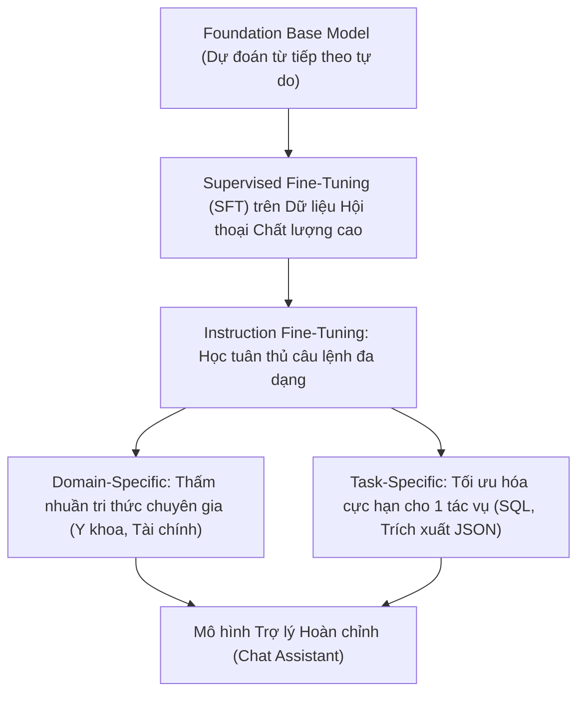
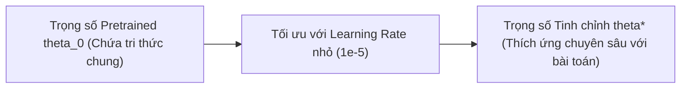
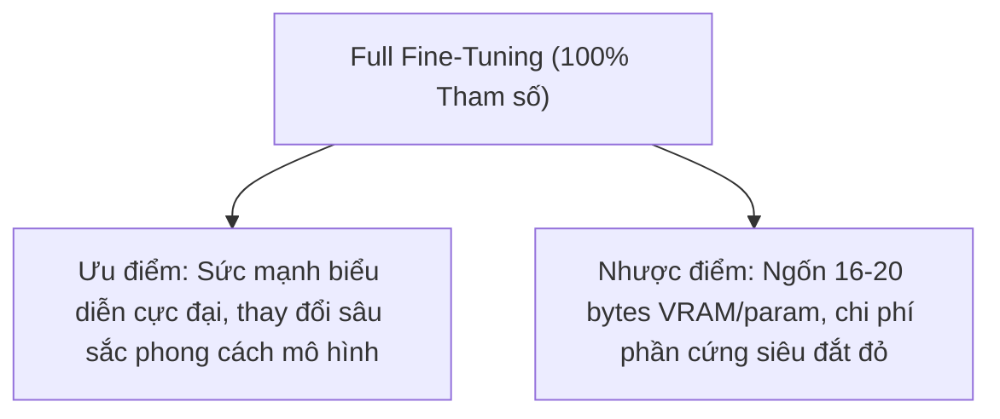
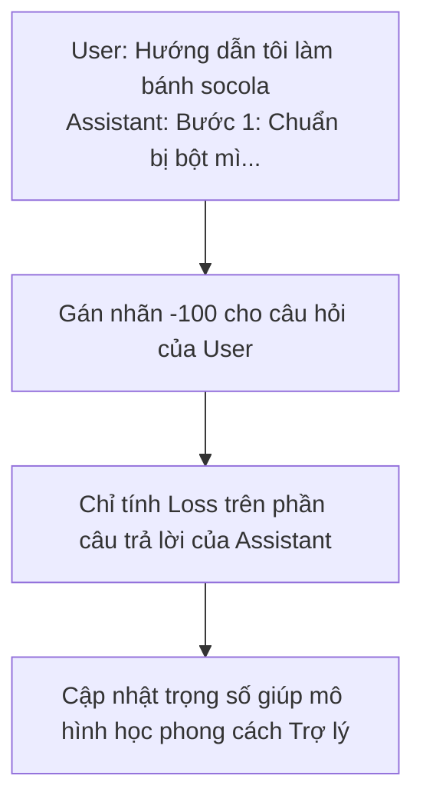
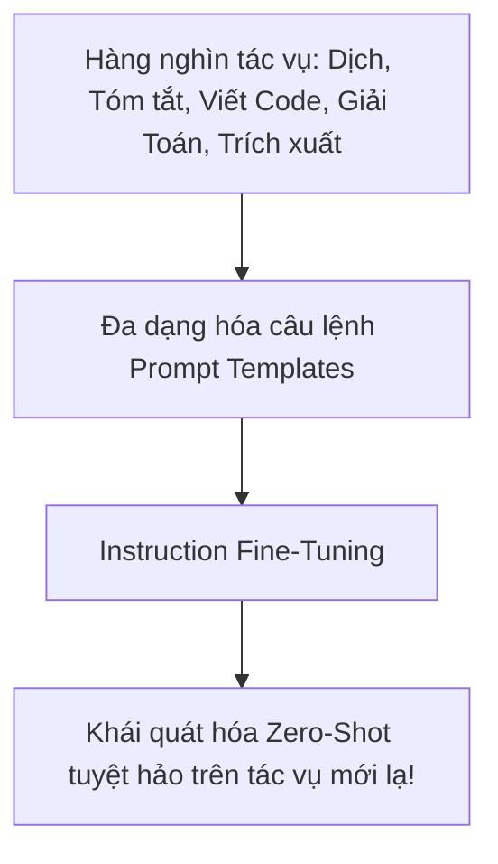
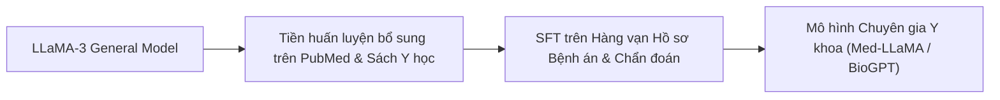
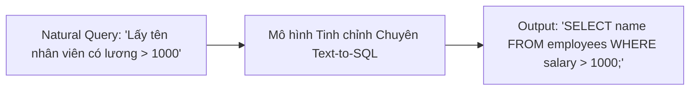
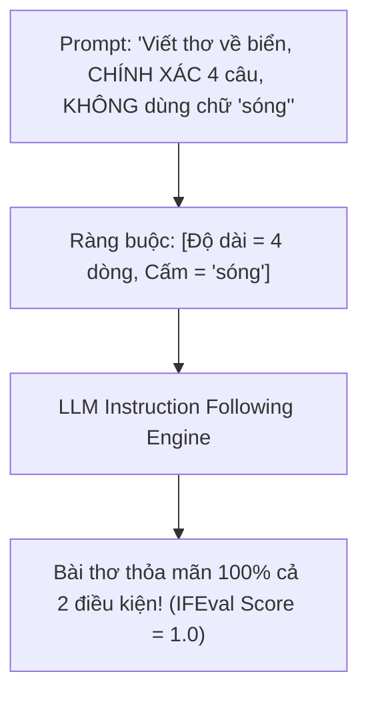

# Chuyên đề: Các Mô hình Tinh chỉnh & Tinh chỉnh Có Giám sát (Fine-Tuning Paradigms & Supervised Fine-Tuning)

## 1. Tổng quan Chuyên đề
Sau khi hoàn tất quá trình tiền huấn luyện (Pretraining), mô hình ngôn ngữ nền tảng (Foundation Base Model) đóng vai trò như một "nhà thông thái hoang dã": nó chứa đựng toàn bộ tri thức của nhân loại nhưng chỉ biết làm một việc duy nhất là dự đoán từ tiếp theo (Text Completion) một cách tự do. Khi người dùng đặt câu hỏi *"Thủ đô của nước Pháp là gì?"*, mô hình Base có thể trả lời tiếp bằng... một câu hỏi khác *"Thủ đô của nước Đức là gì?"* vì nó coi đó là một văn bản bài tập trắc nghiệm trên mạng.

Để biến một mô hình Base thành một trợ lý AI hữu ích, lịch thiệp và an toàn, mô hình phải trải qua giai đoạn **Tinh chỉnh (Fine-Tuning)**, khởi đầu bằng **Supervised Fine-Tuning (SFT)** và **Instruction Fine-Tuning**:
1. **Chuyển dịch Phân phối Ngữ nghĩa (Distributional Shift)**: Chuyển từ việc hoàn thành văn bản ngẫu nhiên sang việc tuân thủ mệnh lệnh (**Instruction Following**) và hội thoại đa lượt.
2. **Các Trường phái Tinh chỉnh**: Từ **Full Fine-Tuning** (cập nhật $100\%$ tham số trên toàn mạng), đến tinh chỉnh theo miền chuyên sâu (**Domain-Specific**) cho Y tế/Pháp luật và tinh chỉnh chuyên biệt hóa theo tác vụ (**Task-Specific**).



---

## 2. Chi tiết từng Keyword

---

### 1. Fine-Tuning (Tinh chỉnh Mô hình)

#### a. Định nghĩa Bản chất Toán học (Mathematical Formulation)
**Fine-Tuning** là quá trình huấn luyện chuyển giao (Transfer Learning), trong đó các trọng số khởi tạo ban đầu $\theta_0$ của mô hình được lấy từ một mô hình đã tiền huấn luyện $\theta_{\text{pretrained}}$, sau đó tiếp tục được tối ưu hóa trên một tập dữ liệu mục tiêu chuyên biệt $\mathcal{D}_{\text{target}}$ với tốc độ học nhỏ hơn rất nhiều so với lúc pretraining ($\eta_{\text{ft}} \approx 0.01 - 0.1 \times \eta_{\text{pretrain}}$):
$$\theta^* = \arg\min_\theta \mathbb{E}_{(\mathbf{x}, \mathbf{y}) \sim \mathcal{D}_{\text{target}}} \big[ \mathcal{L}(\theta; \mathbf{x}, \mathbf{y}) \big]$$
Mục đích là tinh chỉnh không gian biểu diễn đặc trưng ẩn (Latent Representation Space) để mô hình thích ứng với phân phối dữ liệu mới mà không làm mất đi các tri thức nền tảng đã học.

#### b. Cơ chế Tầng Sâu & Điện toán (Under The Hood / Hardware Internals)
- **Hạ thấp Tốc độ Học để Bảo tồn Tri thức**: Việc sử dụng learning rate nhỏ ($\approx 10^{-5} - 10^{-6}$) kết hợp với số epoch ít ($1 - 3$ epochs) giúp giới hạn khoảng cách di chuyển của trọng số trong không gian Euclidean: $\|\theta^* - \theta_{\text{pretrained}}\|_2 \le \delta$, ngăn chặn việc phá vỡ cấu trúc của các mạch nơ-ron trừu tượng đã hình thành ở giai đoạn Pretraining.

#### c. Sơ đồ Minh họa (Mermaid / ASCII Diagram)


#### d. Code Thực chiến (Dual-Engine: C++ & Python)

```cpp
// C++17: Kiểm tra khoảng cách trọng số giữa Pretrained và Fine-tuned Model
#include <iostream>
#include <vector>
#include <cmath>

float compute_weight_drift(const std::vector<float>& w_pre, const std::vector<float>& w_ft) {
    float sum_sq = 0.0f;
    for (size_t i = 0; i < w_pre.size(); ++i) {
        float diff = w_ft[i] - w_pre[i];
        sum_sq += diff * diff;
    }
    return std::sqrt(sum_sq); // L2 Euclidean Distance
}

int main() {
    std::vector<float> w_pre = {1.0f, -0.5f, 2.0f};
    std::vector<float> w_ft  = {1.02f, -0.49f, 1.98f};
    std::cout << "Weight drift after fine-tuning: " << compute_weight_drift(w_pre, w_ft) << "\n";
    return 0;
}
```

```python
# Python / PyTorch: Thiết lập Learning Rate nhỏ chuyên biệt cho Fine-Tuning
import torch
import torch.nn as nn

model = nn.Linear(10, 2)
# Fine-tuning luôn dùng learning rate nhỏ hơn pretraining 10x
optimizer = torch.optim.AdamW(model.parameters(), lr=2e-5, weight_decay=0.01)
print(f"Fine-tuning Optimizer initialized with LR: {optimizer.param_groups[0]['lr']}")
```

#### e. Lỗi Thường gặp & Ổn định Số học (Pitfalls & Numerical Stability)
- **Overfitting Trên Tập Dữ liệu Nhỏ**: Nếu tập dữ liệu fine-tuning quá nhỏ ($< 500$ mẫu) mà huấn luyện quá nhiều vòng lặp, mô hình sẽ học thuộc lòng từng câu chữ và hoàn toàn mất khả năng tổng quát hóa khi người dùng diễn đạt câu hỏi theo cách khác.

#### f. Ứng dụng Thực chiến trong AI / Deep Learning (AI Applications)
- Bước chuẩn hóa bắt buộc để triển khai mọi mô hình mã nguồn mở vào doanh nghiệp.

---

### 2. Full Fine-Tuning (Tinh chỉnh Toàn bộ Tham số)

#### a. Định nghĩa Bản chất Toán học (Mathematical Formulation)
**Full Fine-Tuning** là phương thức tinh chỉnh trong đó **toàn bộ $100\%$ các tham số** của mô hình nơ-ron $\theta = \{\mathbf{W}_1, \dots, \mathbf{W}_L\}$ đều được phép mở khóa để tính đạo hàm và cập nhật trọng số trong quá trình lan truyền ngược:
$$\nabla_\theta \mathcal{L} \ne \mathbf{0} \quad \forall \mathbf{W} \in \theta$$
Đặc điểm:
- Cung cấp khả năng biến đổi linh hoạt và dung lượng học tập cực đại cho mô hình.
- Cho phép thay đổi căn bản hành vi và tiếp thu các tập dữ liệu ngữ nghĩa hoàn toàn mới khác biệt xa với dữ liệu pretraining.

#### b. Cơ chế Tầng Sâu & Điện toán (Under The Hood / Hardware Internals)
- **Gánh nặng Bộ nhớ Khổng lồ (Memory Footprint)**: Trong Full Fine-Tuning, bộ nhớ VRAM không chỉ lưu trọng số mà còn phải lưu toàn bộ trạng thái của thuật toán AdamW:
$$\text{VRAM}_{\text{total}} = \text{Model Trọng số (2 bytes)} + \text{Gradients (2 bytes)} + \text{AdamW States (12 bytes)} + \text{Activations}$$
Tổng cộng tốn ít nhất **$16 - 20\text{ bytes trên mỗi tham số}$**!
Một mô hình 70B đòi hỏi hơn:
$$70 \times 16 = 1120\text{ GB VRAM} \implies \text{Cần ít nhất 16 GPU A100/H100 80GB chỉ để Fine-tune!}$$

#### c. Sơ đồ Minh họa (Mermaid / ASCII Diagram)


#### d. Code Thực chiến (Dual-Engine: C++ & Python)

```cpp
// C++17: Tính toán yêu cầu VRAM tối thiểu cho Full Fine-Tuning với AdamW FP32 States
#include <iostream>

double calculate_full_finetuning_vram_gb(double num_params_billions) {
    double bytes_per_param = 2.0;  // Trọng số BF16
    double bytes_grad = 2.0;       // Gradients BF16
    double bytes_adam = 12.0;      // FP32 Master Weights (4) + Momentum (4) + Variance (4)
    double total_bytes = num_params_billions * 1e9 * (bytes_per_param + bytes_grad + bytes_adam);
    return total_bytes / (1024.0 * 1024.0 * 1024.0);
}

int main() {
    std::cout << "Full Fine-tuning 8B Model:  " << calculate_full_finetuning_vram_gb(8.0) << " GB VRAM\n";
    std::cout << "Full Fine-tuning 70B Model: " << calculate_full_finetuning_vram_gb(70.0) << " GB VRAM\n";
    return 0;
}
```

```python
# Python / PyTorch: Đảm bảo toàn bộ tham số đều requires_grad = True
import torch
import torch.nn as nn

model = nn.Sequential(nn.Linear(64, 64), nn.Linear(64, 2))
# Mở khóa toàn bộ tham số
for param in model.parameters():
    param.requires_grad = True

trainable_params = sum(p.numel() for p in model.parameters() if p.requires_grad)
print(f"Trainable Parameters in Full Fine-Tuning: {trainable_params} (100%)")
```

#### e. Lỗi Thường gặp & Ổn định Số học (Pitfalls & Numerical Stability)
- **Hiện tượng Quên Lãng Thảm họa (Catastrophic Forgetting)**: Khi Full Fine-Tuning trên một tác vụ hẹp (ví dụ chỉ học viết code Python), mô hình có thể bị ghi đè các trọng số cũ và mất đi hoàn toàn khả năng làm thơ, dịch thuật hoặc giải toán tổng quát.

#### f. Ứng dụng Thực chiến trong AI / Deep Learning (AI Applications)
- Huấn luyện các mô hình chính thức cấp nền tảng: Llama-3-Instruct, Mistral-Instruct.

---

### 3. Supervised Fine-Tuning - SFT (Tinh chỉnh Có Giám sát)

#### a. Định nghĩa Bản chất Toán học (Mathematical Formulation)
**Supervised Fine-Tuning (SFT)** là bước đầu tiên và quan trọng nhất trong quá trình chuyển hóa Foundation Base Model thành Chat Assistant.
Mô hình được huấn luyện trên một tập hợp chọn lọc gồm các cặp hội thoại mẫu chất lượng cao giữa Người dùng và Trợ lý ảo do các chuyên gia con người biên soạn:
$$\mathcal{D}_{\text{SFT}} = \big\{ (\mathbf{x}_i, \mathbf{y}_i) \big\}_{i=1}^M, \quad M \approx 10{,}000 - 100{,}000 \text{ mẫu}$$
Hàm mục tiêu là Cross-Entropy chỉ tính trên các token thuộc câu trả lời của trợ lý $\mathbf{y}$:
$$\mathcal{L}_{\text{SFT}}(\theta) = -\sum_{i=1}^M \sum_{t=1}^{|\mathbf{y}_i|} \log P_\theta(y_{i, t} \mid \mathbf{x}_i, y_{i, <t})$$
SFT dạy cho mô hình hai năng lực nền tảng:
1. **Persona Alignment**: Tự nhận thức mình là một trợ lý AI, luôn trả lời lịch sự, hữu ích, không nói bừa.
2. **Formatting & Structure**: Tuân thủ định dạng Markdown, trả lời bằng gạch đầu dòng, khối code hoặc bảng biểu.

#### b. Cơ chế Tầng Sâu & Điện toán (Under The Hood / Hardware Internals)
- **Tối ưu hóa Băng thông bằng Packed SFT Datasets**: Vì các cặp đối thoại SFT thường có độ dài rất chênh lệch, việc đóng gói nhiều cặp hội thoại vào một buffer 4096 tokens (Sequence Packing với Attention Mask phân cách) giúp tăng tốc độ huấn luyện SFT gấp $3\times$ trên GPU.

#### c. Sơ đồ Minh họa (Mermaid / ASCII Diagram)


#### d. Code Thực chiến (Dual-Engine: C++ & Python)

```cpp
// C++17: Kiểm tra định dạng hội thoại Chat SFT hợp lệ
#include <iostream>
#include <string>

bool validate_sft_conversation(const std::string& prompt, const std::string& response) {
    if (prompt.empty() || response.empty()) return false;
    // Kiểm tra câu trả lời không được quá ngắn hoặc thoái thác vô căn cứ
    if (response.size() < 10) return false;
    return true;
}

int main() {
    std::string user = "Explain gravity in one sentence.";
    std::string assistant = "Gravity is a fundamental interaction which causes mutual attraction between all things that have mass.";
    std::cout << "SFT Pair Valid: " << (validate_sft_conversation(user, assistant) ? "YES" : "NO") << "\n";
    return 0;
}
```

```python
# Python / TRL (Transformer Reinforcement Learning): Khởi tạo SFTTrainer
from trl import SFTTrainer
from transformers import TrainingArguments

# Cấu hình huấn luyện SFT tiêu chuẩn
training_args = TrainingArguments(
    output_dir="./sft_output",
    learning_rate=2e-5,
    per_device_train_batch_size=4,
    gradient_accumulation_steps=4,
    num_train_epochs=3,
    weight_decay=0.01,
    bf16=True,
    logging_steps=10
)
print("SFTTrainer configuration configured successfully.")
```

#### e. Lỗi Thường gặp & Ổn định Số học (Pitfalls & Numerical Stability)
- **Học vẹt Câu từ Chào hỏi Sáo rỗng (Sycophancy & Cliche)**: Dữ liệu SFT kém chất lượng khiến mô hình luôn mở đầu bằng các câu sáo rỗng khó chịu: *"Là một mô hình ngôn ngữ lớn, tôi rất vui lòng được giúp bạn..."*.

#### f. Ứng dụng Thực chiến trong AI / Deep Learning (AI Applications)
- Chuyển đổi LLaMA-3-Base thành LLaMA-3-Instruct, tạo ChatGPT từ GPT-3.5.

---

### 4. Instruction Fine-Tuning (Tinh chỉnh Theo Câu lệnh)

#### a. Định nghĩa Bản chất Toán học (Mathematical Formulation)
**Instruction Fine-Tuning** (Wei et al., FLAN 2021; Sanh et al., T0 2021) là phương pháp khái quát hóa SFT trên hàng nghìn nhiệm vụ đa dạng được diễn đạt dưới dạng các câu lệnh tự nhiên (Natural Language Instructions).
Tập dữ liệu huấn luyện bao gồm hàng trăm tác vụ khác nhau:
$$\mathcal{D}_{\text{instruct}} = \bigcup_{t=1}^T \mathcal{D}_{\text{task}_t}$$
Mỗi tác vụ được diễn đạt bằng nhiều mẫu câu lệnh (Prompt Templates) khác nhau để ngăn ngừa học vẹt:
- *"Hãy tóm tắt văn bản sau:"*
- *"Rút gọn bài viết này thành 3 ý chính:"*
- *"Tạo bản tóm tắt ngắn gọn cho nội dung bên dưới:"*

**Định lý Khái quát hóa**: Huấn luyện mô hình trên một tập hợp đủ đa dạng các câu lệnh ($T > 1000$ tác vụ) giúp mô hình bộc lộ khả năng **Zero-Shot Generalization** xuất sắc trên các tác vụ hoàn toàn mới chưa từng xuất hiện trong tập huấn luyện.

#### b. Cơ chế Tầng Sâu & Điện toán (Under The Hood / Hardware Internals)
- **Cân bằng Tỷ trọng Tác vụ (Task Balancing)**: Để tránh một tác vụ có nhiều dữ liệu áp đảo các tác vụ khác, hệ thống áp dụng kỹ thuật lấy mẫu có giới hạn trần (Max Examples Cap, ví dụ tối đa 10,000 mẫu cho mỗi tác vụ) trong quá trình nạp dữ liệu.

#### c. Sơ đồ Minh họa (Mermaid / ASCII Diagram)


#### d. Code Thực chiến (Dual-Engine: C++ & Python)

```cpp
// C++17: Trình tạo câu lệnh đa dạng (Instruction Template Diversity Engine)
#include <iostream>
#include <vector>
#include <string>

std::string apply_random_instruction_template(const std::string& input_text, int template_id) {
    std::vector<std::string> templates = {
        "Summarize the following text:\n",
        "Provide a concise summary of this content:\n",
        "Extract the key takeaways from the passage below:\n"
    };
    return templates[template_id % templates.size()] + input_text;
}

int main() {
    std::cout << apply_random_instruction_template("Deep Learning is growing rapidly.", 0) << "\n\n";
    std::cout << apply_random_instruction_template("Deep Learning is growing rapidly.", 1) << "\n";
    return 0;
}
```

```python
# Python / Datasets: Áp dụng Instruction Templates trên tập dữ liệu thô
prompt_templates = [
    "Translate this English text to French: {text}",
    "How do you say '{text}' in French?",
    "Convert to French: {text}"
]

sample_text = "Hello, how are you today?"
formatted_prompts = [tpl.format(text=sample_text) for tpl in prompt_templates]
for p in formatted_prompts:
    print("-", p)
```

#### e. Lỗi Thường gặp & Ổn định Số học (Pitfalls & Numerical Stability)
- **Mất cân bằng giữa các tác vụ**: Nếu đưa quá nhiều tác vụ phân loại ngắn (Yes/No) so với các tác vụ viết văn bản dài, mô hình sẽ trở nên cộc lốc và mất khả năng sinh luận điểm chi tiết.

#### f. Ứng dụng Thực chiến trong AI / Deep Learning (AI Applications)
- FLAN-T5, Stanford Alpaca, Vicuna, WizardLM.

---

### 5. Domain-Specific Fine-Tuning (Tinh chỉnh Chuyên sâu Theo Miền)

#### a. Định nghĩa Bản chất Toán học (Mathematical Formulation)
**Domain-Specific Fine-Tuning** là quá trình thích ứng một Foundation Model chung vào một lĩnh vực tri thức chuyên sâu đặc thù (như Y tế, Pháp luật, Tài chính, Khoa học Vật liệu) nơi có sự hiện diện dày đặc của các thuật ngữ chuyên môn và quy chuẩn logic riêng biệt:
$$\mathcal{D}_{\text{domain}} = \mathcal{D}_{\text{medical}} \quad \text{hoặc} \quad \mathcal{D}_{\text{legal}} \quad \text{hoặc} \quad \mathcal{D}_{\text{finance}}$$
Quy trình thường kết hợp hai giai đoạn:
1. **Domain-Specific Continued Pretraining (C-PT)**: Tiếp tục chạy Next Token Prediction trên hàng chục tỷ tokens sách giáo khoa, bệnh án, luật lệ để mở rộng vốn tri thức chuyên gia.
2. **Domain-Specific SFT**: Huấn luyện trên các bài hội thoại chuyên gia - người dùng có độ chính xác thực tế tuyệt đối.

#### b. Cơ chế Tầng Sâu & Điện toán (Under The Hood / Hardware Internals)
- **Mở rộng Từ vựng Chuyên ngành (Vocabulary Adaptation)**: Một số thuật ngữ y khoa hoặc hóa học (như danh pháp IUPAC) bị tokenizer thông thường phân mảnh thành hàng chục tokens nhỏ. Người ta thường bổ sung thêm vài nghìn tokens chuyên ngành vào từ điển $\mathcal{V}$ và khởi tạo trọng số embedding mới bằng trung bình cộng các subwords cũ.

#### c. Sơ đồ Minh họa (Mermaid / ASCII Diagram)


#### d. Code Thực chiến (Dual-Engine: C++ & Python)

```cpp
// C++17: Bộ lọc kiểm tra tính chính xác của thuật ngữ chuyên ngành Y khoa
#include <iostream>
#include <string>
#include <vector>

bool contains_required_medical_disclaimer(const std::string& response) {
    std::string disclaimer = "Consult with a professional doctor";
    return response.find(disclaimer) != std::string::npos;
}

int main() {
    std::string resp = "You may have a mild fever. Consult with a professional doctor for advice.";
    std::cout << "Medical Safety Disclaimer Present: " 
              << (contains_required_medical_disclaimer(resp) ? "YES" : "NO") << "\n";
    return 0;
}
```

```python
# Python / HuggingFace: Tải mô hình chuyên biệt hóa ngành y sinh BioGPT
from transformers import AutoTokenizer, AutoModelForCausalLM

# Minh họa việc sử dụng mô hình miền chuyên sâu
model_id = "microsoft/biogpt"
print(f"Domain-Specific Model ID: {model_id} configured for biomedical literature.")
```

#### e. Lỗi Thường gặp & Ổn định Số học (Pitfalls & Numerical Stability)
- **Ảo giác Chuyên gia (Expert Hallucination)**: Mô hình chuyên ngành có phong thái trả lời cực kỳ tự tin, khiến người dùng khó phát hiện khi nó đưa ra chẩn đoán y khoa sai lệch hoặc trích dẫn các điều luật không có thật.

#### f. Ứng dụng Thực chiến trong AI / Deep Learning (AI Applications)
- Med-PaLM 2 (Google Health), BloombergGPT (Tài chính), BioNeMo (NVIDIA Drug Discovery), Harvey AI (Luật pháp).

---

### 6. Task-Specific Fine-Tuning (Tinh chỉnh Chuyên biệt Theo Tác vụ)

#### a. Định nghĩa Bản chất Toán học (Mathematical Formulation)
**Task-Specific Fine-Tuning** là quá trình tối ưu hóa mô hình ngôn ngữ nhằm đạt được hiệu năng cực hạn trên **duy nhất một nhiệm vụ cụ thể**:
$$\min_\theta \mathbb{E}_{(\mathbf{x}, \mathbf{y}) \sim \mathcal{D}_{\text{single\_task}}} \big[ \mathcal{L}(\theta; \mathbf{x}, \mathbf{y}) \big]$$
Các bài toán điển hình:
- Chuyển đổi ngôn ngữ tự nhiên sang truy vấn SQL (Text-to-SQL).
- Trích xuất thông tin thực thể có cấu trúc JSON (Information Extraction).
- Phân tích mã nguồn và phát hiện lỗ hổng bảo mật (Vulnerability Detection).
Khác với mô hình đàm thoại chung chung, mô hình Task-Specific hy sinh khả năng trò chuyện phiếm để đổi lấy tốc độ suy luận nhanh nhất, độ chính xác định dạng $100\%$ và tỷ lệ lỗi cú pháp bằng 0.

#### b. Cơ chế Tầng Sâu & Điện toán (Under The Hood / Hardware Internals)
- **Tối ưu hóa Chiều dài Ngữ cảnh Nhỏ Gọn**: Vì chỉ phục vụ một tác vụ cố định, Context Window và kích thước KV-Cache có thể được cắt gọt tinh gọn (ví dụ chỉ cần 512 hoặc 1024 tokens), cho phép tăng kích thước Batch Size lên gấp nhiều lần và phục vụ hàng nghìn truy vấn mỗi giây trên 1 GPU duy nhất.

#### c. Sơ đồ Minh họa (Mermaid / ASCII Diagram)


#### d. Code Thực chiến (Dual-Engine: C++ & Python)

```cpp
// C++17: Kiểm tra định dạng đầu ra của mô hình Task-Specific SQL Generator
#include <iostream>
#include <string>

bool is_valid_sql_output(const std::string& output) {
    if (output.rfind("SELECT", 0) != 0 && output.rfind("select", 0) != 0) {
        return false; // Không bắt đầu bằng SELECT
    }
    if (output.find("FROM") == std::string::npos && output.find("from") == std::string::npos) {
        return false; // Thiếu mệnh đề FROM
    }
    return output.back() == ';'; // Phải kết thúc bằng dấu chấm phẩy
}

int main() {
    std::string sql = "SELECT id, name FROM users WHERE active = 1;";
    std::cout << "SQL Output Valid: " << (is_valid_sql_output(sql) ? "YES" : "NO") << "\n";
    return 0;
}
```

```python
# Python / Transformers: Fine-tuning mô hình cho tác vụ trích xuất thực thể NER
import torch
import torch.nn as nn

class TaskSpecificClassifierHead(nn.Module):
    def __init__(self, hidden_dim, num_labels=5):
        super().__init__()
        self.dropout = nn.Dropout(0.1)
        self.classifier = nn.Linear(hidden_dim, num_labels)
        
    def forward(self, features):
        return self.classifier(self.dropout(features))

head = TaskSpecificClassifierHead(4096, 5)
print("Task-Specific Classification Head ready.")
```

#### e. Lỗi Thường gặp & Ổn định Số học (Pitfalls & Numerical Stability)
- **Mất Tính Linh Hoạt (Brittleness)**: Mô hình hoạt động hoàn hảo khi dữ liệu đầu vào đúng chuẩn nhưng sẽ sụp đổ hoàn toàn nếu người dùng nhập câu hỏi có cấu trúc hơi khác lạ so với mẫu huấn luyện.

#### f. Ứng dụng Thực chiến trong AI / Deep Learning (AI Applications)
- CodeLlama-Python, Defog SQLCoder, Whisper (chuyên biệt hóa cho nhận diện giọng nói).

---

### 7. Instruction Following (Khả năng Tuân thủ Mệnh lệnh)

#### a. Định nghĩa Bản chất Toán học (Mathematical Formulation)
**Instruction Following** là năng lực của mô hình ngôn ngữ trong việc hiểu chính xác, tuân thủ nghiêm ngặt và không bỏ sót bất kỳ ràng buộc nào được nêu trong câu lệnh của người dùng:
$$\mathcal{M}(\mathbf{Y}, \mathcal{R}) = \prod_{r \in \mathcal{R}} \mathbb{I}\big(\mathbf{Y} \text{ satisfies } r\big)$$
Trong đó $\mathcal{R} = \{r_1, r_2, \dots, r_K\}$ là tập hợp các ràng buộc định lượng:
1. **Ràng buộc Chiều dài**: *"Trả lời trong đúng 3 đoạn văn, không quá 150 từ"*.
2. **Ràng buộc Định dạng**: *"Không dùng dấu chấm câu, xuất ra dưới dạng Markdown Table"*.
3. **Ràng buộc Ngôn ngữ**: *"Trả lời bằng tiếng Pháp, viết hoa toàn bộ chữ cái đầu dòng"*.
4. **Ràng buộc Cấm đoán (Negative Constraints)**: *"Tuyệt đối không được nhắc đến từ 'AI' hoặc 'máy tính'"*.

Thước đo chuẩn hóa quốc tế: **IFEval Benchmark (Zhou et al., Google 2023)** đo lường chính xác tỷ lệ phần trăm các ràng buộc có thể kiểm chứng được mà mô hình thực thi thành công.

#### b. Cơ chế Tầng Sâu & Điện toán (Under The Hood / Hardware Internals)
- **Cơ chế Duy trì Ràng buộc Dọc theo Chiều sâu (Constraint Retention in Self-Attention)**: Để không bị quên ràng buộc ở cuối văn bản sinh ra, các Attention Heads chuyên trách phải liên tục gán trọng số chú ý cao (Attention Weight) quay trở lại các token quy định ràng buộc nằm trong System/User Prompt ban đầu.

#### c. Sơ đồ Minh họa (Mermaid / ASCII Diagram)


#### d. Code Thực chiến (Dual-Engine: C++ & Python)

```cpp
// C++17: Kiểm tra tự động ràng buộc độ dài dòng và từ cấm (IFEval Verifier)
#include <iostream>
#include <string>
#include <vector>
#include <sstream>

struct ConstraintCheckResult {
    bool line_count_passed;
    bool forbidden_word_passed;
};

ConstraintCheckResult verify_constraints(const std::string& text, size_t exact_lines, const std::string& forbidden) {
    std::istringstream stream(text);
    std::string line;
    size_t lines = 0;
    bool has_forbidden = (text.find(forbidden) != std::string::npos);

    while (std::getline(stream, line)) {
        if (!line.empty()) lines++;
    }
    return {lines == exact_lines, !has_forbidden};
}

int main() {
    std::string poem = "Biển xanh mênh mông cát trắng\nGió thổi hàng dừa nghiêng nghiêng\nNắng vàng rực rỡ chân trời\nThuyền ai lướt nhẹ ra khơi";
    auto res = verify_constraints(poem, 4, "sóng");
    std::cout << "4 lines passed:        " << (res.line_count_passed ? "PASS" : "FAIL") << "\n";
    std::cout << "Forbidden word passed: " << (res.forbidden_word_passed ? "PASS" : "FAIL") << "\n";
    return 0;
}
```

```python
# Python: Đánh giá tỷ lệ tuân thủ ràng buộc IFEval tự động
def evaluate_length_constraint(generated_text: str, max_words: int) -> bool:
    word_count = len(generated_text.split())
    return word_count <= max_words

response = "Artificial intelligence empowers modern computer science applications worldwide."
passed = evaluate_length_constraint(response, max_words=10)
print(f"Length Constraint (<= 10 words): {'PASSED' if passed else 'FAILED'} (Words: {len(response.split())})")
```

#### e. Lỗi Thường gặp & Ổn định Số học (Pitfalls & Numerical Stability)
- **Quên Ràng buộc Phủ định (Negative Constraint Failure)**: Mạng nơ-ron xử lý rất kém các câu phủ định dạng *"Đừng nhắc đến X"*, vì từ khóa $X$ được đưa vào prompt sẽ kích hoạt các vector ngữ nghĩa liên quan đến $X$, khiến mô hình dễ vô tình nhắc lại từ đó.

#### f. Ứng dụng Thực chiến trong AI / Deep Learning (AI Applications)
- Tiêu chuẩn cốt lõi đánh giá năng lực trợ lý ảo thông minh: GPT-4o, Claude 3.5 Sonnet, LLaMA-3.1-405B trên bảng xếp hạng IFEval.
