# Chuyên đề: Tinh chỉnh Tối ưu Tham số & Phân rã Ma trận Thứ hạng thấp (Parameter-Efficient Fine-Tuning & Low-Rank Adaptation)

## 1. Tổng quan Chuyên đề
Mặc dù Full Fine-Tuning mang lại hiệu năng cao nhất, chi phí phần cứng khổng lồ và gánh nặng lưu trữ của nó là rào cản bất khả thi đối với hầu hết các doanh nghiệp và nhóm nghiên cứu: Việc lưu giữ riêng biệt một bản sao trọng số đầy đủ $140\text{ GB}$ cho mỗi tác vụ chuyên biệt sẽ nhanh chóng làm cạn kiệt ngân sách lưu trữ đám mây.

**Parameter-Efficient Fine-Tuning (PEFT)** ra đời như một cuộc cách mạng giải phóng năng lực AI: Bằng cách cố định (freeze) $99\%$ trọng số gốc của mô hình và chỉ huấn luyện một tập hợp cực nhỏ các tham số bổ trợ ($< 1\%$ tổng tham số), PEFT cho phép:
1. Giảm yêu cầu VRAM huấn luyện từ hàng trăm GB xuống mức có thể chạy được trên một chiếc GPU tiêu dùng duy nhất (NVIDIA RTX 3090/4090 24GB).
2. Lưu trữ các adapter tác vụ chỉ nặng vài chục Megabytes, dễ dàng tráo đổi động trong thời gian thực khi phục vụ suy luận (Dynamic Adapter Swapping).

Trọng tâm của họ kỹ thuật này là **Low-Rank Adaptation (LoRA)** (Hu et al., ICLR 2022) và các bước tiến hóa vượt bậc: **QLoRA** (Dettmers et al., 2023 - lượng tử hóa 4-bit NF4), **DoRA** (phân rã độ lớn và hướng), **AdaLoRA** (phân bổ rank động), kết hợp các hướng tiếp cận tiền thân như **Prefix Tuning**, **Prompt Tuning**, **P-Tuning**, **Adapters** và **IA3**.

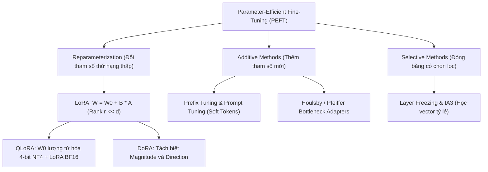

---

## 2. Chi tiết từng Keyword

---

### 8. Parameter-Efficient Fine-Tuning - PEFT (Tinh chỉnh Tối ưu Tham số)

#### a. Định nghĩa Bản chất Toán học (Mathematical Formulation)
**Parameter-Efficient Fine-Tuning (PEFT)** là họ các phương pháp tinh chỉnh mô hình ngôn ngữ lớn trong đó toàn bộ ma trận trọng số ban đầu $\mathbf{W}_0 \in \mathbb{R}^{d \times k}$ được đóng băng tuyệt đối ($\nabla_{\mathbf{W}_0} \mathcal{L} \equiv 0$), và quá trình tối ưu hóa chỉ diễn ra trên một tập tham số gia số bổ trợ nhỏ $\Delta\theta$:
$$\mathbf{W} = \mathbf{W}_0 + \Delta\mathbf{W}(\phi), \quad \text{với } |\phi| \ll |\mathbf{W}_0|$$
Thông thường, số lượng tham số huấn luyện được $|\phi|$ chỉ chiếm từ $0.01\%$ đến $1.0\%$ tổng số tham số của mô hình ($|\phi| \approx 10^6 - 10^7$ so với $|\mathbf{W}_0| \approx 10^{10} - 10^{11}$).
Hàm mất mát chỉ tối ưu hóa theo vector tham số bổ trợ $\phi$:
$$\phi^* = \arg\min_\phi \mathbb{E}_{(\mathbf{x}, \mathbf{y})} \big[ \mathcal{L}(\mathbf{W}_0, \phi; \mathbf{x}, \mathbf{y}) \big]$$

#### b. Cơ chế Tầng Sâu & Điện toán (Under The Hood / Hardware Internals)
- **Cắt giảm Trạng thái Bộ nhớ Optimizer**: Vì chỉ có $<1\%$ tham số cần tính gradient, dung lượng bộ nhớ dành cho các vector AdamW (Momentum và Variance) giảm từ hàng chục Gigabytes xuống chỉ còn vài chục Megabytes! Điều này giúp giải phóng phần lớn VRAM GPU để tăng kích thước Batch Size hoặc mở rộng Context Window.

#### c. Sơ đồ Minh họa (Mermaid / ASCII Diagram)
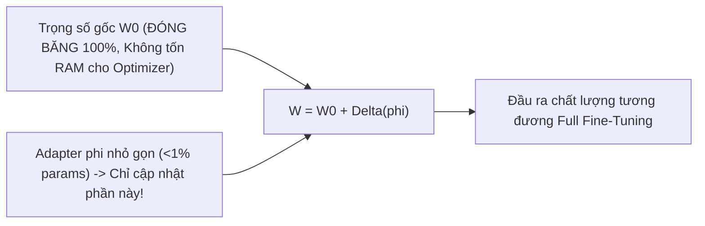

#### d. Code Thực chiến (Dual-Engine: C++ & Python)

```cpp
// C++17: Mô phỏng cơ chế đóng băng trọng số gốc và chỉ cập nhật Adapter
#include <iostream>
#include <vector>

struct LayerWeights {
    const std::vector<float> base_weights; // Đóng băng (const)
    std::vector<float> adapter_weights;    // Khả vi, cập nhật được

    std::vector<float> forward(const std::vector<float>& x) const {
        std::vector<float> out(x.size(), 0.0f);
        for (size_t i = 0; i < x.size(); ++i) {
            // y = (W0 + Delta) * x
            out[i] = (base_weights[i] + adapter_weights[i]) * x[i];
        }
        return out;
    }
};

int main() {
    LayerWeights layer{{1.5f, 2.0f}, {0.01f, -0.02f}};
    auto y = layer.forward({1.0f, 1.0f});
    std::cout << "PEFT Forward Output: [" << y[0] << ", " << y[1] << "]\n";
    return 0;
}
```

```python
# Python / HuggingFace PEFT: Kiểm tra tỷ lệ tham số có thể huấn luyện
from peft import LoraConfig, get_peft_model
import torch.nn as nn

base_model = nn.Sequential(nn.Linear(4096, 4096), nn.Linear(4096, 4096))
lora_config = LoraConfig(r=8, lora_alpha=16, target_modules=["0", "1"])
peft_model = get_peft_model(base_model, lora_config)

peft_model.print_trainable_parameters()
# Kết quả điển hình: trainable params: 131,072 || all params: 33,554,432 || trainable%: 0.39%
```

#### e. Lỗi Thường gặp & Ổn định Số học (Pitfalls & Numerical Stability)
- **Dung lượng Mô hình Quá Nhỏ**: Áp dụng PEFT trên các mô hình nơ-ron quy mô nhỏ ($< 1\text{B}$ tham số) thường mang lại kết quả kém hơn Full Fine-Tuning rõ rệt, do không gian tiềm ẩn của mô hình nhỏ chưa đủ dư thừa (over-parameterized) để phân rã thứ hạng thấp.

#### f. Ứng dụng Thực chiến trong AI / Deep Learning (AI Applications)
- Thư viện HuggingFace PEFT, nền tảng fine-tuning chi phí thấp trên Unsloth, Axolotl, LLaMA-Factory.

---

### 9. Low-Rank Adaptation - LoRA (Thích ứng Thứ hạng Thấp)

#### a. Định nghĩa Bản chất Toán học (Mathematical Formulation)
**Low-Rank Adaptation (LoRA)** (Edward Hu et al., Microsoft 2021) dựa trên giả thuyết toán học nền tảng: *"Sự thay đổi trọng số $\Delta\mathbf{W}$ trong quá trình thích ứng tác vụ có một 'thứ hạng nội tại' (Intrinsic Rank) rất thấp $r \ll \min(d, k)$."*
Thay vì tối ưu hóa trực tiếp ma trận dày đặc đầy đủ $\Delta\mathbf{W} \in \mathbb{R}^{d \times k}$, LoRA phân rã nó thành tích của hai ma trận thứ hạng thấp:
$$\Delta\mathbf{W} = \frac{\alpha}{r} \big(\mathbf{B} \times \mathbf{A}\big)$$
Trong đó:
- $\mathbf{A} \in \mathbb{R}^{r \times k}$: Ma trận chiếu giảm chiều, được khởi tạo theo phân phối chuẩn Gauss $\mathcal{N}(0, \sigma^2)$.
- $\mathbf{B} \in \mathbb{R}^{d \times r}$: Ma trận chiếu tăng chiều, được **khởi tạo hoàn toàn bằng số 0** ($\mathbf{B} = \mathbf{0}$).
- $r \in \mathbb{N}^+$: Thứ hạng (Rank), thường chọn $r \in \{4, 8, 16, 32, 64\}$.
- $\alpha$: Hệ số co giãn không đổi (Scaling Factor, thường $\alpha = 2r$).

Tính chất khởi tạo kỳ diệu:
Tại bước khởi đầu huấn luyện ($t=0$):
$$\Delta\mathbf{W} = \mathbf{B} \times \mathbf{A} = \mathbf{0} \times \mathbf{A} \equiv \mathbf{0}$$
Mô hình bắt đầu hoạt động chính xác $100\%$ như mô hình gốc $\mathbf{W}_0$ mà không bị nhiễu loạn ngẫu nhiên!
Khi suy luận (Inference), ma trận LoRA có thể được cộng gộp thẳng vào ma trận gốc:
$$\mathbf{W}_{\text{final}} = \mathbf{W}_0 + \frac{\alpha}{r}(\mathbf{B}\mathbf{A})$$
mang lại **Độ trễ Suy luận Thêm bằng 0 Tuyệt đối (Zero Inference Latency Overhead)**!

#### b. Cơ chế Tầng Sâu & Điện toán (Under The Hood / Hardware Internals)
- **Tối ưu hóa Phép Nhân Ma trận Khối**:
Với vector đầu vào $\mathbf{x} \in \mathbb{R}^{1 \times k}$:
$$\mathbf{h} = \mathbf{x} \mathbf{W}_0^T + \frac{\alpha}{r} \big( (\mathbf{x} \mathbf{A}^T) \mathbf{B}^T \big)$$
Thay vì tốn $d \cdot k$ phép tính, đường nhánh LoRA chỉ tốn $(k \cdot r + r \cdot d) = r(k + d)$ phép tính. Với $d=4096, k=4096, r=8$:
Chi phí tính toán giảm từ $16{,}777{,}216$ xuống chỉ còn $65{,}536$ phép tính (giảm $256$ lần FLOPs!).

#### c. Sơ đồ Minh họa (Mermaid / ASCII Diagram)
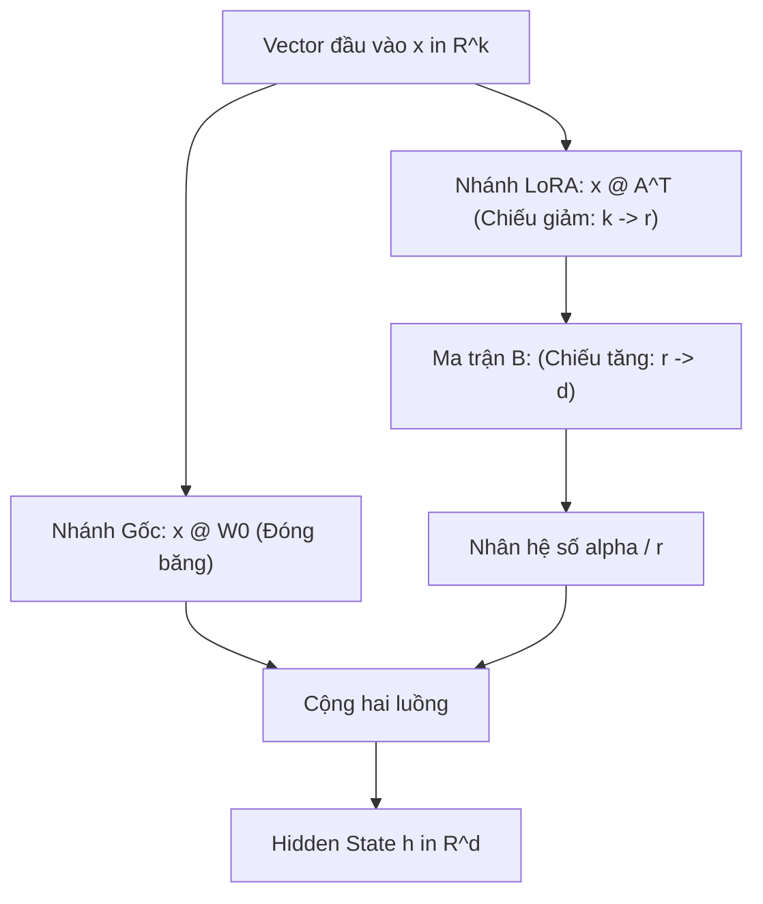

#### d. Code Thực chiến (Dual-Engine: C++ & Python)

```cpp
// C++17: Triển khai Forward Pass của tầng Tuyến tính tích hợp LoRA
#include <iostream>
#include <vector>

class LoRALinearLayer {
private:
    std::vector<float> W0_; // [d, k] - Frozen
    std::vector<float> A_;  // [r, k]
    std::vector<float> B_;  // [d, r]
    size_t d_, k_, r_;
    float scale_;

public:
    LoRALinearLayer(size_t d, size_t k, size_t r, float alpha)
        : d_(d), k_(k), r_(r), scale_(alpha / r), W0_(d * k, 0.5f), A_(r * k, 0.1f), B_(d * r, 0.0f) {}

    std::vector<float> forward(const std::vector<float>& x) {
        std::vector<float> h(d_, 0.0f);
        // 1. Nhánh chính: h = W0 * x
        for (size_t i = 0; i < d_; ++i) {
            for (size_t j = 0; j < k_; ++j) h[i] += W0_[i * k_ + j] * x[j];
        }

        // 2. Nhánh LoRA: intermediate = A * x [r]
        std::vector<float> inter(r_, 0.0f);
        for (size_t i = 0; i < r_; ++i) {
            for (size_t j = 0; j < k_; ++j) inter[i] += A_[i * k_ + j] * x[j];
        }

        // 3. lora_out = scale * (B * inter) [d]
        for (size_t i = 0; i < d_; ++i) {
            float b_val = 0.0f;
            for (size_t j = 0; j < r_; ++j) b_val += B_[i * r_ + j] * inter[j];
            h[i] += scale_ * b_val;
        }
        return h;
    }
};

int main() {
    LoRALinearLayer layer(4, 4, 2, 4.0f); // d=4, k=4, r=2, alpha=4.0
    auto out = layer.forward({1.0f, 1.0f, 1.0f, 1.0f});
    std::cout << "LoRA Output (B=0 initially matches W0): " << out[0] << "\n";
    return 0;
}
```

```python
# Python / PyTorch: Tự tạo Lớp LoRALinear chuẩn chỉnh từ con số không
import torch
import torch.nn as nn
import math

class LoRALinear(nn.Module):
    def __init__(self, in_features, out_features, r=8, lora_alpha=16):
        super().__init__()
        self.linear = nn.Linear(in_features, out_features, bias=False)
        self.linear.weight.requires_grad = False # Đóng băng trọng số gốc
        
        self.r = r
        self.scaling = lora_alpha / r
        self.lora_A = nn.Parameter(torch.randn(r, in_features) / math.sqrt(r))
        self.lora_B = nn.Parameter(torch.zeros(out_features, r)) # Khởi tạo bằng 0

    def forward(self, x):
        base_out = self.linear(x)
        # delta = (x @ A.T) @ B.T * scaling
        lora_out = (x @ self.lora_A.T) @ self.lora_B.T * self.scaling
        return base_out + lora_out

layer = LoRALinear(128, 128, r=4)
x = torch.randn(2, 128)
print("LoRA Output Shape:", layer(x).shape)
```

#### e. Lỗi Thường gặp & Ổn định Số học (Pitfalls & Numerical Stability)
- **Chỉ áp dụng LoRA lên $W_Q, W_V$**: Bản báo cáo LoRA gốc của Microsoft chỉ áp dụng trên $W_Q$ và $W_V$. Nghiên cứu sau này (Dettmers et al.) chứng minh rằng: **Phải áp dụng LoRA lên tất cả các tầng tuyến tính** ($W_Q, W_K, W_V, W_O, W_{\text{gate}}, W_{\text{up}}, W_{\text{down}}$) mới đạt được sức mạnh tương đương $100\%$ Full Fine-Tuning.

#### f. Ứng dụng Thực chiến trong AI / Deep Learning (AI Applications)
- Phương pháp tinh chỉnh phổ biến nhất thế giới hiện nay trong mọi lĩnh vực: LLM Instruct, Stable Diffusion (chuyển đổi phong cách vẽ LoRA), Voice Cloning.

---

### 10. QLoRA - Efficient Finetuning of Quantized LLMs (LoRA Lượng tử hóa 4-bit)

#### a. Định nghĩa Bản chất Toán học (Mathematical Formulation)
**QLoRA** (Tim Dettmers et al., NeurIPS 2023) là bước đột phá phi thường cho phép **Fine-tune mô hình 70B tham số trên một GPU duy nhất 48GB (hoặc mô hình 7B trên GPU 16GB)** mà không làm suy giảm hiệu năng so với Full Precision.
Ba đổi mới toán học cốt lõi của QLoRA:
1. **Kiểu dữ liệu 4-bit NormalFloat (NF4)**:
Định dạng số thực 4-bit được thiết kế tối ưu thông tin lý thuyết cho các trọng số nơ-ron tuân theo phân phối chuẩn Gauss $\mathcal{W} \sim \mathcal{N}(0, \sigma^2)$. NF4 chia đều diện tích dưới đường cong xác suất thành 16 khoảng có tích phân bằng nhau, mang lại độ chính xác cao hơn hẳn kiểu số nguyên INT4 hoặc số thực FP4 truyền thống.
2. **Double Quantization (DQ - Lượng tử hóa Kép)**:
Lượng tử hóa cả hệ số co giãn (Quantization Constants) của các khối 64 phần tử từ FP32 xuống FP8, tiết kiệm thêm $0.37\text{ bits trên mỗi tham số}$ (tiết kiệm $3\text{ GB VRAM}$ cho mô hình 70B).
3. **Paged Optimizers**:
Tận dụng cơ chế CUDA Paging để tự động tráo đổi bộ nhớ của AdamW giữa VRAM và CPU RAM khi xuất hiện đột biến kích hoạt, triệt tiêu $100\%$ lỗi Out-Of-Memory.

Công thức Forward Pass của QLoRA:
$$\mathbf{Y} = \mathbf{X} \cdot \text{Dequantize}\big(\mathbf{c}_1, \mathbf{c}_2, \mathbf{W}^{\text{NF4}}\big) + \frac{\alpha}{r} \mathbf{X} \mathbf{A}^T \mathbf{B}^T$$
Trọng số $\mathbf{W}$ được lưu trữ dưới dạng 4-bit trên VRAM, và chỉ được giải nén tạm thời sang BF16 trong các thanh ghi khi thực hiện phép nhân ma trận.

#### b. Cơ chế Tầng Sâu & Điện toán (Under The Hood / Hardware Internals)
- **Kernel Lượng tử hóa BitsAndBytes CUDA**: Thư viện `bitsandbytes` biên dịch các kernel CUDA tùy biến cao cấp thực hiện giải nén tức thời từ NF4 sang BF16 trực tiếp trong bộ nhớ chia sẻ (Shared Memory) của Streaming Multiprocessor, duy trì tốc độ tính toán gần như tương đương với BF16 nguyên bản.

#### c. Sơ đồ Minh họa (Mermaid / ASCII Diagram)
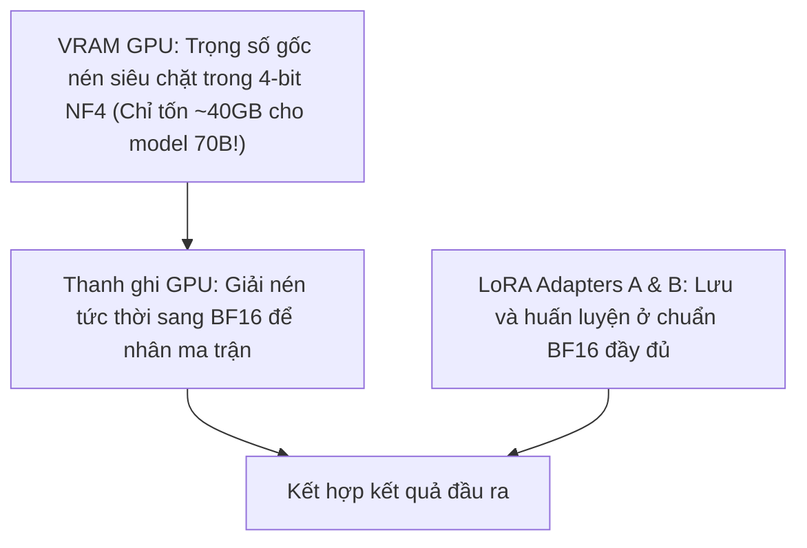

#### d. Code Thực chiến (Dual-Engine: C++ & Python)

```cpp
// C++17: Bảng tra cứu giá trị giải mã 16 mức của kiểu dữ liệu 4-bit NormalFloat (NF4)
#include <iostream>
#include <vector>

// 16 giá trị phân vị chuẩn hóa tối ưu lý thuyết của NF4 theo Dettmers et al.
const float NF4_TABLE[16] = {
    -1.00000000f, -0.69619280f, -0.52507305f, -0.39491749f,
    -0.28444138f, -0.18477343f, -0.09105003f,  0.00000000f,
     0.07958030f,  0.16093020f,  0.24714713f,  0.34393174f,
     0.45817390f,  0.60105305f,  0.80909060f,  1.00000000f
};

float dequantize_nf4(uint8_t nibble, float absmax) {
    return NF4_TABLE[nibble & 0x0F] * absmax;
}

int main() {
    uint8_t mock_compressed_weight = 0x0E; // Chỉ số 14
    float real_weight = dequantize_nf4(mock_compressed_weight, 2.5f);
    std::cout << "Dequantized NF4 Weight: " << real_weight << "\n";
    return 0;
}
```

```python
# Python / BitsAndBytes: Cấu hình BitsAndBytesConfig cho QLoRA Training
from transformers import BitsAndBytesConfig
import torch

bnb_config = BitsAndBytesConfig(
    load_in_4bit=True,
    bnb_4bit_quant_type="nf4",           # Kiểu dữ liệu 4-bit NormalFloat
    bnb_4bit_compute_dtype=torch.bfloat16,# Tính toán bằng BF16
    bnb_4bit_use_double_quant=True       # Double Quantization
)
print("QLoRA 4-bit NF4 Configuration successfully created.")
```

#### e. Lỗi Thường gặp & Ổn định Số học (Pitfalls & Numerical Stability)
- **Tốc độ Huấn luyện Chậm hơn 30%**: Do phải liên tục giải nén trọng số từ 4-bit sang 16-bit trong mỗi lượt forward và backward pass, thời gian huấn luyện mỗi step của QLoRA thường chậm hơn khoảng $30\%$ so with chuẩn LoRA 16-bit thuần túy (đánh đổi tốc độ lấy dung lượng VRAM siêu nhỏ).

#### f. Ứng dụng Thực chiến trong AI / Deep Learning (AI Applications)
- Cho phép các kỹ sư cá nhân và startup tự fine-tune các mô hình mã nguồn mở hàng đầu (Llama-3-70B, Mixtral-8x7B) trên phần cứng chi phí thấp.

---

### 11. AdaLoRA - Adaptive Low-Rank Adaptation (LoRA Thứ hạng Thích ứng)

#### a. Định nghĩa Bản chất Toán học (Mathematical Formulation)
**AdaLoRA** (Zhang et al., ICLR 2023) giải quyết nhược điểm cố định thứ hạng (Fixed Rank $r$) của LoRA truyền thống.
Trong mô hình Transformer sâu, các tầng khác nhau có tầm quan trọng ngữ nghĩa hoàn toàn khác nhau (ví dụ: các tầng giữa và tầng cuối thường quan trọng hơn các tầng đầu). Việc gán cùng một rank $r=8$ cho tất cả các ma trận là lãng phí tài nguyên.
AdaLoRA tham số hóa gia số $\Delta\mathbf{W}$ dựa trên **Phân rã Giá trị Kỳ dị Cắt cụt (Singular Value Decomposition - SVD)**:
$$\Delta\mathbf{W} = \mathbf{P} \cdot \mathbf{\Lambda} \cdot \mathbf{Q}$$
Trong đó:
- $\mathbf{P} \in \mathbb{R}^{d \times r}$ và $\mathbf{Q} \in \mathbb{R}^{r \times k}$ là các ma trận trực giao.
- $\mathbf{\Lambda} = \text{diag}(\lambda_1, \lambda_2, \dots, \lambda_r)$ là ma trận đường chéo chứa các giá trị kỳ dị (Singular Values).

**Cơ chế Tỉa Thứ hạng Động (Dynamic Rank Pruning)**:
Tại mỗi bước huấn luyện, AdaLoRA tính toán điểm số tầm quan trọng (Importance Score) của từng giá trị kỳ dị $\lambda_i$ dựa trên độ lớn và độ nhạy gradient của nó:
$$S_i = s(\lambda_i) = |\lambda_i| \cdot \left| \frac{\partial \mathcal{L}}{\partial \lambda_i} \right|$$
Các giá trị kỳ dị có $S_i$ thấp nhất sẽ bị gán về 0 (bị tỉa bỏ), tự động chuyển giao ngân sách tham số sang các tầng quan trọng hơn.

#### b. Cơ chế Tầng Sâu & Điện toán (Under The Hood / Hardware Internals)
- **Điều chuẩn Trực giao (Orthogonal Regularization)**: Để ngăn chặn $\mathbf{P}$ và $\mathbf{Q}$ bị sụp đổ phương sai trong quá trình tối ưu, AdaLoRA bổ sung một số hạng phạt trực giao vào hàm loss: $\mathcal{L}_{\text{orth}} = \|\mathbf{P}^T\mathbf{P} - \mathbf{I}\|_F^2 + \|\mathbf{Q}\mathbf{Q}^T - \mathbf{I}\|_F^2$.

#### c. Sơ đồ Minh họa (Mermaid / ASCII Diagram)
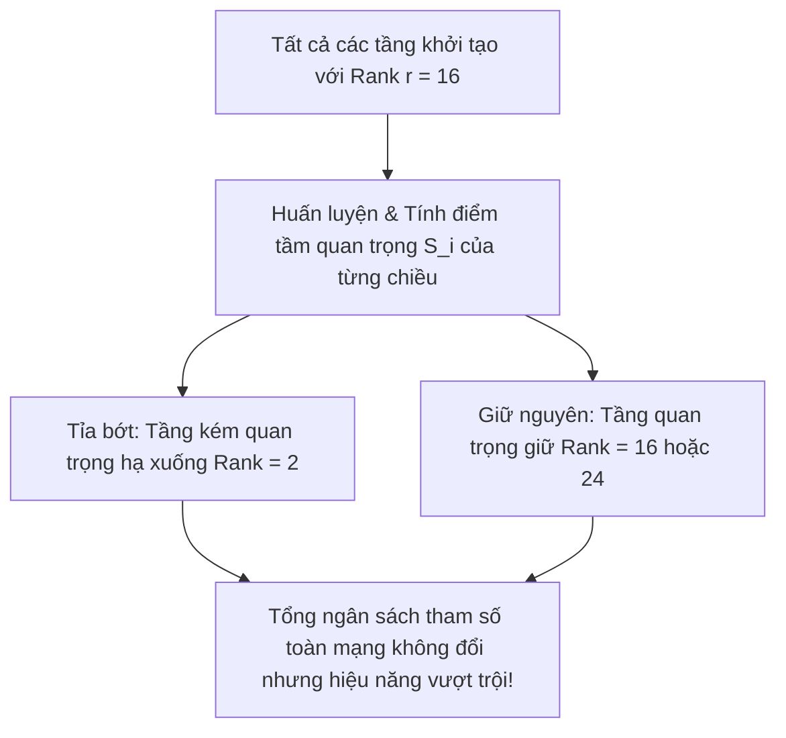

#### d. Code Thực chiến (Dual-Engine: C++ & Python)

```cpp
// C++17: Thuật toán tính điểm tầm quan trọng của Singular Value trong AdaLoRA
#include <iostream>
#include <vector>
#include <cmath>
#include <algorithm>

struct SingularComponent {
    int index;
    float lambda_val;
    float grad_val;
    float importance;

    void update_importance() {
        importance = std::abs(lambda_val * grad_val);
    }
};

int main() {
    std::vector<SingularComponent> components = {
        {0, 0.8f, 0.05f, 0.0f},
        {1, 0.01f, 0.001f, 0.0f}, // Rất nhỏ -> nên tỉa
        {2, 1.2f, 0.15f, 0.0f}
    };

    for (auto& c : components) c.update_importance();
    std::cout << "Comp 0 Importance: " << components[0].importance << "\n";
    std::cout << "Comp 1 Importance: " << components[1].importance << " (Prune Target!)\n";
    std::cout << "Comp 2 Importance: " << components[2].importance << "\n";
    return 0;
}
```

```python
# Python / PEFT: Cấu hình AdaLoraConfig
from peft import AdaLoraConfig

adalora_config = AdaLoraConfig(
    init_r=12,          # Rank ban đầu
    target_r=8,         # Rank mục tiêu trung bình sau khi tỉa
    beta1=0.85, beta2=0.85,
    tinit=200, tfinal=1000, deltaT=10
)
print("AdaLoRA Configuration successfully defined.")
```

#### e. Lỗi Thường gặp & Ổn định Số học (Pitfalls & Numerical Stability)
- **Tỉa Rank Quá Sớm**: Nếu bắt đầu tỉa thứ hạng trước khi mô hình kịp hội tụ qua giai đoạn Warmup (ví dụ tỉa ngay từ step 10), điểm số gradient rất nhiễu loạn sẽ tỉa nhầm các chiều biểu diễn quan trọng.

#### f. Ứng dụng Thực chiến trong AI / Deep Learning (AI Applications)
- Tối ưu hóa phân bổ tham số cho các tác vụ hiểu ngôn ngữ phức tạp (NLU benchmarks, GLUE, SuperGLUE).

---

### 12. DoRA - Weight-Decomposed Low-Rank Adaptation (LoRA Phân rã Trọng số)

#### a. Định nghĩa Bản chất Toán học (Mathematical Formulation)
**DoRA** (Shih-Yang Liu et al., NVIDIA 2024) phân tích sự khác biệt cơ bản giữa **Full Fine-Tuning (FT)** và **LoRA**:
- Trong Full FT: Cả **Độ lớn (Magnitude)** và **Hướng (Direction)** của ma trận trọng số đều thay đổi linh hoạt.
- Trong LoRA: Cả độ lớn và hướng bị ràng buộc chặt chẽ với nhau do cấu trúc tích ma trận $\mathbf{B}\mathbf{A}$, làm hạn chế khả năng học các biến đổi phức tạp.

DoRA giải quyết triệt để vấn đề này bằng cách phân rã ma trận trọng số thành hai thành phần độc lập theo nguyên lý đại số vector:
$$\mathbf{W} = m \frac{\mathbf{V}}{\|\mathbf{V}\|_c} = m \frac{\mathbf{W}_0 + \Delta\mathbf{W}}{\|\mathbf{W}_0 + \Delta\mathbf{W}\|_c}$$
Trong đó:
- $m \in \mathbb{R}^{1 \times k}$: Vector tham số vô hướng biểu diễn **Độ lớn (Magnitude)** của từng cột ma trận, được huấn luyện trực tiếp.
- $\mathbf{V} = \mathbf{W}_0 + \frac{\alpha}{r}\mathbf{B}\mathbf{A}$: Ma trận biểu diễn **Hướng (Direction)**, được điều hòa bởi các ma trận LoRA thứ hạng thấp.
- $\|\cdot\|_c$: Chuẩn $\ell_2$ tính theo từng cột của ma trận.

Kết quả thực nghiệm của NVIDIA chứng minh: **DoRA vượt trội hơn LoRA trên mọi benchmark** và tiệm cận hoặc vượt qua cả Full Fine-Tuning với cùng một số lượng tham số!

#### b. Cơ chế Tầng Sâu & Điện toán (Under The Hood / Hardware Internals)
- **Tối ưu hóa Bằng Kernel Hợp Nhất (Fused Normalization)**: Phép tính chuẩn hóa $\|\mathbf{W}_0 + \mathbf{B}\mathbf{A}\|_c$ đòi hỏi tính tổng bình phương theo cột. DoRA sử dụng kernel tùy biến để tính chuẩn trực tiếp trong quá trình nhân ma trận mà không cần cấp phát tensor bộ nhớ đệm phụ trợ.

#### c. Sơ đồ Minh họa (Mermaid / ASCII Diagram)
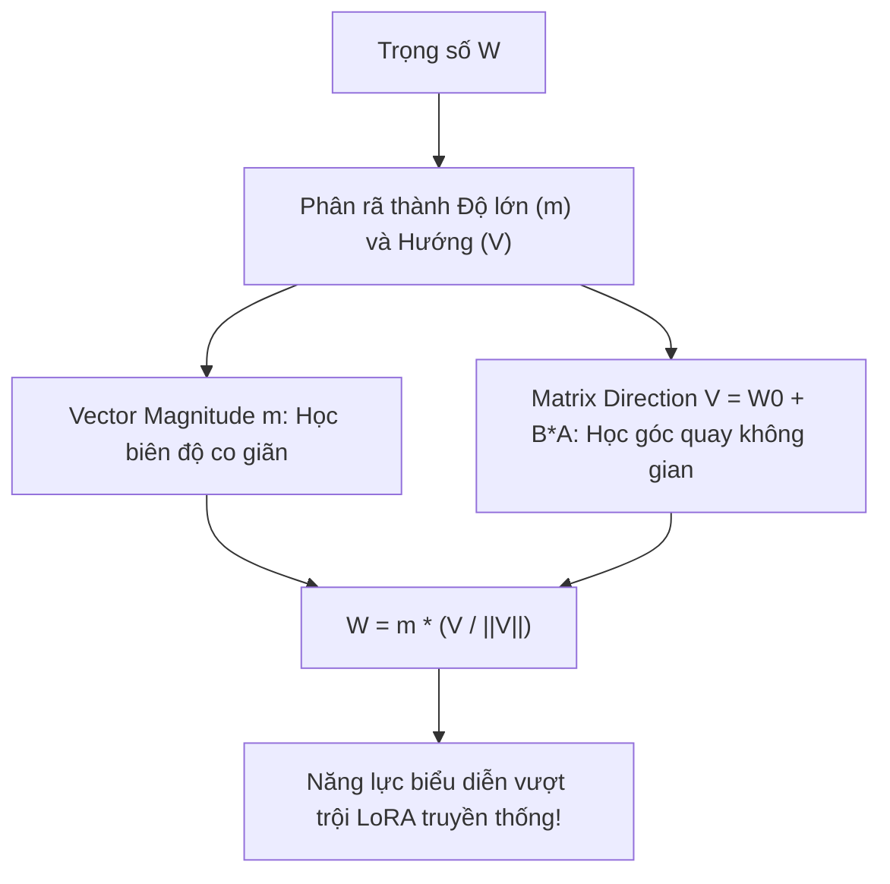

#### d. Code Thực chiến (Dual-Engine: C++ & Python)

```cpp
// C++17: Thuật toán phân rã vector thành Magnitude và Normalized Direction
#include <iostream>
#include <vector>
#include <cmath>

struct DecomposedVector {
    float magnitude;
    std::vector<float> direction; // Normalized unit vector
};

DecomposedVector decompose_vector(const std::vector<float>& v) {
    float sum_sq = 0.0f;
    for (float x : v) sum_sq += x * x;
    float mag = std::sqrt(sum_sq);

    std::vector<float> dir(v.size());
    float inv_mag = (mag > 1e-8f) ? (1.0f / mag) : 0.0f;
    for (size_t i = 0; i < v.size(); ++i) dir[i] = v[i] * inv_mag;

    return {mag, dir};
}

int main() {
    std::vector<float> v = {3.0f, 4.0f};
    auto decomp = decompose_vector(v);
    std::cout << "Magnitude m: " << decomp.magnitude << " (Target: 5.0)\n";
    std::cout << "Unit Direction: [" << decomp.direction[0] << ", " << decomp.direction[1] << "]\n";
    return 0;
}
```

```python
# Python / PEFT: Kích hoạt DoRA trong LoraConfig
from peft import LoraConfig

dora_config = LoraConfig(
    r=16,
    lora_alpha=32,
    use_dora=True, # Kích hoạt Weight-Decomposed LoRA (DoRA)
    target_modules=["q_proj", "v_proj", "k_proj", "o_proj"]
)
print("DoRA Configuration successfully initialized via PEFT.")
```

#### e. Lỗi Thường gặp & Ổn định Số học (Pitfalls & Numerical Stability)
- **Tăng nhẹ Thời gian Huấn luyện**: Do phải tính thêm phép chuẩn hóa cột $\|\mathbf{V}\|_c$, tốc độ huấn luyện của DoRA chậm hơn LoRA khoảng $10\% - 15\%$. Tuy nhiên, khi suy luận (Inference), ma trận hoàn toàn có thể gộp lại thành ma trận phẳng duy nhất, bảo đảm độ trễ bằng 0.

#### f. Ứng dụng Thực chiến trong AI / Deep Learning (AI Applications)
- Fine-tune các mô hình thị giác và ngôn ngữ đòi hỏi độ chính xác cao: LLaMA-3, Stable Diffusion 3, Flux.

---

### 13. Prefix Tuning (Tinh chỉnh Tiền tố)

#### a. Định nghĩa Bản chất Toán học (Mathematical Formulation)
**Prefix Tuning** (Li & Liang, ACL 2021) là phương pháp giữ nguyên toàn bộ các trọng số của mạng Transformer và chèn thêm một chuỗi các tham số vector khả vi liên tục (**Virtual Prefix Vectors**) vào phía trước các ma trận Key và Value tại **tất cả các tầng Attention**:
$$\mathbf{K}' = [\mathbf{P}_K, \mathbf{K}], \qquad \mathbf{V}' = [\mathbf{P}_V, \mathbf{V}]$$
Trong đó:
- $\mathbf{P}_K, \mathbf{P}_V \in \mathbb{R}^{l_{\text{prefix}} \times d_k}$ là các vector tiền tố học được, với $l_{\text{prefix}}$ là độ dài tiền tố (thường $l_{\text{prefix}} \in [10, 30]$ tokens).
- Quá trình tính toán Self-Attention:
$$\text{Attention}(Q, \mathbf{K}', \mathbf{V}') = \text{softmax}\left( \frac{Q [\mathbf{P}_K, \mathbf{K}]^T}{\sqrt{d_k}} \right) [\mathbf{P}_V, \mathbf{V}]$$
Các token trong chuỗi văn bản tự do chú ý tới các vector tiền tố này như thể chúng là ngữ cảnh ảo định hướng hành vi của mạng.

#### b. Cơ chế Tầng Sâu & Điện toán (Under The Hood / Hardware Internals)
- **Tái tham số hóa MLP trong lúc Huấn luyện**: Tối ưu hóa trực tiếp $\mathbf{P}_K, \mathbf{P}_V$ rất dễ gây bất ổn định số học. Tác giả sử dụng một mạng nơ-ron MLP nhỏ để sinh ra prefix trong lúc huấn luyện: $\mathbf{P} = \text{MLP}(\mathbf{E}_{\text{prefix}})$, sau khi huấn luyện xong chỉ lưu trữ các vector $\mathbf{P}$ thô trên VRAM.

#### c. Sơ đồ Minh họa (Mermaid / ASCII Diagram)
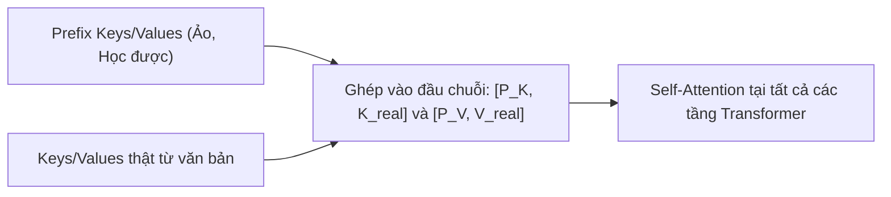

#### d. Code Thực chiến (Dual-Engine: C++ & Python)

```cpp
// C++17: Nối vector Prefix ảo vào đầu vector Key thật
#include <iostream>
#include <vector>

std::vector<float> prepend_prefix_keys(
    const std::vector<float>& prefix_keys, // [l_pre * d]
    const std::vector<float>& real_keys)   // [l_real * d]
{
    std::vector<float> combined = prefix_keys;
    combined.insert(combined.end(), real_keys.begin(), real_keys.end());
    return combined;
}

int main() {
    std::vector<float> prefix = {0.1f, 0.2f}; // 1 prefix token, dim=2
    std::vector<float> real = {1.0f, 1.1f,  2.0f, 2.1f}; // 2 real tokens
    auto full_k = prepend_prefix_keys(prefix, real);
    std::cout << "Full Keys sequence length: " << full_k.size() / 2 << " tokens.\n";
    return 0;
}
```

```python
# Python / PEFT: Cấu hình PrefixTuningConfig
from peft import PrefixTuningConfig

prefix_config = PrefixTuningConfig(
    num_virtual_tokens=20, # 20 virtual prefix tokens
    task_type="CAUSAL_LM"
)
print("Prefix Tuning Config defined successfully.")
```

#### e. Lỗi Thường gặp & Ổn định Số học (Pitfalls & Numerical Stability)
- **Chiếm dụng Cửa sổ Ngữ cảnh Thực tế**: Thêm 30 prefix tokens đồng nghĩa với việc giảm 30 vị trí của cửa sổ ngữ cảnh thực tế dành cho văn bản người dùng ($L_{\text{effective}} = L_{\max} - l_{\text{prefix}}$).

#### f. Ứng dụng Thực chiến trong AI / Deep Learning (AI Applications)
- Tinh chỉnh mô hình sinh sinh học, điều khiển phong cách sinh văn bản trong GPT-2 và BART.

---

### 14. Prompt Tuning (Tinh chỉnh Lời nhắc Mềm)

#### a. Định nghĩa Bản chất Toán học (Mathematical Formulation)
**Prompt Tuning** (Lester et al., EMNLP 2021) là phiên bản đơn giản hóa tối đa của Prefix Tuning.
Thay vì chèn vector tiền tố vào tất cả các tầng sâu của mạng, Prompt Tuning **chỉ chèn các vector tiền tố ảo (Soft Prompt Tokens) vào duy nhất tầng nhúng đầu vào (Input Embedding Layer)**:
$$\mathbf{X}' = [\mathbf{P}_{\text{soft}}, \mathbf{E}(w_1), \mathbf{E}(w_2), \dots, \mathbf{E}(w_T)] \in \mathbb{R}^{(p + T) \times d}$$
Trong đó:
- $\mathbf{P}_{\text{soft}} \in \mathbb{R}^{p \times d}$ là ma trận các tham số liên tục tự do học được ($p \approx 8 - 32$ tokens).
- Toàn bộ các tầng Transformer phía sau được đóng băng $100\%$.

Định luật Hội tụ Quy mô của Lester et al.:
Khi kích thước mô hình vượt qua **$10\text{B}$ tham số**, Prompt Tuning đạt được hiệu năng ngang bằng $100\%$ với Full Fine-Tuning trong khi chỉ huấn luyện chưa đầy $0.001\%$ số tham số!

#### b. Cơ chế Tầng Sâu & Điện toán (Under The Hood / Hardware Internals)
- **Phục vụ Đa Tác vụ Siêu Tốc (Extreme Multi-Task Serving)**: Một cụm máy chủ duy nhất chỉ cần nạp 1 bản sao của mô hình 70B vào VRAM. Khi có yêu cầu từ người dùng, hệ thống chỉ cần gắn kèm vector Soft Prompt $\mathbf{P}_{\text{task}}$ tương ứng (nặng vài chục Kilobytes), cho phép một GPU phục vụ đồng thời hàng nghìn khách hàng với hàng nghìn tác vụ khác nhau.

#### c. Sơ đồ Minh họa (Mermaid / ASCII Diagram)
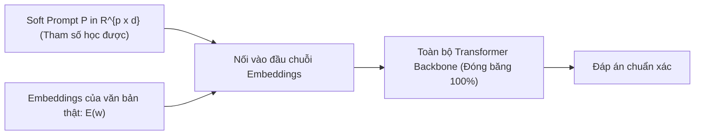

#### d. Code Thực chiến (Dual-Engine: C++ & Python)

```cpp
// C++17: Nối ma trận Soft Prompt vào đầu ma trận Embeddings đầu vào
#include <iostream>
#include <vector>

std::vector<float> prepend_soft_prompts(
    const std::vector<float>& soft_prompt, // [p * d]
    const std::vector<float>& input_embeds) // [T * d]
{
    std::vector<float> packed = soft_prompt;
    packed.insert(packed.end(), input_embeds.begin(), input_embeds.end());
    return packed;
}

int main() {
    std::vector<float> soft_p(8 * 4, 0.5f); // 8 soft tokens, dim=4
    std::vector<float> text_e(3 * 4, 1.0f); // 3 text tokens
    auto full_input = prepend_soft_prompts(soft_p, text_e);
    std::cout << "Input sequence length to Transformer: " << full_input.size() / 4 << " tokens\n";
    return 0;
}
```

```python
# Python / PEFT: Thiết lập PromptTuningConfig với Text Initialization
from peft import PromptTuningConfig, PromptTuningInit

prompt_tuning_config = PromptTuningConfig(
    num_virtual_tokens=10,
    prompt_tuning_init=PromptTuningInit.TEXT,
    prompt_tuning_init_text="Classify the sentiment of this text:",
    tokenizer_name_or_path="gpt2"
)
print("Prompt Tuning Config initialized with text seed.")
```

#### e. Lỗi Thường gặp & Ổn định Số học (Pitfalls & Numerical Stability)
- **Kém hiệu quả trên Mô hình Nhỏ**: Trên các mô hình nhỏ (dưới 1 tỷ tham số như T5-Base hay GPT-2), Prompt Tuning hoạt động rất kém và không thể cạnh tranh được với LoRA hay Full Fine-Tuning.

#### f. Ứng dụng Thực chiến trong AI / Deep Learning (AI Applications)
- Hệ thống SaaS AI phục vụ hàng vạn khách hàng tùy biến trên cùng một hạ tầng GPU dùng chung.

---

### 15. P-Tuning (Kỹ thuật P-Tuning)

#### a. Định nghĩa Bản chất Toán học (Mathematical Formulation)
**P-Tuning (Liu et al., 2021)** và phiên bản nâng cấp **P-Tuning v2 (Liu et al., ACL 2022)** giải quyết sự bất ổn định trong tối ưu hóa trực tiếp của Prompt Tuning.
Thay vì tối ưu hóa độc lập từng vector $\mathbf{p}_i$, P-Tuning giả định rằng các token ảo có sự phụ thuộc liên tục không gian. Do đó, một mạng nơ-ron hồi quy hai chiều **BiLSTM** kết hợp với mạng MLP được sử dụng làm bộ sinh vector tiền tố (Prompt Encoder):
$$\mathbf{p}_i = \text{MLP}\Big( \big[ \overrightarrow{\text{LSTM}}(\mathbf{e}_{1:p})_i, \; \overleftarrow{\text{LSTM}}(\mathbf{e}_{1:p})_i \big] \Big)$$
Trong đó $\mathbf{e}_1, \dots, \mathbf{e}_p$ là các vector nhúng khởi tạo.
P-Tuning v2 mở rộng cơ chế này bằng cách áp dụng Deep Prompt Tuning (chèn các prompt ảo vào tất cả các tầng như Prefix Tuning nhưng không bị ràng buộc bởi kiến trúc Attention cũ), mang lại hiệu năng sánh ngang Full Fine-Tuning trên cả các mô hình nhỏ ($100\text{M} - 1\text{B}$).

#### b. Cơ chế Tầng Sâu & Điện toán (Under The Hood / Hardware Internals)
- **Xóa bỏ BiLSTM sau Huấn luyện**: Tương tự Prefix Tuning, sau khi huấn luyện xong, mạng BiLSTM được chạy 1 lần duy nhất để kết xuất ra các vector $\mathbf{p}_i$. Mạng BiLSTM sau đó bị loại bỏ hoàn toàn, không gây bất kỳ độ trễ tính toán nào khi đưa vào vận hành.

#### c. Sơ đồ Minh họa (Mermaid / ASCII Diagram)


#### d. Code Thực chiến (Dual-Engine: C++ & Python)

```cpp
// C++17: Cấu trúc lưu trữ P-Tuning Multi-Layer Embeddings
#include <iostream>
#include <vector>

struct PTuningV2LayerPrompts {
    int layer_id;
    std::vector<float> prompt_vectors; // [num_tokens * dim]
};

int main() {
    PTuningV2LayerPrompts layer0{0, std::vector<float>(16 * 128, 0.1f)};
    std::cout << "Layer 0 P-Tuning virtual tokens stored: " << layer0.prompt_vectors.size() / 128 << "\n";
    return 0;
}
```

```python
# Python / PEFT: Cấu hình P-Tuning qua PromptEncoderConfig
from peft import PromptEncoderConfig

p_tuning_config = PromptEncoderConfig(
    num_virtual_tokens=20,
    encoder_hidden_size=128,
    encoder_num_layers=2, # 2 layers BiLSTM
    task_type="CAUSAL_LM"
)
print("P-Tuning Configuration with BiLSTM encoder defined.")
```

#### e. Lỗi Thường gặp & Ổn định Số học (Pitfalls & Numerical Stability)
- **Quá nhiều tham số trong Encoder**: Nếu thiết kế mạng BiLSTM quá lớn, số lượng tham số cần học của bộ sinh prompt có thể vượt quá giới hạn mong muốn của PEFT.

#### f. Ứng dụng Thực chiến trong AI / Deep Learning (AI Applications)
- ChatGLM, ChatGLM-2 (Tsinghua University) sử dụng P-Tuning v2 làm phương thức fine-tuning mặc định.

---

### 16. Adapter Tuning (Tinh chỉnh Bộ Thích ứng Cổ điển)

#### a. Định nghĩa Bản chất Toán học (Mathematical Formulation)
**Adapter Tuning** (Neil Houlsby et al., ICML 2019; Jonas Pfeiffer et al., 2020) là phương pháp PEFT đầu tiên mở đầu cho kỷ nguyên tối ưu hóa tham số hiện đại.
Thay vì thay đổi các ma trận trọng số hiện có, Adapter chèn các khối mạng nơ-ron nhỏ dạng cổ chai (**Bottleneck Adapter Modules**) ngay sau tầng Multi-Head Attention và sau tầng Feed-Forward Network:
$$\mathbf{h}_{\text{out}} = \mathbf{h} + f_{\text{adapter}}(\mathbf{h})$$
Kiến trúc khối Bottleneck:
$$f_{\text{adapter}}(\mathbf{h}) = \sigma(\mathbf{h} \mathbf{W}_{\text{down}}) \mathbf{W}_{\text{up}}$$
Trong đó:
- $\mathbf{W}_{\text{down}} \in \mathbb{R}^{d \times m}$ giảm số chiều từ $d$ xuống không gian cổ chai nhỏ $m \ll d$ (thường $m = d/16$ hoặc $d/32$).
- $\sigma$ là hàm kích hoạt phi tuyến tính (GELU hoặc ReLU).
- $\mathbf{W}_{\text{up}} \in \mathbb{R}^{m \times d}$ chiếu ngược lại chiều không gian ban đầu $d$.
- Kết hợp đường nối tắt dư thừa (**Residual Connection**) đảm bảo nếu adapter khởi tạo bằng 0, mạng hoạt động nguyên vẹn như ban đầu.

#### b. Cơ chế Tầng Sâu & Điện toán (Under The Hood / Hardware Internals)
- **Độ Trễ Tuần Tự (Sequential Latency Overhead)**: Khác với LoRA (có thể cộng gộp ma trận trước khi inference), các khối Adapter nằm xen kẽ giữa các tầng và có hàm phi tuyến $\sigma$. Do đó, **bắt buộc phải thực hiện phép tính tuần tự qua Adapter** tại mỗi bước forward pass, làm tăng từ $5\% - 10\%$ độ trễ suy luận trên GPU.

#### c. Sơ đồ Minh họa (Mermaid / ASCII Diagram)
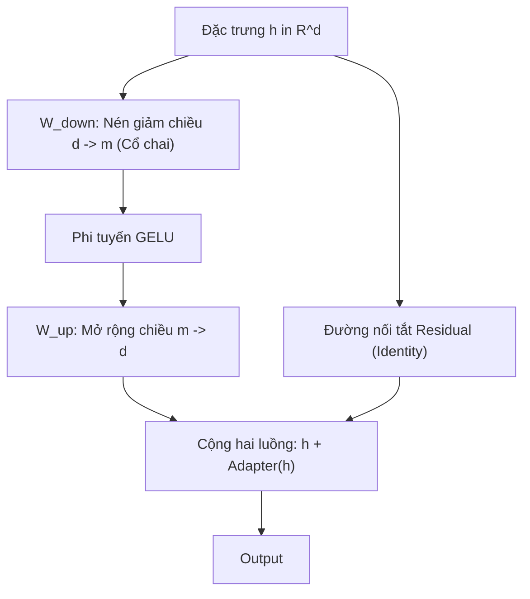

#### d. Code Thực chiến (Dual-Engine: C++ & Python)

```cpp
// C++17: Khối Bottleneck Adapter với Residual Connection
#include <iostream>
#include <vector>
#include <cmath>

struct BottleneckAdapter {
    std::vector<float> W_down; // [m, d]
    std::vector<float> W_up;   // [d, m]
    size_t d, m;

    std::vector<float> forward(const std::vector<float>& h) {
        // 1. Down-projection: inter = ReLU(W_down * h)
        std::vector<float> inter(m, 0.0f);
        for (size_t i = 0; i < m; ++i) {
            for (size_t j = 0; j < d; ++j) inter[i] += W_down[i * d + j] * h[j];
            inter[i] = std::max(0.0f, inter[i]); // ReLU
        }

        // 2. Up-projection + Residual: out = h + (W_up * inter)
        std::vector<float> out = h;
        for (size_t i = 0; i < d; ++i) {
            for (size_t j = 0; j < m; ++j) out[i] += W_up[i * m + j] * inter[j];
        }
        return out;
    }
};

int main() {
    BottleneckAdapter adapter{std::vector<float>(2 * 4, 0.1f), std::vector<float>(4 * 2, 0.1f), 4, 2};
    auto y = adapter.forward({1.0f, 1.0f, 1.0f, 1.0f});
    std::cout << "Adapter Output: [" << y[0] << ", " << y[1] << "]\n";
    return 0;
}
```

```python
# Python / PyTorch: Khối Houlsby Adapter Module hoàn chỉnh
import torch
import torch.nn as nn

class HoulsbyAdapter(nn.Module):
    def __init__(self, d_model=4096, bottleneck_dim=128):
        super().__init__()
        self.down_proj = nn.Linear(d_model, bottleneck_dim)
        self.act = nn.GELU()
        self.up_proj = nn.Linear(bottleneck_dim, d_model)
        # Khởi tạo up_proj bằng 0 để ban đầu adapter là hàm đồng nhất (Identity)
        nn.init.zeros_(self.up_proj.weight)
        nn.init.zeros_(self.up_proj.bias)

    def forward(self, x):
        return x + self.up_proj(self.act(self.down_proj(x)))

adapter = HoulsbyAdapter(256, 16)
x = torch.randn(2, 10, 256)
print("Adapter output matches input initially:", torch.allclose(adapter(x), x))
```

#### e. Lỗi Thường gặp & Ổn định Số học (Pitfalls & Numerical Stability)
- **Tắc nghẽn Băng thông Bộ nhớ Tuần tự**: Việc gọi hàng trăm khối adapter nhỏ xen kẽ kích hoạt các kernel CUDA rời rạc, làm giảm hiệu suất sử dụng GPU do chi phí khởi tạo kernel (Kernel Launch Overhead).

#### f. Ứng dụng Thực chiến trong AI / Deep Learning (AI Applications)
- Thư viện AdapterHub, tiền thân của các phương pháp LoRA ngày nay.

---

### 17. IA3 - Infused Adapter by Inhibiting and Amplifying Inner Activations

#### a. Định nghĩa Bản chất Toán học (Mathematical Formulation)
**IA3** (Liu et al., NeurIPS 2022 - T-Few) là một trong những phương pháp PEFT tiết kiệm tham số cực hạn nhất từng được phát minh: Nó đạt hiệu năng ngang ngửa hoặc vượt qua Full Fine-Tuning trong khi **chỉ huấn luyện khoảng $0.01\%$ tham số** (chỉ tốn vài trăm Kilobytes!).
Thay vì sử dụng các phép nhân ma trận dày đặc hay tích phân rã rank, IA3 điều hòa các vector kích hoạt nội tại thông qua **phép nhân theo từng phần tử (Element-wise Rescaling Vectors)**:
1. Trong Self-Attention:
$$\mathbf{K}' = \mathbf{l}_K \odot (\mathbf{x} \mathbf{W}_K), \qquad \mathbf{V}' = \mathbf{l}_V \odot (\mathbf{x} \mathbf{W}_V)$$
2. Trong Feed-Forward Network:
$$\mathbf{FFN}'(\mathbf{x}) = \mathbf{l}_{\text{FFN}} \odot \sigma(\mathbf{x} \mathbf{W}_{\text{in}}) \mathbf{W}_{\text{out}}$$
Trong đó:
- $\mathbf{l}_K \in \mathbb{R}^{d_k}$, $\mathbf{l}_V \in \mathbb{R}^{d_v}$, $\mathbf{l}_{\text{FFN}} \in \mathbb{R}^{d_{\text{ffn}}}$ là các vector tham số học được.
- Được khởi tạo bằng vector toàn số $1$ ($\mathbf{l} = \mathbf{1}$).
- Phép nhân $\odot$ có khả năng khuếch đại (Amplify nếu $l_i > 1$) hoặc ức chế (Inhibit nếu $l_i < 1$) từng kênh đặc trưng nơ-ron cụ thể.

Khi suy luận, vector $\mathbf{l}$ có thể được nhân trực tiếp vào từng hàng của ma trận trọng số gốc $\mathbf{W}$, đạt **độ trễ thêm bằng 0**.

#### b. Cơ chế Tầng Sâu & Điện toán (Under The Hood / Hardware Internals)
- **Siêu Tiết kiệm Bộ nhớ Cực đoan**: Với mô hình T0-11B, toàn bộ các vector IA3 của tất cả các tầng chỉ nặng đúng **$1.1\text{ MB}$**! Có thể lưu trữ hàng chục nghìn tác vụ khác nhau ngay trong bộ nhớ RAM của một chiếc điện thoại di động.

#### c. Sơ đồ Minh họa (Mermaid / ASCII Diagram)
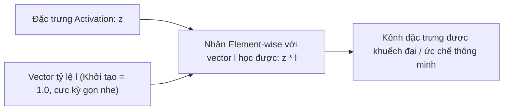

#### d. Code Thực chiến (Dual-Engine: C++ & Python)

```cpp
// C++17: Phép co giãn đặc trưng Element-wise của IA3
#include <iostream>
#include <vector>

void apply_ia3_rescaling(std::vector<float>& activations, const std::vector<float>& l_vec) {
    for (size_t i = 0; i < activations.size(); ++i) {
        activations[i] *= l_vec[i];
    }
}

int main() {
    std::vector<float> act = {2.0f, -1.0f, 0.5f};
    std::vector<float> l = {1.2f, 0.8f, 1.5f}; // Vector IA3
    apply_ia3_rescaling(act, l);
    std::cout << "IA3 Rescaled: [" << act[0] << ", " << act[1] << ", " << act[2] << "]\n";
    return 0;
}
```

```python
# Python / PEFT: Cấu hình IA3Config
from peft import IA3Config

ia3_config = IA3Config(
    task_type="CAUSAL_LM",
    target_modules=["k_proj", "v_proj", "down_proj"],
    feedforward_modules=["down_proj"]
)
print("IA3 Configuration initialized with ultra-low parameter footprint.")
```

#### e. Lỗi Thường gặp & Ổn định Số học (Pitfalls & Numerical Stability)
- **Kém linh hoạt khi miền dữ liệu quá khác biệt**: Do chỉ thay đổi tỷ lệ co giãn của các kênh đặc trưng có sẵn mà không thể xoay hướng vector trong không gian, IA3 gặp khó khăn nếu tác vụ mới đòi hỏi các phép biến đổi hình học hoàn toàn mới lạ.

#### f. Ứng dụng Thực chiến trong AI / Deep Learning (AI Applications)
- Few-shot learning cực đoan trên mô hình T-Few, phân loại văn bản tốc độ cao.

---

### 18. Layer Freezing (Đóng băng Tầng Mạng)

#### a. Định nghĩa Bản chất Toán học (Mathematical Formulation)
**Layer Freezing** là phương pháp tiếp cận chọn lọc (Selective PEFT) đơn giản và cổ điển nhất: Cố định hoàn toàn trọng số của phần lớn các tầng bên dưới và chỉ cho phép cập nhật một số ít tầng trên cùng (Top Layers) hoặc chỉ tầng phân loại cuối cùng:
$$\nabla_{\mathbf{W}_l} \mathcal{L} = \mathbf{0} \quad \forall l \in \{1, 2, \dots, L - k\}$$
$$\nabla_{\mathbf{W}_l} \mathcal{L} \ne \mathbf{0} \quad \forall l \in \{L - k + 1, \dots, L\}$$
với $k$ là số lượng tầng được mở khóa (ví dụ $k=2$ trên tổng số $L=32$ tầng).
Nguyên lý hình thành tri thức:
- Các tầng đầu tiên ($1 \to L-k$): Học các đặc trưng ngôn ngữ phổ quát (cú pháp, từ vựng, ngữ pháp cơ bản).
- Các tầng cuối ($L-k \to L$): Chịu trách nhiệm về ngữ nghĩa tác vụ cấp cao và phong cách suy luận.

#### b. Cơ chế Tầng Sâu & Điện toán (Under The Hood / Hardware Internals)
- **Cắt Ngắn Quá trình Backward Pass (Truncated Backpropagation)**: Khi toàn bộ các tầng từ $1 \to L-k$ bị đóng băng, đồ thị tự động đạo hàm (Autograd Engine) có thể dừng lại ngay sau tầng $L-k+1$, **không cần tính đạo hàm ngược cho các tầng phía trước**, giúp tiết kiệm $50\%$ thời gian tính toán Backward Pass trên GPU.

#### c. Sơ đồ Minh họa (Mermaid / ASCII Diagram)
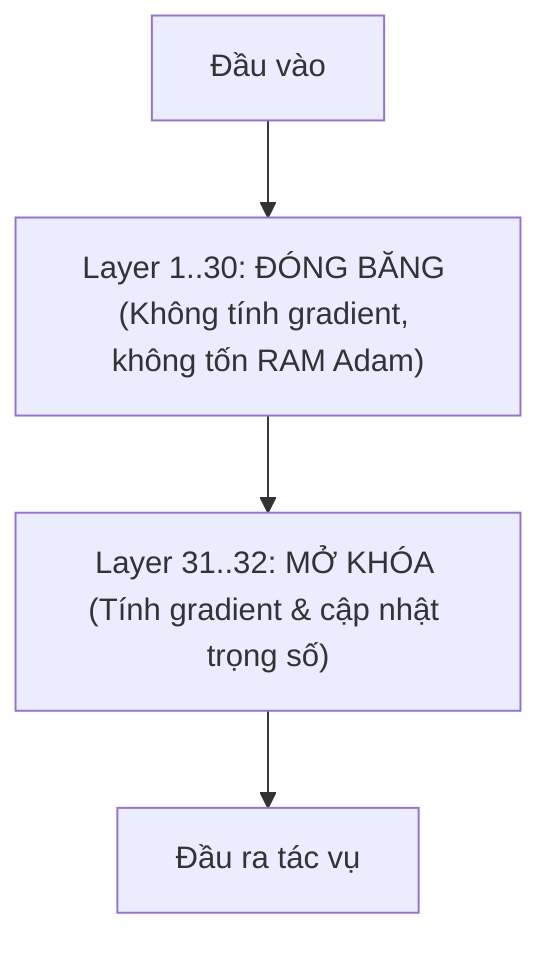

#### d. Code Thực chiến (Dual-Engine: C++ & Python)

```cpp
// C++17: Kiểm tra cờ khả vi requires_grad của từng tầng Transformer
#include <iostream>
#include <vector>

struct LayerConfig {
    int layer_id;
    bool is_frozen;
};

void freeze_bottom_layers(std::vector<LayerConfig>& layers, int num_trainable_top_layers) {
    int cutoff = static_cast<int>(layers.size()) - num_trainable_top_layers;
    for (int i = 0; i < static_cast<int>(layers.size()); ++i) {
        layers[i].is_frozen = (i < cutoff);
    }
}

int main() {
    std::vector<LayerConfig> layers(4);
    for (int i = 0; i < 4; ++i) layers[i] = {i, false};
    freeze_bottom_layers(layers, 1); // Chỉ mở khóa tầng cuối

    for (const auto& l : layers) {
        std::cout << "Layer " << l.layer_id << ": " << (l.is_frozen ? "FROZEN" : "TRAINABLE") << "\n";
    }
    return 0;
}
```

```python
# Python / PyTorch: Đóng băng toàn bộ các tầng trừ 2 tầng cuối cùng
import torch.nn as nn

class ToyTransformer(nn.Module):
    def __init__(self, num_layers=6):
        super().__init__()
        self.layers = nn.ModuleList([nn.Linear(64, 64) for _ in range(num_layers)])

model = ToyTransformer()
# Đóng băng 4 tầng đầu, chỉ mở khóa 2 tầng cuối (4 và 5)
for i, layer in enumerate(model.layers):
    if i < 4:
        for p in layer.parameters(): p.requires_grad = False

trainable = sum(p.numel() for p in model.parameters() if p.requires_grad)
total = sum(p.numel() for p in model.parameters())
print(f"Trainable params: {trainable}/{total} ({trainable/total*100:.1f}%)")
```

#### e. Lỗi Thường gặp & Ổn định Số học (Pitfalls & Numerical Stability)
- **Hiệu năng Kém hơn LoRA**: Giữ nguyên $k$ tầng cuối tiêu tốn lượng tham số lớn hơn LoRA nhiều lần nhưng lại mang lại độ chính xác thấp hơn, do không thể can thiệp điều hòa vào các tầng biểu diễn ở giữa.

#### f. Ứng dụng Thực chiến trong AI / Deep Learning (AI Applications)
- Tinh chỉnh nhanh các mô hình phân loại đầu cuối (Feature Extraction Transfer Learning).

---

### 19. Quantization-Aware Fine-Tuning - QAFT (Tinh chỉnh Nhận thức Lượng tử hóa)

#### a. Định nghĩa Bản chất Toán học (Mathematical Formulation)
**Quantization-Aware Fine-Tuning (QAFT)** là phương pháp tinh chỉnh mô hình trong khi trực tiếp mô phỏng các hiệu ứng mất mát độ chính xác của quá trình lượng tử hóa (Quantization Noise) ngay trong vòng lặp huấn luyện.
Thay vì lượng tử hóa sau khi huấn luyện xong (Post-Training Quantization - PTQ - vốn gây suy giảm độ chính xác rõ rệt ở chuẩn 4-bit/2-bit), QAFT chèn các toán tử **Lượng tử hóa Giả lập (Fake Quantization Operators)** vào đồ thị tính toán:
$$\mathbf{W}_{\text{fake}} = \text{Dequantize}\Big( \text{Quantize}(\mathbf{W}, \Delta, z), \Delta, z \Big)$$
Trong đó:
$$\text{Quantize}(w) = \text{clamp}\left( \left\lfloor \frac{w}{\Delta} \right\rceil + z, -q_{\max}, q_{\max} \right)$$
Do hàm làm tròn số nguyên $\lfloor \cdot \rceil$ có đạo hàm bằng 0 ở khắp mọi nơi (làm đứt gãy đồ thị backward pass), QAFT sử dụng ước lượng độ dốc truyền thẳng **Straight-Through Estimator (STE)**:
$$\frac{\partial \mathbf{W}_{\text{fake}}}{\partial \mathbf{W}} \approx \mathbf{I}$$
Trọng số $\mathbf{W}$ học cách thích nghi và tự bù trừ các sai số làm tròn số học, giúp mô hình sau khi xuất xưởng sang định dạng INT4/INT2 bảo toàn $99\%$ năng lực của bản gốc FP16.

#### b. Cơ chế Tầng Sâu & Điện toán (Under The Hood / Hardware Internals)
- **Triển khai Trực tiếp trên Chip Cạnh (Edge Deployment Optimization)**: Mô hình trải qua QAFT có thể được xuất trực tiếp sang các định dạng thực thi phần cứng cực hạn (như Qualcomm NPU, Apple Neural Engine, TensorRT INT4) mà không cần bước hiệu chỉnh hậu kỳ (Calibration).

#### c. Sơ đồ Minh họa (Mermaid / ASCII Diagram)
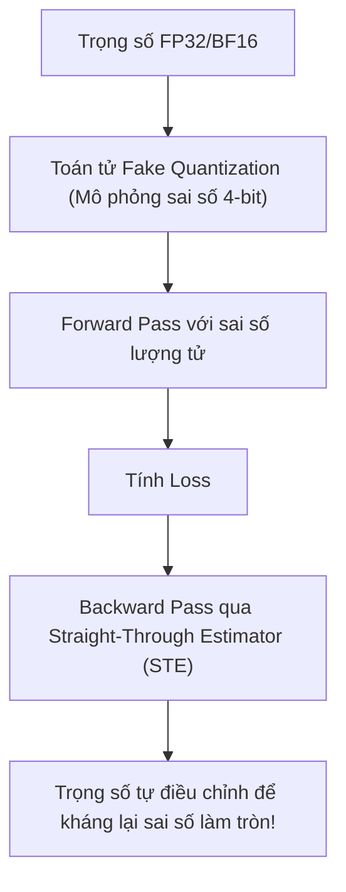

#### d. Code Thực chiến (Dual-Engine: C++ & Python)

```cpp
// C++17: Mô phỏng toán tử Fake Quantization INT8 (Lượng tử hóa rồi Giải mã tức thì)
#include <iostream>
#include <vector>
#include <cmath>
#include <algorithm>

float fake_quantize_scalar(float x, float scale) {
    // 1. Quantize to INT8 [-128, 127]
    int q = static_cast<int>(std::round(x / scale));
    q = std::max(-128, std::min(127, q));
    // 2. Dequantize back to float
    return static_cast<float>(q) * scale;
}

int main() {
    float original = 0.34789f;
    float scale = 0.05f;
    float simulated = fake_quantize_scalar(original, scale);
    std::cout << "Original Float: " << original << "\n";
    std::cout << "Fake Quantized: " << simulated << " (Quantization error injected)\n";
    return 0;
}
```

```python
# Python / PyTorch: Lớp FakeQuantize mô phỏng Straight-Through Estimator (STE)
import torch
import torch.nn as nn

class STEQuantize(torch.autograd.Function):
    @staticmethod
    def forward(ctx, x, scale):
        # Làm tròn số nguyên
        q = torch.clamp(torch.round(x / scale), -128, 127)
        return q * scale

    @staticmethod
    def backward(ctx, grad_output):
        # Straight-Through Estimator: truyền thẳng gradient nguyên vẹn
        return grad_output, None

class QALinear(nn.Module):
    def __init__(self, in_features, out_features, scale=0.05):
        super().__init__()
        self.weight = nn.Parameter(torch.randn(out_features, in_features))
        self.scale = scale

    def forward(self, x):
        w_simulated = STEQuantize.apply(self.weight, self.scale)
        return nn.functional.linear(x, w_simulated)

layer = QALinear(4, 2)
out = layer(torch.randn(1, 4))
out.sum().backward()
print("Gradient successfully backpropagated through STE:", layer.weight.grad is not None)
```

#### e. Lỗi Thường gặp & Ổn định Số học (Pitfalls & Numerical Stability)
- **Bất ổn định Gradient STE**: Do đạo hàm STE chỉ là phép xấp xỉ thô của hàm làm tròn bậc thang, nếu tốc độ học quá lớn, gradient có thể dao động qua lại quanh các bậc lượng tử hóa và không thể hội tụ.

#### f. Ứng dụng Thực chiến trong AI / Deep Learning (AI Applications)
- Nén mô hình triển khai trên thiết bị nhúng, robot tự hành, điện thoại thông minh (Snapdragon NPU, iPhone ANE).
