# Chuyên đề: Căn chỉnh Mô hình, RLHF & Tối ưu hóa Sở thích Trực tiếp (Alignment, RLHF & Preference Optimization)

## 1. Tổng quan Chuyên đề
Giai đoạn Pretraining và Supervised Fine-Tuning (SFT) trang bị cho Large Language Model (LLM) kho tri thức khổng lồ và khả năng tuân thủ định dạng hội thoại. Tuy nhiên, việc tối ưu hóa hàm mất mát Next-Token Prediction thuần túy ($\mathcal{L}_{\text{NLL}}$) thường dẫn đến hiện tượng **Objective Mismatch**: Mô hình có xu hướng bắt chước cả những thông tin sai lệch, độc hại, phân biệt đối xử hoặc suy diễn ngụy biện có sẵn trong dữ liệu internet.

**Alignment (Căn chỉnh)** là quy trình điều chỉnh hành vi và phân phối xác suất đầu ra của LLM sao cho hội tụ với ba giá trị cốt lõi của con người (**HHH - Helpful, Honest, Harmless**):
1. **Helpful (Hữu ích)**: Thực thi đúng mục tiêu, giải quyết triệt để yêu cầu của người dùng.
2. **Honest (Trung thực)**: Cung cấp thông tin xác thực, nhận thức được giới hạn tri thức, hạn chế ảo giác (hallucination).
3. **Harmless (Vô hại)**: Tuyệt đối từ chối tạo ra nội dung nguy hiểm, độc hại, vi phạm pháp luật hoặc kích động bạo lực.

Từ đột phá kinh điển của **RLHF** với thuật toán tối ưu hóa chính sách **PPO** (Proximal Policy Optimization), bức tranh căn chỉnh đã chứng kiến bước tiến hóa nhảy vọt hướng tới các kỹ thuật **Direct Preference Optimization (DPO, IPO, KTO, ORPO, SimPO)** nhằm loại bỏ hoàn toàn sự phức tạp và bất ổn định của Reward Model riêng biệt, đồng thời mở rộng sang kiến trúc **GRPO** (nền tảng của DeepSeek-Math và DeepSeek-R1) giúp tối ưu hóa suy luận mà không cần Value Network đồ sộ.

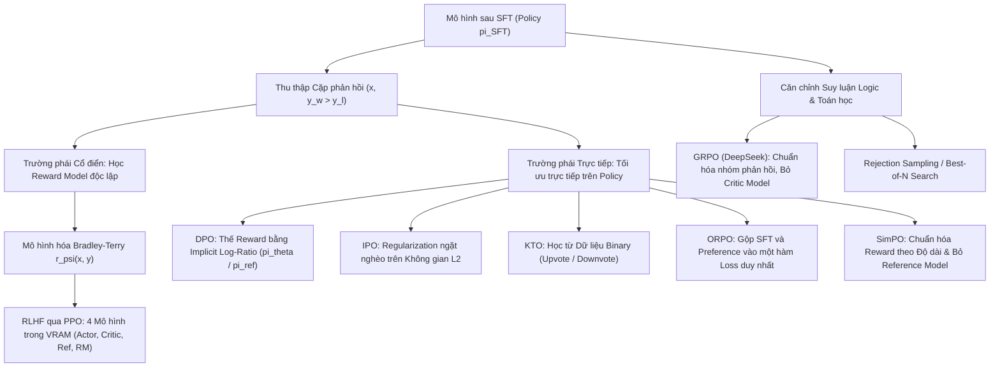

---

## 2. Chi tiết từng Keyword

---

### 20. Alignment (Căn chỉnh Mô hình)

#### a. Định nghĩa Bản chất Toán học (Mathematical Formulation)
**Alignment** là bài toán tối ưu hóa phân phối chính sách $\pi_\theta(y \mid x)$ của LLM trong không gian hành vi sao cho phân phối này tương thích tối đa với hàm thỏa dụng (Utility Function) của con người $U(x, y) \in \mathbb{R}$:
$$\theta^* = \arg\max_\theta \mathbb{E}_{x \sim \mathcal{D}, y \sim \pi_\theta(\cdot \mid x)} [U(x, y)] - \beta \, D_{\text{KL}}\big(\pi_\theta(y \mid x) \parallel \pi_{\text{ref}}(y \mid x)\big)$$
Trong đó:
- $x$: Chuỗi câu lệnh đầu vào (Prompt).
- $y$: Chuỗi phản hồi được sinh ra (Completion).
- $U(x, y)$: Hàm thỏa dụng trừu tượng đo lường mức độ Helpful, Honest, Harmless.
- $D_{\text{KL}}(\pi_\theta \parallel \pi_{\text{ref}})$: Khoảng cách Kullback-Leibler đóng vai trò neo giữ phân phối, ngăn chặn mô hình trôi quá xa khỏi phân phối ngôn ngữ tự nhiên ban đầu $\pi_{\text{ref}}$.
- $\beta > 0$: Hệ số phạt phân kỳ KL.

#### b. Cơ chế Tầng Sâu & Điện toán (Under The Hood / Hardware Internals)
- **Entropy Collapse & Mode Dropping**: Khi căn chỉnh quá mức (over-aligned), entropy của phân phối logits $H(\pi_\theta) = -\sum_i P(y_i) \log P(y_i)$ sụt giảm nghiêm trọng. Các nơ-ron sinh ra token đa dạng bị ức chế, mô hình chuyển sang chế độ trả lời rập khuôn mang tính phòng thủ (refusal phrases như *"I am an AI, I cannot..."*).
- **Phân bổ Bộ nhớ Tính toán**: Căn chỉnh đòi hỏi lưu giữ song song ít nhất 2 phiên bản mô hình trong VRAM: Active Model $\pi_\theta$ (nhận gradient) và Frozen Reference Model $\pi_{\text{ref}}$ (chỉ forward inference để tính KL divergence), làm tăng gấp đôi dung lượng bộ nhớ tham số.

#### c. Sơ đồ Minh họa (Mermaid / ASCII Diagram)
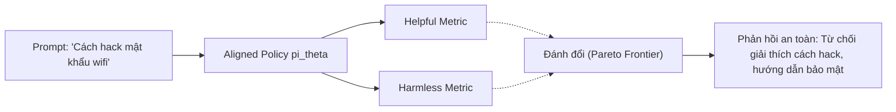

#### d. Code Thực chiến (Dual-Engine: C++ & Python)

```cpp
// C++17: Tính toán KL Divergence giữa 2 phân phối xác suất rời rạc
#include <iostream>
#include <vector>
#include <cmath>
#include <numeric>

double compute_kl_divergence(const std::vector<double>& pi_theta, const std::vector<double>& pi_ref) {
    double kl = 0.0;
    const double eps = 1e-12;
    for (size_t i = 0; i < pi_theta.size(); ++i) {
        if (pi_theta[i] > eps) {
            double ref_val = std::max(pi_ref[i], eps);
            kl += pi_theta[i] * std::log(pi_theta[i] / ref_val);
        }
    }
    return kl;
}

int main() {
    std::vector<double> pi_theta = {0.7, 0.2, 0.1};
    std::vector<double> pi_ref   = {0.4, 0.4, 0.2};
    std::cout << "KL Divergence: " << compute_kl_divergence(pi_theta, pi_ref) << std::endl;
    return 0;
}
```

```python
# Python / PyTorch: Hàm phạt KL Penalty giữa Aligned Model và Reference Model
import torch
import torch.nn.functional as F

def compute_token_level_kl(logits_theta: torch.Tensor, logits_ref: torch.Tensor) -> torch.Tensor:
    """
    Tính token-level KL divergence: KL(pi_theta || pi_ref)
    logits_theta, logits_ref: [Batch, SeqLen, VocabSize]
    """
    log_probs_theta = F.log_softmax(logits_theta, dim=-1)
    log_probs_ref = F.log_softmax(logits_ref, dim=-1)
    
    # KL(p || q) = sum p * (log p - log q)
    probs_theta = torch.exp(log_probs_theta)
    kl_div = torch.sum(probs_theta * (log_probs_theta - log_probs_ref), dim=-1)
    return kl_div # [Batch, SeqLen]

logits_active = torch.randn(2, 8, 32000)
logits_frozen = torch.randn(2, 8, 32000)
kl_loss = compute_token_level_kl(logits_active, logits_frozen).mean()
print(f"Token-level KL penalty: {kl_loss.item():.4f}")
```

#### e. Lỗi Thường gặp & Ổn định Số học (Pitfalls & Numerical Stability)
- **Log Ratio Instability**: Tránh tính trực tiếp $\frac{\pi_\theta(y)}{\pi_{\text{ref}}(y)}$ bằng phép chia thông thường vì xác suất token thường rất nhỏ ($\sim 10^{-6}$), dẫn đến underflow về 0 hoặc overflow thành `NaN`/`Inf`. Luôn làm việc trong không gian log: $\log \pi_\theta(y) - \log \pi_{\text{ref}}(y)$.

#### f. Ứng dụng Thực chiến trong AI / Deep Learning (AI Applications)
- **Anthropic Claude & OpenAI GPT-4**: Thiết lập hệ thống phòng thủ đa tầng (Defense-in-depth) ngăn chặn Jailbreak, Prompt Injection và bảo vệ an toàn thông tin người dùng.

---

### 21. Human Feedback (Phản hồi từ Con người)

#### a. Định nghĩa Bản chất Toán học (Mathematical Formulation)
**Human Feedback** là quá trình gán nhãn dữ liệu sở thích thông qua đánh giá định tính của con người đối với một tập hợp các phản hồi ứng viên $\{y_1, y_2, \dots, y_K\}$ cho cùng một câu lệnh $x$.
Hình thức phổ biến nhất là **So sánh Cặp (Pairwise Comparison)**:
$$\tau = (x, y_w, y_l)$$
Trong đó $y_w \succ y_l$ biểu thị phản hồi $y_w$ (Winner) được người thẩm định ưa thích hơn phản hồi $y_l$ (Loser). Xác suất con người lựa chọn $y_w$ hơn $y_l$ thường được mô hình hóa theo quy luật Bradley-Terry-Luce (BTL):
$$P(y_w \succ y_l \mid x) = \sigma\big(r(x, y_w) - r(x, y_l)\big) = \frac{1}{1 + e^{-(r(x, y_w) - r(x, y_l))}}$$
Trong đó $r(x, y)$ là giá trị hàm phần thưởng ẩn (Latent Reward).

#### b. Cơ chế Tầng Sâu & Điện toán (Under The Hood / Hardware Internals)
- **Inter-Annotator Agreement & Noise**: Dữ liệu phản hồi từ con người có phương sai cao do tính chủ quan. Độ tương đồng Cohen's Kappa ($\kappa$) giữa các annotators thường dao động trong khoảng $0.6 - 0.7$. Độ ồn này tạo ra các gradient ngẫu nhiên trong quá trình backpropagation, đòi hỏi kích thước Batch Size lớn ($\ge 64$ samples) để triệt tiêu phương sai gradient.

#### c. Sơ đồ Minh họa (Mermaid / ASCII Diagram)
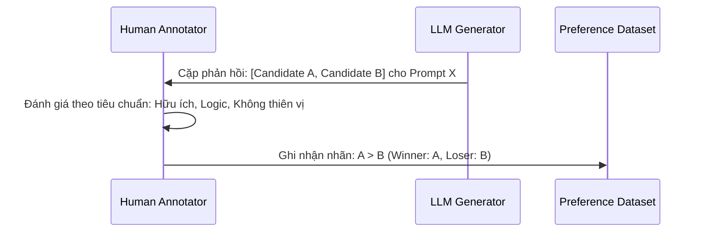

#### d. Code Thực chiến (Dual-Engine: C++ & Python)

```cpp
// C++17: Tính xác suất Bradley-Terry từ 2 điểm thưởng tiềm ẩn
#include <iostream>
#include <cmath>

double bradley_terry_prob(double r_w, double r_l) {
    double diff = r_w - r_l;
    return 1.0 / (1.0 + std::exp(-diff));
}

int main() {
    double r_win = 2.45;
    double r_lose = 0.85;
    std::cout << "P(Win > Lose): " << bradley_terry_prob(r_win, r_lose) << std::endl;
    return 0;
}
```

```python
# Python / PyTorch: Xây dựng Dataset chuyển đổi xếp hạng đa ứng viên thành cặp Pairwise
import torch
from itertools import combinations
from typing import List, Tuple, Dict

def rank_to_pairwise(prompt: str, ranked_candidates: List[str]) -> List[Dict[str, str]]:
    """
    ranked_candidates: Danh sách sắp xếp theo thứ tự giảm dần từ tốt nhất đến kém nhất
    """
    pairwise_data = []
    for (i, win_cand), (j, lose_cand) in combinations(enumerate(ranked_candidates), 2):
        pairwise_data.append({
            "prompt": prompt,
            "chosen": win_cand,
            "rejected": lose_cand,
            "margin": j - i
        })
    return pairwise_data

candidates = ["Phản hồi xuất sắc, chi tiết", "Phản hồi đúng nhưng ngắn", "Phản hồi sai lệch"]
pairs = rank_to_pairwise("Giải thích hiện tượng quang hợp?", candidates)
print(f"Số lượng cặp nhị phân sinh ra: {len(pairs)}")
```

#### e. Lỗi Thường gặp & Ổn định Số học (Pitfalls & Numerical Stability)
- **Position Bias & Length Bias**: Người chấm điểm có xu hướng thiên vị các văn bản dài hơn (dài hơn thường bị nhầm là thông minh hơn) hoặc thiên vị phản hồi xuất hiện ở vị trí đầu tiên (A thay vì B). Cần phải hoán vị ngẫu nhiên (shuffle) vị trí của các ứng viên khi hiển thị cho annotators.

#### f. Ứng dụng Thực chiến trong AI / Deep Learning (AI Applications)
- **Tập dữ liệu Anthropic HH-RLHF & UltraFeedback**: Nền tảng huấn luyện cho hầu hết các mô hình mã nguồn mở hàng đầu như LLaMA-2-Chat, Zephyr, Mistral-Instruct.

---

### 22. Reinforcement Learning from Human Feedback - RLHF (Học tăng cường từ Phản hồi Con người)

#### a. Định nghĩa Bản chất Toán học (Mathematical Formulation)
**RLHF** chuẩn mực bao gồm quy trình 3 giai đoạn:
1. **Supervised Fine-Tuning (SFT)**: Khởi tạo chính sách xuất phát $\pi^{\text{SFT}}$.
2. **Reward Modeling**: Huấn luyện mô hình phần thưởng $r_\psi(x, y)$ dựa trên dữ liệu con người.
3. **RL Policy Optimization**: Tối ưu hóa mô hình chính sách $\pi_\theta$ để tối đa hóa phần thưởng kỳ vọng kết hợp với điều kiện ràng buộc KL:
$$\max_\theta \mathbb{E}_{x \sim \mathcal{D}, y \sim \pi_\theta(\cdot \mid x)} \left[ r_\psi(x, y) - \beta D_{\text{KL}}\big(\pi_\theta(y \mid x) \parallel \pi^{\text{SFT}}(y \mid x)\big) \right]$$
Với mỗi token thứ $t$, phần thưởng gán thêm có dạng:
$$\tilde{r}_t = \begin{cases} -\beta \log \frac{\pi_\theta(y_t \mid x, y_{<t})}{\pi^{\text{SFT}}(y_t \mid x, y_{<t})} & \text{khi } t < T \\ r_\psi(x, y) - \beta \log \frac{\pi_\theta(y_T \mid x, y_{<T})}{\pi^{\text{SFT}}(y_T \mid x, y_{<T})} & \text{khi } t = T \end{cases}$$

#### b. Cơ chế Tầng Sâu & Điện toán (Under The Hood / Hardware Internals)
- **Hệ thống 4 Mô hình Đồng thời trong Cụm GPU**:
  Một pipeline RLHF đầy đủ bắt buộc phải vận hành 4 mô hình:
  1. **Actor Model ($\pi_\theta$)**: Nhận gradient, sinh token và cập nhật trọng số.
  2. **Critic / Value Model ($V_\phi$)**: Nhận gradient, dự đoán tổng reward kỳ vọng (Value baseline).
  3. **Reference Model ($\pi^{\text{SFT}}$)**: Đóng băng hoàn toàn, tính log-probs tham chiếu.
  4. **Reward Model ($r_\psi$)**: Đóng băng hoàn toàn, cho điểm phản hồi cuối cùng.
  Tổng bộ nhớ GPU tiêu thụ tối thiểu gấp $3.5\times - 4\times$ so với quá trình huấn luyện Pretraining tiêu chuẩn cho cùng một kích thước mô hình.

#### c. Sơ đồ Minh họa (Mermaid / ASCII Diagram)
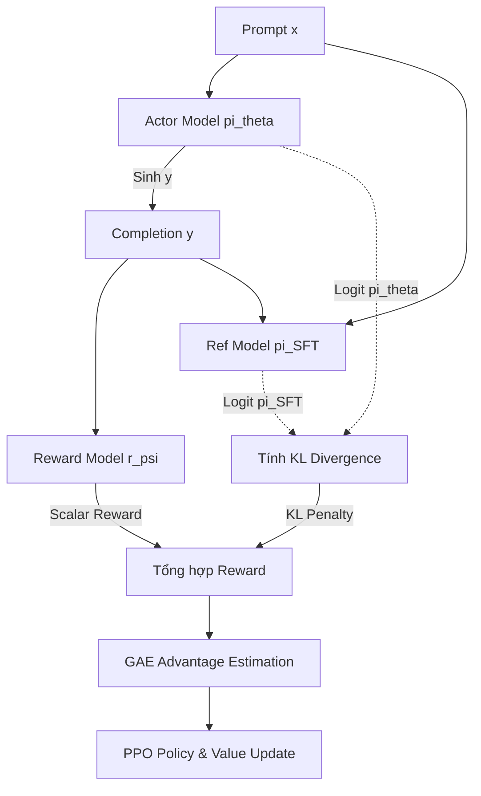

#### d. Code Thực chiến (Dual-Engine: C++ & Python)

```cpp
// C++17: Mô phỏng tính toán Reward tổng hợp có tính phạt KL tại token cuối
#include <iostream>
#include <cmath>

struct RLHFTarget {
    static double compute_final_reward(double raw_reward, double log_pi_theta, double log_pi_ref, double beta) {
        double kl_penalty = beta * (log_pi_theta - log_pi_ref);
        return raw_reward - kl_penalty;
    }
};

int main() {
    double reward = 3.5;
    double log_theta = -1.2;
    double log_ref = -1.8;
    double beta = 0.1;
    double r_penalized = RLHFTarget::compute_final_reward(reward, log_theta, log_ref, beta);
    std::cout << "Penalized Step Reward: " << r_penalized << std::endl;
    return 0;
}
```

```python
# Python / PyTorch: Xây dựng hàm tính toán GAE (Generalized Advantage Estimation) cho RLHF
import torch

def compute_gae(
    rewards: torch.Tensor,       # [Batch, SeqLen]
    values: torch.Tensor,        # [Batch, SeqLen]
    gamma: float = 1.0,
    lam: float = 0.95
) -> Tuple[torch.Tensor, torch.Tensor]:
    """
    Generalized Advantage Estimation cho chuỗi tokens
    """
    batch_size, seq_len = rewards.shape
    advantages = torch.zeros_like(rewards)
    last_gae = 0.0
    
    for t in reversed(range(seq_len)):
        next_val = values[:, t + 1] if t < seq_len - 1 else 0.0
        delta = rewards[:, t] + gamma * next_val - values[:, t]
        last_gae = delta + gamma * lam * last_gae
        advantages[:, t] = last_gae
        
    returns = advantages + values
    return advantages, returns

r = torch.randn(2, 10)
v = torch.randn(2, 10)
adv, ret = compute_gae(r, v)
print(f"Advantage shape: {adv.shape}, Returns shape: {ret.shape}")
```

#### e. Lỗi Thường gặp & Ổn định Số học (Pitfalls & Numerical Stability)
- **Advantage Explosion**: Nếu Value Model $V_\phi$ dự đoán sai lệch lớn ở những bước đầu, giá trị Advantage có thể bùng nổ hàng nghìn đơn vị khiến gradient làm hỏng ma trận nhúng của Actor. Bắt buộc phải chuẩn hóa Advantage trên toàn batch: $A_{\text{norm}} = \frac{A - \mu_A}{\sigma_A + 10^{-8}}$.

#### f. Ứng dụng Thực chiến trong AI / Deep Learning (AI Applications)
- **InstructGPT (Ouyang et al., 2022)**: Công trình đánh dấu sự ra đời của ChatGPT, biến mô hình sinh văn bản thuần túy thành trợ lý đàm thoại có độ hữu dụng cao.

---

### 23. Reward Models (Mô hình Phần thưởng)

#### a. Định nghĩa Bản chất Toán học (Mathematical Formulation)
**Reward Model** $r_\psi(x, y)$ là một mạng nơ-ron (thường tái sử dụng từ checkpoint SFT, thay thế LM Head $d \to V$ bằng một Linear Projection $d \to 1$) ánh xạ chuỗi văn bản $(x, y)$ thành một đại lượng vô hướng $r \in \mathbb{R}$.
Mô hình được huấn luyện bằng hàm mất mát Binary Cross-Entropy dưới giả thiết Bradley-Terry:
$$\mathcal{L}_{\text{RM}}(\psi) = -\mathbb{E}_{(x, y_w, y_l) \sim \mathcal{D}} \left[ \log \sigma\big(r_\psi(x, y_w) - r_\psi(x, y_l)\big) \right]$$
Để bảo đảm tính ổn định, người ta thường thêm một hệ số điều hòa $L_2$ trên trọng số đầu ra của scalar head hoặc chuẩn hóa sao cho kỳ vọng reward trên tập phân phối tham chiếu bằng 0.

#### b. Cơ chế Tầng Sâu & Điện toán (Under The Hood / Hardware Internals)
- **Token Padding & Sequence Reduction**: Để lấy giá trị phần thưởng vô hướng cho một chuỗi có độ dài thay đổi $L$, scalar head thường được áp dụng lên ẩn trạng thái (hidden state) tại token hợp lệ cuối cùng (Last Non-Padding Token):
  $$r(x, y) = \mathbf{w}^T \mathbf{h}_{\text{last\_idx}} + b$$
  Thao tác này đòi hỏi tra cứu chỉ số thông qua `gather` trên GPU tensor, tránh lấy nhầm token `<pad>` khiến gradient rơi vào vùng rác.

#### c. Sơ đồ Minh họa (Mermaid / ASCII Diagram)
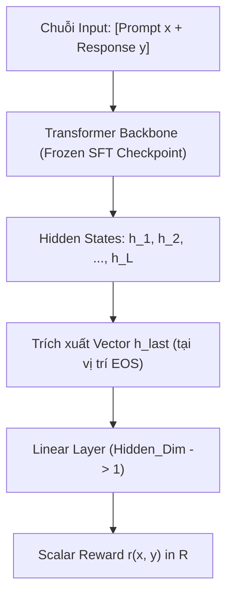

#### d. Code Thực chiến (Dual-Engine: C++ & Python)

```cpp
// C++17: Tính Loss cho Reward Model trên cặp Winner / Loser
#include <iostream>
#include <cmath>
#include <vector>

double compute_reward_loss(double r_winner, double r_loser) {
    double diff = r_winner - r_loser;
    // LogSigmoid(x) = log(1 / (1 + exp(-x))) = -log(1 + exp(-x))
    // Ổn định số học: log(1 + exp(-x)) khi x > 0 và x + log(1 + exp(x)) khi x <= 0
    double loss = 0.0;
    if (diff > 0) {
        loss = std::log(1.0 + std::exp(-diff));
    } else {
        loss = -diff + std::log(1.0 + std::exp(diff));
    }
    return loss;
}

int main() {
    double rw = 2.1;
    double rl = -0.5;
    std::cout << "Reward Model Loss: " << compute_reward_loss(rw, rl) << std::endl;
    return 0;
}
```

```python
# Python / PyTorch: Kiến trúc mô hình Reward Model hoàn chỉnh từ Transformer Backbone
import torch
import torch.nn as nn

class RewardModel(nn.Module):
    def __init__(self, hidden_dim: int):
        super().__init__()
        self.score_head = nn.Linear(hidden_dim, 1, bias=False)
        
    def forward(self, hidden_states: torch.Tensor, attention_mask: torch.Tensor) -> torch.Tensor:
        """
        hidden_states: [Batch, SeqLen, HiddenDim]
        attention_mask: [Batch, SeqLen] (1 cho token thật, 0 cho padding)
        """
        # Xác định vị trí của token cuối cùng hợp lệ
        last_indices = attention_mask.sum(dim=1, keepdim=True) - 1 # [Batch, 1]
        last_indices = last_indices.unsqueeze(-1).expand(-1, -1, hidden_states.size(-1))
        
        last_hidden = torch.gather(hidden_states, dim=1, index=last_indices).squeeze(1)
        rewards = self.score_head(last_hidden) # [Batch, 1]
        return rewards.squeeze(-1)

batch_size, seq_len, dim = 4, 16, 768
h = torch.randn(batch_size, seq_len, dim)
mask = torch.ones(batch_size, seq_len, dtype=torch.long)
mask[:, 12:] = 0 # Padding 4 token cuối

rm = RewardModel(dim)
scores = rm(h, mask)
print(f"Predicted Rewards: {scores}")
```

#### e. Lỗi Thường gặp & Ổn định Số học (Pitfalls & Numerical Stability)
- **Reward Scale Drift**: Trong quá trình huấn luyện kéo dài, giá trị reward tuyệt đối có thể trôi tự do về $+\infty$ hoặc $-\infty$ mà không làm thay đổi hiệu $r_w - r_l$. Giải pháp: Thêm ràng buộc chính quy hóa $L_2$ trên giá trị dự đoán: $\mathcal{L}_{\text{reg}} = \lambda (r_w^2 + r_l^2)$.

#### f. Ứng dụng Thực chiến trong AI / Deep Learning (AI Applications)
- Đóng vai trò hàm mục tiêu cho các kỹ thuật suy luận thời gian chạy như **Best-of-N Reranking** và thuật toán học tăng cường PPO.

---

### 24. Proximal Policy Optimization for RLHF - PPO (Tối ưu hóa Chính sách Tiệm cận cho RLHF)

#### a. Định nghĩa Bản chất Toán học (Mathematical Formulation)
**PPO** (Schulman et al., 2017) là thuật toán Policy Gradient thuộc họ On-Policy sử dụng cơ chế Clipping để bảo đảm độ biến thiên của chính sách không vượt quá giới hạn an toàn.
Hàm mục tiêu PPO Clipped Surrogate:
$$\mathcal{L}^{\text{CLIP}}(\theta) = \hat{\mathbb{E}}_t \left[ \min\left( r_t(\theta) \hat{A}_t, \, \text{clip}(r_t(\theta), 1 - \epsilon, 1 + \epsilon) \hat{A}_t \right) \right]$$
Trong đó tỷ lệ xác suất (Probability Ratio):
$$r_t(\theta) = \frac{\pi_\theta(y_t \mid x, y_{<t})}{\pi_{\theta_{\text{old}}}(y_t \mid x, y_{<t})} = \exp\left( \log \pi_\theta(y_t \mid x, y_{<t}) - \log \pi_{\theta_{\text{old}}}(y_t \mid x, y_{<t}) \right)$$
$\hat{A}_t$: Ước lượng Advantage thu được từ Value Model qua GAE.
$\epsilon \in [0.1, 0.2]$: Ngưỡng cắt xén (Clipping threshold).

#### b. Cơ chế Tầng Sâu & Điện toán (Under The Hood / Hardware Internals)
- **Sự phân tách giữa Rollout Phase và Train Phase**:
  - *Rollout Phase*: GPU hoạt động ở chế độ Generation (Autoregressive Token-by-Token) bị giới hạn bởi Memory Bandwidth (Memory-bound).
  - *Train Phase*: GPU tính forward/backward trên toàn bộ sequence tensor, tối ưu tối đa năng lực tính toán của Tensor Cores (Compute-bound).
  Sự chuyển đổi liên tục giữa hai chế độ này gây ra độ trễ chuyển đổi bộ nhớ và phân mảnh VRAM cao.

#### c. Sơ đồ Minh họa (Mermaid / ASCII Diagram)
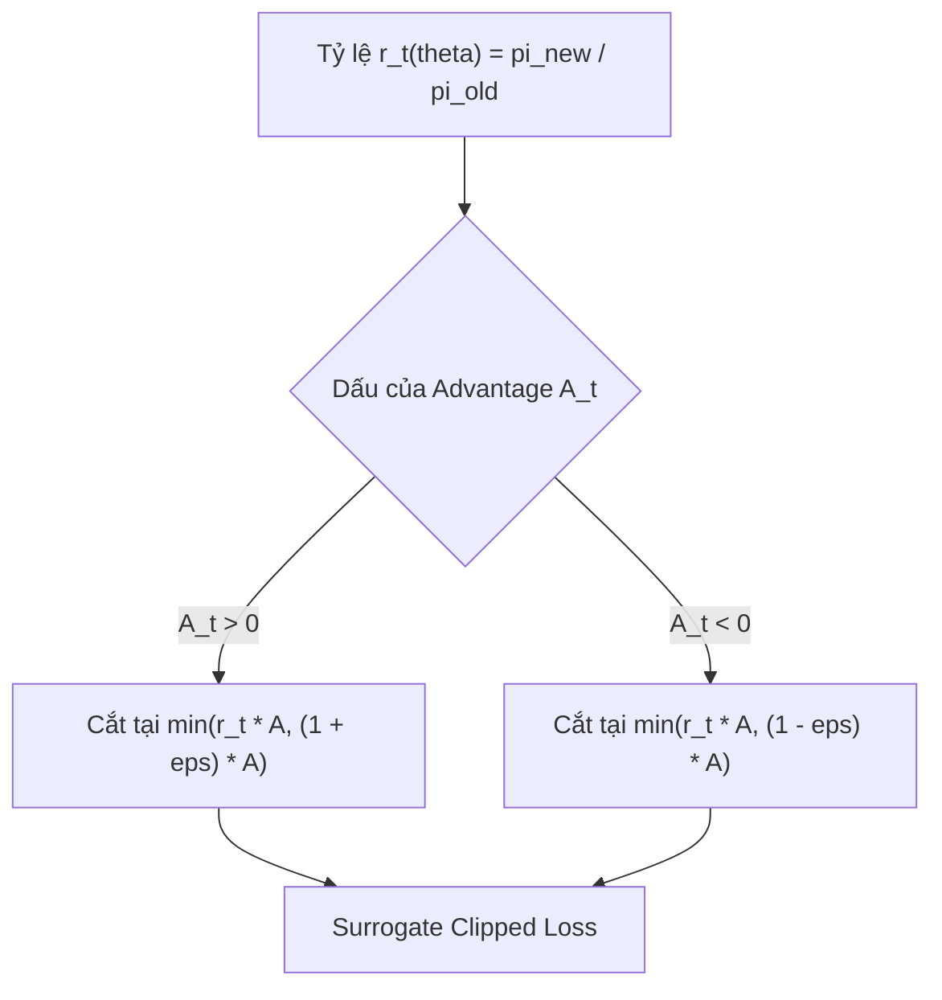

#### d. Code Thực chiến (Dual-Engine: C++ & Python)

```cpp
// C++17: Tính toán PPO Clipped Loss cho một token đơn lẻ
#include <iostream>
#include <algorithm>

double compute_ppo_clipped_loss(double log_pi, double log_pi_old, double advantage, double epsilon = 0.2) {
    double ratio = std::exp(log_pi - log_pi_old);
    double surr1 = ratio * advantage;
    double surr2 = std::clamp(ratio, 1.0 - epsilon, 1.0 + epsilon) * advantage;
    return -std::min(surr1, surr2); // Minimize negative objective
}

int main() {
    double log_pi = -0.45;
    double log_old = -0.50;
    double adv = 1.25;
    std::cout << "PPO Clipped Objective: " << -compute_ppo_clipped_loss(log_pi, log_old, adv) << std::endl;
    return 0;
}
```

```python
# Python / PyTorch: Triển khai Vectorized PPO Loss cho LLM
import torch

def ppo_actor_loss(
    log_probs: torch.Tensor,       # [Batch, SeqLen]
    old_log_probs: torch.Tensor,   # [Batch, SeqLen]
    advantages: torch.Tensor,      # [Batch, SeqLen]
    mask: torch.Tensor,            # [Batch, SeqLen]
    clip_eps: float = 0.2
) -> torch.Tensor:
    # r_t(theta) = exp(log_p - log_p_old)
    ratio = torch.exp(log_probs - old_log_probs)
    surr1 = ratio * advantages
    surr2 = torch.clamp(ratio, 1.0 - clip_eps, 1.0 + clip_eps) * advantages
    
    # Mục tiêu tối đa hóa -> Loss cần tối thiểu hóa
    policy_loss = -torch.min(surr1, surr2)
    # Chỉ tính trên các token sinh ra (bỏ qua prompt và padding)
    loss = (policy_loss * mask).sum() / mask.sum()
    return loss

log_p = torch.randn(4, 32)
old_p = log_p.detach() + torch.randn(4, 32) * 0.05
advs = torch.randn(4, 32)
m = torch.ones(4, 32)
print(f"PPO Policy Loss: {ppo_actor_loss(log_p, old_p, advs, m).item():.4f}")
```

#### e. Lỗi Thường gặp & Ổn định Số học (Pitfalls & Numerical Stability)
- **Policy Collapse / Gradient Explosion**: Nếu `old_log_probs` bị tính lệch do precision không khớp (ví dụ: Rollout chạy ở FP16 nhưng Training chạy ở BF16), `ratio` có thể bị thổi phồng dẫn đến sụp đổ phân phối chính sách. Luôn bảo đảm dữ liệu log-probs được lưu với độ chính xác FP32 khi tính ratio.

#### f. Ứng dụng Thực chiến trong AI / Deep Learning (AI Applications)
- Lõi thuật toán của framework **TRL (Transformer Reinforcement Learning)** của HuggingFace và **Deepspeed-Chat**.

---

### 25. Direct Preference Optimization - DPO (Tối ưu hóa Sở thích Trực tiếp)

#### a. Định nghĩa Bản chất Toán học (Mathematical Formulation)
**DPO** (Rafailov et al., NeurIPS 2023) chứng minh rằng bài toán RLHF có nghiệm đóng phân tích biểu diễn Reward hàm ý thông qua tỷ lệ log-probability giữa mô hình tối ưu $\pi_\theta$ và mô hình tham chiếu $\pi_{\text{ref}}$:
$$r(x, y) = \beta \log \frac{\pi_\theta(y \mid x)}{\pi_{\text{ref}}(y \mid x)} + \beta \log Z(x)$$
Thay thế công thức này trực tiếp vào hàm mất mát Bradley-Terry giúp triệt tiêu hoàn toàn hằng số chuẩn hóa $Z(x)$, dẫn đến hàm mất mát DPO trực tiếp trên tham số của LLM:
$$\mathcal{L}_{\text{DPO}}(\theta; \pi_{\text{ref}}) = -\mathbb{E}_{(x, y_w, y_l) \sim \mathcal{D}} \left[ \log \sigma \left( \beta \log \frac{\pi_\theta(y_w \mid x)}{\pi_{\text{ref}}(y_w \mid x)} - \beta \log \frac{\pi_\theta(y_l \mid x)}{\pi_{\text{ref}}(y_l \mid x)} \right) \right]$$
Trong đó $\beta$ là siêu tham số kiểm soát mức độ ràng buộc vào $\pi_{\text{ref}}$ (thường chọn $\beta \in [0.05, 0.5]$).

#### b. Cơ chế Tầng Sâu & Điện toán (Under The Hood / Hardware Internals)
- **Tiết kiệm $50\%$ Bộ nhớ GPU**: DPO không cần huấn luyện Reward Model riêng biệt và loại bỏ hoàn toàn Critic Model ($V_\phi$). Không cần lấy mẫu tự hồi quy ngẫu nhiên (No sampling during training) vì quá trình tính loss là hoàn toàn khép kín qua phép forward pass trên các cặp văn bản $(x, y_w)$ và $(x, y_l)$ có sẵn.
- **Tập hợp Batch Forward**: Thay vì forward 4 lần riêng biệt, các triển khai tối ưu gộp $(x, y_w)$ và $(x, y_l)$ vào cùng một batch tensor kích thước $2B$ để tối ưu hóa tính toán qua CUDA kernels.

#### c. Sơ đồ Minh họa (Mermaid / ASCII Diagram)
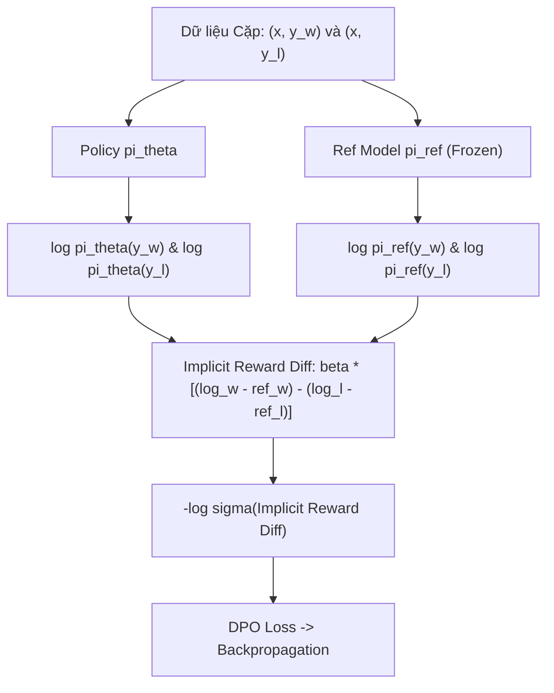

#### d. Code Thực chiến (Dual-Engine: C++ & Python)

```cpp
// C++17: Tính toán DPO Loss từ các log xác suất chuỗi
#include <iostream>
#include <cmath>

double compute_dpo_loss(double log_pi_w, double log_ref_w,
                        double log_pi_l, double log_ref_l,
                        double beta = 0.1) {
    double log_ratio_w = log_pi_w - log_ref_w;
    double log_ratio_l = log_pi_l - log_ref_l;
    double logits = beta * (log_ratio_w - log_ratio_l);
    
    // LogSigmoid
    if (logits > 0) {
        return std::log(1.0 + std::exp(-logits));
    } else {
        return -logits + std::log(1.0 + std::exp(logits));
    }
}

int main() {
    double loss = compute_dpo_loss(-10.2, -11.5, -15.4, -13.2, 0.1);
    std::cout << "Computed DPO Loss: " << loss << std::endl;
    return 0;
}
```

```python
# Python / PyTorch: Triển khai DPO Loss chuẩn xác
import torch
import torch.nn.functional as F

def dpo_loss(
    policy_chosen_logps: torch.Tensor,    # [Batch]
    policy_rejected_logps: torch.Tensor,  # [Batch]
    reference_chosen_logps: torch.Tensor, # [Batch]
    reference_rejected_logps: torch.Tensor,# [Batch]
    beta: float = 0.1
) -> Tuple[torch.Tensor, torch.Tensor, torch.Tensor]:
    # Tỷ lệ log-ratio
    pi_logratios = policy_chosen_logps - policy_rejected_logps
    ref_logratios = reference_chosen_logps - reference_rejected_logps
    
    logits = pi_logratios - ref_logratios
    losses = -F.logsigmoid(beta * logits)
    
    # Implicit rewards để theo dõi metrics
    chosen_rewards = beta * (policy_chosen_logps - reference_chosen_logps).detach()
    rejected_rewards = beta * (policy_rejected_logps - reference_rejected_logps).detach()
    
    return losses.mean(), chosen_rewards, rejected_rewards

p_w = torch.tensor([-8.5, -12.1])
p_l = torch.tensor([-14.2, -13.0])
r_w = torch.tensor([-9.0, -12.5])
r_l = torch.tensor([-12.0, -11.5])

loss, r_win, r_lose = dpo_loss(p_w, p_l, r_w, r_l, beta=0.1)
print(f"DPO Loss: {loss.item():.4f}, Delta Reward: {(r_win - r_lose).mean():.4f}")
```

#### e. Lỗi Thường gặp & Ổn định Số học (Pitfalls & Numerical Stability)
- **Overfitting & Implicit Reward Degeneration**: Vì DPO không có hàm Value để làm giảm phương sai, mô hình rất nhanh chóng học vẹt dữ liệu gán nhãn, dẫn đến việc giảm đột ngột xác suất của mẫu rejected mà không làm tăng chất lượng mẫu chosen. Khắc phục bằng cách chọn $\beta$ cẩn thận và áp dụng Label Smoothing.

#### f. Ứng dụng Thực chiến trong AI / Deep Learning (AI Applications)
- Phương pháp tiêu chuẩn trong đào tạo các dòng mô hình hiện đại như **Zephyr-7B**, **Llama-3-Instruct**, **Qwen-2**.

---

### 26. Identity Preference Optimization - IPO (Tối ưu hóa Sở thích Đồng nhất)

#### a. Định nghĩa Bản chất Toán học (Mathematical Formulation)
**IPO** (Azar et al., ICML 2024) chỉ ra rằng DPO có thể gặp hiện tượng suy biến nếu tập dữ liệu sở thích chứa nhiễu (deterministic preference assumption). IPO đề xuất một giải pháp kiểm soát chính quy hóa ngặt nghèo bằng cách thay thế hàm mục tiêu Bradley-Terry phi tuyến bằng một hàm mất mát bình phương (Mean Squared Error) trực tiếp trên khoảng cách log-ratio:
$$\mathcal{L}_{\text{IPO}}(\theta) = \mathbb{E}_{(x, y_w, y_l)} \left[ \left( \log \frac{\pi_\theta(y_w \mid x)}{\pi_{\text{ref}}(y_w \mid x)} - \log \frac{\pi_\theta(y_l \mid x)}{\pi_{\text{ref}}(y_l \mid x)} - \frac{\tau^{-1}}{2} \right)^2 \right]$$
Trong đó $\tau > 0$ là hệ số điều hòa. Điểm mấu chốt của IPO là đặt ra một ngưỡng cận trên (Margin) mục tiêu $\frac{\tau^{-1}}{2}$, ngăn chặn việc mô hình đẩy vô hạn hiệu số log-ratio lên mức cực đoan.

#### b. Cơ chế Tầng Sâu & Điện toán (Under The Hood / Hardware Internals)
- Gradient của IPO có tính chất tự triệt tiêu đối xứng: Khi chênh lệch log-ratio vượt quá ngưỡng mục tiêu, gradient đổi dấu để kéo mô hình trở lại, bảo toàn entropy của chính sách và tránh sập phân phối token (Degeneracy resistance).

#### c. Sơ đồ Minh họa (Mermaid / ASCII Diagram)
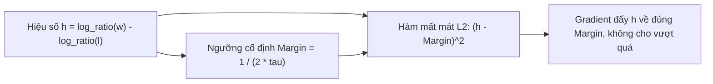

#### d. Code Thực chiến (Dual-Engine: C++ & Python)

```cpp
// C++17: Tính IPO Loss với ràng buộc Margin
#include <iostream>
#include <cmath>

double compute_ipo_loss(double log_pi_w, double log_ref_w,
                        double log_pi_l, double log_ref_l,
                        double tau = 0.1) {
    double log_ratio_w = log_pi_w - log_ref_w;
    double log_ratio_l = log_pi_l - log_ref_l;
    double margin = 1.0 / (2.0 * tau);
    double error = (log_ratio_w - log_ratio_l) - margin;
    return error * error;
}

int main() {
    std::cout << "IPO Loss: " << compute_ipo_loss(-5.0, -6.0, -8.0, -7.0, 0.1) << std::endl;
    return 0;
}
```

```python
# Python / PyTorch: Triển khai IPO Loss
import torch

def ipo_loss(
    pi_chosen_logps: torch.Tensor,
    pi_rejected_logps: torch.Tensor,
    ref_chosen_logps: torch.Tensor,
    ref_rejected_logps: torch.Tensor,
    tau: float = 0.1
) -> torch.Tensor:
    log_ratio_w = pi_chosen_logps - ref_chosen_logps
    log_ratio_l = pi_rejected_logps - ref_rejected_logps
    
    # Margin mục tiêu
    target_margin = 1.0 / (2.0 * tau)
    loss = (log_ratio_w - log_ratio_l - target_margin) ** 2
    return loss.mean()

w_p, l_p = torch.tensor([-4.2]), torch.tensor([-7.8])
w_r, l_r = torch.tensor([-4.5]), torch.tensor([-6.5])
print(f"IPO Loss: {ipo_loss(w_p, l_p, w_r, l_r, tau=0.2).item():.4f}")
```

#### e. Lỗi Thường gặp & Ổn định Số học (Pitfalls & Numerical Stability)
- **Tốc độ Hội tụ Chậm**: Khi khoảng cách ban đầu giữa chosen và rejected còn xa ngưỡng margin, gradient của hàm MSE có thể tạo ra các bước nhảy lớn nếu không có learning rate warmup phù hợp.

#### f. Ứng dụng Thực chiến trong AI / Deep Learning (AI Applications)
- Áp dụng khi tập dữ liệu tinh chỉnh có độ ồn cao, dữ liệu được sinh tự động bằng AI (synthetic data) có nhiều nhãn mâu thuẫn.

---

### 27. Kahneman-Tversky Optimization - KTO (Tối ưu hóa theo Lý thuyết Viễn cảnh Kahneman-Tversky)

#### a. Định nghĩa Bản chất Toán học (Mathematical Formulation)
**KTO** (Ethayarajh et al., 2024) lấy cảm hứng từ **Lý thuyết Viễn cảnh (Prospect Theory)** từng đoạt giải Nobel Kinh tế của Daniel Kahneman và Amos Tversky: Con người bất đối xứng trong việc đón nhận lợi nhuận và mất mát (Loss Aversion - con người sợ mất mát hơn là thích được nhận cùng một giá trị).
KTO không yêu cầu dữ liệu gán nhãn theo từng cặp $(y_w, y_l)$. Nó chỉ cần phản hồi nhị phân đơn lẻ: $y$ là Tốt (Desirable / Upvote) hoặc $y$ là Xấu (Undesirable / Downvote):
$$\mathcal{L}_{\text{KTO}}(\theta) = \mathbb{E}_{x, y} \left[ w(y) \left( 1 - v_\theta(x, y) \right) \right]$$
Hàm giá trị (Value Function):
$$v_\theta(x, y) = \begin{cases} \sigma\left(\lambda_D \left( \log \frac{\pi_\theta(y \mid x)}{\pi_{\text{ref}}(y \mid x)} - z_{\text{ref}} \right)\right) & \text{nếu } y \text{ Desirable} \\ \sigma\left(\lambda_U \left( z_{\text{ref}} - \log \frac{\pi_\theta(y \mid x)}{\pi_{\text{ref}}(y \mid x)} \right)\right) & \text{nếu } y \text{ Undesirable} \end{cases}$$
Trong đó $\lambda_U > \lambda_D$ (thể hiện tâm lý sợ tổn thất), $z_{\text{ref}} = \mathbb{E}[\log \frac{\pi_\theta}{\pi_{\text{ref}}}]$ là điểm tham chiếu nội tại (Reference Point).

#### b. Cơ chế Tầng Sâu & Điện toán (Under The Hood / Hardware Internals)
- **Giải phóng gánh nặng Ghép cặp Bộ nhớ**: Do xử lý từng mẫu độc lập, cấu trúc dữ liệu không bị ràng buộc bởi kích thước độ dài bất đối xứng giữa $y_w$ và $y_l$, giúp giảm padding thừa trong batch và cải thiện thông lượng (Throughput) GPU thêm $30\% - 40\%$.

#### c. Sơ đồ Minh họa (Mermaid / ASCII Diagram)
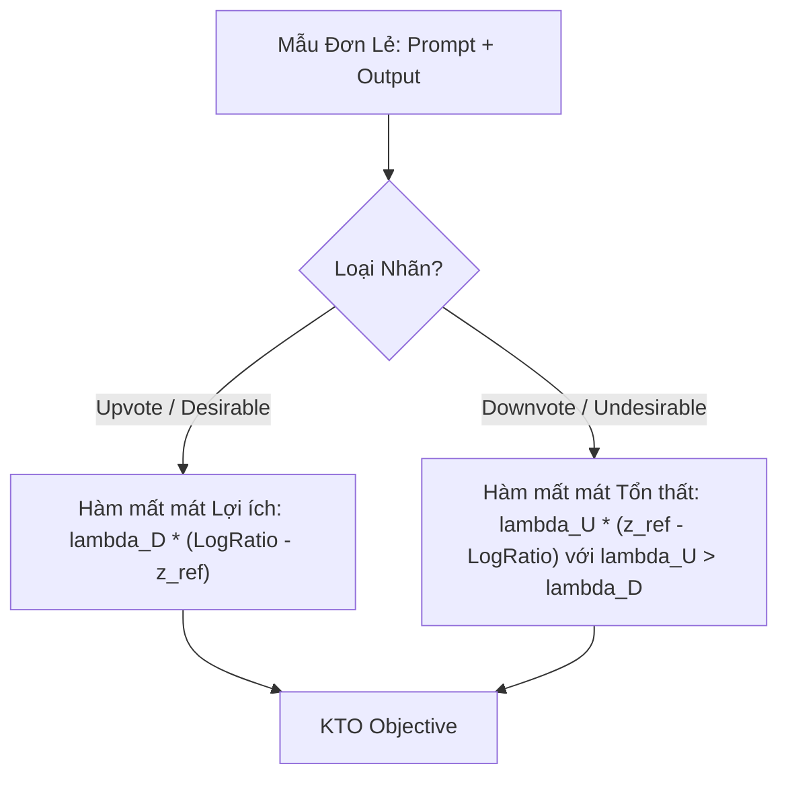

#### d. Code Thực chiến (Dual-Engine: C++ & Python)

```cpp
// C++17: Mô phỏng Value Function của KTO dựa trên tâm lý sợ tổn thất
#include <iostream>
#include <cmath>

double kto_value_function(double log_ratio, double z_ref, bool is_desirable, double lambda_d = 1.0, double lambda_u = 1.33) {
    if (is_desirable) {
        double x = lambda_d * (log_ratio - z_ref);
        return 1.0 / (1.0 + std::exp(-x));
    } else {
        double x = lambda_u * (z_ref - log_ratio);
        return 1.0 / (1.0 + std::exp(-x));
    }
}

int main() {
    double z_ref = 0.05;
    std::cout << "KTO Desirable Value: " << kto_value_function(0.3, z_ref, true) << std::endl;
    std::cout << "KTO Undesirable Value: " << kto_value_function(-0.4, z_ref, false) << std::endl;
    return 0;
}
```

```python
# Python / PyTorch: Triển khai KTO Loss
import torch
import torch.nn.functional as F

def kto_loss(
    log_ratios: torch.Tensor,       # log pi_theta(y|x) - log pi_ref(y|x)
    is_desirable: torch.Tensor,     # Boolean Tensor: True nếu Upvote
    z_ref: float,
    beta: float = 0.1,
    desirable_weight: float = 1.0,
    undesirable_weight: float = 1.33
) -> torch.Tensor:
    losses = []
    for lr, des in zip(log_ratios, is_desirable):
        if des:
            val = torch.sigmoid(beta * (lr - z_ref))
            losses.append(desirable_weight * (1.0 - val))
        else:
            val = torch.sigmoid(beta * (z_ref - lr))
            losses.append(undesirable_weight * (1.0 - val))
    return torch.stack(losses).mean()

l_ratios = torch.tensor([0.25, -0.40, 0.10, -0.85])
labels = torch.tensor([True, False, True, False])
print(f"KTO Loss: {kto_loss(l_ratios, labels, z_ref=0.0).item():.4f}")
```

#### e. Lỗi Thường gặp & Ổn định Số học (Pitfalls & Numerical Stability)
- **Ước lượng Sai lệch Reference Point**: Nếu $z_{\text{ref}}$ không được cập nhật ổn định theo Moving Average qua các batch, gradient sẽ bị lệch một chiều (mô hình hoặc từ chối mọi câu trả lời hoặc chấp nhận mọi câu trả lời).

#### f. Ứng dụng Thực chiến trong AI / Deep Learning (AI Applications)
- Căn chỉnh từ log tương tác trực tiếp của người dùng thực tế trên giao diện web (User Thumbs Up / Thumbs Down), nơi dữ liệu không tồn tại ở dạng so sánh cặp.

---

### 28. Odds Ratio Preference Optimization - ORPO (Tối ưu hóa Tỷ lệ Chênh lệch Sở thích)

#### a. Định nghĩa Bản chất Toán học (Mathematical Formulation)
**ORPO** (Hong et al., 2024) là một đột phá kết hợp giai đoạn **SFT** và **Preference Alignment** vào một pha huấn luyện duy nhất mà không cần mô hình tham chiếu ($\pi_{\text{ref}}$).
ORPO định nghĩa tỷ lệ chênh lệch xác suất (Odds) sinh ra chuỗi $y$ cho trước prompt $x$:
$$\text{Odds}_\theta(y \mid x) = \frac{P_\theta(y \mid x)}{1 - P_\theta(y \mid x)}$$
Hàm mất mát tổng thể kết hợp giữa Negative Log-Likelihood trên mẫu thắng ($y_w$) và hình phạt Log Odds Ratio:
$$\mathcal{L}_{\text{ORPO}}(\theta) = \mathcal{L}_{\text{SFT}}(\theta; y_w) + \lambda_{\text{OR}} \mathcal{L}_{\text{OR}}(\theta)$$
$$\mathcal{L}_{\text{OR}}(\theta) = -\mathbb{E}_{(x, y_w, y_l)} \left[ \log \sigma \left( \log \frac{\text{Odds}_\theta(y_w \mid x)}{\text{Odds}_\theta(y_l \mid x)} \right) \right]$$

#### b. Cơ chế Tầng Sâu & Điện toán (Under The Hood / Hardware Internals)
- **Tiết kiệm Tuyệt đối VRAM (Zero Reference Model)**: Không cần duy trì $\pi_{\text{ref}}$ trong bộ nhớ GPU, giảm toàn bộ chi phí lưu trữ tham số và trạng thái forward pass của mô hình phụ. Cho phép huấn luyện mô hình có kích thước gấp đôi trên cùng một cụm hạ tầng phần cứng.

#### c. Sơ đồ Minh họa (Mermaid / ASCII Diagram)
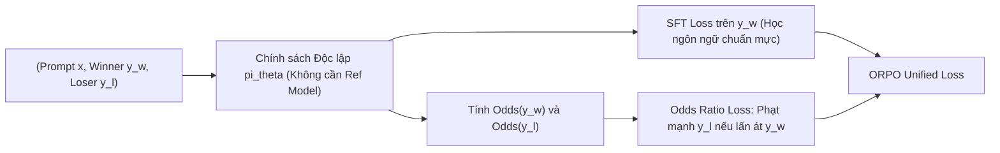

#### d. Code Thực chiến (Dual-Engine: C++ & Python)

```cpp
// C++17: Tính Odds Ratio từ xác suất token trung bình
#include <iostream>
#include <cmath>

double compute_odds(double prob) {
    prob = std::clamp(prob, 1e-7, 1.0 - 1e-7);
    return prob / (1.0 - prob);
}

double compute_log_odds_ratio(double p_w, double p_l) {
    double odds_w = compute_odds(p_w);
    double odds_l = compute_odds(p_l);
    return std::log(odds_w / odds_l);
}

int main() {
    double p_win = 0.82;
    double p_lose = 0.25;
    std::cout << "Log Odds Ratio: " << compute_log_odds_ratio(p_win, p_lose) << std::endl;
    return 0;
}
```

```python
# Python / PyTorch: Triển khai ORPO Loss
import torch
import torch.nn.functional as F

def orpo_loss(
    sft_logps: torch.Tensor,            # [Batch] NLL loss của chosen
    policy_chosen_logps: torch.Tensor,  # [Batch]
    policy_rejected_logps: torch.Tensor,# [Batch]
    alpha: float = 1.0
) -> torch.Tensor:
    # log_odds = log(p / (1 - p)) = log_p - log(1 - p)
    log_odds_w = policy_chosen_logps - torch.log1p(-torch.exp(policy_chosen_logps) + 1e-7)
    log_odds_l = policy_rejected_logps - torch.log1p(-torch.exp(policy_rejected_logps) + 1e-7)
    
    odds_ratio = log_odds_w - log_odds_l
    odds_ratio_loss = -F.logsigmoid(odds_ratio).mean()
    
    total_loss = sft_logps.mean() + alpha * odds_ratio_loss
    return total_loss

sft_l = torch.tensor([1.8, 2.1])
p_w = torch.tensor([-0.2, -0.3])
p_l = torch.tensor([-1.5, -1.8])
print(f"ORPO Loss: {orpo_loss(sft_l, p_w, p_l).item():.4f}")
```

#### e. Lỗi Thường gặp & Ổn định Số học (Pitfalls & Numerical Stability)
- **Numerical Overflow trong `log1p`**: Khi xác suất của token tiệm cận 1.0, $\exp(\text{log\_p}) \to 1.0$, khiến $1 - \exp(\text{log\_p}) \to 0$ dẫn đến lỗi `-inf`. Cần dùng `torch.clamp` hoặc thêm hằng số $\epsilon = 10^{-7}$ trong tính toán phân số Odds.

#### f. Ứng dụng Thực chiến trong AI / Deep Learning (AI Applications)
- Được sử dụng để tinh chỉnh nhanh các mô hình chuyên biệt kích thước nhỏ (1B - 8B) trong môi trường tài nguyên tính toán bị giới hạn.

---

### 29. SimPO (Simple Preference Optimization)

#### a. Định nghĩa Bản chất Toán học (Mathematical Formulation)
**SimPO** (Meng et al., NeurIPS 2024) cải tiến DPO dựa trên hai phát hiện quan trọng:
1. Reference Model trong DPO không thực sự cần thiết và tạo ra gánh nặng tính toán lớn.
2. DPO không chuẩn hóa theo độ dài, dẫn đến thiên vị các câu trả lời dài (Length Exploitation).
SimPO định nghĩa hàm phần thưởng tiềm ẩn chuẩn hóa theo độ dài chuỗi $|y|$:
$$r_{\text{SimPO}}(x, y) = \frac{\beta}{|y|} \log \pi_\theta(y \mid x) = \frac{\beta}{|y|} \sum_{i=1}^{|y|} \log \pi_\theta(y_i \mid x, y_{<i})$$
Hàm mất mát SimPO đưa thêm một ngưỡng cách biệt mục tiêu (Target Reward Margin $\gamma > 0$):
$$\mathcal{L}_{\text{SimPO}}(\theta) = -\mathbb{E}_{(x, y_w, y_l)} \left[ \log \sigma \left( \frac{\beta}{|y_w|} \log \pi_\theta(y_w \mid x) - \frac{\beta}{|y_l|} \log \pi_\theta(y_l \mid x) - \gamma \right) \right]$$

#### b. Cơ chế Tầng Sâu & Điện toán (Under The Hood / Hardware Internals)
- **Loại bỏ Hoàn toàn Frozen Graph**: Không cần nạp đồ thị $\pi_{\text{ref}}$, giảm một nửa số lượng phép tính FLOPs trong lượt huấn luyện.
- **Tối ưu hóa Chiều dài Token**: Phép chia cho $|y|$ loại bỏ xu hướng mô hình cố tình sinh ra các câu trả lời dông dài để tăng tổng log-likelihood, trực tiếp tiết kiệm chi phí KV Cache khi phục vụ người dùng cuối.

#### c. Sơ đồ Minh họa (Mermaid / ASCII Diagram)
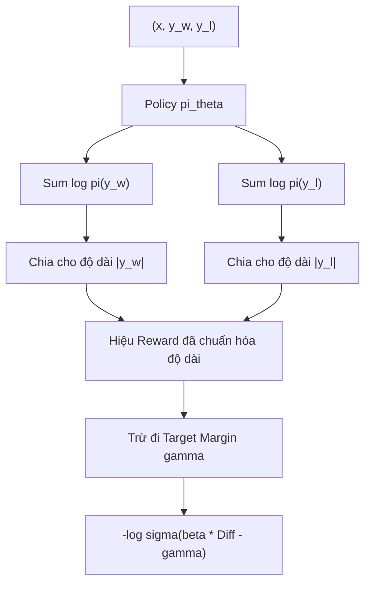

#### d. Code Thực chiến (Dual-Engine: C++ & Python)

```cpp
// C++17: Tính SimPO Loss chuẩn hóa theo chiều dài chuỗi
#include <iostream>
#include <cmath>

double compute_simpo_loss(double sum_logp_w, size_t len_w,
                          double sum_logp_l, size_t len_l,
                          double beta = 2.0, double gamma = 1.4) {
    double norm_w = sum_logp_w / static_cast<double>(len_w);
    double norm_l = sum_logp_l / static_cast<double>(len_l);
    double reward_diff = beta * (norm_w - norm_l) - gamma;
    
    // LogSigmoid
    if (reward_diff > 0) {
        return std::log(1.0 + std::exp(-reward_diff));
    } else {
        return -reward_diff + std::log(1.0 + std::exp(reward_diff));
    }
}

int main() {
    std::cout << "SimPO Loss: " << compute_simpo_loss(-45.0, 50, -80.0, 60, 2.0, 1.4) << std::endl;
    return 0;
}
```

```python
# Python / PyTorch: Triển khai SimPO Loss
import torch
import torch.nn.functional as F

def simpo_loss(
    chosen_logps: torch.Tensor,      # [Batch] Tổng log-probs
    rejected_logps: torch.Tensor,    # [Batch] Tổng log-probs
    chosen_lens: torch.Tensor,       # [Batch] Chiều dài tokens
    rejected_lens: torch.Tensor,     # [Batch] Chiều dài tokens
    beta: float = 2.0,
    gamma: float = 1.4
) -> torch.Tensor:
    # Chuẩn hóa độ dài
    r_w = (beta / chosen_lens) * chosen_logps
    r_l = (beta / rejected_lens) * rejected_logps
    
    logits = r_w - r_l - gamma
    losses = -F.logsigmoid(logits)
    return losses.mean()

w_log = torch.tensor([-30.0, -42.0])
l_log = torch.tensor([-55.0, -60.0])
w_len = torch.tensor([40.0, 50.0])
l_len = torch.tensor([65.0, 70.0])

print(f"SimPO Loss: {simpo_loss(w_log, l_log, w_len, l_len).item():.4f}")
```

#### e. Lỗi Thường gặp & Ổn định Số học (Pitfalls & Numerical Stability)
- **Độ nhạy cực cao với Margin $\gamma$**: Nếu đặt $\gamma$ quá lớn ($\ge 2.5$), mô hình sẽ rơi vào tình trạng không hội tụ và loss bão hòa; nếu đặt $\gamma$ quá nhỏ ($< 0.5$), mô hình không tạo ra ranh giới phân biệt đủ mạnh giữa phản hồi tốt và xấu.

#### f. Ứng dụng Thực chiến trong AI / Deep Learning (AI Applications)
- Đạt hiệu năng dẫn đầu (State-of-the-art) trên bảng xếp hạng **AlpacaEval 2** và **MT-Bench** trong số các phương pháp căn chỉnh không cần mô hình tham chiếu.

---

### 30. Group Relative Policy Optimization - GRPO (Tối ưu hóa Chính sách Tương đối theo Nhóm)

#### a. Định nghĩa Bản chất Toán học (Mathematical Formulation)
**GRPO** (Shao et al., DeepSeek-Math / DeepSeek-R1 2024/2025) là phương pháp tối ưu hóa chính sách đột phá được thiết kế chuyên biệt cho suy luận toán học và logic, giải quyết triệt để sự cồng kềnh của mô hình Critic trong PPO.
Thay vì duy trì một Critic Network $V_\phi$ khổng lồ để dự đoán Baseline, GRPO lấy mẫu một **nhóm $G$ phản hồi ứng viên** $\{y_1, y_2, \dots, y_G\}$ cho cùng một câu lệnh $x$ từ chính sách cũ $\pi_{\theta_{\text{old}}}$.
Reward của từng phản hồi $r_i$ được chuẩn hóa tương đối ngay bên trong nhóm:
$$\hat{A}_i = \frac{r_i - \text{mean}(\{r_1, \dots, r_G\})}{\text{std}(\{r_1, \dots, r_G\}) + \epsilon}$$
Hàm mục tiêu GRPO:
$$\mathcal{L}_{\text{GRPO}}(\theta) = -\frac{1}{G} \sum_{i=1}^G \left[ \min\left( \frac{\pi_\theta(y_i \mid x)}{\pi_{\theta_{\text{old}}}(y_i \mid x)} \hat{A}_i, \, \text{clip}\left(\frac{\pi_\theta(y_i \mid x)}{\pi_{\theta_{\text{old}}}(y_i \mid x)}, 1 - \epsilon, 1 + \epsilon\right) \hat{A}_i \right) - \beta D_{\text{KL}}\big(\pi_\theta \parallel \pi_{\text{ref}}\big) \right]$$

#### b. Cơ chế Tầng Sâu & Điện toán (Under The Hood / Hardware Internals)
- **Triệt tiêu Hoàn toàn Value Network**: Trong các mô hình siêu lớn (ví dụ 67B tham số), việc bỏ đi Critic Model tiết kiệm trực tiếp hàng trăm Gigabytes VRAM trên cụm node GPU, cho phép toàn bộ tài nguyên phần cứng dồn vào sinh chuỗi suy luận dài (Chain-of-Thought lên tới hàng chục nghìn tokens).

#### c. Sơ đồ Minh họa (Mermaid / ASCII Diagram)
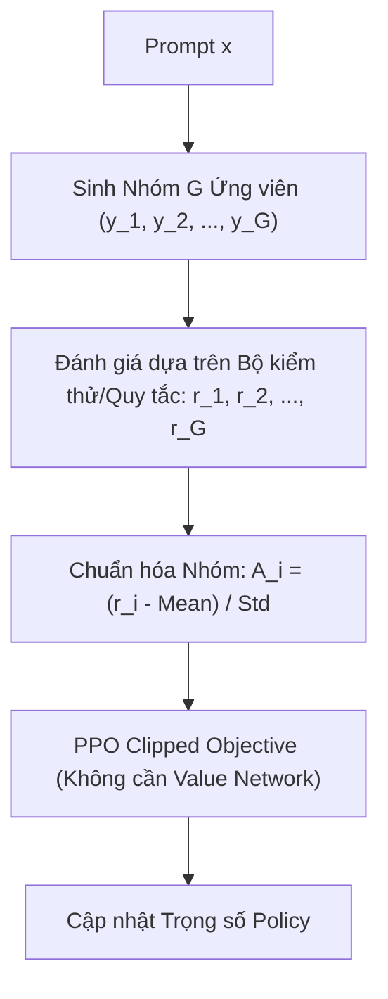

#### d. Code Thực chiến (Dual-Engine: C++ & Python)

```cpp
// C++17: Chuẩn hóa Nhóm (Group Advantage Normalization) trong GRPO
#include <iostream>
#include <vector>
#include <numeric>
#include <cmath>

std::vector<double> compute_group_advantages(const std::vector<double>& rewards) {
    size_t g = rewards.size();
    double sum = std::accumulate(rewards.begin(), rewards.end(), 0.0);
    double mean = sum / g;
    
    double sq_diff = 0.0;
    for (double r : rewards) sq_diff += (r - mean) * (r - mean);
    double std_dev = std::sqrt(sq_diff / g) + 1e-8;
    
    std::vector<double> advantages(g);
    for (size_t i = 0; i < g; ++i) {
        advantages[i] = (rewards[i] - mean) / std_dev;
    }
    return advantages;
}

int main() {
    std::vector<double> group_rewards = {1.0, 0.0, 1.0, 0.0, 0.0};
    auto adv = compute_group_advantages(group_rewards);
    for (double a : adv) std::cout << a << " ";
    std::cout << std::endl;
    return 0;
}
```

```python
# Python / PyTorch: Triển khai Vectorized GRPO Advantage & Loss
import torch

def grpo_loss(
    log_probs: torch.Tensor,       # [GroupSize, SeqLen]
    old_log_probs: torch.Tensor,   # [GroupSize, SeqLen]
    rewards: torch.Tensor,         # [GroupSize]
    mask: torch.Tensor,            # [GroupSize, SeqLen]
    clip_eps: float = 0.2
) -> torch.Tensor:
    # 1. Tính toán Group Normalized Advantage
    mean_r = rewards.mean()
    std_r = rewards.std() + 1e-8
    advantages = (rewards - mean_r) / std_r # [GroupSize]
    advantages = advantages.unsqueeze(1)    # [GroupSize, 1]
    
    # 2. Clipped Surrogate Objective
    ratio = torch.exp(log_probs - old_log_probs)
    surr1 = ratio * advantages
    surr2 = torch.clamp(ratio, 1.0 - clip_eps, 1.0 + clip_eps) * advantages
    
    token_losses = -torch.min(surr1, surr2)
    loss = (token_losses * mask).sum() / mask.sum()
    return loss

g_size, s_len = 8, 64
lp = torch.randn(g_size, s_len)
old_lp = lp.detach() + torch.randn(g_size, s_len) * 0.02
rew = torch.tensor([1.0, 1.0, 0.0, 0.0, 1.0, 0.0, 0.0, 1.0])
m = torch.ones(g_size, s_len)

print(f"GRPO Loss: {grpo_loss(lp, old_lp, rew, m).item():.4f}")
```

#### e. Lỗi Thường gặp & Ổn định Số học (Pitfalls & Numerical Stability)
- **Zero Variance Collapse**: Nếu tất cả các ứng viên trong nhóm đều đúng ($r_i = 1$) hoặc đều sai ($r_i = 0$), phương sai $\text{std}(r) = 0$. Khi đó việc chia cho hằng số $\epsilon$ nhỏ có thể phóng đại ngẫu nhiên sai số dấu, triệt tiêu gradient có ý nghĩa. Cần kiểm tra nếu $\text{std}(r) < 1e-6$ thì đặt toàn bộ $\hat{A}_i = 0$.

#### f. Ứng dụng Thực chiến trong AI / Deep Learning (AI Applications)
- **DeepSeek-R1 & DeepSeekMath**: Cốt lõi sức mạnh cho phép mô hình tự kích hoạt tư duy chuỗi suy luận nội tại (Internal Chain-of-Thought), tự phản biện và tự sửa lỗi trong giải toán học và lập trình mà không cần con người gán nhãn thủ công.

---

### 31. Rejection Sampling (Lấy mẫu Bác bỏ)

#### a. Định nghĩa Bản chất Toán học (Mathematical Formulation)
**Rejection Sampling** trong bối cảnh căn chỉnh LLM là một kỹ thuật tổng hợp dữ liệu ngoại tuyến (Offline Data Synthesis):
Cho một mô hình chính sách $\pi_\theta$ và một bộ lọc đánh giá (Verifier hoặc Reward Model $r(x, y)$). Với mỗi câu lệnh $x$:
1. Sinh ra tập ứng viên $\mathcal{Y} = \{y_1, y_2, \dots, y_K\} \sim \pi_\theta(\cdot \mid x)$.
2. Chấm điểm từng ứng viên: $s_k = r(x, y_k)$.
3. Giữ lại (Accept) các mẫu thỏa mãn tiêu chí vượt ngưỡng:
$$\mathcal{Y}_{\text{accepted}} = \{y_k \in \mathcal{Y} \mid s_k \ge \tau\}$$
4. Tập dữ liệu sau khi sàng lọc được dùng để thực hiện thêm một vòng Supervised Fine-Tuning (SFT) lặp lại.

#### b. Cơ chế Tầng Sâu & Điện toán (Under The Hood / Hardware Internals)
- **High Concurrency Inference**: Quá trình sinh $K$ ứng viên được thực thi bằng phương pháp batched inference với vLLM hoặc TensorRT-LLM, tận dụng PagedAttention để chia sẻ bộ nhớ KV Cache cho phần Prompt chung, giảm tải tới $80\%$ băng thông đọc ghi VRAM.

#### c. Sơ đồ Minh họa (Mermaid / ASCII Diagram)
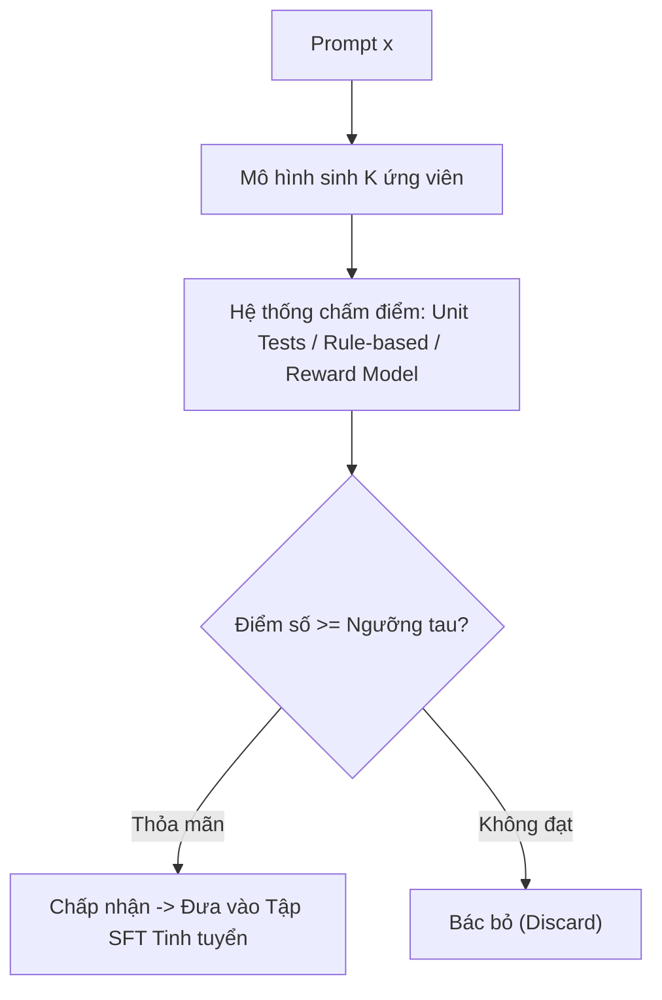

#### d. Code Thực chiến (Dual-Engine: C++ & Python)

```cpp
// C++17: Mô phỏng thuật toán Rejection Sampling
#include <iostream>
#include <vector>
#include <string>

struct Candidate {
    std::string text;
    double score;
};

std::vector<Candidate> filter_candidates(const std::vector<Candidate>& pool, double threshold) {
    std::vector<Candidate> accepted;
    for (const auto& item : pool) {
        if (item.score >= threshold) {
            accepted.push_back(item);
        }
    }
    return accepted;
}

int main() {
    std::vector<Candidate> samples = {
        {"Giải pháp A", 0.95},
        {"Giải pháp B", 0.42},
        {"Giải pháp C", 0.88}
    };
    auto passed = filter_candidates(samples, 0.80);
    std::cout << "Số ứng viên được chấp thuận: " << passed.size() << std::endl;
    return 0;
}
```

```python
# Python: Pipeline Rejection Sampling cho dữ liệu mã nguồn sử dụng Unit Test làm Verifier
from typing import List, Callable, Dict

def rejection_sampling_pipeline(
    prompt: str,
    generator_func: Callable[[str, int], List[str]],
    verifier_func: Callable[[str], bool],
    k: int = 8
) -> List[Dict[str, str]]:
    candidates = generator_func(prompt, k)
    accepted_data = []
    
    for cand in candidates:
        if verifier_func(cand):
            accepted_data.append({"prompt": prompt, "completion": cand})
            
    return accepted_data

# Mô phỏng verifier kiểm tra code thực thi thành công
mock_gen = lambda p, k: ["def add(a, b): return a + b", "def add(a, b): return a - b"]
mock_verifier = lambda code: "return a + b" in code

filtered = rejection_sampling_pipeline("Viết hàm cộng 2 số", mock_gen, mock_verifier)
print(f"Số lượng mẫu hợp lệ sau sàng lọc: {len(filtered)}")
```

#### e. Lỗi Thường gặp & Ổn định Số học (Pitfalls & Numerical Stability)
- **Tỷ lệ Bác bỏ Quá Cao (Sample Inefficiency)**: Với các bài toán khó (ví dụ chứng minh định lý toán học phức tạp), xác suất mô hình sinh ngẫu nhiên ra lời giải đúng có thể thấp hơn $1\%$, khiến chi phí suy luận sinh dữ liệu bùng nổ mà không thu được mẫu huấn luyện nào.

#### f. Ứng dụng Thực chiến trong AI / Deep Learning (AI Applications)
- **LLaMA-2-Chat & LLaMA-3**: Sử dụng Rejection Sampling lặp lại nhiều vòng (Iterative Rejection Sampling) để liên tục nâng cấp chất lượng dữ liệu huấn luyện cho các checkpoint tiếp theo.

---

### 32. Best-of-N Sampling (Lấy mẫu Tốt nhất trong N ứng viên)

#### a. Định nghĩa Bản chất Toán học (Mathematical Formulation)
**Best-of-N Sampling** (còn gọi là **Reranking Inference**) là phương pháp kiểm soát chất lượng tại thời điểm suy luận (Test-Time Search).
Với một câu lệnh $x$, mô hình sinh độc lập $N$ chuỗi phản hồi $\{y_1, y_2, \dots, y_N\} \sim \pi_\theta(\cdot \mid x)$ với tham số nhiệt độ $T > 0$. Lời giải tối ưu cuối cùng được lựa chọn theo nguyên tắc Argmax của hàm phần thưởng:
$$y^* = \arg\max_{y \in \{y_1, y_2, \dots, y_N\}} r_\psi(x, y)$$
Phân phối hiệu dụng của Best-of-N có dạng:
$$\pi_{\text{BoN}}(y \mid x) \propto \pi_\theta(y \mid x) \cdot \left( \int_{-\infty}^{r(x, y)} p(r') dr' \right)^{N-1}$$
Khi $N \to \infty$, phân phối hội tụ về phản hồi có điểm số cực đại tuyệt đối.

#### b. Cơ chế Tầng Sâu & Điện toán (Under The Hood / Hardware Internals)
- **Đánh đổi Chi phí Tính toán Suy luận (Compute vs. Accuracy)**: Best-of-N tăng chi phí tính toán FLOPs tại thời điểm suy luận lên gấp $N$ lần. Tuy nhiên, nó cho phép một mô hình nhỏ (7B) sau khi chạy Best-of-32 đạt độ chính xác giải toán tương đương với một mô hình 70B chạy Greedy Decoding.

#### c. Sơ đồ Minh họa (Mermaid / ASCII Diagram)
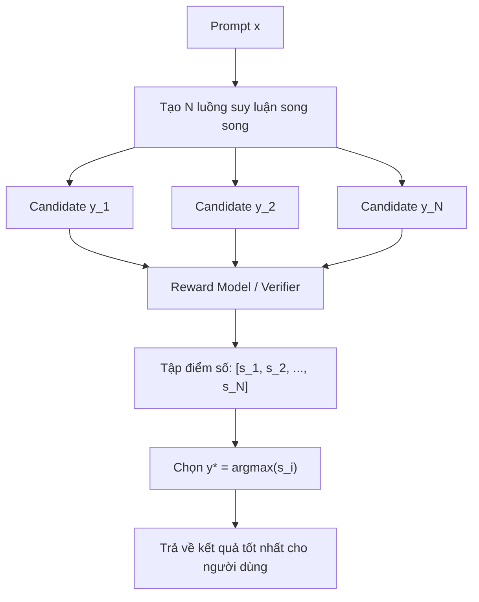

#### d. Code Thực chiến (Dual-Engine: C++ & Python)

```cpp
// C++17: Lựa chọn Best-of-N dựa trên chỉ số điểm phần thưởng
#include <iostream>
#include <vector>
#include <algorithm>

struct CandidateOutput {
    int id;
    double score;
};

int select_best_of_n(const std::vector<CandidateOutput>& candidates) {
    auto best_it = std::max_element(candidates.begin(), candidates.end(),
        [](const CandidateOutput& a, const CandidateOutput& b) {
            return a.score < b.score;
        });
    return best_it->id;
}

int main() {
    std::vector<CandidateOutput> cands = {{1, 2.3}, {2, 4.8}, {3, 1.1}, {4, 3.9}};
    std::cout << "Selected Best Candidate ID: " << select_best_of_n(cands) << std::endl;
    return 0;
}
```

```python
# Python / PyTorch: Triển khai thuật toán Best-of-N Reranking
import torch
from typing import List

def best_of_n_rerank(
    prompt: str,
    candidates: List[str],
    reward_model_fn: Callable[[str, List[str]], torch.Tensor]
) -> Tuple[str, float]:
    """
    prompt: Câu lệnh đầu vào
    candidates: Danh sách N câu trả lời sinh ra từ mô hình
    """
    scores = reward_model_fn(prompt, candidates) # [N]
    best_idx = torch.argmax(scores).item()
    return candidates[best_idx], scores[best_idx].item()

mock_candidates = [
    "Đáp án là 42.",
    "Tôi không chắc chắn lắm, có thể là 40.",
    "Theo định lý Fermat, kết quả là 42."
]
mock_rm = lambda p, cands: torch.tensor([2.5, 0.4, 4.8])

best_res, score = best_of_n_rerank("Tính toán?", mock_candidates, mock_rm)
print(f"Best Choice: '{best_res}' với Score: {score}")
```

#### e. Lỗi Thường gặp & Ổn định Số học (Pitfalls & Numerical Stability)
- **Goodhart's Law & Reward Hacking**: Khi tăng $N$ lên quá lớn ($N \ge 64$), việc tối ưu hóa điểm số thuần túy sẽ kích hoạt hiện tượng khai thác lỗ hổng của Reward Model (Reward Hacking): Mẫu được chọn có điểm số cao ngất ngưởng nhưng nội dung thực tế lại chứa các chuỗi ký tự lặp vô nghĩa hoặc phong cách trả lời giả tạo.

#### f. Ứng dụng Thực chiến trong AI / Deep Learning (AI Applications)
- **AlphaCode & OpenAI o1 / o3**: Sử dụng Test-Time Sampling quy mô lớn kết hợp với Verifier tự động để vượt qua các kỳ thi lập trình quốc tế (Competitive Programming).
