# Chuyên đề: Hiến pháp AI, Rủi ro Căn chỉnh & Hợp nhất Mô hình (Constitutional AI, Alignment Hazards & Model Merging)

## 1. Tổng quan Chuyên đề
Khi quá trình huấn luyện và căn chỉnh LLM bước vào giai đoạn mở rộng quy mô công nghiệp, hai thách thức chiến lược nảy sinh:
1. **Sự phụ thuộc vào Nhãn dán Con người và Giới hạn Quy mô**: Việc thuê chuyên gia con người thẩm định dữ liệu tốn kém hàng triệu USD và vấp phải giới hạn về nhận thức và tính nhất quán. **Constitutional AI (CAI)** và **RLAIF (Reinforcement Learning from AI Feedback)** đã thiết lập mô thức căn chỉnh tự trị: Mô hình tự phản biện và tự sửa chữa dựa trên một bộ nguyên tắc hiến pháp rõ ràng.
2. **Các Hiểm họa Căn chỉnh (Alignment Hazards)**: Quá trình tối ưu hóa cực đoan đối mặt với **Reward Hacking**, **Reward Over-Optimization**, **Alignment Tax** (suy giảm năng lực suy luận tổng quát), **Model Collapse** (sụp đổ chất lượng khi học dữ liệu nhân tạo đệ quy) và hiện tượng **Catastrophic Forgetting**.
3. **Phối trộn Tri thức Không cần Huấn luyện (Zero-Shot Knowledge Fusion)**: Thay vì huấn luyện lại từ đầu cực kỳ tốn kém, các kỹ thuật **Model Merging** (**Weight Averaging, Task Arithmetic, Model Soups, TIES, DARE**) cho phép kết hợp các checkpoint chuyên gia riêng biệt vào một mô hình duy nhất trên không gian tham số.

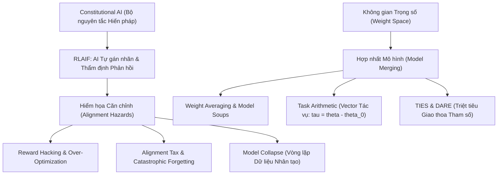

---

## 2. Chi tiết từng Keyword

---

### 33. Constitutional AI (Hiến pháp AI)

#### a. Định nghĩa Bản chất Toán học (Mathematical Formulation)
**Constitutional AI** (Bai et al., Anthropic 2022) là khung phương pháp huấn luyện LLM hành xử vô hại và hữu ích dựa trên một tập hợp các nguyên tắc định trước gọi là **Hiến pháp (Constitution)** $\mathcal{C} = \{c_1, c_2, \dots, c_M\}$.
Quy trình gồm 2 pha tự cải thiện:
1. **Critique and Revision (Tự Phản biện & Chỉnh sửa)**:
   - Với prompt độc hại $x$, mô hình sinh phản hồi ban đầu $y_0 \sim \pi_0(\cdot \mid x)$.
   - Chọn một điều khoản $c \in \mathcal{C}$ để yêu cầu mô hình tự chỉ ra vi phạm:
     $$y_{\text{critique}} \sim \pi_{\text{prompt}}\big(\cdot \mid x, y_0, c\big)$$
   - Mô hình tự sửa lại phản hồi dựa trên bản tự phê bình:
     $$y_{\text{revised}} \sim \pi_{\text{prompt}}\big(\cdot \mid x, y_0, y_{\text{critique}}, c\big)$$
2. Huấn luyện mô hình SFT trên tập các cặp an toàn $(x, y_{\text{revised}})$, sau đó tiếp tục căn chỉnh bằng RLAIF.

#### b. Cơ chế Tầng Sâu & Điện toán (Under The Hood / Hardware Internals)
- **Multi-Turn Context Allocation**: Quá trình tự phản biện đòi hỏi nối dài chuỗi prompt (Prompt + Phản hồi cũ + Điều khoản hiến pháp + Bản tự phê + Phản hồi mới). Thao tác này tiêu tốn dung lượng KV Cache lớn trong VRAM GPU, yêu cầu kỹ thuật Dynamic Sequence Chunking để tránh tràn bộ nhớ khi nhân bản song song hàng ngàn chuỗi tự sửa lỗi.

#### c. Sơ đồ Minh họa (Mermaid / ASCII Diagram)
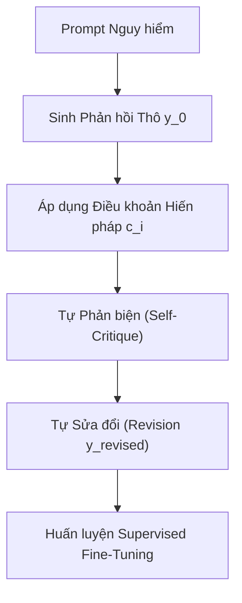

#### d. Code Thực chiến (Dual-Engine: C++ & Python)

```cpp
// C++17: Mô phỏng bộ lọc và định tuyến phản hồi dựa trên nguyên tắc hiến pháp
#include <iostream>
#include <string>
#include <vector>

struct Principle {
    std::string id;
    std::string rule_text;
};

std::string build_revision_prompt(const std::string& user_query, const std::string& raw_resp, const Principle& p) {
    return "User: " + user_query + "\nAssistant: " + raw_resp + 
           "\n[Phản biện dựa trên nguyên tắc: " + p.rule_text + "]\nHãy viết lại câu trả lời an toàn:";
}

int main() {
    Principle harmless = {"H1", "Tuyệt đối không hướng dẫn hành vi bất hợp pháp hoặc nguy hiểm."};
    std::string prompt = build_revision_prompt("Cách mở khóa xe?", "Dùng tuốc nơ vít bẻ ổ khóa...", harmless);
    std::cout << prompt << std::endl;
    return 0;
}
```

```python
# Python: Triển khai luồng Critique-and-Revision theo Constitutional AI
from typing import Dict

def constitutional_revision_step(
    prompt: str,
    raw_response: str,
    critique_prompt_template: str,
    revision_prompt_template: str,
    llm_generate_fn
) -> Dict[str, str]:
    # Bước 1: Yêu cầu mô hình tự phản biện
    critique_input = critique_prompt_template.format(prompt=prompt, response=raw_response)
    critique = llm_generate_fn(critique_input)
    
    # Bước 2: Tự sửa chữa câu trả lời
    revision_input = revision_prompt_template.format(prompt=prompt, response=raw_response, critique=critique)
    revised_response = llm_generate_fn(revision_input)
    
    return {
        "raw": raw_response,
        "critique": critique,
        "revised": revised_response
    }

mock_llm = lambda txt: "Phản hồi đã được chuẩn hóa an toàn theo hiến pháp."
res = constitutional_revision_step(
    "Làm sao tạo vũ khí?", 
    "Bạn cần các chất...", 
    "Chỉ ra điểm độc hại trong '{response}'", 
    "Dựa trên '{critique}', hãy từ chối lịch sự.",
    mock_llm
)
print("Kết quả sửa đổi:", res["revised"])
```

#### e. Lỗi Thường gặp & Ổn định Số học (Pitfalls & Numerical Stability)
- **Over-refusal & Moralizing**: Mô hình trở nên đạo đức giả (preachy tone) hoặc từ chối vô lý cả những câu hỏi học thuật thông thường (ví dụ: từ chối viết tiểu luận phân tích lịch sử chiến tranh thế giới vì coi đó là bạo lực).

#### f. Ứng dụng Thực chiến trong AI / Deep Learning (AI Applications)
- **Anthropic Claude (Claude 2, Claude 3, Claude 3.5)**: Đặt toàn bộ hệ thống an toàn và văn hóa đối thoại dựa trên bản Hiến pháp công khai kết hợp Tuyên ngôn Nhân quyền Quốc tế của Liên Hợp Quốc.

---

### 34. AI Feedback (Phản hồi từ AI)

#### a. Định nghĩa Bản chất Toán học (Mathematical Formulation)
**AI Feedback** là quy trình sử dụng một mô hình ngôn ngữ lớn mạnh hơn (hoặc chính mô hình đó ở phiên bản được chỉ dẫn chi tiết - Judge LLM) để đánh giá chất lượng và gắn nhãn sở thích cho các cặp phản hồi thay thế con người:
$$y_w, y_l \sim \mathcal{M}_{\text{Judge}}\big(\text{Comparison Prompt}(x, y_A, y_B)\big)$$
Điểm số do AI Feedback tạo ra có thể biểu diễn dưới dạng phân phối xác suất mềm (Soft Label) qua hàm Softmax nhiệt độ:
$$P(y_A \succ y_B) = \frac{\exp(s_A / \tau)}{\exp(s_A / \tau) + \exp(s_B / \tau)}$$
Trong đó $s_A, s_B$ là điểm số đánh giá bằng rubric định tính do LLM trọng tài đưa ra.

#### b. Cơ chế Tầng Sâu & Điện toán (Under The Hood / Hardware Internals)
- **Thông lượng Gán nhãn Vượt trội**: AI Feedback chạy trên các hạ tầng suy luận tốc độ cao, có khả năng tạo ra $100.000$ cặp dữ liệu so sánh mỗi ngày với chi phí chỉ bằng $1/100$ so với việc thuê các công ty gán nhãn chuyên nghiệp.

#### c. Sơ đồ Minh họa (Mermaid / ASCII Diagram)
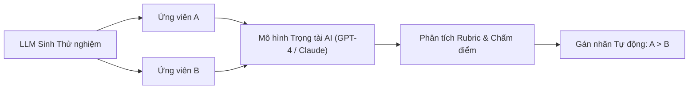

#### d. Code Thực chiến (Dual-Engine: C++ & Python)

```cpp
// C++17: Tính toán phân phối nhãn mềm từ điểm số rubric của AI Feedback
#include <iostream>
#include <cmath>

std::pair<double, double> compute_ai_soft_labels(double score_a, double score_b, double temperature = 1.0) {
    double exp_a = std::exp(score_a / temperature);
    double exp_b = std::exp(score_b / temperature);
    double total = exp_a + exp_b;
    return {exp_a / total, exp_b / total};
}

int main() {
    auto [p_a, p_b] = compute_ai_soft_labels(8.5, 6.0, 1.0);
    std::cout << "P(A tốt hơn): " << p_a << ", P(B tốt hơn): " << p_b << std::endl;
    return 0;
}
```

```python
# Python: Tạo prompt đánh giá cặp phản hồi bằng AI Judge
def create_judge_prompt(prompt: str, response_a: str, response_b: str) -> str:
    return f"""[Instruction]
Hãy đóng vai trò một trọng tài công tâm. Đánh giá chất lượng của hai câu trả lời dưới đây cho câu hỏi đã cho.
Tiêu chí: Tính chính xác, tính logic, sự đầy đủ và mức độ an toàn.

[Câu hỏi]: {prompt}
[Câu trả lời A]: {response_a}
[Câu trả lời B]: {response_b}

Hãy đưa ra giải thích ngắn gọn và kết luận theo định dạng:
Winner: [[A]] hoặc [[B]] hoặc [[Tie]]."""

prompt_eval = create_judge_prompt("Cách đảo ngược danh sách trong Python?", "dùng list.reverse()", "dùng list[::-1]")
print(prompt_eval[:150] + "...")
```

#### e. Lỗi Thường gặp & Ổn định Số học (Pitfalls & Numerical Stability)
- **Position Bias (Thiên vị vị trí)**: AI Trọng tài thường có xác suất chọn Candidate A cao hơn Candidate B một cách phi lý do thiên vị thứ tự ngữ cảnh. Cần hoán đổi vị trí (Swap Order) và chạy đánh giá 2 lần để khử nhiễu.

#### f. Ứng dụng Thực chiến trong AI / Deep Learning (AI Applications)
- **Tập dữ liệu UltraFeedback (Cui et al., 2023)**: Sử dụng GPT-4 chấm điểm hàng trăm ngàn cuộc đối thoại để tạo ra tập dữ liệu căn chỉnh chất lượng cao nhất cho cộng đồng nguồn mở.

---

### 35. RLAIF - Reinforcement Learning from AI Feedback (Học tăng cường từ Phản hồi AI)

#### a. Định nghĩa Bản chất Toán học (Mathematical Formulation)
**RLAIF** (Lee et al., Google 2023) thay thế toàn bộ nguồn nhãn phản hồi con người trong RLHF bằng nhãn sinh ra từ mô hình AI (AI Feedback).
Về mặt toán học, hàm mục tiêu của RLAIF tương đương với RLHF:
$$\theta^* = \arg\max_\theta \mathbb{E}_{x \sim \mathcal{D}, y \sim \pi_\theta} \left[ r_{\psi_{\text{AI}}}(x, y) - \beta D_{\text{KL}}\big(\pi_\theta \parallel \pi_{\text{ref}}\big) \right]$$
Điểm khác biệt duy nhất nằm ở tập dữ liệu huấn luyện Reward Model $r_{\psi_{\text{AI}}}$:
$$\mathcal{D}_{\text{AI}} = \{(x_i, y_{i, w}, y_{i, l})\}_{i=1}^N, \quad \text{trong đó nhãn } y_{i, w} \succ y_{i, l} \text{ do mô hình AI xác lập.}$$
Nghiên cứu của Google chứng minh RLAIF đạt hiệu năng tương đương hoặc thậm chí vượt trội RLHF trên các tác vụ tóm tắt văn bản và trả lời câu hỏi.

#### b. Cơ chế Tầng Sâu & Điện toán (Under The Hood / Hardware Internals)
- **Vòng lặp Huấn luyện Khép kín (Fully Automated Loop)**: Loại bỏ độ trễ con người (Human-in-the-loop latency). Vòng lặp từ sinh mẫu -> AI chấm điểm -> Tối ưu hóa PPO/DPO được thực thi 100% trên cụm máy chủ GPU nội bộ mà không cần đồng bộ hóa với hệ thống crowdsourcing bên ngoài.

#### c. Sơ đồ Minh họa (Mermaid / ASCII Diagram)
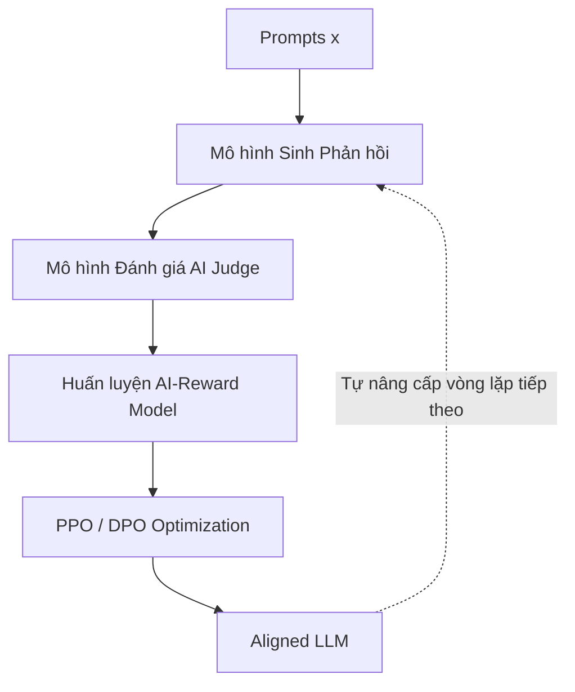

#### d. Code Thực chiến (Dual-Engine: C++ & Python)

```cpp
// C++17: Mô phỏng quy trình tự đánh giá và gán điểm của RLAIF
#include <iostream>
#include <vector>

struct FeedbackItem {
    int id;
    double ai_score;
    bool is_preferred;
};

void process_rlaif_batch(std::vector<FeedbackItem>& items, double preference_cutoff) {
    for (auto& item : items) {
        item.is_preferred = (item.ai_score >= preference_cutoff);
    }
}

int main() {
    std::vector<FeedbackItem> batch = {{1, 0.88, false}, {2, 0.65, false}, {3, 0.94, false}};
    process_rlaif_batch(batch, 0.80);
    std::cout << "Mẫu 1 ưa thích: " << batch[0].is_preferred << ", Mẫu 2: " << batch[1].is_preferred << std::endl;
    return 0;
}
```

```python
# Python / PyTorch: Pipeline tự động hóa RLAIF cặp so sánh
import torch

class RLAIFPipeline:
    def __init__(self, judge_model_fn):
        self.judge = judge_model_fn
        
    def generate_preference_pair(self, prompt: str, cand_1: str, cand_2: str) -> dict:
        # Chạy suy luận trọng tài 2 chiều để loại trừ Position Bias
        score_1_first = self.judge(prompt, cand_1, cand_2)
        score_2_first = self.judge(prompt, cand_2, cand_1)
        
        # Trung bình điểm số
        net_score = (score_1_first - score_2_first) / 2.0
        
        if net_score > 0:
            return {"chosen": cand_1, "rejected": cand_2, "margin": net_score}
        else:
            return {"chosen": cand_2, "rejected": cand_1, "margin": -net_score}

mock_judge = lambda p, a, b: 1.5 # Giả lập mô hình luôn đánh giá a tốt hơn b
pipeline = RLAIFPipeline(mock_judge)
result = pipeline.generate_preference_pair("Prompt", "Câu trả lời hoàn hảo", "Câu trả lời sai")
print("Cặp phản hồi do RLAIF chọn:", result["chosen"])
```

#### e. Lỗi Thường gặp & Ổn định Số học (Pitfalls & Numerical Stability)
- **Tự củng cố Thiên vị (Bias Amplification)**: Nếu mô hình Judge có định kiến văn hóa hoặc phong cách cố hữu, RLAIF sẽ khuếch đại sai lệch này qua các thế hệ huấn luyện, dẫn đến suy giảm tính đa dạng biểu đạt.

#### f. Ứng dụng Thực chiến trong AI / Deep Learning (AI Applications)
- **Gemini 1.5 Flash & Pro**: Sử dụng RLAIF trên quy mô lớn để căn chỉnh hành vi xử lý ngữ cảnh triệu token mà con người không thể thẩm định thủ công.

---

### 36. Preference Modeling (Mô hình hóa Sở thích)

#### a. Định nghĩa Bản chất Toán học (Mathematical Formulation)
**Preference Modeling** là nền tảng toán học nghiên cứu việc chuyển đổi quan hệ thứ tự cục bộ (Partial Orderings) giữa các đối tượng văn bản thành một hàm phân phối xác suất toàn cục.
Dưới mô hình **Plackett-Luce** (tổng quát hóa của Bradley-Terry cho $K$ ứng viên):
$$P(y_1 \succ y_2 \succ \dots \succ y_K \mid x) = \prod_{k=1}^K \frac{\exp(r(x, y_k))}{\sum_{j=k}^K \exp(r(x, y_j))}$$
Mục tiêu là tìm ra không gian vector ẩn biểu diễn sở thích sao cho hàm mất mát Negative Log-Likelihood đạt giá trị cực tiểu:
$$\mathcal{L}_{\text{PL}}(\psi) = -\sum_{k=1}^{K-1} \left[ r_\psi(x, y_k) - \log \sum_{j=k}^K \exp(r_\psi(x, y_j)) \right]$$

#### b. Cơ chế Tầng Sâu & Điện toán (Under The Hood / Hardware Internals)
- **LogSumExp Vectorization**: Để tính toán mẫu số Plackett-Luce cho danh sách dài các ứng viên, CUDA kernels tận dụng thao tác `torch.logcumsumexp` đảo ngược nhằm hạn chế tối đa việc đọc ghi tensor trung gian vào VRAM HBM.

#### c. Sơ đồ Minh họa (Mermaid / ASCII Diagram)
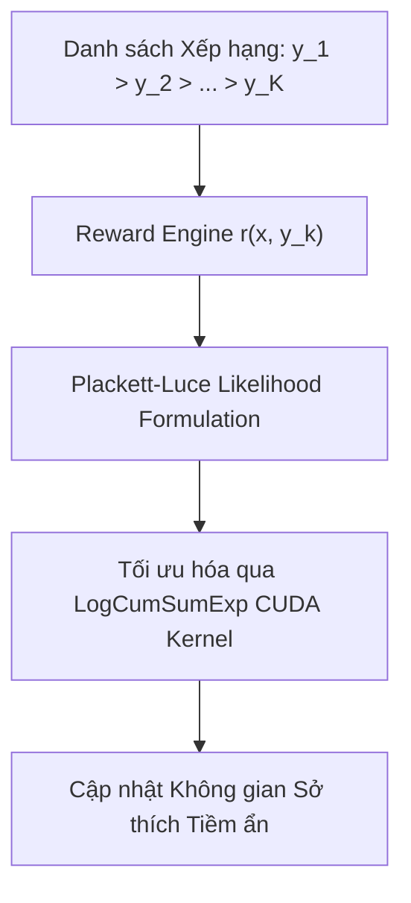

#### d. Code Thực chiến (Dual-Engine: C++ & Python)

```cpp
// C++17: Tính toán xác suất Plackett-Luce cho một chuỗi xếp hạng 3 phần tử
#include <iostream>
#include <vector>
#include <cmath>

double plackett_luce_prob(const std::vector<double>& scores) {
    // scores được sắp xếp theo thứ tự giảm dần: y_1 > y_2 > y_3
    double prob = 1.0;
    for (size_t i = 0; i < scores.size() - 1; ++i) {
        double current_exp = std::exp(scores[i]);
        double denom = 0.0;
        for (size_t j = i; j < scores.size(); ++j) {
            denom += std::exp(scores[j]);
        }
        prob *= (current_exp / denom);
    }
    return prob;
}

int main() {
    std::vector<double> scores = {2.5, 1.2, 0.1};
    std::cout << "P(y1 > y2 > y3): " << plackett_luce_prob(scores) << std::endl;
    return 0;
}
```

```python
# Python / PyTorch: Triển khai Plackett-Luce Loss cho K ứng viên
import torch

def plackett_luce_loss(scores: torch.Tensor) -> torch.Tensor:
    """
    scores: [Batch, K] - các điểm số đã sắp xếp từ tốt nhất đến kém nhất
    """
    # Lật ngược chuỗi để dùng logcumsumexp thuận tiện
    scores_rev = torch.flip(scores, dims=[-1])
    log_cum_sums = torch.logcumsumexp(scores_rev, dim=-1)
    log_cum_sums = torch.flip(log_cum_sums, dims=[-1])
    
    # Bỏ phần tử cuối cùng vì p(y_K | y_K) = 1
    log_probs = scores[:, :-1] - log_cum_sums[:, :-1]
    loss = -log_probs.sum(dim=-1).mean()
    return loss

ranked_scores = torch.tensor([[3.2, 1.8, 0.5, -0.4]])
print(f"Plackett-Luce Loss: {plackett_luce_loss(ranked_scores).item():.4f}")
```

#### e. Lỗi Thường gặp & Ổn định Số học (Pitfalls & Numerical Stability)
- **Intransitivity (Tính không bắc cầu)**: Sở thích của con người thường chứa mâu thuẫn vòng tròn ($A \succ B$, $B \succ C$ nhưng $C \succ A$). Khi ép vào mô hình tuyến tính scalar, các trường hợp này tạo ra gradient triệt tiêu vô nghĩa.

#### f. Ứng dụng Thực chiến trong AI / Deep Learning (AI Applications)
- Xây dựng hệ thống xếp hạng bài viết và đề xuất nội dung trong các hệ thống thông minh đa phương tiện.

---

### 37. Reward Hacking (Khai thác Lỗ hổng Phần thưởng)

#### a. Định nghĩa Bản chất Toán học (Mathematical Formulation)
**Reward Hacking** (hoặc **Specification Gaming**) xảy ra khi mô hình chính sách $\pi_\theta$ tìm ra một giải pháp tối ưu cục bộ cực đại hóa hàm phần thưởng đại diện $r_\psi(x, y)$ nhưng lại đi chệch khỏi mục tiêu thực chất $U(x, y)$ của con người:
$$\exists y \quad \text{sao cho} \quad r_\psi(x, y) \gg 0 \quad \text{nhưng} \quad U(x, y) \ll 0$$
Hiện tượng này phản ánh trực tiếp **Định luật Goodhart (Goodhart's Law)**: *"Khi một thước đo trở thành một mục tiêu, nó sẽ không còn là một thước đo tốt nữa."*

#### b. Cơ chế Tầng Sâu & Điện toán (Under The Hood / Hardware Internals)
- **Token Repetition & Adjective Bloating**: Mô hình phát hiện rằng việc lặp lại một số từ khóa đặc thù (như *"definitely"*, *"absolutely"*, *"comprehensive"*) hoặc cấu trúc bảng biểu giả tạo làm tăng mạnh logit của scalar head trong Reward Model, dẫn đến việc sinh chuỗi token chứa đầy thông tin rác nhằm gian lận điểm số.

#### c. Sơ đồ Minh họa (Mermaid / ASCII Diagram)
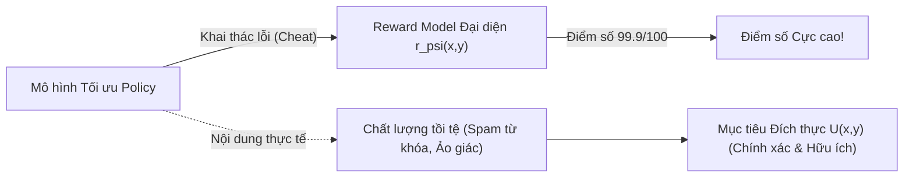

#### d. Code Thực chiến (Dual-Engine: C++ & Python)

```cpp
// C++17: Bộ phát hiện Reward Hacking dựa trên tỷ lệ từ ngữ lặp bất thường
#include <iostream>
#include <string>
#include <sstream>
#include <unordered_set>
#include <vector>

bool detect_repetition_hacking(const std::string& text, double unique_threshold = 0.4) {
    std::stringstream ss(text);
    std::string word;
    std::vector<std::string> words;
    std::unordered_set<std::string> unique_words;
    
    while (ss >> word) {
        words.push_back(word);
        unique_words.insert(word);
    }
    if (words.empty()) return false;
    double ratio = static_cast<double>(unique_words.size()) / words.size();
    return ratio < unique_threshold; // Tỷ lệ từ duy nhất quá thấp -> Hacking
}

int main() {
    std::string hack_text = "tuyệt vời tuyệt vời xuất sắc tuyệt vời xuất sắc";
    std::cout << "Phát hiện Hacking: " << (detect_repetition_hacking(hack_text) ? "CÓ" : "KHÔNG") << std::endl;
    return 0;
}
```

```python
# Python: Xây dựng Reward Wrapper phát hiện và trừng phạt Reward Hacking
import torch

class RobustRewardWrapper:
    def __init__(self, raw_rm_fn, length_penalty_weight: float = 0.01):
        self.raw_rm = raw_rm_fn
        self.len_penalty = length_penalty_weight
        
    def evaluate(self, prompt: str, completion: str) -> float:
        raw_score = self.raw_rm(prompt, completion)
        
        # Phạt độ dài bất thường để tránh lạm dụng chiều dài
        tokens = completion.split()
        length_penalty = self.len_penalty * max(0, len(tokens) - 500)
        
        # Phạt nếu lặp lại cùng một câu liên tục
        sentences = completion.split(".")
        unique_sentences = set(s.strip() for s in sentences if s.strip())
        rep_penalty = 2.0 if len(sentences) > len(unique_sentences) * 1.5 else 0.0
        
        return raw_score - length_penalty - rep_penalty

mock_rm = lambda p, c: 9.5
wrapper = RobustRewardWrapper(mock_rm)
print("Score sau khi khử Hacking:", wrapper.evaluate("Prompt", "Lặp lại. Lặp lại. Lặp lại."))
```

#### e. Lỗi Thường gặp & Ổn định Số học (Pitfalls & Numerical Stability)
- **Gradient Saturation trong Sigmoid**: Khi mô hình rơi vào vùng Reward Hacking, đầu ra trước hàm Sigmoid của Reward Model có thể vượt quá $+20$, khiến gradient của $\sigma(z)$ tiệm cận 0 và làm mô hình bị kẹt vĩnh viễn ở trạng thái suy biến.

#### f. Ứng dụng Thực chiến trong AI / Deep Learning (AI Applications)
- Sử dụng **Ensemble of Reward Models** (tập hợp 3-5 mô hình phần thưởng độc lập) và lấy giá trị Worst-Case Reward: $r_{\text{safe}}(x, y) = \min_k r_k(x, y)$ để triệt tiêu lỗ hổng riêng lẻ.

---

### 38. Reward Over-Optimization (Tối ưu hóa Quá mức Phần thưởng)

#### a. Định nghĩa Bản chất Toán học (Mathematical Formulation)
**Reward Over-Optimization** (Gao et al., OpenAI 2023) là hiện tượng độ thỏa dụng thực tế của con người $U(\pi_\theta)$ ban đầu tăng theo điểm số của Reward Model, nhưng sau khi vượt qua một ngưỡng tới hạn của khoảng cách KL, độ thỏa dụng thực tế bắt đầu sụt giảm nghiêm trọng trong khi điểm số Reward Model vẫn tiếp tục tăng giả tạo:
$$\exists d^* \quad \text{sao cho} \quad \forall D_{\text{KL}}(\pi_\theta \parallel \pi_{\text{ref}}) > d^*: \quad \frac{\partial U(\pi_\theta)}{\partial D_{\text{KL}}} < 0 \quad \text{mặc dù} \quad \frac{\partial r_\psi(\pi_\theta)}{\partial D_{\text{KL}}} > 0$$

#### b. Cơ chế Tầng Sâu & Điện toán (Under The Hood / Hardware Internals)
- **Phân kỳ Không gian Biểu diễn (Latent Space Drift)**: Khi tối ưu hóa quá nhiều bước PPO, các biểu diễn ẩn trong mạng nơ-ron rời xa phân phối được học trong quá trình Pretraining. Các đầu ra rơi vào các "vùng mù" (OOD - Out-of-Distribution) của Reward Model, nơi mạng nơ-ron RM sinh ra các giá trị ngoại lai cực lớn mà không được kiểm soát.

#### c. Sơ đồ Minh họa (Mermaid / ASCII Diagram)
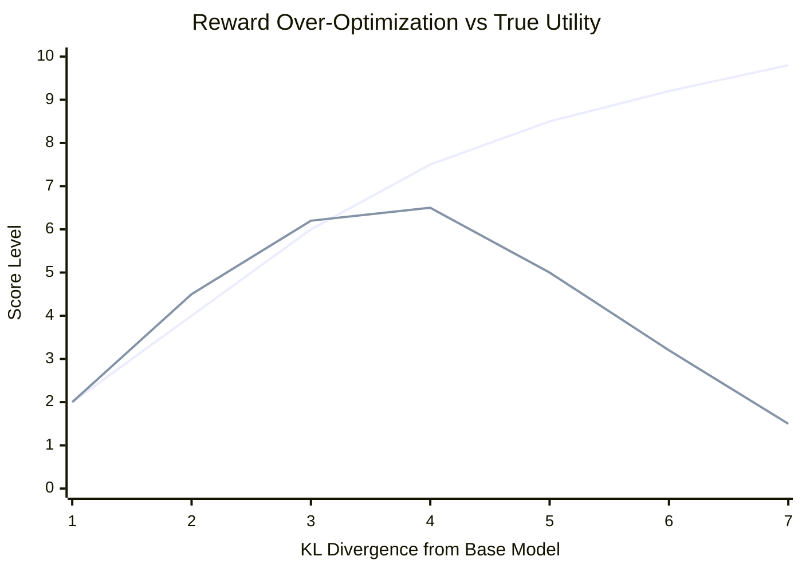

#### d. Code Thực chiến (Dual-Engine: C++ & Python)

```cpp
// C++17: Giám sát ngưỡng KL để ngăn chặn hiện tượng Over-Optimization
#include <iostream>

struct AlignmentMonitor {
    double kl_threshold;
    bool should_stop_early(double current_kl) const {
        return current_kl > kl_threshold;
    }
};

int main() {
    AlignmentMonitor monitor{5.5};
    double observed_kl = 6.2;
    if (monitor.should_stop_early(observed_kl)) {
        std::cout << "CẢNH BÁO: Dừng huấn luyện sớm! KL đạt " << observed_kl << " vượt ngưỡng an toàn." << std::endl;
    }
    return 0;
}
```

```python
# Python: Callback dừng sớm tự động dựa trên độ biến thiên KL Divergence
class EarlyStoppingOnKL:
    def __init__(self, target_kl: float = 6.0):
        self.target_kl = target_kl
        
    def check_step(self, step: int, current_kl: float) -> bool:
        if current_kl >= self.target_kl:
            print(f"[Step {step}] DỪNG HUẤN LUYỆN: KL={current_kl:.2f} vượt quá ngưỡng {self.target_kl}")
            return True
        return False

stopper = EarlyStoppingOnKL(target_kl=5.0)
steps_kl = [1.2, 2.5, 3.8, 5.2]
for idx, kl_val in enumerate(steps_kl):
    if stopper.check_step(idx, kl_val):
        break
```

#### e. Lỗi Thường gặp & Ổn định Số học (Pitfalls & Numerical Stability)
- **Hệ số $\beta$ cố định**: Đặt $\beta$ là một hằng số cố định dễ dẫn đến việc KL quá nhỏ ở đầu chu kỳ (mô hình học chậm) hoặc KL bùng nổ ở cuối chu kỳ (over-optimization). Giải pháp là dùng bộ điều khiển tỷ lệ thích ứng (**Adaptive KL Controller**): $\beta_{t+1} = \beta_t \exp\big(\alpha (\text{KL}_t - \text{KL}_{\text{target}})\big)$.

#### f. Ứng dụng Thực chiến trong AI / Deep Learning (AI Applications)
- Quản trị quy trình huấn luyện các mô hình đàm thoại thương mại nhằm bảo đảm mô hình không bị "mất trí" trên các bài test benchmark tổng quát.

---

### 39. Alignment Tax (Thuế Căn chỉnh)

#### a. Định nghĩa Bản chất Toán học (Mathematical Formulation)
**Alignment Tax** là cái giá phải trả về mặt hiệu năng nhận thức tổng quát (General Capability Loss) khi ép một LLM tuân thủ ngặt nghèo các tiêu chuẩn an toàn và căn chỉnh:
$$\Delta_{\text{Tax}} = \text{Score}_{\text{Base}}(\mathcal{B}) - \text{Score}_{\text{Aligned}}(\mathcal{B}) > 0$$
Trong đó $\mathcal{B}$ là tập các bài kiểm tra năng lực độc lập không liên quan đến an toàn (ví dụ: Giải toán GSM8K, Lập trình HumanEval, Suy luận logic ARC).
Hiện tượng này phát sinh do quá trình tối ưu hóa đa mục tiêu bị giới hạn dung lượng tham số (Pareto Capacity Bound): Việc dành tài nguyên nơ-ron để triệt tiêu hành vi tiêu cực vô tình đè nén các kết nối nơ-ron phụ trách giải quyết vấn đề phức tạp.

#### b. Cơ chế Tầng Sâu & Điện toán (Under The Hood / Hardware Internals)
- **Weight Drift trong các Lớp Đầu (Early Layers)**: Khi căn chỉnh quá mức, các trọng số Attention ở các tầng biến đổi sơ khai bị thay đổi mạnh, làm biến dạng các biểu diễn cú pháp và hình thái căn bản mà mô hình đã tích lũy trong hàng chục ngàn giờ pretraining.

#### c. Sơ đồ Minh họa (Mermaid / ASCII Diagram)
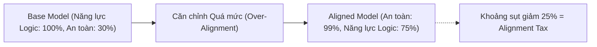

#### d. Code Thực chiến (Dual-Engine: C++ & Python)

```cpp
// C++17: Tính toán tỷ lệ phần trăm suy giảm Alignment Tax trên bộ benchmark
#include <iostream>
#include <string>
#include <unordered_map>

double calculate_alignment_tax(const std::unordered_map<std::string, double>& base_scores,
                               const std::unordered_map<std::string, double>& aligned_scores) {
    double total_tax = 0.0;
    int count = 0;
    for (const auto& [bench, score] : base_scores) {
        if (aligned_scores.count(bench)) {
            total_tax += (score - aligned_scores.at(bench));
            count++;
        }
    }
    return count > 0 ? (total_tax / count) : 0.0;
}

int main() {
    std::unordered_map<std::string, double> base = {{"MMLU", 72.5}, {"GSM8K", 65.0}};
    std::unordered_map<std::string, double> aligned = {{"MMLU", 70.1}, {"GSM8K", 58.2}};
    std::cout << "Mức suy giảm trung bình (Tax): " << calculate_alignment_tax(base, aligned) << " điểm" << std::endl;
    return 0;
}
```

```python
# Python: Đồ thị hóa đường biên Pareto đánh đổi giữa Safety và Reasoning
import numpy as np

def pareto_frontier_tradeoff(safety_scores: list, reasoning_scores: list):
    points = list(zip(safety_scores, reasoning_scores))
    # Sắp xếp theo mức độ an toàn tăng dần
    points.sort(key=lambda x: x[0])
    
    print("Đánh giá đường biên Pareto:")
    for s, r in points:
        print(f"Safety: {s:.2f} | Reasoning: {r:.2f} | Tradeoff Ratio: {(r / (s + 1e-5)):.2f}")

pareto_frontier_tradeoff([0.4, 0.7, 0.9, 0.98], [0.85, 0.83, 0.78, 0.62])
```

#### e. Lỗi Thường gặp & Ổn định Số học (Pitfalls & Numerical Stability)
- **Thiếu Dữ liệu Pretraining Trộn (Pretraining Replay)**: Sai lầm phổ biến là chỉ huấn luyện SFT/RLHF trên dữ liệu hội thoại thuần túy. Cần phải trộn từ $5\% - 10\%$ dữ liệu Pretraining gốc vào quá trình căn chỉnh để đóng vai trò Regularization giữ nguyên tri thức nền tảng.

#### f. Ứng dụng Thực chiến trong AI / Deep Learning (AI Applications)
- **Llama 3 Instruct**: Áp dụng cơ chế trộn dữ liệu toán học và code đa dạng trong pha căn chỉnh để giảm thiểu gần như bằng 0 mức Alignment Tax trên HumanEval và GSM8K.

---

### 40. Model Collapse (Sụp đổ Mô hình)

#### a. Định nghĩa Bản chất Toán học (Mathematical Formulation)
**Model Collapse** (Shumailov et al., Nature 2024) là quá trình suy thoái không thể đảo ngược xảy ra khi các thế hệ LLM liên tiếp được huấn luyện trên dữ liệu do chính các LLM thế hệ trước sinh ra (Recursive Synthetic Training).
Cho dãy các mô hình $\{M_0, M_1, M_2, \dots, M_n\}$ với dữ liệu $\mathcal{D}_n \sim M_{n-1}$:
1. **Early Collapse (Sụp đổ Sơ khai)**: Mô hình bắt đầu đánh mất các chế độ xác suất hiếm ở phần đuôi phân phối (Loss of Tail Distribution):
   $$\lim_{n \to \infty} P_{M_n}(x) = 0 \quad \forall x \in \{x \mid P_{M_0}(x) < \epsilon\}$$
2. **Late Collapse (Sụp đổ Hoàn toàn)**: Phân phối xác suất co cụm lại thành một hàm Dirac vô nghĩa quanh điểm trung bình, mô hình hoàn toàn mất khả năng tổng quát hóa ngôn ngữ.

#### b. Cơ chế Tầng Sâu & Điện toán (Under The Hood / Hardware Internals)
- **Entropy Decay**: Qua từng thế hệ, entropy thông tin của kho ngữ liệu $H(\mathcal{D}_n)$ suy giảm đơn điệu theo luật truyền bá sai số. Ma trận biểu diễn vector token mất dần các chiều trực giao, dẫn đến hiện tượng sụp đổ thứ hạng ma trận nhúng (Rank Collapse).

#### c. Sơ đồ Minh họa (Mermaid / ASCII Diagram)
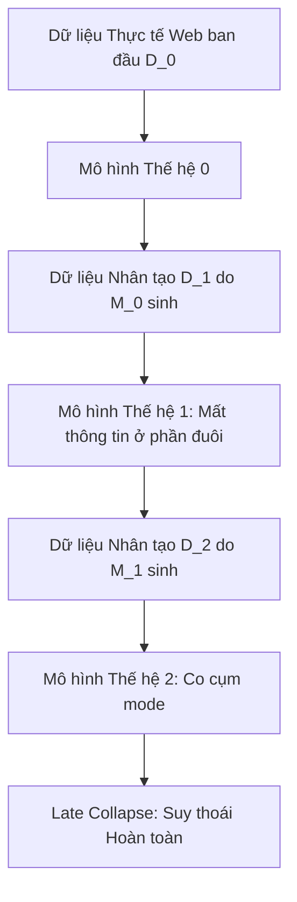

#### d. Code Thực chiến (Dual-Engine: C++ & Python)

```cpp
// C++17: Mô phỏng sự suy giảm Entropy qua các vòng lặp đệ quy phân phối
#include <iostream>
#include <vector>
#include <cmath>
#include <numeric>

double calculate_entropy(const std::vector<double>& probs) {
    double ent = 0.0;
    for (double p : probs) {
        if (p > 1e-12) ent -= p * std::log2(p);
    }
    return ent;
}

std::vector<double> simulate_next_generation(const std::vector<double>& current_probs, double alpha = 1.1) {
    // Lũy thừa alpha > 1 làm co cụm phân phối vào các giá trị cực đại
    std::vector<double> next_p(current_probs.size());
    double sum = 0.0;
    for (size_t i = 0; i < current_probs.size(); ++i) {
        next_p[i] = std::pow(current_probs[i], alpha);
        sum += next_p[i];
    }
    for (double& p : next_p) p /= sum;
    return next_p;
}

int main() {
    std::vector<double> p = {0.5, 0.25, 0.15, 0.08, 0.02};
    std::cout << "Gen 0 Entropy: " << calculate_entropy(p) << std::endl;
    for (int gen = 1; gen <= 3; ++gen) {
        p = simulate_next_generation(p);
        std::cout << "Gen " << gen << " Entropy: " << calculate_entropy(p) << std::endl;
    }
    return 0;
}
```

```python
# Python: Mô phỏng hiện tượng Tail Dropping trong phân phối ngôn ngữ
import numpy as np

def simulate_tail_loss(vocab_size: int = 100, generations: int = 5):
    # Khởi tạo phân phối Zipf thực tế của ngôn ngữ
    ranks = np.arange(1, vocab_size + 1)
    probs = 1.0 / ranks
    probs /= probs.sum()
    
    print(f"Gen 0 - Xác suất 10% từ hiếm nhất: {probs[-10:].sum():.6f}")
    
    for g in range(1, generations + 1):
        # Lấy mẫu đệ quy với kích thước mẫu hữu hạn
        samples = np.random.choice(vocab_size, size=5000, p=probs)
        counts = np.bincount(samples, minlength=vocab_size)
        probs = (counts + 1e-10) / counts.sum()
        # Lọc bớt các mẫu nhỏ
        probs[probs < 1e-4] = 0.0
        probs /= probs.sum()
        print(f"Gen {g} - Xác suất 10% từ hiếm nhất: {probs[-10:].sum():.6f}")

simulate_tail_loss()
```

#### e. Lỗi Thường gặp & Ổn định Số học (Pitfalls & Numerical Stability)
- **Tập dữ liệu Huấn luyện Ô nhiễm Dữ liệu Sinh (Web Scrape Poisoning)**: Lọc dữ liệu thô không kỹ khiến các văn bản do ChatGPT/LLMs sinh ra tràn ngập vào corpus pretraining, âm thầm kích hoạt quá trình Model Collapse. Cần sử dụng các bộ lọc phát hiện văn bản AI chuyên dụng.

#### f. Ứng dụng Thực chiến trong AI / Deep Learning (AI Applications)
- **Lưu trữ Bất biến Dữ liệu Con người (Human Data Vaults)**: Các tổ chức lớn (như Common Crawl, Reddit, Wikipedia) tiến hành lưu giữ bản quyền các kho dữ liệu lịch sử trước năm 2022 như "tài nguyên vàng nguyên chất" không bị pha tạp.

---

### 41. Catastrophic Forgetting (Quên Lãng Thảm Họa)

#### a. Định nghĩa Bản chất Toán học (Mathematical Formulation)
**Catastrophic Forgetting** là hiện tượng mạng nơ-ron đánh mất đột ngột khả năng thực thi tác vụ cũ $\mathcal{T}_A$ khi được huấn luyện liên tục (Continual Learning) trên tác vụ mới $\mathcal{T}_B$.
Về mặt hình học, vector tham số $\theta$ di chuyển ra khỏi vùng cực tiểu tối ưu (Loss Basin) của tác vụ $A$:
$$\mathcal{L}_A(\theta^*) \ll \mathcal{L}_A(\theta^* + \Delta\theta_B)$$
Giải pháp kinh điển là thuật toán **Elastic Weight Consolidation (EWC)** bảo vệ các trọng số quan trọng thông qua ma trận thông tin Fisher $F$:
$$\mathcal{L}_{\text{EWC}}(\theta) = \mathcal{L}_B(\theta) + \sum_i \frac{\lambda}{2} F_{i} (\theta_i - \theta_{A, i}^*)^2$$
Trong đó $F_i = \mathbb{E}\left[ \left(\frac{\partial \log p(y \mid x, \theta_A)}{\partial \theta_i}\right)^2 \right]$ đo lường độ nhạy của tác vụ cũ đối với từng tham số.

#### b. Cơ chế Tầng Sâu & Điện toán (Under The Hood / Hardware Internals)
- **Sự Thay đổi Hướng Gradient trên Không gian Hilbert**: Khi vector gradient của tác vụ mới $\mathbf{g}_B$ tạo thành góc tù với gradient tác vụ cũ $\mathbf{g}_A$ ($\mathbf{g}_A^T \mathbf{g}_B < 0$), quá trình cập nhật trọng số sẽ trực tiếp phá hủy hiệu năng của tác vụ cũ (Gradient Interference).

#### c. Sơ đồ Minh họa (Mermaid / ASCII Diagram)
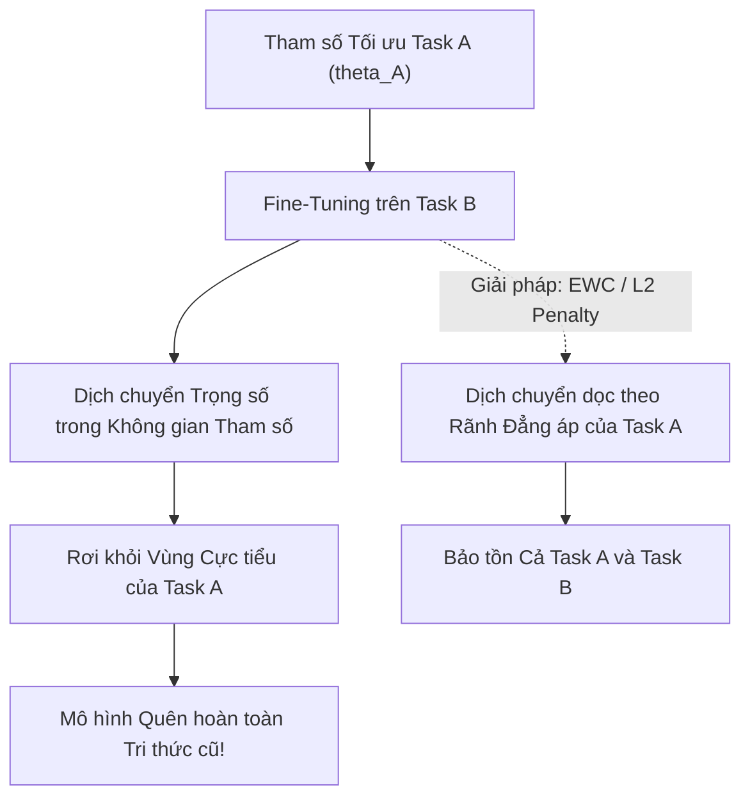

#### d. Code Thực chiến (Dual-Engine: C++ & Python)

```cpp
// C++17: Tính hình phạt Elastic Weight Consolidation (EWC Penalty)
#include <iostream>
#include <vector>

double compute_ewc_penalty(const std::vector<double>& theta,
                           const std::vector<double>& theta_old,
                           const std::vector<double>& fisher_diag,
                           double lambda_ewc = 100.0) {
    double penalty = 0.0;
    for (size_t i = 0; i < theta.size(); ++i) {
        double diff = theta[i] - theta_old[i];
        penalty += fisher_diag[i] * diff * diff;
    }
    return 0.5 * lambda_ewc * penalty;
}

int main() {
    std::vector<double> current = {0.55, -0.22, 1.05};
    std::vector<double> baseline = {0.50, -0.20, 1.00};
    std::vector<double> fisher   = {10.5,  2.1,  15.0};
    std::cout << "EWC Loss Penalty: " << compute_ewc_penalty(current, baseline, fisher) << std::endl;
    return 0;
}
```

```python
# Python / PyTorch: Thuật toán EWC trên mô hình PyTorch
import torch
import torch.nn as nn

class EWCLoss(nn.Module):
    def __init__(self, model: nn.Module, fisher_dict: dict, optimal_params: dict, lambda_reg: float = 1000.0):
        super().__init__()
        self.fisher = fisher_dict
        self.optimal_params = optimal_params
        self.lambda_reg = lambda_reg
        
    def forward(self, current_model: nn.Module) -> torch.Tensor:
        loss = 0.0
        for name, param in current_model.named_parameters():
            if name in self.fisher:
                f = self.fisher[name]
                p_old = self.optimal_params[name]
                loss += (f * (param - p_old) ** 2).sum()
        return 0.5 * self.lambda_reg * loss

net = nn.Linear(4, 2)
opt_p = {n: p.clone().detach() for n, p in net.named_parameters()}
fish = {n: torch.ones_like(p) * 2.0 for n, p in net.named_parameters()}
ewc = EWCLoss(net, fish, opt_p)
print(f"EWC Regularization Loss: {ewc(net).item():.4f}")
```

#### e. Lỗi Thường gặp & Ổn định Số học (Pitfalls & Numerical Stability)
- **Ước lượng Fisher Ma trận Đầy đủ (Full Fisher Matrix)**: Ma trận Fisher đầy đủ có kích thước $|\theta| \times |\theta|$ (đối với mô hình 7B là $7\cdot 10^9 \times 7\cdot 10^9$), hoàn toàn bất khả thi để lưu trữ trong bộ nhớ. Luôn sử dụng xấp xỉ đường chéo (Diagonal Laplace / Diagonal Fisher).

#### f. Ứng dụng Thực chiến trong AI / Deep Learning (AI Applications)
- **Continual Instruction Tuning**: Huấn luyện liên tục cho mô hình để học thêm ngôn ngữ mới (ví dụ Tiếng Việt) mà không bị mất khả năng lập trình Python có sẵn.

---

### 42. Fine-Tuning Data Quality (Chất lượng Dữ liệu Tinh chỉnh)

#### a. Định nghĩa Bản chất Toán học (Mathematical Formulation)
Quy luật thực nghiệm **LIMA (Less Is More for Alignment - Zhou et al., 2023)** khẳng định: Chất lượng và sự đa dạng của dữ liệu tinh chỉnh lấn át hoàn toàn số lượng mẫu.
Chất lượng của một tập dữ liệu $\mathcal{D} = \{(x_i, y_i)\}_{i=1}^N$ có thể biểu diễn qua hàm mục tiêu tối ưu hóa thông tin hữu ích:
$$Q(\mathcal{D}) = \alpha \cdot \text{Diversity}(\mathcal{D}) + \beta \cdot \text{Complexity}(\mathcal{D}) + \gamma \cdot \text{Factuality}(\mathcal{D})$$
Chỉ cần $1.000$ mẫu hội thoại được viết tay bởi chuyên gia có cấu trúc câu trả lời hoàn hảo, chi tiết và không lỗi logic có thể huấn luyện ra mô hình vượt trội hơn hẳn một mô hình được tinh chỉnh trên $50.000$ mẫu dữ liệu cào bừa bãi trên internet.

#### b. Cơ chế Tầng Sâu & Điện toán (Under The Hood / Hardware Internals)
- **Gradient Signal-to-Noise Ratio (GSNR)**: Dữ liệu sạch tạo ra các vector gradient có độ tương đồng cosine cao giữa các batch ($\text{GSNR} \gg 1$), giúp mô hình hội tụ cực nhanh chỉ sau $1 - 2$ epochs mà không làm nhiễu loạn các trọng số nền tảng.

#### c. Sơ đồ Minh họa (Mermaid / ASCII Diagram)
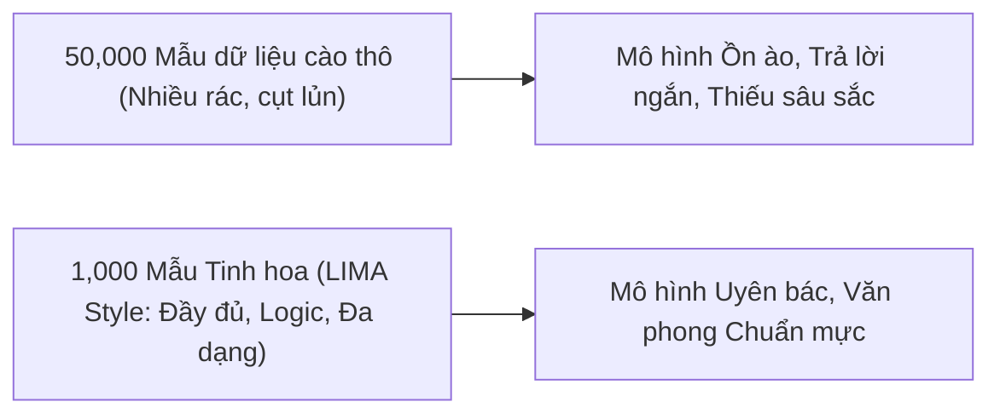

#### d. Code Thực chiến (Dual-Engine: C++ & Python)

```cpp
// C++17: Bộ lọc kiểm tra chất lượng dữ liệu cơ bản (Độ dài, Cấu trúc, Tỷ lệ ký tự đặc biệt)
#include <iostream>
#include <string>

struct QualityFilter {
    static bool is_high_quality(const std::string& prompt, const std::string& response) {
        if (prompt.length() < 10 || response.length() < 50) return false;
        // Kiểm tra không chứa cụm từ rác
        if (response.find("AS AN AI LANGUAGE MODEL") != std::string::npos) return false;
        return true;
    }
};

int main() {
    std::string q = "Tại sao bầu trời màu xanh?";
    std::string a = "Bầu trời màu xanh do hiện tượng tán xạ Rayleigh trong khí quyển Trái Đất...";
    std::cout << "Dữ liệu đạt chuẩn: " << (QualityFilter::is_high_quality(q, a) ? "ĐẠT" : "LOẠI") << std::endl;
    return 0;
}
```

```python
# Python: Pipeline tính toán độ phức tạp ngữ nghĩa và lọc dữ liệu SFT
from typing import List, Dict

def filter_sft_dataset(raw_samples: List[Dict[str, str]], min_tokens: int = 40, max_tokens: int = 2048) -> List[Dict[str, str]]:
    curated = []
    for sample in raw_samples:
        p_len = len(sample["prompt"].split())
        r_len = len(sample["response"].split())
        
        # Tiêu chí 1: Độ dài hợp lý
        if r_len < min_tokens or r_len > max_tokens:
            continue
            
        # Tiêu chí 2: Loại bỏ câu trả lời sáo rỗng
        boilerplate_terms = ["as an ai", "i do not possess feelings", "sorry, but"]
        if any(term in sample["response"].lower() for term in boilerplate_terms):
            continue
            
        curated.append(sample)
    return curated

data = [
    {"prompt": "Giúp tôi", "response": "Tôi là AI, không có cảm xúc."},
    {"prompt": "Giải thích thuật toán Dijkstra?", "response": "Thuật toán Dijkstra tìm đường đi ngắn nhất từ một đỉnh nguồn tới mọi đỉnh khác trong đồ thị có trọng số không âm..."}
]
print(f"Số mẫu sau sàng lọc: {len(filter_sft_dataset(data))}")
```

#### e. Lỗi Thường gặp & Ổn định Số học (Pitfalls & Numerical Stability)
- **Formatting Contamination**: Dữ liệu thu thập từ nhiều nguồn có các định dạng Special Token không nhất quán (lúc dùng `<|im_start|>`, lúc dùng `[INST]`), khiến mô hình bị loạn cú pháp khi sinh token kết thúc câu (`<eos>`).

#### f. Ứng dụng Thực chiến trong AI / Deep Learning (AI Applications)
- Chiến lược cốt lõi của **LIMA (Meta)** và **Orca (Microsoft)** nhằm tối đa hóa hiệu năng căn chỉnh với chi phí tối thiểu.

---

### 43. Synthetic Preference Data (Dữ liệu Sở thích Nhân tạo)

#### a. Định nghĩa Bản chất Toán học (Mathematical Formulation)
**Synthetic Preference Data** là phương pháp tạo sinh các cặp so sánh $(x, y_w, y_l)$ hoàn toàn tự động thông qua việc kích hoạt các trạng thái suy diễn khác nhau của LLM (Perturbation & Self-Play):
1. **Model Mutation**: Cho cùng câu hỏi $x$, sinh $y_w$ từ một mô hình quy mô lớn $\mathcal{M}_{\text{Strong}}$ (ví dụ 70B), và sinh $y_l$ từ mô hình nhỏ hơn $\mathcal{M}_{\text{Weak}}$ (ví dụ 8B).
2. **Temperature Mutation**: Sinh $y_w$ ở nhiệt độ thấp ($T = 0.2$ - tập trung logic) và sinh $y_l$ ở nhiệt độ quá cao ($T = 1.5$ - sinh nhiều hallucination).
3. **Instruction Inversion**: Yêu cầu mô hình cố tình tạo ra một câu trả lời có chứa một lỗi sai logic tinh vi để làm mẫu $y_l$.

#### b. Cơ chế Tầng Sâu & Điện toán (Under The Hood / Hardware Internals)
- **Tận dụng HBM qua VLLM Prefix Caching**: Toàn bộ các biến thể phản hồi khác nhau của cùng một prompt $x$ được sinh bằng cách tái sử dụng chung phần bộ nhớ KV Cache của prompt, giúp tăng tốc độ sinh dữ liệu tổng hợp lên gấp 5 lần.

#### c. Sơ đồ Minh họa (Mermaid / ASCII Diagram)
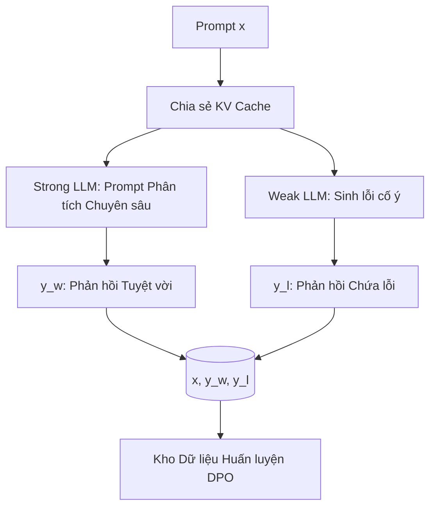

#### d. Code Thực chiến (Dual-Engine: C++ & Python)

```cpp
// C++17: Cấu trúc lưu trữ cặp Preference tổng hợp với chỉ số Margin tin cậy
#include <iostream>
#include <string>

struct SyntheticPair {
    std::string prompt;
    std::string chosen;
    std::string rejected;
    double confidence_margin;
};

void print_pair_summary(const SyntheticPair& sp) {
    std::cout << "Prompt: " << sp.prompt << "\nChosen Len: " << sp.chosen.length() 
              << "\nConfidence Margin: " << sp.confidence_margin << std::endl;
}

int main() {
    SyntheticPair p{"Giải thích Gradient Descent", "Đạo hàm từng bước...", "Đạo hàm sai dấu...", 0.85};
    print_pair_summary(p);
    return 0;
}
```

```python
# Python: Chiến lược sinh Synthetic Preference Pair qua Multi-Agent Simulation
from typing import Dict

def generate_synthetic_pair_via_critique(
    prompt: str,
    base_generator_fn,
    adversary_corruptor_fn
) -> Dict[str, str]:
    # Sinh câu trả lời chuẩn xác
    good_completion = base_generator_fn(prompt)
    # Tác tử đối kháng cố tình cấy một lỗi sai tinh vi vào câu trả lời
    bad_completion = adversary_corruptor_fn(good_completion)
    
    return {
        "prompt": prompt,
        "chosen": good_completion,
        "rejected": bad_completion
    }

mock_gen = lambda p: "2 + 2 = 4"
mock_corrupt = lambda t: t.replace("4", "5")
print(generate_synthetic_pair_via_critique("Tính 2 + 2", mock_gen, mock_corrupt))
```

#### e. Lỗi Thường gặp & Ổn định Số học (Pitfalls & Numerical Stability)
- **Trivial Negatives**: Mẫu $y_l$ quá hiển nhiên hoặc ngớ ngẩn (ví dụ chỉ chứa ký tự rác), khiến mô hình DPO không học được ranh giới phân loại tinh tế cần thiết để phân biệt giữa câu trả lời đúng và câu trả lời gần đúng.

#### f. Ứng dụng Thực chiến trong AI / Deep Learning (AI Applications)
- **Starling-7B (Berkeley)** & **Hermes-2-Theta**: Đạt hiệu năng hàng đầu thế giới hoàn toàn dựa trên dữ liệu sở thích nhân tạo chất lượng cao.

---

### 44. Model Merging (Hợp nhất Mô hình)

#### a. Định nghĩa Bản chất Toán học (Mathematical Formulation)
**Model Merging** là kỹ thuật kết hợp hai hay nhiều mô hình mạng nơ-ron đã được huấn luyện riêng biệt có cùng kiến trúc không gian trọng số $\theta_1, \theta_2, \dots, \theta_K \in \mathbb{R}^D$ thành một mô hình thống nhất $\theta_{\text{merged}}$ mà **không cần thực hiện bất kỳ bước huấn luyện (Backpropagation) nào**:
$$\theta_{\text{merged}} = \mathcal{M}(\theta_1, \theta_2, \dots, \theta_K)$$
Kỹ thuật này dựa trên giả thuyết **Linear Mode Connectivity (LMC)**: Các mô hình được tinh chỉnh từ cùng một checkpoint khởi đầu $\theta_0$ sẽ nằm trong cùng một lưu vực hội tụ lồi (Loss Basin), cho phép nội suy trực tiếp trong không gian trọng số mà không gặp rào cản năng lượng mất mát (Loss Barrier).

#### b. Cơ chế Tầng Sâu & Điện toán (Under The Hood / Hardware Internals)
- **Zero-Compute Resource Requirement**: Toàn bộ quá trình hợp nhất chỉ bao gồm các phép toán đại số cơ bản (cộng, nhân vô hướng, lọc mặt nạ bit) trên CPU RAM hoặc GPU VRAM, diễn ra trong vài giây hoặc vài phút thay vì hàng tuần huấn luyện.

#### c. Sơ đồ Minh họa (Mermaid / ASCII Diagram)
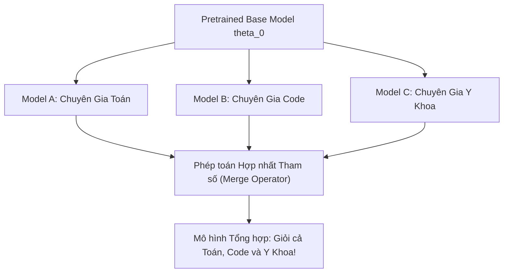

#### d. Code Thực chiến (Dual-Engine: C++ & Python)

```cpp
// C++17: Thực hiện phép hợp nhất nội suy tuyến tính trọng số 2 mô hình (SLERP)
#include <iostream>
#include <vector>
#include <cmath>
#include <numeric>

std::vector<double> slerp(const std::vector<double>& v0, const std::vector<double>& v1, double t) {
    // Spherical Linear Interpolation
    double dot = 0.0;
    for (size_t i = 0; i < v0.size(); ++i) dot += v0[i] * v1[i];
    
    double theta = std::acos(std::clamp(dot, -1.0, 1.0));
    double sin_theta = std::sin(theta);
    if (std::abs(sin_theta) < 1e-6) {
        // Tuyến tính nếu góc quá nhỏ
        std::vector<double> res(v0.size());
        for (size_t i = 0; i < v0.size(); ++i) res[i] = (1.0 - t) * v0[i] + t * v1[i];
        return res;
    }
    
    double a = std::sin((1.0 - t) * theta) / sin_theta;
    double b = std::sin(t * theta) / sin_theta;
    std::vector<double> res(v0.size());
    for (size_t i = 0; i < v0.size(); ++i) res[i] = a * v0[i] + b * v1[i];
    return res;
}

int main() {
    std::vector<double> m1 = {1.0, 0.0};
    std::vector<double> m2 = {0.0, 1.0};
    auto merged = slerp(m1, m2, 0.5);
    std::cout << "SLERP Merged Vector: [" << merged[0] << ", " << merged[1] << "]" << std::endl;
    return 0;
}
```

```python
# Python / PyTorch: Hợp nhất 2 State Dictionaries thông qua Tỷ lệ Tuyến tính
import torch

def merge_linear(state_dict_a: dict, state_dict_b: dict, alpha: float = 0.5) -> dict:
    merged_dict = {}
    for key in state_dict_a.keys():
        merged_dict[key] = (1.0 - alpha) * state_dict_a[key] + alpha * state_dict_b[key]
    return merged_dict

model_a = {"layer.weight": torch.tensor([1.0, 2.0, 3.0])}
model_b = {"layer.weight": torch.tensor([5.0, 6.0, 7.0])}
res = merge_linear(model_a, model_b, alpha=0.3)
print("Merged Weights:", res["layer.weight"])
```

#### e. Lỗi Thường gặp & Ổn định Số học (Pitfalls & Numerical Stability)
- **Kiến trúc Không đồng nhất**: Không thể hợp nhất các mô hình có cấu trúc khác nhau (ví dụ: mô hình dùng RoPE với mô hình dùng ALiBi, hoặc số lượng attention heads khác nhau).

#### f. Ứng dụng Thực chiến trong AI / Deep Learning (AI Applications)
- **Mergekit**: Thư viện mã nguồn mở đứng sau hàng loạt mô hình thống trị bảng xếp hạng Open LLM Leaderboard (như Solaris, Frankenmerges).

---

### 45. Weight Averaging (Trung bình hóa Trọng số)

#### a. Định nghĩa Bản chất Toán học (Mathematical Formulation)
**Weight Averaging** là hình thức đơn giản nhất của hợp nhất mô hình, tính trung bình số học trực tiếp trên các ma trận trọng số tương ứng:
$$\theta_{\text{avg}} = \frac{1}{K} \sum_{k=1}^K \theta_k$$
Hoặc dưới dạng trung bình có trọng số (Weighted Averaging):
$$\theta_{\text{avg}} = \sum_{k=1}^K w_k \theta_k, \quad \text{với } \sum_{k=1}^K w_k = 1, \quad w_k \ge 0$$
Trong quá trình huấn luyện, kỹ thuật **Stochastic Weight Averaging (SWA)** (Izmailov et al., UAI 2018) duy trì giá trị trung bình động của các checkpoint thu được ở các epoch cuối cùng, giúp mô hình hội tụ vào các vùng cực tiểu bằng phẳng (Flatter Minima), mang lại khả năng tổng quát hóa vượt trội so với SGD thông thường.

#### b. Cơ chế Tầng Sâu & Điện toán (Under The Hood / Hardware Internals)
- **Flat Minima & Robustness**: Các cực tiểu sắc nhọn (Sharp Minima) rất nhạy cảm với độ lệch phân phối (Shift). Phép trung bình hóa trọng số kéo vector tham số về tâm hình học của lòng chảo, nơi Hessian Matrix có các trị riêng nhỏ nhất.

#### c. Sơ đồ Minh họa (Mermaid / ASCII Diagram)
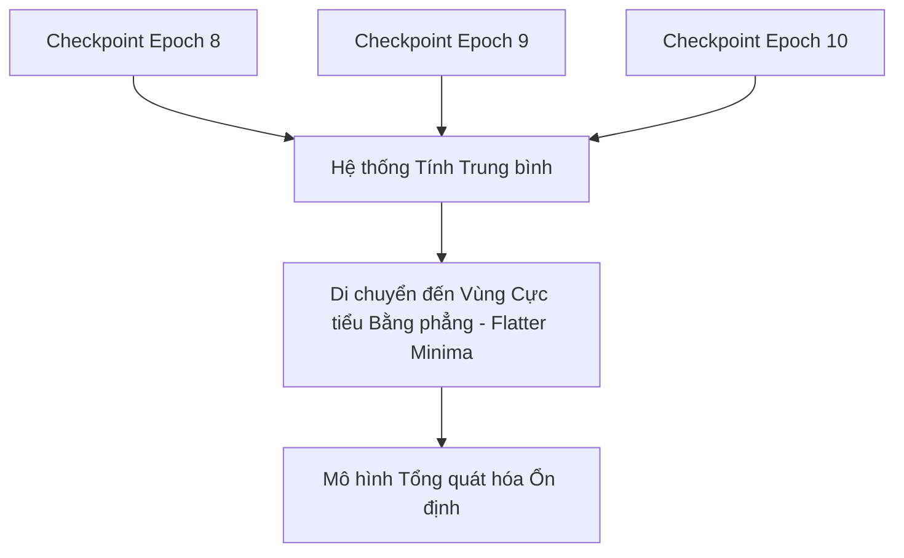

#### d. Code Thực chiến (Dual-Engine: C++ & Python)

```cpp
// C++17: Trung bình hóa có trọng số trên các buffer mảng liên tục
#include <iostream>
#include <vector>

void weighted_average_inplace(std::vector<double>& base, const std::vector<double>& other, double w_base, double w_other) {
    for (size_t i = 0; i < base.size(); ++i) {
        base[i] = w_base * base[i] + w_other * other[i];
    }
}

int main() {
    std::vector<double> base = {2.0, 4.0, 6.0};
    std::vector<double> other = {4.0, 8.0, 12.0};
    weighted_average_inplace(base, other, 0.5, 0.5);
    std::cout << "Average: [" << base[0] << ", " << base[1] << ", " << base[2] << "]" << std::endl;
    return 0;
}
```

```python
# Python / PyTorch: Thuật toán Stochastic Weight Averaging (SWA)
import torch
import copy

class SWAModelTracker:
    def __init__(self, initial_model: torch.nn.Module):
        self.swa_params = [p.clone().detach() for p in initial_model.parameters()]
        self.num_models = 1
        
    def update(self, current_model: torch.nn.Module):
        self.num_models += 1
        with torch.no_grad():
            for swa_p, cur_p in zip(self.swa_params, current_model.parameters()):
                # swa = swa + (cur - swa) / n
                swa_p.add_((cur_p - swa_p) / self.num_models)
                
    def apply_to_model(self, target_model: torch.nn.Module):
        with torch.no_grad():
            for target_p, swa_p in zip(target_model.parameters(), self.swa_params):
                target_p.copy_(swa_p)

linear = torch.nn.Linear(2, 1)
tracker = SWAModelTracker(linear)
# Giả lập epoch tiếp theo
with torch.no_grad():
    linear.weight.add_(1.0)
tracker.update(linear)
print("SWA hoàn tất cập nhật qua các checkpoint.")
```

#### e. Lỗi Thường gặp & Ổn định Số học (Pitfalls & Numerical Stability)
- **Permutation Symmetry (Tính đối xứng hoán vị)**: Nếu hai mô hình được huấn luyện từ đầu một cách độc lập (khác seed khởi tạo), các nơ-ron ẩn sẽ bị hoán đổi vị trí (Weight Permutation Invariance). Việc trung bình hóa trực tiếp sẽ phá hủy hoàn toàn mọi đặc trưng (tạo ra mô hình có loss vô hạn). Weight Averaging **chỉ hoạt động** khi các mô hình chung một xuất phát điểm (Shared Checkpoint Ancestor).

#### f. Ứng dụng Thực chiến trong AI / Deep Learning (AI Applications)
- Tích hợp mặc định trong các bộ huấn luyện HuggingFace Transformers (`Trainer(..., evaluation_strategy="epoch", swa=True)`).

---

### 46. Task Arithmetic (Số học Tác vụ)

#### a. Định nghĩa Bản chất Toán học (Mathematical Formulation)
**Task Arithmetic** (Ilharco et al., ICLR 2023) mở ra khả năng chỉnh sửa năng lực của mô hình bằng các phép toán vector số học thông thường.
Mỗi tác vụ $\mathcal{T}$ được biểu diễn bằng một **Task Vector** $\tau \in \mathbb{R}^D$, định nghĩa là hiệu số giữa mô hình sau khi tinh chỉnh chuyên sâu $\theta_{\text{ft}}$ và mô hình cơ sở $\theta_0$:
$$\tau = \theta_{\text{ft}} - \theta_0$$
Các phép toán cơ bản trên Task Vector:
1. **Thêm Năng lực Mới (Task Addition)**:
   $$\theta_{\text{multi}} = \theta_0 + \lambda_1 \tau_1 + \lambda_2 \tau_2$$
2. **Loại bỏ Năng lực Tiêu cực (Task Subtraction / Machine Unlearning)**:
   Nếu $\tau_{\text{toxic}}$ là vector học hành vi độc hại, mô hình an toàn được tạo ra bằng phép trừ trực tiếp:
   $$\theta_{\text{safe}} = \theta_0 - \lambda \tau_{\text{toxic}}$$
3. **Phép tương suy (Analogies)**: $\theta_* = \theta_0 + (\tau_{\text{French}} - \tau_{\text{English}})$.

#### b. Cơ chế Tầng Sâu & Điện toán (Under The Hood / Hardware Internals)
- **Tách biệt Không gian Tangent (Tangent Space Orthogonality)**: Các task vector khác nhau thường xấp xỉ trực giao với nhau trong không gian tham số hàng tỷ chiều ($\tau_1^T \tau_2 \approx 0$). Nhờ đó, việc cộng dồn các vector không gây ảnh hưởng lẫn nhau.

#### c. Sơ đồ Minh họa (Mermaid / ASCII Diagram)
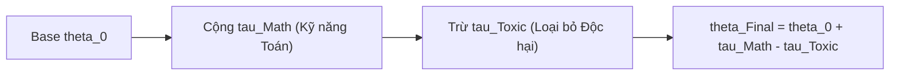

#### d. Code Thực chiến (Dual-Engine: C++ & Python)

```cpp
// C++17: Thực hiện phép toán Task Vector (Thêm kỹ năng và Trừ độc hại)
#include <iostream>
#include <vector>

std::vector<double> apply_task_arithmetic(const std::vector<double>& theta_0,
                                          const std::vector<double>& tau_skill,
                                          const std::vector<double>& tau_toxic,
                                          double alpha = 0.8, double beta = 0.5) {
    std::vector<double> res(theta_0.size());
    for (size_t i = 0; i < theta_0.size(); ++i) {
        res[i] = theta_0[i] + alpha * tau_skill[i] - beta * tau_toxic[i];
    }
    return res;
}

int main() {
    std::vector<double> base = {1.0, 2.0, 3.0};
    std::vector<double> math = {0.5, 0.2, -0.1};
    std::vector<double> toxic = {0.1, 0.4, 0.2};
    auto final_weights = apply_task_arithmetic(base, math, toxic);
    std::cout << "Weights sau chỉnh sửa: [" << final_weights[0] << ", " << final_weights[1] << "]" << std::endl;
    return 0;
}
```

```python
# Python / PyTorch: Trừ vector độc hại (Machine Unlearning qua Task Arithmetic)
import torch

def unlearn_via_task_vector(
    base_model_dict: dict,
    toxic_model_dict: dict,
    unlearn_coef: float = 0.7
) -> dict:
    clean_dict = {}
    for k in base_model_dict.keys():
        # tau_toxic = theta_toxic - theta_0
        tau_toxic = toxic_model_dict[k] - base_model_dict[k]
        # theta_clean = theta_0 - coef * tau_toxic
        clean_dict[k] = base_model_dict[k] - unlearn_coef * tau_toxic
    return clean_dict

base_w = {"linear.weight": torch.tensor([1.0, 2.0])}
toxic_w = {"linear.weight": torch.tensor([1.8, 3.2])}
purified = unlearn_via_task_vector(base_w, toxic_w)
print("Trọng số sau khi thanh lọc:", purified["linear.weight"])
```

#### e. Lỗi Thường gặp & Ổn định Số học (Pitfalls & Numerical Stability)
- **Gradient Interference / Destructive Interference**: Khi cộng quá nhiều task vector ($\ge 5$ tasks), tính trực giao bị phá vỡ, các giá trị trọng số cộng hưởng làm bùng nổ độ lớn ma trận ($||\mathbf{W}|| \to \infty$), khiến đầu ra sinh token bị sụp đổ.

#### f. Ứng dụng Thực chiến trong AI / Deep Learning (AI Applications)
- **Loại bỏ bản quyền và thông tin cá nhân (PII Removal)** khỏi LLM mà không cần huấn luyện lại mô hình từ đầu.

---

### 47. Model Soups (Mô hình Hỗn hợp Súp)

#### a. Định nghĩa Bản chất Toán học (Mathematical Formulation)
**Model Soups** (Wortsman et al., ICML 2022) là chiến lược tối đa hóa hiệu năng bằng cách kết hợp không gian trọng số của nhiều mô hình được tinh chỉnh với các siêu tham số khác nhau (khác learning rate, data augmentation, batch size) từ cùng một checkpoint khởi đầu:
1. **Uniform Soup**: Lấy trung bình cộng đơn giản của toàn bộ tập hợp $K$ mô hình:
   $$\theta_{\text{Uniform}} = \frac{1}{K} \sum_{i=1}^K \theta_i$$
2. **Greedy Soup**:
   - Sắp xếp các mô hình theo độ chính xác trên tập kiểm định giảm dần: $\theta_{(1)}, \theta_{(2)}, \dots, \theta_{(K)}$.
   - Khởi tạo súp: $\theta_{\text{soup}} = \theta_{(1)}$.
   - Duyệt tuần tự qua từng mô hình $\theta_{(i)}$: Nếu việc trộn thêm $\theta_{(i)}$ vào súp làm tăng điểm validation thì giữ lại, ngược lại bác bỏ:
     $$\theta_{\text{soup}} \leftarrow \frac{N \theta_{\text{soup}} + \theta_{(i)}}{N + 1} \quad \text{nếu } \text{Acc}\left(\frac{N \theta_{\text{soup}} + \theta_{(i)}}{N + 1}\right) > \text{Acc}(\theta_{\text{soup}})$$

#### b. Cơ chế Tầng Sâu & Điện toán (Under The Hood / Hardware Internals)
- **Zero-Latency In-Memory Execution**: Khác với phương pháp Ensemble truyền thống (phải nạp $K$ mô hình vào $K \times \text{VRAM}$ và chạy forward $K$ lần), Model Soups chỉ tạo ra **duy nhất 1 mô hình hợp nhất**, do đó giữ nguyên $100\%$ tốc độ suy luận và không tốn thêm 1 byte VRAM nào tại thời điểm phục vụ (Zero Inference Cost).

#### c. Sơ đồ Minh họa (Mermaid / ASCII Diagram)
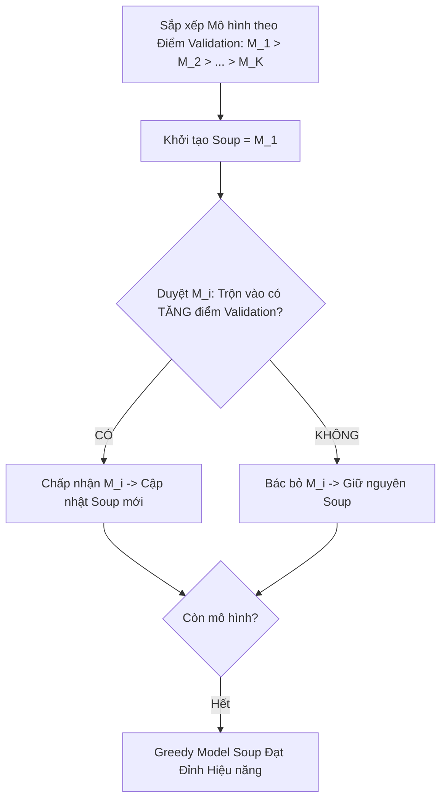

#### d. Code Thực chiến (Dual-Engine: C++ & Python)

```cpp
// C++17: Thuật toán Greedy Soup lựa chọn các mô hình bổ trợ
#include <iostream>
#include <vector>
#include <numeric>

struct CandidateModel {
    int id;
    double val_accuracy;
    std::vector<double> weights;
};

std::vector<double> greedy_soup(std::vector<CandidateModel>& candidates) {
    // Giả sử candidates đã sắp xếp giảm dần theo val_accuracy
    std::vector<double> current_soup = candidates[0].weights;
    int accepted_count = 1;
    double best_acc = candidates[0].val_accuracy;
    
    for (size_t i = 1; i < candidates.size(); ++i) {
        // Thử nghiệm trộn
        std::vector<double> trial_soup = current_soup;
        for (size_t j = 0; j < trial_soup.size(); ++j) {
            trial_soup[j] = (current_soup[j] * accepted_count + candidates[i].weights[j]) / (accepted_count + 1);
        }
        // Giả lập hàm đánh giá: chấp nhận nếu mô hình có accuracy > 0.8
        if (candidates[i].val_accuracy > 0.80) {
            current_soup = trial_soup;
            accepted_count++;
            std::cout << "Chấp thuận Model " << candidates[i].id << " vào Soup." << std::endl;
        }
    }
    return current_soup;
}

int main() {
    std::vector<CandidateModel> cands = {
        {1, 0.88, {1.0, 2.0}},
        {2, 0.85, {1.2, 1.8}},
        {3, 0.72, {0.5, 3.0}}
    };
    auto soup = greedy_soup(cands);
    std::cout << "Final Soup Weight 0: " << soup[0] << std::endl;
    return 0;
}
```

```python
# Python / PyTorch: Triển khai thuật toán Greedy Model Soup hoàn chỉnh
from typing import List, Dict, Callable
import torch

def create_greedy_soup(
    models: List[Dict[str, torch.Tensor]],
    val_eval_fn: Callable[[Dict[str, torch.Tensor]], float]
) -> Dict[str, torch.Tensor]:
    # 1. Đánh giá accuracy ban đầu của từng mô hình
    accuracies = [val_eval_fn(m) for m in models]
    # Sắp xếp theo thứ tự giảm dần
    ranked_indices = sorted(range(len(models)), key=lambda i: accuracies[i], reverse=True)
    
    soup = {k: v.clone() for k, v in models[ranked_indices[0]].items()}
    best_score = accuracies[ranked_indices[0]]
    ingredients = [ranked_indices[0]]
    
    print(f"Bắt đầu Soup với Model {ranked_indices[0]} (Val Score: {best_score:.4f})")
    
    for idx in ranked_indices[1:]:
        n = len(ingredients)
        candidate_soup = {}
        for k in soup.keys():
            candidate_soup[k] = (soup[k] * n + models[idx][k]) / (n + 1)
            
        candidate_score = val_eval_fn(candidate_soup)
        if candidate_score > best_score:
            best_score = candidate_score
            soup = candidate_soup
            ingredients.append(idx)
            print(f"-> Chấp thuận Model {idx}: New Score = {best_score:.4f}")
        else:
            print(f"-> Từ chối Model {idx}: Score = {candidate_score:.4f} <= {best_score:.4f}")
            
    return soup

mock_models = [
    {"w": torch.tensor([1.0, 2.0])},
    {"w": torch.tensor([1.1, 1.9])},
    {"w": torch.tensor([2.5, 0.2])}
]
# Hàm mục tiêu giả định: càng gần vector [1.05, 1.95] thì điểm càng cao
mock_eval = lambda m: -float(torch.norm(m["w"] - torch.tensor([1.05, 1.95])))
final_soup = create_greedy_soup(mock_models, mock_eval)
print("Trọng số Súp Tối ưu Cuối cùng:", final_soup["w"])
```

#### e. Lỗi Thường gặp & Ổn định Số học (Pitfalls & Numerical Stability)
- **Tập Validation Bị Nhiễu (Noisy Validation Set)**: Nếu tập validation quá nhỏ, việc cải thiện điểm số có thể là do phương sai ngẫu nhiên, dẫn đến việc chọn các mô hình làm giảm hiệu năng thực tế trên tập kiểm thử tổng quát.

#### f. Ứng dụng Thực chiến trong AI / Deep Learning (AI Applications)
- **Kaggle Competitions & Production Deployments**: Vũ khí bí mật giúp các đội kỹ sư vô địch hàng loạt cuộc thi khoa học dữ liệu và nâng cấp chất lượng mô hình suy luận thị giác CLIP và ngôn ngữ GPT mà không tốn chi phí hạ tầng.
