# Chuyên đề: Nền tảng Đánh giá Mô hình Ngôn ngữ & Các Thước đo Cổ điển (Evaluation Foundations & Classical Metrics)

## 1. Tổng quan Chuyên đề
Đo lường năng lực của một Mô hình Ngôn ngữ Lớn (LLM) là một bài toán khoa học phức tạp và đa chiều. Khác với các mô hình học máy truyền thống vốn có nhãn ground-truth cố định và không gian đầu ra hữu hạn, LLM tạo ra các chuỗi văn bản tự do với sự biến thiên vô tận về phong cách diễn đạt, cấu trúc ngữ pháp và chiều sâu tư duy.

Hệ thống đánh giá mô hình ngôn ngữ được xây dựng trên hai trụ cột:
1. **Nền tảng Phương pháp luận (Methodological Foundations)**: Phân định rạch ròi giữa **Intrinsic Evaluation** (đo lường chất lượng nội tại của phân phối ngôn ngữ qua Perplexity, Cross-Entropy) và **Extrinsic Evaluation** (đo lường hiệu năng của mô hình trên các tác vụ hạ nguồn cụ thể).
2. **Các Thước đo Cổ điển (Classical & Semantic Metrics)**: Từ các độ đo so khớp chuỗi n-gram chính xác như **Exact Match, Accuracy, F1 Score, BLEU, ROUGE, METEOR** cho tới các phương pháp đánh giá dựa trên không gian vector ngữ nghĩa như **BERTScore** và **Semantic Similarity**.

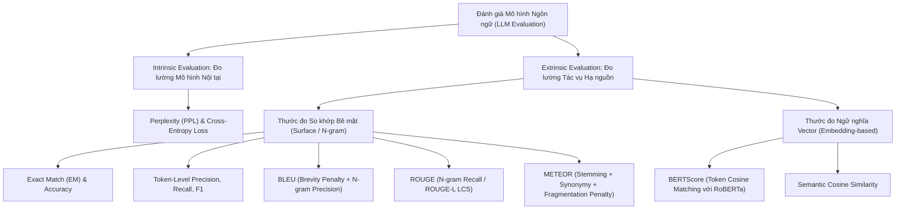

---

## 2. Chi tiết từng Keyword

---

### 1. Language Model Evaluation (Đánh giá Mô hình Ngôn ngữ)

#### a. Định nghĩa Bản chất Toán học (Mathematical Formulation)
**Language Model Evaluation** là quy trình định lượng hóa mức độ chính xác, an toàn, hiệu năng và tính nhất quán của một mô hình xác suất $\pi_\theta$ thông qua một tập toán tử đo lường $\mathcal{M} = \{m_1, m_2, \dots, m_K\}$ tác động trên tập dữ liệu thử nghiệm $\mathcal{D}_{\text{test}} = \{(x_i, y_i^*)\}_{i=1}^N$:
$$\text{Score}(\pi_\theta) = \frac{1}{N} \sum_{i=1}^N m\big(\hat{y}_i, y_i^*\big), \quad \text{với } \hat{y}_i \sim \pi_\theta(\cdot \mid x_i)$$
Một khung đánh giá khoa học phải bảo đảm tính toàn vẹn thông qua 3 thuộc tính:
1. **Tính hợp lệ (Validity)**: Thước đo phải phản ánh đúng năng lực cốt lõi cần đo lường.
2. **Tính tin cậy (Reliability)**: Kết quả phải có tính lặp lại (reproducible) khi thay đổi seed ngẫu nhiên hoặc hạ tầng máy chủ.
3. **Tính nhạy (Sensitivity)**: Thước đo phải có khả năng phân biệt được sự cải tiến nhỏ giữa các phiên bản mô hình khác nhau.

#### b. Cơ chế Tầng Sâu & Điện toán (Under The Hood / Hardware Internals)
- **Inference Harness Overheads**: Các hệ thống đánh giá hiện đại (như LM-Evaluation-Harness) thực thi đồng thời hàng chục ngàn prompts. Cơ chế quản lý bộ nhớ phải giải quyết xung đột phân mảnh GPU VRAM do độ dài prompt không đồng nhất, yêu cầu gom nhóm batch theo độ dài tương đồng (Bucketing / Length Sorting) để tối đa hóa hiệu năng Tensor Cores.

#### c. Sơ đồ Minh họa (Mermaid / ASCII Diagram)
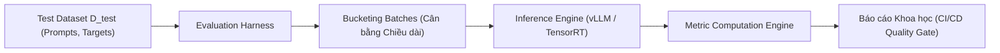

#### d. Code Thực chiến (Dual-Engine: C++ & Python)

```cpp
// C++17: Khung sườn cơ bản của một Evaluation Runner
#include <iostream>
#include <vector>
#include <string>
#include <numeric>

struct EvalResult {
    std::string test_id;
    double score;
};

double aggregate_scores(const std::vector<EvalResult>& results) {
    if (results.empty()) return 0.0;
    double sum = 0.0;
    for (const auto& r : results) sum += r.score;
    return sum / results.size();
}

int main() {
    std::vector<EvalResult> run = {{"task_1", 0.85}, {"task_2", 0.92}, {"task_3", 0.78}};
    std::cout << "Mean Evaluation Score: " << aggregate_scores(run) << std::endl;
    return 0;
}
```

```python
# Python: Khung đánh giá tổng quát mô hình ngôn ngữ
from typing import List, Dict, Callable
import numpy as np

class LMEvaluator:
    def __init__(self, metrics: Dict[str, Callable[[str, str], float]]):
        self.metrics = metrics
        
    def evaluate(self, predictions: List[str], references: List[str]) -> Dict[str, float]:
        results = {name: [] for name in self.metrics}
        for pred, ref in zip(predictions, references):
            for name, fn in self.metrics.items():
                results[name].append(fn(pred, ref))
        return {name: float(np.mean(scores)) for name, scores in results.items()}

# Thước đo minh họa
metrics_dict = {"char_length_ratio": lambda p, r: len(p) / max(len(r), 1)}
evaluator = LMEvaluator(metrics_dict)
print(evaluator.evaluate(["hello world"], ["hello world!"]))
```

#### e. Lỗi Thường gặp & Ổn định Số học (Pitfalls & Numerical Stability)
- **Prompt Sensitivity (Độ nhạy cú pháp prompt)**: Chỉ cần thay đổi dấu cách, xuống dòng hoặc từ ngữ dẫn dắt (ví dụ: *"Answer:"* so với *"The correct answer is:"*), điểm số của mô hình có thể biến thiên từ $5\% - 15\%$, dẫn đến kết luận sai lệch về năng lực mô hình.

#### f. Ứng dụng Thực chiến trong AI / Deep Learning (AI Applications)
- **Quality Gates trong CI/CD AI**: Ngăn chặn mô hình hồi quy (regression) trước khi đóng băng và triển khai bản cập nhật lên production.

---

### 2. Benchmarking (Thiết lập Chuẩn Đối sánh)

#### a. Định nghĩa Bản chất Toán học (Mathematical Formulation)
**Benchmarking** là việc chuẩn hóa quy trình so sánh nhiều mô hình ngôn ngữ khác nhau trên một tập hợp cố định các nhiệm vụ chuẩn hóa $\mathcal{T} = \{\tau_1, \tau_2, \dots, \tau_M\}$ dưới cùng một điều kiện kiểm thử nghiêm ngặt (Zero-Shot, Few-Shot, CoT):
$$\mathbf{S}_{M \times K} = \begin{bmatrix} s_{1, 1} & \cdots & s_{1, K} \\ \vdots & \ddots & \vdots \\ s_{M, 1} & \cdots & s_{M, K} \end{bmatrix}, \quad \text{với } s_{m, k} = \text{Score}(\text{Model}_k, \text{Task}_m)$$
Điểm số tổng hợp thường được chuẩn hóa Z-score hoặc tính trung bình hình học (Geometric Mean) để tránh việc một bài test có biên độ điểm lớn lấn át các bài test khác:
$$\text{AggregateScore}_k = \left( \prod_{m=1}^M s_{m, k} \right)^{\frac{1}{M}}$$

#### b. Cơ chế Tầng Sâu & Điện toán (Under The Hood / Hardware Internals)
- **Đồng bộ hóa Môi trường & Determinism**: Quá trình benchmark đòi hỏi kiểm soát chặt chẽ các yếu tố ngẫu nhiên phần cứng: cố định CUDA Seeds, tắt FlashAttention non-deterministic atomic operations, và thiết lập `temperature = 0.0` (Greedy Search) để bảo đảm hai lần chạy trên hai cụm GPU khác nhau cho ra kết quả khớp từng token.

#### c. Sơ đồ Minh họa (Mermaid / ASCII Diagram)
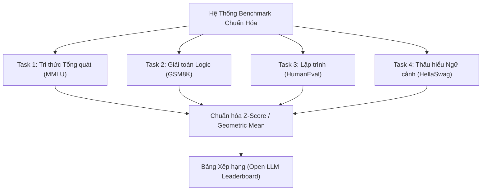

#### d. Code Thực chiến (Dual-Engine: C++ & Python)

```cpp
// C++17: Tính Geometric Mean để tổng hợp điểm số Benchmark đa nhiệm
#include <iostream>
#include <vector>
#include <cmath>

double compute_geometric_mean(const std::vector<double>& scores) {
    if (scores.empty()) return 0.0;
    double log_sum = 0.0;
    for (double s : scores) {
        log_sum += std::log(std::max(s, 1e-6));
    }
    return std::exp(log_sum / scores.size());
}

int main() {
    std::vector<double> benchmark_scores = {0.85, 0.72, 0.94, 0.65};
    std::cout << "Aggregate Geometric Score: " << compute_geometric_mean(benchmark_scores) << std::endl;
    return 0;
}
```

```python
# Python: Xây dựng Leaderboard tổng hợp điểm chuẩn hóa
import pandas as pd
import numpy as np

def compile_leaderboard(raw_scores: dict) -> pd.DataFrame:
    df = pd.DataFrame(raw_scores)
    # Tính Geometric Mean cho từng model
    df["Geometric_Mean"] = np.exp(np.log(df).mean(axis=1))
    df = df.sort_values(by="Geometric_Mean", ascending=False)
    return df

data = {
    "MMLU": [0.75, 0.82, 0.68],
    "GSM8K": [0.60, 0.78, 0.55],
    "HumanEval": [0.52, 0.65, 0.45]
}
lb = compile_leaderboard(data)
lb.index = ["Model_Alpha", "Model_Beta", "Model_Gamma"]
print(lb)
```

#### e. Lỗi Thường gặp & Ổn định Số học (Pitfalls & Numerical Stability)
- **Goodhart's Law & Leaderboard Overfitting**: Các nhóm nghiên cứu cố tình tối ưu hóa các siêu tham số chỉ để vượt qua một benchmark cụ thể mà làm hỏng khả năng tổng quát hóa thực tế của LLM.

#### f. Ứng dụng Thực chiến trong AI / Deep Learning (AI Applications)
- **HuggingFace Open LLM Leaderboard**: Tiêu chuẩn công nghiệp hàng đầu để so sánh sức mạnh các mô hình nguồn mở.

---

### 3. Intrinsic Evaluation (Đánh giá Nội tại)

#### a. Định nghĩa Bản chất Toán học (Mathematical Formulation)
**Intrinsic Evaluation** đo lường chất lượng của mô hình ngôn ngữ dựa trên khả năng học và mô hình hóa phân phối xác suất văn bản độc lập với bất kỳ ứng dụng hạ nguồn nào.
Đại lượng đo lường nền tảng là **Cross-Entropy Loss** của mô hình trên tập ngữ liệu kiểm định $\mathcal{D} = \{w_1, w_2, \dots, w_N\}$:
$$\mathcal{H}(P, \pi_\theta) = -\frac{1}{N} \sum_{i=1}^N \log \pi_\theta(w_i \mid w_{<i})$$
Mô hình có chất lượng nội tại càng cao khi Cross-Entropy càng thấp, đồng nghĩa với việc mô hình ít bị "bất ngờ" trước các cấu trúc ngôn ngữ thực tế.

#### b. Cơ chế Tầng Sâu & Điện toán (Under The Hood / Hardware Internals)
- **FlashAttention Cross-Entropy Fused Kernel**: Quá trình tính toán Intrinsic Loss đòi hỏi tính softmax trên toàn bộ Vocabulary ($V \sim 128.000$ tokens). Các thư viện tối ưu (như Flash-Cross-Entropy) tích hợp phép tính Softmax và Negative Log-Likelihood vào một CUDA kernel duy nhất trong GPU Shared Memory (SRAM), tránh ghi ma trận xác suất khổng lồ $[B \times S \times V]$ ra VRAM HBM.

#### c. Sơ đồ Minh họa (Mermaid / ASCII Diagram)
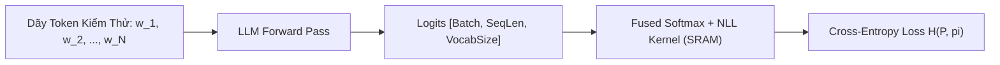

#### d. Code Thực chiến (Dual-Engine: C++ & Python)

```cpp
// C++17: Tính Intrinsic Cross-Entropy từ vector Log-Probabilities
#include <iostream>
#include <vector>
#include <numeric>

double compute_intrinsic_cross_entropy(const std::vector<double>& log_probs) {
    if (log_probs.empty()) return 0.0;
    double sum = std::accumulate(log_probs.begin(), log_probs.end(), 0.0);
    return -sum / log_probs.size();
}

int main() {
    std::vector<double> sample_log_probs = {-0.12, -0.45, -0.05, -0.89};
    std::cout << "Intrinsic Cross-Entropy: " << compute_intrinsic_cross_entropy(sample_log_probs) << " nats" << std::endl;
    return 0;
}
```

```python
# Python / PyTorch: Đo lường Intrinsic Cross-Entropy trên mô hình PyTorch
import torch
import torch.nn.functional as F

def evaluate_intrinsic_loss(model, input_ids: torch.Tensor) -> float:
    model.eval()
    with torch.no_grad():
        outputs = model(input_ids)
        logits = outputs.logits # [Batch, SeqLen, Vocab]
        
        # Shift để dự đoán next token
        shift_logits = logits[:, :-1, :].contiguous()
        shift_labels = input_ids[:, 1:].contiguous()
        
        loss = F.cross_entropy(
            shift_logits.view(-1, shift_logits.size(-1)),
            shift_labels.view(-1)
        )
    return loss.item()

print("Intrinsic Loss Function Defined.")
```

#### e. Lỗi Thường gặp & Ổn định Số học (Pitfalls & Numerical Stability)
- **Vocabulary Size Bias**: Hai mô hình sử dụng Tokenizer khác nhau (ví dụ: Vocab 32K so với Vocab 128K) không thể so sánh trực tiếp Intrinsic Loss theo token, mà bắt buộc phải chuẩn hóa theo đơn vị byte hoặc word (Bits-per-Byte).

#### f. Ứng dụng Thực chiến trong AI / Deep Learning (AI Applications)
- Giám sát độ ổn định và phát hiện hiện tượng Overfitting / Underfitting trong suốt chu kỳ Pretraining hàng triệu GPU hours.

---

### 4. Extrinsic Evaluation (Đánh giá Ngoại tại)

#### a. Định nghĩa Bản chất Toán học (Mathematical Formulation)
**Extrinsic Evaluation** đánh giá năng lực của LLM dựa trên mức độ thành công khi mô hình được triển khai vào các hệ thống và tác vụ thực tế trong thế giới thực (Downstream Tasks) như: Dịch máy, Tóm tắt văn bản, Rút trích thông tin hoặc Tác nhân tự trị (Agents).
Hàm mục tiêu ngoại tại đo lường lợi ích thực tiễn (Utility / Business Value):
$$V(\pi_\theta) = \mathbb{E}_{(x, y) \sim \mathcal{D}_{\text{real}}} \big[ \text{TaskUtility}(\pi_\theta(x), y) \big]$$
Khác với Intrinsic Evaluation (vốn mang tính lý thuyết xác suất), Extrinsic Evaluation phản ánh trực tiếp sự hài lòng của người dùng và hiệu quả kinh tế.

#### b. Cơ chế Tầng Sâu & Điện toán (Under The Hood / Hardware Internals)
- **End-to-End Latency & Pipeline Profiling**: Trong đánh giá ngoại tại, bên cạnh độ chính xác, các chỉ số phần cứng như **Time-To-First-Token (TTFT)**, **Inter-Token Latency (ITL)** và thông lượng Token/s/GPU đóng vai trò quyết định khả năng triển khai thực tế.

#### c. Sơ đồ Minh họa (Mermaid / ASCII Diagram)
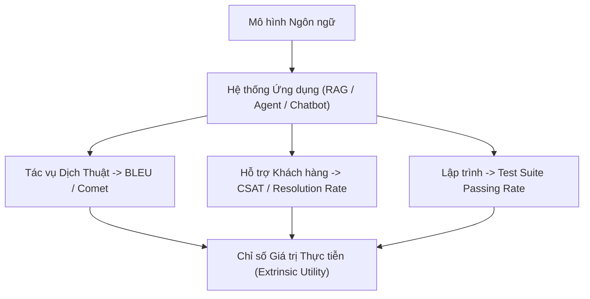

#### d. Code Thực chiến (Dual-Engine: C++ & Python)

```cpp
// C++17: Đo lường Extrinsic Resolution Rate của Agent hỗ trợ khách hàng
#include <iostream>
#include <vector>

struct CustomerTicket {
    int ticket_id;
    bool resolved_successfully;
    double execution_time_seconds;
};

double compute_resolution_rate(const std::vector<CustomerTicket>& tickets) {
    if (tickets.empty()) return 0.0;
    int success_count = 0;
    for (const auto& t : tickets) {
        if (t.resolved_successfully) success_count++;
    }
    return static_cast<double>(success_count) / tickets.size();
}

int main() {
    std::vector<CustomerTicket> run = {{1, true, 2.4}, {2, false, 5.1}, {3, true, 1.8}};
    std::cout << "Extrinsic Task Resolution Rate: " << compute_resolution_rate(run) * 100.0 << "%" << std::endl;
    return 0;
}
```

```python
# Python: Đánh giá Extrinsic cho tác vụ trích xuất thực thể có cấu trúc (JSON Schema Validation)
import json
from typing import List

def evaluate_json_extraction(predictions: List[str], expected_keys: set) -> float:
    valid_count = 0
    for pred in predictions:
        try:
            parsed = json.loads(pred)
            if expected_keys.issubset(parsed.keys()):
                valid_count += 1
        except json.JSONDecodeError:
            continue
    return valid_count / max(len(predictions), 1)

preds = ['{"name": "Alice", "age": 30}', '{"invalid_json": true', '{"name": "Bob"}']
acc = evaluate_json_extraction(preds, {"name", "age"})
print(f"Extrinsic Schema Accuracy: {acc * 100:.1f}%")
```

#### e. Lỗi Thường gặp & Ổn định Số học (Pitfalls & Numerical Stability)
- **High Cost & Slow Turnaround**: Đánh giá ngoại tại thường rất tốn kém tài nguyên và thời gian do phải thiết lập môi trường giả lập (sandbox, web browser, external APIs).

#### f. Ứng dụng Thực chiến trong AI / Deep Learning (AI Applications)
- Quyết định phê duyệt đưa trợ lý AI vào vận hành trong môi trường ngân hàng, y tế hoặc hỗ trợ kỹ thuật viên.

---

### 5. Perplexity - PPL (Độ Hỗn Loạn)

#### a. Định nghĩa Bản chất Toán học (Mathematical Formulation)
**Perplexity (PPL)** là hàm mũ của độ mất mát Cross-Entropy trung bình trên từng token, biểu thị số lượng lựa chọn tương đương khả dĩ mà mô hình đang phân vân tại mỗi bước dự đoán:
$$\text{PPL}(\mathcal{W}) = \exp\left( -\frac{1}{N} \sum_{i=1}^N \log \pi_\theta(w_i \mid w_{<i}) \right) = \sqrt[N]{\prod_{i=1}^N \frac{1}{\pi_\theta(w_i \mid w_{<i})}}$$
Nếu một mô hình có $\text{PPL} = 10$, điều đó có nghĩa là mức độ không chắc chắn của nó tương đương với việc tung một con xúc xắc 10 mặt đồng chất để chọn token tiếp theo. Giá trị PPL càng thấp, mô hình càng nắm bắt xuất sắc ngữ cảnh ngôn ngữ.

#### b. Cơ chế Tầng Sâu & Điện toán (Under The Hood / Hardware Internals)
- **Tránh Lỗi Tràn Số khi Lũy thừa**: Tích xác suất $\prod_{i=1}^N \pi_\theta(w_i)$ sẽ nhanh chóng tràn dưới số học (Underflow) về 0 chỉ sau vài chục token. Vì vậy, bắt buộc phải tính tổng trong miền Logarithm trước khi gọi hàm $\exp$:
  $$\text{PPL} = \exp\left( \frac{\sum_i \mathcal{L}_{\text{NLL}}(w_i)}{N} \right)$$

#### c. Sơ đồ Minh họa (Mermaid / ASCII Diagram)
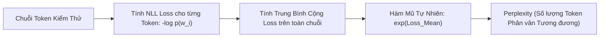

#### d. Code Thực chiến (Dual-Engine: C++ & Python)

```cpp
// C++17: Tính Perplexity từ tổng NLL Loss
#include <iostream>
#include <vector>
#include <cmath>

double compute_perplexity(const std::vector<double>& nll_losses) {
    if (nll_losses.empty()) return 0.0;
    double total_loss = 0.0;
    for (double l : nll_losses) total_loss += l;
    double mean_loss = total_loss / nll_losses.size();
    return std::exp(mean_loss);
}

int main() {
    std::vector<double> token_losses = {1.85, 2.10, 1.45, 1.90};
    std::cout << "Perplexity: " << compute_perplexity(token_losses) << std::endl;
    return 0;
}
```

```python
# Python / PyTorch: Tính Perplexity chuẩn cho một đoạn văn bản dài có chia khối (Stride Window)
import torch

def calculate_perplexity(model, encodings, max_length: int = 512, stride: int = 256) -> float:
    seq_len = encodings.input_ids.size(1)
    nlls = []
    
    for begin_loc in range(0, seq_len, stride):
        end_loc = min(begin_loc + max_length, seq_len)
        trg_len = end_loc - max(begin_loc, end_loc - stride)
        input_ids = encodings.input_ids[:, begin_loc:end_loc]
        target_ids = input_ids.clone()
        target_ids[:, :-trg_len] = -100 # Bỏ qua loss của phần context cũ
        
        with torch.no_grad():
            outputs = model(input_ids, labels=target_ids)
            neg_log_likelihood = outputs.loss * trg_len
            
        nlls.append(neg_log_likelihood)
        if end_loc == seq_len:
            break
            
    ppl = torch.exp(torch.stack(nlls).sum() / seq_len)
    return ppl.item()

print("Perplexity Sliding-Window Function Ready.")
```

#### e. Lỗi Thường gặp & Ổn định Số học (Pitfalls & Numerical Stability)
- **Tokenization Disparity**: Không bao giờ so sánh PPL giữa LLaMA (vocab 32K) và Gemma (vocab 256K). Gemma chia văn bản thành ít tokens hơn, khiến loss trung bình trên mỗi token cao hơn nhưng khả năng nén văn bản tổng thể có thể tốt hơn.

#### f. Ứng dụng Thực chiến trong AI / Deep Learning (AI Applications)
- Chỉ số then chốt để đánh giá năng lực ngôn ngữ của các mô hình nén ngôn ngữ (Language Modeling benchmarks: WikiText-103, PTB).

---

### 6. Accuracy (Độ Chính Xác)

#### a. Định nghĩa Bản chất Toán học (Mathematical Formulation)
**Accuracy** đo lường tỷ lệ các mẫu mà mô hình đưa ra dự đoán hoàn toàn trùng khớp với nhãn thực tế trên tổng số mẫu đánh giá:
$$\text{Accuracy} = \frac{\sum_{i=1}^N \mathbb{I}(\hat{y}_i = y_i^*)}{N}$$
Trong đó:
- $\mathbb{I}(\cdot)$ là hàm chỉ báo (Indicator Function), nhận giá trị 1 nếu điều kiện thỏa mãn và 0 nếu ngược lại.
- Thường được áp dụng trong các bài kiểm tra trắc nghiệm (Multiple Choice Questions - MCQ như MMLU, ARC), nơi đầu ra được ánh xạ vào một tập lựa chọn hữu hạn $\{A, B, C, D\}$.

#### b. Cơ chế Tầng Sâu & Điện toán (Under The Hood / Hardware Internals)
- **Logit Extraction & Reduction**: Thay vì để mô hình sinh toàn bộ chuỗi văn bản tự do, phương pháp đo Accuracy tối ưu trích xuất trực tiếp giá trị logit tại vị trí token tiếp theo cho các ký tự lựa chọn ['A', 'B', 'C', 'D'], sau đó áp dụng phép toán `argmax` ngay trên GPU. Kỹ thuật này giúp tăng tốc độ đánh giá lên gấp $20\times - 50\times$.

#### c. Sơ đồ Minh họa (Mermaid / ASCII Diagram)
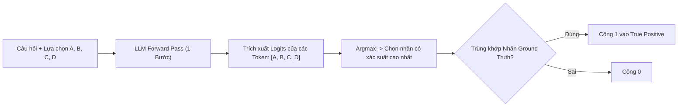

#### d. Code Thực chiến (Dual-Engine: C++ & Python)

```cpp
// C++17: Tính toán Accuracy từ mảng kết quả dự đoán nhị phân
#include <iostream>
#include <vector>

double calculate_accuracy(const std::vector<int>& preds, const std::vector<int>& targets) {
    if (preds.size() != targets.size() || preds.empty()) return 0.0;
    int correct = 0;
    for (size_t i = 0; i < preds.size(); ++i) {
        if (preds[i] == targets[i]) correct++;
    }
    return static_cast<double>(correct) / preds.size();
}

int main() {
    std::vector<int> p = {1, 0, 2, 3, 1};
    std::vector<int> t = {1, 0, 2, 2, 1};
    std::cout << "Accuracy: " << calculate_accuracy(p, t) * 100.0 << "%" << std::endl;
    return 0;
}
```

```python
# Python / PyTorch: Trích xuất logit và tính Accuracy MCQ tốc độ cao
import torch

def evaluate_mcq_accuracy(logits: torch.Tensor, label_token_ids: list, targets: torch.Tensor) -> float:
    """
    logits: [Batch, VocabSize] tại vị trí token dự đoán
    label_token_ids: Danh sách Token IDs đại diện cho ['A', 'B', 'C', 'D']
    targets: [Batch] - chỉ số ground truth (0, 1, 2, hoặc 3)
    """
    # Trích xuất logits của 4 lựa chọn
    choice_logits = logits[:, label_token_ids] # [Batch, 4]
    preds = torch.argmax(choice_logits, dim=-1) # [Batch]
    correct = (preds == targets).sum().item()
    return correct / targets.size(0)

mock_logits = torch.randn(8, 32000)
choices = [319, 350, 315, 360] # Token IDs giả định cho A, B, C, D
targs = torch.tensor([0, 1, 1, 2, 3, 0, 2, 1])
print(f"MCQ Batch Accuracy: {evaluate_mcq_accuracy(mock_logits, choices, targs) * 100:.2f}%")
```

#### e. Lỗi Thường gặp & Ổn định Số học (Pitfalls & Numerical Stability)
- **Class Imbalance Paradox**: Khi tập dữ liệu có $95\%$ nhãn thuộc một lớp duy nhất, mô hình chỉ cần dự đoán ngây thơ một lớp đó cũng đạt Accuracy $95\%$ mà không học được bất kỳ tri thức nào.

#### f. Ứng dụng Thực chiến trong AI / Deep Learning (AI Applications)
- Thước đo tiêu chuẩn để xếp hạng các mô hình trên **MMLU, ARC-Challenge, OpenBookQA**.

---

### 7. Exact Match - EM (Trùng Khớp Tuyệt Đối)

#### a. Định nghĩa Bản chất Toán học (Mathematical Formulation)
**Exact Match (EM)** là chỉ số nhị phân ngặt nghèo nhất trong đánh giá văn bản: Chuỗi dự đoán $\hat{y}$ chỉ được tính điểm nếu nó trùng khớp $100\%$ từng ký tự với chuỗi đích $y^*$ sau khi đã chuẩn hóa khoảng trắng và dấu câu:
$$\text{EM}(\hat{y}, y^*) = \begin{cases} 1 & \text{nếu } \text{Normalize}(\hat{y}) = \text{Normalize}(y^*) \\ 0 & \text{ngược lại} \end{cases}$$
Quy trình chuẩn hóa $\text{Normalize}(\cdot)$ thường bao gồm: chuyển thành chữ thường, loại bỏ mạo từ (*a, an, the*), và khử bỏ toàn bộ dấu câu ngoại lai.

#### b. Cơ chế Tầng Sâu & Điện toán (Under The Hood / Hardware Internals)
- **String Hashing Optimization**: Thay vì thực hiện so sánh chuỗi ký tự theo thứ tự $O(L)$ trong CPU, các hệ thống đánh giá tính toán mã băm 64-bit (xxHash / MurmurHash) cho các chuỗi sau chuẩn hóa để so khớp tức thì qua các phép toán số nguyên trên thanh ghi CPU.

#### c. Sơ đồ Minh họa (Mermaid / ASCII Diagram)
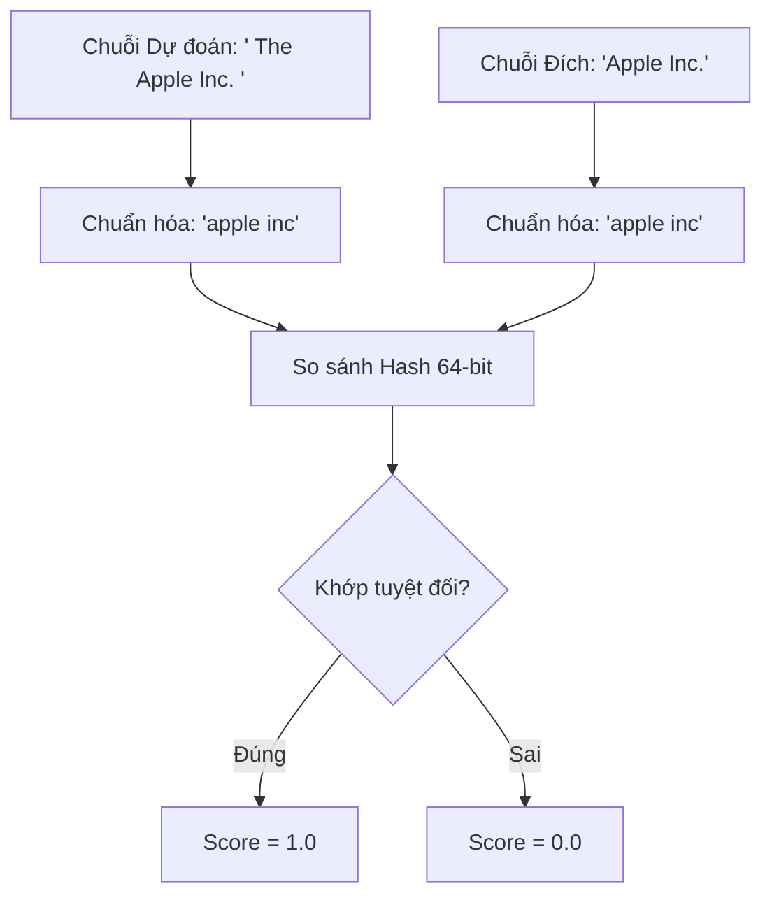

#### d. Code Thực chiến (Dual-Engine: C++ & Python)

```cpp
// C++17: Chuẩn hóa chuỗi và kiểm tra Exact Match
#include <iostream>
#include <string>
#include <algorithm>
#include <cctype>

std::string normalize_text(std::string str) {
    // Chuyển chữ thường và loại bỏ dấu câu
    std::string result;
    for (char c : str) {
        if (!std::ispunct(c)) {
            result += std::tolower(c);
        }
    }
    // Khử khoảng trắng thừa
    result.erase(std::unique(result.begin(), result.end(), [](char a, char b) {
        return std::isspace(a) && std::isspace(b);
    }), result.end());
    return result;
}

bool exact_match(const std::string& pred, const std::string& target) {
    return normalize_text(pred) == normalize_text(target);
}

int main() {
    std::string p = "Albert Einstein.";
    std::string t = "albert einstein";
    std::cout << "Exact Match Result: " << (exact_match(p, t) ? "TRUE" : "FALSE") << std::endl;
    return 0;
}
```

```python
# Python: Hàm chuẩn hóa và tính Exact Match theo chuẩn SQuAD
import re
import string

def normalize_answer(s: str) -> str:
    def remove_articles(text):
        return re.sub(r'\b(a|an|the)\b', ' ', text)
    def white_space_fix(text):
        return ' '.join(text.split())
    def remove_punc(text):
        exclude = set(string.punctuation)
        return ''.join(ch for ch in text if ch not in exclude)
    def lower(text):
        return text.lower()
    return white_space_fix(remove_articles(remove_punc(lower(s))))

def compute_exact_match(prediction: str, ground_truth: str) -> int:
    return int(normalize_answer(prediction) == normalize_answer(ground_truth))

print("EM Score:", compute_exact_match("The Great Wall of China!", "great wall of china"))
```

#### e. Lỗi Thường gặp & Ổn định Số học (Pitfalls & Numerical Stability)
- **Overly Punitive Nature**: Thước đo này phạt điểm 0 một cách bất công đối với các câu trả lời hoàn toàn chính xác về mặt ngữ nghĩa nhưng khác biệt về cách viết số (ví dụ: *"42"* so với *"bốn mươi hai"*).

#### f. Ứng dụng Thực chiến trong AI / Deep Learning (AI Applications)
- Thước đo bắt buộc trong bài toán Hỏi đáp đọc hiểu văn bản **SQuAD**, trích xuất thực thể, và giải toán số học cuối cùng trên **GSM8K**.

---

### 8. F1 Score (Chỉ số F1 trên Token)

#### a. Định nghĩa Bản chất Toán học (Mathematical Formulation)
Trong bối cảnh đánh giá mô hình ngôn ngữ tự do, **Token-level F1 Score** đo lường sự cân bằng điều hòa giữa Precision và Recall của tập hợp các token trong câu dự đoán và câu chuẩn:
$$\text{Precision} = \frac{|\mathcal{T}_{\text{pred}} \cap \mathcal{T}_{\text{target}}|}{|\mathcal{T}_{\text{pred}}|}, \quad \text{Recall} = \frac{|\mathcal{T}_{\text{pred}} \cap \mathcal{T}_{\text{target}}|}{|\mathcal{T}_{\text{target}}|}$$
$$\text{F1} = \frac{2 \cdot \text{Precision} \cdot \text{Recall}}{\text{Precision} + \text{Recall}}$$
Trong đó $\mathcal{T}$ là đa tập hợp (Multiset) các token sau khi chuẩn hóa. F1 nhận giá trị trong đoạn $[0, 1]$, đạt cực đại khi mô hình dự đoán đầy đủ thông tin mà không thừa thãi các từ ngữ vô nghĩa.

#### b. Cơ chế Tầng Sâu & Điện toán (Under The Hood / Hardware Internals)
- **Hash Table Multiset Intersection**: Việc tính giao của hai multiset được tối ưu thông qua mảng băm đếm tần số (`std::unordered_map` hoặc băm số nguyên), với độ phức tạp thời gian tuyến tính $O(|\mathcal{T}_{\text{pred}}| + |\mathcal{T}_{\text{target}}|)$.

#### c. Sơ đồ Minh họa (Mermaid / ASCII Diagram)
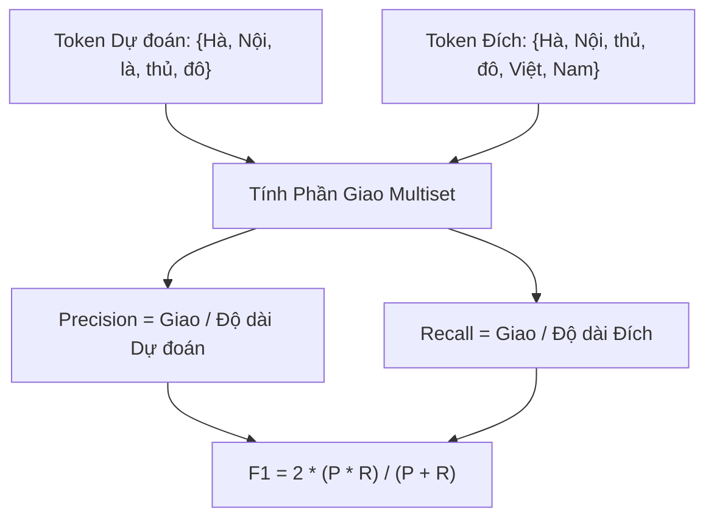

#### d. Code Thực chiến (Dual-Engine: C++ & Python)

```cpp
// C++17: Tính Token-Level F1 Score giữa 2 danh sách từ
#include <iostream>
#include <vector>
#include <string>
#include <unordered_map>
#include <algorithm>

double compute_token_f1(const std::vector<std::string>& pred_tokens, const std::vector<std::string>& target_tokens) {
    if (pred_tokens.empty() || target_tokens.empty()) return 0.0;
    
    std::unordered_map<std::string, int> pred_counts, target_counts;
    for (const auto& w : pred_tokens) pred_counts[w]++;
    for (const auto& w : target_tokens) target_counts[w]++;
    
    int overlap = 0;
    for (const auto& [w, count] : pred_counts) {
        if (target_counts.count(w)) {
            overlap += std::min(count, target_counts[w]);
        }
    }
    
    if (overlap == 0) return 0.0;
    double precision = static_cast<double>(overlap) / pred_tokens.size();
    double recall = static_cast<double>(overlap) / target_tokens.size();
    return 2.0 * (precision * recall) / (precision + recall);
}

int main() {
    std::vector<std::string> p = {"ha", "noi", "thu", "do"};
    std::vector<std::string> t = {"ha", "noi", "la", "thu", "do", "viet", "nam"};
    std::cout << "Token F1 Score: " << compute_token_f1(p, t) << std::endl;
    return 0;
}
```

```python
# Python: Hàm tính F1 Score chuẩn SQuAD cho chuỗi ký tự
from collections import Counter

def compute_f1(prediction: str, ground_truth: str) -> float:
    pred_tokens = prediction.lower().split()
    truth_tokens = ground_truth.lower().split()
    
    common = Counter(pred_tokens) & Counter(truth_tokens)
    num_same = sum(common.values())
    
    if num_same == 0:
        return 0.0
        
    precision = 1.0 * num_same / len(pred_tokens)
    recall = 1.0 * num_same / len(truth_tokens)
    f1 = (2 * precision * recall) / (precision + recall)
    return f1

print(f"F1 Score: {compute_f1('deep learning models', 'deep learning language models'):.4f}")
```

#### e. Lỗi Thường gặp & Ổn định Số học (Pitfalls & Numerical Stability)
- **Bag-of-Words Limitation**: F1 Score trên token bỏ qua hoàn toàn trật tự từ (Word Order). Câu *"Chó cắn người"* và *"Người cắn chó"* có cùng chung tập từ, dẫn đến F1 Score bằng tuyệt đối $1.0$ dù ngữ nghĩa hoàn toàn trái ngược.

#### f. Ứng dụng Thực chiến trong AI / Deep Learning (AI Applications)
- Đánh giá khả năng rút trích thông tin cốt lõi trong các hệ thống RAG (Retrieval-Augmented Generation).

---

### 9. BLEU - Bilingual Evaluation Understudy

#### a. Định nghĩa Bản chất Toán học (Mathematical Formulation)
**BLEU** (Papineni et al., ACL 2002) là tiêu chuẩn kinh điển trong đánh giá dịch máy, dựa trên **Modified N-gram Precision** kết hợp với hình phạt độ dài ngắn (**Brevity Penalty - BP**):
$$\text{BLEU} = \text{BP} \cdot \exp\left( \sum_{n=1}^N w_n \log p_n \right)$$
Trong đó:
- $p_n$: Độ chính xác n-gram đã cắt xén (Clipped n-gram Precision) để ngăn chặn việc lặp lại cùng một từ để tăng điểm:
  $$p_n = \frac{\sum_{C \in \{\text{Candidates}\}} \sum_{\text{n-gram} \in C} \text{Count}_{\text{clip}}(\text{n-gram})}{\sum_{C \in \{\text{Candidates}\}} \sum_{\text{n-gram} \in C} \text{Count}(\text{n-gram})}$$
- Thường chọn $N = 4$ và trọng số đều $w_n = \frac{1}{4}$ (BLEU-4).
- **Brevity Penalty (BP)** trừng phạt các bản dịch quá ngắn:
  $$\text{BP} = \begin{cases} 1 & \text{nếu } c > r \\ \exp\left( 1 - \frac{r}{c} \right) & \text{nếu } c \le r \end{cases}$$
  Với $c$ là độ dài câu dự đoán, $r$ là độ dài câu tham chiếu hiệu dụng.

#### b. Cơ chế Tầng Sâu & Điện toán (Under The Hood / Hardware Internals)
- **Clipped Count Hash Collisions**: Để tính toán song song hàng triệu câu dịch, các chuỗi n-gram được mã hóa thành các khóa 64-bit hoặc 128-bit thông qua Rolling Polynomial Hash, giúp thao tác tra cứu trên bảng đếm tần số đạt tốc độ tối đa.

#### c. Sơ đồ Minh họa (Mermaid / ASCII Diagram)
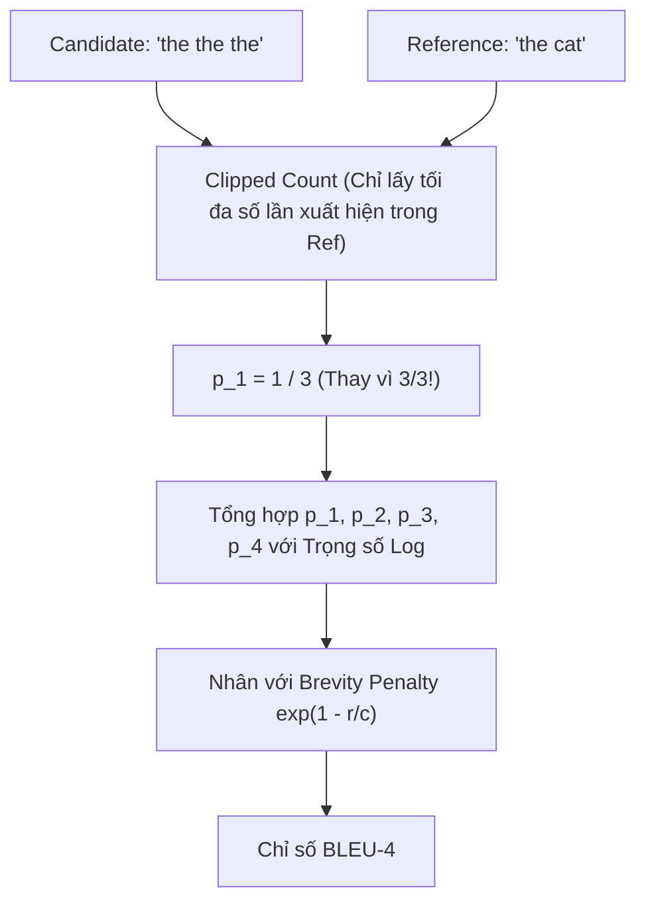

#### d. Code Thực chiến (Dual-Engine: C++ & Python)

```cpp
// C++17: Tính Brevity Penalty cho thuật toán BLEU
#include <iostream>
#include <cmath>

double compute_brevity_penalty(int candidate_len, int reference_len) {
    if (candidate_len > reference_len) return 1.0;
    if (candidate_len == 0) return 0.0;
    return std::exp(1.0 - static_cast<double>(reference_len) / candidate_len);
}

int main() {
    std::cout << "BP (c=8, r=12): " << compute_brevity_penalty(8, 12) << std::endl;
    return 0;
}
```

```python
# Python: Tính BLEU Score sử dụng thư viện NLTK chuẩn mực
from nltk.translate.bleu_score import sentence_bleu, SmoothingFunction

def compute_bleu_score(candidate: str, reference: str) -> float:
    ref_tokens = [reference.split()]
    cand_tokens = candidate.split()
    
    # Áp dụng Smoothing Function để tránh log(0) khi n-gram bậc cao không xuất hiện
    smooth = SmoothingFunction().method1
    score = sentence_bleu(ref_tokens, cand_tokens, weights=(0.25, 0.25, 0.25, 0.25), smoothing_function=smooth)
    return score

cand = "the cat is sitting on the mat"
ref = "the cat is on the mat"
print(f"BLEU-4 Score: {compute_bleu_score(cand, ref):.4f}")
```

#### e. Lỗi Thường gặp & Ổn định Số học (Pitfalls & Numerical Stability)
- **Zero n-gram Precision Collapse**: Nếu một câu không có bất kỳ 4-gram nào trùng khớp ($p_4 = 0$), thì $\log p_4 \to -\infty$, khiến toàn bộ tích BLEU sụp đổ về 0. Bắt buộc phải áp dụng kỹ thuật **Smoothing** (như Chen & Cherry Smoothing) để gán một giá trị $\epsilon$ nhỏ cho các bậc n-gram rỗng.

#### f. Ứng dụng Thực chiến trong AI / Deep Learning (AI Applications)
- Đo lường chất lượng hệ thống dịch máy tự động đa ngôn ngữ (Machine Translation benchmarks: WMT).

---

### 10. ROUGE - Recall-Oriented Understudy for Gisting Evaluation

#### a. Định nghĩa Bản chất Toán học (Mathematical Formulation)
**ROUGE** (Lin, 2004) là bộ thước đo được thiết kế chuyên biệt cho tác vụ **Tóm tắt Văn bản (Summarization)**, tập trung ưu tiên chỉ số **Recall** (đo lường xem bản tóm tắt có lưu giữ được bao nhiêu ý quan trọng từ tài liệu gốc).
Các biến thể cốt lõi:
1. **ROUGE-N**: Đo lường Recall của n-gram:
   $$\text{ROUGE-N} = \frac{\sum_{r \in \{\text{Refs}\}} \sum_{\text{n-gram} \in r} \text{Count}_{\text{match}}(\text{n-gram})}{\sum_{r \in \{\text{Refs}\}} \sum_{\text{n-gram} \in r} \text{Count}(\text{n-gram})}$$
2. **ROUGE-L**: Dựa trên chuỗi con chung dài nhất (**Longest Common Subsequence - LCS**), đánh giá cấu trúc thứ tự từ ở cấp độ câu mà không yêu cầu các từ phải liền kề nhau:
   $$R_{\text{LCS}} = \frac{\text{LCS}(\text{Cand}, \text{Ref})}{m}, \quad P_{\text{LCS}} = \frac{\text{LCS}(\text{Cand}, \text{Ref})}{n}, \quad \text{ROUGE-L} = \frac{(1 + \beta^2) R_{\text{LCS}} P_{\text{LCS}}}{R_{\text{LCS}} + \beta^2 P_{\text{LCS}}}$$

#### b. Cơ chế Tầng Sâu & Điện toán (Under The Hood / Hardware Internals)
- **Dynamic Programming LCS Acceleration**: Thuật toán quy hoạch động tìm LCS có độ phức tạp $O(m \times n)$. Với các văn bản dài hàng ngàn từ, bảng quy hoạch động tốn nhiều cache lines. Các triển khai C++ hiện đại sử dụng bit-parallelism (Myers' bit-vector algorithm) để tăng tốc độ tính LCS lên $32\times - 64\times$ trên thanh ghi 64-bit CPU.

#### c. Sơ đồ Minh họa (Mermaid / ASCII Diagram)
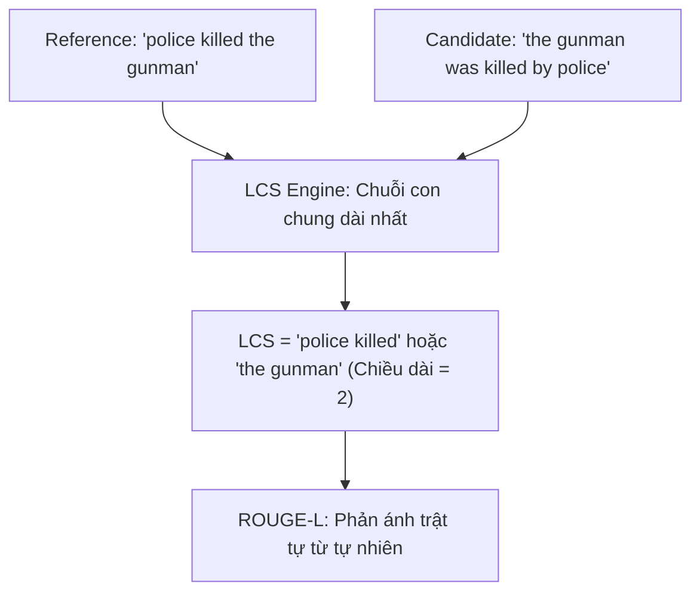

#### d. Code Thực chiến (Dual-Engine: C++ & Python)

```cpp
// C++17: Quy hoạch động tính Longest Common Subsequence (LCS) cho ROUGE-L
#include <iostream>
#include <vector>
#include <string>
#include <algorithm>

int compute_lcs(const std::vector<std::string>& x, const std::vector<std::string>& y) {
    size_t m = x.size(), n = y.size();
    std::vector<std::vector<int>> dp(m + 1, std::vector<int>(n + 1, 0));
    
    for (size_t i = 1; i <= m; ++i) {
        for (size_t j = 1; j <= n; ++j) {
            if (x[i - 1] == y[j - 1]) dp[i][j] = dp[i - 1][j - 1] + 1;
            else dp[i][j] = std::max(dp[i - 1][j], dp[i][j - 1]);
        }
    }
    return dp[m][n];
}

int main() {
    std::vector<std::string> c = {"the", "gunman", "killed"};
    std::vector<std::string> r = {"police", "killed", "the", "gunman"};
    std::cout << "LCS Length: " << compute_lcs(c, r) << std::endl;
    return 0;
}
```

```python
# Python: Sử dụng thư viện rouge-score chính thống
from rouge_score import rouge_scorer

def evaluate_summarization_rouge(candidate: str, reference: str) -> dict:
    scorer = rouge_scorer.RougeScorer(['rouge1', 'rouge2', 'rougeL'], use_stemmer=True)
    scores = scorer.score(reference, candidate)
    return {
        "rouge1_f1": scores['rouge1'].fmeasure,
        "rouge2_f1": scores['rouge2'].fmeasure,
        "rougeL_f1": scores['rougeL'].fmeasure,
    }

c = "Mô hình ngôn ngữ lớn cần được đánh giá chuẩn xác."
r = "Đánh giá mô hình ngôn ngữ lớn đòi hỏi tiêu chuẩn khoa học."
print(evaluate_summarization_rouge(c, r))
```

#### e. Lỗi Thường gặp & Ổn định Số học (Pitfalls & Numerical Stability)
- **Stemmer Sensitivity**: ROUGE sử dụng Porter Stemmer để đưa từ về dạng gốc. Với các ngôn ngữ đơn lập không biến hình như Tiếng Việt hoặc chữ viết tượng hình như Tiếng Trung, ROUGE dựa trên khoảng trắng mặc định sẽ cho ra kết quả hoàn toàn vô nghĩa nếu không có công đoạn tách từ chuyên biệt (Word Segmentation).

#### f. Ứng dụng Thực chiến trong AI / Deep Learning (AI Applications)
- Thước đo tiêu chuẩn vàng trên các bộ benchmark tóm tắt văn bản: **CNN/DailyMail, XSum**.

---

### 11. METEOR - Metric for Evaluation of Translation with Explicit ORdering

#### a. Định nghĩa Bản chất Toán học (Mathematical Formulation)
**METEOR** (Banerjee & Lavie, 2005) khắc phục hạn chế cứng nhắc của BLEU bằng cách mở rộng khớp nối không chỉ ở bề mặt ký tự mà qua 3 giai đoạn: **Khớp chính xác (Exact)**, **Khớp dạng gốc (Stemming)**, và **Khớp từ đồng nghĩa (Synonymy qua WordNet)**.
Điểm $F_{\text{mean}}$ điều hòa có thiên lệch Recall:
$$F_{\text{mean}} = \frac{10 \cdot P \cdot R}{R + 9 \cdot P}$$
Chỉ số METEOR kết hợp với một hình phạt phân mảnh (Fragmentation Penalty) đo lường mức độ đứt gãy của các khối từ được ghép nối:
$$\text{Penalty} = 0.5 \cdot \left( \frac{\text{Ch}}{\text{m}} \right)^3, \quad \text{METEOR} = F_{\text{mean}} \cdot (1 - \text{Penalty})$$
Trong đó $\text{Ch}$ là số lượng khối liên tục (Chunks), $m$ là tổng số từ được ghép cặp.

#### b. Cơ chế Tầng Sâu & Điện toán (Under The Hood / Hardware Internals)
- **Graph Bipartite Matching**: Để tìm ra tập hợp ghép nối tối ưu giữa hai câu văn, METEOR giải bài toán ghép cặp cực đại trên đồ thị hai phía (Maximum Weight Bipartite Matching) với ràng buộc không giao nhau (Unigram Alignment), có chi phí tính toán cao hơn đáng kể so với BLEU.

#### c. Sơ đồ Minh họa (Mermaid / ASCII Diagram)
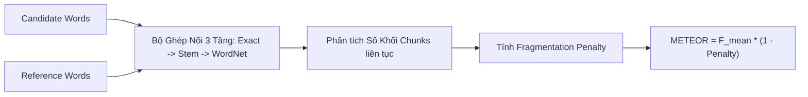

#### d. Code Thực chiến (Dual-Engine: C++ & Python)

```cpp
// C++17: Tính Fragmentation Penalty của METEOR
#include <iostream>
#include <cmath>

double compute_meteor_penalty(int num_chunks, int total_matches, double gamma = 0.5, double beta = 3.0) {
    if (total_matches == 0) return 0.0;
    double chunk_ratio = static_cast<double>(num_chunks) / total_matches;
    return gamma * std::pow(chunk_ratio, beta);
}

int main() {
    std::cout << "METEOR Penalty: " << compute_meteor_penalty(2, 6) << std::endl;
    return 0;
}
```

```python
# Python: Đánh giá METEOR qua thư viện NLTK
import nltk
from nltk.translate.meteor_score import meteor_score

def calculate_meteor(candidate: str, reference: str) -> float:
    # Yêu cầu tải dữ liệu wordnet của nltk
    return meteor_score([reference.split()], candidate.split())

try:
    c = "The fast runner won the contest"
    r = "The quick athlete won the competition"
    print(f"METEOR Score: {calculate_meteor(c, r):.4f}")
except Exception as e:
    print("METEOR Demo (Cần tài nguyên WordNet)")
```

#### e. Lỗi Thường gặp & Ổn định Số học (Pitfalls & Numerical Stability)
- **Language Dependency**: Phụ thuộc nặng nề vào WordNet của Tiếng Anh, gây khó khăn lớn khi muốn mở rộng đo lường sang các ngôn ngữ ít tài nguyên (Low-resource Languages).

#### f. Ứng dụng Thực chiến trong AI / Deep Learning (AI Applications)
- Sử dụng trong các bài toán sinh chú thích ảnh (Image Captioning) và dịch thuật tự động cần độ tương quan cao với đánh giá của chuyên gia con người.

---

### 12. BERTScore (Chỉ số Ngữ nghĩa Dựa trên BERT)

#### a. Định nghĩa Bản chất Toán học (Mathematical Formulation)
**BERTScore** (Zhang et al., ICLR 2020) là bước chuyển dịch từ so khớp từ ngữ bề mặt sang so khớp trong không gian biểu diễn ngữ nghĩa liên tục.
Sử dụng mô hình ngôn ngữ ngữ cảnh (như RoBERTa hoặc DeBERTa), câu ứng viên được ánh xạ thành ma trận vector $\mathbf{x} = \langle \mathbf{x}_1, \dots, \mathbf{x}_k \rangle$ và câu tham chiếu thành $\mathbf{y} = \langle \mathbf{y}_1, \dots, \mathbf{y}_l \rangle$, với các vector được chuẩn hóa chuẩn $L_2$ ($||\mathbf{x}_i||_2 = 1$).
Ma trận tương đồng Cosine: $\mathbf{x}_i^T \mathbf{y}_j$.
Chỉ số Recall, Precision và F1 được tính thông qua phép ghép cặp tham lam (Greedy Matching):
$$R_{\text{BERT}} = \frac{1}{|y|} \sum_{y_j \in y} \max_{x_i \in x} \mathbf{x}_i^T \mathbf{y}_j, \quad P_{\text{BERT}} = \frac{1}{|x|} \sum_{x_i \in x} \max_{y_j \in y} \mathbf{x}_i^T \mathbf{y}_j$$
$$F_{\text{BERT}} = 2 \cdot \frac{P_{\text{BERT}} \cdot R_{\text{BERT}}}{P_{\text{BERT}} + R_{\text{BERT}}}$$

#### b. Cơ chế Tầng Sâu & Điện toán (Under The Hood / Hardware Internals)
- **Batch Matrix Multiplication (BMM) trên GPU**: Phép tính tương đồng giữa hai tập token biểu diễn dưới dạng nhân ma trận khối:
  $$\mathbf{S} = \mathbf{X} \mathbf{Y}^T \in \mathbb{R}^{B \times L_x \times L_y}$$
  Được tăng tốc bằng Tensor Cores FP16/BF16, sau đó gọi hàm `torch.max` dọc theo từng chiều để trích xuất điểm ghép cặp cực đại với chi phí tính toán cực thấp.

#### c. Sơ đồ Minh họa (Mermaid / ASCII Diagram)
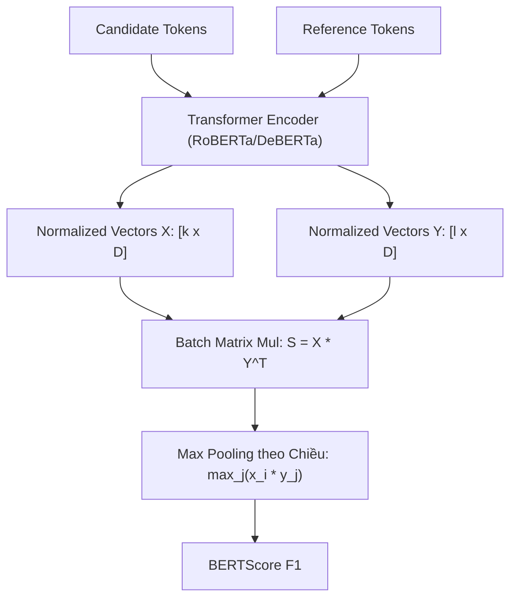

#### d. Code Thực chiến (Dual-Engine: C++ & Python)

```cpp
// C++17: Tính toán Greedy Cosine Similarity Matching giữa 2 tập vector
#include <iostream>
#include <vector>
#include <algorithm>
#include <cmath>

double compute_greedy_cosine_score(const std::vector<std::vector<double>>& x,
                                   const std::vector<std::vector<double>>& y) {
    // x: [N, D], y: [M, D] (Đã chuẩn hóa L2)
    double total_sim = 0.0;
    for (const auto& vec_x : x) {
        double max_sim = -1.0;
        for (const auto& vec_y : y) {
            double dot = 0.0;
            for (size_t d = 0; d < vec_x.size(); ++d) dot += vec_x[d] * vec_y[d];
            max_sim = std::max(max_sim, dot);
        }
        total_sim += max_sim;
    }
    return total_sim / x.size();
}

int main() {
    std::vector<std::vector<double>> x = {{1.0, 0.0}, {0.0, 1.0}};
    std::vector<std::vector<double>> y = {{0.9, 0.1}, {0.1, 0.9}};
    std::cout << "Greedy Match Precision: " << compute_greedy_cosine_score(x, y) << std::endl;
    return 0;
}
```

```python
# Python / PyTorch: Triển khai Vectorized BERTScore Calculation
import torch

def compute_bert_score(x_emb: torch.Tensor, y_emb: torch.Tensor) -> float:
    """
    x_emb: [Len_X, Dim] - Vector biểu diễn Candidate (Normalized)
    y_emb: [Len_Y, Dim] - Vector biểu diễn Reference (Normalized)
    """
    # Ma trận tương đồng cosine [Len_X, Len_Y]
    sim_matrix = torch.matmul(x_emb, y_emb.t())
    
    # Precision: với mỗi token x, tìm token y tương đồng nhất
    precision = sim_matrix.max(dim=1)[0].mean()
    # Recall: với mỗi token y, tìm token x tương đồng nhất
    recall = sim_matrix.max(dim=0)[0].mean()
    
    f1 = 2 * (precision * recall) / (precision + recall)
    return f1.item()

emb_cand = torch.nn.functional.normalize(torch.randn(5, 768), p=2, dim=-1)
emb_ref = torch.nn.functional.normalize(torch.randn(6, 768), p=2, dim=-1)
print(f"Simulated BERTScore F1: {compute_bert_score(emb_cand, emb_ref):.4f}")
```

#### e. Lỗi Thường gặp & Ổn định Số học (Pitfalls & Numerical Stability)
- **Model Layer Selection**: Điểm số BERTScore biến thiên mạnh tùy thuộc vào việc trích xuất ẩn trạng thái ở tầng nào của mô hình Transformer. Các nghiên cứu chỉ ra rằng các tầng giữa (ví dụ: tầng 9 hoặc 17 trong RoBERTa-Large) mang thông tin ngữ nghĩa tối ưu nhất cho đánh giá, trong khi các tầng cuối cùng thường bị thiên lệch về bài toán masked language modeling.

#### f. Ứng dụng Thực chiến trong AI / Deep Learning (AI Applications)
- Đánh giá khả năng viết lại câu (Paraphrasing), dịch máy ngữ nghĩa cao, và đo lường độ chính xác trong hội thoại mở.

---

### 13. Semantic Similarity (Độ Tương đồng Ngữ nghĩa)

#### a. Định nghĩa Bản chất Toán học (Mathematical Formulation)
**Semantic Similarity** lượng hóa mức độ tương đương về mặt ý niệm và nội dung giữa hai văn bản hoàn chỉnh mà không phụ thuộc vào từ ngữ bề mặt.
Phương pháp chuẩn hóa hiện đại sử dụng **Sentence Transformers (SBERT)** để chiếu toàn bộ văn bản $A$ và văn bản $B$ thành hai vector ngữ nghĩa cô đọng $\mathbf{u}, \mathbf{v} \in \mathbb{R}^D$ thông qua hàm Mean Pooling trên chuỗi token:
$$\mathbf{u} = \text{MeanPooling}(\text{Encoder}(A)), \quad \mathbf{v} = \text{MeanPooling}(\text{Encoder}(B))$$
Độ tương đồng ngữ nghĩa được xác định qua hàm Cosine Similarity:
$$\text{Sim}(A, B) = \cos(\mathbf{u}, \mathbf{v}) = \frac{\mathbf{u} \cdot \mathbf{v}}{||\mathbf{u}||_2 \cdot ||\mathbf{v}||_2} \in [-1, 1]$$

#### b. Cơ chế Tầng Sâu & Điện toán (Under The Hood / Hardware Internals)
- **Vector Indexing & SIMD Distance Kernels**: Khi so sánh hàng ngàn câu phản hồi, các vector nhúng được tổ chức thành cấu trúc chỉ mục (như FAISS HNSW hoặc Flat Index). Phép tính Cosine được biên dịch thành tập lệnh CPU AVX-512 hoặc GPU Warp-level primitives để tính toán hàng triệu tích vô hướng mỗi giây.

#### c. Sơ đồ Minh họa (Mermaid / ASCII Diagram)
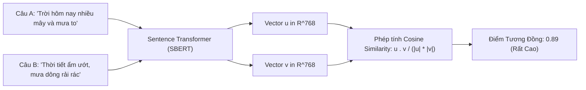

#### d. Code Thực chiến (Dual-Engine: C++ & Python)

```cpp
// C++17: Tính toán Cosine Similarity tối ưu hóa SIMD logic
#include <iostream>
#include <vector>
#include <cmath>

double compute_cosine_similarity(const std::vector<double>& u, const std::vector<double>& v) {
    if (u.size() != v.size() || u.empty()) return 0.0;
    double dot = 0.0, norm_u = 0.0, norm_v = 0.0;
    for (size_t i = 0; i < u.size(); ++i) {
        dot += u[i] * v[i];
        norm_u += u[i] * u[i];
        norm_v += v[i] * v[i];
    }
    double denom = std::sqrt(norm_u) * std::sqrt(norm_v);
    return denom < 1e-12 ? 0.0 : dot / denom;
}

int main() {
    std::vector<double> emb1 = {0.8, 0.2, -0.4};
    std::vector<double> emb2 = {0.75, 0.3, -0.35};
    std::cout << "Semantic Cosine Similarity: " << compute_cosine_similarity(emb1, emb2) << std::endl;
    return 0;
}
```

```python
# Python / PyTorch: Đo lường Semantic Similarity với Sentence-Transformers
import torch
import torch.nn.functional as F

def semantic_similarity_score(emb_a: torch.Tensor, emb_b: torch.Tensor) -> float:
    """
    emb_a, emb_b: [Dim]
    """
    sim = F.cosine_similarity(emb_a.unsqueeze(0), emb_b.unsqueeze(0))
    return sim.item()

u = torch.randn(768)
v = u + torch.randn(768) * 0.1 # Biến thể tương đồng cao
print(f"Cosine Similarity Score: {semantic_similarity_score(u, v):.4f}")
```

#### e. Lỗi Thường gặp & Ổn định Số học (Pitfalls & Numerical Stability)
- **Anisotropy Problem (Vấn đề Dị hướng)**: Các mô hình ngôn ngữ chưa qua tinh chỉnh tương phản (như BERT thô) thường có các vector nhúng tập trung trong một hình nón hẹp (Cone shape), khiến cho Cosine Similarity giữa bất kỳ hai câu ngẫu nhiên nào cũng bị đẩy lên rất cao ($> 0.8$). Cần sử dụng các mô hình đã được căn chỉnh không gian đẳng hướng (Isotropic Adjustment) như **BGE-M3** hoặc **text-embedding-3-large**.

#### f. Ứng dụng Thực chiến trong AI / Deep Learning (AI Applications)
- Lõi đánh giá độ chính xác truy hồi ngữ cảnh (Context Relevance) và độ tương thích phản hồi (Answer Relevance) trong các khung kiểm định RAG phổ biến như **Ragas** và **TruLens**.
