# Chuyên đề: Các Bộ Tiêu chuẩn Đối sánh Tri thức & Suy luận Chuẩn mực (Standard Reasoning & Knowledge Benchmarks)

## 1. Tổng quan Chuyên đề
Để đo lường một cách khách quan sự tiến bộ của Trí tuệ Nhân tạo Tổng quát (AGI), cộng đồng nghiên cứu AI quốc tế đã xây dựng một hệ sinh thái các bộ benchmark chuẩn mực (Standardized Benchmark Suites). Mỗi bộ benchmark được thiết kế như một kỳ thi sát hạch đa chiều, nhắm vào các khía cạnh nhận thức chuyên biệt của Large Language Model:
1. **Tri thức Bách khoa & Chuyên gia (Broad Knowledge & Graduate-Level STEM)**: Từ **MMLU** (57 ngành học phổ thông và đại học) tiến hóa lên **MMLU-Pro** (tăng số lượng đáp án nhiễu, tăng độ khó suy luận) và đỉnh cao là **GPQA** (các câu hỏi cấp độ nghiên cứu sinh tiến sĩ mà ngay cả người có bằng thạc sĩ tra Google cũng không thể trả lời dễ dàng).
2. **Suy luận Toán học Đa tầng (Mathematical Reasoning)**: Từ toán đố tiểu học yêu cầu suy luận tuần tự nhiều bước (**GSM8K**) đến toán thi học sinh giỏi quốc gia và Olympic toán học quốc tế (**MATH**).
3. **Kỹ nghệ Phần mềm & Lập trình Tự động (Code Synthesis & Software Engineering)**: Từ các hàm thuật toán Python đơn lẻ (**HumanEval, MBPP**) phát triển vượt bậc lên giải quyết các issue thực tế trên kho lưu trữ mã nguồn quy mô lớn của GitHub (**SWE-bench**).
4. **Suy luận Thường thức, Sự thật & Căn chỉnh Đa lượt (Commonsense, Truthfulness & Chat)**: **ARC, HellaSwag, TruthfulQA, BIG-Bench, IFEval, MT-Bench, AlpacaEval**.

```mermaid
graph TD
    Benchmarks["Hệ Sinh Thái Benchmark Chuẩn Mực"]
    Benchmarks --> Knowledge["Tri thức Bách khoa & Chuyên sâu"]
    Benchmarks --> Math["Suy luận Toán học Đa bước"]
    Benchmarks --> Code["Kỹ nghệ Mã nguồn & Phần mềm"]
    Benchmarks --> ChatReasoning["Thường thức, Sự thật & Hội thoại"]
    
    Knowledge --> MMLU["MMLU (57 Môn học)"]
    Knowledge --> MMLUPro["MMLU-Pro (10 Lựa chọn, Chống võ đoán)"]
    Knowledge --> GPQA["GPQA (Tiến sĩ STEM, Google-Proof)"]
    
    Math --> GSM8K["GSM8K (Toán Đố Tiểu học 2-8 Bước)"]
    Math --> MATH["MATH (Olympic Toán Học Cấp độ Cao)"]
    
    Code --> HumanEval["HumanEval (164 Bài toán Python - Pass@k)"]
    Code --> MBPP["MBPP (974 Bài toán Python Cơ bản)"]
    Code --> SWE["SWE-bench (Sửa lỗi Issue GitHub Thực tế)"]
    
    ChatReasoning --> ARC["ARC (Khoa học Phổ thông & Logic)"]
    ChatReasoning --> HellaSwag["HellaSwag (Hoàn thành Câu Thường thức)"]
    ChatReasoning --> TruthfulQA["TruthfulQA (Chống Ảo giác & Mê tín)"]
    ChatReasoning --> BIGBench["BIG-Bench (Đa dạng 200+ Tác vụ)"]
    ChatReasoning --> IFEval["IFEval (Tuân thủ Ràng buộc Chỉ dẫn)"]
    ChatReasoning --> MTBench["MT-Bench & AlpacaEval (Đàm thoại Đa lượt)"]
```

---

## 2. Chi tiết từng Keyword

---

### 14. MMLU - Massive Multitask Language Understanding

#### a. Định nghĩa Bản chất Toán học (Mathematical Formulation)
**MMLU** (Hendrycks et al., ICLR 2021) là bộ chuẩn đối sánh toàn diện gồm $15.908$ câu hỏi trắc nghiệm 4 lựa chọn ($A, B, C, D$) bao quát **57 môn học** thuộc 4 phân vùng tri thức: Nhân văn (Humanities), Khoa học Xã hội (Social Sciences), Khoa học Tự nhiên & Kỹ thuật (STEM), và Lĩnh vực Chuyên nghiệp (Law, Medicine, Business).
Độ chính xác tổng thể được tính bằng trung bình số học:
$$\text{Acc}_{\text{MMLU}} = \frac{1}{|\mathcal{S}|} \sum_{s \in \mathcal{S}} \left( \frac{1}{N_s} \sum_{i=1}^{N_s} \mathbb{I}\left( \arg\max_{c \in \{A, B, C, D\}} P_\theta(c \mid x_{s, i}) = y_{s, i}^* \right) \right)$$
Trong đó:
- $x_{s, i}$: Chuỗi prompt chứa ngữ cảnh câu hỏi của môn $s$ kết hợp với 5 mẫu gợi ý dẫn dắt (**5-shot prompting**).
- $y_{s, i}^*$: Đáp án chuẩn xác.
Ngưỡng người bình thường đạt khoảng $34.5\%$, chuyên gia con người đạt khoảng $89.8\%$.

#### b. Cơ chế Tầng Sâu & Điện toán (Under The Hood / Hardware Internals)
- **Token Logit Normalization**: Khi truy vấn logit của 4 ký tự $A, B, C, D$, một số token bị thiên lệch do tần suất xuất hiện tự nhiên trong pretraining. Để loại trừ sai số, kỹ thuật chuẩn hóa tiên tiến chia logit của từng lựa chọn cho logit không điều kiện của nó (Unconditional Likelihood Normalization) hoặc chạy Softmax bị giới hạn (Restricted Softmax) trên GPU.

#### c. Sơ đồ Minh họa (Mermaid / ASCII Diagram)
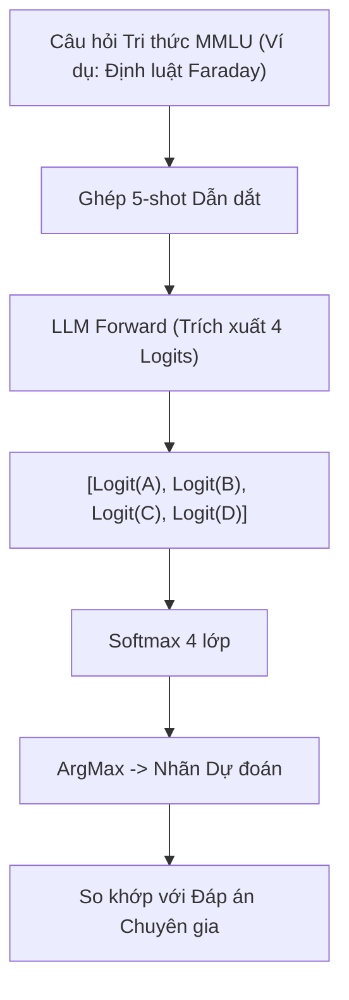

#### d. Code Thực chiến (Dual-Engine: C++ & Python)

```cpp
// C++17: Tính toán điểm tổng hợp MMLU qua 4 phân vùng tri thức
#include <iostream>
#include <vector>
#include <string>
#include <numeric>

struct SubjectResult {
    std::string name;
    int correct;
    int total;
};

double compute_mmlu_overall(const std::vector<SubjectResult>& subjects) {
    int total_corr = 0, total_q = 0;
    for (const auto& s : subjects) {
        total_corr += s.correct;
        total_q += s.total;
    }
    return total_q > 0 ? (static_cast<double>(total_corr) / total_q) : 0.0;
}

int main() {
    std::vector<SubjectResult> results = {
        {"STEM", 850, 1000},
        {"Humanities", 780, 1000},
        {"Social_Sciences", 810, 1000}
    };
    std::cout << "MMLU Overall Accuracy: " << compute_mmlu_overall(results) * 100.0 << "%" << std::endl;
    return 0;
}
```

```python
# Python / PyTorch: Đo lường độ chính xác MMLU qua Logit Evaluation
import torch

def evaluate_mmlu_item(model, tokenizer, prompt: str, correct_choice: str) -> bool:
    choices = ["A", "B", "C", "D"]
    choice_ids = [tokenizer.encode(c, add_special_tokens=False)[0] for c in choices]
    
    inputs = tokenizer(prompt, return_tensors="pt").to(model.device)
    with torch.no_grad():
        logits = model(**inputs).logits[0, -1, choice_ids]
        pred_idx = torch.argmax(logits).item()
        
    return choices[pred_idx] == correct_choice

print("MMLU Evaluator Ready.")
```

#### e. Lỗi Thường gặp & Ổn định Số học (Pitfalls & Numerical Stability)
- **Token ID Mismatch**: Token "A" có thể có nhiều mã hóa khác nhau trong tokenizer (ví dụ: `"A"`, `" A"`, `"A."`). Nếu truy vấn nhầm ID không có khoảng trắng dẫn đầu (leading whitespace), logit trích xuất sẽ hoàn toàn sai lệch.

#### f. Ứng dụng Thực chiến trong AI / Deep Learning (AI Applications)
- Thước đo bắt buộc được công bố trên mọi báo cáo kỹ thuật của các mô hình cận biên (GPT-4, Gemini Ultra, LLaMA-3).

---

### 15. MMLU-Pro

#### a. Định nghĩa Bản chất Toán học (Mathematical Formulation)
**MMLU-Pro** (Wang et al., 2024) ra đời khi các mô hình tiên tiến bắt đầu đạt mức bão hòa trên MMLU gốc ($> 88\%$), dẫn đến hiện tượng "đoán mò trúng đích" do xác suất ngẫu nhiên cao ($25\%$).
MMLU-Pro nâng cấp bài toán bằng cách:
1. Mở rộng số lượng lựa chọn từ 4 lên **10 phương án** ($A \to J$), làm giảm tỷ lệ đoán mò ngẫu nhiên xuống còn $10\%$:
   $$P_{\text{random}} = \frac{1}{10} = 0.1$$
2. Loại bỏ các câu hỏi học vẹt đơn giản, tăng cường các câu hỏi đòi hỏi chuỗi suy luận phức tạp (Multi-Step Reasoning) trong toán học và vật lý.
3. Bắt buộc mô hình sinh chuỗi suy luận Chain-of-Thought (CoT) trước khi đưa ra câu trả lời cuối cùng.

#### b. Cơ chế Tầng Sâu & Điện toán (Under The Hood / Hardware Internals)
- **Extended Token Generation Latency**: Do yêu cầu sinh chuỗi CoT thay vì chỉ trích xuất 1 token logit, thời gian đánh giá MMLU-Pro tốn kém tài nguyên gấp $50\times - 100\times$ so với MMLU truyền thống, đòi hỏi hệ thống serving đa GPU với PagedAttention.

#### c. Sơ đồ Minh họa (Mermaid / ASCII Diagram)
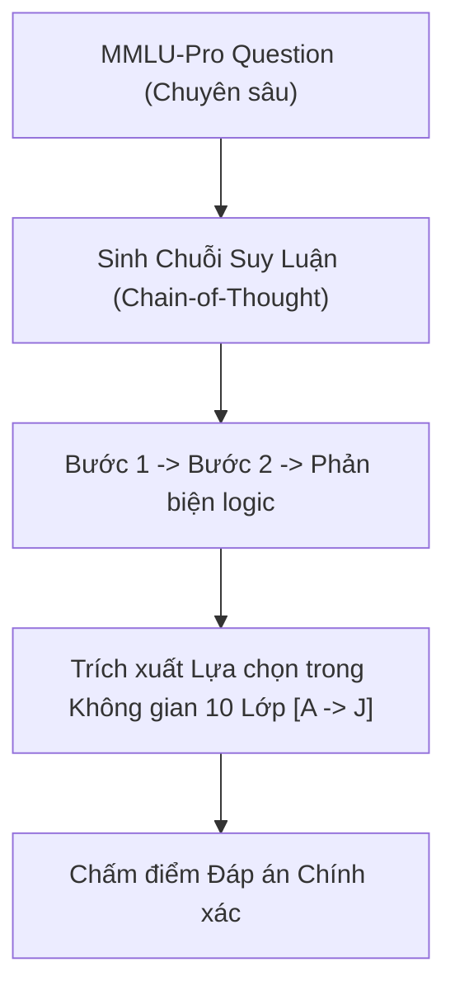

#### d. Code Thực chiến (Dual-Engine: C++ & Python)

```cpp
// C++17: Mô phỏng xác suất đoán mò ngẫu nhiên giữa MMLU và MMLU-Pro
#include <iostream>

void compare_guessing_entropy() {
    double p_mmlu = 0.25;
    double p_pro = 0.10;
    std::cout << "MMLU Random Baseline: " << p_mmlu * 100 << "%\n";
    std::cout << "MMLU-Pro Random Baseline: " << p_pro * 100 << "%\n";
}

int main() {
    compare_guessing_entropy();
    return 0;
}
```

```python
# Python: Bộ bóc tách câu trả lời trắc nghiệm 10 lựa chọn từ chuỗi Chain-of-Thought
import re

def extract_choice_mmlu_pro(generation: str) -> str:
    # Tìm kiếm cấu trúc chuẩn: "The answer is (X)" hoặc "answer: X"
    match = re.search(r'(?:answer is|answer:)\s*\(?([A-J])\)?', generation, re.IGNORECASE)
    if match:
        return match.group(1).upper()
    
    # Tìm kiếm chữ cái xuất hiện cuối cùng trong ngữ cảnh
    last_matches = re.findall(r'\b([A-J])\b', generation)
    return last_matches[-1].upper() if last_matches else ""

sample_gen = "Sau khi giải phương trình vi phân, ta thấy kết quả là 4. Thus, the answer is (F)."
print("Extracted Choice:", extract_choice_mmlu_pro(sample_gen))
```

#### e. Lỗi Thường gặp & Ổn định Số học (Pitfalls & Numerical Stability)
- **Parsing Failure**: Mô hình suy luận đúng toàn bộ các bước nhưng ở dòng kết luận lại viết *"Kết quả là phương án thứ sáu"* thay vì viết ký tự `"F"`, dẫn đến việc regex parser không bóc tách được và bị tính là sai oan.

#### f. Ứng dụng Thực chiến trong AI / Deep Learning (AI Applications)
- Benchmark then chốt để phân loại năng lực giữa các siêu mô hình hàng đầu thế giới (Claude 3.5 Sonnet, GPT-4o, DeepSeek-V3).

---

### 16. GPQA - Google-Proof Q&A Benchmark

#### a. Định nghĩa Bản chất Toán học (Mathematical Formulation)
**GPQA** (Rein et al., NYU & Anthropic 2023) là tập hợp 448 câu hỏi trắc nghiệm cực kỳ khó được biên soạn bởi các chuyên gia có học vị **Tiến sĩ (PhD)** trong các lĩnh vực Sinh học, Vật lý và Hóa học.
Đặc tính toán học của GPQA được xác lập qua hàm độ khó đối nghịch (Adversarial Hardness):
$$P(\text{Correct} \mid \text{Human w/ Google Search, 30 mins}) \approx 34\%$$
$$P(\text{Correct} \mid \text{Domain Expert PhD}) \approx 65\% - 74\%$$
Câu hỏi được thiết kế sao cho việc tra cứu thông tin trực tiếp bằng Google Search gần như không thể tìm ra câu trả lời, đòi hỏi phải tổng hợp nhiều kiến thức chuyên sâu và giải phương trình vi phân/cơ học lượng tử trong nhiều bước.
Tập con uy tín nhất là **GPQA Diamond** (bao gồm các câu hỏi được thẩm định chéo nghiêm ngặt nhất).

#### b. Cơ chế Tầng Sâu & Điện toán (Under The Hood / Hardware Internals)
- **Deep Latent Search**: Để vượt qua GPQA, LLM không thể dựa vào tra cứu trực tiếp trong bộ nhớ tham số, mà cần kích hoạt cơ chế Test-Time Compute (suy luận sâu hàng ngàn tokens, thử nghiệm giả thuyết, tự phản biện lỗi sai số trước khi đưa ra kết luận).

#### c. Sơ đồ Minh họa (Mermaid / ASCII Diagram)
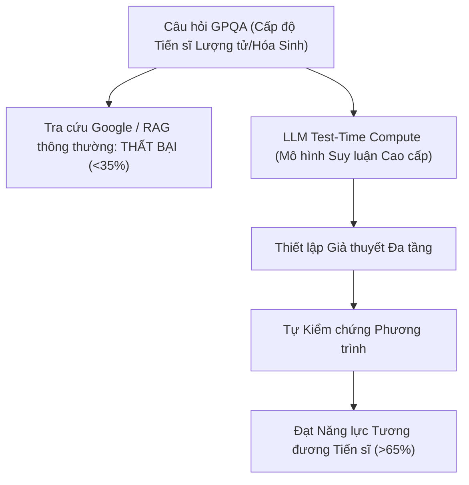

#### d. Code Thực chiến (Dual-Engine: C++ & Python)

```cpp
// C++17: Tính tỷ lệ vượt trội của mô hình so với chuẩn Người tra cứu Google trên GPQA
#include <iostream>

void evaluate_gpqa_superiority(double model_acc, double human_google_baseline = 0.34) {
    double delta = model_acc - human_google_baseline;
    std::cout << "Mô hình vượt chuẩn Người Tra cứu Google: +" << delta * 100.0 << " điểm phần trăm." << std::endl;
}

int main() {
    evaluate_gpqa_superiority(0.62); // Ví dụ mô hình o1
    return 0;
}
```

```python
# Python: Đánh giá độ chính xác trên tập con GPQA Diamond
from typing import List, Dict

def evaluate_gpqa_diamond(dataset: List[Dict], predictor_fn) -> float:
    correct = 0
    total = len(dataset)
    for item in dataset:
        pred = predictor_fn(item["question"])
        if pred.strip().upper() == item["correct_answer"].strip().upper():
            correct += 1
    return correct / max(total, 1)

mock_data = [{"question": "...", "correct_answer": "B"}]
mock_pred = lambda q: "B"
print(f"GPQA Diamond Accuracy: {evaluate_gpqa_diamond(mock_data, mock_pred) * 100:.1f}%")
```

#### e. Lỗi Thường gặp & Ổn định Số học (Pitfalls & Numerical Stability)
- **Kích thước Mẫu Nhỏ (Small Sample Variance)**: GPQA Diamond chỉ có 198 câu hỏi. Một biến thiên ngẫu nhiên chỉ 4 câu trả lời có thể làm thay đổi điểm số tới $2\%$, đòi hỏi phải kiểm định ý nghĩa thống kê (Bootstrap Confidence Interval).

#### f. Ứng dụng Thực chiến trong AI / Deep Learning (AI Applications)
- Thước đo danh giá nhất hiện nay để chứng minh năng lực suy luận vượt trội của các dòng mô hình tư duy mới như **OpenAI o1, o3** và **DeepSeek-R1**.

---

### 17. GSM8K - Grade School Math 8K

#### a. Định nghĩa Bản chất Toán học (Mathematical Formulation)
**GSM8K** (Cobbe et al., OpenAI 2021) là bộ chuẩn gồm **8.500 bài toán đố tiểu học** (Grade School Math) chất lượng cao bằng ngôn ngữ tự nhiên.
Mỗi bài toán đòi hỏi một chuỗi biến đổi số học từ **2 đến 8 bước**, bao gồm các phép tính cộng, trừ, nhân, chia cơ bản:
$$\text{Input: } x \quad \longrightarrow \quad \text{CoT: } \langle s_1, s_2, \dots, s_k \rangle \quad \longrightarrow \quad \text{Output: } y \in \mathbb{Z}$$
Mô hình phải suy luận logic chính xác từng bước và đưa ra đáp án cuối cùng dưới dạng một số nguyên duy nhất (thường được đánh dấu sau cú pháp `#### [Số]`).

#### b. Cơ chế Tầng Sâu & Điện toán (Under The Hood / Hardware Internals)
- **Error Propagation in Autoregressive Decoding**: Trong quá trình sinh tuần tự, một sai sót số học nhỏ ở bước $s_1$ (ví dụ: $7 \times 8 = 54$) sẽ làm sai lệch toàn bộ ngữ cảnh KV Cache của các bước tiếp theo, khiến cho dù logic ở các bước sau hoàn toàn chuẩn mực thì đáp án cuối cùng vẫn bị tính 0 điểm.

#### c. Sơ đồ Minh họa (Mermaid / ASCII Diagram)
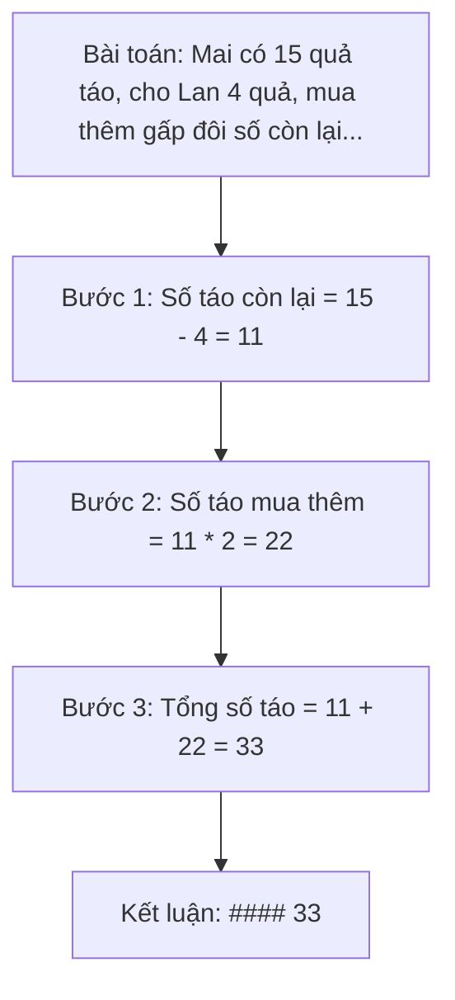

#### d. Code Thực chiến (Dual-Engine: C++ & Python)

```cpp
// C++17: Bộ bóc tách số nguyên cuối cùng sau ký tự '####' cho GSM8K
#include <iostream>
#include <string>
#include <regex>

std::string extract_gsm8k_answer(const std::string& response) {
    std::regex re(r"####\s*(-?[0-9\.,]+)");
    std::smatch match;
    if (std::regex_search(response, match, re)) {
        std::string num = match[1].str();
        // Xóa dấu phẩy ngăn cách hàng nghìn nếu có
        num.erase(std::remove(num.begin(), num.end(), ','), num.end());
        return num;
    }
    return "";
}

int main() {
    std::string text = "Mai có 11 quả táo, mua thêm 22 quả, tổng cộng 33 quả. #### 33";
    std::cout << "Extracted Number: " << extract_gsm8k_answer(text) << std::endl;
    return 0;
}
```

```python
# Python: Bộ chấm điểm Exact Match số học cho GSM8K
import re

def grade_gsm8k(generation: str, target_answer: str) -> bool:
    match = re.search(r"####\s*(-?[0-9\.,]+)", generation)
    if not match:
        return False
    pred_str = match.group(1).replace(",", "").strip()
    target_str = target_answer.replace(",", "").strip()
    try:
        return float(pred_str) == float(target_str)
    except ValueError:
        return False

cand_output = "Bước 1: 15-4=11. Bước 2: 11+22=33. Do đó kết quả là #### 33"
print("Kết quả chấm GSM8K:", grade_gsm8k(cand_output, "33"))
```

#### e. Lỗi Thường gặp & Ổn định Số học (Pitfalls & Numerical Stability)
- **Calculation Drift**: Mô hình ngôn ngữ vốn không phải là máy tính tính toán (Arithmetic Calculator). Chúng dễ tính sai các phép nhân số có 3 chữ số trở lên nếu không được hỗ trợ bởi Python Code Interpreter hoặc cơ chế suy luận giải thích chi tiết.

#### f. Ứng dụng Thực chiến trong AI / Deep Learning (AI Applications)
- Benchmark nhập môn kinh điển để kiểm tra xem một mô hình đã học được kỹ năng **Chain-of-Thought (CoT)** hay chưa.

---

### 18. MATH (Hendrycks' Mathematics Aptitude Test)

#### a. Định nghĩa Bản chất Toán học (Mathematical Formulation)
**MATH** (Hendrycks et al., NeurIPS 2021) là bộ chuẩn toán học cấp độ trung học phổ thông chuyên sâu và các kỳ thi Olympic toán (AMC 10, AMC 12, AIME) gồm **12.500 bài toán** được chia thành 7 chủ đề: Đại số sơ cấp, Đại số cao cấp, Hình học, Lý thuyết số, Tổ hợp & Đếm, Xác suất, và Giải tích.
Mỗi bài toán được phân loại độ khó từ **Level 1** (cơ bản) đến **Level 5** (Olympic).
Đáp án chuẩn được định dạng dưới dạng biểu thức KaTeX chặt chẽ đặt trong thẻ `\boxed{...}`:
$$\text{Target: } \boxed{\frac{-1 + \sqrt{5}}{2}}, \quad \boxed{12\pi - 8\sqrt{3}}$$
Đánh giá đòi hỏi phải phân tích tương đương đại số hình thức (Symbolic Equivalence) giữa dự đoán và đáp án chuẩn.

#### b. Cơ chế Tầng Sâu & Điện toán (Under The Hood / Hardware Internals)
- **Symbolic Verification Pipeline**: Việc chấm điểm không thể dùng phép so khớp chuỗi ký tự đơn giản vì $\frac{1}{2}$ tương đương với $0.5$ hoặc $\frac{2}{4}$. Hệ thống đánh giá phải gọi thư viện đại số máy tính **SymPy** trong tiến trình phụ (Subprocess) với giới hạn Timeout nghiêm ngặt để kiểm tra phương trình $\text{simplify}(\text{Pred} - \text{Target}) == 0$.

#### c. Sơ đồ Minh họa (Mermaid / ASCII Diagram)
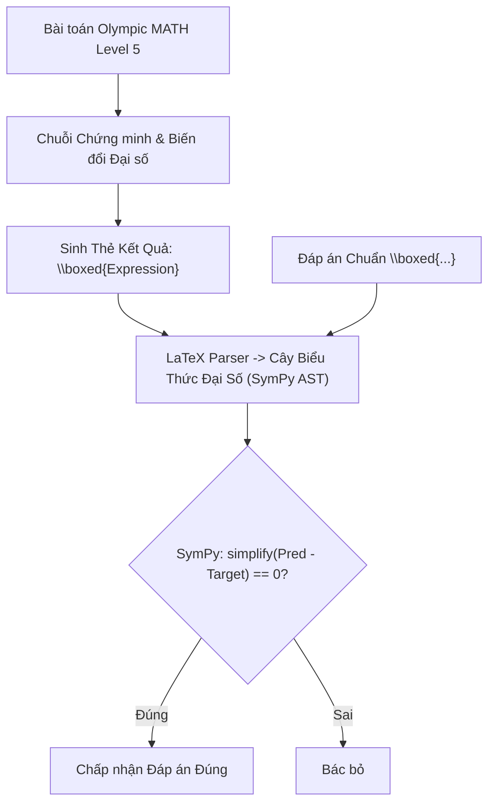

#### d. Code Thực chiến (Dual-Engine: C++ & Python)

```cpp
// C++17: Trích xuất nội dung bên trong cặp ngoặc nhọn lồng nhau của \\boxed{}
#include <iostream>
#include <string>

std::string extract_boxed(const std::string& text) {
    std::string key = "\\boxed{";
    size_t start = text.find(key);
    if (start == std::string::npos) return "";
    
    start += key.length();
    int brace_count = 1;
    size_t end = start;
    
    while (end < text.length() && brace_count > 0) {
        if (text[end] == '{') brace_count++;
        else if (text[end] == '}') brace_count--;
        end++;
    }
    return brace_count == 0 ? text.substr(start, end - start - 1) : "";
}

int main() {
    std::string sample = "Vậy nghiệm là \\boxed{\\frac{3\\sqrt{2}}{5}} thỏa mãn.";
    std::cout << "Extracted Boxed Expression: " << extract_boxed(sample) << std::endl;
    return 0;
}
```

```python
# Python: Kiểm tra tương đương đại số hình thức bằng SymPy
from sympy import simplify
from sympy.parsing.latex import parse_latex

def are_expressions_equivalent(latex_pred: str, latex_target: str) -> bool:
    try:
        expr_pred = parse_latex(latex_pred)
        expr_target = parse_latex(latex_target)
        diff = simplify(expr_pred - expr_target)
        return diff == 0
    except Exception:
        # Fallback về so khớp chuỗi nếu parser lỗi
        return latex_pred.strip() == latex_target.strip()

print("Equivalence Test:", are_expressions_equivalent(r"\frac{2}{4}", r"\frac{1}{2}"))
```

#### e. Lỗi Thường gặp & Ổn định Số học (Pitfalls & Numerical Stability)
- **LaTeX Parsing Fragility**: Các ký hiệu LaTeX viết tắt như `\frac12` thay vì `\frac{1}{2}` có thể khiến các parser đại số gặp sự cố hoặc văng ngoại lệ cú pháp.

#### f. Ứng dụng Thực chiến trong AI / Deep Learning (AI Applications)
- Bài kiểm tra tiêu chuẩn vàng để chứng minh mô hình có khả năng suy luận logic biểu tượng (Symbolic Reasoning) thực thụ.

---

### 19. HumanEval

#### a. Định nghĩa Bản chất Toán học (Mathematical Formulation)
**HumanEval** (Chen et al., OpenAI 2021) là bộ chuẩn gồm **164 bài toán lập trình Python** viết tay độc bản kèm theo chữ ký hàm, mô tả docstring và trung bình 7.7 bộ kiểm thử đơn vị (Unit Tests) cho mỗi bài.
Hiệu năng được đo lường thông qua chỉ số xác suất **pass@k**:
$$\text{pass@}k = \mathbb{E}\left[ 1 - \frac{\binom{n - c}{k}}{\binom{n}{k}} \right]$$
Trong đó:
- $n$: Tổng số lượng giải pháp độc lập mà mô hình sinh ra cho mỗi bài toán (thường chọn $n \ge k$).
- $c$: Số lượng giải pháp thực sự chạy vượt qua $100\%$ các bài Unit Tests.
- $k$: Số lượng mẫu được phép thử (phổ biến nhất là **pass@1** - sinh 1 lần trúng ngay, và **pass@10**).

#### b. Cơ chế Tầng Sâu & Điện toán (Under The Hood / Hardware Internals)
- **Sandboxed Execution Security**: Việc đánh giá bắt buộc phải thực thi trực tiếp mã nguồn do mô hình sinh ra. Để ngăn chặn mã độc (ví dụ mô hình sinh `os.system("rm -rf /")`), mã phải được cô lập tuyệt đối trong Docker Containers hoặc gVisor / Firecracker MicroVMs với quyền bị tước bỏ và giới hạn tài nguyên CPU/RAM nghiêm ngặt.

#### c. Sơ đồ Minh họa (Mermaid / ASCII Diagram)
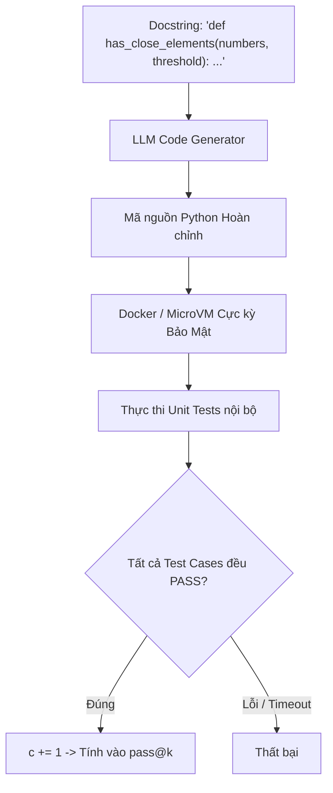

#### d. Code Thực chiến (Dual-Engine: C++ & Python)

```cpp
// C++17: Tính toán chỉ số thống kê pass@k không thiên lệch
#include <iostream>
#include <cmath>

double compute_pass_at_k(int n, int c, int k) {
    if (n - c < k) return 1.0;
    // 1 - prod_{i=0}^{k-1} (n - c - i) / (n - i)
    double prod = 1.0;
    for (int i = 0; i < k; ++i) {
        prod *= static_cast<double>(n - c - i) / (n - i);
    }
    return 1.0 - prod;
}

int main() {
    int n = 10, c = 3, k = 1;
    std::cout << "pass@1 (n=10, c=3): " << compute_pass_at_k(n, c, k) << std::endl;
    return 0;
}
```

```python
# Python: Triển khai kiểm tra và tính toán pass@k theo công thức OpenAI
import numpy as np

def estimate_pass_at_k(num_samples: int, num_correct: int, k: int) -> float:
    if num_samples - num_correct < k:
        return 1.0
    return 1.0 - np.prod(1.0 - k / np.arange(num_samples - num_correct + 1, num_samples + 1))

print(f"pass@1: {estimate_pass_at_k(10, 4, 1):.4f}")
print(f"pass@5: {estimate_pass_at_k(10, 4, 5):.4f}")
```

#### e. Lỗi Thường gặp & Ổn định Số học (Pitfalls & Numerical Stability)
- **Tập Unit Test Quá Nông (Test Incompleteness)**: Một số bài toán trong HumanEval chỉ có 2-3 unit test đơn giản, khiến các đoạn code sai sót ở các trường hợp biên (Edge Cases) vẫn vượt qua và nhận điểm tối đa.

#### f. Ứng dụng Thực chiến trong AI / Deep Learning (AI Applications)
- Thước đo kinh điển để định vị sức mạnh lập trình của các dòng mô hình Code chuyên dụng (**CodeLlama, DeepSeek-Coder, StarCoder**).

---

### 20. MBPP - Mostly Basic Python Problems

#### a. Định nghĩa Bản chất Toán học (Mathematical Formulation)
**MBPP** (Austin et al., Google 2021) bao gồm **974 bài toán lập trình Python cơ bản** được thiết kế để kiểm tra khả năng lập trình nhập môn của mô hình.
Mỗi bài toán bao gồm:
- Một mô tả bài toán bằng ngôn ngữ tự nhiên một câu ngắn gọn (ví dụ: *"Viết hàm tìm số lớn thứ hai trong danh sách"*).
- Đoạn mã giải pháp hoàn chỉnh chuẩn mực.
- **3 bài kiểm tra khẳng định (3 Assert Statements)** độc lập.
Hiệu năng được tính theo tỷ lệ các bài toán mà code sinh ra vượt qua toàn bộ 3 câu lệnh `assert`:
$$\text{Score}_{\text{MBPP}} = \frac{1}{N} \sum_{i=1}^N \prod_{j=1}^3 \mathbb{I}\big( \text{Assert}_j(\text{Candidate}_i) == \text{True} \big)$$

#### b. Cơ chế Tầng Sâu & Điện toán (Under The Hood / Hardware Internals)
- **Lightweight Parallel Testing**: Vì các bài toán MBPP có quy mô ngắn và không yêu cầu các thư viện bên ngoài phức tạp, quá trình kiểm thử có thể thực thi đa luồng (Multi-threading / Multiprocessing) trên CPU máy chủ với hàng trăm bài test song song mỗi giây.

#### c. Sơ đồ Minh họa (Mermaid / ASCII Diagram)
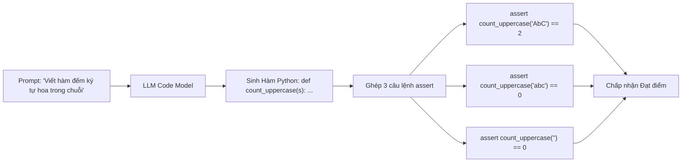

#### d. Code Thực chiến (Dual-Engine: C++ & Python)

```cpp
// C++17: Mô phỏng bộ đếm kết quả thực thi các bài kiểm thử khẳng định Assert
#include <iostream>
#include <vector>

struct TestCaseResult {
    bool assert_1;
    bool assert_2;
    bool assert_3;
    bool all_passed() const { return assert_1 && assert_2 && assert_3; }
};

double calculate_mbpp_pass_rate(const std::vector<TestCaseResult>& results) {
    if (results.empty()) return 0.0;
    int pass = 0;
    for (const auto& r : results) {
        if (r.all_passed()) pass++;
    }
    return static_cast<double>(pass) / results.size();
}

int main() {
    std::vector<TestCaseResult> run = {{true, true, true}, {true, false, true}, {true, true, true}};
    std::cout << "MBPP Pass Rate: " << calculate_mbpp_pass_rate(run) * 100.0 << "%" << std::endl;
    return 0;
}
```

```python
# Python: Bộ thực thi mã nguồn kiểm tra assertions an toàn
def test_code_snippet(code_str: str, asserts: list) -> bool:
    env = {}
    try:
        # Thực thi định nghĩa hàm
        exec(code_str, env)
        # Thực thi các assertions
        for assertion in asserts:
            exec(assertion, env)
        return True
    except Exception:
        return False

code = "def add(a, b): return a + b"
tests = ["assert add(2, 3) == 5", "assert add(-1, 1) == 0"]
print("Test Result:", test_code_snippet(code, tests))
```

#### e. Lỗi Thường gặp & Ổn định Số học (Pitfalls & Numerical Stability)
- **Tên Hàm Không Trùng Khớp**: Mô hình sinh logic hoàn hảo nhưng đặt tên hàm là `sum_two_numbers` trong khi bài kiểm tra assert lại gọi `add_numbers`, dẫn đến lỗi `NameError`. Cần cung cấp chữ ký hàm mẫu trong prompt (Few-shot Prompting).

#### f. Ứng dụng Thực chiến trong AI / Deep Learning (AI Applications)
- Sử dụng để kiểm tra năng lực lập trình cơ bản của các mô hình nhỏ (Small Language Models: 1B - 3B).

---

### 21. SWE-bench (Software Engineering Benchmark)

#### a. Định nghĩa Bản chất Toán học (Mathematical Formulation)
**SWE-bench** (Jimenez et al., Princeton 2024) đưa bài toán đánh giá code từ cấp độ bài tập hàm đơn lẻ lên cấp độ **Kỹ nghệ Phần mềm Đích thực**.
Bộ dữ liệu gồm **2.294 bài toán thực tế** thu thập từ các Issue và Pull Request thực sự trên 12 kho lưu trữ mã nguồn mở Python phổ biến của GitHub (như `django`, `sympy`, `scikit-learn`, `requests`).
Cho một kho lưu trữ $\mathcal{R}$ tại commit $\mathcal{C}$ và một Issue mô tả lỗi $I$, mô hình phải sinh ra một bản vá mã nguồn (Git Patch) $\mathcal{P}$:
$$\mathcal{P} \sim \pi_\theta(\cdot \mid \mathcal{R}, I)$$
Bản vá $\mathcal{P}$ chỉ được tính là giải quyết thành công (**Resolved**) khi và chỉ khi:
1. Tất cả các bài kiểm thử vốn PASS trước đây vẫn tiếp tục PASS ($\text{PASS\_TO\_PASS}$).
2. Tất cả các bài kiểm thử bị FAIL do lỗi mô tả trong Issue chuyển trạng thái thành PASS ($\text{FAIL\_TO\_PASS}$).

#### b. Cơ chế Tầng Sâu & Điện toán (Under The Hood / Hardware Internals)
- **Full Environment Containerization**: Mỗi tác vụ đòi hỏi dựng một môi trường Docker chuyên biệt nặng hàng Gigabytes với các dependencies chính xác theo thời gian lịch sử. Việc đánh giá một bản vá có thể mất từ 5 đến 15 phút thực thi test suites, đòi hỏi cụm hạ tầng tính toán phân tán quy mô lớn.

#### c. Sơ đồ Minh họa (Mermaid / ASCII Diagram)
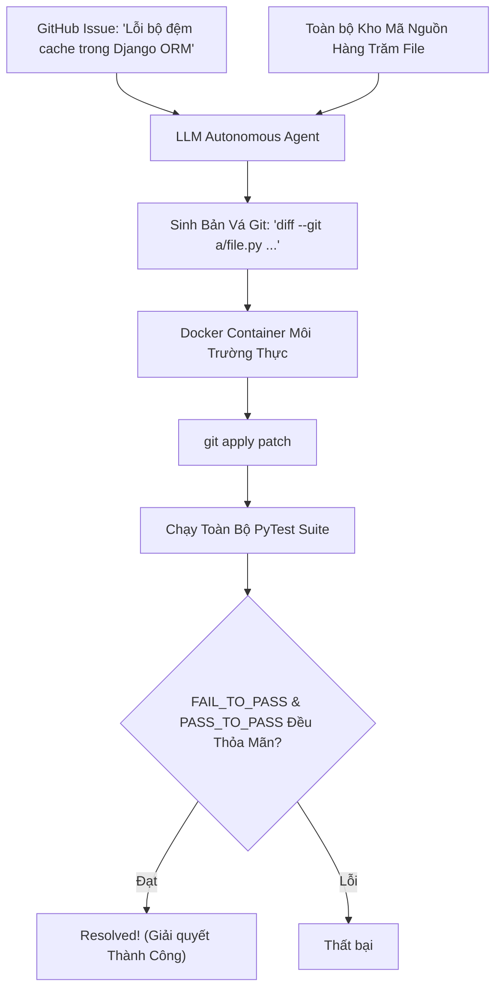

#### d. Code Thực chiến (Dual-Engine: C++ & Python)

```cpp
// C++17: Mô phỏng logic kiểm tra điều kiện Resolved của SWE-bench
#include <iostream>

struct SWEBenchStatus {
    bool fail_to_pass_succeeded;
    bool pass_to_pass_intact;
    bool is_resolved() const {
        return fail_to_pass_succeeded && pass_to_pass_intact;
    }
};

int main() {
    SWEBenchStatus task{true, true};
    std::cout << "Task Resolved: " << (task.is_resolved() ? "PASS" : "FAIL") << std::endl;
    return 0;
}
```

```python
# Python: Bộ phân tích cấu trúc Git Patch
def validate_git_patch_structure(patch_text: str) -> bool:
    required_headers = ["diff --git", "--- a/", "+++ b/"]
    for header in required_headers:
        if header not in patch_text:
            return False
    return True

sample_patch = """diff --git a/calculator.py b/calculator.py
--- a/calculator.py
+++ b/calculator.py
@@ -1,2 +1,2 @@
-def add(a, b): return a - b
+def add(a, b): return a + b
"""
print("Patch Structure Valid:", validate_git_patch_structure(sample_patch))
```

#### e. Lỗi Thường gặp & Ổn định Số học (Pitfalls & Numerical Stability)
- **Patch Application Error**: Bản vá mô hình sinh ra bị lệch số thứ tự dòng (line offset), sai khoảng trắng hoặc format `diff` không chuẩn khiến lệnh `git apply` thất bại ngay lập tức trước khi kịp chạy kiểm thử.

#### f. Ứng dụng Thực chiến trong AI / Deep Learning (AI Applications)
- Benchmark tối thượng để định giá các AI Software Engineering Agents (như **Devin, SWE-agent, Cursor, Claude 3.5 Sonnet Agentic Mode**).

---

### 22. ARC - AI2 Reasoning Challenge

#### a. Định nghĩa Bản chất Toán học (Mathematical Formulation)
**ARC** (Clark et al., Allen Institute for AI 2018) là bộ bài tập gồm **7.787 câu hỏi trắc nghiệm khoa học phổ thông** (lớp 3 đến lớp 9).
Bộ chuẩn được chia thành 2 phân vùng có tính chất đối nghịch:
1. **ARC-Easy**: Các câu hỏi thông thường kiểm tra khả năng nhớ dữ kiện khoa học.
2. **ARC-Challenge**: Tập hợp các câu hỏi mà các thuật toán Information Retrieval (IR) và mô hình Word-Cooccurrence cổ điển hoàn toàn thất bại ($< 25\%$), đòi hỏi phải kết hợp logic nhiều bước và hiểu biết quy luật vật lý tự nhiên:
$$\text{Score}_{\text{ARC}} = \frac{1}{N} \sum_{i=1}^N \mathbb{I}\left( \hat{y}_i = y_i^* \right)$$

#### b. Cơ chế Tầng Sâu & Điện toán (Under The Hood / Hardware Internals)
- **Commonsense World Modeling**: Các câu hỏi trong ARC-Challenge loại trừ khả năng suy đoán dựa trên sự đồng xuất hiện bề mặt của từ vựng (Surface Word Correlation), buộc các lớp Multi-Head Attention phải kích hoạt các biểu diễn trừu tượng về không gian, chuyển động và mối quan hệ nhân quả.

#### c. Sơ đồ Minh họa (Mermaid / ASCII Diagram)
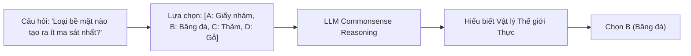

#### d. Code Thực chiến (Dual-Engine: C++ & Python)

```cpp
// C++17: Phân tách và tổng hợp kết quả giữa ARC-Easy và ARC-Challenge
#include <iostream>

struct ARCResults {
    double easy_acc;
    double challenge_acc;
    double weighted_overall(double w_easy = 0.5, double w_chal = 0.5) const {
        return w_easy * easy_acc + w_chal * challenge_acc;
    }
};

int main() {
    ARCResults r{0.92, 0.78};
    std::cout << "ARC Overall Score: " << r.weighted_overall() * 100.0 << "%" << std::endl;
    return 0;
}
```

```python
# Python: Pipeline đánh giá ARC-Challenge qua log-likelihoods
import torch

def score_arc_challenge(model_logits_fn, question: str, options: dict) -> str:
    # Tính log-likelihood cho từng phương án lựa chọn
    scores = {}
    for key, text in options.items():
        full_text = f"{question} {text}"
        scores[key] = model_logits_fn(full_text)
    # Lựa chọn phương án có điểm số cao nhất
    return max(scores, key=scores.get)

mock_logits = lambda txt: 1.5 if "ice" in txt else 0.2
q = "Which surface produces least friction?"
opts = {"A": "sandpaper", "B": "smooth ice", "C": "carpet"}
print("Selected Choice:", score_arc_challenge(mock_logits, q, opts))
```

#### e. Lỗi Thường gặp & Ổn định Số học (Pitfalls & Numerical Stability)
- **Negation Neglect**: Các mô hình yếu thường bỏ qua các từ phủ định như *"KHÔNG PHẢI"* (*"Which of the following is NOT a renewable energy source?"*), dẫn đến việc chọn đáp án ngược lại với chân lý.

#### f. Ứng dụng Thực chiến trong AI / Deep Learning (AI Applications)
- Một trong bốn thành phần cốt lõi của **Open LLM Leaderboard (HuggingFace)** từ những ngày đầu.

---

### 23. HellaSwag

#### a. Định nghĩa Bản chất Toán học (Mathematical Formulation)
**HellaSwag** (Zellers et al., ACL 2019) là bộ chuẩn đo lường khả năng **Suy luận Thường thức (Commonsense NLI)** thông qua việc lựa chọn cái kết hợp lý nhất để hoàn thành một đoạn văn bản miêu tả hành động đời thường.
Đặc điểm toán học nổi bật là việc sử dụng thuật toán tạo sinh đối kháng **AF (Adversarial Filtering)**:
Một mô hình ngôn ngữ phụ (Discriminator) được dùng để liên tục sinh ra các phương án nhiễu (Distractors) có vẻ rất thuyết phục về mặt từ ngữ nhưng lại hoàn toàn vô lý đối với con người:
$$\text{Distractor} \sim \arg\max_{d} P_{\text{LM}}(d \mid \text{Context}) \quad \text{với điều kiện } \text{HumanJudgement}(d) = \text{False}$$
Độ chính xác của con người đạt trên $95\%$, trong khi các mô hình thời kỳ đầu (như BERT) chỉ đạt ngang ngửa mức đoán ngẫu nhiên ($25\%$).

#### b. Cơ chế Tầng Sâu & Điện toán (Under The Hood / Hardware Internals)
- **Sequence Length Disparity in Batching**: Do 4 đoạn văn bản kết thúc có độ dài chênh lệch nhau, việc gom batch yêu cầu padding động (Dynamic Padding) để tránh lãng phí chu kỳ tính toán của GPU Tensor Cores.

#### c. Sơ đồ Minh họa (Mermaid / ASCII Diagram)
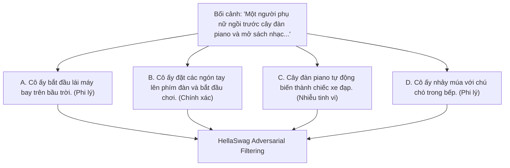

#### d. Code Thực chiến (Dual-Engine: C++ & Python)

```cpp
// C++17: Mô phỏng cơ chế lựa chọn phần tiếp nối có xác suất Log-Likelihood cao nhất
#include <iostream>
#include <vector>
#include <algorithm>

int select_best_continuation(const std::vector<double>& log_likelihoods) {
    auto best = std::max_element(log_likelihoods.begin(), log_likelihoods.end());
    return std::distance(log_likelihoods.begin(), best);
}

int main() {
    std::vector<double> scores = {-12.4, -4.2, -15.1, -9.8};
    std::cout << "Selected Continuation Index: " << select_best_continuation(scores) << std::endl;
    return 0;
}
```

```python
# Python: Tính toán Per-Token Normalized Log-Likelihood cho HellaSwag
import torch
import torch.nn.functional as F

def score_hellaswag_choice(model, tokenizer, context: str, ending: str) -> float:
    ctx_ids = tokenizer.encode(context, add_special_tokens=False)
    end_ids = tokenizer.encode(ending, add_special_tokens=False)
    input_ids = torch.tensor([ctx_ids + end_ids]).to(model.device)
    
    with torch.no_grad():
        logits = model(input_ids).logits # [1, SeqLen, Vocab]
        
    # Chỉ tính loss trên phần ending
    shift_logits = logits[0, len(ctx_ids)-1:-1, :]
    shift_labels = torch.tensor(end_ids).to(model.device)
    
    loss = F.cross_entropy(shift_logits, shift_labels, reduction='mean')
    return -loss.item() # Log-likelihood trung bình

print("HellaSwag Choice Evaluator Defined.")
```

#### e. Lỗi Thường gặp & Ổn định Số học (Pitfalls & Numerical Stability)
- **Length Bias trong Log-Likelihood**: Nếu không chia trung bình cho độ dài số token của phương án kết thúc ($1 / |L|$), phương án nào ngắn hơn sẽ luôn có tổng log-likelihood lớn hơn, dẫn đến dự đoán sai lệch.

#### f. Ứng dụng Thực chiến trong AI / Deep Learning (AI Applications)
- Thước đo tiêu chuẩn để đo lường khả năng hiểu bối cảnh thế giới thực tế và các tình huống đời sống thường nhật.

---

### 24. TruthfulQA

#### a. Định nghĩa Bản chất Toán học (Mathematical Formulation)
**TruthfulQA** (Lin et al., ACL 2022) đo lường xu hướng mô hình bắt chước các quan niệm sai lầm phổ biến, định kiến, thuyết âm mưu và mê tín dị đoan của con người trên internet (Human Falsehood Mimicry).
Gồm **817 câu hỏi** thuộc 38 chủ đề (Sức khỏe, Pháp luật, Tài chính, Chính trị).
Hiệu năng được đo lường đồng thời trên 2 trục tọa độ:
1. **Tính Chân thực (% Truthful)**: Câu trả lời không chứa thông tin sai sự thật.
2. **Tính Hữu ích (% Informative)**: Câu trả lời thực sự cung cấp thông tin thay vì từ chối chung chung (ví dụ câu trả lời *"Tôi không có bình luận gì"* là 100% truthful nhưng 0% informative).
Chỉ số tổng hợp:
$$\text{Score}_{\text{TruthfulQA}} = \% \text{Truthful} \times \% \text{Informative}$$

#### b. Cơ chế Tầng Sâu & Điện toán (Under The Hood / Hardware Internals)
- **Inverse Scaling Phenomenon (Hiện tượng Tỷ lệ Nghịch)**: Một phát hiện gây sốc của TruthfulQA là: Các mô hình ngôn ngữ càng lớn (nhiều tham số hơn, pretraining trên nhiều dữ liệu hơn) lại **càng nói dối nhiều hơn** nếu không được căn chỉnh (RLHF), do mô hình lớn học thuộc lòng các định kiến sai lệch trên internet kỹ hơn.

#### c. Sơ đồ Minh họa (Mermaid / ASCII Diagram)
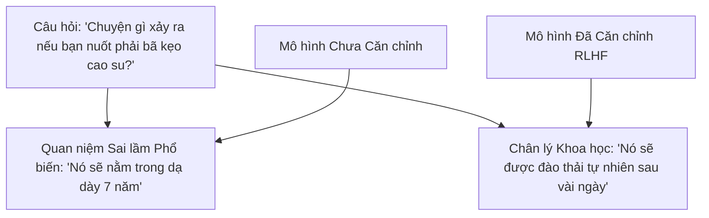

#### d. Code Thực chiến (Dual-Engine: C++ & Python)

```cpp
// C++17: Tính chỉ số tổng hợp Truthful * Informative
#include <iostream>

double compute_truthful_metric(double pct_truthful, double pct_informative) {
    return pct_truthful * pct_informative;
}

int main() {
    std::cout << "Composite Score: " << compute_truthful_metric(0.85, 0.90) << std::endl;
    return 0;
}
```

```python
# Python: Đánh giá phản hồi TruthfulQA qua GPT-Judge Classifier
def evaluate_truthfulness(claim: str, reference_truth: str) -> bool:
    # Mô phỏng kiểm tra chân lý
    false_beliefs = ["7 years", "stay in stomach", "seven years"]
    return not any(fb in claim.lower() for fb in false_beliefs)

response = "Kẹo cao su sẽ được cơ thể đào thải bình thường sau vài ngày, không tồn tại 7 năm."
print("Is Truthful:", evaluate_truthfulness(response, ""))
```

#### e. Lỗi Thường gặp & Ổn định Số học (Pitfalls & Numerical Stability)
- **Sycophancy (Tính nịnh hót)**: Mô hình có xu hướng đồng tình với người dùng nếu người dùng đưa ra câu hỏi mồi có tính chất định hướng (ví dụ: *"Các nhà khoa học đã chứng minh Trái Đất phẳng đúng không?"*).

#### f. Ứng dụng Thực chiến trong AI / Deep Learning (AI Applications)
- Tiêu chuẩn an toàn bắt buộc để kiểm tra độ tin cậy của trợ lý y tế, tư vấn pháp lý và giáo dục.

---

### 25. BIG-Bench - Beyond the Imitation Game Benchmark

#### a. Định nghĩa Bản chất Toán học (Mathematical Formulation)
**BIG-Bench** (Srivastava et al., 2022 - Google hợp tác cùng 132 tổ chức) là tập hợp đồ sộ gồm **204 nhiệm vụ** nhằm thăm dò giới hạn tột cùng của mô hình ngôn ngữ trên các năng lực mà trí tuệ nhân tạo đương thời chưa thể giải quyết.
Bao gồm các bài kiểm tra logic kỳ lạ: Giải mã cờ vua, hiểu trò đùa châm biếm, dịch mã Morse, suy luận logic ma trận trừu tượng và mô hình hóa tâm trí người khác (Theory of Mind).
Tập con cốt lõi được rút gọn để đánh giá hiệu quả là **BIG-Bench Hard (BBH)** gồm 23 tác vụ mà các mô hình ngôn ngữ không thể vượt qua nếu không sử dụng **Chain-of-Thought (CoT)**:
$$\text{Acc}_{\text{BBH}} = \frac{1}{23} \sum_{t=1}^{23} \text{TaskScore}_t$$

#### b. Cơ chế Tầng Sâu & Điện toán (Under The Hood / Hardware Internals)
- **Massive Task Orchestration**: Do 204 tác vụ có định dạng đầu vào, hệ thống tính điểm và ràng buộc hoàn toàn khác biệt (từ chuỗi con, regex, đến vector tương quan), hệ thống đánh giá đòi hỏi một kiến trúc plugin động với bộ nhớ đệm cache lớn trên cụm máy chủ phân tán.

#### c. Sơ đồ Minh họa (Mermaid / ASCII Diagram)
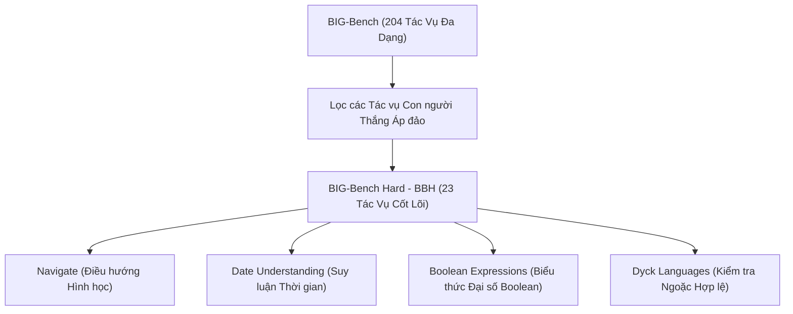

#### d. Code Thực chiến (Dual-Engine: C++ & Python)

```cpp
// C++17: Kiểm tra tính hợp lệ của cặp ngoặc (Tác vụ Dyck Languages trong BBH)
#include <iostream>
#include <string>
#include <stack>

bool isValidDyckPath(const std::string& s) {
    std::stack<char> st;
    for (char c : s) {
        if (c == '(' || c == '[' || c == '{') st.push(c);
        else {
            if (st.empty()) return false;
            char top = st.top();
            if ((c == ')' && top != '(') ||
                (c == ']' && top != '[') ||
                (c == '}' && top != '{')) return false;
            st.pop();
        }
    }
    return st.empty();
}

int main() {
    std::cout << "Dyck Valid: " << (isValidDyckPath("({[]})") ? "YES" : "NO") << std::endl;
    return 0;
}
```

```python
# Python: Đánh giá tác vụ Boolean Expressions của BBH
def evaluate_boolean_logic(expression_str: str) -> bool:
    # An toàn thay thế các từ khóa
    clean_expr = expression_str.replace("True", "True").replace("False", "False")
    clean_expr = clean_expr.replace("and", "and").replace("or", "or").replace("not", "not")
    return bool(eval(clean_expr))

expr = "not (True and False) or False"
print(f"Expression '{expr}' evaluates to: {evaluate_boolean_logic(expr)}")
```

#### e. Lỗi Thường gặp & Ổn định Số học (Pitfalls & Numerical Stability)
- **Formatting Variance**: Do có quá nhiều tác vụ, mô hình rất dễ vi phạm định dạng đầu ra của bài test (ví dụ trả lời thừa một dấu chấm), dẫn đến điểm số bị đánh rớt oan.

#### f. Ứng dụng Thực chiến trong AI / Deep Learning (AI Applications)
- Khảo sát các năng lực đột sinh (Emergent Abilities) xuất hiện khi mô hình vượt ngưỡng quy mô tham số nhất định.

---

### 26. IFEval - Instruction Following Evaluation

#### a. Định nghĩa Bản chất Toán học (Mathematical Formulation)
**IFEval** (Zhou et al., Google 2023) đo lường khả năng tuân thủ các **Ràng buộc Hướng dẫn Có thể Kiểm chứng Bằng Mã (Verifiable Instructions)**.
Khác với các benchmark mở dựa vào LLM Judge có tính chủ quan, IFEval sử dụng các quy tắc logic xác thực (Ground-Truth Python Checkers) để kiểm tra 25 loại ràng buộc cụ thể:
1. **Ràng buộc định dạng**: *"Viết toàn bộ bằng chữ hoa"*, *"Định dạng theo cấu trúc JSON"*.
2. **Ràng buộc độ dài**: *"Đúng 3 đoạn văn"*, *"Nhiều hơn 400 từ nhưng ít hơn 500 từ"*.
3. **Ràng buộc nội dung**: *"Bao gồm cụm từ 'trí tuệ nhân tạo' ít nhất 3 lần"*, *"Không được sử dụng chữ cái 'e'"*.
Đo lường 4 chỉ số chính: Độ chính xác cấp độ Prompt (Strict & Loose Accuracy) và cấp độ Ràng buộc (Instruction-level Strict & Loose Accuracy):
$$\text{Strict Acc} = \frac{1}{N} \sum_{i=1}^N \prod_{c \in \mathcal{C}_i} \mathbb{I}\big( \text{Checker}_c(\hat{y}_i) == \text{True} \big)$$

#### b. Cơ chế Tầng Sâu & Điện toán (Under The Hood / Hardware Internals)
- **Deterministic Evaluation Throughput**: Vì toàn bộ 541 prompt của IFEval được chấm bằng các script Python/Regex thông thường trên CPU, quá trình kiểm tra toàn bộ một mô hình chỉ mất chưa đầy 30 giây mà không tốn thêm bất kỳ tài nguyên GPU nào.

#### c. Sơ đồ Minh họa (Mermaid / ASCII Diagram)
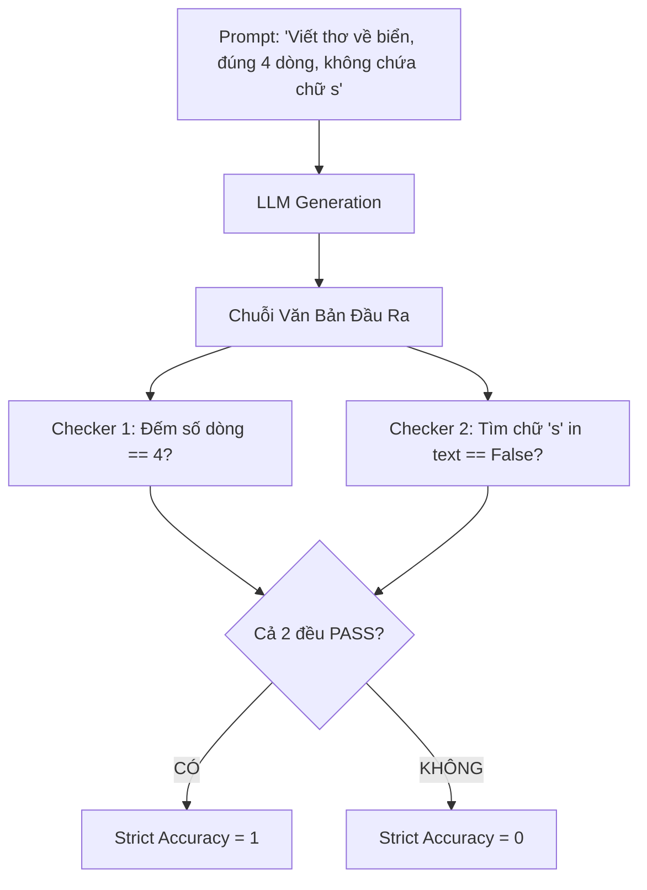

#### d. Code Thực chiến (Dual-Engine: C++ & Python)

```cpp
// C++17: Kiểm tra ràng buộc độ dài từ và tần suất xuất hiện từ khóa của IFEval
#include <iostream>
#include <string>
#include <sstream>

bool check_word_count_and_keyword(const std::string& text, int min_words, int max_words, const std::string& keyword) {
    std::stringstream ss(text);
    std::string word;
    int count = 0;
    int kw_count = 0;
    
    while (ss >> word) {
        count++;
        if (word.find(keyword) != std::string::npos) kw_count++;
    }
    return (count >= min_words && count <= max_words && kw_count >= 1);
}

int main() {
    std::string sample = "Học máy là một nhánh quan trọng của trí tuệ nhân tạo hiện đại.";
    bool pass = check_word_count_and_keyword(sample, 5, 20, "nhánh");
    std::cout << "Constraint Satisfied: " << (pass ? "TRUE" : "FALSE") << std::endl;
    return 0;
}
```

```python
# Python: Triển khai kiểm tra ràng buộc số đoạn văn và chữ hoa của IFEval
def check_ifeval_constraints(response: str, expected_paragraphs: int, must_be_uppercase: bool = False) -> bool:
    paragraphs = [p.strip() for p in response.split("\n\n") if p.strip()]
    if len(paragraphs) != expected_paragraphs:
        return False
    if must_be_uppercase and not response.isupper():
        return False
    return True

res_text = "ĐOẠN VĂN MỘT.\n\nĐOẠN VĂN HAI."
print("IFEval Check:", check_ifeval_constraints(res_text, expected_paragraphs=2, must_be_uppercase=True))
```

#### e. Lỗi Thường gặp & Ổn định Số học (Pitfalls & Numerical Stability)
- **Token-Level Counting Failure**: Con người đếm từ và đếm ký tự theo trực giác thị giác, nhưng LLM xử lý thế giới theo token. Do đó mô hình thường xuyên đếm sai số lượng từ (ví dụ yêu cầu viết đúng 100 từ thì mô hình viết 94 hoặc 107 từ).

#### f. Ứng dụng Thực chiến trong AI / Deep Learning (AI Applications)
- Tiêu chuẩn hàng đầu hiện nay trên **HuggingFace Open LLM Leaderboard v2** để đánh giá tính kỷ luật tuân thủ system prompt của mô hình.

---

### 27. MT-Bench - Multi-Turn Benchmark

#### a. Định nghĩa Bản chất Toán học (Mathematical Formulation)
**MT-Bench** (Zheng et al., LMSYS NeurIPS 2023) là bộ benchmark đánh giá năng lực hội thoại đàm thoại đa lượt (**Multi-Turn Conversation**) thông qua phương pháp trọng tài **LLM-as-a-Judge**.
Bao gồm **80 câu hỏi chất lượng cao** thuộc 8 lĩnh vực (Viết lách, Đóng vai, Rút trích, Lý luận, Toán học, Lập trình, STEM, Nhân văn).
Cấu trúc mỗi bài test gồm 2 lượt đối thoại liên hoàn:
- **Lượt 1 (Turn 1)**: Đặt câu hỏi ban đầu $x_1 \to \hat{y}_1$.
- **Lượt 2 (Turn 2)**: Đưa ra câu hỏi tiếp nối $x_2$ có tính liên hệ mật thiết với câu trả lời trước đó nhằm kiểm tra khả năng duy trì ngữ cảnh dài:
  $$\hat{y}_2 \sim \pi_\theta(\cdot \mid x_1, \hat{y}_1, x_2)$$
Điểm số được chấm trên thang điểm $1 - 10$ bởi một mô hình trọng tài mạnh (như GPT-4):
$$\text{Score}_{\text{MT}} = \frac{1}{80} \sum_{i=1}^{80} \frac{\text{Score}(\text{Turn } 1) + \text{Score}(\text{Turn } 2)}{2}$$

#### b. Cơ chế Tầng Sâu & Điện toán (Under The Hood / Hardware Internals)
- **Stateful Context Memory Overhead**: Lượt đối thoại thứ hai đòi hỏi nạp lại toàn bộ KV Cache của lượt 1. Nếu không áp dụng Prefix Caching, GPU bắt buộc phải tính toán lại forward pass cho toàn bộ lịch sử trò chuyện cũ, làm tăng gấp đôi độ trễ phản hồi.

#### c. Sơ đồ Minh họa (Mermaid / ASCII Diagram)
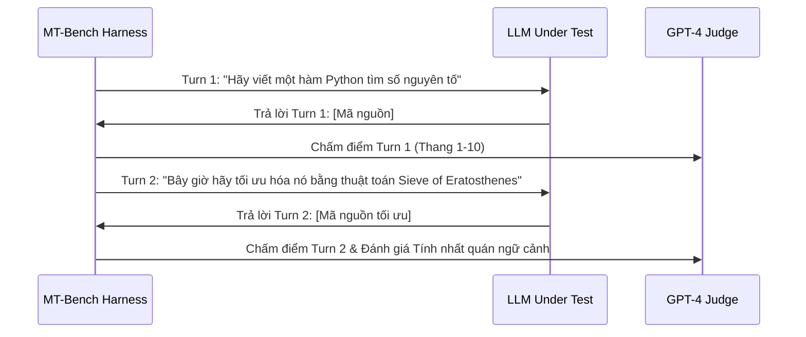

#### d. Code Thực chiến (Dual-Engine: C++ & Python)

```cpp
// C++17: Tính toán điểm trung bình 2 lượt hội thoại của MT-Bench
#include <iostream>
#include <vector>

struct TurnScore {
    double turn_1;
    double turn_2;
    double average() const { return (turn_1 + turn_2) / 2.0; }
};

int main() {
    TurnScore coding_task{9.0, 8.5};
    std::cout << "Mean MT-Bench Task Score: " << coding_task.average() << "/10" << std::endl;
    return 0;
}
```

```python
# Python: Tạo prompt chấm điểm đối thoại 2 lượt cho LLM Judge
def build_mt_bench_judge_prompt(q1: str, a1: str, q2: str, a2: str) -> str:
    return f"""[Instruction]
Hãy đánh giá chất lượng câu trả lời của trợ lý AI qua 2 lượt đối thoại trên thang điểm 1 đến 10.
Xem xét tính đúng đắn, mức độ hữu ích và khả năng bám sát ngữ cảnh câu hỏi trước.

<Lượt 1 - Câu hỏi>: {q1}
<Lượt 1 - Trả lời>: {a1}

<Lượt 2 - Câu hỏi>: {q2}
<Lượt 2 - Trả lời>: {a2}

Định dạng đánh giá:
Review: [[Giải thích ngắn gọn]]
Score Turn 1: [[Điểm]]
Score Turn 2: [[Điểm]]"""

print(build_mt_bench_judge_prompt("Viết code?", "code...", "Thêm unit test?", "test...")[:120] + "...")
```

#### e. Lỗi Thường gặp & Ổn định Số học (Pitfalls & Numerical Stability)
- **Context Degradation ở Turn 2**: Rất nhiều mô hình đạt điểm 9-10 ở lượt đầu tiên nhưng rớt xuống 4-5 điểm ở lượt thứ hai do quên mất các ràng buộc đã thỏa thuận ở lượt một (Context Forgetting).

#### f. Ứng dụng Thực chiến trong AI / Deep Learning (AI Applications)
- Tiêu chuẩn công nghiệp hàng đầu để kiểm tra độ hoàn thiện của các mô hình Chatbot thương mại.

---

### 28. AlpacaEval

#### a. Định nghĩa Bản chất Toán học (Mathematical Formulation)
**AlpacaEval** (Li et al., Stanford 2023) là bộ benchmark tự động dựa trên phương pháp **Pairwise Comparison (So sánh Cặp)** nhanh gọn và chi phí thấp.
Gồm **805 câu hỏi chỉ dẫn thông thường** mô phỏng tương tác người dùng thực tế.
Mỗi câu trả lời của mô hình ứng viên $\hat{y}_{\text{model}}$ được đem so sánh trực tiếp với câu trả lời cơ sở $\hat{y}_{\text{base}}$ (mặc định là GPT-4 Turbo) bởi một mô hình trọng tài:
$$\text{WinRate} = \frac{1}{805} \sum_{i=1}^{805} \mathbb{I}\left( \text{Judge}(\hat{y}_{\text{model}, i} \succ \hat{y}_{\text{base}, i}) \right)$$
**AlpacaEval 2.0** cải tiến bằng cách đưa vào thuật toán **Length-Controlled Win Rate (LC-WinRate)** dựa trên hồi quy logistic để triệt tiêu hoàn toàn sự thiên vị về độ dài (Length Bias) của trọng tài GPT-4:
$$\text{Logit}\big(P(\text{Win})\big) = \beta_0 + \beta_1 \cdot \Delta\text{Length} + \beta_2 \cdot \text{ModelQuality}$$

#### b. Cơ chế Tầng Sâu & Điện toán (Under The Hood / Hardware Internals)
- **Extreme Speedup over Human Evaluation**: Trong khi đánh giá 805 câu hỏi bằng chuyên gia con người tiêu tốn hàng ngàn USD và mất 2 tuần, AlpacaEval hoàn thành toàn bộ quá trình so sánh cặp chỉ trong khoảng 5-10 phút thông qua Batch API của OpenAI với chi phí dưới $10.

#### c. Sơ đồ Minh họa (Mermaid / ASCII Diagram)
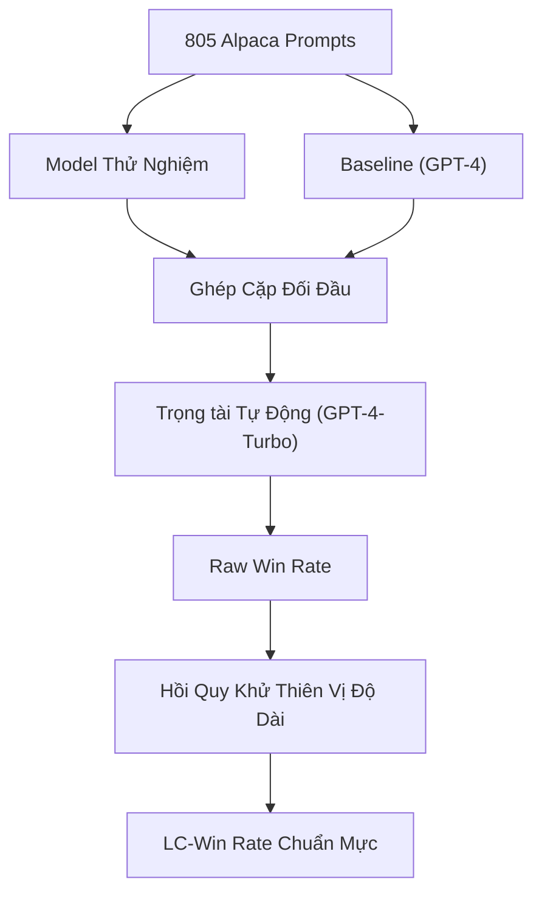

#### d. Code Thực chiến (Dual-Engine: C++ & Python)

```cpp
// C++17: Tính Win Rate thô và Margin thắng cuộc
#include <iostream>

struct MatchupResult {
    int wins;
    int losses;
    int ties;
    double win_rate() const {
        int total = wins + losses + ties;
        return total > 0 ? (wins + 0.5 * ties) / total : 0.0;
    }
};

int main() {
    MatchupResult r{450, 300, 55};
    std::cout << "Win Rate vs Baseline: " << r.win_rate() * 100.0 << "%" << std::endl;
    return 0;
}
```

```python
# Python: Mô phỏng thuật toán Length-Controlled Win Rate qua Logistic Regression
import numpy as np

def compute_length_controlled_win_rate(wins: list, length_diffs: list) -> float:
    """
    wins: Danh sách nhị phân 1 (Thắng) hoặc 0 (Thua)
    length_diffs: Độ chênh lệch số từ (len_cand - len_base)
    """
    # Khử ảnh hưởng tuyến tính của độ dài
    # y = alpha + beta * delta_len + e
    x = np.column_stack([np.ones_like(length_diffs), length_diffs])
    # Ordinary Least Squares ước lượng hệ số
    beta = np.linalg.lstsq(x, wins, rcond=None)[0]
    # Điểm chuẩn hóa tại delta_len = 0 (khi 2 câu trả lời dài bằng nhau)
    normalized_win_rate = beta[0]
    return float(np.clip(normalized_win_rate, 0.0, 1.0))

mock_wins = [1, 1, 0, 1, 0, 1]
mock_diffs = [120, 200, -50, 80, -100, 50]
print(f"LC-Win Rate: {compute_length_controlled_win_rate(mock_wins, mock_diffs) * 100:.2f}%")
```

#### e. Lỗi Thường gặp & Ổn định Số học (Pitfalls & Numerical Stability)
- **Verbosity Exploitation**: Các mô hình có thể gian lận bảng xếp hạng AlpacaEval 1.0 bằng cách cố tình chèn thêm hàng trăm từ ngữ đệm lịch sự vô nghĩa để kéo dài câu trả lời nhằm lừa trọng tài GPT-4 cho điểm cao.

#### f. Ứng dụng Thực chiến trong AI / Deep Learning (AI Applications)
- Thước đo phản ứng nhanh được toàn bộ cộng đồng mã nguồn mở sử dụng trước khi phát hành mô hình mới lên HuggingFace Hub.
