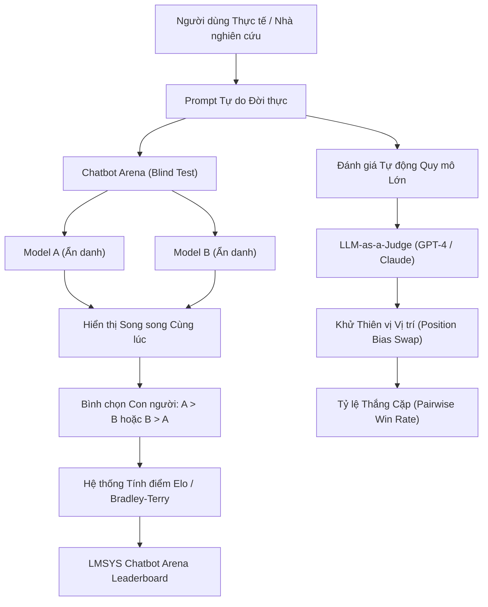
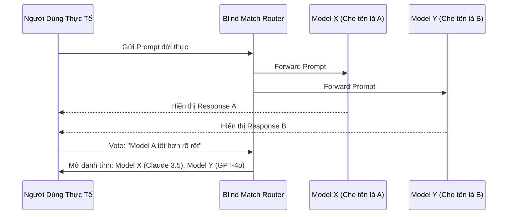
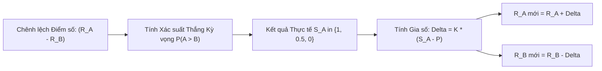
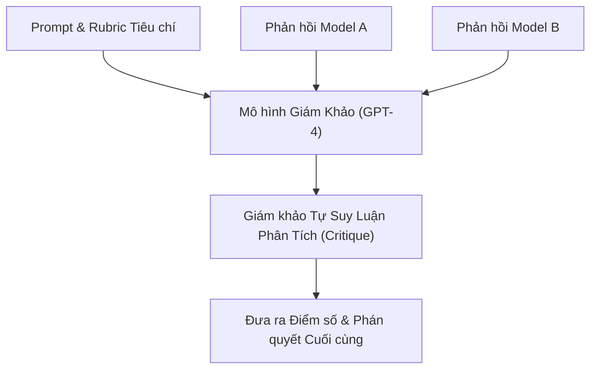
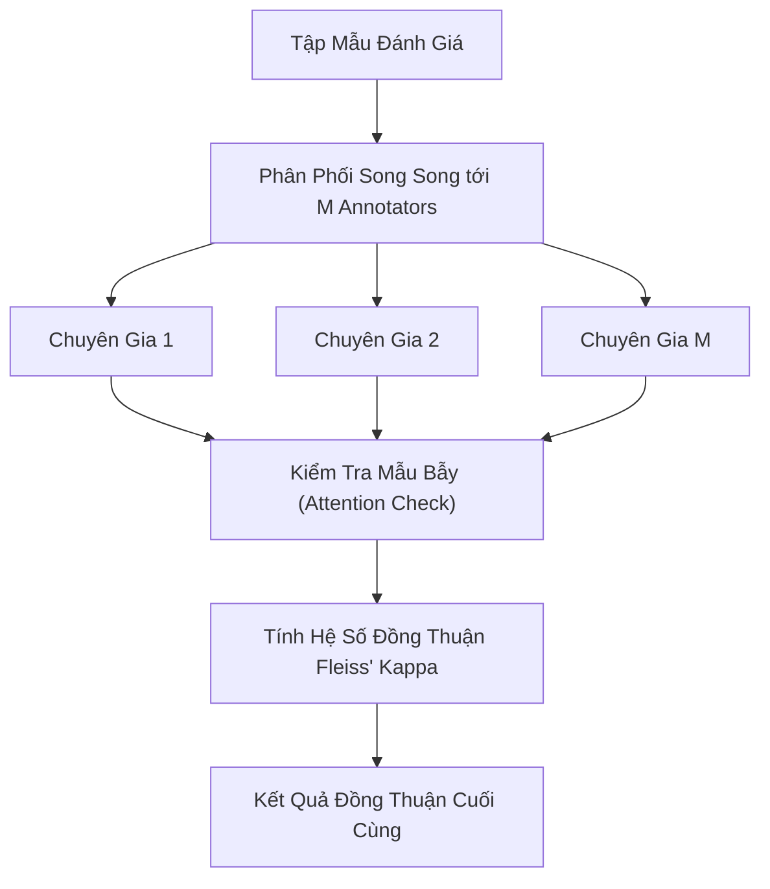
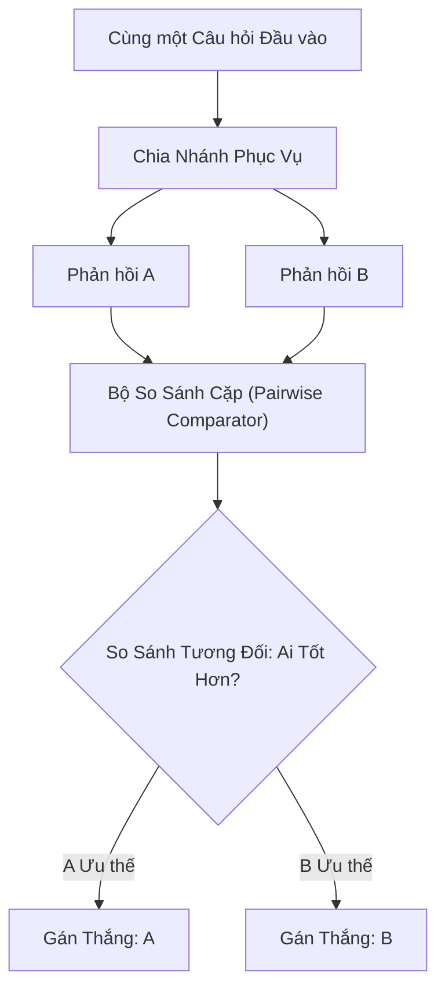
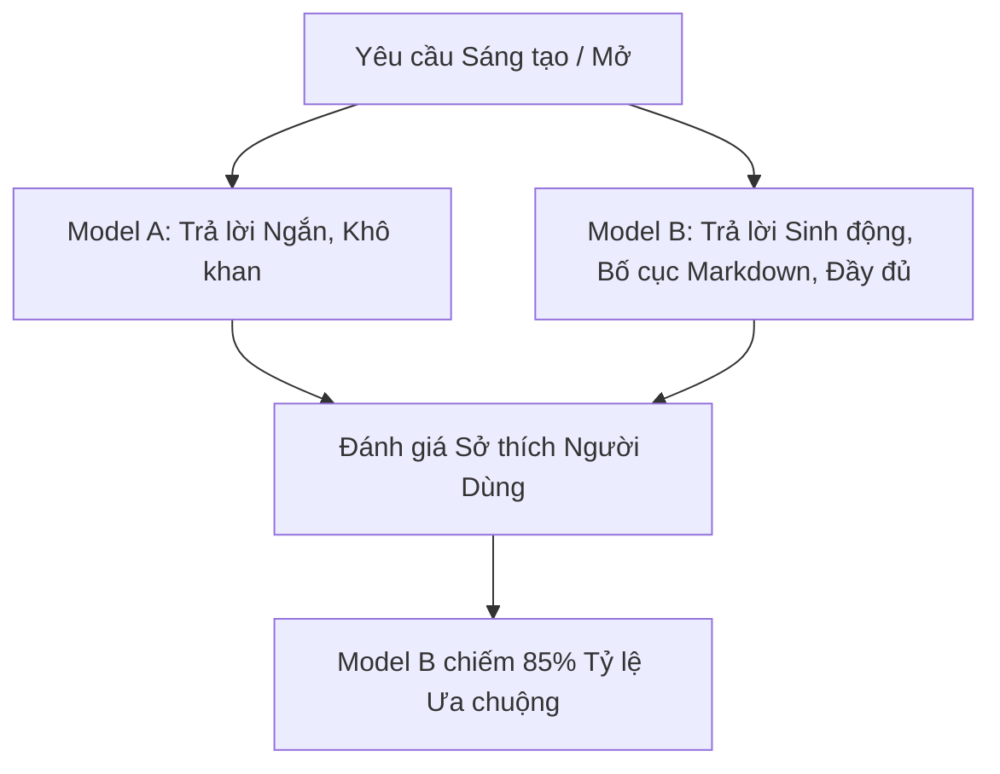
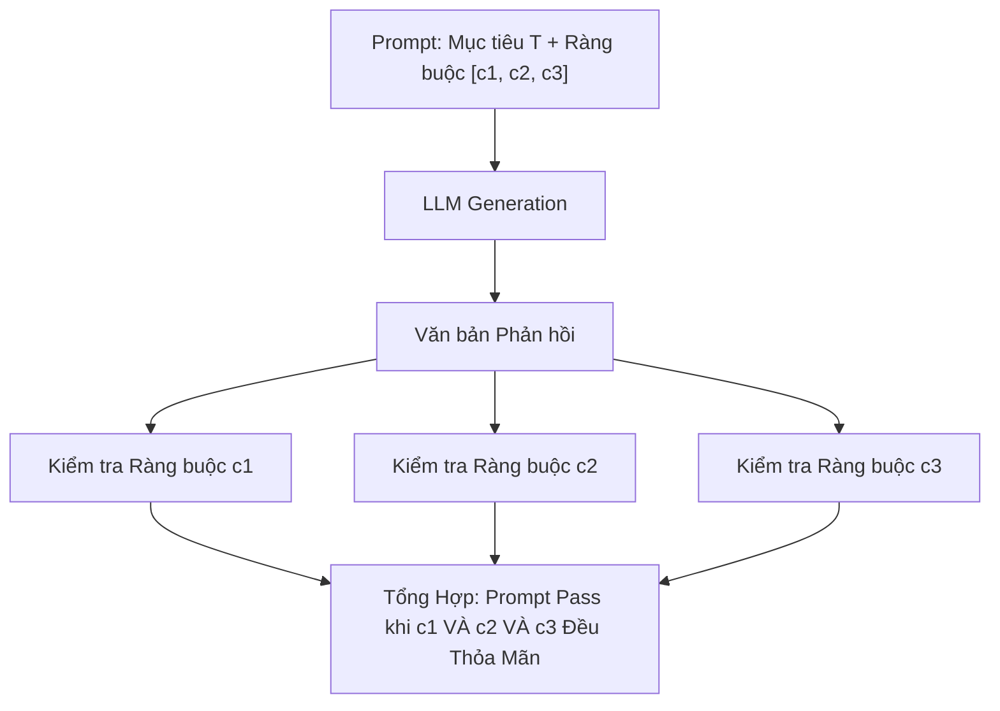

# Chuyên đề: Đấu trường Chatbot, Trọng tài LLM & Đánh giá Lấy Con người làm Trung tâm (Arena, Judges & Human-Centric Evaluation)

## 1. Tổng quan Chuyên đề
Khi các mô hình ngôn ngữ lớn đạt đến trình độ siêu đẳng trên các bài kiểm tra trắc nghiệm học thuật, các bộ benchmark tĩnh (Static Benchmarks) dần bộc lộ những khiếm khuyết chết người: Hiện tượng rò rỉ đề thi (Data Contamination), việc học vẹt câu hỏi, và sự mất kết nối với cảm nhận thực tế của người dùng.

Để nắm bắt chính xác mức độ thỏa dụng của con người trong các tình huống thực tế, làn sóng đánh giá thế hệ mới chuyển dịch sang **Mô hình Lấy Con người làm Trung tâm (Human-Centric)** kết hợp với **Trí tuệ Nhân tạo làm Giám khảo (LLM-as-a-Judge)**:
1. **Chatbot Arena & Hệ thống Xếp hạng Elo (Bradley-Terry)**: Đấu trường mù (Blind Battle) nơi hàng trăm ngàn người dùng thực tế trên toàn cầu trực tiếp đối thoại và bình chọn câu trả lời xuất sắc hơn giữa hai mô hình ẩn danh, tạo ra bảng xếp hạng có độ tin cậy và uy tín cao nhất thế giới AI.
2. **LLM-as-a-Judge**: Giải pháp tự động hóa chi phí thấp sử dụng các siêu mô hình thông minh nhất để đóng vai trò giám khảo công tâm, chấm điểm và so sánh theo các bảng tiêu chí định tính nghiêm ngặt.
3. **Phương pháp So sánh Cặp & Thẩm định Sự tuân thủ (Pairwise Comparison, Preference & Instruction Following Evaluation)**: Các kỹ thuật toán học giúp triệt tiêu thiên vị, đo lường sự hài lòng và kiểm chứng độ kỷ luật của mô hình.



---

## 2. Chi tiết từng Keyword

---

### 29. Chatbot Arena

#### a. Định nghĩa Bản chất Toán học (Mathematical Formulation)
**Chatbot Arena** (LMSYS Org, UC Berkeley 2023) là nền tảng đánh giá đám đông mở (Crowdsourced Open Evaluation Platform) vận hành theo cơ chế **Đấu trường Đối kháng Ẩn danh (Blind A/B Testing)**.
Quy trình toán học của một trận đấu (Battle):
1. Người dùng nhập một câu lệnh bất kỳ $x \sim \mathcal{D}_{\text{wild}}$ (phân phối câu hỏi thực tế trong đời sống).
2. Hệ thống định tuyến ngẫu nhiên câu lệnh tới 2 mô hình $\mathcal{M}_A$ và $\mathcal{M}_B$ được che giấu danh tính (Model A và Model B).
3. Người dùng tương tác đa lượt và đưa ra phán quyết nhị phân:
   $$y_{\text{vote}} \in \{\text{Model A Thắng}, \text{Model B Thắng}, \text{Hòa}, \text{Cả hai cùng Tệ}\}$$
4. Sau khi biểu quyết hoàn tất, danh tính của hai mô hình mới được công khai.
Dữ liệu biểu quyết được đưa vào mô hình xác suất Bradley-Terry để cập nhật thứ hạng toàn cầu.

#### b. Cơ chế Tầng Sâu & Điện toán (Under The Hood / Hardware Internals)
- **Global Dynamic Routing & Traffic Balancing**: Để bảo đảm các mô hình mới gia nhập đấu trường nhanh chóng hội tụ điểm số mà không làm loãng các mô hình cũ, bộ định tuyến sử dụng thuật toán **Active Sampling / Multi-Armed Bandit**: Ưu tiên ghép cặp các mô hình có độ bất định cao (High Variance in Elo) hoặc các mô hình có điểm số sát nút nhau để trận đấu mang lại lượng thông tin (Fisher Information) lớn nhất.

#### c. Sơ đồ Minh họa (Mermaid / ASCII Diagram)


#### d. Code Thực chiến (Dual-Engine: C++ & Python)

```cpp
// C++17: Bộ định tuyến ghép cặp đấu ngẫu nhiên cân bằng trong Chatbot Arena
#include <iostream>
#include <vector>
#include <string>
#include <random>

struct ModelEntry {
    int id;
    std::string name;
    double current_elo;
};

std::pair<int, int> select_matchup(const std::vector<ModelEntry>& pool) {
    std::random_device rd;
    std::mt19937 gen(rd());
    std::uniform_int_distribution<size_t> dist(0, pool.size() - 1);
    
    size_t idx_a = dist(gen);
    size_t idx_b = dist(gen);
    while (idx_b == idx_a) {
        idx_b = dist(gen);
    }
    return {pool[idx_a].id, pool[idx_b].id};
}

int main() {
    std::vector<ModelEntry> models = {{1, "Model_A", 1250.0}, {2, "Model_B", 1230.0}, {3, "Model_C", 1180.0}};
    auto [m1, m2] = select_matchup(models);
    std::cout << "Trận đấu ẩn danh được tạo giữa Model ID: " << m1 << " vs " << m2 << std::endl;
    return 0;
}
```

```python
# Python: Xử lý sự kiện vote và lọc dữ liệu rác trong Chatbot Arena
from typing import Dict, Optional

def process_arena_vote(user_id: str, prompt: str, model_a: str, model_b: str, winner: str) -> Optional[Dict]:
    # Kiểm tra tính hợp lệ: Bỏ qua prompt quá ngắn hoặc spam
    if len(prompt.strip()) < 5:
        return None
    
    # Chuẩn hóa nhãn chiến thắng
    if winner not in ["model_a", "model_b", "tie"]:
        return None
        
    return {
        "user": user_id,
        "model_a": model_a,
        "model_b": model_b,
        "winner": winner
    }

print(process_arena_vote("usr_123", "Giải thích thuyết tương đối?", "GPT-4o", "Llama-3-70B", "model_a"))
```

#### e. Lỗi Thường gặp & Ổn định Số học (Pitfalls & Numerical Stability)
- **Crowdsourcing Sybil Attack**: Các tổ chức hoặc cá nhân có thể dùng botnet để tự động vote ủng hộ cho mô hình của họ nhằm thao túng bảng xếp hạng. Nền tảng phải áp dụng thuật toán lọc IP, CAPTCHA và kiểm tra độ dị biệt hành vi.

#### f. Ứng dụng Thực chiến trong AI / Deep Learning (AI Applications)
- **LMSYS Chatbot Arena**: "Bảng vàng" uy tín số 1 thế giới được toàn thể giới công nghệ theo dõi hàng tuần để xác định vị thế các mô hình cận biên.

---

### 30. Arena Elo (Hệ thống Xếp hạng Elo Đấu trường)

#### a. Định nghĩa Bản chất Toán học (Mathematical Formulation)
**Arena Elo** áp dụng hệ thống xếp hạng cờ vua của Arpad Elo kết hợp mô hình thống kê **Bradley-Terry Maximum Likelihood Estimation (MLE)** để lượng hóa sức mạnh tương đối của mỗi mô hình thành một con số vô hướng $R_i \in \mathbb{R}$.
Xác suất kỳ vọng mô hình $A$ chiến thắng mô hình $B$:
$$P(A \succ B) = \frac{1}{1 + 10^{(R_B - R_A) / 400}} = \sigma\left( \frac{\ln 10}{400} (R_A - R_B) \right)$$
Nếu mô hình $A$ thắng thực tế ($S_A = 1$) hoặc hòa ($S_A = 0.5$):
$$R_A^{\text{new}} = R_A^{\text{old}} + K \cdot \big(S_A - P(A \succ B)\big)$$
Trong đó hệ số $K$ xác định biên độ cập nhật (thường chọn $K = 32$ cho mô hình mới và $K = 16$ cho mô hình ổn định).
Trên LMSYS, hệ thống sử dụng thuật toán hồi quy Logistic đa biến kết hợp Bootstrap 100 lần để tính khoảng tin cậy $95\%$ Confidence Interval cho mỗi điểm Elo.

#### b. Cơ chế Tầng Sâu & Điện toán (Under The Hood / Hardware Internals)
- **Sparse Matrix Solver for Bradley-Terry MLE**: Khi số lượng mô hình lên tới hàng trăm và số trận đấu lên tới hàng triệu, việc giải bài toán MLE trực tiếp trên ma trận thưa Hessian (thông qua thuật toán Newton-Raphson hoặc L-BFGS) được tăng tốc bằng thư viện SciPy/Eigen, giải quyết toàn bộ hệ phương trình trong vài chục giây.

#### c. Sơ đồ Minh họa (Mermaid / ASCII Diagram)


#### d. Code Thực chiến (Dual-Engine: C++ & Python)

```cpp
// C++17: Thuật toán cập nhật điểm số Elo tiêu chuẩn
#include <iostream>
#include <cmath>

struct EloSystem {
    static double get_expected_score(double rating_a, double rating_b) {
        return 1.0 / (1.0 + std::pow(10.0, (rating_b - rating_a) / 400.0));
    }
    
    static std::pair<double, double> update_ratings(double r_a, double r_b, double outcome_a, double k = 32.0) {
        double exp_a = get_expected_score(r_a, r_b);
        double exp_b = 1.0 - exp_a;
        double new_a = r_a + k * (outcome_a - exp_a);
        double new_b = r_b + k * ((1.0 - outcome_a) - exp_b);
        return {new_a, new_b};
    }
};

int main() {
    double elo_a = 1200.0, elo_b = 1150.0;
    // Giả sử Model A thắng (outcome = 1.0)
    auto [new_a, new_b] = EloSystem::update_ratings(elo_a, elo_b, 1.0);
    std::cout << "New Elo A: " << new_a << " | New Elo B: " << new_b << std::endl;
    return 0;
}
```

```python
# Python: Ước lượng Elo toàn cục bằng hồi quy Logistic Bradley-Terry
import numpy as np
from sklearn.linear_model import LogisticRegression

def compute_bradley_terry_elo(matchups: list, model_names: list, base_elo: float = 1000.0) -> dict:
    """
    matchups: Danh sách tuples (model_a_idx, model_b_idx, outcome_a)
    outcome_a = 1 nếu a thắng, 0 nếu b thắng
    """
    n_models = len(model_names)
    X, y = [], []
    for a, b, outcome in matchups:
        row = np.zeros(n_models)
        row[a] = 1.0
        row[b] = -1.0
        X.append(row)
        y.append(outcome)
        
    # Fit logistic regression không dùng intercept
    lr = LogisticRegression(fit_intercept=False, C=10.0)
    lr.fit(X, y)
    
    # Chuyển đổi coefficients thành Elo scale (hệ số 400 / ln(10))
    scale = 400.0 / np.log(10.0)
    elos = lr.coef_[0] * scale + base_elo
    return {name: elo for name, elo in zip(model_names, elos)}

matches = [(0, 1, 1), (1, 2, 1), (0, 2, 1), (1, 0, 0)]
names = ["GPT-4o", "Claude-3.5", "Llama-3-8B"]
print("Estimated Global Elos:", compute_bradley_terry_elo(matches, names))
```

#### e. Lỗi Thường gặp & Ổn định Số học (Pitfalls & Numerical Stability)
- **Elo Inflation & Non-Transitivity**: Điểm số Elo có thể bị lạm phát nếu có một lượng lớn mô hình yếu liên tục được thêm vào hệ thống làm "mồi ngon" cho các mô hình mạnh. Cần phải cố định (Anchor) điểm số của một mô hình cơ sở làm mốc quy chiếu (ví dụ gán cứng GPT-4 = 1250).

#### f. Ứng dụng Thực chiến trong AI / Deep Learning (AI Applications)
- Chuẩn mực vàng để định giá và so sánh sức mạnh toàn diện của mọi thế hệ LLM.

---

### 31. LLM-as-a-Judge (Mô hình Ngôn ngữ Lớn làm Giám khảo)

#### a. Định nghĩa Bản chất Toán học (Mathematical Formulation)
**LLM-as-a-Judge** (Zheng et al., 2023) là phương pháp luận sử dụng một mô hình ngôn ngữ lớn có năng lực tối thượng $\mathcal{M}_{\text{Judge}}$ (thường là GPT-4, Claude 3.5 Sonnet) để thẩm định chất lượng văn bản được sinh ra bởi các mô hình khác.
3 mô thức triển khai chuẩn:
1. **Pairwise Comparison (So sánh Cặp)**:
   $$\hat{y}_{\text{winner}} = \mathcal{M}_{\text{Judge}}\big(\text{Prompt}, \hat{y}_A, \hat{y}_B, \text{Criteria}\big)$$
2. **Single-Answer Scoring (Chấm điểm Đơn lẻ)**: Chấm điểm một câu trả lời trên thang điểm $1 - 10$ dựa trên Rubric chi tiết.
3. **Reference-Guided Evaluation (Chấm điểm có Lời giải Mẫu)**: Cung cấp thêm đáp án chuẩn của con người để giám khảo so sánh đối chiếu.
Nghiên cứu chứng minh LLM-as-a-Judge đạt độ tương đồng trên **80%** so với hội đồng chuyên gia con người (ngang ngửa với độ tương đồng giữa hai người với nhau).

#### b. Cơ chế Tầng Sâu & Điện toán (Under The Hood / Hardware Internals)
- **Token Logprob Calibration of Scores**: Khi giám khảo LLM sinh ra điểm số (ví dụ `"Score: 8"`), thay vì chỉ lấy chuỗi text, các hệ thống tiên tiến trích xuất phân phối xác suất mềm của token tại vị trí con số để tính toán điểm kỳ vọng liên tục:
  $$\mathbb{E}[\text{Score}] = \sum_{s=1}^{10} s \cdot P(\text{token} = \text{"}s\text{"})$$
  giúp tăng độ phân giải và loại trừ phương sai làm tròn.

#### c. Sơ đồ Minh họa (Mermaid / ASCII Diagram)


#### d. Code Thực chiến (Dual-Engine: C++ & Python)

```cpp
// C++17: Tính điểm kỳ vọng liên tục từ phân phối xác suất các token điểm số
#include <iostream>
#include <vector>

double compute_expected_judge_score(const std::vector<double>& score_probs) {
    // score_probs[i] tương ứng với xác suất của điểm (i + 1)
    double expected = 0.0;
    for (size_t i = 0; i < score_probs.size(); ++i) {
        expected += (i + 1) * score_probs[i];
    }
    return expected;
}

int main() {
    // Giả sử xác suất phân bổ cho các điểm từ 7 đến 10
    std::vector<double> probs = {0.0, 0.0, 0.0, 0.0, 0.0, 0.0, 0.1, 0.6, 0.25, 0.05};
    std::cout << "Expected Continuous Score: " << compute_expected_judge_score(probs) << "/10" << std::endl;
    return 0;
}
```

```python
# Python: Khung hoàn chỉnh chấm điểm Pairwise bằng LLM-as-a-Judge có khử thiên vị vị trí
def evaluate_pairwise_llm_judge(prompt: str, resp_a: str, resp_b: str, judge_fn) -> str:
    # Lượt 1: Thử nghiệm theo thứ tự (A, B)
    verdict_1 = judge_fn(prompt, resp_a, resp_b)
    # Lượt 2: Hoán đổi thứ tự (B, A) để khử Position Bias
    verdict_2 = judge_fn(prompt, resp_b, resp_a)
    
    # Tổng hợp kết quả
    if verdict_1 == "A" and verdict_2 == "B":
        return "Model A Thắng Tuyệt Đối"
    elif verdict_1 == "B" and verdict_2 == "A":
        return "Model B Thắng Tuyệt Đối"
    else:
        return "Hòa hoặc Thiên Vị Vị Trí"

mock_judge = lambda p, r1, r2: "A" if "xuất sắc" in r1 else "B"
print(evaluate_pairwise_llm_judge("Prompt", "Câu trả lời xuất sắc", "Bình thường", mock_judge))
```

#### e. Lỗi Thường gặp & Ổn định Số học (Pitfalls & Numerical Stability)
- **Egocentric Bias (Thiên vị Bản thân)**: Một LLM làm giám khảo (ví dụ GPT-4) luôn có xu hướng vô thức chấm điểm cao hơn cho các câu trả lời do chính nó (hoặc các mô hình cùng họ) sinh ra vì có phong cách hành văn và độ dài quen thuộc.

#### f. Ứng dụng Thực chiến trong AI / Deep Learning (AI Applications)
- Trụ cột vận hành của các bộ benchmark tự động: **MT-Bench, AlpacaEval, Arena-Hard-Auto**.

---

### 32. Human Evaluation (Đánh giá bởi Con người)

#### a. Định nghĩa Bản chất Toán học (Mathematical Formulation)
**Human Evaluation** là tiêu chuẩn tham chiếu tối cao (Ground Truth Reference) để định vị độ tin cậy của mọi thước đo tự động khác.
Được tiến hành bởi một hội đồng thẩm định gồm $M$ chuyên gia con người trên tập dữ liệu mẫu:
Mỗi chuyên gia $j$ chấm điểm mẫu thứ $i$ cho ra giá trị $y_{i, j}$.
Độ hội tụ ý kiến được đo lường bằng hệ số tương quan nội lớp (Intraclass Correlation Coefficient - ICC) hoặc **Fleiss' Kappa ($\kappa$)** cho dữ liệu phân loại đa thẩm định viên:
$$\kappa = \frac{\bar{P} - \bar{P}_e}{1 - \bar{P}_e}$$
Trong đó $\bar{P}$ là tỷ lệ đồng thuận thực tế quan sát được giữa các chuyên gia, và $\bar{P}_e$ là tỷ lệ đồng thuận kỳ vọng do ngẫu nhiên thuần túy.

#### b. Cơ chế Tầng Sâu & Điện toán (Under The Hood / Hardware Internals)
- **Cognitive Fatigue & Quality Control**: Hiệu suất làm việc của con người suy giảm nhanh theo thời gian do mệt mỏi nhận thức (Cognitive Fatigue). Hệ thống quản trị phải chèn các "mẫu bẫy" (Attention-Check Questions) có đáp án hiển nhiên để tự động loại bỏ các annotators làm ẩu hoặc bấm bừa.

#### c. Sơ đồ Minh họa (Mermaid / ASCII Diagram)


#### d. Code Thực chiến (Dual-Engine: C++ & Python)

```cpp
// C++17: Tính tỷ lệ đồng thuận quan sát được giữa 2 người chấm điểm
#include <iostream>
#include <vector>

double calculate_inter_annotator_agreement(const std::vector<int>& rater_a, const std::vector<int>& rater_b) {
    if (rater_a.size() != rater_b.size() || rater_a.empty()) return 0.0;
    int agree = 0;
    for (size_t i = 0; i < rater_a.size(); ++i) {
        if (rater_a[i] == rater_b[i]) agree++;
    }
    return static_cast<double>(agree) / rater_a.size();
}

int main() {
    std::vector<int> a = {1, 2, 1, 3, 2};
    std::vector<int> b = {1, 2, 1, 2, 2};
    std::cout << "Raw Human Agreement: " << calculate_inter_annotator_agreement(a, b) * 100.0 << "%" << std::endl;
    return 0;
}
```

```python
# Python: Tính toán Fleiss' Kappa cho đánh giá của con người
import numpy as np

def compute_fleiss_kappa(ratings_matrix: np.ndarray) -> float:
    """
    ratings_matrix: [N_samples, N_categories]
    Giá trị tại (i, j) là số lượng annotators xếp sample i vào category j
    """
    N, k = ratings_matrix.shape
    n = np.sum(ratings_matrix[0, :]) # Tổng số annotators mỗi mẫu
    
    p_j = np.sum(ratings_matrix, axis=0) / (N * n)
    P_e = np.sum(p_j ** 2)
    
    P_i = (np.sum(ratings_matrix ** 2, axis=1) - n) / (n * (n - 1))
    P_bar = np.mean(P_i)
    
    kappa = (P_bar - P_e) / (1.0 - P_e)
    return float(kappa)

# 3 mẫu, 2 category (Tốt/Xấu), 4 annotators
mock_ratings = np.array([
    [4, 0], # Cả 4 đồng thuận Tốt
    [3, 1], # 3 Tốt, 1 Xấu
    [0, 4]  # Cả 4 đồng thuận Xấu
])
print(f"Fleiss' Kappa: {compute_fleiss_kappa(mock_ratings):.4f}")
```

#### e. Lỗi Thường gặp & Ổn định Số học (Pitfalls & Numerical Stability)
- **High Variance & Low Reproducibility**: Dữ liệu đánh giá từ con người có chi phí cực đắt nhưng độ phân tán cao, khó nhân bản độc lập nếu tài liệu hướng dẫn gán nhãn (Annotation Guidelines) không được quy chuẩn chi tiết đến từng trường hợp biên.

#### f. Ứng dụng Thực chiến trong AI / Deep Learning (AI Applications)
- Thước đo quyết định cuối cùng trong việc nghiệm thu các mô hình nền tảng cấp quốc gia hoặc các bài báo khoa học đỉnh cao tại NeurIPS, ICML.

---

### 33. Pairwise Comparison (So sánh Cặp)

#### a. Định nghĩa Bản chất Toán học (Mathematical Formulation)
**Pairwise Comparison** là phương pháp đo lường đánh giá bằng cách đưa ra hai phản hồi đối thủ $(y_A, y_B)$ cho cùng một ngữ cảnh $x$, và yêu cầu giám khảo (con người hoặc LLM) đưa ra lựa chọn nhị phân:
$$C(x, y_A, y_B) \in \{A, B, \text{Tie}\}$$
Ưu thế tâm lý học và toán học của phương pháp này dựa trên **Định luật Phán đoán So sánh của Thurstone (Thurstone's Law of Comparative Judgment)**: Con người rất kém trong việc gán một con số tuyệt đối (Absolute Score, ví dụ: "Văn bản này được 7.3 hay 7.5 điểm?"), nhưng lại cực kỳ nhạy bén và ổn định khi đặt hai vật thể cạnh nhau và xác định đối tượng nào tốt hơn (Relative Comparison).

#### b. Cơ chế Tầng Sâu & Điện toán (Under The Hood / Hardware Internals)
- **Tournament Sorting Complexity**: Để sắp xếp thứ tự sức mạnh của $N$ mô hình thông qua so sánh cặp, thay vì chạy toàn bộ $\mathcal{O}(N^2)$ cặp đấu, các hệ thống áp dụng các thuật toán chia để trị (như QuickSort hoặc Swiss-system tournament) giúp giảm số lượng trận đấu cần suy luận xuống còn $\mathcal{O}(N \log N)$.

#### c. Sơ đồ Minh họa (Mermaid / ASCII Diagram)


#### d. Code Thực chiến (Dual-Engine: C++ & Python)

```cpp
// C++17: Sắp xếp danh sách ứng viên dựa trên hàm so sánh cặp
#include <iostream>
#include <vector>
#include <string>
#include <algorithm>

struct CandidateText {
    std::string text;
    int quality_metric;
};

void rank_candidates_pairwise(std::vector<CandidateText>& candidates) {
    // So sánh cặp dựa trên tiêu chuẩn chất lượng
    std::sort(candidates.begin(), candidates.end(), [](const CandidateText& a, const CandidateText& b) {
        return a.quality_metric > b.quality_metric;
    });
}

int main() {
    std::vector<CandidateText> list = {{"Bản dịch A", 85}, {"Bản dịch B", 92}, {"Bản dịch C", 78}};
    rank_candidates_pairwise(list);
    std::cout << "Top 1: " << list[0].text << std::endl;
    return 0;
}
```

```python
# Python: Xây dựng ma trận tương quan Thắng/Thua từ kết quả so sánh cặp
import numpy as np

def build_pairwise_win_matrix(matches: list, num_models: int) -> np.ndarray:
    """
    matches: Danh sách các trận đấu dạng (winner_idx, loser_idx)
    """
    matrix = np.zeros((num_models, num_models), dtype=int)
    for winner, loser in matches:
        matrix[winner][loser] += 1
    return matrix

match_records = [(0, 1), (0, 1), (1, 2), (0, 2), (2, 1)]
win_mat = build_pairwise_win_matrix(match_records, 3)
print("Pairwise Win Matrix:\n", win_mat)
```

#### e. Lỗi Thường gặp & Ổn định Số học (Pitfalls & Numerical Stability)
- **Position Bias**: Mô hình trọng tài có xu hướng ưu ái câu trả lời xuất hiện ở vị trí đầu tiên (A). Khắc phục bắt buộc bằng cách chạy 2 lần hoán đổi: $C(x, y_A, y_B)$ và $C(x, y_B, y_A)$.

#### f. Ứng dụng Thực chiến trong AI / Deep Learning (AI Applications)
- Phương pháp luận cốt lõi xây dựng tập dữ liệu căn chỉnh sở thích trong **RLHF, DPO** và **AlpacaEval**.

---

### 34. Preference Evaluation (Đánh giá Sở thích)

#### a. Định nghĩa Bản chất Toán học (Mathematical Formulation)
**Preference Evaluation** đo lường mức độ tương thích giữa hành vi của mô hình với hệ thống thang bậc giá trị, sở thích phong cách và kỳ vọng ngầm định của người dùng.
Hàm phân phối sở thích được xác định bằng xác suất con người lựa chọn mô hình $\mathcal{M}$ khi đối đầu với toàn bộ các mô hình khác trên không gian nhiệm vụ mở $\mathcal{X}$:
$$\mathbb{P}_{\text{pref}}(\mathcal{M}) = \mathbb{E}_{x \sim \mathcal{X}, \mathcal{M}' \sim \text{Pool}} \big[ P(\mathcal{M}(x) \succ \mathcal{M}'(x)) \big]$$
Khác với đánh giá tính đúng sai tuyệt đối (Factuality - vốn chỉ có đúng hoặc sai), Preference Evaluation lượng hóa các yếu tố định tính tinh tế: Văn phong lưu loát, bố cục thẩm mỹ, sự ân cần, độ chi tiết và tính cá nhân hóa.

#### b. Cơ chế Tầng Sâu & Điện toán (Under The Hood / Hardware Internals)
- **Embedding Clustering for Preference Topics**: Để phân tích sở thích theo từng chuyên đề, các truy vấn của người dùng được mã hóa thành các vector nhúng ngữ nghĩa và gom cụm bằng thuật toán k-Means hoặc HDBSCAN trên GPU, giúp xác định mô hình nào được ưa chuộng hơn trong từng miền chuyên biệt (Coding vs. Creative Writing).

#### c. Sơ đồ Minh họa (Mermaid / ASCII Diagram)


#### d. Code Thực chiến (Dual-Engine: C++ & Python)

```cpp
// C++17: Tính toán tỷ lệ ưa thích trung bình theo danh mục chuyên đề
#include <iostream>
#include <unordered_map>
#include <string>

struct TopicPreference {
    int preferred_count;
    int total_comparisons;
    double preference_ratio() const {
        return total_comparisons > 0 ? (static_cast<double>(preferred_count) / total_comparisons) : 0.0;
    }
};

int main() {
    TopicPreference coding{145, 180};
    TopicPreference creative{92, 150};
    std::cout << "Coding Preference Rate: " << coding.preference_ratio() * 100.0 << "%" << std::endl;
    std::cout << "Creative Preference Rate: " << creative.preference_ratio() * 100.0 << "%" << std::endl;
    return 0;
}
```

```python
# Python: Phân tích tỷ lệ Preference kèm khoảng tin cậy Wilson Score Interval
import numpy as np
from scipy import stats

def wilson_score_interval(successes: int, trials: int, confidence: float = 0.95):
    if trials == 0:
        return 0.0, 0.0
    z = stats.norm.ppf(1 - (1 - confidence) / 2)
    p = successes / trials
    denom = 1 + z**2 / trials
    centre = (p + z**2 / (2 * trials)) / denom
    spread = z * np.sqrt(p * (1 - p) / trials + z**2 / (4 * trials**2)) / denom
    return centre - spread, centre + spread

low, high = wilson_score_interval(75, 100)
print(f"95% Confidence Interval for Preference: [{low:.3f}, {high:.3f}]")
```

#### e. Lỗi Thường gặp & Ổn định Số học (Pitfalls & Numerical Stability)
- **Cultural & Demographic Bias**: Sở thích của người dùng ở Bắc Mỹ có thể khác biệt sâu sắc so với người dùng ở Châu Á về phong cách giao tiếp (thẳng thắn so với khiêm nhường), đòi hỏi bộ dữ liệu đánh giá phải đa dạng hóa nguồn gốc người thẩm định.

#### f. Ứng dụng Thực chiến trong AI / Deep Learning (AI Applications)
- Tối ưu hóa giao diện trợ lý ảo cá nhân hóa và xếp hạng sản phẩm AI tiêu dùng.

---

### 35. Instruction Following Evaluation (Đánh giá Khả năng Tuân thủ Chỉ dẫn)

#### a. Định nghĩa Bản chất Toán học (Mathematical Formulation)
**Instruction Following Evaluation** lượng hóa độ chính xác mà một LLM thực thi một tập hợp gồm nhiều ràng buộc phức tạp được lồng ghép bên trong câu lệnh người dùng.
Một câu lệnh phức hợp bao gồm một mục tiêu chính $T$ và tập hợp $K$ điều kiện biên $\mathcal{C} = \{c_1, c_2, \dots, c_K\}$:
$$\text{Prompt}: \quad T \land c_1 \land c_2 \land \dots \land c_K$$
Ví dụ: *"Viết bài luận về biến đổi khí hậu ($T$), dài đúng 300 từ ($c_1$), không dùng từ 'nhiệt độ' ($c_2$), kết thúc bằng một câu hỏi ($c_3$)"*.
Mức độ tuân thủ được đánh giá theo 2 độ đo:
1. **Instruction-Level Accuracy (Tỷ lệ Ràng buộc Đạt)**:
   $$\text{Acc}_{\text{inst}} = \frac{1}{K} \sum_{k=1}^K \mathbb{I}\big( \hat{y} \text{ satisfies } c_k \big)$$
2. **Prompt-Level Strict Accuracy (Đạt Tuyệt đối Toàn bộ Chỉ dẫn)**:
   $$\text{Acc}_{\text{prompt}} = \prod_{k=1}^K \mathbb{I}\big( \hat{y} \text{ satisfies } c_k \big)$$

#### b. Cơ chế Tầng Sâu & Điện toán (Under The Hood / Hardware Internals)
- **Constraint Masking & Rule Engine**: Việc kiểm chứng các ràng buộc phức tạp được tối ưu hóa bằng các máy trạng thái hữu hạn (Deterministic Finite Automata - DFA) và bộ kiểm tra văn phạm (Context-Free Grammar Parser) biên dịch bằng C++ chạy với độ trễ micro-giây.

#### c. Sơ đồ Minh họa (Mermaid / ASCII Diagram)


#### d. Code Thực chiến (Dual-Engine: C++ & Python)

```cpp
// C++17: Kiểm tra đa ràng buộc (Độ dài chuỗi và Ký tự kết thúc)
#include <iostream>
#include <string>

struct InstructionVerifier {
    static bool verify(const std::string& text, size_t min_len, char required_ending_char) {
        if (text.length() < min_len) return false;
        if (text.empty() || text.back() != required_ending_char) return false;
        return true;
    }
};

int main() {
    std::string response = "Đây là câu trả lời hợp lệ hoàn toàn?";
    bool ok = InstructionVerifier::verify(response, 20, '?');
    std::cout << "All Instructions Satisfied: " << (ok ? "YES" : "NO") << std::endl;
    return 0;
}
```

```python
# Python: Bộ kiểm tra đa tiêu chí tuân thủ chỉ dẫn (Instruction Compliance Checker)
from typing import List, Callable

class InstructionSuite:
    def __init__(self, constraints: List[Callable[[str], bool]]):
        self.constraints = constraints
        
    def evaluate(self, response: str) -> dict:
        results = [fn(response) for fn in self.constraints]
        return {
            "instruction_accuracy": sum(results) / len(results),
            "prompt_strict_pass": all(results)
        }

# Ràng buộc mẫu
c1 = lambda txt: len(txt.split()) >= 10
c2 = lambda txt: "bảo mật" in txt.lower()
c3 = lambda txt: txt.endswith(".")

suite = InstructionSuite([c1, c2, c3])
sample = "Hệ thống điện toán đám mây hiện đại cần bảo đảm các tiêu chuẩn an toàn bảo mật."
print("Instruction Evaluation:", suite.evaluate(sample))
```

#### e. Lỗi Thường gặp & Ổn định Số học (Pitfalls & Numerical Stability)
- **Constraint Interference (Xung đột Ràng buộc)**: Khi người dùng đưa ra các ràng buộc đối kháng (ví dụ: *"Giải thích toàn diện lý thuyết lượng tử nhưng chỉ dùng đúng 5 từ"*), mô hình sẽ rơi vào tình trạng quá tải và phá vỡ ít nhất một trong các quy tắc.

#### f. Ứng dụng Thực chiến trong AI / Deep Learning (AI Applications)
- Kiểm định độ tin cậy của các hệ thống AI thực thi tự động (Tool Calling, Function Calling, Robotic Instruction Following).
