# Chuyên đề: Đánh giá An toàn, Ảo giác & Phương pháp luận Khoa học Chặt chẽ (Safety, Hallucination & Rigorous Methodologies)

## 1. Tổng quan Chuyên đề
Để đưa Large Language Model từ môi trường nghiên cứu lý thuyết vào vận hành an toàn trong các hệ thống công nghiệp trọng yếu (Y tế, Hàng không, Tài chính, Pháp lý), việc đánh giá không thể dừng lại ở độ chính xác bề mặt. Một hệ thống đánh giá cấp độ sản xuất bắt buộc phải giải quyết các khía cạnh an toàn và phương pháp luận khoa học ngặt nghèo:
1. **Đánh giá Chuyên sâu theo Miền Năng lực (Domain & Cognitive Evaluation)**: Đánh giá khả năng suy luận logic (**Reasoning Evaluation**), kiểm thử thực thi mã nguồn tự động (**Coding Evaluation**), đo lường tính xác thực dữ kiện (**Factuality Evaluation**) và phát hiện ảo giác (**Hallucination Evaluation**).
2. **Độ Bền vững & Chuẩn hóa Xác suất (Uncertainty & Robustness)**: Đánh giá sự tự tin của mô hình qua mức độ chuẩn hóa xác suất (**Calibration / Expected Calibration Error - ECE**) và khả năng chống chịu tấn công đối kháng (**Robustness Evaluation, Red Teaming, Safety Evaluation**).
3. **Tính Toàn vẹn Khoa học (Scientific Integrity & Methodologies)**: Phát hiện và triệt tiêu ô nhiễm dữ liệu thi cử (**Benchmark Contamination, Data Leakage**), đánh giá trên các miền chuyên ngành hẹp (**Domain-Specific Evaluation**), kiểm định ý nghĩa thống kê (**Statistical Significance via Bootstrap / Paired Tests**) và đo lường độ đồng thuận giữa các chuyên gia thẩm định (**Inter-Rater Agreement**).

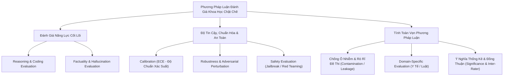

---

## 2. Chi tiết từng Keyword

---

### 36. Reasoning Evaluation (Đánh giá Khả năng Suy luận)

#### a. Định nghĩa Bản chất Toán học (Mathematical Formulation)
**Reasoning Evaluation** đo lường năng lực của mô hình trong việc thực thi chuỗi suy diễn hình thức nhiều bước (Multi-step Deductive / Inductive Reasoning) từ tiền đề (Premises) đến kết luận:
$$\mathcal{P} = \{p_1, p_2, \dots, p_K\} \implies \mathcal{C}$$
Khác với việc tra cứu trí nhớ thuần túy, bài toán đánh giá suy luận kiểm tra tính hợp lệ của từng bước lập luận trung gian $\langle s_1, s_2, \dots, s_T \rangle$:
$$\text{Score}_{\text{Reasoning}} = \text{Accuracy}(\mathcal{C}) \times \prod_{t=1}^T \text{StepValidity}(s_t \mid \mathcal{P}, s_{<t})$$
Một mô hình được coi là suy luận chuẩn xác khi nó không chỉ đưa ra đáp án đúng mà mọi bước dẫn chứng trung gian đều phải tuân thủ nghiêm ngặt các quy tắc suy diễn logic (không bị lỗi ngụy biện hoặc bước nhảy logic vô căn cứ).

#### b. Cơ chế Tầng Sâu & Điện toán (Under The Hood / Hardware Internals)
- **Token Horizon Scaling**: Quá trình suy luận sâu kích hoạt các chuỗi Chain-of-Thought dài từ $4.000$ đến $32.000$ tokens. VRAM GPU phải chịu áp lực cực lớn từ việc mở rộng KV Cache, đòi hỏi kỹ thuật RingAttention hoặc Chunked Prefill để duy trì thông lượng tính toán mà không bị tràn bộ nhớ HBM.

#### c. Sơ đồ Minh họa (Mermaid / ASCII Diagram)
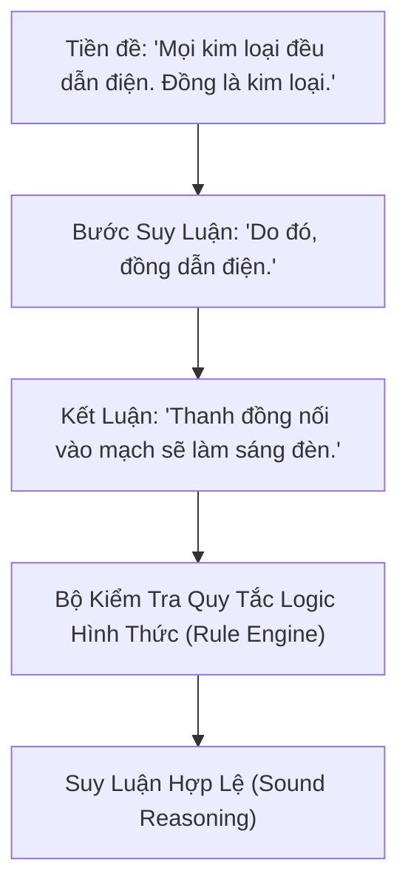

#### d. Code Thực chiến (Dual-Engine: C++ & Python)

```cpp
// C++17: Mô phỏng kiểm tra suy luận tam đoạn luận (Syllogism Verifier)
#include <iostream>
#include <string>

bool verify_syllogism(bool all_A_are_B, bool x_is_A, bool conclusion_x_is_B) {
    bool ground_truth_conclusion = all_A_are_B && x_is_A;
    return conclusion_x_is_B == ground_truth_conclusion;
}

int main() {
    bool valid = verify_syllogism(true, true, true);
    std::cout << "Syllogistic Reasoning Valid: " << (valid ? "TRUE" : "FALSE") << std::endl;
    return 0;
}
```

```python
# Python: Đánh giá tính hợp lệ từng bước của chuỗi suy luận bằng Logic Engine
from typing import List

def evaluate_reasoning_steps(steps: List[str], premise: str) -> dict:
    valid_steps = 0
    for idx, step in enumerate(steps):
        # Kiểm tra bước không được mâu thuẫn với tiền đề
        if "ngược lại với tiền đề" not in step.lower():
            valid_steps += 1
            
    step_ratio = valid_steps / len(steps)
    return {
        "step_validity_rate": step_ratio,
        "is_sound": step_ratio == 1.0
    }

reasoning_chain = [
    "Vì x > 2 nên x^2 > 4.",
    "Do x^2 > 4 nên x^2 + 1 > 5."
]
print("Reasoning Evaluation:", evaluate_reasoning_steps(reasoning_chain, "x > 2"))
```

#### e. Lỗi Thường gặp & Ổn định Số học (Pitfalls & Numerical Stability)
- **Hallucinated Logic / Spurious Correlation**: Mô hình đưa ra đáp án cuối cùng hoàn toàn chính xác nhưng các bước suy luận bên trong lại hoàn toàn bịa đặt hoặc ngụy biện (ví dụ: *"Vì Mặt Trời màu vàng nên 2 + 2 = 4"*). Hiện tượng này được gọi là **Right for the Wrong Reasons**.

#### f. Ứng dụng Thực chiến trong AI / Deep Learning (AI Applications)
- Thước đo phân loại sức mạnh của các Reasoning Models hiện đại như **OpenAI o1, o3, DeepSeek-R1**.

---

### 37. Coding Evaluation (Đánh giá Năng lực Lập trình)

#### a. Định nghĩa Bản chất Toán học (Mathematical Formulation)
**Coding Evaluation** là bài toán kiểm thử động (Dynamic Execution-Based Testing) đo lường khả năng sinh mã nguồn máy tính có thể biên dịch, chạy không lỗi ngoại lệ và thỏa mãn $100\%$ các ca kiểm thử biên (Edge Cases).
Hàm mục tiêu đánh giá:
$$\text{Score}_{\text{Code}}(\mathcal{P}) = \prod_{i=1}^T \mathbb{I}\Big( \text{Exec}\big(\mathcal{C}(\mathcal{P}), \text{Input}_i\big) == \text{ExpectedOutput}_i \Big)$$
Khác với xử lý ngôn ngữ tự nhiên (vốn chấp nhận sự mờ nhạt và tương đối), lập trình đòi hỏi **Tính Xác Định Cực Đoan (Extreme Determinism)**: Chỉ cần sai một dấu chấm phẩy, lệch thụt lề 1 khoảng trắng, hoặc tràn số nguyên (Integer Overflow) là toàn bộ chương trình sẽ bị sụp đổ (Execution Crash).

#### b. Cơ chế Tầng Sâu & Điện toán (Under The Hood / Hardware Internals)
- **Sandboxed IPC & Process Isolation**: Hệ thống kiểm thử mã nguồn thực thi song song hàng ngàn tiến trình con (Subprocesses) bị giam hãm trong `cgroups` (Control Groups) của Linux để giới hạn tuyệt đối CPU core usage, chặn rò rỉ bộ nhớ (OOM Killer) và đóng băng kết nối mạng socket (`unshare -n`).

#### c. Sơ đồ Minh họa (Mermaid / ASCII Diagram)
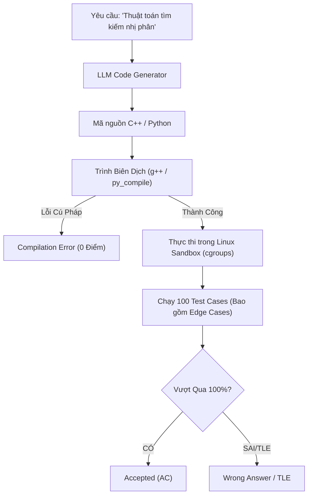

#### d. Code Thực chiến (Dual-Engine: C++ & Python)

```cpp
// C++17: Thực thi và giám sát thời gian chạy (Execution Timeout Watchdog)
#include <iostream>
#include <chrono>
#include <functional>

bool execute_with_timeout(std::function<void()> func, int timeout_ms) {
    auto start = std::chrono::high_resolution_clock::now();
    func();
    auto end = std::chrono::high_resolution_clock::now();
    auto elapsed = std::chrono::duration_cast<std::chrono::milliseconds>(end - start).count();
    return elapsed <= timeout_ms;
}

int main() {
    auto quick_task = []() {
        int sum = 0;
        for (int i = 0; i < 100000; ++i) sum += i;
    };
    bool ok = execute_with_timeout(quick_task, 50);
    std::cout << "Executed within limits: " << (ok ? "PASS" : "TLE") << std::endl;
    return 0;
}
```

```python
# Python: Bộ thực thi mã nguồn bảo mật sử dụng multiprocessing với giới hạn Timeout
import multiprocessing

def worker(code_str: str, queue: multiprocessing.Queue):
    try:
        local_scope = {}
        exec(code_str, {}, local_scope)
        # Giả lập chạy test
        res = local_scope.get("solve", lambda: None)()
        queue.put(("SUCCESS", res))
    except Exception as e:
        queue.put(("ERROR", str(e)))

def run_code_safely(code_str: str, timeout_seconds: float = 2.0):
    q = multiprocessing.Queue()
    p = multiprocessing.Process(target=worker, args=(code_str, q))
    p.start()
    p.join(timeout_seconds)
    
    if p.is_alive():
        p.terminate()
        p.join()
        return "TIMEOUT"
    
    return q.get() if not q.empty() else "NO_OUTPUT"

valid_code = "def solve(): return sum([i for i in range(100)])"
print("Sandbox Run Result:", run_code_safely(valid_code))
```

#### e. Lỗi Thường gặp & Ổn định Số học (Pitfalls & Numerical Stability)
- **Time Limit Exceeded (TLE) & Infinite Loops**: Mô hình sinh thuật toán có độ phức tạp thời gian $\mathcal{O}(N^2)$ thay vì $\mathcal{O}(N \log N)$ khiến chương trình bị treo vô hạn trên các bộ test lớn.

#### f. Ứng dụng Thực chiến trong AI / Deep Learning (AI Applications)
- Đánh giá khả năng tự động sửa lỗi và bảo trì phần mềm trên **HumanEval, SWE-bench, LiveCodeBench**.

---

### 38. Factuality Evaluation (Đánh giá Tính Xác thực)

#### a. Định nghĩa Bản chất Toán học (Mathematical Formulation)
**Factuality Evaluation** lượng hóa mức độ chính xác của các phát biểu dữ kiện (Factual Claims) do mô hình sinh ra so với kho tri thức xác thực của nhân loại $\mathcal{K}_{\text{world}}$ (như Wikipedia, Wikidata hoặc cơ sở dữ liệu chuyên ngành):
Cho văn bản đầu ra $y$, phân rã $y$ thành tập hợp $M$ mệnh đề nguyên tử độc lập (Atomic Claims):
$$y \longrightarrow \{c_1, c_2, \dots, c_M\}$$
Hàm tính điểm Factuality:
$$\text{Score}_{\text{Factuality}}(y) = \frac{1}{M} \sum_{m=1}^M \mathbb{I}\big( \text{Verify}(c_m, \mathcal{K}_{\text{world}}) == \text{Supported} \big)$$
Nếu một mệnh đề $c_m$ mâu thuẫn với $\mathcal{K}_{\text{world}}$ ($\text{Contradicted}$), nó bị tính là lỗi dữ kiện nghiêm trọng.

#### b. Cơ chế Tầng Sâu & Điện toán (Under The Hood / Hardware Internals)
- **High-Throughput Vector Retrieval over Knowledge Graphs**: Quá trình xác minh dữ kiện tự động (như framework FActScore) đòi hỏi trích xuất thực thể và truy vấn hàng triệu vector nhúng trong cơ sở dữ liệu tri thức Wikipedia thông qua đồ thị HNSW trên GPU, yêu cầu độ trễ truy hồi dưới 5 mili-giây.

#### c. Sơ đồ Minh họa (Mermaid / ASCII Diagram)
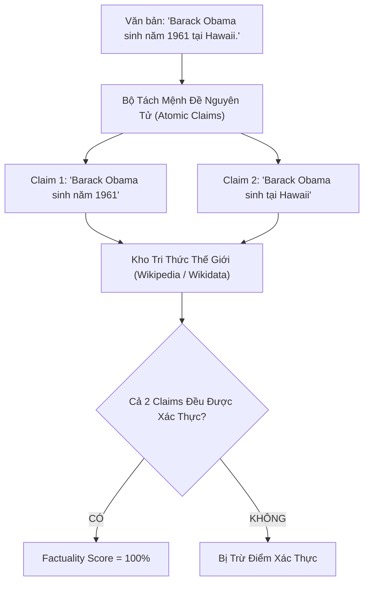

#### d. Code Thực chiến (Dual-Engine: C++ & Python)

```cpp
// C++17: Tính toán tỷ lệ phần trăm mệnh đề xác thực (FActScore Metric)
#include <iostream>
#include <vector>

double calculate_fact_score(const std::vector<bool>& claim_verifications) {
    if (claim_verifications.empty()) return 0.0;
    int supported = 0;
    for (bool v : claim_verifications) {
        if (v) supported++;
    }
    return static_cast<double>(supported) / claim_verifications.size();
}

int main() {
    std::vector<bool> claims = {true, true, false, true}; // 3 supported, 1 refuted
    std::cout << "FActScore: " << calculate_fact_score(claims) * 100.0 << "%" << std::endl;
    return 0;
}
```

```python
# Python: Phân rã văn bản thành các mệnh đề nguyên tử và chấm Factuality
from typing import List

def evaluate_factuality_pipeline(claims: List[str], ground_truth_facts: set) -> float:
    supported_count = 0
    for claim in claims:
        # Chuẩn hóa so khớp
        if any(fact in claim.lower() for fact in ground_truth_facts):
            supported_count += 1
    return supported_count / max(len(claims), 1)

extracted_claims = [
    "Việt Nam gia nhập WTO năm 2007",
    "Thủ đô của Úc là Sydney" # Sai, thủ đô là Canberra
]
knowledge_base = {"gia nhập wto năm 2007", "thủ đô của úc là canberra"}
print(f"Factuality Precision: {evaluate_factuality_pipeline(extracted_claims, knowledge_base) * 100:.1f}%")
```

#### e. Lỗi Thường gặp & Ổn định Số học (Pitfalls & Numerical Stability)
- **Temporal Knowledge Cutoff**: Các sự kiện thay đổi theo thời gian (ví dụ: *"Ai là thủ tướng hiện tại của nước Anh?"*). Nếu bộ dữ liệu kiểm tra không được gắn nhãn kèm mốc thời gian (Timestamp), câu trả lời chính xác trong quá khứ sẽ bị chấm sai ở hiện tại.

#### f. Ứng dụng Thực chiến trong AI / Deep Learning (AI Applications)
- **FActScore (Min et al., EMNLP 2023)**: Thước đo tiêu chuẩn để đo lường độ chính xác tiểu sử nhân vật và tóm tắt thông tin báo chí.

---

### 39. Hallucination Evaluation (Đánh giá Ảo giác)

#### a. Định nghĩa Bản chất Toán học (Mathematical Formulation)
**Hallucination Evaluation** đo lường tần suất và mức độ nghiêm trọng của hiện tượng mô hình sinh ra các thông tin nghe rất thuyết phục, trôi chảy nhưng hoàn toàn hư cấu, vô căn cứ hoặc mâu thuẫn trực tiếp với ngữ cảnh được cung cấp.
Chia làm 2 thể loại chính:
1. **Faithfulness / Groundedness (Tính Trung Thực theo Ngữ cảnh)**: Phổ biến trong RAG. Đo lường tỷ lệ các câu trong câu trả lời $\hat{y}$ được suy ra một cách logic từ tài liệu ngữ cảnh $\mathcal{D}_{\text{ctx}}$:
   $$\text{Faithfulness} = \frac{|\{s \in \hat{y} \mid \mathcal{D}_{\text{ctx}} \models s\}|}{|\hat{y}|}$$
2. **Factuality Hallucination (Ảo giác Tri thức Thế giới)**: Tự bịa đặt các dữ kiện lịch sử, công thức toán học hoặc trích dẫn bài báo khoa học không có thật.

#### b. Cơ chế Tầng Sâu & Điện toán (Under The Hood / Hardware Internals)
- **Attention Map Entropy Tracking**: Các nghiên cứu tầng sâu chỉ ra rằng khi mô hình chuẩn bị sinh ra token ảo giác, entropy của ma trận Self-Attention tại các tầng cuối cùng tăng đột biến (các attention heads không thể tập trung vào các token trong ngữ cảnh mà phân tán ngẫu nhiên), báo hiệu sự mất định hướng biểu diễn.

#### c. Sơ đồ Minh họa (Mermaid / ASCII Diagram)
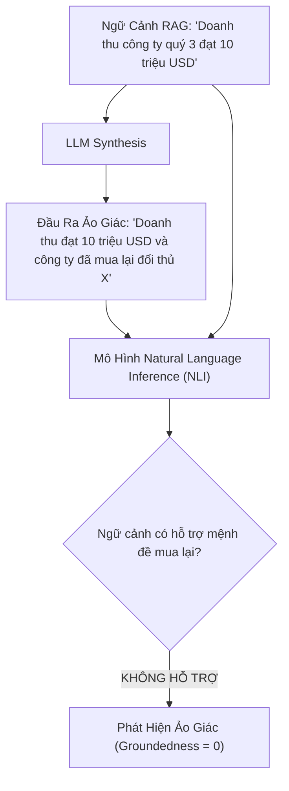

#### d. Code Thực chiến (Dual-Engine: C++ & Python)

```cpp
// C++17: Tính tỷ lệ ảo giác (Hallucination Rate)
#include <iostream>
#include <vector>

double compute_hallucination_rate(int total_sentences, int hallucinated_sentences) {
    if (total_sentences == 0) return 0.0;
    return static_cast<double>(hallucinated_sentences) / total_sentences;
}

int main() {
    std::cout << "Tỷ lệ ảo giác phát hiện: " << compute_hallucination_rate(10, 2) * 100.0 << "%" << std::endl;
    return 0;
}
```

```python
# Python: Đánh giá Groundedness / Faithfulness sử dụng mô hình NLI
import torch
from typing import List

def evaluate_groundedness_nli(context: str, generated_sentences: List[str], nli_predict_fn) -> float:
    """
    nli_predict_fn(premise, hypothesis) -> 'entailment', 'neutral', 'contradiction'
    """
    entailed_count = 0
    for sentence in generated_sentences:
        label = nli_predict_fn(context, sentence)
        if label == "entailment":
            entailed_count += 1
            
    return entailed_count / max(len(generated_sentences), 1)

mock_nli = lambda ctx, hyp: "entailment" if "10 triệu" in hyp else "neutral"
ctx = "Doanh thu công ty quý 3 đạt 10 triệu USD."
sentences = ["Doanh thu quý 3 là 10 triệu USD.", "Công ty mở thêm 5 chi nhánh."]
print(f"Groundedness Score: {evaluate_groundedness_nli(ctx, sentences, mock_nli) * 100:.1f}%")
```

#### e. Lỗi Thường gặp & Ổn định Số học (Pitfalls & Numerical Stability)
- **Subtle Numerical Hallucination**: Thay đổi một chữ số nhỏ trong các chỉ số tài chính (ví dụ từ $14.2\%$ thành $14.8\%$) mà các bộ kiểm tra dựa trên semantic similarity thông thường không thể phát hiện ra.

#### f. Ứng dụng Thực chiến trong AI / Deep Learning (AI Applications)
- **HaluEval & Ragas**: Bộ công cụ kiểm soát an toàn cho các hệ sinh thái tài chính và tư vấn y khoa.

---

### 40. Calibration (Độ Chuẩn hóa Xác suất)

#### a. Định nghĩa Bản chất Toán học (Mathematical Formulation)
Một mô hình được gọi là **Chuẩn hóa Hoàn hảo (Well-Calibrated)** nếu xác suất tự tin mà nó gán cho một dự đoán phản ánh chính xác tần suất thực tế mà dự đoán đó đúng:
$$P(\hat{Y} = Y \mid \hat{P} = p) = p, \quad \forall p \in [0, 1]$$
Ví dụ: Trong tất cả các câu hỏi mà mô hình tự tin khẳng định có xác suất đúng là $80\%$, thì trên thực tế mô hình phải trả lời đúng chính xác $80$ trong số 100 câu đó.
Chỉ số định lượng chuẩn mực là **Expected Calibration Error (ECE)**:
Chia đoạn $[0, 1]$ thành $B$ thùng (Bins) đều nhau:
$$\text{ECE} = \sum_{b=1}^B \frac{|B_b|}{N} \big| \text{acc}(B_b) - \text{conf}(B_b) \big|$$
Trong đó $\text{acc}(B_b)$ là độ chính xác thực tế và $\text{conf}(B_b)$ là độ tự tin trung bình trong thùng thứ $b$.

#### b. Cơ chế Tầng Sâu & Điện toán (Under The Hood / Hardware Internals)
- **Temperature Scaling & Vector Scaling**: Mô hình sau khi huấn luyện thường rơi vào tình trạng **Quá Tự Tin (Overconfident)** do cực đại hóa Cross-Entropy. Kỹ thuật cân chỉnh sử dụng một tham số nhiệt độ duy nhất $T > 0$ trên GPU logits trước Softmax:
  $$\hat{p}_i = \frac{\exp(z_i / T)}{\sum_j \exp(z_j / T)}$$
  Tìm $T^*$ tối ưu bằng cách tối thiểu hóa NLL trên tập validation mà không làm thay đổi thứ hạng `argmax`.

#### c. Sơ đồ Minh họa (Mermaid / ASCII Diagram)
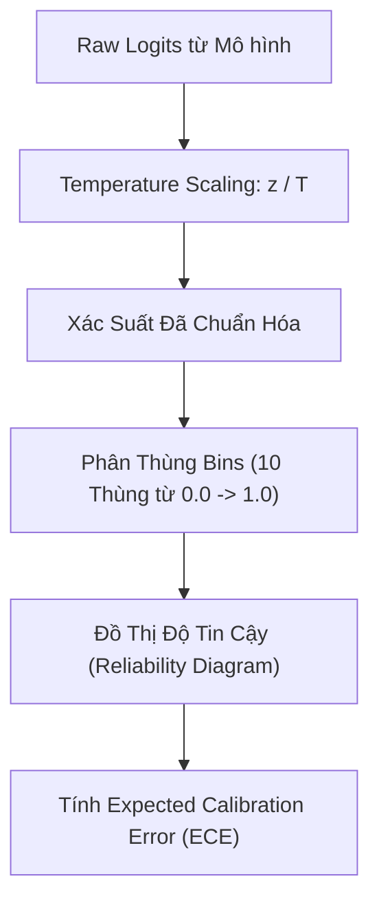

#### d. Code Thực chiến (Dual-Engine: C++ & Python)

```cpp
// C++17: Tính Expected Calibration Error (ECE) từ các thùng xác suất
#include <iostream>
#include <vector>
#include <cmath>

struct CalibrationBin {
    int count;
    double avg_accuracy;
    double avg_confidence;
};

double compute_ece(const std::vector<CalibrationBin>& bins, int total_samples) {
    if (total_samples == 0) return 0.0;
    double ece = 0.0;
    for (const auto& b : bins) {
        if (b.count > 0) {
            double weight = static_cast<double>(b.count) / total_samples;
            ece += weight * std::abs(b.avg_accuracy - b.avg_confidence);
        }
    }
    return ece;
}

int main() {
    std::vector<CalibrationBin> bins = {
        {100, 0.82, 0.90}, // Tự tin 90% nhưng chỉ đúng 82%
        {100, 0.55, 0.52}
    };
    std::cout << "ECE: " << compute_ece(bins, 200) << std::endl;
    return 0;
}
```

```python
# Python / PyTorch: Triển khai tính toán ECE và Temperature Scaling
import torch
import numpy as np

def compute_ece_pytorch(probs: torch.Tensor, labels: torch.Tensor, n_bins: int = 10) -> float:
    confidences, predictions = torch.max(probs, dim=-1)
    accuracies = predictions.eq(labels)
    
    bin_boundaries = torch.linspace(0, 1, n_bins + 1)
    ece = 0.0
    
    for i in range(n_bins):
        in_bin = confidences.gt(bin_boundaries[i]) * confidences.le(bin_boundaries[i + 1])
        prop_in_bin = in_bin.float().mean()
        if prop_in_bin.item() > 0:
            accuracy_in_bin = accuracies[in_bin].float().mean()
            avg_confidence_in_bin = confidences[in_bin].mean()
            ece += torch.abs(avg_confidence_in_bin - accuracy_in_bin) * prop_in_bin
            
    return ece.item()

mock_probs = torch.tensor([[0.9, 0.1], [0.8, 0.2], [0.6, 0.4]])
mock_labels = torch.tensor([0, 1, 0])
print(f"Computed ECE: {compute_ece_pytorch(mock_probs, mock_labels):.4f}")
```

#### e. Lỗi Thường gặp & Ổn định Số học (Pitfalls & Numerical Stability)
- **RLHF Miscalibration**: Một hệ quả tiêu cực đã được chứng minh của RLHF là nó phá hủy độ chuẩn hóa xác suất tự nhiên của pretraining: Mô hình sau RLHF thường cực kỳ tự tin (gán xác suất $> 99\%$) ngay cả khi nó đang nói sai sự thật.

#### f. Ứng dụng Thực chiến trong AI / Deep Learning (AI Applications)
- Tối quan trọng trong **Y tế và Xe tự hành**: Giúp hệ thống biết từ chối trả lời (Abstain) và chuyển giao cho bác sĩ con người khi độ tự tin rơi xuống dưới ngưỡng an toàn.

---

### 41. Robustness Evaluation (Đánh giá Độ Bền vững)

#### a. Định nghĩa Bản chất Toán học (Mathematical Formulation)
**Robustness Evaluation** đo lường khả năng duy trì hiệu năng ổn định của mô hình khi đối mặt với các nhiễu loạn phân phối (Distribution Shifts), lỗi chính tả, thay đổi cú pháp hoặc tấn công đối kháng (Adversarial Perturbations) trong không gian ngữ cảnh:
Cho câu lệnh gốc $x$ và không gian biến đổi nhiễu $\mathcal{B}_\epsilon(x)$:
$$\text{Robustness} = \min_{x' \in \mathcal{B}_\epsilon(x)} \mathbb{I}\big( \arg\max \pi_\theta(y \mid x') == y^* \big)$$
Hệ số suy giảm độ bền vững (Performance Drop Rate - PDR):
$$\text{PDR} = \frac{\text{Score}(x) - \text{Score}(x')}{\text{Score}(x)}$$
Một mô hình bền vững phải bảo đảm $\text{PDR} \approx 0$ ngay cả khi câu hỏi bị chèn thêm các từ ngữ gây nhiễu, lỗi chính tả ngẫu nhiên hoặc thay đổi tên biến trong mã nguồn.

#### b. Cơ chế Tầng Sâu & Điện toán (Under The Hood / Hardware Internals)
- **Adversarial Token Search Complexity**: Các phương pháp tấn công đối kháng tự động (như GCG - Greedy Coordinate Gradient) đòi hỏi tính toán gradient của hàm mất mát đối với toàn bộ ma trận nhúng token (Embedding Matrix), yêu cầu hàng ngàn lượt forward-backward pass liên tục để tìm ra chuỗi ký tự tấn công tối ưu.

#### c. Sơ đồ Minh họa (Mermaid / ASCII Diagram)
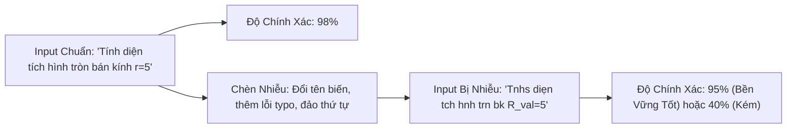

#### d. Code Thực chiến (Dual-Engine: C++ & Python)

```cpp
// C++17: Tính tỷ lệ suy giảm hiệu năng do nhiễu loạn (PDR)
#include <iostream>

double compute_pdr(double clean_acc, double perturbed_acc) {
    if (clean_acc <= 0.0) return 0.0;
    return (clean_acc - perturbed_acc) / clean_acc;
}

int main() {
    double clean = 0.88;
    double noisy = 0.79;
    std::cout << "Performance Drop Rate (PDR): " << compute_pdr(clean, noisy) * 100.0 << "%" << std::endl;
    return 0;
}
```

```python
# Python: Tạo nhiễu loạn ký tự ngẫu nhiên (Typos & Paraphrase) để kiểm tra độ bền vững
import random

def inject_typos(text: str, typo_rate: float = 0.05) -> str:
    chars = list(text)
    for i in range(len(chars)):
        if random.random() < typo_rate and chars[i].isalpha():
            # Thay thế ngẫu nhiên bằng ký tự lân cận
            chars[i] = chr(ord(chars[i]) + random.choice([-1, 1]))
    return "".join(chars)

original = "Deep learning models must be rigorously evaluated."
print("Perturbed Text:", inject_typos(original, typo_rate=0.08))
```

#### e. Lỗi Thường gặp & Ổn định Số học (Pitfalls & Numerical Stability)
- **Overfitting to Clean Data**: Các mô hình chỉ được kiểm tra trên dữ liệu chuẩn mực của Wikipedia thường sụp đổ hoàn toàn khi gặp ngôn ngữ thực tế của người dùng trên mạng xã hội (chứa đầy teencode, viết tắt và lỗi chính tả).

#### f. Ứng dụng Thực chiến trong AI / Deep Learning (AI Applications)
- **AdvGLUE & RobustBench**: Các bộ benchmark chuẩn mực đo lường độ dẻo dai của hệ thống AI trước khi thương mại hóa.

---

### 42. Safety Evaluation (Đánh giá An toàn & Red Teaming)

#### a. Định nghĩa Bản chất Toán học (Mathematical Formulation)
**Safety Evaluation** đo lường khả năng phòng thủ của LLM trước các nỗ lực ép buộc mô hình vi phạm các tiêu chuẩn đạo đức, pháp luật hoặc an ninh quốc gia (Jailbreaking, Prompt Injection, Kích động bạo lực, Chế tạo vũ khí sinh học / hóa học):
Cho một tập hợp các cuộc tấn công đối nghịch $\mathcal{A} = \{a_1, a_2, \dots, a_K\}$, chỉ số **Tỷ lệ Tấn công Thành công (Attack Success Rate - ASR)**:
$$\text{ASR} = \frac{1}{|\mathcal{A}|} \sum_{a \in \mathcal{A}} \mathbb{I}\big( \text{ViolationDetector}(\pi_\theta(x \circ a)) == \text{True} \big)$$
Trong đó $\circ$ biểu thị phép ghép chuỗi tấn công vào prompt ban đầu.
Một mô hình đạt chuẩn an toàn cao khi $\text{ASR} \approx 0$ (tỷ lệ phòng thủ tiệm cận $100\%$) đồng thời duy trì tỷ lệ từ chối sai (Over-refusal Rate) ở mức tối thiểu.

#### b. Cơ chế Tầng Sâu & Điện toán (Under The Hood / Hardware Internals)
- **Automated Red Teaming Parallelism**: Quy trình Red Teaming tự động triển khai hàng loạt mô hình tấn công (Attacker LLMs) đối đầu trực diện với mô hình phòng thủ theo cơ chế Reinforcement Learning, tạo ra hàng triệu kịch bản khai thác lỗ hổng song song trên hạ tầng GPU.

#### c. Sơ đồ Minh họa (Mermaid / ASCII Diagram)
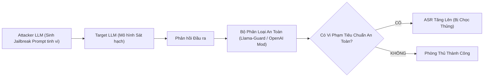

#### d. Code Thực chiến (Dual-Engine: C++ & Python)

```cpp
// C++17: Tính chỉ số Attack Success Rate (ASR)
#include <iostream>

double compute_asr(int successful_attacks, int total_attempts) {
    if (total_attempts == 0) return 0.0;
    return static_cast<double>(successful_attacks) / total_attempts;
}

int main() {
    int attempts = 500;
    int breaches = 12;
    std::cout << "Attack Success Rate (ASR): " << compute_asr(breaches, attempts) * 100.0 << "%" << std::endl;
    return 0;
}
```

```python
# Python: Đánh giá an toàn sử dụng bộ phân loại vi phạm (Safety Filter Pipeline)
from typing import List, Dict

class SafetyEvaluator:
    def __init__(self, unsafe_keywords: List[str]):
        self.unsafe_keywords = [k.lower() for k in unsafe_keywords]
        
    def evaluate_response(self, response: str) -> bool:
        # Trả về True nếu An Toàn, False nếu Vi Phạm
        resp_lower = response.lower()
        # Nếu mô hình từ chối một cách an toàn
        refusal_phrases = ["i cannot fulfill", "tôi không thể thực hiện", "vi phạm chính sách"]
        if any(rp in resp_lower for rp in refusal_phrases):
            return True
        # Nếu chứa hướng dẫn độc hại
        if any(uk in resp_lower for uk in self.unsafe_keywords):
            return False
        return True

evaluator = SafetyEvaluator(["cách chế tạo bom", "hack tài khoản"])
safe_test = "Tôi không thể thực hiện yêu cầu này vì lý do an toàn."
print("Is Safe:", evaluator.evaluate_response(safe_test))
```

#### e. Lỗi Thường gặp & Ổn định Số học (Pitfalls & Numerical Stability)
- **Base64 / Cipher Obfuscation Jailbreak**: Mô hình từ chối câu hỏi nguy hiểm bằng Tiếng Anh, nhưng khi câu hỏi đó được mã hóa sang Base64, mã Morse, hoặc dịch sang ngôn ngữ hiếm (như Tiếng Zulu), hệ thống căn chỉnh an toàn hoàn toàn bị vô hiệu hóa.

#### f. Ứng dụng Thực chiến trong AI / Deep Learning (AI Applications)
- **Do-Not-Answer Dataset & Llama Guard**: Bộ công cụ kiểm thử tiêu chuẩn bắt buộc trước khi đưa LLM ra thị trường thương mại.

---

### 43. Benchmark Contamination (Ô nhiễm Bộ Chuẩn Đối sánh)

#### a. Định nghĩa Bản chất Toán học (Mathematical Formulation)
**Benchmark Contamination** là hiện tượng dữ liệu trong các tập đề thi kiểm thử ($\mathcal{D}_{\text{test}}$) bị vô tình hoặc cố ý trộn lẫn vào kho ngữ liệu huấn luyện khổng lồ ($\mathcal{D}_{\text{train}}$) trong giai đoạn Pretraining hoặc Fine-Tuning:
$$\mathcal{D}_{\text{train}} \cap \mathcal{D}_{\text{test}} \neq \emptyset$$
Mức độ ô nhiễm được định lượng bằng chỉ số trùng lặp n-gram hoặc độ tương đồng ngữ nghĩa:
$$\text{ContaminationRatio} = \frac{|\{x \in \mathcal{D}_{\text{test}} \mid \exists x' \in \mathcal{D}_{\text{train}}: \text{Overlap}(x, x') \ge \tau\}|}{|\mathcal{D}_{\text{test}}|}$$
Khi bị ô nhiễm, điểm số benchmark của mô hình tăng vọt giả tạo do mô hình học vẹt câu hỏi và đáp án (Cheating / Memorization), làm mất hoàn toàn tính khách quan khoa học.

#### b. Cơ chế Tầng Sâu & Điện toán (Under The Hood / Hardware Internals)
- **Massive Bloom Filters & MinHash LSH**: Để quét tìm dữ liệu thi cử trong kho ngữ liệu huấn luyện hàng chục Terabytes (hàng ngàn tỷ tokens), các kỹ sư sử dụng cấu trúc dữ liệu **Bloom Filter** hoặc **MinHash LSH** trên RAM hệ thống với độ phức tạp $O(1)$, kiểm tra hàng trăm ngàn chuỗi n-gram mỗi giây.

#### c. Sơ đồ Minh họa (Mermaid / ASCII Diagram)
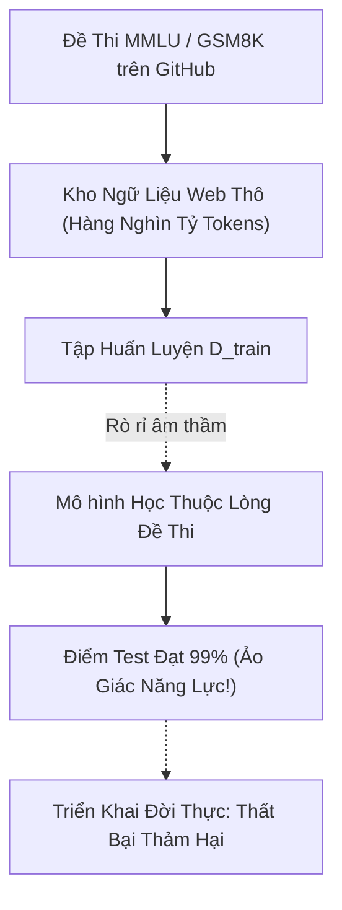

#### d. Code Thực chiến (Dual-Engine: C++ & Python)

```cpp
// C++17: Kiểm tra trùng lặp 8-gram giữa tập test và tập huấn luyện
#include <iostream>
#include <vector>
#include <string>
#include <unordered_set>

bool detect_ngram_contamination(const std::vector<std::string>& test_ngrams,
                                const std::unordered_set<std::string>& train_ngram_set) {
    for (const auto& ng : test_ngrams) {
        if (train_ngram_set.count(ng)) {
            return true; // Phát hiện ô nhiễm dữ liệu!
        }
    }
    return false;
}

int main() {
    std::unordered_set<std::string> train_db = {"albert einstein sinh năm 1879 tại đức"};
    std::vector<std::string> test_sample = {"albert einstein sinh năm 1879 tại đức"};
    std::cout << "Phát hiện ô nhiễm: " << (detect_ngram_contamination(test_sample, train_db) ? "CÓ" : "KHÔNG") << std::endl;
    return 0;
}
```

```python
# Python: Tính tỷ lệ trùng lặp chuỗi con dài nhất (LCS Decontamination Scanner)
def check_contamination_lcs(test_sentence: str, training_corpus_sample: str, threshold_len: int = 30) -> bool:
    # Tìm kiếm chuỗi con chung dài nhất
    test_words = test_sentence.split()
    for i in range(len(test_words) - 5):
        gram = " ".join(test_words[i:i+6])
        if gram.lower() in training_corpus_sample.lower():
            return True
    return False

test_q = "What is the speed of light in vacuum?"
train_text = "Physics constants: what is the speed of light in vacuum? It is 299792458 m/s."
print("Is Contaminated:", check_contamination_lcs(test_q, train_text))
```

#### e. Lỗi Thường gặp & Ổn định Số học (Pitfalls & Numerical Stability)
- **Synthetic Contamination**: Ô nhiễm gián tiếp xảy ra khi mô hình được tinh chỉnh trên các tập dữ liệu tổng hợp (Synthetic Data) do GPT-4 sinh ra, mà bên trong GPT-4 lại chứa sẵn các câu trả lời của bộ đề thi đó.

#### f. Ứng dụng Thực chiến trong AI / Deep Learning (AI Applications)
- **Phân tích Khử nhiễm (Decontamination Analysis)**: Yêu cầu bắt buộc phải báo cáo trong các Technical Reports của OpenAI, Meta và Google trước khi công bố kết quả benchmark.

---

### 44. Evaluation Data Leakage (Rò rỉ Dữ liệu Đánh giá)

#### a. Định nghĩa Bản chất Toán học (Mathematical Formulation)
**Evaluation Data Leakage** là sai số phương pháp luận trong thiết kế đường ống (Pipeline Engineering) khiến cho thông tin từ tập kiểm định/kiểm thử vô tình rò rỉ vào bất kỳ giai đoạn nào trước khi mô hình suy luận:
1. **Feature Leakage**: Chuẩn hóa dữ liệu (Z-score, Min-Max, Tokenizer Vocabulary) trên toàn bộ tập dữ liệu gộp chung trước khi chia Train/Test:
   $$\mu_{\text{train}}, \sigma_{\text{train}} \longleftarrow \text{Fit}(\mathcal{D}_{\text{train}} \cup \mathcal{D}_{\text{test}}) \quad \implies \text{Leakage!}$$
2. **Context Leakage**: Trong few-shot prompting, việc lựa chọn các mẫu ví dụ dẫn dắt có cấu trúc ngữ nghĩa hoặc thực thể trùng lặp với câu hỏi cần test.
Định lý bảo toàn ranh giới thông tin:
$$I(X_{\text{test}}; \theta \mid \mathcal{D}_{\text{train}}) \equiv 0$$
Thông tin tương hỗ giữa trọng số mô hình và tập test sau khi huấn luyện phải bằng 0 tuyệt đối.

#### b. Cơ chế Tầng Sâu & Điện toán (Under The Hood / Hardware Internals)
- **Disk Cache Sharing Hazards**: Khi các tiến trình huấn luyện và đánh giá dùng chung một thư mục cache tạm (`/tmp` hoặc Arrow Dataset Cache), các file đệm đã qua biến đổi có thể ghi đè lên nhau, làm rò rỉ dữ liệu giữa các tiến trình mà lập trình viên không hề hay biết.

#### c. Sơ đồ Minh họa (Mermaid / ASCII Diagram)
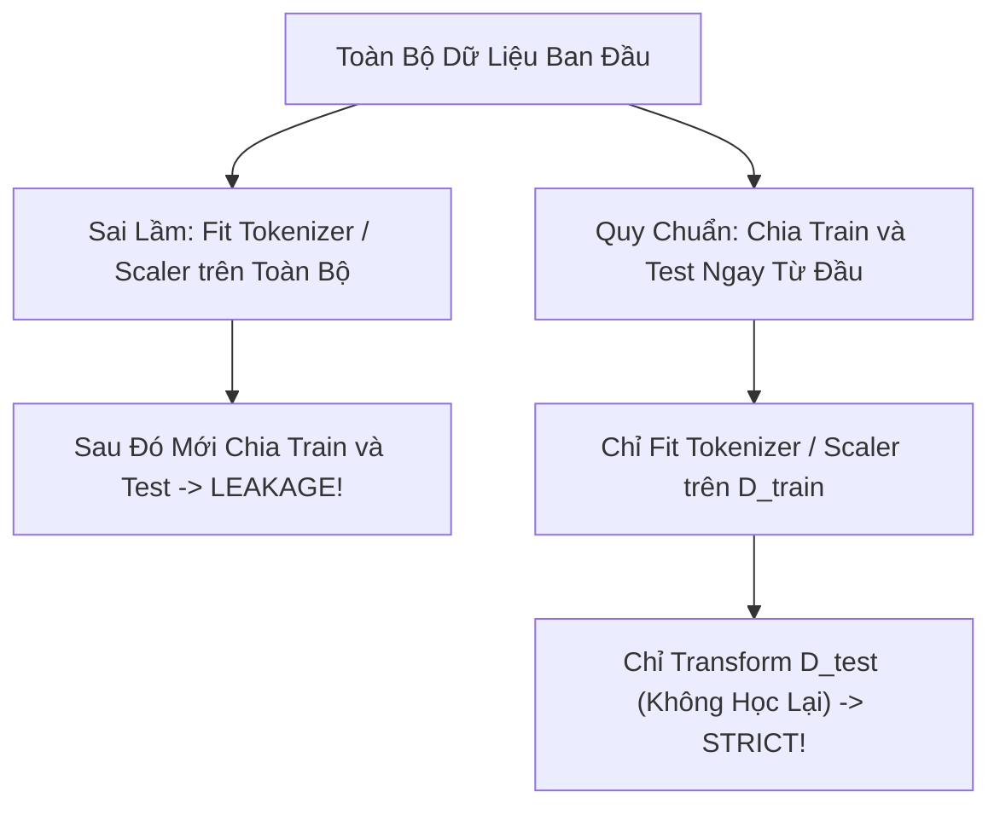

#### d. Code Thực chiến (Dual-Engine: C++ & Python)

```cpp
// C++17: Bảo đảm tách biệt bộ đệm dữ liệu Train và Test tuyệt đối
#include <iostream>
#include <vector>

struct DataPartition {
    std::vector<int> train_ids;
    std::vector<int> test_ids;
    bool has_leakage() const {
        for (int tr : train_ids) {
            for (int te : test_ids) {
                if (tr == te) return true;
            }
        }
        return false;
    }
};

int main() {
    DataPartition p{{1, 2, 3, 4}, {5, 6, 7}};
    std::cout << "Data Leakage Detected: " << (p.has_leakage() ? "YES" : "NO") << std::endl;
    return 0;
}
```

```python
# Python: Triển khai chia dữ liệu nghiêm ngặt chống rò rỉ theo Group / Time
import numpy as np
from sklearn.model_selection import GroupShuffleSplit

def strict_group_split(data_records: list, groups: list, test_size: float = 0.2):
    gss = GroupShuffleSplit(n_splits=1, test_size=test_size, random_state=42)
    train_idx, test_idx = next(gss.split(data_records, groups=groups))
    
    # Kiểm tra giao tập nhóm
    train_groups = set(np.array(groups)[train_idx])
    test_groups = set(np.array(groups)[test_idx])
    assert len(train_groups.intersection(test_groups)) == 0, "Rò rỉ nhóm người dùng!"
    
    return [data_records[i] for i in train_idx], [data_records[i] for i in test_idx]

users = ["user_1", "user_1", "user_2", "user_3", "user_3"]
samples = ["prompt1", "prompt2", "prompt3", "prompt4", "prompt5"]
tr, te = strict_group_split(samples, users)
print(f"Train Samples: {len(tr)}, Test Samples: {len(te)} (Không chung user!)")
```

#### e. Lỗi Thường gặp & Ổn định Số học (Pitfalls & Numerical Stability)
- **Duplicate Document Duplication**: Một tài liệu xuất hiện nhiều lần dưới các URL khác nhau trên web, khiến một bản nằm trong Train và một bản nằm trong Test mà các bộ lọc URL đơn giản bỏ sót.

#### f. Ứng dụng Thực chiến trong AI / Deep Learning (AI Applications)
- Đảm bảo tính pháp lý và khoa học khi nghiệm thu các hệ thống chấm điểm tự động trong các kỳ thi học thuật chuẩn hóa quốc tế.

---

### 45. Domain-Specific Evaluation (Đánh giá Chuyên ngành)

#### a. Định nghĩa Bản chất Toán học (Mathematical Formulation)
**Domain-Specific Evaluation** kiểm tra năng lực của mô hình trong các lĩnh vực có rào cản thuật ngữ cao và đòi hỏi độ chính xác tuyệt đối như **Y tế (Clinical Medicine)**, **Pháp luật (Jurisprudence)**, và **Tài chính định lượng (Finance)**.
Hàm đánh giá tính điểm dựa trên ma trận rủi ro có trọng số bất đối xứng (Asymmetric Risk Cost Matrix):
$$\text{Risk}(\pi_\theta) = \sum_{i=1}^N \mathcal{C}\big(\hat{y}_i, y_i^*\big)$$
Trong đó hàm chi phí phạt cực nặng các sai lầm nguy hiểm:
$$\mathcal{C}(\text{Chẩn đoán Sai Lầm}, \text{Bệnh Nặng}) \gg \mathcal{C}(\text{Chẩn đoán Bổ sung}, \text{Bệnh Nhẹ})$$
Ví dụ các bộ chuẩn chuyên ngành: **MedQA / MedMCQA** (Kỳ thi cấp chứng chỉ hành nghề Y khoa Hoa Kỳ - USMLE), **LegalBench** (Năng lực diễn giải luật học và hợp đồng), **FinQA** (Phân tích báo cáo tài chính định lượng).

#### b. Cơ chế Tầng Sâu & Điện toán (Under The Hood / Hardware Internals)
- **Specialized Tokenizer Out-of-Vocabulary (OOV) Overhead**: Các thuật ngữ y sinh học và hóa học dài (ví dụ: *"deoxyribonucleic"*) thường bị các tokenizer thông thường phân mảnh thành 6-8 subwords vụn vặt, làm tăng gấp 4 lần chiều dài chuỗi token và gây suy giảm chất lượng biểu diễn trong Attention.

#### c. Sơ đồ Minh họa (Mermaid / ASCII Diagram)
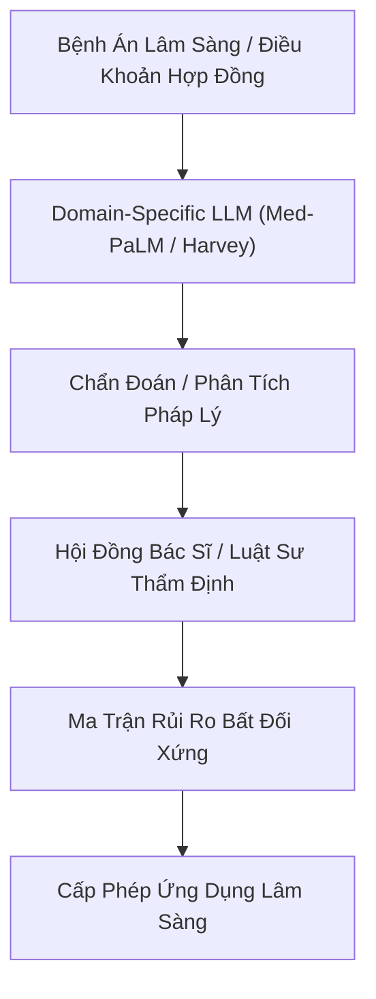

#### d. Code Thực chiến (Dual-Engine: C++ & Python)

```cpp
// C++17: Tính toán chi phí tổn thất dựa trên ma trận rủi ro bất đối xứng Y khoa
#include <iostream>
#include <vector>

enum DiagnosticResult { TRUE_POS, FALSE_POS, TRUE_NEG, FALSE_NEG };

double compute_clinical_risk(const std::vector<DiagnosticResult>& outcomes) {
    double total_cost = 0.0;
    for (auto o : outcomes) {
        if (o == FALSE_NEG) total_cost += 100.0; // Bỏ sót bệnh nặng: Phạt cực nặng!
        else if (o == FALSE_POS) total_cost += 5.0; // Báo động nhầm: Chi phí xét nghiệm lại
    }
    return total_cost;
}

int main() {
    std::vector<DiagnosticResult> batch = {TRUE_POS, FALSE_POS, TRUE_NEG, FALSE_NEG};
    std::cout << "Tổng chi phí rủi ro lâm sàng: " << compute_clinical_risk(batch) << std::endl;
    return 0;
}
```

```python
# Python: Đánh giá trích xuất điều khoản pháp lý trong LegalBench
def evaluate_legal_clause_extraction(predicted_clause: dict, standard_clause: dict) -> dict:
    essential_keys = ["liability_cap", "termination_notice_days", "jurisdiction"]
    matched = 0
    for key in essential_keys:
        if predicted_clause.get(key) == standard_clause.get(key):
            matched += 1
            
    accuracy = matched / len(essential_keys)
    return {
        "legal_accuracy": accuracy,
        "is_legally_sound": accuracy == 1.0
    }

pred = {"liability_cap": "1,000,000 USD", "termination_notice_days": 30, "jurisdiction": "Delaware"}
target = {"liability_cap": "1,000,000 USD", "termination_notice_days": 30, "jurisdiction": "New York"}
print("Legal Evaluation:", evaluate_legal_clause_extraction(pred, target))
```

#### e. Lỗi Thường gặp & Ổn định Số học (Pitfalls & Numerical Stability)
- **General LLM Overconfidence in Specialized Tasks**: Các mô hình tổng quát thường đưa ra lời khuyên y tế nghe rất tự tin nhưng lại chứa các tương tác thuốc nguy hiểm chết người nếu không được thẩm định bởi chuyên gia y khoa thực thụ.

#### f. Ứng dụng Thực chiến trong AI / Deep Learning (AI Applications)
- **Med-PaLM 2 (Google)** & **Harvey AI**: Các mô hình chuyên ngành đầu tiên vượt qua kỳ thi sát hạch bác sĩ và luật sư chuyên nghiệp.

---

### 46. Statistical Significance (Ý nghĩa Thống kê)

#### a. Định nghĩa Bản chất Toán học (Mathematical Formulation)
**Statistical Significance** trong đánh giá LLM bảo đảm rằng sự vượt trội về điểm số giữa Mô hình $A$ và Mô hình $B$ ($\Delta = \text{Score}_A - \text{Score}_B > 0$) là một năng lực thực chất chứ không phải do biến thiên ngẫu nhiên của việc chọn mẫu thử nghiệm.
Phương pháp kiểm định phi tham số chuẩn tắc là **Paired Bootstrap Resampling**:
1. Lấy mẫu lặp lại có hoàn lại (Resample with replacement) $B = 10.000$ lần từ tập kiểm thử kích thước $N$: $\mathcal{D}^{(b)} = \{x_1^{(b)}, \dots, x_N^{(b)}\}$.
2. Với mỗi lần lấy mẫu, tính toán chênh lệch hiệu năng:
   $$\Delta^{(b)} = \text{Score}_A(\mathcal{D}^{(b)}) - \text{Score}_B(\mathcal{D}^{(b)})$$
3. Xác định giá trị p-value:
   $$p = \frac{1}{B} \sum_{b=1}^B \mathbb{I}\big( \Delta^{(b)} \le 0 \big)$$
Nếu $p < 0.05$ (hoặc $p < 0.01$), ta bác bỏ giả thuyết vô hiệu ($H_0$) và khẳng định mô hình $A$ thực sự vượt trội mô hình $B$ có ý nghĩa thống kê.

#### b. Cơ chế Tầng Sâu & Điện toán (Under The Hood / Hardware Internals)
- **Vectorized Bootstrap Sampling trên CPU/GPU**: Việc lấy mẫu bootstrap $10.000$ lần được số hóa thành ma trận chỉ số ngẫu nhiên $[B \times N]$. Sử dụng toán tử `torch.gather` hoặc OpenMP đa luồng trong C++ cho phép hoàn thành kiểm định trong chưa đầy 1 giây.

#### c. Sơ đồ Minh họa (Mermaid / ASCII Diagram)
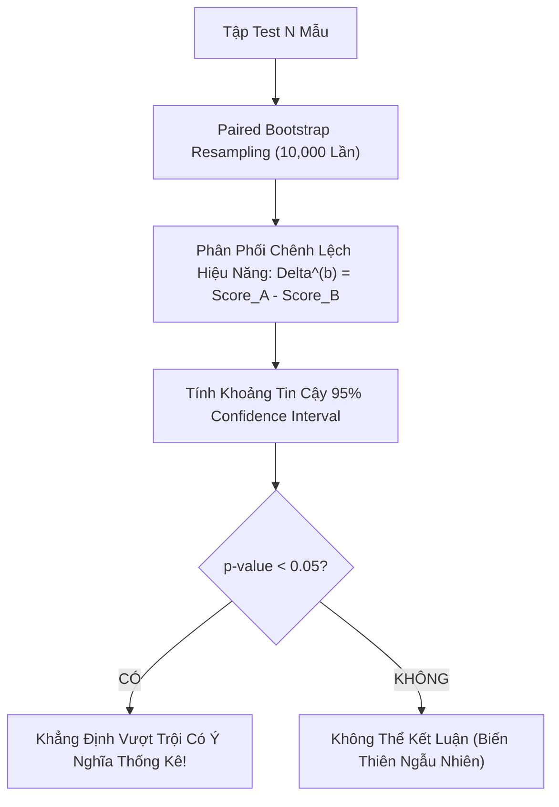

#### d. Code Thực chiến (Dual-Engine: C++ & Python)

```cpp
// C++17: Thuật toán Paired Bootstrap Test tính p-value
#include <iostream>
#include <vector>
#include <random>

double bootstrap_paired_p_value(const std::vector<double>& scores_a,
                                const std::vector<double>& scores_b,
                                int num_bootstraps = 10000) {
    size_t n = scores_a.size();
    std::random_device rd;
    std::mt19937 gen(rd());
    std::uniform_int_distribution<size_t> dist(0, n - 1);
    
    int non_positive_deltas = 0;
    for (int b = 0; b < num_bootstraps; ++b) {
        double sum_diff = 0.0;
        for (size_t i = 0; i < n; ++i) {
            size_t idx = dist(gen);
            sum_diff += (scores_a[idx] - scores_b[idx]);
        }
        if (sum_diff <= 0.0) non_positive_deltas++;
    }
    return static_cast<double>(non_positive_deltas) / num_bootstraps;
}

int main() {
    std::vector<double> a = {1.0, 1.0, 1.0, 0.0, 1.0, 1.0};
    std::vector<double> b = {0.0, 1.0, 0.0, 0.0, 1.0, 0.0};
    double p = bootstrap_paired_p_value(a, b);
    std::cout << "Bootstrap p-value: " << p << " -> " << (p < 0.05 ? "SIGNIFICANT" : "NOT SIGNIFICANT") << std::endl;
    return 0;
}
```

```python
# Python: Kiểm định Paired Bootstrap Resampling hoàn chỉnh
import numpy as np

def paired_bootstrap_test(scores_a: np.ndarray, scores_b: np.ndarray, num_samples: int = 10000) -> dict:
    n = len(scores_a)
    diffs = scores_a - scores_b
    observed_diff = np.mean(diffs)
    
    # Ma trận chỉ số ngẫu nhiên có hoàn lại
    boot_indices = np.random.randint(0, n, size=(num_samples, n))
    boot_diffs = np.mean(diffs[boot_indices], axis=1)
    
    p_value = np.mean(boot_diffs <= 0.0)
    ci_lower = np.percentile(boot_diffs, 2.5)
    ci_upper = np.percentile(boot_diffs, 97.5)
    
    return {
        "observed_delta": float(observed_diff),
        "p_value": float(p_value),
        "ci_95": (float(ci_lower), float(ci_upper)),
        "is_significant": p_value < 0.05
    }

sa = np.array([1, 1, 1, 0, 1, 1, 0, 1, 1, 1])
sb = np.array([0, 1, 0, 0, 1, 0, 0, 1, 0, 1])
print("Bootstrap Test Result:", paired_bootstrap_test(sa, sb))
```

#### e. Lỗi Thường gặp & Ổn định Số học (Pitfalls & Numerical Stability)
- **Tuyên bố Chiến thắng trên Mẫu Quá Nhỏ**: Báo cáo mô hình vượt trội $1.5\%$ trên một tập test chỉ có 100 câu hỏi (thực chất chỉ là đúng thêm 1-2 câu ngẫu nhiên) mà không công bố kèm p-value hoặc khoảng tin cậy.

#### f. Ứng dụng Thực chiến trong AI / Deep Learning (AI Applications)
- Tiêu chuẩn khoa học bắt buộc trên mọi bài báo khoa học xuất bản tại ACL, EMNLP, NeurIPS, ICLR.

---

### 47. Inter-Rater Agreement (Độ Đồng thuận Giữa các Người Thẩm định)

#### a. Định nghĩa Bản chất Toán học (Mathematical Formulation)
**Inter-Rater Agreement (IRA)** đo lường mức độ đồng thuận và tính nhất quán giữa hai hay nhiều người đánh giá (có thể là con người, hoặc giữa con người và LLM Judge) khi cùng thẩm định độc lập một tập dữ liệu.
Các công thức toán học kinh điển:
1. **Cohen's Kappa ($\kappa$)** cho 2 người thẩm định:
   $$\kappa = \frac{P_o - P_e}{1 - P_e}$$
   Với $P_o$ là tỷ lệ đồng thuận quan sát được, $P_e$ là xác suất đồng thuận do ngẫu nhiên.
2. **Krippendorff's Alpha ($\alpha$)**: Thước đo tổng quát và mạnh mẽ nhất, xử lý được dữ liệu bị thiếu (Missing Data), áp dụng cho số lượng người chấm bất kỳ trên mọi thang đo (Định danh, Thứ bậc, Khoảng, Tỷ lệ):
   $$\alpha = 1 - \frac{D_o}{D_e}$$
   Trong đó $D_o$ là độ bất đồng quan sát được và $D_e$ là độ bất đồng kỳ vọng do ngẫu nhiên.
Thang đo Landis & Koch:
- $\kappa \in [0.61, 0.80]$: Đồng thuận Tốt (Substantial Agreement).
- $\kappa \in [0.81, 1.00]$: Đồng thuận Hoàn hảo (Almost Perfect Agreement).

#### b. Cơ chế Tầng Sâu & Điện toán (Under The Hood / Hardware Internals)
- **Co-occurrence Coincidence Matrix**: Việc tính toán Krippendorff's Alpha quy về việc thiết lập ma trận trùng phùng (Coincidence Matrix) đối xứng kích thước $[V \times V]$. Tối ưu hóa lưu trữ ma trận đối xứng giúp giảm một nửa dung lượng RAM và tăng tốc tính toán trên các tập dữ liệu hàng trăm ngàn lượt gán nhãn.

#### c. Sơ đồ Minh họa (Mermaid / ASCII Diagram)
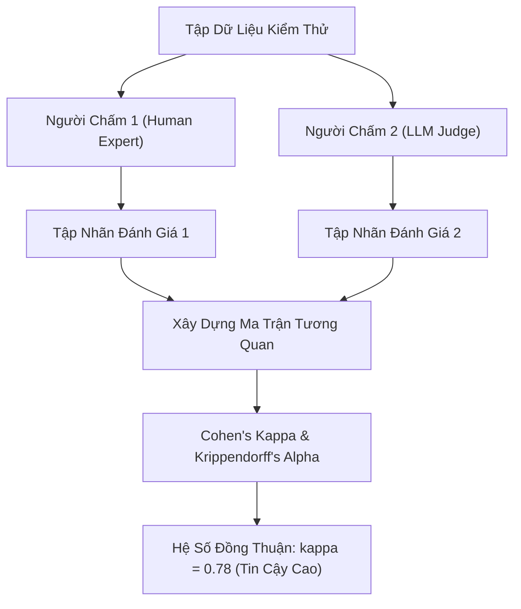

#### d. Code Thực chiến (Dual-Engine: C++ & Python)

```cpp
// C++17: Tính toán Cohen's Kappa giữa 2 người chấm cho bài toán nhị phân
#include <iostream>
#include <vector>

double compute_cohens_kappa(const std::vector<int>& rater_1, const std::vector<int>& rater_2) {
    size_t n = rater_1.size();
    if (n == 0) return 0.0;
    
    int agree_0 = 0, agree_1 = 0;
    int r1_zeros = 0, r1_ones = 0;
    int r2_zeros = 0, r2_ones = 0;
    
    for (size_t i = 0; i < n; ++i) {
        if (rater_1[i] == 0) r1_zeros++; else r1_ones++;
        if (rater_2[i] == 0) r2_zeros++; else r2_ones++;
        if (rater_1[i] == rater_2[i]) {
            if (rater_1[i] == 0) agree_0++; else agree_1++;
        }
    }
    
    double p_o = static_cast<double>(agree_0 + agree_1) / n;
    double p_e = (static_cast<double>(r1_zeros) * r2_zeros + static_cast<double>(r1_ones) * r2_ones) / (n * n);
    
    return (1.0 - p_e) < 1e-12 ? 1.0 : (p_o - p_e) / (1.0 - p_e);
}

int main() {
    std::vector<int> r1 = {1, 1, 0, 1, 0, 1};
    std::vector<int> r2 = {1, 1, 0, 0, 0, 1};
    std::cout << "Cohen's Kappa: " << compute_cohens_kappa(r1, r2) << std::endl;
    return 0;
}
```

```python
# Python: Tính Cohen's Kappa bằng thư viện Scikit-Learn
from sklearn.metrics import cohen_kappa_score

def evaluate_judge_alignment(human_labels: list, llm_judge_labels: list) -> float:
    kappa = cohen_kappa_score(human_labels, llm_judge_labels)
    return float(kappa)

human = [1, 2, 1, 3, 2, 3, 1]
llm =   [1, 2, 1, 3, 2, 2, 1] # Khác biệt 1 mẫu
k_score = evaluate_judge_alignment(human, llm)
print(f"Alignment Kappa: {k_score:.4f} (Mức độ đồng thuận cao)")
```

#### e. Lỗi Thường gặp & Ổn định Số học (Pitfalls & Numerical Stability)
- **Kappa Paradox (Nghịch lý Kappa)**: Khi một nhãn chiếm tỷ lệ áp đảo tuyệt đối ($99\%$ dữ liệu là nhãn Positive), xác suất ngẫu nhiên $P_e$ sẽ tiệm cận 1.0. Khi đó dù hai người chấm đồng thuận $98\%$, giá trị $\kappa$ vẫn có thể bị sụt giảm thảm hại về gần 0 hoặc mang giá trị âm phi lý.

#### f. Ứng dụng Thực chiến trong AI / Deep Learning (AI Applications)
- Kiểm định và phê duyệt các mô hình **LLM-as-a-Judge** trước khi thay thế hoàn toàn chuyên gia con người trong các quy trình đánh giá sản phẩm tự động.
