# Chuyên đề: Kỹ nghệ Suy luận Dẫn xuất, Chuỗi Tư duy & Cấu trúc Tìm kiếm Đồ thị (Prompt-Based Reasoning, CoT & Graph Search)

## 1. Tổng quan Chuyên đề
Khả năng suy luận (Reasoning) là ranh giới phân định rõ nét nhất giữa một mô hình ngôn ngữ bắt chước cú pháp đơn thuần và một thực thể Trí tuệ Nhân tạo Tổng quát (AGI). Các mô hình tự hồi quy tiêu chuẩn dự đoán token tiếp theo theo nguyên tắc song ánh trực tiếp từ câu hỏi $x$ tới đáp án $y$ ($P(y \mid x)$) trong một số hữu hạn các bước tính toán (Fixed Computational Budget per Token). Điều này khiến mô hình dễ vấp phải các cạm bẫy logic khi đối mặt với các bài toán đòi hỏi tính toán tuần tự và phân rã vấn đề.

Kỷ nguyên suy luận hiện đại mở ra bước nhảy vọt thông qua các phương pháp luận khai thác không gian tính toán trung gian:
1. **Chuỗi Tư duy (Chain-of-Thought - CoT)**: Cho phép mô hình "nghĩ trước khi nói" bằng cách sinh ra một chuỗi các bước suy diễn trung gian $z_1, z_2, \dots, z_k$, mở rộng năng lực tính toán hiệu dụng theo chiều dài chuỗi sinh (Scaling Inference FLOPs).
2. **Khám phá Không gian Lời giải Đa nhánh (Search over Thoughts)**: Nâng cấp từ chuỗi đơn tuyến tính sang cây suy luận (**Tree of Thoughts - ToT**) và đồ thị tư duy có chu trình (**Graph of Thoughts - GoT**), kết hợp với kỹ thuật lấy mẫu tự nhất quán (**Self-Consistency**).
3. **Kết hợp Động cơ Lập trình & Vùng nháp Tính toán (Program-Aided & Scratchpad Reasoning)**: Tích hợp trình thông dịch mã nguồn (**PAL, Program of Thoughts**) nhằm trao quyền tính toán số học chính xác cho CPU/Python runtime, giải phóng mô hình khỏi các sai sót số học cố hữu.

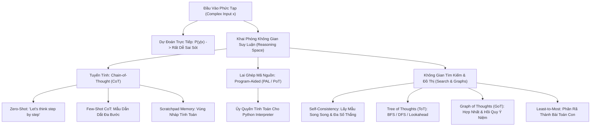

---

## 2. Chi tiết từng Keyword

---

### 1. Chain-of-Thought - CoT (Chuỗi Tư duy)

#### a. Định nghĩa Bản chất Toán học (Mathematical Formulation)
**Chain-of-Thought (CoT)** (Wei et al., NeurIPS 2022) phân rã bài toán ánh xạ trực tiếp $P(y \mid x)$ thành một chuỗi các bước suy diễn trung gian $z = \langle z_1, z_2, \dots, z_K \rangle$:
$$P(y \mid x) = \sum_{z} P(y, z \mid x) = \sum_{z} P(y \mid x, z) \prod_{k=1}^K P(z_k \mid x, z_{<k})$$
Bằng cách phân rã xác suất thông qua biến ẩn $z$, mô hình chuyển đổi một bài toán phi tuyến phức tạp thành một chuỗi các bài toán con đơn giản hơn, trong đó mỗi bước suy luận trung gian $z_k$ đóng vai trò là tiền đề ngữ cảnh (Conditioning Context) cho bước suy luận tiếp theo $z_{k+1}$.

#### b. Cơ chế Tầng Sâu & Điện toán (Under The Hood / Hardware Internals)
- **Quadratic Attention Expansion**: Chiều dài chuỗi sinh tăng lên gấp $5\times - 20\times$ do phải sinh toàn bộ các bước suy luận trung gian. Chi phí tính toán cơ chế Attention tăng theo quy luật bậc hai $\mathcal{O}(L^2)$ đối với độ dài chuỗi $L = |x| + |z| + |y|$, đòi hỏi các kiến trúc FlashAttention-2 và quản lý bộ nhớ đệm KV Cache liên tục trên HBM.

#### c. Sơ đồ Minh họa (Mermaid / ASCII Diagram)
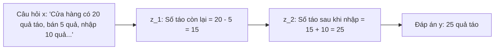

#### d. Code Thực chiến (Dual-Engine: C++ & Python)

```cpp
// C++17: Mô phỏng bộ thực thi chuỗi suy luận CoT tuần tự
#include <iostream>
#include <vector>
#include <string>

struct ReasoningStep {
    int step_id;
    std::string premise;
    std::string conclusion;
};

void execute_cot_pipeline(const std::vector<ReasoningStep>& chain) {
    std::cout << "--- BẮT ĐẦU CHUỖI SUY LUẬN (CoT) ---" << std::endl;
    for (const auto& step : chain) {
        std::cout << "[Bước " << step.step_id << "] Tiền đề: " << step.premise 
                  << " -> Suy ra: " << step.conclusion << std::endl;
    }
    std::cout << "--- KẾT THÚC SUY LUẬN ---" << std::endl;
}

int main() {
    std::vector<ReasoningStep> steps = {
        {1, "Tổng số ban đầu = 20, bán đi 5", "Còn lại 15"},
        {2, "Còn 15, nhập thêm 10", "Hiện có 25"}
    };
    execute_cot_pipeline(steps);
    return 0;
}
```

```python
# Python / PyTorch: Xây dựng Prompt Generator cho Chain-of-Thought
from typing import List, Dict

def format_cot_prompt(question: str, rationale_steps: List[str], final_answer: str) -> str:
    cot_body = " ".join([f"Bước {i+1}: {step}" for i, step in enumerate(rationale_steps)])
    return f"Câu hỏi: {question}\nSuy luận từng bước: {cot_body}\nKết luận cuối cùng: {final_answer}"

q = "Có 3 hộp kẹo, mỗi hộp 12 viên. Ăn hết 6 viên, còn bao nhiêu viên?"
steps = ["Tổng số kẹo là 3 * 12 = 36 viên.", "Ăn 6 viên nên còn lại 36 - 6 = 30 viên."]
print(format_cot_prompt(q, steps, "30 viên"))
```

#### e. Lỗi Thường gặp & Ổn định Số học (Pitfalls & Numerical Stability)
- **Snowballing Error Effect**: Nếu một bước suy luận trung gian $z_k$ bị sai số, sai lầm này sẽ được đưa vào làm dữ kiện ngữ cảnh cho các bước sau, khiến toàn bộ chuỗi tư duy phía sau bị trôi dạt hoàn toàn khỏi chân lý.

#### f. Ứng dụng Thực chiến trong AI / Deep Learning (AI Applications)
- Nền tảng cốt lõi giải phóng sức mạnh giải toán (GSM8K, MATH) và lập trình của tất cả các dòng LLM hiện đại.

---

### 2. Zero-Shot CoT (Chuỗi Tư duy Không Cần Mẫu)

#### a. Định nghĩa Bản chất Toán học (Mathematical Formulation)
**Zero-Shot CoT** (Kojima et al., NeurIPS 2022) chứng minh rằng khả năng suy luận logic nhiều bước vốn đã tiềm ẩn sẵn trong các trọng số của LLM sau quá trình pretraining, và có thể được "đánh thức" chỉ bằng một câu thần chú ma thuật (Magic Prompt Trigger):
$$\tau = \text{"Let's think step by step" (Hãy suy nghĩ từng bước một)}$$
Quy trình thực thi gồm 2 pha (Two-Stage Pipeline):
1. **Pha 1: Trích xuất Lý lẽ Suy luận (Reasoning Extraction)**:
   $$z \sim \pi_\theta\big(\cdot \mid x \circ \tau\big)$$
2. **Pha 2: Trích xuất Đáp án Cuối cùng (Answer Extraction)**:
   $$y \sim \pi_\theta\big(\cdot \mid x \circ \tau \circ z \circ \text{"Therefore, the answer is"}\big)$$

#### b. Cơ chế Tầng Sâu & Điện toán (Under The Hood / Hardware Internals)
- **Activation of Reasoning Heads**: Nghiên cứu cơ chế nơ-ron (Mechanistic Interpretability) chỉ ra rằng cụm từ *"Let's think step by step"* làm dịch chuyển phân phối kích hoạt của các tầng Attention đầu tiên sang trạng thái "chờ" (Delay Induction Heads), ức chế xu hướng phát ra token kết luận ngay lập tức và phân bổ năng lượng tính toán vào các biểu diễn trung gian.

#### c. Sơ đồ Minh họa (Mermaid / ASCII Diagram)
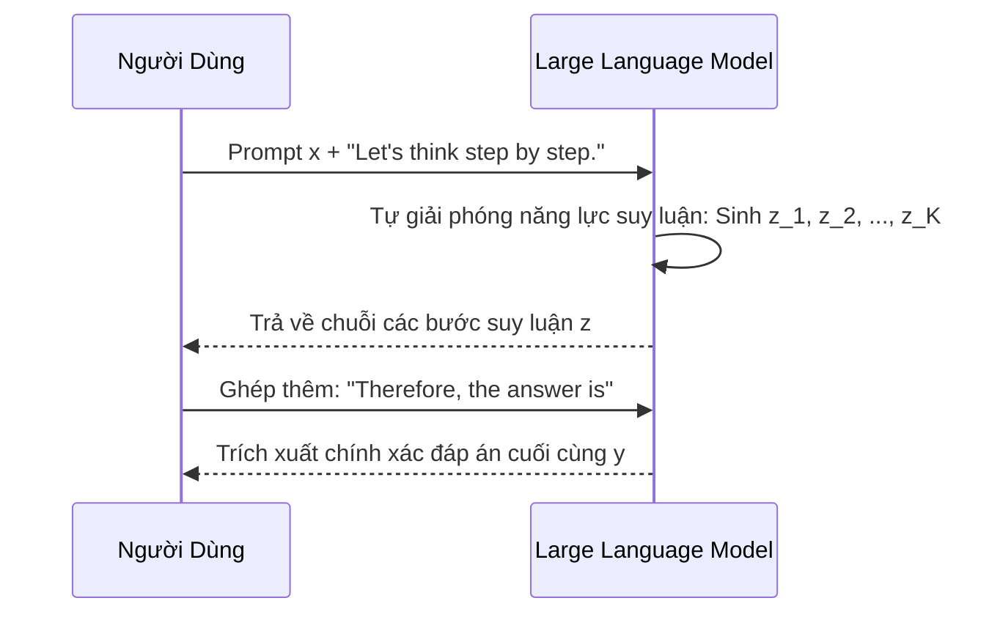

#### d. Code Thực chiến (Dual-Engine: C++ & Python)

```cpp
// C++17: Khung tạo Prompt Zero-Shot CoT 2 giai đoạn
#include <iostream>
#include <string>

std::pair<std::string, std::string> create_zero_shot_cot_prompts(const std::string& question, const std::string& generated_rationale = "") {
    std::string prompt_stage1 = question + "\nHãy suy nghĩ từng bước một:";
    std::string prompt_stage2 = prompt_stage1 + "\n" + generated_rationale + "\nDo đó, đáp án chính xác là:";
    return {prompt_stage1, prompt_stage2};
}

int main() {
    auto [p1, p2] = create_zero_shot_cot_prompts("Nếu hôm qua là thứ Hai, thì 100 ngày nữa là thứ mấy?");
    std::cout << "[Giai đoạn 1]:\n" << p1 << "\n\n[Giai đoạn 2 Mẫu]:\n" << p2 << std::endl;
    return 0;
}
```

```python
# Python: Pipeline Zero-Shot CoT 2 bước hoàn chỉnh
def zero_shot_cot_pipeline(question: str, llm_generate_fn) -> dict:
    # Pha 1: Kích hoạt suy luận
    prompt_stage1 = f"{question}\nLet's think step by step."
    rationale = llm_generate_fn(prompt_stage1)
    
    # Pha 2: Trích xuất đáp án
    prompt_stage2 = f"{prompt_stage1}\n{rationale}\nTherefore, the answer is"
    final_answer = llm_generate_fn(prompt_stage2)
    
    return {
        "rationale": rationale,
        "answer": final_answer
    }

mock_llm = lambda p: "100 chia 7 dư 2. Thứ Hai + 2 ngày = Thứ Tư." if "step by step" in p else "Thứ Tư."
print(zero_shot_cot_pipeline("100 ngày sau thứ Hai?", mock_llm))
```

#### e. Lỗi Thường gặp & Ổn định Số học (Pitfalls & Numerical Stability)
- **Token Inflation without Accuracy Gain**: Trên các mô hình nhỏ ($< 7\text{B}$ tham số chưa căn chỉnh), việc thêm *"Let's think step by step"* có thể khiến mô hình lặp lại câu hỏi một cách vô nghĩa mà không sinh ra được bất kỳ bước logic hữu ích nào.

#### f. Ứng dụng Thực chiến trong AI / Deep Learning (AI Applications)
- Phương pháp tăng độ chính xác tức thì miễn phí (Zero-effort accuracy booster) cho mọi ứng dụng gọi API LLM.

---

### 3. Few-Shot CoT (Chuỗi Tư duy Kèm Ví dụ Mẫu)

#### a. Định nghĩa Bản chất Toán học (Mathematical Formulation)
**Few-Shot CoT** cung cấp trực tiếp trong ngữ cảnh đầu vào một tập hợp $M$ ví dụ mẫu $\mathcal{E} = \{(x_m, z_m, y_m)\}_{m=1}^M$, trong đó mỗi ví dụ đều chứa tường minh câu hỏi, chuỗi suy luận từng bước và câu trả lời mẫu:
$$P(y \mid x, \mathcal{E}) = \sum_z P(y \mid x, z, \mathcal{E}) P(z \mid x, \mathcal{E})$$
Mô hình học theo cơ chế **In-Context Learning (ICL)** để sao chép cấu trúc lập luận, phong cách trình bày và độ sâu suy diễn của các mẫu dẫn dắt, giúp tăng độ chính xác vượt trội so với Zero-Shot CoT.

#### b. Cơ chế Tầng Sâu & Điện toán (Under The Hood / Hardware Internals)
- **Prompt Token Overhead & KV Reuse**: Đưa 4-8 ví dụ mẫu kèm chuỗi suy luận dài làm tăng kích thước prompt ban đầu lên tới $2.000 - 4.000$ tokens. Bắt buộc phải kích hoạt **Prefix Caching** trên GPU để không phải tính lại Self-Attention cho phần ví dụ mẫu qua các lượt gọi API khác nhau.

#### c. Sơ đồ Minh họa (Mermaid / ASCII Diagram)
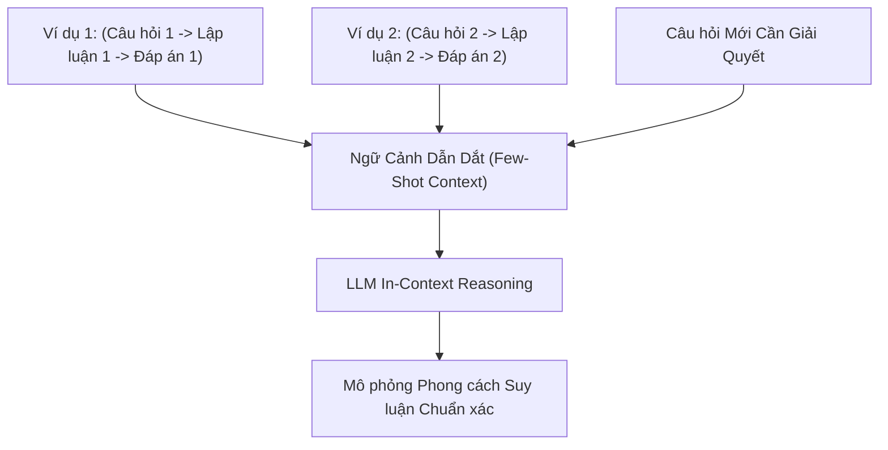

#### d. Code Thực chiến (Dual-Engine: C++ & Python)

```cpp
// C++17: Cấu trúc quản lý và định dạng Few-Shot CoT Exemplars
#include <iostream>
#include <vector>
#include <string>

struct Exemplar {
    std::string question;
    std::string reasoning;
    std::string answer;
};

std::string build_few_shot_prompt(const std::vector<Exemplar>& exemplars, const std::string& new_q) {
    std::string prompt = "";
    for (const auto& ex : exemplars) {
        prompt += "Hỏi: " + ex.question + "\nGiải: " + ex.reasoning + "\nĐáp án: " + ex.answer + "\n\n";
    }
    prompt += "Hỏi: " + new_q + "\nGiải:";
    return prompt;
}

int main() {
    std::vector<Exemplar> demos = {
        {"2 con gà có mấy chân?", "Mỗi con gà có 2 chân. 2 con gà có 2 * 2 = 4 chân.", "4"}
    };
    std::cout << build_few_shot_prompt(demos, "5 con chó có mấy chân?") << std::endl;
    return 0;
}
```

```python
# Python: Xây dựng Few-Shot CoT Prompt động dựa trên độ tương đồng ngữ nghĩa (Auto-CoT)
from typing import List, Dict

def create_dynamic_few_shot_cot(exemplar_pool: List[Dict], target_q: str, k: int = 2) -> str:
    # Lấy k ví dụ mẫu (giả lập chọn mẫu phù hợp nhất)
    selected = exemplar_pool[:k]
    prompt_parts = []
    for ex in selected:
        prompt_parts.append(f"Q: {ex['q']}\nA: {ex['rationale']} The answer is {ex['a']}.\n")
    prompt_parts.append(f"Q: {target_q}\nA:")
    return "\n".join(prompt_parts)

pool = [
    {"q": "Tìm x nếu 2x = 10", "rationale": "Chia cả 2 vế cho 2, ta được x = 5.", "a": "5"},
    {"q": "Tìm y nếu y + 3 = 7", "rationale": "Trừ 3 ở cả 2 vế, ta được y = 4.", "a": "4"}
]
print(create_dynamic_few_shot_cot(pool, "Tìm z nếu 3z = 18"))
```

#### e. Lỗi Thường gặp & Ổn định Số học (Pitfalls & Numerical Stability)
- **Exemplar Bias**: Nếu tất cả các ví dụ mẫu đều có đáp án là số chẵn, mô hình sẽ bị thiên lệch và có xác suất sinh ra số chẵn cao hơn hẳn dù bài toán thực tế ra số lẻ.

#### f. Ứng dụng Thực chiến trong AI / Deep Learning (AI Applications)
- Kỹ thuật chuẩn tắc được sử dụng khi đánh giá các mô hình trên bảng xếp hạng **MMLU, GSM8K, MATH**.

---

### 4. Self-Consistency (Tự Nhất quán)

#### a. Định nghĩa Bản chất Toán học (Mathematical Formulation)
**Self-Consistency** (Wang et al., ICLR 2023) thay thế chiến lược giải mã tham lam đơn lẻ (Greedy Decoding) bằng cơ chế lấy mẫu ngẫu nhiên độc lập nhiều chuỗi suy luận khác nhau và áp dụng nguyên tắc **Bình chọn Đa số (Majority Voting)** trên tập đáp án cuối cùng:
1. Lấy mẫu $N$ chuỗi suy luận độc lập ở nhiệt độ $T > 0$:
   $$\{(z^{(i)}, y^{(i)})\}_{i=1}^N \sim \pi_\theta(\cdot \mid x)$$
2. Gom nhóm các câu trả lời trùng nhau về mặt ngữ nghĩa và tìm đáp án chiếm đa số tuyệt đối:
   $$y^* = \arg\max_{y} \sum_{i=1}^N \mathbb{I}\big( y^{(i)} = y \big) = \arg\max_{y} \text{Count}(y)$$
Về mặt xác suất, Self-Consistency xấp xỉ phép lấy tích phân rìa (Marginalization) trên toàn bộ không gian các bước suy luận khả dĩ: $P(y \mid x) = \int P(y, z \mid x) dz$.

#### b. Cơ chế Tầng Sâu & Điện toán (Under The Hood / Hardware Internals)
- **Batched Parallel Generation**: $N$ chuỗi suy luận ($N \in [10, 40]$) được sinh song song trong cùng một Batch Tensor trên GPU. Nhờ dùng chung Prompt KV Cache ban đầu, thông lượng xử lý tăng gấp nhiều lần so với việc chạy $N$ lần tuần tự.

#### c. Sơ đồ Minh họa (Mermaid / ASCII Diagram)
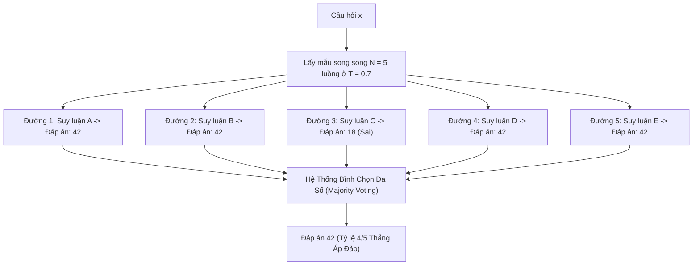

#### d. Code Thực chiến (Dual-Engine: C++ & Python)

```cpp
// C++17: Thuật toán Majority Voting cho Self-Consistency
#include <iostream>
#include <vector>
#include <string>
#include <unordered_map>

std::string majority_vote(const std::vector<std::string>& candidates) {
    std::unordered_map<std::string, int> counts;
    for (const auto& c : candidates) counts[c]++;
    
    std::string best_ans = "";
    int max_count = -1;
    for (const auto& [ans, cnt] : counts) {
        if (cnt > max_count) {
            max_count = cnt;
            best_ans = ans;
        }
    }
    return best_ans;
}

int main() {
    std::vector<std::string> answers = {"42", "42", "18", "42", "30", "42"};
    std::cout << "Majority Voted Answer: " << majority_vote(answers) << std::endl;
    return 0;
}
```

```python
# Python: Triển khai Self-Consistency với trích xuất câu trả lời chuẩn tắc
from collections import Counter
from typing import List, Callable

def self_consistency_voting(prompt: str, sample_generator_fn: Callable[[str, int], List[str]], n: int = 10) -> str:
    samples = sample_generator_fn(prompt, n)
    extracted_answers = []
    
    for s in samples:
        # Bóc tách đáp án sau từ khóa 'Answer:'
        if "Answer:" in s:
            ans = s.split("Answer:")[-1].strip().split()[0].replace(".", "")
            extracted_answers.append(ans)
            
    if not extracted_answers:
        return "NO_CONSENSUS"
        
    vote_counts = Counter(extracted_answers)
    most_common_answer, count = vote_counts.most_common(1)[0]
    print(f"Bình chọn cao nhất: {most_common_answer} ({count}/{len(extracted_answers)} phiếu)")
    return most_common_answer

mock_gen = lambda p, n: ["... Answer: 42."] * 7 + ["... Answer: 15."] * 3
print("Kết quả Self-Consistency:", self_consistency_voting("Tính x?", mock_gen, 10))
```

#### e. Lỗi Thường gặp & Ổn định Số học (Pitfalls & Numerical Stability)
- **Tied Votes / Uniform Distribution**: Nếu nhiệt độ $T$ đặt quá cao ($T \ge 1.5$), mô hình sinh ra $N$ câu trả lời hoàn toàn khác biệt nhau (phân tán cực đại), khiến thuật toán bỏ phiếu bị mất tác dụng.

#### f. Ứng dụng Thực chiến trong AI / Deep Learning (AI Applications)
- Giúp tăng vọt từ $10\% - 20\%$ độ chính xác trên các bài thi toán học **GSM8K, MATH, SVAMP**.

---

### 5. Tree of Thoughts - ToT (Cây Tư duy)

#### a. Định nghĩa Bản chất Toán học (Mathematical Formulation)
**Tree of Thoughts (ToT)** (Yao et al., NeurIPS 2023) mở rộng mô hình suy luận từ chuỗi thẳng sang cấu trúc **Cây Tìm kiếm (Search Tree)**, cho phép mô hình khám phá nhiều nhánh suy nghĩ đồng thời, nhìn trước tương lai (Lookahead) và quay lui (Backtracking) khi gặp ngõ cụt:
Cây tư duy được định nghĩa bởi bộ 4 thành phần $\mathcal{T} = (\mathcal{S}, p_{\theta}^{\text{gen}}, p_{\theta}^{\text{eval}}, \text{SearchAlg})$:
1. **Trạng thái (State) $s$**: Chuỗi các suy nghĩ đã tích lũy tính đến thời điểm hiện tại.
2. **Sinh suy nghĩ tiếp theo**: $z \sim p_{\theta}^{\text{gen}}(s)$.
3. **Đánh giá trạng thái (State Evaluation)**: Mô hình tự chấm điểm chất lượng của một trạng thái:
   $$V(s) \in \{\text{Chắc chắn đúng}, \text{Khả thi}, \text{Bất khả thi}\} \quad \text{hoặc} \quad V(s) \in [0, 1]$$
4. **Thuật toán tìm kiếm**: Áp dụng **Breadth-First Search (BFS)** hoặc **Depth-First Search (DFS)** kết hợp cắt tỉa nhánh (Pruning).

#### b. Cơ chế Tầng Sâu & Điện toán (Under The Hood / Hardware Internals)
- **Exponential Tree Memory Allocation**: Không gian trạng thái của ToT bùng nổ theo cấp số nhân $\mathcal{O}(b^d)$ với $b$ là hệ số nhánh (Branching Factor) và $d$ là độ sâu cây. Cần áp dụng kỹ thuật giải phóng bộ nhớ KV Cache của các nhánh bị cắt tỉa (Pruned Branches) để tránh tràn VRAM GPU.

#### c. Sơ đồ Minh họa (Mermaid / ASCII Diagram)
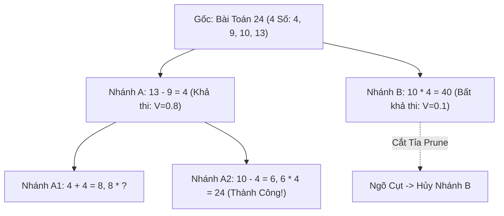

#### d. Code Thực chiến (Dual-Engine: C++ & Python)

```cpp
// C++17: Cấu trúc Node và Cắt tỉa Nhánh trong Cây Tư duy (ToT)
#include <iostream>
#include <vector>
#include <memory>

struct ThoughtNode {
    std::string thought_text;
    double evaluation_score;
    std::vector<std::shared_ptr<ThoughtNode>> children;
    
    ThoughtNode(std::string text, double score) : thought_text(text), evaluation_score(score) {}
};

void prune_and_traverse(const std::shared_ptr<ThoughtNode>& node, double threshold = 0.5) {
    if (!node || node->evaluation_score < threshold) return;
    std::cout << "Khám phá nhánh khả thi: " << node->thought_text << " (Score: " << node->evaluation_score << ")\n";
    for (const auto& child : node->children) {
        prune_and_traverse(child, threshold);
    }
}

int main() {
    auto root = std::make_shared<ThoughtNode>("Start", 1.0);
    root->children.push_back(std::make_shared<ThoughtNode>("Nhánh 1: Cộng trừ", 0.85));
    root->children.push_back(std::make_shared<ThoughtNode>("Nhánh 2: Nhân chia bừa bãi", 0.20)); // Bị tỉa
    prune_and_traverse(root);
    return 0;
}
```

```python
# Python: Thuật toán ToT BFS cho bài toán Game of 24
from typing import List

class TreeOfThoughtsBFS:
    def __init__(self, generator_fn, evaluator_fn, breadth: int = 3, max_depth: int = 3):
        self.gen = generator_fn
        self.eval = evaluator_fn
        self.b = breadth
        self.max_depth = max_depth
        
    def solve(self, initial_state: str) -> str:
        current_states = [initial_state]
        
        for depth in range(self.max_depth):
            candidates = []
            for state in current_states:
                next_thoughts = self.gen(state, self.b)
                for t in next_thoughts:
                    score = self.eval(t)
                    if score > 0.4: # Ngưỡng cắt tỉa
                        candidates.append((t, score))
                        
            if not candidates:
                return "FAILED_SEARCH"
                
            # Giữ lại B trạng thái có điểm cao nhất
            candidates.sort(key=lambda x: x[1], reverse=True)
            current_states = [c[0] for c in candidates[:self.b]]
            
        return current_states[0]

mock_gen = lambda s, b: [f"{s} -> Bước {i}" for i in range(b)]
mock_eval = lambda s: 0.8 if "Bước 1" in s else 0.2
tot = TreeOfThoughtsBFS(mock_gen, mock_eval)
print("ToT Optimal Path:", tot.solve("Game24(4, 6, 8, 2)"))
```

#### e. Lỗi Thường gặp & Ổn định Số học (Pitfalls & Numerical Stability)
- **Combinatorial Explosion & Latency**: Chi phí tính toán bùng nổ cực nhanh. Chạy ToT trên các bài toán phức tạp có thể tiêu tốn hàng ngàn lượt gọi API và mất vài phút cho một câu hỏi duy nhất.

#### f. Ứng dụng Thực chiến trong AI / Deep Learning (AI Applications)
- Giải quyết xuất sắc bài toán **Game of 24**, viết tiểu luận sáng tạo đa chương, và lập kế hoạch chiến lược nhiều bước.

---

### 6. Graph of Thoughts - GoT (Đồ thị Tư duy)

#### a. Định nghĩa Bản chất Toán học (Mathematical Formulation)
**Graph of Thoughts (GoT)** (Besta et al., AAAI 2024) tổng quát hóa Tree of Thoughts thành một **Đồ thị Có hướng Có thể Chứa Chu trình (Directed Graph of Thoughts)** $\mathcal{G} = (\mathcal{V}, \mathcal{E})$:
Trong đó:
- Đỉnh $v \in \mathcal{V}$: Đại diện cho một đơn vị suy nghĩ (Thought Unit).
- Cạnh có hướng $(u, v) \in \mathcal{E}$: Biểu thị sự phụ thuộc logic (Suy nghĩ $v$ được xây dựng từ suy nghĩ $u$).
Các phép toán đồ thị tiên tiến mà Tree không thể làm được:
1. **Phép Hợp nhất Suy nghĩ (Thought Merging / Aggregation)**: Kết hợp nhiều nhánh suy nghĩ độc lập thành một giải pháp tổng hợp duy nhất:
   $$v_{\text{merged}} \sim \pi_\theta\big(\cdot \mid v_1, v_2, \dots, v_m\big), \quad \text{với } (v_i, v_{\text{merged}}) \in \mathcal{E}$$
2. **Vòng lặp Cải thiện Phản hồi (Feedback Loops / Cycles)**: Cho phép một ý niệm quay trở lại tinh chỉnh đỉnh tiền nhiệm.

#### b. Cơ chế Tầng Sâu & Điện toán (Under The Hood / Hardware Internals)
- **Topological Sorting & Dynamic DAG Scheduler**: Việc thực thi các node trên đồ thị tư duy đòi hỏi thuật toán sắp xếp tô-pô (Topological Sort) để xác định thứ tự forward pass hợp lý, giải phóng bộ nhớ của các node không còn cạnh kết nối (In-degree = 0).

#### c. Sơ đồ Minh họa (Mermaid / ASCII Diagram)
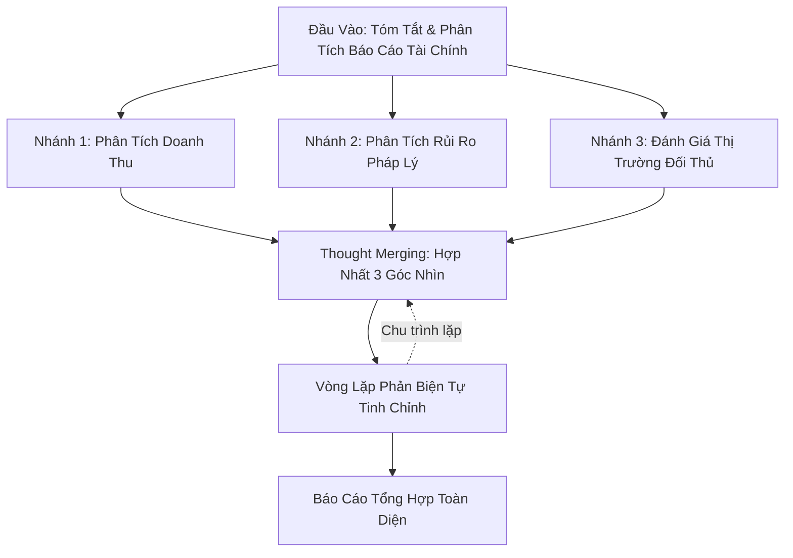

#### d. Code Thực chiến (Dual-Engine: C++ & Python)

```cpp
// C++17: Cấu trúc Đồ thị Có hướng lưu trữ các mối liên kết suy nghĩ trong GoT
#include <iostream>
#include <vector>
#include <string>

struct ThoughtVertex {
    int id;
    std::string content;
    std::vector<int> incoming_edges; // Dependencies
};

class GraphOfThoughts {
public:
    std::vector<ThoughtVertex> vertices;
    void add_thought(int id, const std::string& text, const std::vector<int>& dependencies) {
        vertices.push_back({id, text, dependencies});
    }
};

int main() {
    GraphOfThoughts got;
    got.add_thought(1, "Ý niệm A: Phân tích kỹ thuật", {});
    got.add_thought(2, "Ý niệm B: Phân tích cơ bản", {});
    got.add_thought(3, "Hợp nhất: Chiến lược đầu tư kết hợp A và B", {1, 2});
    std::cout << "GoT Node 3 In-Degree: " << got.vertices[2].incoming_edges.size() << std::endl;
    return 0;
}
```

```python
# Python: Triển khai phép hợp nhất 2 luồng suy nghĩ độc lập trong GoT
def merge_thoughts_got(thought_a: str, thought_b: str, merger_llm_fn) -> str:
    merge_prompt = f"""[Mục Tiêu: Hợp Nhất Ý Niệm]
Ý kiến 1: {thought_a}
Ý kiến 2: {thought_b}
Hãy tổng hợp hai phân tích trên thành một giải pháp thống nhất khắc phục nhược điểm của cả hai:"""
    return merger_llm_fn(merge_prompt)

mock_merge = lambda p: "Tổng hợp: Kết hợp chiến lược tăng trưởng Doanh thu song hành cùng Tối ưu chi phí."
print(merge_thoughts_got("Cần tăng doanh thu", "Cần cắt giảm chi phí", mock_merge))
```

#### e. Lỗi Thường gặp & Ổn định Số học (Pitfalls & Numerical Stability)
- **Deadlock & Infinite Cycle**: Các chu trình phản biện không có điều kiện dừng rõ ràng có thể khiến hệ thống rơi vào vòng lặp vô tận, làm cạn kiệt ngân sách tính toán (Token Budget Exhaustion).

#### f. Ứng dụng Thực chiến trong AI / Deep Learning (AI Applications)
- Hệ thống tóm tắt tài liệu quy mô lớn, phân tích văn bản pháp luật đa chiều và nghiên cứu thuốc y sinh phức tạp.

---

### 7. Least-to-Most Prompting

#### a. Định nghĩa Bản chất Toán học (Mathematical Formulation)
**Least-to-Most Prompting** (Zhou et al., ICLR 2023) là chiến lược suy luận lấy cảm hứng từ phương pháp giáo dục học chia nhỏ vấn đề (Pedagogical Scaffolding):
Quá trình diễn ra theo 2 giai đoạn kế tiếp nhau:
1. **Phân rã Bài toán (Decomposition)**: Chia bài toán phức tạp $Q$ thành danh sách các bài toán con được sắp xếp theo thứ tự độ khó tăng dần:
   $$Q \longrightarrow \langle q_1, q_2, \dots, q_K \rangle, \quad \text{với } \text{Difficulty}(q_1) < \text{Difficulty}(q_2) < \dots < \text{Difficulty}(q_K)$$
2. **Giải toán Tuần tự Kế thừa (Sequential Solving)**: Giải từng bài toán con, trong đó lời giải của bài toán trước được dùng làm dữ kiện bổ sung để giải bài toán tiếp theo:
   $$a_k \sim \pi_\theta\big(\cdot \mid q_k, (q_1, a_1), \dots, (q_{k-1}, a_{k-1})\big)$$
Lời giải cuối cùng $a_K$ chính là đáp án cho toàn bộ bài toán gốc $Q$.

#### b. Cơ chế Tầng Sâu & Điện toán (Under The Hood / Hardware Internals)
- **Incremental Context Buffering**: Mỗi lượt giải bài toán con thành công, cặp $(q_k, a_k)$ được nối thêm vào bộ nhớ Context Window. Kỹ thuật này đòi hỏi cơ chế quản lý bộ nhớ linh hoạt để đảm bảo chuỗi tích lũy không vượt quá giới hạn Context Window của mô hình.

#### c. Sơ đồ Minh họa (Mermaid / ASCII Diagram)
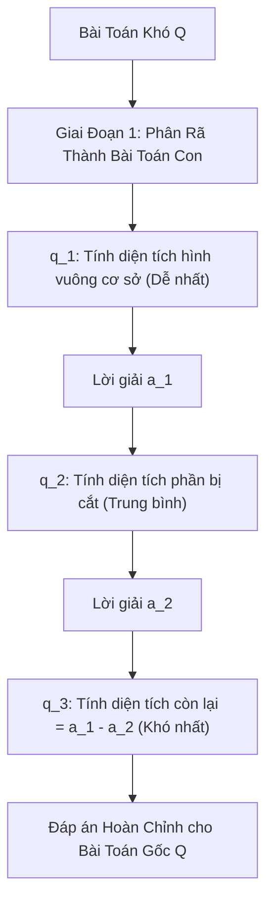

#### d. Code Thực chiến (Dual-Engine: C++ & Python)

```cpp
// C++17: Mô phỏng quy trình giải tuần tự kế thừa Least-to-Most
#include <iostream>
#include <vector>
#include <string>

struct SubProblem {
    std::string question;
    std::string answer;
};

void run_least_to_most(std::vector<SubProblem>& sub_problems) {
    std::string context_history = "";
    for (size_t i = 0; i < sub_problems.size(); ++i) {
        std::cout << "[Giải bài toán con " << (i + 1) << "]: " << sub_problems[i].question << "\n";
        // Kế thừa lịch sử
        sub_problems[i].answer = "Đáp án của bước " + std::to_string(i + 1);
        context_history += "Q: " + sub_problems[i].question + " -> A: " + sub_problems[i].answer + "\n";
    }
    std::cout << "Hoàn thành giải toàn bộ chuỗi.\n";
}

int main() {
    std::vector<SubProblem> chain = {
        {"Tính vận tốc xe A?", ""},
        {"Tính quãng đường xe A đi được trong 2h?", ""}
    };
    run_least_to_most(chain);
    return 0;
}
```

```python
# Python: Triển khai Least-to-Most Pipeline
def least_to_most_solver(complex_problem: str, deconstruct_fn, solve_fn) -> str:
    # Bước 1: Phân rã bài toán
    sub_questions = deconstruct_fn(complex_problem)
    
    accumulated_context = ""
    for idx, sq in enumerate(sub_questions):
        prompt = f"{accumulated_context}\nCâu hỏi con {idx+1}: {sq}\nHãy giải quyết:"
        sub_ans = solve_fn(prompt)
        accumulated_context += f"\nCâu hỏi: {sq}\nTrả lời: {sub_ans}\n"
        
    return accumulated_context

mock_deconstruct = lambda p: ["Mai có bao nhiêu tiền?", "Lan có bao nhiêu tiền?", "Cả hai có bao nhiêu tiền?"]
mock_solver = lambda p: "10k" if "Mai" in p else ("20k" if "Lan" in p else "30k")
print("Least-to-Most Result:\n", least_to_most_solver("Tính tổng tiền Mai và Lan", mock_deconstruct, mock_solver))
```

#### e. Lỗi Thường gặp & Ổn định Số học (Pitfalls & Numerical Stability)
- **Flawed Decomposition**: Nếu giai đoạn 1 phân rã bài toán thiếu sót một điều kiện tiên quyết (Missing Dependency), các bước giải sau sẽ bị thiếu thông tin và dẫn đến kết luận sai lệch.

#### f. Ứng dụng Thực chiến trong AI / Deep Learning (AI Applications)
- Giải các bài toán đố nhiều bước trong **GSM8K**, bài toán logic đồ thị và bài toán định lý hình học.

---

### 8. Program-Aided Language Models - PAL

#### a. Định nghĩa Bản chất Toán học (Mathematical Formulation)
**PAL** (Gao et al., ICML 2023) giải quyết triệt để điểm yếu chí mạng của LLM: **LLM rất giỏi suy luận logic ngôn ngữ nhưng lại rất kém trong tính toán số học chính xác (Arithmetic Calculation)**.
Thay vì bắt LLM tự tính nhẩm các phép tính trong chuỗi Chain-of-Thought, PAL yêu cầu mô hình sinh ra một **Đoạn Mã Lập trình (Python Code)** đại diện cho toàn bộ logic giải toán:
$$x \quad \longrightarrow \quad \mathcal{P}_{\text{Python}} \sim \pi_\theta(\cdot \mid x)$$
Sau đó, đoạn mã được gửi tới một trình thông dịch Python (Python Runtime Environment) độc lập để thực thi và trích xuất kết quả biến số cuối cùng:
$$y = \text{PythonRuntime.execute}(\mathcal{P}_{\text{Python}})$$
Sự kết hợp này tạo ra một hệ thống hoàn hảo: LLM đóng vai trò bộ não lập trình (Neuro), còn Python đóng vai trò động cơ tính toán số học chuẩn xác tuyệt đối (Symbolic Engine).

#### b. Cơ chế Tầng Sâu & Điện toán (Under The Hood / Hardware Internals)
- **Subprocess Forking Latency**: Mỗi truy vấn PAL yêu cầu tạo một tiến trình Python con (`subprocess.Popen` hoặc Docker container). Để giảm độ trễ khởi động tiến trình (Process Spawning Overhead), các hệ thống công nghiệp duy trì một hồ chứa tiến trình sẵn sàng (Warm Process Pool).

#### c. Sơ đồ Minh họa (Mermaid / ASCII Diagram)
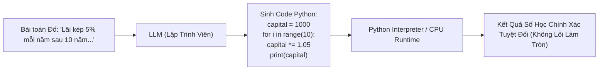

#### d. Code Thực chiến (Dual-Engine: C++ & Python)

```cpp
// C++17: Kiểm tra định dạng khối mã Python do LLM sinh ra trong PAL
#include <iostream>
#include <string>

bool validate_pal_code_block(const std::string& response) {
    return (response.find("```python") != std::string::npos && 
            response.find("```", response.find("```python") + 9) != std::string::npos);
}

int main() {
    std::string sample = "Dưới đây là mã giải toán:\n```python\na = 10\nb = 20\nans = a + b\n```";
    std::cout << "Mã Python hợp lệ: " << (validate_pal_code_block(sample) ? "TRUE" : "FALSE") << std::endl;
    return 0;
}
```

```python
# Python: Triển khai PAL Engine thực thi mã an toàn để trích xuất đáp án
import io
import sys

def execute_pal_snippet(code_string: str) -> str:
    # Bóc tách code giữa các dấu backticks
    if "```python" in code_string:
        code_string = code_string.split("```python")[1].split("```")[0]
        
    old_stdout = sys.stdout
    redirected_output = io.StringIO()
    sys.stdout = redirected_output
    
    try:
        local_scope = {}
        exec(code_string, {}, local_scope)
        # Ưu tiên lấy biến 'result' hoặc 'ans' hoặc in ra màn hình
        output = redirected_output.getvalue().strip()
        if output:
            return output
        if "ans" in local_scope:
            return str(local_scope["ans"])
        return "NO_OUTPUT"
    except Exception as e:
        return f"EXECUTION_ERROR: {str(e)}"
    finally:
        sys.stdout = old_stdout

sample_pal = """```python
principal = 1000
rate = 0.05
years = 3
ans = principal * ((1 + rate) ** years)
print(round(ans, 2))
```"""
print("PAL Executed Output:", execute_pal_snippet(sample_pal))
```

#### e. Lỗi Thường gặp & Ổn định Số học (Pitfalls & Numerical Stability)
- **Syntax Errors & Infinite Loops**: Mô hình có thể sinh ra vòng lặp `while True` không có điều kiện thoát hoặc thụt lề sai cú pháp (IndentationError), làm treo tiến trình nếu không có cơ chế Timeout Watchdog.

#### f. Ứng dụng Thực chiến trong AI / Deep Learning (AI Applications)
- Tăng độ chính xác giải toán trên **GSM8K** từ $74\%$ lên trên $85\%$ cho các dòng mô hình nền tảng.

---

### 9. Program of Thoughts - PoT (Chương trình Tư duy)

#### a. Định nghĩa Bản chất Toán học (Mathematical Formulation)
**Program of Thoughts (PoT)** (Chen et al., TMLR 2023) mở rộng tư tưởng của PAL sang các bài toán phức tạp hơn bao gồm tối ưu hóa số, mô phỏng quá trình xác suất và giải phương trình đại số phi tuyến.
Khác với PAL (vốn thường chỉ sinh ra các phép tính số học đơn giản), PoT:
1. Mô hình hóa bài toán ngôn ngữ thành một tập hợp các định nghĩa biến số, phương trình hình thức và các hàm logic trong Python (sử dụng các thư viện toán học chuyên sâu như `sympy`, `scipy`, `numpy`):
   $$\text{NLP Problem } x \quad \xrightarrow{\text{Formalize}} \quad \text{SymPy Equations } \mathcal{E}$$
2. Tách bạch hoàn toàn:
   - **Giai đoạn Mô hình hóa (Modeling Phase)**: Do LLM phụ trách (khai thác năng lực thấu hiểu ngôn ngữ).
   - **Giai đoạn Tính toán Giải thuật (Computation Phase)**: Do Trình giải Phương trình Đại số Máy tính (Computer Algebra System - CAS) đảm nhiệm.

#### b. Cơ chế Tầng Sâu & Điện toán (Under The Hood / Hardware Internals)
- **Symbolic Solver Memory Overhead**: Việc nạp các gói thư viện đại số lớn như SymPy tốn bộ nhớ RAM máy chủ. Các triển khai PoT tối ưu sử dụng các worker tiến trình nạp sẵn thư viện (Pre-imported workers) để xử lý tức thì các phương trình đại số mà không bị độ trễ import.

#### c. Sơ đồ Minh họa (Mermaid / ASCII Diagram)
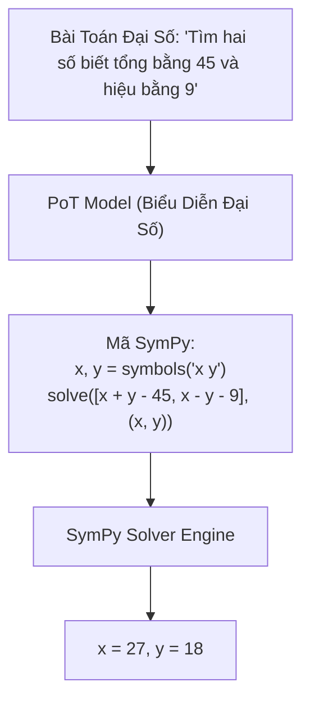

#### d. Code Thực chiến (Dual-Engine: C++ & Python)

```cpp
// C++17: Mô phỏng phân tích cấu trúc lời giải đại số của PoT
#include <iostream>
#include <string>

struct AlgebraicVariable {
    std::string name;
    double resolved_value;
};

void print_solution(const AlgebraicVariable& var) {
    std::cout << "Variable: " << var.name << " = " << var.resolved_value << std::endl;
}

int main() {
    print_solution({"x", 27.0});
    return 0;
}
```

```python
# Python: Triển khai PoT giải hệ phương trình đại số bằng SymPy
from sympy import symbols, Eq, solve

def solve_pot_algebraic_system():
    x, y = symbols('x y')
    # Hệ phương trình: x + y = 45 và x - y = 9
    eq1 = Eq(x + y, 45)
    eq2 = Eq(x - y, 9)
    
    solution = solve((eq1, eq2), (x, y))
    return f"Nghiệm tìm được: x={solution[x]}, y={solution[y]}"

print(solve_pot_algebraic_system())
```

#### e. Lỗi Thường gặp & Ổn định Số học (Pitfalls & Numerical Stability)
- **Ill-Posed Equation Systems**: Mô hình thiết lập hệ phương trình vô nghiệm hoặc có vô số nghiệm, khiến trình giải đại số ném ngoại lệ hoặc không hội tụ.

#### f. Ứng dụng Thực chiến trong AI / Deep Learning (AI Applications)
- Giải quyết xuất sắc các bài toán vật lý định lượng, tính toán tài chính phái sinh và thống kê nâng cao trong **MATH** và **FinQA**.

---

### 10. Scratchpad Reasoning (Vùng Nháp Tính toán)

#### a. Định nghĩa Bản chất Toán học (Mathematical Formulation)
**Scratchpad Reasoning** (Nye et al., 2021) là kỹ thuật cung cấp một không gian đệm ghi chép tạm thời (Intermediate State Scratchpad) trực tiếp trong chuỗi token sinh ra.
Mô hình được huấn luyện để mô phỏng chính xác trạng thái bên trong của một máy tính vạn năng Turing (Turing Machine Tape):
$$\text{Input: } x \quad \longrightarrow \quad \text{Tape State } s_1 \to s_2 \to \dots \to s_T \quad \longrightarrow \quad \text{Final Output: } y$$
Tại mỗi bước $t$, mô hình in ra toàn bộ trạng thái hiện tại của bộ nhớ tạm (ví dụ: con trỏ duyệt mảng, biến nhớ mang cờ - Carry Bit, hoặc ngăn xếp Stack), giúp giải quyết các thuật toán đòi hỏi biến đổi trạng thái phức tạp như thực thi từng dòng lệnh chương trình (Code Execution Simulation) hoặc cộng hai số lớn hàng trăm chữ số.

#### b. Cơ chế Tầng Sâu & Điện toán (Under The Hood / Hardware Internals)
- **Attention Over Past Scratchpad States**: Mô hình tận dụng toàn bộ ma trận Self-Attention để liên tục "đọc" lại trạng thái nháp của bước ngay trước đó, loại bỏ sự phụ thuộc vào các trọng số ẩn nội tại (Hidden States) và biến đổi trạng thái thành dữ liệu ngữ cảnh hiển ngôn (Explicit Context).

#### c. Sơ đồ Minh họa (Mermaid / ASCII Diagram)
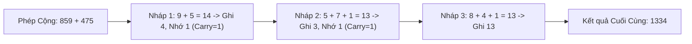

#### d. Code Thực chiến (Dual-Engine: C++ & Python)

```cpp
// C++17: Mô phỏng cơ chế lưu vết Scratchpad cho phép cộng số lớn có nhớ
#include <iostream>
#include <string>
#include <vector>

struct ScratchpadStep {
    int digit_a;
    int digit_b;
    int carry_in;
    int sum;
    int digit_out;
    int carry_out;
};

void run_addition_scratchpad(int a, int b) {
    int d_a = a % 10, d_b = b % 10;
    int sum = d_a + d_b;
    ScratchpadStep s1{d_a, d_b, 0, sum, sum % 10, sum / 10};
    std::cout << "[Scratchpad]: " << s1.digit_a << " + " << s1.digit_b 
              << " -> Ghi: " << s1.digit_out << ", Nhớ: " << s1.carry_out << std::endl;
}

int main() {
    run_addition_scratchpad(9, 5);
    return 0;
}
```

```python
# Python: Trình mô phỏng Scratchpad thực thi thuật toán mô phỏng dấu vết thực thi mã (Trace Simulation)
def scratchpad_loop_trace(n: int) -> list:
    scratchpad_log = []
    total = 0
    for i in range(1, n + 1):
        prev_total = total
        total += i
        scratchpad_log.append(f"Bước {i}: i={i}, total_cu={prev_total} + {i} -> total_moi={total}")
    return scratchpad_log

trace = scratchpad_loop_trace(4)
for line in trace:
    print(line)
```

#### e. Lỗi Thường gặp & Ổn định Số học (Pitfalls & Numerical Stability)
- **Context Length Overflow in Long Loops**: Với các vòng lặp lớn ($N \ge 1.000$), toàn bộ nội dung nháp sẽ nhanh chóng làm tràn Context Window của mô hình, đòi hỏi phải tóm tắt hoặc nén trạng thái nháp định kỳ.

#### f. Ứng dụng Thực chiến trong AI / Deep Learning (AI Applications)
- Nền tảng huấn luyện các mô hình giả lập trình biên dịch (Neural Interpreters) và tối ưu hóa năng lực giải các bài toán quy hoạch động nhiều bước.
