# Chuyên đề: Tự Tinh chỉnh, Học tăng cường Bằng Lời & Mở rộng Tính toán Thời điểm Suy luận (Self-Refinement, Verbal RL & Test-Time Compute)

## 1. Tổng quan Chuyên đề
Một trong những bước ngoặt vĩ đại nhất trong sự phát triển của Trí tuệ Nhân tạo là sự chuyển dịch trọng tâm từ **Pretraining Scaling** (tiếp tục mở rộng kích thước mô hình và dữ liệu tiền huấn luyện) sang **Test-Time Scaling / Inference-Time Compute** (mở rộng tài nguyên tính toán tại thời điểm mô hình suy luận).

Quy luật mới này chứng minh: Thay vì phản hồi ngay lập tức sau vài phần nghìn giây, việc cho phép mô hình dành nhiều giây hoặc nhiều phút để "nghiền ngẫm", tự phản biện, tự sửa sai và tương tác với các công cụ môi trường bên ngoài sẽ giúp mô hình vượt qua những rào cản nhận thức hóc búa nhất:
1. **Vòng lặp Tự Phản tỉnh & Học tăng cường Ngôn từ (Self-Reflection & Verbal RL)**: **Self-Refinement, Self-Critique, Reflection, Verbal Reinforcement Learning** cho phép LLM đóng vai trò vừa là người thực thi, vừa là người giám sát (Supervisor), tích lũy kinh nghiệm ngôn từ vào bộ nhớ đệm mà không cần cập nhật ma trận trọng số (Zero-Weight Gradient Update).
2. **Khai phóng Năng lực Tính toán Thời điểm Suy luận (Test-Time Compute & Inference Scaling Laws)**: Phân bổ linh hoạt giữa **Parallel Sampling** (lấy mẫu song song hàng ngàn nhánh) và **Sequential Sampling** (suy luận tuần tự dài hơi có sửa sai), mở ra một hàm Scaling Law mới: *"Hiệu năng tỷ lệ thuận với số lượng FLOPs bỏ ra khi suy luận"*.
3. **Mở rộng Tri thức qua Công cụ & Thực thi Mã (Search & Tool Augmentation)**: Trao quyền cho mô hình sử dụng công cụ tìm kiếm bên ngoài (**Search-Augmented**) và thực thi mã nguồn thời gian thực (**Code Execution**).

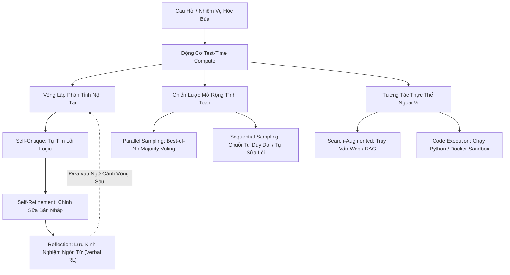

---

## 2. Chi tiết từng Keyword

---

### 11. Self-Refinement (Tự Tinh chỉnh)

#### a. Định nghĩa Bản chất Toán học (Mathematical Formulation)
**Self-Refinement** (Madaan et al., NeurIPS 2023) là quy trình lặp lại khép kín trong đó LLM tự cải thiện câu trả lời của chính mình thông qua các vòng lặp phản hồi tự thân mà không cần dữ liệu huấn luyện mới hay sự can thiệp của con người.
Chuỗi quá trình lặp tại bước $t$:
1. **Sinh bản nháp ban đầu**: $y_0 \sim \pi_\theta(\cdot \mid x)$.
2. **Tự phản hồi (Feedback)**: $f_t \sim \pi_{\text{feedback}}(\cdot \mid x, y_t)$.
3. **Tự chỉnh sửa (Refinement)**: $y_{t+1} \sim \pi_{\text{refine}}(\cdot \mid x, y_t, f_t)$.
Quá trình dừng lại khi hàm thỏa dụng đạt ngưỡng hội tụ hoặc đạt giới hạn số vòng lặp tối đa $T$:
$$y^* = y_T, \quad \text{với } \text{Quality}(y_{t+1}) \ge \text{Quality}(y_t)$$

#### b. Cơ chế Tầng Sâu & Điện toán (Under The Hood / Hardware Internals)
- **Context Accumulation Overhead**: Mỗi vòng lặp tinh chỉnh bổ sung bản nháp cũ và bản tự phản hồi vào lịch sử đối thoại. Đến vòng lặp thứ $T = 4$, độ dài chuỗi context có thể tăng lên $8.000$ tokens, gây áp lực lớn lên bộ nhớ đệm KV Cache và làm tăng thời gian sinh token tiếp theo.

#### c. Sơ đồ Minh họa (Mermaid / ASCII Diagram)
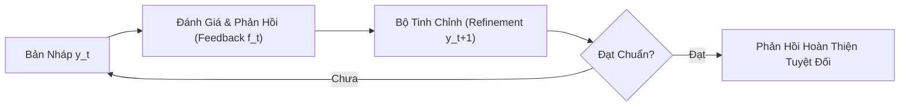

#### d. Code Thực chiến (Dual-Engine: C++ & Python)

```cpp
// C++17: Khung điều khiển vòng lặp Self-Refinement với điều kiện dừng
#include <iostream>
#include <string>

struct RefinementCycle {
    int max_iterations;
    double quality_threshold;
    
    void run(const std::string& initial_draft) {
        std::string current = initial_draft;
        for (int iter = 1; iter <= max_iterations; ++iter) {
            std::cout << "[Vòng " << iter << "] Bản nháp: '" << current << "' -> Tự phản biện & Tinh chỉnh\n";
            current += " (Đã tối ưu hóa ở vòng " + std::to_string(iter) + ")";
        }
    }
};

int main() {
    RefinementCycle loop{3, 0.95};
    loop.run("Thuật toán sắp xếp cơ bản");
    return 0;
}
```

```python
# Python: Triển khai Self-Refinement Pipeline hoàn chỉnh
def self_refinement_loop(
    task_prompt: str,
    generator_fn,
    feedback_fn,
    refiner_fn,
    max_steps: int = 3
) -> str:
    current_response = generator_fn(task_prompt)
    
    for step in range(max_steps):
        feedback = feedback_fn(task_prompt, current_response)
        if "HOÀN HẢO" in feedback:
            break
        current_response = refiner_fn(task_prompt, current_response, feedback)
        
    return current_response

mock_gen = lambda p: "Hàm cộng a và b: def add(a, b): return a"
mock_fb = lambda p, r: "HOÀN HẢO" if "a + b" in r else "Lỗi logic: đang trả về a thay vì a + b"
mock_ref = lambda p, r, f: "def add(a, b): return a + b"

print("Final Refined Code:", self_refinement_loop("Viết hàm add", mock_gen, mock_fb, mock_ref))
```

#### e. Lỗi Thường gặp & Ổn định Số học (Pitfalls & Numerical Stability)
- **Degeneration Loop (Vòng lặp Suy thoái)**: Mô hình bắt đầu sửa từ một câu trả lời đúng thành một câu trả lời sai do tự nghi ngờ vô căn cứ (Over-correction), khiến chất lượng sụt giảm sau vòng lặp thứ 3.

#### f. Ứng dụng Thực chiến trong AI / Deep Learning (AI Applications)
- Tối ưu hóa mã nguồn lập trình, biên dịch thơ ca, và viết luận văn học thuật có chiều sâu.

---

### 12. Self-Critique (Tự Phản biện)

#### a. Định nghĩa Bản chất Toán học (Mathematical Formulation)
**Self-Critique** (Saunders et al., OpenAI 2022) là quá trình mô hình tự soi chiếu và đóng vai trò như một người thẩm định độc lập đối với chính phản hồi do mình sinh ra.
Mô hình ước lượng một hàm phân rã lỗi (Error Attribution Function):
$$\mathcal{E} \sim \pi_{\text{critique}}\big(\cdot \mid x, y\big)$$
Bản tự phê bình $\mathcal{E}$ bao gồm:
1. **Phát hiện lỗi sai (Error Detection)**: Chỉ rõ dòng nào, bước nào chứa nhận định sai sự thật hoặc ngụy biện logic.
2. **Phân tích nguyên nhân (Root Cause Analysis)**: Giải thích tại sao lỗi đó lại xuất hiện.
3. **Đề xuất khắc phục (Actionable Advice)**: Đưa ra chỉ dẫn cụ thể để viết lại câu trả lời.
Nghiên cứu chứng minh việc yêu cầu LLM tự viết Critique trước khi sửa chữa giúp tăng tỷ lệ phát hiện lỗi lên gấp **3 lần** so với việc yêu cầu nó sửa trực tiếp.

#### b. Cơ chế Tầng Sâu & Điện toán (Under The Hood / Hardware Internals)
- **Role-Swapping Attention Context**: Bằng cách thay đổi System Prompt sang vai trò *"Bạn là một chuyên gia phản biện khắt khe"*, không gian biểu diễn ẩn trong mô hình được dịch chuyển khỏi chế độ tạo sinh thông thường sang chế độ phân tích tương phản (Contrastive Analysis).

#### c. Sơ đồ Minh họa (Mermaid / ASCII Diagram)
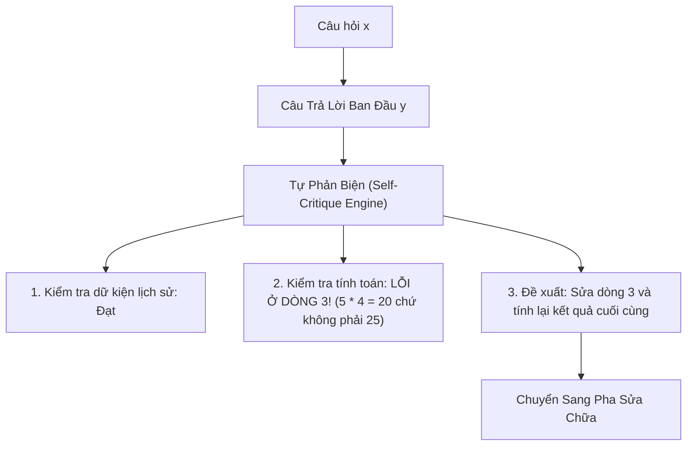

#### d. Code Thực chiến (Dual-Engine: C++ & Python)

```cpp
// C++17: Cấu trúc bản tự phê bình phân tích lỗi logic
#include <iostream>
#include <string>
#include <vector>

struct CritiqueReport {
    bool has_error;
    std::string error_location;
    std::string critique_explanation;
    std::string remediation;
};

void display_critique(const CritiqueReport& cr) {
    if (!cr.has_error) {
        std::cout << "Phản hồi hoàn toàn chuẩn xác.\n";
        return;
    }
    std::cout << "[PHÁT HIỆN LỖI]: Tại " << cr.error_location << "\n"
              << "[LÝ GIẢI]: " << cr.critique_explanation << "\n"
              << "[KHẮC PHỤC]: " << cr.remediation << std::endl;
}

int main() {
    CritiqueReport rep{true, "Bước 2", "Tính nhầm 7 * 8 = 54", "Sửa thành 56"};
    display_critique(rep);
    return 0;
}
```

```python
# Python: Mẫu Prompt tự phản biện nghiêm ngặt
def generate_self_critique_prompt(prompt: str, candidate_solution: str) -> str:
    return f"""[Vai Trò: Giám Khảo Phản Biện Nghiêm Khắc]
Dưới đây là một bài toán và câu trả lời được đề xuất. Hãy thẩm định chi tiết và tìm ra MỌI lỗi sai (nếu có).

[Bài toán]: {prompt}
[Lời giải đề xuất]: {candidate_solution}

Hãy trả lời theo định dạng:
- Có lỗi sai không? [CÓ / KHÔNG]
- Vị trí lỗi: [Chỉ rõ dòng hoặc bước]
- Phân tích chi tiết: [Giải thích tại sao sai]
- Hướng dẫn sửa chữa: [Cách viết lại chuẩn xác]"""

print(generate_self_critique_prompt("Giải phương trình", "x = 5")[:150] + "...")
```

#### e. Lỗi Thường gặp & Ổn định Số học (Pitfalls & Numerical Stability)
- **Critique Hallucination (Ảo giác Phản biện)**: Mô hình tự bịa ra một lỗi sai không hề tồn tại trong một bài giải vốn đã hoàn hảo, sau đó tự sửa một câu đúng thành một câu sai (Self-Doubt induced failure).

#### f. Ứng dụng Thực chiến trong AI / Deep Learning (AI Applications)
- Hệ thống rà soát mã nguồn tự động (Automated Code Review) và kiểm tra bảo mật phần mềm.

---

### 13. Reflection (Phản tỉnh Tự thân)

#### a. Định nghĩa Bản chất Toán học (Mathematical Formulation)
**Reflection** (Shinn et al., NeurIPS 2023) nâng cấp Self-Critique thành một **Trí nhớ Dài hạn bằng Ngôn từ (Verbal Long-Term Memory)**.
Trong một môi trường tương tác tác nhân (Agent Environment), khi tác nhân nhận được một tín hiệu thất bại (ví dụ: chạy code bị lỗi Runtime Error, hoặc bài toán bị 0 điểm):
Tác nhân tự phản tỉnh về chuỗi hành động trong quá khứ $\tau_t = (s_1, a_1, \dots, s_t, a_t)$ và rút ra một bài học kinh nghiệm cô đọng dưới dạng văn bản tự nhiên:
$$m_{\text{reflect}} \sim \pi_{\text{reflect}}\big(\cdot \mid \tau_t, \text{Reward} = 0\big)$$
Kinh nghiệm $m_{\text{reflect}}$ được lưu trữ vào bộ nhớ ngữ cảnh và được nạp vào Prompt ở vòng lặp thử nghiệm tiếp theo:
$$a_{t+1} \sim \pi_\theta\big(\cdot \mid x, m_{\text{reflect}}, s_{t+1}\big)$$
Cơ chế này cho phép mô hình học hỏi từ sai lầm mà **hoàn toàn không cần cập nhật trọng số mạng nơ-ron** (In-Context Trial-and-Error).

#### b. Cơ chế Tầng Sâu & Điện toán (Under The Hood / Hardware Internals)
- **Episodic Memory Buffer Retrieval**: Các đoạn kinh nghiệm phản tỉnh $m_{\text{reflect}}$ qua nhiều tập (Episodes) được mã hóa thành vector nhúng và lưu trữ trong cơ sở dữ liệu vector cục bộ (ChromaDB hoặc Faiss), sau đó được truy hồi tương tự ngữ cảnh khi tác nhân gặp phải bài toán tương tự trong tương lai.

#### c. Sơ đồ Minh họa (Mermaid / ASCII Diagram)
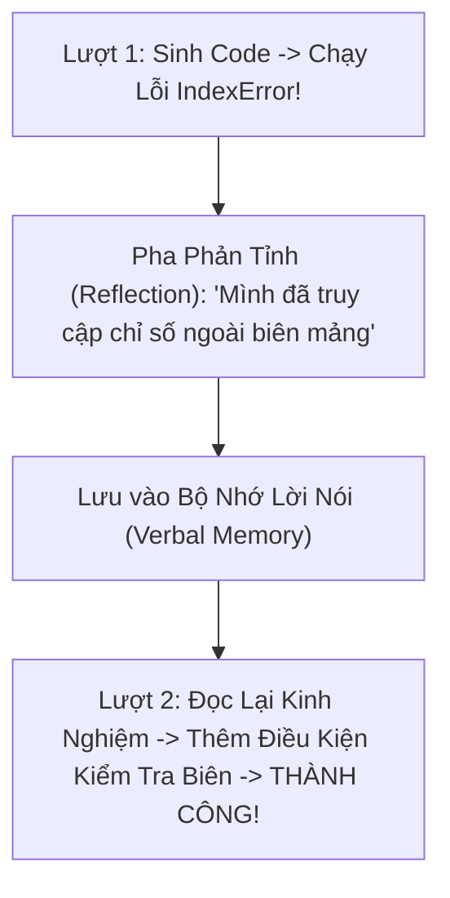

#### d. Code Thực chiến (Dual-Engine: C++ & Python)

```cpp
// C++17: Cấu trúc quản lý Bộ nhớ Phản tỉnh (Reflection Memory Buffer)
#include <iostream>
#include <vector>
#include <string>

class EpisodicMemory {
private:
    std::vector<std::string> reflections;
public:
    void record_failure_lesson(const std::string& lesson) {
        reflections.push_back(lesson);
    }
    
    std::string get_accumulated_context() const {
        std::string ctx = "--- BÀI HỌC KINH NGHIỆM TỪ QUÁ KHỨ ---\n";
        for (const auto& r : reflections) {
            ctx += "- " + r + "\n";
        }
        return ctx;
    }
};

int main() {
    EpisodicMemory mem;
    mem.record_failure_lesson("Tránh chia cho 0 khi mẫu số có thể bằng 0.");
    std::cout << mem.get_accumulated_context() << std::endl;
    return 0;
}
```

```python
# Python: Triển khai khung tác tử Reflexion cho bài toán lập trình
class ReflexionAgent:
    def __init__(self, code_generator_fn, reflection_fn):
        self.generator = code_generator_fn
        self.reflector = reflection_fn
        self.memory = []
        
    def execute_and_learn(self, prompt: str, execution_env_fn, max_trials: int = 3) -> bool:
        for trial in range(max_trials):
            # Nạp toàn bộ bài học quá khứ vào prompt
            full_prompt = f"{prompt}\nKinh nghiệm trước: {' | '.join(self.memory)}" if self.memory else prompt
            code = self.generator(full_prompt)
            
            success, error_msg = execution_env_fn(code)
            if success:
                print(f"[Trial {trial+1}] THÀNH CÔNG!")
                return True
            else:
                # Tự phản tỉnh từ thông báo lỗi
                lesson = self.reflector(code, error_msg)
                self.memory.append(lesson)
                print(f"[Trial {trial+1}] Thất bại. Bài học rút ra: {lesson}")
                
        return False

mock_gen = lambda p: "def divide(a, b): return a / b" if not "kinh nghiệm" in p else "def divide(a, b): return a / b if b != 0 else 0"
mock_ref = lambda c, e: "Cần kiểm tra b == 0 trước khi chia."
mock_env = lambda c: (False, "ZeroDivisionError") if "if b != 0" not in c else (True, "")

agent = ReflexionAgent(mock_gen, mock_ref)
agent.execute_and_learn("Viết hàm chia 2 số", mock_env)
```

#### e. Lỗi Thường gặp & Ổn định Số học (Pitfalls & Numerical Stability)
- **Misattributed Blame**: Tác nhân đổ lỗi sai nguyên nhân gây lỗi (ví dụ lỗi do thiếu thư viện nhưng mô hình lại kết luận do thuật toán sai), dẫn đến việc đưa ra bài học vô tác dụng ở các lượt thử sau.

#### f. Ứng dụng Thực chiến trong AI / Deep Learning (AI Applications)
- **Reflexion Framework**: Đạt mức tăng vọt từ $67\%$ lên $91\%$ điểm số trên **HumanEval**, vượt qua cả các mô hình có kích thước lớn gấp nhiều lần.

---

### 14. Verbal Reinforcement Learning (Học tăng cường Bằng Lời)

#### a. Định nghĩa Bản chất Toán học (Mathematical Formulation)
**Verbal Reinforcement Learning** thay thế toàn bộ các đại lượng toán học vô hướng của RL truyền thống (Scalar Rewards $r \in \mathbb{R}$, Bellman Equations, Value Function $V(s)$ và Gradient Ascent $\nabla_\theta J(\theta)$) bằng các tín hiệu **Ngôn từ Tự nhiên Giàu Ngữ nghĩa (High-Bandwidth Linguistic Feedback)**:
Trong RL truyền thống:
$$\theta_{t+1} \leftarrow \theta_t + \alpha \nabla_\theta \log \pi_\theta(a \mid s) \cdot R$$
Trong Verbal RL:
$$\mathcal{M}_{t+1} \leftarrow \mathcal{M}_t \cup \text{VerbalPolicyUpdate}\big(\tau_t, \text{Feedback}_{\text{Language}}\big)$$
Thay vì chỉ nhận một con số khô khốc (ví dụ: $-1.0$), mô hình nhận được một đoạn văn bản giải thích chi tiết tại sao hành động đó lại tồi tệ và cần phải điều chỉnh chiến lược như thế nào. Trọng số $\theta$ được giữ cố định, trong khi "chính sách hiệu dụng" (Effective Policy) được cập nhật thông qua biến đổi ngữ cảnh In-Context.

#### b. Cơ chế Tầng Sâu & Điện toán (Under The Hood / Hardware Internals)
- **In-Context Policy Compilation**: Thông tin ngôn từ được biên dịch trực tiếp vào ma trận Key-Value trong Attention. Tốc độ "học" diễn ra với độ trễ một bước forward pass duy nhất (Zero Backpropagation FLOPs), không tốn điện năng tính toán gradient trên GPU.

#### c. Sơ đồ Minh họa (Mermaid / ASCII Diagram)
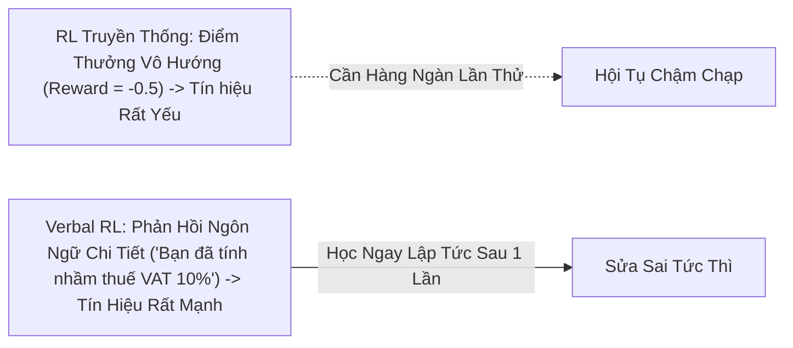

#### d. Code Thực chiến (Dual-Engine: C++ & Python)

```cpp
// C++17: Mô phỏng cập nhật chính sách hành vi thông qua chuỗi quy tắc ngôn từ
#include <iostream>
#include <vector>
#include <string>

class VerbalPolicy {
private:
    std::vector<std::string> verbal_rules;
public:
    void update_policy_verbally(const std::string& linguistic_gradient) {
        verbal_rules.push_back(linguistic_gradient);
    }
    
    void print_active_policy() const {
        std::cout << "Chính sách ngôn từ hiện tại:\n";
        for (const auto& r : verbal_rules) std::cout << "-> " << r << "\n";
    }
};

int main() {
    VerbalPolicy p;
    p.update_policy_verbally("Quy tắc 1: Luôn đóng kết nối cơ sở dữ liệu sau khi truy vấn.");
    p.print_active_policy();
    return 0;
}
```

```python
# Python: Mô phỏng Verbal RL Agent tối ưu hóa lời khuyên đàm thoại
class VerbalRLAgent:
    def __init__(self):
        self.linguistic_policy = []
        
    def receive_verbal_feedback(self, environment_feedback: str):
        # Biến đổi phản hồi ngôn từ thành quy tắc hành vi
        rule = f"Khi gặp tình huống này, hãy nhớ: {environment_feedback}"
        self.linguistic_policy.append(rule)
        
    def act(self, state: str) -> str:
        prompt = f"Trạng thái: {state}\nChính sách đã học:\n" + "\n".join(self.linguistic_policy)
        return f"Hành động tối ưu dựa trên chính sách ngôn từ ({len(self.linguistic_policy)} quy tắc)."

agent = VerbalRLAgent()
agent.receive_verbal_feedback("Khách hàng đang giận dữ, tuyệt đối không dùng câu trả lời mẫu tự động.")
print(agent.act("Khách hàng khiếu nại giao hàng trễ"))
```

#### e. Lỗi Thường gặp & Ổn định Số học (Pitfalls & Numerical Stability)
- **Policy Saturation / Context Overflow**: Sau nhiều lượt tương tác, số lượng quy tắc ngôn từ tích lũy quá nhiều làm loãng sự chú ý của cơ chế Softmax Attention, khiến mô hình vi phạm các quy tắc cũ đã học.

#### f. Ứng dụng Thực chiến trong AI / Deep Learning (AI Applications)
- Huấn luyện các Agent tự hành chơi game văn bản (**TextWorld**), điều khiển Robot qua chỉ dẫn ngôn ngữ và hệ thống đàm phán thương mại tự động.

---

### 15. Test-Time Compute (Điện toán Thời điểm Suy luận)

#### a. Định nghĩa Bản chất Toán học (Mathematical Formulation)
**Test-Time Compute** (hoặc **Inference Compute Budget**) là tổng số lượng phép tính dấu phẩy động (**FLOPs**) được phân bổ cho mô hình để giải quyết một câu hỏi cụ thể tại thời điểm suy luận:
$$\text{Compute}_{\text{Inference}} \approx 2 \cdot P \cdot N_{\text{tokens}} \quad \text{FLOPs}$$
Trong đó:
- $P$: Số lượng tham số của mô hình (Parameter Count).
- $N_{\text{tokens}}$: Tổng số token được sinh ra (bao gồm chuỗi suy nghĩ ẩn, các nhánh tìm kiếm và các bản sửa lỗi).
Khác với mô thức truyền thống vốn có $N_{\text{tokens}}$ cố định và tối thiểu, kỷ nguyên mới cho phép $N_{\text{tokens}}$ mở rộng linh hoạt từ hàng trăm lên tới hàng chục ngàn tokens cho một bài toán cực khó:
$$\text{Performance} = f\big(\text{Test-Time FLOPs}\big)$$

#### b. Cơ chế Tầng Sâu & Điện toán (Under The Hood / Hardware Internals)
- **Serving Cost Shift (Sự chuyển dịch Chi phí Vận hành)**: Tăng $N_{\text{tokens}}$ làm tăng trực tiếp thời gian chiếm dụng GPU trên mỗi truy vấn người dùng. Hệ thống phục vụ phải chuyển từ mô hình tính giá theo Request sang mô hình tính giá theo **Compute-Time / Execution Time**, tối ưu hóa cấu trúc bộ nhớ cache để duy trì hiệu năng cao nhất.

#### c. Sơ đồ Minh họa (Mermaid / ASCII Diagram)
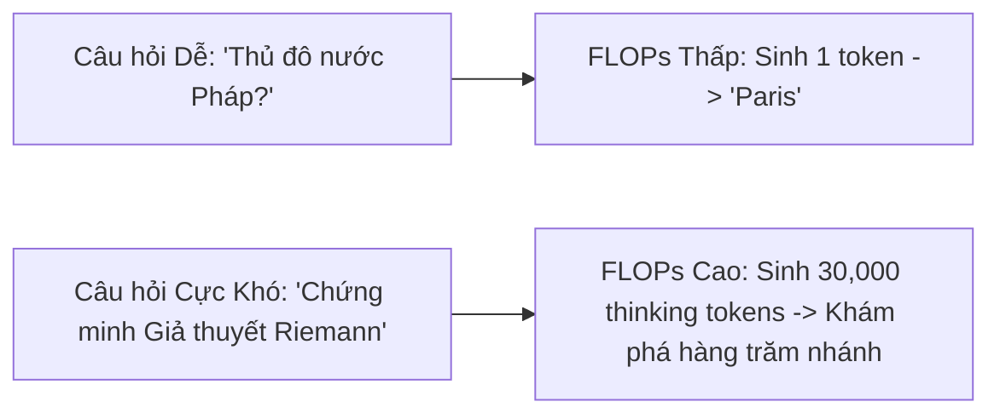

#### d. Code Thực chiến (Dual-Engine: C++ & Python)

```cpp
// C++17: Ước lượng số phép tính FLOPs tiêu thụ trong thời điểm suy luận
#include <iostream>

double estimate_test_time_flops(double num_params_billions, int total_tokens_generated) {
    // Ước lượng 2 * P * N
    double p = num_params_billions * 1e9;
    return 2.0 * p * total_tokens_generated;
}

int main() {
    double flops = estimate_test_time_flops(70.0, 4096);
    std::cout << "Tổng Test-Time FLOPs: " << flops / 1e12 << " TeraFLOPs" << std::endl;
    return 0;
}
```

```python
# Python: Bộ điều phối ngân sách tính toán động (Dynamic Test-Time Compute Allocator)
def allocate_compute_budget(task_difficulty: str) -> dict:
    if task_difficulty == "EASY":
        return {"max_tokens": 128, "num_samples": 1, "use_search": False}
    elif task_difficulty == "MEDIUM":
        return {"max_tokens": 1024, "num_samples": 5, "use_search": False}
    else: # HARD
        return {"max_tokens": 8192, "num_samples": 32, "use_search": True}

print("Ngân sách tính toán cho bài toán Olympic:", allocate_compute_budget("HARD"))
```

#### e. Lỗi Thường gặp & Ổn định Số học (Pitfalls & Numerical Stability)
- **Diminishing Returns (Quy luật Lợi tức Giảm dần)**: Sau khi vượt qua một ngưỡng tới hạn của số lượng token suy luận, việc tiếp tục sinh thêm token không làm tăng thêm độ chính xác mà chỉ dẫn đến việc lặp lại câu từ hoặc sa đà vào các hướng đi sai lầm.

#### f. Ứng dụng Thực chiến trong AI / Deep Learning (AI Applications)
- Kiến trúc vận hành của **OpenAI o1, o3** và **DeepSeek-R1**.

---

### 16. Inference-Time Scaling (Định luật Mở rộng Quy mô Suy luận)

#### a. Định nghĩa Bản chất Toán học (Mathematical Formulation)
**Inference-Time Scaling Laws** (Snell et al., 2024; Brown et al., 2024) mở rộng định luật Chinchilla Scaling sang giai đoạn suy luận:
Tỷ lệ lỗi của mô hình $\mathcal{E}$ tuân theo quy luật hàm lũy thừa (Power Law) đối với ngân sách tính toán thời điểm suy luận $C_{\text{infer}}$:
$$\mathcal{E}(C_{\text{infer}}) \propto C_{\text{infer}}^{-\alpha_{\text{infer}}}$$
Một phát hiện mang tính cách mạng: **Tăng ngân sách tính toán suy luận có thể bù đắp hoàn toàn cho việc thiếu hụt tham số tiền huấn luyện**. Cụ thể, một mô hình nhỏ hơn $4\times$ được trang bị thêm tính toán suy luận có thể đánh bại một mô hình tiền huấn luyện khổng lồ trên các tác vụ toán học và lập trình phức tạp.

#### b. Cơ chế Tầng Sâu & Điện toán (Under The Hood / Hardware Internals)
- **Optimal Frontier Frontier Trade-off**: Đồ thị cân bằng Pareto giữa Pretraining FLOPs và Inference FLOPs: Đối với các dịch vụ có hàng triệu lượt gọi API mỗi ngày, việc đầu tư pretraining mô hình lớn sẽ tiết kiệm chi phí hơn; nhưng đối với các bài toán độc bản giá trị cao (như nghiên cứu chip bán dẫn), Inference-Time Scaling mang lại hiệu quả vượt trội.

#### c. Sơ đồ Minh họa (Mermaid / ASCII Diagram)
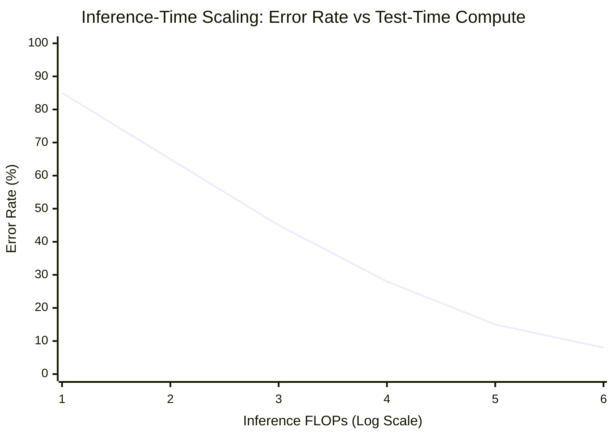

#### d. Code Thực chiến (Dual-Engine: C++ & Python)

```cpp
// C++17: Mô phỏng dự báo tỷ lệ lỗi theo Định luật Power Law của Inference Scaling
#include <iostream>
#include <cmath>

double predict_error_rate(double base_error, double compute_multiplier, double alpha = 0.35) {
    return base_error * std::pow(compute_multiplier, -alpha);
}

int main() {
    double initial_err = 0.60; // 60% lỗi ban đầu
    double compute_boost = 16.0; // Tăng gấp 16 lần chi phí tính toán suy luận
    std::cout << "Tỷ lệ lỗi dự kiến sau khi mở rộng suy luận: " 
              << predict_error_rate(initial_err, compute_boost) * 100.0 << "%" << std::endl;
    return 0;
}
```

```python
# Python: Đồ thị hóa định luật Inference Scaling Law
import numpy as np

def compute_scaling_trajectory(compute_budgets: list, alpha: float = 0.4) -> list:
    c_arr = np.array(compute_budgets)
    performance = 1.0 - (c_arr ** -alpha)
    return list(np.clip(performance, 0.0, 1.0))

budgets = [1, 2, 4, 8, 16, 32, 64]
scores = compute_scaling_trajectory(budgets)
for b, s in zip(budgets, scores):
    print(f"Ngân sách x{b:02d} -> Điểm Năng Lực: {s * 100:.2f}%")
```

#### e. Lỗi Thường gặp & Ổn định Số học (Pitfalls & Numerical Stability)
- **Asymptotic Plateau**: Định luật suy luận bị bão hòa khi chạm đến giới hạn tri thức nền tảng của mô hình (Pretraining Knowledge Boundary). Nếu mô hình hoàn toàn không biết một định lý toán học, việc cho nó suy nghĩ thêm $100.000$ tokens cũng không thể tự sinh ra định lý đó.

#### f. Ứng dụng Thực chiến trong AI / Deep Learning (AI Applications)
- Chiến lược cốt lõi thúc đẩy thế hệ **AGI Frontiers** (mở ra kỷ nguyên chuyển dịch đầu tư từ phần cứng Pretraining sang cụm máy chủ Inference quy mô siêu lớn).

---

### 17. Parallel Sampling (Lấy mẫu Song song)

#### a. Định nghĩa Bản chất Toán học (Mathematical Formulation)
**Parallel Sampling** (còn gọi là **Coverage Search** hoặc **Pass@k Sampling**) là chiến lược mở rộng tính toán bằng cách tạo ra $K$ giải pháp độc lập và đồng thời cho cùng một câu lệnh $x$:
$$\mathcal{Y} = \{y^{(1)}, y^{(2)}, \dots, y^{(K)}\} \sim \pi_\theta(\cdot \mid x) \quad \text{với } T > 0$$
Xác suất tìm thấy ít nhất một giải pháp đúng (Coverage Probability):
$$P(\text{Success} \mid K) = 1 - \big(1 - P(\text{Success} \mid K = 1)\big)^K$$
Khi $K \to \infty$, xác suất tìm thấy lời giải đúng tiệm cận $1.0$, với điều kiện bài toán có một cơ chế kiểm chứng (Verifier) có khả năng lọc ra đáp án chính xác từ tập $\mathcal{Y}$.

#### b. Cơ chế Tầng Sâu & Điện toán (Under The Hood / Hardware Internals)
- **High Tensor Parallelism & Memory Bandwidth Saturation**: Sinh $K$ luồng song song trên cùng một GPU tối đa hóa việc tận dụng băng thông bộ nhớ HBM (Memory Bandwidth Utilization). Do dùng chung ma trận trọng số (Weights) và phần prompt ban đầu, thông lượng sinh token tăng theo hàm tuyến tính tiệm cận trên các cụm máy chủ vLLM.

#### c. Sơ đồ Minh họa (Mermaid / ASCII Diagram)
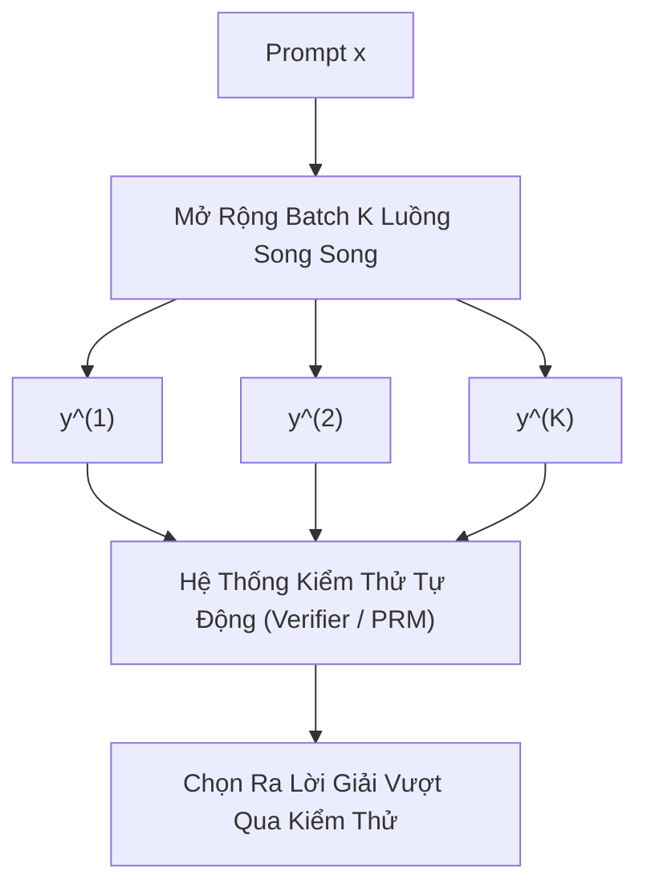

#### d. Code Thực chiến (Dual-Engine: C++ & Python)

```cpp
// C++17: Tính toán xác suất thành công khi mở rộng lấy mẫu song song K luồng
#include <iostream>
#include <cmath>

double compute_coverage_probability(double single_pass_prob, int k) {
    return 1.0 - std::pow(1.0 - single_pass_prob, k);
}

int main() {
    double p1 = 0.15; // Xác suất trúng 15% với 1 mẫu
    std::cout << "Xác suất tìm thấy lời giải đúng với K=16: " 
              << compute_coverage_probability(p1, 16) * 100.0 << "%" << std::endl;
    return 0;
}
```

```python
# Python: Bộ lấy mẫu song song kết hợp bộ lọc Verifier
from typing import List, Callable

def parallel_sampling_search(
    prompt: str,
    sampler_fn: Callable[[str, int], List[str]],
    verifier_fn: Callable[[str], bool],
    k: int = 16
) -> str:
    candidates = sampler_fn(prompt, k)
    for cand in candidates:
        if verifier_fn(cand):
            return cand # Trả về giải pháp hợp lệ đầu tiên
    return "FAILED_TO_FIND_VALID_SOLUTION"

mock_sampler = lambda p, k: [f"Candidate solution {i}" for i in range(k)]
mock_verifier = lambda c: "12" in c # Giả sử candidate 12 đúng
print("Parallel Search Result:", parallel_sampling_search("Problem", mock_sampler, mock_verifier, 16))
```

#### e. Lỗi Thường gặp & Ổn định Số học (Pitfalls & Numerical Stability)
- **Verifier Bottleneck (Nút thắt của Bộ kiểm chứng)**: Nếu mô hình không có một bộ kiểm tra tự động đáng tin cậy (như Unit Tests trong lập trình), việc lấy mẫu song song hàng ngàn nhánh sẽ vô nghĩa vì không thể biết chọn nhánh nào làm đáp án cuối cùng.

#### f. Ứng dụng Thực chiến trong AI / Deep Learning (AI Applications)
- **AlphaCode 1 & 2 (Google DeepMind)**: Sinh $100.000$ mẫu chương trình song song kết hợp với cụm phân nhóm (Clustering) để lọt vào top $1\%$ lập trình viên giỏi nhất thế giới trên Codeforces.

---

### 18. Sequential Sampling (Lấy mẫu Tuần tự)

#### a. Định nghĩa Bản chất Toán học (Mathematical Formulation)
**Sequential Sampling** mở rộng tính toán không phải bằng cách phân nhánh song song mà bằng cách kéo dài **Độ sâu Thời gian (Temporal Depth)**: Cho phép mô hình suy nghĩ, phát hiện lỗi sai, sửa đổi và tiếp tục suy diễn trên cùng một dòng thời gian duy nhất:
$$y = \langle z_1, z_2, \dots, z_T, y_{\text{final}} \rangle$$
Trong đó độ dài chuỗi $T$ có thể tự do mở rộng dựa trên độ phức tạp của bài toán.
Mô hình tự động học cách chèn các token đặc biệt đánh dấu sự chuyển đổi trạng thái nhận thức:
- `<think>`: Bắt đầu suy luận ngầm.
- `Wait, let me double check...`: Nhận diện sự không chắc chắn và tự sửa sai.
- `</think>`: Kết thúc suy luận và phát ra câu trả lời chính thức.

#### b. Cơ chế Tầng Sâu & Điện toán (Under The Hood / Hardware Internals)
- **Long-Sequence KV Cache Eviction**: Khi độ dài chuỗi suy luận tuần tự vượt quá giới hạn phần cứng ($> 64.000$ tokens), hệ thống phục vụ phải áp dụng kỹ thuật giải phóng KV Cache có chọn lọc (như StreamingLLM hoặc H2O - Heavy Hitter Oracle) để chỉ giữ lại các token mang thông tin ngữ nghĩa cốt lõi trong VRAM.

#### c. Sơ đồ Minh họa (Mermaid / ASCII Diagram)
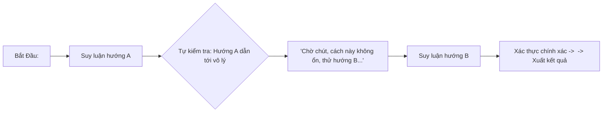

#### d. Code Thực chiến (Dual-Engine: C++ & Python)

```cpp
// C++17: Bộ bóc tách vùng suy nghĩ tuần tự nằm giữa thẻ <think> và </think>
#include <iostream>
#include <string>

std::pair<std::string, std::string> parse_thinking_tokens(const std::string& full_stream) {
    std::string start_tag = "<think>";
    std::string end_tag = "</think>";
    
    size_t start = full_stream.find(start_tag);
    size_t end = full_stream.find(end_tag);
    
    if (start != std::string::npos && end != std::string::npos) {
        std::string thoughts = full_stream.substr(start + start_tag.length(), end - (start + start_tag.length()));
        std::string final_ans = full_stream.substr(end + end_tag.length());
        return {thoughts, final_ans};
    }
    return {"", full_stream};
}

int main() {
    std::string stream = "<think>Phân tích dữ kiện... Kiểm tra lại... Xong.</think>Đáp án là 42.";
    auto [th, ans] = parse_thinking_tokens(stream);
    std::cout << "Thinking Trace: " << th << "\nFinal Answer: " << ans << std::endl;
    return 0;
}
```

```python
# Python: Mô phỏng chuỗi suy luận tuần tự có cơ chế Backtracking
def simulate_sequential_reasoning(problem: str) -> str:
    reasoning_trace = ["<think>"]
    reasoning_trace.append("Thử nghiệm giả thuyết 1: Giả sử x = 0.")
    reasoning_trace.append("Thay vào phương trình: 0 + 5 = 10 -> Vô lý!")
    reasoning_trace.append("Chờ đã, nhận thấy x không thể bằng 0. Chuyển sang giải tích thông thường: x = 10 - 5 = 5.")
    reasoning_trace.append("Kiểm tra lại: 5 + 5 = 10. Hoàn toàn thỏa mãn.")
    reasoning_trace.append("</think>")
    
    final_output = "Đáp số: x = 5."
    return "\n".join(reasoning_trace) + "\n" + final_output

print(simulate_sequential_reasoning("x + 5 = 10"))
```

#### e. Lỗi Thường gặp & Ổn định Số học (Pitfalls & Numerical Stability)
- **Overthinking & Reasoning Loops**: Mô hình bị rơi vào trạng thái suy nghĩ luẩn quẩn (Overthinking), liên tục nghi ngờ bản thân và kiểm tra đi kiểm tra lại một phép tính đơn giản hàng chục lần mà không bao giờ phát ra thẻ `</think>`.

#### f. Ứng dụng Thực chiến trong AI / Deep Learning (AI Applications)
- Cơ chế tư duy cốt lõi của **DeepSeek-R1** và dòng mô hình **OpenAI o1**.

---

### 19. Search-Augmented Reasoning (Suy luận Tăng cường Tìm kiếm)

#### a. Định nghĩa Bản chất Toán học (Mathematical Formulation)
**Search-Augmented Reasoning** kết hợp chuỗi suy luận logic nội tại của LLM với khả năng truy vấn thông tin động từ thế giới thực thông qua các công cụ tìm kiếm bên ngoài (Search Engine / Vector Store):
Tại mỗi bước suy luận $t$, mô hình có thể phát ra một lệnh gọi tìm kiếm đặc thù:
$$\text{Query}_t = \text{ExtractQuery}(z_{<t})$$
$$\text{Passage}_t = \text{SearchEngine}(\text{Query}_t)$$
Bước suy luận tiếp theo được điều kiện hóa trên tài liệu tìm được:
$$z_t \sim \pi_\theta\big(\cdot \mid x, z_{<t}, \text{Passage}_t\big)$$
Sự kết hợp này giải phóng mô hình khỏi giới hạn tri thức đóng băng (Knowledge Cutoff), bảo đảm mọi suy luận đều được hỗ trợ bởi các bằng chứng thực tế mới nhất.

#### b. Cơ chế Tầng Sâu & Điện toán (Under The Hood / Hardware Internals)
- **Asynchronous Search I/O Overlapped with Model Inference**: Thao tác truy vấn mạng HTTP tới máy chủ tìm kiếm có độ trễ cao ($100 - 300\text{ ms}$). Các hệ thống tối ưu thực thi I/O bất đồng bộ (Async I/O), cho phép mô hình tiếp tục tính toán các nhánh suy luận khác trong khi chờ kết quả trả về từ công cụ tìm kiếm.

#### c. Sơ đồ Minh họa (Mermaid / ASCII Diagram)
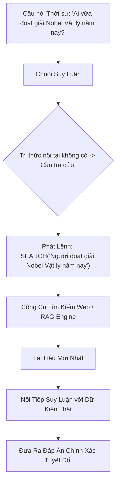

#### d. Code Thực chiến (Dual-Engine: C++ & Python)

```cpp
// C++17: Bộ phát hiện lệnh gọi tìm kiếm trong chuỗi sinh token
#include <iostream>
#include <string>

bool detect_search_trigger(const std::string& token_stream, std::string& extracted_query) {
    std::string key = "[SEARCH: ";
    size_t start = token_stream.find(key);
    if (start != std::string::npos) {
        size_t end = token_stream.find("]", start);
        if (end != std::string::npos) {
            extracted_query = token_stream.substr(start + key.length(), end - (start + key.length()));
            return true;
        }
    }
    return false;
}

int main() {
    std::string stream = "Để giải quyết vấn đề này, ta cần tra cứu [SEARCH: dân số Hà Nội 2024] để có số liệu.";
    std::string q;
    if (detect_search_trigger(stream, q)) {
        std::cout << "Phát hiện lệnh tìm kiếm: '" << q << "'" << std::endl;
    }
    return 0;
}
```

```python
# Python: Khung tương tác Search-Augmented Reasoning hoàn chỉnh
def search_augmented_pipeline(prompt: str, llm_generate_fn, search_api_fn) -> str:
    conversation = prompt
    for _ in range(3): # Tối đa 3 lượt tìm kiếm
        output = llm_generate_fn(conversation)
        if "[SEARCH:" in output:
            query = output.split("[SEARCH:")[1].split("]")[0].strip()
            print(f"-> Đang thực thi tìm kiếm: '{query}'")
            search_result = search_api_fn(query)
            # Nạp kết quả tìm kiếm vào ngữ cảnh
            conversation += f"\n{output}\n[KẾT QUẢ TÌM KIẾM]: {search_result}\nTiếp tục suy luận:"
        else:
            return output
    return conversation

mock_llm = lambda c: "Ta cần tra cứu [SEARCH: CEO OpenAI] để biết." if "[KẾT QUẢ" not in c else "CEO là Sam Altman."
mock_search = lambda q: "Sam Altman là CEO của OpenAI tính đến hiện tại."
print("Final Output:", search_augmented_pipeline("Ai là CEO OpenAI?", mock_llm, mock_search))
```

#### e. Lỗi Thường gặp & Ổn định Số học (Pitfalls & Numerical Stability)
- **Search Query Drift**: Mô hình sinh ra các từ khóa tìm kiếm quá dài dòng hoặc lan man (ví dụ tìm cả một đoạn văn), khiến công cụ tìm kiếm trả về kết quả rỗng hoặc không liên quan.

#### f. Ứng dụng Thực chiến trong AI / Deep Learning (AI Applications)
- **Perplexity AI & SearchGPT**: Hệ thống tìm kiếm thế hệ mới thay thế công cụ tra cứu truyền thống bằng cách kết hợp suy luận logic và bằng chứng trực tuyến.

---

### 20. Tool-Augmented Reasoning (Suy luận Tăng cường Công cụ)

#### a. Định nghĩa Bản chất Toán học (Mathematical Formulation)
**Tool-Augmented Reasoning** (ví dụ: Toolformer, Schick et al., 2023) trang bị cho LLM khả năng tương tác với một hệ sinh thái các giao diện lập trình ứng dụng (**APIs / Tools**) ngoại vi $\mathcal{A} = \{a_1, a_2, \dots, a_M\}$:
Mô hình học cách chèn các thẻ gọi hàm có cấu trúc (Function Calling Tokens) vào chuỗi văn bản tự nhiên:
$$\text{Token Stream: } \dots \langle \text{call}: \text{API\_Name}(\text{Arg}_1, \text{Arg}_2) \rangle \dots$$
Môi trường thực thi chặn bắt cuộc gọi, chạy API và trả về kết quả dưới dạng chuỗi:
$$\text{Return: } \langle \text{return}: \text{API\_Output} \rangle$$
Mô hình tiếp tục sinh token dựa trên kết quả trả về này:
$$P(y \mid x, \text{Tools}) = \prod_t P\big(w_t \mid x, w_{<t}, \{\text{call}_j, \text{return}_j\}\big)$$
Các công cụ điển hình: Máy tính bỏ túi (Calculator), Cơ sở dữ liệu SQL, Bộ chuyển đổi tiền tệ, Lịch làm việc và Thiết bị điều khiển nhà thông minh (IoT).

#### b. Cơ chế Tầng Sâu & Điện toán (Under The Hood / Hardware Internals)
- **Constrained Decoding & JSON Schema Grammar Masking**: Để bảo đảm các tham số truyền vào hàm luôn tuân thủ $100\%$ cấu trúc JSON/API yêu cầu, GPU áp dụng kỹ thuật **Grammar-Guided Decoding**: Tại mỗi bước sinh, bộ giải mã chỉ cho phép các token hợp lệ theo văn phạm Context-Free Grammar (CFG) được kích hoạt qua mặt nạ Logits Masking.

#### c. Sơ đồ Minh họa (Mermaid / ASCII Diagram)
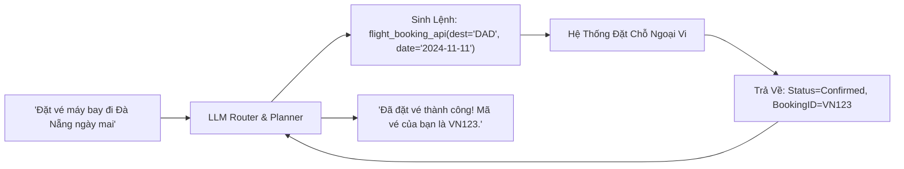

#### d. Code Thực chiến (Dual-Engine: C++ & Python)

```cpp
// C++17: Bộ định tuyến phân tích cú pháp Function Call từ văn bản
#include <iostream>
#include <string>

struct ToolCallPayload {
    std::string tool_name;
    std::string arguments_json;
};

ToolCallPayload parse_tool_call(const std::string& text) {
    std::string tag = "<call:";
    size_t start = text.find(tag);
    if (start != std::string::npos) {
        size_t end = text.find(">", start);
        std::string inner = text.substr(start + tag.length(), end - (start + tag.length()));
        size_t split = inner.find("(");
        return {inner.substr(0, split), inner.substr(split)};
    }
    return {"", ""};
}

int main() {
    std::string model_out = "Ta cần tính toán: <call:calculator(15 * 84)>";
    auto tool = parse_tool_call(model_out);
    std::cout << "Tool: " << tool.tool_name << " | Args: " << tool.arguments_json << std::endl;
    return 0;
}
```

```python
# Python: Triển khai OpenAI Function Calling Mock Engine
import json

def execute_tool_call(function_name: str, arguments: dict) -> str:
    tools_registry = {
        "get_weather": lambda args: f"Thời tiết tại {args['city']}: 25 độ C, trời nắng.",
        "calculate_tax": lambda args: f"Thuế: {args['amount'] * 0.1} USD"
    }
    
    if function_name in tools_registry:
        return tools_registry[function_name](arguments)
    return "Lỗi: Không tìm thấy công cụ yêu cầu."

mock_call = {
    "name": "get_weather",
    "arguments": {"city": "Hà Nội"}
}
print("Tool Result:", execute_tool_call(mock_call["name"], mock_call["arguments"]))
```

#### e. Lỗi Thường gặp & Ổn định Số học (Pitfalls & Numerical Stability)
- **Argument Type Mismatch**: Mô hình truyền tham số sai kiểu dữ liệu (ví dụ truyền chuỗi `"10"` thay vì số nguyên `10`), khiến hệ thống backend API bị văng ngoại lệ nếu không có bộ kiểm tra Schema nghiêm ngặt (như Pydantic).

#### f. Ứng dụng Thực chiến trong AI / Deep Learning (AI Applications)
- **Gorilla LLM & ChatGPT Plugins**: Tự động hóa tác vụ văn phòng, tương tác hệ thống cơ sở dữ liệu doanh nghiệp và điều phối Agent tự trị.

---

### 21. Code Execution (Thực thi Mã nguồn trong Suy luận)

#### a. Định nghĩa Bản chất Toán học (Mathematical Formulation)
**Code Execution** là mô thức suy luận trong đó LLM sử dụng một môi trường máy tính thực thụ (Interactive Python Kernel / REPL) như một không gian làm việc tương tác (Workspace):
Mô hình hoạt động theo chu trình quan sát - hành động - suy ngẫm (Observation-Action Cycle):
$$\text{State } s_t \xrightarrow{\text{LLM}} \text{Code Action } a_t \xrightarrow{\text{Sandbox Environment}} \text{Observation } o_t \xrightarrow{\text{LLM}} s_{t+1}$$
Khác với việc chỉ sinh mã ở bước cuối cùng, Code Execution cho phép mô hình:
1. Viết mã để phân tích dữ liệu, vẽ đồ thị.
2. Nhìn thấy lỗi phát sinh trong terminal (Traceback), tự sửa lỗi và chạy lại.
3. Sử dụng các biến số đã tính toán ở các bước trước được lưu trong bộ nhớ RAM của Kernel.

#### b. Cơ chế Tầng Sâu & Điện toán (Under The Hood / Hardware Internals)
- **Jupyter Kernel Protocol & ZeroMQ (ZMQ)**: LLM giao tiếp với Python Kernel thông qua giao thức ZMQ (ZeroMQ sockets) qua các kênh `shell`, `iopub` và `stdin`. Mọi kết quả in ra màn hình hoặc đồ thị ảnh Base64 được chuyển đổi ngược lại thành token đa phương thức cho mô hình quan sát.

#### c. Sơ đồ Minh họa (Mermaid / ASCII Diagram)
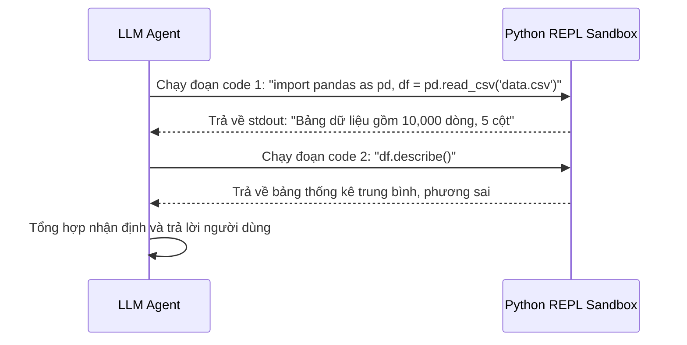

#### d. Code Thực chiến (Dual-Engine: C++ & Python)

```cpp
// C++17: Bộ đệm quản lý trạng thái phiên thực thi mã nguồn
#include <iostream>
#include <string>

struct CodeSessionState {
    int execution_count;
    bool is_kernel_alive;
    void log_execution(const std::string& code) {
        execution_count++;
        std::cout << "[In " << execution_count << "]: " << code << std::endl;
    }
};

int main() {
    CodeSessionState session{0, true};
    session.log_execution("x = 10");
    session.log_execution("y = x * 2");
    return 0;
}
```

```python
# Python: Mô phỏng Persistent REPL State qua các bước tương tác
class InteractivePythonREPL:
    def __init__(self):
        self.globals_env = {}
        
    def run_cell(self, code_cell: str) -> str:
        import sys, io
        old_stdout = sys.stdout
        redirected = io.StringIO()
        sys.stdout = redirected
        
        try:
            exec(code_cell, self.globals_env)
            output = redirected.getvalue()
            return output if output else "[Cell executed successfully with no output]"
        except Exception as e:
            return f"[ERROR]: {type(e).__name__}: {str(e)}"
        finally:
            sys.stdout = old_stdout

repl = InteractivePythonREPL()
print(repl.run_cell("a = [1, 2, 3, 4]"))
print(repl.run_cell("print('Sum:', sum(a))")) # Giữ nguyên biến a từ cell trước!
```

#### e. Lỗi Thường gặp & Ổn định Số học (Pitfalls & Numerical Stability)
- **Memory Leaks in Persistent Kernels**: Nếu mô hình liên tục nạp các file dữ liệu khổng lồ vào bộ nhớ `globals()` mà không giải phóng, tiến trình Python Kernel sẽ nhanh chóng chạm ngưỡng Out-Of-Memory (OOM) và bị hệ điều hành Linux tiêu diệt.

#### f. Ứng dụng Thực chiến trong AI / Deep Learning (AI Applications)
- **OpenAI Advanced Data Analysis (Code Interpreter)**: Cho phép người dùng tải lên các file dữ liệu CSV, Excel để phân tích định lượng, làm sạch dữ liệu và huấn luyện mô hình học máy tự động.
