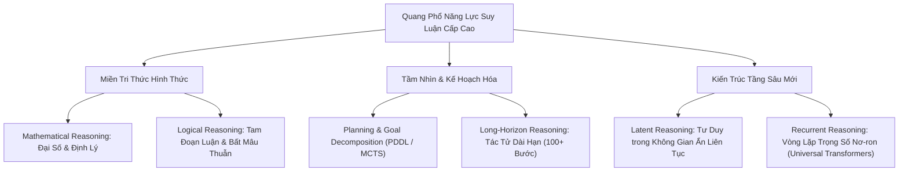
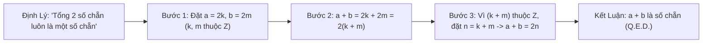
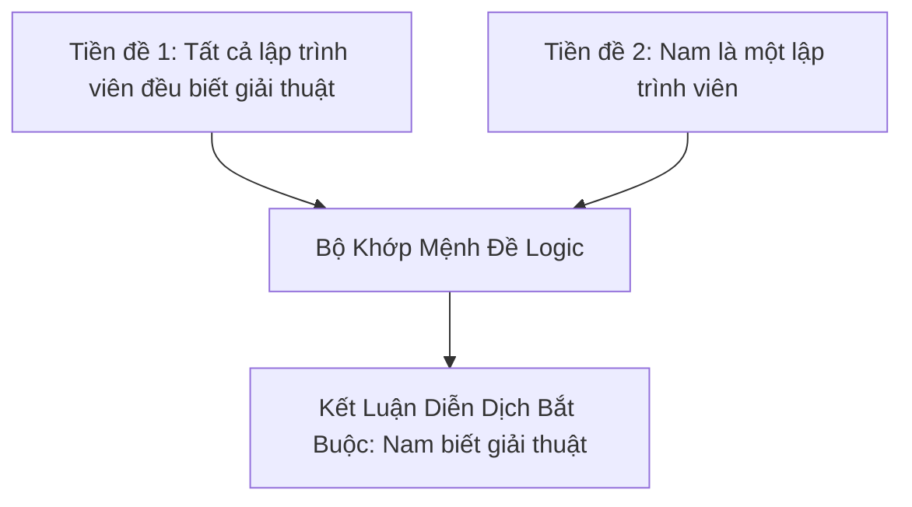
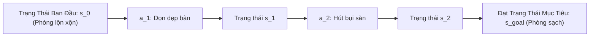
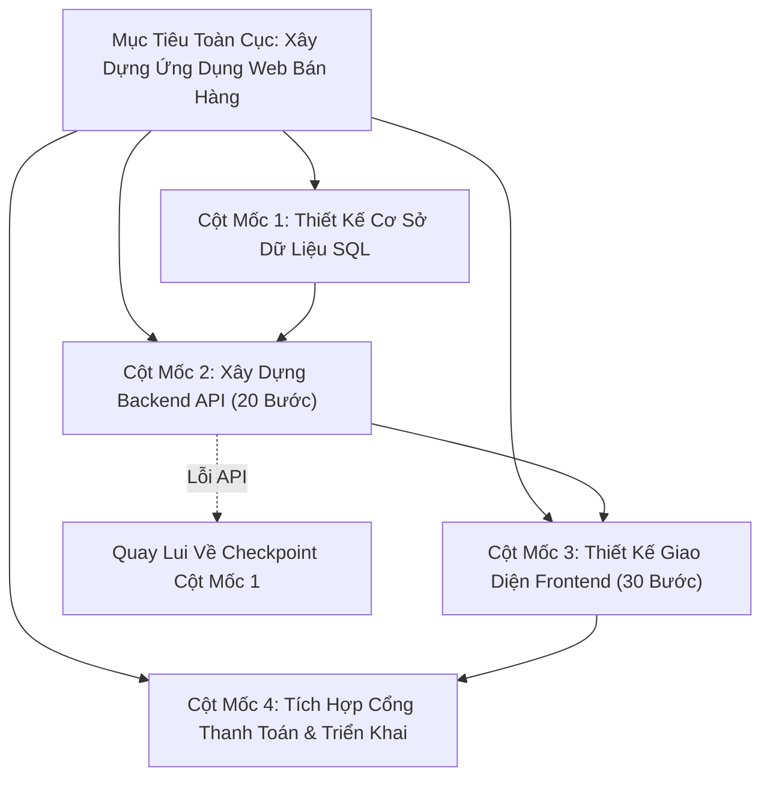
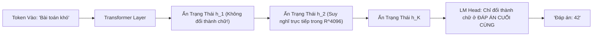
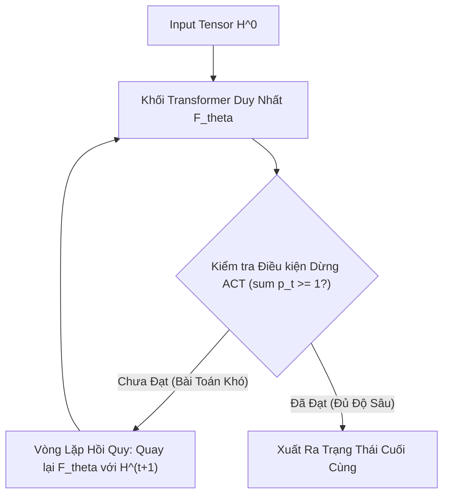

# Chuyên đề: Các Miền Suy luận Chuyên sâu, Suy luận Tiềm ẩn & Lập kế hoạch Dài hạn (Reasoning Domains, Latent Reasoning & Long-Horizon Planning)

## 1. Tổng quan Chuyên đề
Khả năng tư duy của con người không chỉ gói gọn trong việc sinh ra chuỗi ngôn từ tự nhiên tuần tự mà là một hệ thống đa tầng phức tạp: Chúng ta giải quyết các bài toán trừu tượng bằng trực giác hình học, suy diễn logic hình thức không chứa mâu thuẫn, xây dựng các chiến lược hành động hướng tới mục tiêu trong tương lai xa (Planning), và thậm chí tư duy sâu bên trong "không gian biểu diễn nội tại" (Latent Space) trước khi phát ngôn bất kỳ một từ ngữ nào.

Chuyên đề này đi sâu vào bản chất toán học và điện toán của các miền tư duy chuyên biệt và các kiến trúc suy luận tiên tiến nhất:
1. **Các Miền Suy luận Cốt lõi (Core Reasoning Domains)**: **Mathematical Reasoning** (chứng minh định lý, đại số hình thức, số học rời rạc) và **Logical Reasoning** (logic mệnh đề, logic vị từ bậc một, lập luận quy nạp và diễn dịch).
2. **Lập kế hoạch & Suy luận Tầm nhìn Dài hạn (Planning & Long-Horizon Reasoning)**: Phân rã mục tiêu toàn cục thành cây hành động phân cấp (Hierarchical Task Networks), kiểm soát bài toán bùng nổ không gian trạng thái trong các tác vụ kéo dài hàng trăm bước.
3. **Suy luận Tiềm ẩn & Kiến trúc Hồi quy (Latent & Recurrent Reasoning)**: Vượt thoát khỏi sự ràng buộc của ngôn ngữ bề mặt (Surface Tokens), cho phép các nơ-ron "nghiền ngẫm" trực tiếp trong không gian vector liên tục thông qua các khối biến đổi lặp (**Recurrent Transformers, Universal Transformers, Quiet-STaR**).



---

## 2. Chi tiết từng Keyword

---

### 22. Mathematical Reasoning (Suy luận Toán học)

#### a. Định nghĩa Bản chất Toán học (Mathematical Formulation)
**Mathematical Reasoning** là quá trình ánh xạ một bài toán từ ngôn ngữ tự nhiên thành một hệ thống các biểu thức đại số hình thức, giải phương trình hoặc xây dựng một chuỗi chứng minh suy diễn chặt chẽ (Formal Proof Verification):
Hệ thống logic hình thức được biểu diễn bằng bộ ba $\mathcal{M} = (\mathcal{L}, \mathcal{A}, \mathcal{R})$:
- $\mathcal{L}$: Ngôn ngữ hình thức (First-Order Logic / Set Theory / ZFC).
- $\mathcal{A}$: Hệ tiên đề xuất phát (Axioms).
- $\mathcal{R}$: Các quy tắc suy diễn (Rules of Inference như Modus Ponens):
$$\frac{P, \quad P \implies Q}{Q}$$
Mỗi bước chứng minh là một chuỗi biến đổi hợp lệ:
$$\mathcal{A} \vdash \phi_1 \vdash \phi_2 \vdash \dots \vdash \phi_n \equiv \text{Theorem}$$
Mô hình toán học không chấp nhận sự mập mờ: Một bài toán hoặc là đúng tuyệt đối, hoặc là sai, không tồn tại trạng thái "gần đúng".

#### b. Cơ chế Tầng Sâu & Điện toán (Under The Hood / Hardware Internals)
- **Symbolic Verification via Lean / Isabelle**: Để đảm bảo tính chính xác tuyệt đối, các nghiên cứu hàng đầu (như Lean 4 / Coq) tích hợp LLM với Trình kiểm chứng định lý hình thức (Interactive Theorem Prover - ITP). Khi LLM sinh ra các bước biến đổi (Tactics), môi trường Lean chạy kiểm tra tính đóng của cây chứng minh (Proof Tree Unification) trong CPU memory.

#### c. Sơ đồ Minh họa (Mermaid / ASCII Diagram)


#### d. Code Thực chiến (Dual-Engine: C++ & Python)

```cpp
// C++17: Mô phỏng quy tắc suy diễn Modus Ponens trong Logic Toán học
#include <iostream>

struct ModusPonensEngine {
    static bool deduce(bool premise_p, bool implication_p_implies_q) {
        if (premise_p && implication_p_implies_q) {
            return true; // Suy ra Q là TRUE
        }
        return false;
    }
};

int main() {
    bool p = true; // "Trời mưa"
    bool p_imp_q = true; // "Nếu trời mưa thì đường ướt"
    bool q = ModusPonensEngine::deduce(p, p_imp_q);
    std::cout << "Kết luận Q (Đường ướt): " << (q ? "ĐÚNG" : "CHƯA XÁC ĐỊNH") << std::endl;
    return 0;
}
```

```python
# Python: Sử dụng SymPy để chứng minh tương đương đại số lượng giác
from sympy import symbols, sin, cos, simplify

def verify_trigonometric_identity():
    x = symbols('x')
    # Kiểm tra đồng nhất thức: sin^2(x) + cos^2(x) == 1
    lhs = sin(x)**2 + cos(x)**2
    rhs = 1
    proof = simplify(lhs - rhs)
    return proof == 0

print("Identity Proven Mathematically:", verify_trigonometric_identity())
```

#### e. Lỗi Thường gặp & Ổn định Số học (Pitfalls & Numerical Stability)
- **Circular Reasoning (Suy luận Vòng tròn)**: Mô hình ngầm sử dụng chính điều cần chứng minh làm tiền đề trung gian ở các bước giải trước (Begging the Question).

#### f. Ứng dụng Thực chiến trong AI / Deep Learning (AI Applications)
- **AlphaProof (Google DeepMind 2024)**: Đạt huy chương bạc Olympic Toán học Quốc tế (IMO 2024) nhờ kết hợp LLM với hệ thống chứng minh hình thức Lean.

---

### 23. Logical Reasoning (Suy luận Logic)

#### a. Định nghĩa Bản chất Toán học (Mathematical Formulation)
**Logical Reasoning** là khả năng phân tích mối quan hệ cấu trúc giữa các mệnh đề độc lập với nội dung ngữ nghĩa thực tế.
Gồm 3 phương thức tư duy cốt lõi:
1. **Deductive Reasoning (Suy luận Diễn dịch)**: Đi từ quy luật tổng quát tới trường hợp riêng lẻ (Bảo toàn chân lý $100\%$):
   $$\forall x (P(x) \implies Q(x)) \land P(a) \models Q(a)$$
2. **Inductive Reasoning (Suy luận Quy nạp)**: Đi từ các quan sát cụ thể để khái quát hóa thành quy luật (Mang tính xác suất):
   $$P(\text{Rule} \mid \text{Observations}) \propto P(\text{Observations} \mid \text{Rule}) P(\text{Rule})$$
3. **Abductive Reasoning (Suy luận Thoái suy)**: Tìm kiếm lời giải thích hợp lý nhất cho một hiện tượng bất thường:
   $$Q \land (P \implies Q) \quad \xrightarrow{\text{Abduction}} \quad P \text{ là giả thuyết khả dĩ nhất.}$$

#### b. Cơ chế Tầng Sâu & Điện toán (Under The Hood / Hardware Internals)
- **SAT Solver Integration (DPLL / CDCL)**: Khi giải các bài toán logic ràng buộc lớn (như Sudoku hoặc cấu hình mạng viễn thông), mô hình chuyển đổi bài toán sang dạng chuẩn tắc hội liên kết (Conjunctive Normal Form - CNF) và gửi tới bộ giải SAT viết bằng C++ (như Z3 hoặc MiniSat) để giải quyết trong vài mili-giây.

#### c. Sơ đồ Minh họa (Mermaid / ASCII Diagram)


#### d. Code Thực chiến (Dual-Engine: C++ & Python)

```cpp
// C++17: Mô phỏng kiểm tra bảng chân trị cho phép kéo theo (Implication: P -> Q)
#include <iostream>

bool logical_implication(bool p, bool q) {
    // P -> Q tương đương với !P || Q
    return (!p) || q;
}

int main() {
    std::cout << "F -> T: " << logical_implication(false, true) << " (Chân lý chân không)\n";
    std::cout << "T -> F: " << logical_implication(true, false) << " (Sai duy nhất khi tiền đề đúng nhưng kết luận sai)\n";
    return 0;
}
```

```python
# Python: Kiểm tra tính hợp lệ logic bằng Z3 Theorem Prover
from z3 import Bool, Implies, And, Not, Solver, sat

def test_propositional_validity():
    # Chứng minh Modus Tollens: ((P -> Q) and not Q) -> not P
    P = Bool('P')
    Q = Bool('Q')
    
    premise = And(Implies(P, Q), Not(Q))
    conclusion = Not(P)
    
    # Để chứng minh định lý luôn đúng, ta kiểm tra xem phủ định của nó có UNSAT không
    solver = Solver()
    solver.add(Not(Implies(premise, conclusion)))
    
    result = solver.check()
    return result != sat # Nếu phủ định không thể thỏa mãn -> Định lý đúng 100%

print("Modus Tollens is Valid:", test_propositional_validity())
```

#### e. Lỗi Thường gặp & Ổn định Số học (Pitfalls & Numerical Stability)
- **Belief Bias**: Mô hình có xu hướng đánh giá một suy luận logic là "hợp lệ" nếu kết luận của nó phù hợp với niềm tin sẵn có của con người trong thế giới thực, ngay cả khi cấu trúc logic của nó hoàn toàn sai bét (ví dụ: *"Mọi loài chim đều biết bay. Gà là chim. Do đó gà biết bay"*).

#### f. Ứng dụng Thực chiến trong AI / Deep Learning (AI Applications)
- **LogiQA & ReClor**: Đánh giá năng lực suy luận phân tích phục vụ kỳ thi sát hạch trường Luật (LSAT).

---

### 24. Planning and Reasoning (Lập kế hoạch và Suy luận)

#### a. Định nghĩa Bản chất Toán học (Mathematical Formulation)
**Planning** là bài toán tìm kiếm một chuỗi hành động hợp lệ (Action Trajectory) $\pi = \langle a_1, a_2, \dots, a_T \rangle$ đưa hệ thống từ trạng thái ban đầu $s_0$ tới trạng thái mục tiêu $s_{\text{goal}}$ trong một không gian trạng thái chuyển tiếp $\mathcal{T}: \mathcal{S} \times \mathcal{A} \to \mathcal{S}$:
Hàm mục tiêu tối ưu hóa chi phí hoặc tối đa hóa phần thưởng tích lũy:
$$\pi^* = \arg\min_{\pi} \sum_{t=1}^T \text{Cost}(s_{t-1}, a_t) \quad \text{sao cho} \quad s_T \in \mathcal{S}_{\text{goal}} \quad \text{và} \quad \text{Preconditions}(a_t, s_{t-1}) = \text{True}$$
Quy trình lập kế hoạch chuẩn bao gồm:
1. **World Modeling**: Dự đoán trạng thái tiếp theo $\hat{s}_{t} = f(s_{t-1}, a_t)$.
2. **Search / Tree Search**: Sử dụng thuật toán A*, Monte Carlo Tree Search (MCTS) hoặc PDDL (Planning Domain Definition Language) để duyệt qua không gian kế hoạch.

#### b. Cơ chế Tầng Sâu & Điện toán (Under The Hood / Hardware Internals)
- **Heuristic Evaluation Latency**: Trong mỗi bước duyệt đồ thị kế hoạch, việc gọi LLM để đánh giá giá trị hàm Heuristic $h(s)$ tạo ra độ trễ lớn. Các hệ thống tiên tiến sử dụng mô hình học máy nhỏ chuyên biệt (Value Head) để dự đoán $h(s)$ trong vài micro-giây trên Tensor Cores thay vì gọi mô hình lớn.

#### c. Sơ đồ Minh họa (Mermaid / ASCII Diagram)


#### d. Code Thực chiến (Dual-Engine: C++ & Python)

```cpp
// C++17: Thuật toán tìm đường đi A* cơ bản cho bài toán lập kế hoạch trạng thái
#include <iostream>
#include <vector>
#include <queue>
#include <cmath>

struct PlanNode {
    int state_id;
    double g_cost; // Chi phí đã đi
    double h_cost; // Ước lượng tới đích
    double f() const { return g_cost + h_cost; }
};

bool operator>(const PlanNode& a, const PlanNode& b) {
    return a.f() > b.f();
}

int main() {
    std::priority_queue<PlanNode, std::vector<PlanNode>, std::greater<PlanNode>> open_set;
    open_set.push({0, 0.0, 10.0});
    open_set.push({1, 2.0, 5.0});
    
    std::cout << "Khai phá trạng thái tối ưu kế tiếp ID: " << open_set.top().state_id << std::endl;
    return 0;
}
```

```python
# Python: Bộ lập kế hoạch PDDL đơn giản kiểm tra tiền điều kiện hành động
class SimplePlanner:
    def __init__(self, initial_state: set, goal_state: set, actions: dict):
        self.state = initial_state
        self.goal = goal_state
        self.actions = actions
        
    def execute_plan(self, plan: list) -> bool:
        for action_name in plan:
            act = self.actions[action_name]
            # Kiểm tra preconditions
            if not act["pre"].issubset(self.state):
                print(f"Hành động {action_name} thất bại do không thỏa mãn tiền điều kiện!")
                return False
            # Áp dụng effects
            self.state = (self.state - act["del"]) | act["add"]
            
        return self.goal.issubset(self.state)

acts = {
    "don_ban": {"pre": {"ban_ban"}, "add": {"ban_sach"}, "del": {"ban_ban"}},
    "lau_san": {"pre": {"ban_sach", "san_ban"}, "add": {"san_sach"}, "del": {"san_ban"}}
}
planner = SimplePlanner({"ban_ban", "san_ban"}, {"ban_sach", "san_sach"}, acts)
print("Kế hoạch thành công:", planner.execute_plan(["don_ban", "lau_san"]))
```

#### e. Lỗi Thường gặp & Ổn định Số học (Pitfalls & Numerical Stability)
- **Hallucinated Preconditions**: LLM tự tiện thực hiện một hành động mà bỏ qua các tiền điều kiện bắt buộc của thế giới thực (ví dụ: thực hiện hành động *"gửi email"* khi mạng internet đang ở trạng thái *"ngắt kết nối"*).

#### f. Ứng dụng Thực chiến trong AI / Deep Learning (AI Applications)
- **Robotic Agents & Autonomous Web Browsing**: Điều khiển robot gia dụng (Google SayCan) và các tác nhân tự động đặt lịch trình du lịch trên web.

---

### 25. Long-Horizon Reasoning (Suy luận Tầm nhìn Dài hạn)

#### a. Định nghĩa Bản chất Toán học (Mathematical Formulation)
**Long-Horizon Reasoning** là năng lực duy trì tính mạch lạc logic, theo dõi trạng thái thế giới và bám sát mục tiêu xuyên suốt một chuỗi tương tác kéo dài từ **hàng chục đến hàng trăm bước** ($T \ge 100$ steps):
Xác suất thành công của một chuỗi dài phụ thuộc vào tích xác suất của từng bước đơn lẻ:
$$P(\text{Mission Success}) = \prod_{t=1}^T P(\text{Action}_t \text{ Correct} \mid s_{t-1})$$
Nếu độ chính xác mỗi bước là $p = 0.98$, thì sau $T = 50$ bước, xác suất toàn bộ nhiệm vụ thành công chỉ còn:
$$P(\text{Success}) = 0.98^{50} \approx 0.364 \quad (36.4\%)$$
Để giải quyết bài toán suy thoái lũy thừa này, Long-Horizon Reasoning đòi hỏi:
1. **Hierarchical Abstraction (Trừu tượng hóa Phân tầng)**: Chia nhiệm vụ dài thành các cột mốc (Milestones / Subgoals).
2. **State Checkpointing & Recovery**: Khả năng quay lui về trạng thái an toàn gần nhất khi gặp sự cố mà không làm hỏng toàn bộ tiến trình.

#### b. Cơ chế Tầng Sâu & Điện toán (Under The Hood / Hardware Internals)
- **Hierarchical KV Cache Compression**: Duy trì toàn bộ chuỗi ngữ cảnh hàng trăm bước sẽ nhanh chóng làm cạn kiệt bộ nhớ HBM. Các kiến trúc tiên tiến phân tầng bộ nhớ thành: L1 Cache (Ngữ cảnh 5 bước gần nhất - đầy đủ chi tiết) và L2 Cache (Các bước lịch sử cũ được nén thành các vector tóm tắt ngữ nghĩa).

#### c. Sơ đồ Minh họa (Mermaid / ASCII Diagram)


#### d. Code Thực chiến (Dual-Engine: C++ & Python)

```cpp
// C++17: Mô phỏng sự suy giảm xác suất thành công theo chiều dài thời gian Long-Horizon
#include <iostream>
#include <cmath>

double calculate_mission_survival_prob(double per_step_reliability, int horizon_steps) {
    return std::pow(per_step_reliability, horizon_steps);
}

int main() {
    double p = 0.99; // Độ chính xác cực cao 99% mỗi bước
    std::cout << "Thành công sau 10 bước: " << calculate_mission_survival_prob(p, 10) * 100.0 << "%\n";
    std::cout << "Thành công sau 100 bước: " << calculate_mission_survival_prob(p, 100) * 100.0 << "%\n";
    return 0;
}
```

```python
# Python: Khung quản lý tiến trình dài hạn dựa trên Cột mốc (Milestone Architecture)
class LongHorizonController:
    def __init__(self, milestones: list):
        self.milestones = milestones
        self.current_idx = 0
        self.completed_history = []
        
    def advance_step(self, step_executor_fn) -> bool:
        if self.current_idx >= len(self.milestones):
            return True # Đã hoàn thành toàn bộ
            
        current_goal = self.milestones[self.current_idx]
        success = step_executor_fn(current_goal)
        
        if success:
            self.completed_history.append(current_goal)
            self.current_idx += 1
            print(f"-> Hoàn thành cột mốc {self.current_idx}/{len(self.milestones)}: {current_goal}")
            return True
        else:
            print(f"-> Gặp sự cố tại cột mốc: {current_goal}. Kích hoạt cơ chế hồi phục.")
            return False

goals = ["Dựng Database", "Viết API Auth", "Dựng Frontend", "Deploy AWS"]
mock_exec = lambda g: True
ctrl = LongHorizonController(goals)
for _ in range(4):
    ctrl.advance_step(mock_exec)
```

#### e. Lỗi Thường gặp & Ổn định Số học (Pitfalls & Numerical Stability)
- **Goal Drift (Trôi dạt Mục tiêu)**: Sau 30-40 bước tương tác, mô hình quên mất mục tiêu tối thượng ban đầu được giao và bắt đầu thực hiện các hành động râu ria vô nghĩa (Attentional Wandering).

#### f. Ứng dụng Thực chiến trong AI / Deep Learning (AI Applications)
- **SWE-bench Autonomous Agents (Devin)**: Tự động điều tra lỗi, đọc hàng chục file mã nguồn, chỉnh sửa và chạy lại kiểm thử qua hàng trăm bước lệnh terminal liên hoàn.

---

### 26. Latent Reasoning (Suy luận Tiềm ẩn)

#### a. Định nghĩa Bản chất Toán học (Mathematical Formulation)
**Latent Reasoning** (ví dụ: Quiet-STaR, Coconut - Continuous Chain-of-Thought, 2024) phá bỏ giới hạn của việc phải biểu diễn chuỗi suy nghĩ bằng các từ ngữ ngôn ngữ tự nhiên rời rạc (Discrete Natural Language Tokens).
Thay vì giải mã ẩn trạng thái thành token thông qua LM Head ($d \to V$):
$$\mathbf{h}_t \in \mathbb{R}^d \quad \xrightarrow{\text{Decode}} \quad w_t \in \mathcal{V}$$
Mô hình giữ nguyên các vector ẩn và truyền trực tiếp chúng làm đầu vào nhúng cho bước thời gian tiếp theo trong không gian liên tục:
$$\mathbf{e}_{t+1} = \mathbf{h}_t \in \mathbb{R}^d$$
Chuỗi suy luận diễn ra hoàn toàn trong không gian vector ẩn (Continuous Latent Thought Space):
$$\mathbf{H} = \langle \mathbf{h}_1, \mathbf{h}_2, \dots, \mathbf{h}_K \rangle, \quad \mathbf{h}_k \in \mathbb{R}^d$$
Cho phép mô hình suy nghĩ ở băng thông thông tin tối đa (High-Density Vector Reasoning) mà không bị bóp nghẹt bởi từ vựng hữu hạn của con người.

#### b. Cơ chế Tầng Sâu & Điện toán (Under The Hood / Hardware Internals)
- **Zero Embedding Lookup & Softmax Bypass**: Bỏ qua hoàn toàn hai tầng tính toán đắt đỏ nhất của Transformer: Tầng Linear Head khổng lồ ($d \times V$) và tầng Embedding Table Lookup. Tất cả các bước suy nghĩ ẩn chỉ diễn ra bên trong các khối Transformer Block (GEMM tính toán ma trận thuần túy), giúp tăng tốc độ suy luận lên gấp $3\times - 5\times$.

#### c. Sơ đồ Minh họa (Mermaid / ASCII Diagram)


#### d. Code Thực chiến (Dual-Engine: C++ & Python)

```cpp
// C++17: Mô phỏng truyền tiếp ẩn trạng thái liên tục mà không qua từ điển
#include <iostream>
#include <vector>

std::vector<double> forward_latent_step(const std::vector<double>& h_prev, double weight = 0.95) {
    std::vector<double> h_next(h_prev.size());
    for (size_t i = 0; i < h_prev.size(); ++i) {
        // Biến đổi phi tuyến trong không gian ẩn
        h_next[i] = std::tanh(h_prev[i] * weight);
    }
    return h_next;
}

int main() {
    std::vector<double> h = {0.8, -0.4, 0.2};
    std::cout << "Latent State Step 1: " << forward_latent_step(h)[0] << std::endl;
    return 0;
}
```

```python
# Python / PyTorch: Kiến trúc Continuous Thought Projection
import torch
import torch.nn as nn

class ContinuousThoughtBlock(nn.Module):
    def __init__(self, hidden_dim: int):
        super().__init__()
        self.thought_transform = nn.Sequential(
            nn.Linear(hidden_dim, hidden_dim),
            nn.GELU(),
            nn.Linear(hidden_dim, hidden_dim)
        )
        
    def forward(self, h_state: torch.Tensor, num_latent_thoughts: int = 4) -> torch.Tensor:
        """
        Suy nghĩ trực tiếp trong không gian liên tục qua K bước
        h_state: [Batch, HiddenDim]
        """
        current_h = h_state
        for _ in range(num_latent_thoughts):
            # Truyền trạng thái ẩn tiếp nối
            current_h = current_h + self.thought_transform(current_h)
        return current_h

dim = 768
ctb = ContinuousThoughtBlock(dim)
initial_h = torch.randn(2, dim)
final_h = ctb(initial_h, num_latent_thoughts=5)
print(f"Initial State Shape: {initial_h.shape} -> Final Latent Shape: {final_h.shape}")
```

#### e. Lỗi Thường gặp & Ổn định Số học (Pitfalls & Numerical Stability)
- **Representational Drift & Exploding Norms**: Khi truyền trạng thái ẩn liên tục nhiều bước mà không qua hàm chuẩn hóa (LayerNorm / RMSNorm), chuẩn vector $||\mathbf{h}_t||_2$ có thể bùng nổ hoặc tiêu biến về 0, làm hỏng khả năng giải mã ở token cuối cùng.

#### f. Ứng dụng Thực chiến trong AI / Deep Learning (AI Applications)
- **Quiet-STaR (Stanford 2024)** & **Coconut**: Hướng đi tiên phong phá vỡ sự phụ thuộc vào ngôn ngữ của con người, mở đường cho tư duy siêu trí tuệ (Alien Superhuman Cognition).

---

### 27. Recurrent Reasoning (Suy luận Hồi quy)

#### a. Định nghĩa Bản chất Toán học (Mathematical Formulation)
**Recurrent Reasoning** (tiêu biểu là **Universal Transformers** - Dehghani et al., ICLR 2019; **TRM** - Thinking Recurrent Models) áp dụng nguyên tắc chia sẻ trọng số lặp (Weight Sharing over Depth) thay vì xếp chồng các tầng cố định:
Cho trạng thái đầu vào $\mathbf{H}^0$, mạng áp dụng lặp đi lặp lại **cùng một khối Transformer duy nhất** $\mathcal{F}_\theta$ qua $T$ bước lặp động (Dynamic Halting Time):
$$\mathbf{H}^{t+1} = \mathcal{F}_\theta\big(\mathbf{H}^t + \mathbf{P}_t\big)$$
Trong đó $\mathbf{P}_t$ là vector nhúng bước lặp thời gian.
Cơ chế **Adaptive Computation Time (ACT)** cho phép mô hình tự quyết định khi nào nên dừng suy luận dựa trên một hàm xác suất tích lũy $p_t$:
$$p_t = \sigma(\mathbf{w}^T \mathbf{h}_t + b), \quad \text{Dừng lại khi } \sum_{t=1}^T p_t \ge 1 - \epsilon$$
Với câu hỏi dễ, mô hình dừng sau 2 vòng lặp; với câu hỏi khó, mô hình tự động lặp lại 20 vòng suy luận trên cùng một tập trọng số.

#### b. Cơ chế Tầng Sâu & Điện toán (Under The Hood / Hardware Internals)
- **Zero Parameter Growth**: Số lượng tham số của mô hình được giữ cố định $100\%$ trong VRAM (không tăng kích thước checkpoint), nhưng năng lực tính toán hiệu dụng (Effective Depth) có thể mở rộng tùy ý, giúp tiết kiệm bộ nhớ GPU tối đa.

#### c. Sơ đồ Minh họa (Mermaid / ASCII Diagram)


#### d. Code Thực chiến (Dual-Engine: C++ & Python)

```cpp
// C++17: Mô phỏng cơ chế dừng động Adaptive Computation Time (ACT)
#include <iostream>
#include <vector>

struct ACTController {
    double threshold;
    double accumulated_prob;
    int step_count;
    
    ACTController(double thresh = 0.99) : threshold(thresh), accumulated_prob(0.0), step_count(0) {}
    
    bool should_continue(double halting_prob) {
        step_count++;
        accumulated_prob += halting_prob;
        return accumulated_prob < threshold;
    }
};

int main() {
    ACTController act;
    std::vector<double> step_probs = {0.2, 0.35, 0.48};
    for (double p : step_probs) {
        if (!act.should_continue(p)) {
            std::cout << "Mô hình tự động dừng suy luận tại bước: " << act.step_count << std::endl;
            break;
        }
    }
    return 0;
}
```

```python
# Python / PyTorch: Triển khai Recurrent Transformer Block cơ bản
import torch
import torch.nn as nn

class RecurrentTransformerBlock(nn.Module):
    def __init__(self, d_model: int):
        super().__init__()
        self.shared_layer = nn.TransformerEncoderLayer(d_model=d_model, nhead=8, batch_first=True)
        self.halting_head = nn.Linear(d_model, 1)
        
    def forward(self, x: torch.Tensor, max_depth: int = 6) -> torch.Tensor:
        h = x
        for depth in range(max_depth):
            h = self.shared_layer(h)
            # Dự đoán xác suất dừng
            halt_prob = torch.sigmoid(self.halting_head(h.mean(dim=1))).mean()
            if halt_prob > 0.8:
                print(f"-> Tự động dừng tại vòng lặp thứ {depth + 1}")
                break
        return h

net = RecurrentTransformerBlock(d_model=128)
dummy_input = torch.randn(2, 10, 128)
output = net(dummy_input)
print("Output Shape:", output.shape)
```

#### e. Lỗi Thường gặp & Ổn định Số học (Pitfalls & Numerical Stability)
- **Vanishing/Exploding Gradients qua Độ sâu Thời gian**: Việc lặp lại cùng một ma trận trọng số qua nhiều bước làm tăng độ nhạy cảm của gradient (Backpropagation Through Time - BPTT). Bắt buộc phải áp dụng Residual Connection có trọng số và chuẩn hóa RMSNorm ở mỗi bước hồi quy.

#### f. Ứng dụng Thực chiến trong AI / Deep Learning (AI Applications)
- **Universal Transformers & AlphaFold 2 (Evoformer)**: Ứng dụng các khối biến đổi hồi quy lặp lại nhiều lần để giải quyết bài toán gấp cuộn cấu trúc protein 3D với độ chính xác ở cấp độ nguyên tử.
