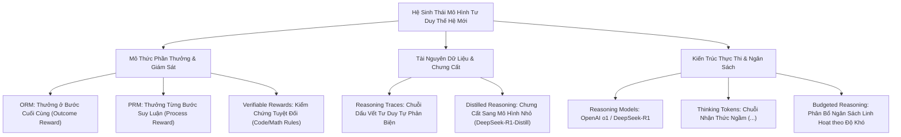
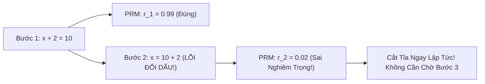
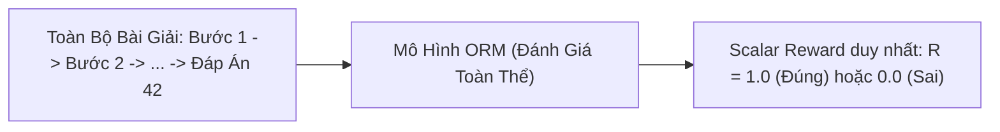
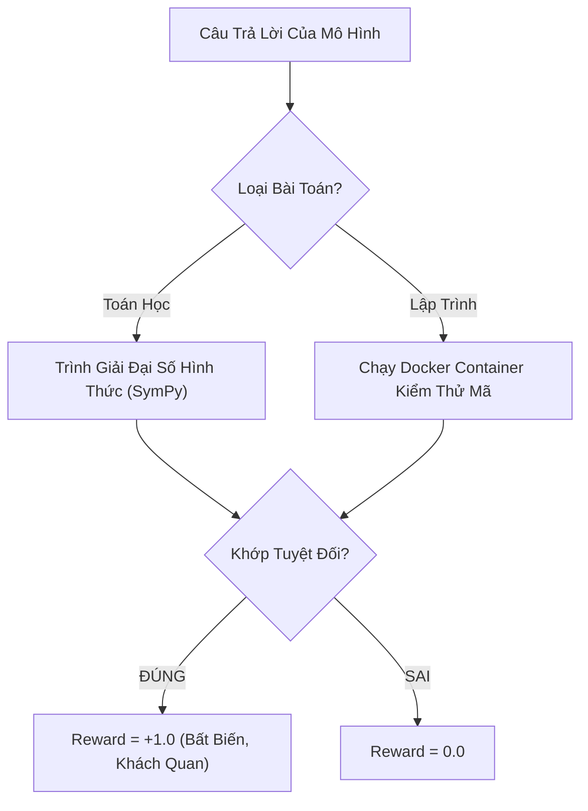
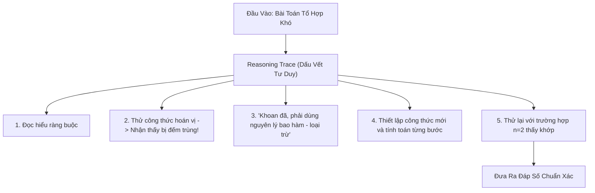
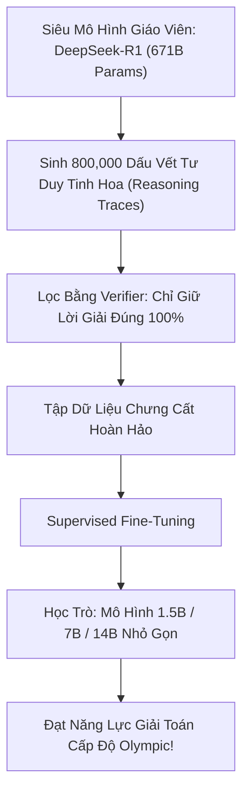
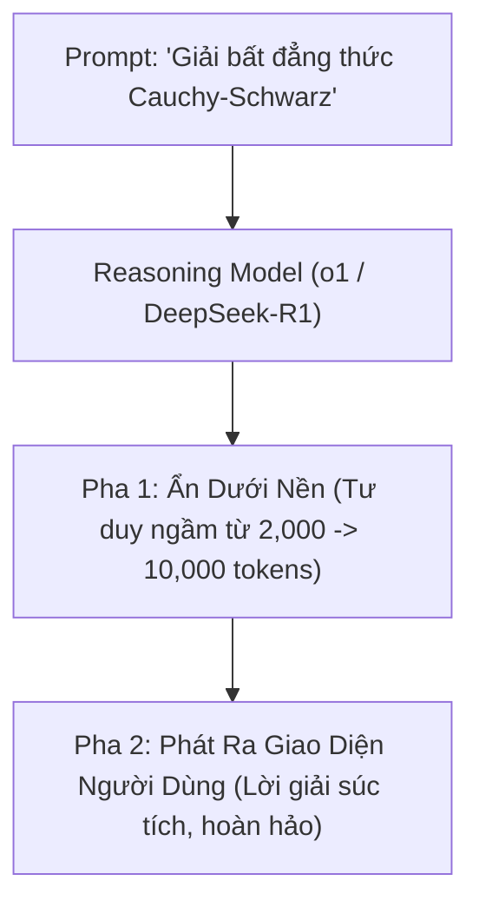
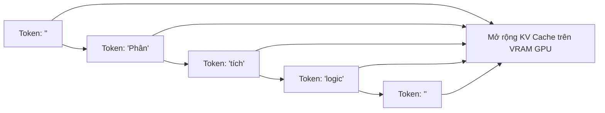
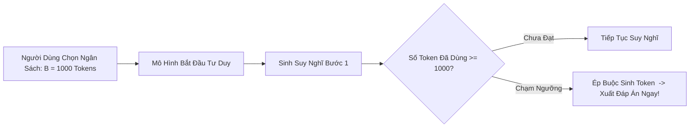

# Chuyên đề: Mô hình Phần thưởng Tiến trình, Mô hình Tư duy & Token Nhận thức (Process Reward Models, Reasoning Models & Thinking Tokens)

## 1. Tổng quan Chuyên đề
Sự ra đời của các mô hình suy luận cận biên như **OpenAI o1, o3** và **DeepSeek-R1** đã đánh dấu một cuộc cách mạng mô thức: Thay vì huấn luyện mô hình dự đoán token tiếp theo một cách thụ động, hệ thống được thiết kế để "tự suy ngẫm", phân bổ ngân sách nhận thức linh hoạt và tự thẩm định từng bước lập luận trung gian.

Chuyên đề này phân tích toàn bộ cấu trúc công nghệ đứng sau các hệ thống AI suy luận tự trị thế hệ mới:
1. **Mô hình Phần thưởng Tiến trình vs. Kết quả (PRM vs. ORM)**: Chuyển dịch từ việc chỉ thưởng điểm khi ra kết quả cuối cùng (**Outcome Reward Models - ORM**) sang việc chấm điểm từng bước suy luận trung gian (**Process Reward Models - PRM / Step-level Supervision**), kết hợp với các cơ chế phần thưởng có thể kiểm chứng bằng thuật toán (**Verifiable Rewards**).
2. **Dấu vết Suy luận & Chưng cất Tư duy (Reasoning Traces & Distilled Reasoning)**: Khai thác kho dữ liệu **Reasoning Traces** khổng lồ để chưng cất tri thức (Knowledge Distillation) từ các mô hình tư duy 671B xuống các mô hình nhỏ gọn (1.5B, 7B, 14B) mà vẫn giữ nguyên $90\%$ năng lực giải toán và lập trình.
3. **Mô hình Tư duy Chuyên biệt & Token Nhận thức (Reasoning Models, Thinking Tokens & Budgeted Reasoning)**: Tích hợp các token tư duy ngầm (`<think>...</think>`), cho phép kiểm soát ngân sách suy luận chính xác đến từng mili-giây và từng token tùy thuộc vào mức độ phức tạp của bài toán.



---

## 2. Chi tiết từng Keyword

---

### 28. Process Reward Models - PRM (Mô hình Phần thưởng Tiến trình)

#### a. Định nghĩa Bản chất Toán học (Mathematical Formulation)
**Process Reward Model (PRM)** (Lightman et al., OpenAI 2023 - *Let's Verify Step by Step*) là mô hình thẩm định được huấn luyện để gán một giá trị phần thưởng độc lập cho **từng bước suy luận đơn lẻ** trong chuỗi Chain-of-Thought $\langle s_1, s_2, \dots, s_T \rangle$:
$$r_t = \text{PRM}(x, s_1, s_2, \dots, s_t) \in [0, 1]$$
Xác suất toàn bộ lời giải hợp lệ được tính bằng tích xác suất của từng bước:
$$P(\text{Solution Valid}) = \prod_{t=1}^T r_t$$
PRM cung cấp tín hiệu phản hồi cực kỳ chi tiết (Dense Reward Signal), cho phép phát hiện chính xác bước đầu tiên xảy ra lỗi sai logic, tạo điều kiện thuận lợi cho thuật toán tìm kiếm cây Best-First Search tại thời điểm suy luận.

#### b. Cơ chế Tầng Sâu & Điện toán (Under The Hood / Hardware Internals)
- **Token Delimiter Masking in Forward Pass**: PRM nhận diện ranh giới giữa các bước suy luận thông qua một ký tự phân cách đặc biệt (thường là ký tự xuống dòng `\n` hoặc token `\n\n`). Lớp Head chấm điểm chỉ trích xuất ẩn trạng thái tại các vị trí token phân cách này thông qua mặt nạ phân đoạn (Segment Masking) trên GPU.

#### c. Sơ đồ Minh họa (Mermaid / ASCII Diagram)


#### d. Code Thực chiến (Dual-Engine: C++ & Python)

```cpp
// C++17: Tính điểm tổng hợp chuỗi từ mảng điểm số từng bước của PRM
#include <iostream>
#include <vector>

double evaluate_prm_chain(const std::vector<double>& step_scores, double step_threshold = 0.5) {
    double total_prob = 1.0;
    for (size_t i = 0; i < step_scores.size(); ++i) {
        if (step_scores[i] < step_threshold) {
            std::cout << "-> Phát hiện lỗi tại bước " << (i + 1) << " (Score: " << step_scores[i] << ")\n";
            return 0.0; // Chuỗi không hợp lệ
        }
        total_prob *= step_scores[i];
    }
    return total_prob;
}

int main() {
    std::vector<double> scores = {0.98, 0.95, 0.12, 0.88};
    std::cout << "Final Solution Validity: " << evaluate_prm_chain(scores) << std::endl;
    return 0;
}
```

```python
# Python / PyTorch: Kiến trúc mô hình Process Reward Model (PRM Head)
import torch
import torch.nn as nn

class ProcessRewardModelHead(nn.Module):
    def __init__(self, hidden_dim: int):
        super().__init__()
        # 3 lớp phân loại: Positive (+1), Neutral (0), Negative (-1)
        self.step_classifier = nn.Linear(hidden_dim, 3)
        
    def forward(self, hidden_states: torch.Tensor, step_boundary_indices: torch.Tensor) -> torch.Tensor:
        """
        hidden_states: [Batch, SeqLen, HiddenDim]
        step_boundary_indices: [Batch, NumSteps] - vị trí của token \n giữa các bước
        """
        # Trích xuất ẩn trạng thái tại ranh giới các bước
        batch_size, num_steps = step_boundary_indices.shape
        gathered_states = torch.gather(
            hidden_states, 
            dim=1, 
            index=step_boundary_indices.unsqueeze(-1).expand(-1, -1, hidden_states.size(-1))
        )
        logits = self.step_classifier(gathered_states) # [Batch, NumSteps, 3]
        probs = torch.softmax(logits, dim=-1)
        # Điểm xác suất bước hợp lệ (lớp Positive)
        step_scores = probs[:, :, 0]
        return step_scores

dim = 512
prm = ProcessRewardModelHead(dim)
h = torch.randn(2, 30, dim)
step_idx = torch.tensor([[8, 18, 29], [10, 20, 28]])
scores = prm(h, step_idx)
print("Step-Level Reward Scores Shape:", scores.shape)
```

#### e. Lỗi Thường gặp & Ổn định Số học (Pitfalls & Numerical Stability)
- **High Annotation Cost**: Việc gán nhãn dữ liệu từng bước cho PRM đòi hỏi các nhà toán học chuyên nghiệp phải đọc từng dòng suy luận để phát hiện lỗi, tốn kém chi phí gấp hàng chục lần so với gán nhãn ORM (Tập dữ liệu PRM800K của OpenAI tốn hàng trăm ngàn giờ chuyên gia).

#### f. Ứng dụng Thực chiến trong AI / Deep Learning (AI Applications)
- **Math-Shepherd & OpenAI o1**: Công cụ cốt lõi điều hướng các thuật toán tìm kiếm cây Monte Carlo Tree Search (MCTS) trong giải toán Olympic.

---

### 29. Outcome Reward Models - ORM (Mô hình Phần thưởng Kết quả)

#### a. Định nghĩa Bản chất Toán học (Mathematical Formulation)
**Outcome Reward Model (ORM)** là phương thức chấm điểm truyền thống: Toàn bộ chuỗi lời giải $\langle s_1, s_2, \dots, s_T, y \rangle$ chỉ nhận được một điểm số vô hướng duy nhất tại thời điểm kết thúc dựa trên tính đúng sai của đáp án cuối cùng $y$:
$$R = \text{ORM}(x, y) \in \{0, 1\} \quad \text{hoặc} \quad R \in \mathbb{R}$$
Hàm mất mát huấn luyện ORM dựa trên phân loại nhị phân:
$$\mathcal{L}_{\text{ORM}} = - \log \sigma\big(r_\psi(x, y_{\text{correct}})\big) - \log\big(1 - \sigma(r_\psi(x, y_{\text{wrong}}))\big)$$
Ưu điểm vượt trội của ORM là **Dữ liệu Hoàn Toàn Tự Động (Free Automated Labels)**: Chỉ cần so khớp đáp án cuối cùng với kết quả chuẩn mà không cần con người đọc hiểu các bước trung gian.

#### b. Cơ chế Tầng Sâu & Điện toán (Under The Hood / Hardware Internals)
- **Low Memory Footprint**: Khác với PRM đòi hỏi lưu giữ mảng trạng thái tại từng bước, ORM chỉ tính toán một giá trị scalar duy nhất tại token EOS cuối cùng, giảm thiểu số lượng phép tính forward pass và tiết kiệm tài nguyên VRAM.

#### c. Sơ đồ Minh họa (Mermaid / ASCII Diagram)


#### d. Code Thực chiến (Dual-Engine: C++ & Python)

```cpp
// C++17: Đánh giá nhị phân Outcome Reward Model dựa trên kết quả cuối
#include <iostream>
#include <string>

double evaluate_orm_outcome(const std::string& predicted_ans, const std::string& true_ans) {
    return (predicted_ans == true_ans) ? 1.0 : 0.0;
}

int main() {
    std::cout << "ORM Score (Khớp): " << evaluate_orm_outcome("42", "42") << std::endl;
    std::cout << "ORM Score (Lệch): " << evaluate_orm_outcome("40", "42") << std::endl;
    return 0;
}
```

```python
# Python: Huấn luyện ORM Head từ nhãn đúng/sai của đáp án cuối
import torch
import torch.nn as nn
import torch.nn.functional as F

class OutcomeRewardModel(nn.Module):
    def __init__(self, hidden_dim: int):
        super().__init__()
        self.scalar_head = nn.Linear(hidden_dim, 1)
        
    def forward(self, eos_hidden_state: torch.Tensor) -> torch.Tensor:
        # eos_hidden_state: [Batch, HiddenDim]
        return self.scalar_head(eos_hidden_state).squeeze(-1)

orm = OutcomeRewardModel(256)
dummy_eos = torch.randn(4, 256)
labels = torch.tensor([1.0, 0.0, 1.0, 0.0]) # Nhãn đúng sai
preds = orm(dummy_eos)
loss = F.binary_cross_entropy_with_logits(preds, labels)
print("ORM Training Loss:", loss.item())
```

#### e. Lỗi Thường gặp & Ổn định Số học (Pitfalls & Numerical Stability)
- **Credit Assignment Problem (Vấn đề Phân bổ Tín chỉ)**: Nếu một bài giải có 9 bước đúng hoàn hảo nhưng bước cuối cùng tính nhầm một phép cộng, ORM gán điểm 0 cho toàn bộ bài giải, vô tình trừng phạt cả 9 bước suy luận xuất sắc phía trước. Ngược lại, nếu các bước suy luận sai bét nhưng đáp án tình cờ đoán mò trúng, ORM lại thưởng điểm tối đa (False Positive Reinforcement).

#### f. Ứng dụng Thực chiến trong AI / Deep Learning (AI Applications)
- Huấn luyện củng cố chính sách trên quy mô lớn trong **STaR (Self-Taught Reasoner)** và các vòng lặp Rejection Sampling.

---

### 30. Verifiable Rewards (Phần thưởng Có thể Kiểm chứng)

#### a. Định nghĩa Bản chất Toán học (Mathematical Formulation)
**Verifiable Rewards** (nền tảng của **DeepSeek-R1-Zero** và **Qwen-2.5-Math**) loại bỏ hoàn toàn các mô hình phần thưởng nơ-ron học máy (Neural Reward Models - vốn luôn có nguy cơ bị Reward Hacking) và thay thế bằng các **Hệ thống Kiểm chứng Hình thức Dựa trên Quy tắc (Deterministic Rule-Based Verifiers)**:
$$R(x, y) = \begin{cases} 1.0 & \text{nếu } \text{FormalVerification}(x, y) == \text{True} \\ 0.0 & \text{ngược lại} \end{cases}$$
Áp dụng hoàn hảo trong 2 miền tri thức:
1. **Toán học**: Sử dụng SymPy kiểm tra tính tương đương đại số hình thức của đáp án trong thẻ `\boxed{...}`.
2. **Lập trình**: Thực thi code sinh ra trong sandbox và kiểm tra xem có vượt qua $100\%$ các bài Unit Tests hay không.
Vì hàm phần thưởng hoàn toàn khách quan và bất biến, mô hình không thể "lừa đảo" hệ thống để gian lận điểm số.

#### b. Cơ chế Tầng Sâu & Điện toán (Under The Hood / Hardware Internals)
- **Zero VRAM Reward Execution**: Không cần nạp bất kỳ mô hình Reward Model nào vào bộ nhớ GPU. Toàn bộ logic kiểm chứng diễn ra trên CPU host thông qua các script Python/SymPy/Docker nhẹ nhàng, giải phóng $100\%$ dung lượng VRAM cho Actor Model sinh chuỗi suy luận dài.

#### c. Sơ đồ Minh họa (Mermaid / ASCII Diagram)


#### d. Code Thực chiến (Dual-Engine: C++ & Python)

```cpp
// C++17: Bộ kiểm chứng số học khách quan không dùng neural network
#include <iostream>
#include <cmath>

bool verify_arithmetic_answer(double predicted, double ground_truth, double epsilon = 1e-6) {
    return std::abs(predicted - ground_truth) < epsilon;
}

int main() {
    std::cout << "Verifiable Reward: " << (verify_arithmetic_answer(3.14159, 3.14159) ? "1.0" : "0.0") << std::endl;
    return 0;
}
```

```python
# Python: Verifier toán học và code thực thi theo chuẩn DeepSeek-R1
import re
from sympy import simplify
from sympy.parsing.latex import parse_latex

def verifiable_math_reward(model_output: str, ground_truth_latex: str) -> float:
    # 1. Trích xuất đáp án trong \boxed{...}
    match = re.search(r"\\boxed\{([^}]+)\}", model_output)
    if not match:
        return 0.0 # Phạt vì không tuân thủ định dạng
    
    extracted = match.group(1).strip()
    try:
        expr_pred = parse_latex(extracted)
        expr_true = parse_latex(ground_truth_latex)
        if simplify(expr_pred - expr_true) == 0:
            return 1.0 # Đúng tuyệt đối
    except Exception:
        if extracted == ground_truth_latex.strip():
            return 1.0
    return 0.0

output_sample = "Sau khi giải, kết quả là \\boxed{\\frac{1}{2}}."
print("Verifiable Reward Score:", verifiable_math_reward(output_sample, r"\frac{2}{4}"))
```

#### e. Lỗi Thường gặp & Ổn định Số học (Pitfalls & Numerical Stability)
- **Format Gaming (Gian lận Định dạng)**: Mô hình không giải được bài toán nhưng viết thẻ `\boxed{}` trống rỗng hoặc lặp lại câu hỏi. Verifier phải kiểm tra cả tính hợp lệ của cú pháp biểu thức bên trong thẻ.

#### f. Ứng dụng Thực chiến trong AI / Deep Learning (AI Applications)
- **DeepSeek-R1-Zero**: Đột phá chứng minh học tăng cường với Verifiable Rewards thuần túy có thể tự kích hoạt năng lực suy luận siêu phàm mà không cần dữ liệu SFT của con người.

---

### 31. Reasoning Traces (Dấu vết Suy luận)

#### a. Định nghĩa Bản chất Toán học (Mathematical Formulation)
**Reasoning Trace** là bản ghi chép chi tiết, hiển ngôn toàn bộ quá trình nhận thức (Cognitive Footprint) của một mô hình tư duy từ lúc tiếp nhận bài toán cho tới khi đưa ra kết luận.
Một Reasoning Trace $\mathcal{T}$ có cấu trúc phân đoạn tự nhiên:
$$\mathcal{T} = \langle \text{Hiểu Đề} \longrightarrow \text{Lập Giả Thuyết} \longrightarrow \text{Thử Nghiệm} \longrightarrow \text{Phát Hiện Lỗi} \longrightarrow \text{Sửa Lỗi} \longrightarrow \text{Xác Minh} \rangle$$
Khác với chuỗi CoT thông thường (vốn chỉ bao gồm các bước giải thẳng tắp), một Reasoning Trace chân thực chứa đầy những biểu hiện tâm lý nhận thức:
- Sự do dự (*"Wait, let me rethink this..."*).
- Tự đặt câu hỏi đối nghịch (*"What if $x$ is negative?"*).
- Khám phá nhiều phương pháp giải khác nhau (*"Alternatively, we could use dynamic programming..."*).

#### b. Cơ chế Tầng Sâu & Điện toán (Under The Hood / Hardware Internals)
- **Long-Context Density in Pre-training Data**: Các Reasoning Traces thường dài từ $5.000$ đến $30.000$ tokens cho một bài toán duy nhất. Việc nạp các bộ dữ liệu này vào huấn luyện đòi hỏi hạ tầng GPU hỗ trợ Context Window lớn với công nghệ FlashAttention-3 và FP8/BF16 mixed precision.

#### c. Sơ đồ Minh họa (Mermaid / ASCII Diagram)


#### d. Code Thực chiến (Dual-Engine: C++ & Python)

```cpp
// C++17: Bộ phân tích cấu trúc giai đoạn của một Reasoning Trace
#include <iostream>
#include <string>

struct TraceMetrics {
    int total_words;
    bool has_self_correction;
    bool has_alternative_path;
};

TraceMetrics analyze_reasoning_trace(const std::string& trace_text) {
    bool correction = (trace_text.find("Wait,") != std::string::npos || trace_text.find("Chờ chút,") != std::string::npos);
    bool alt = (trace_text.find("Alternatively,") != std::string::npos || trace_text.find("Cách khác,") != std::string::npos);
    return {static_cast<int>(trace_text.length() / 5), correction, alt};
}

int main() {
    std::string sample = "Phân tích... Chờ chút, cách này sai. Thử cách khác... Xong.";
    auto m = analyze_reasoning_trace(sample);
    std::cout << "Has Self-Correction: " << (m.has_self_correction ? "YES" : "NO") << std::endl;
    return 0;
}
```

```python
# Python: Bộ lọc và chuẩn hóa dữ liệu Reasoning Traces phục vụ chưng cất SFT
def clean_and_format_reasoning_trace(raw_thinking: str, final_answer: str) -> dict:
    # Chuẩn hóa cấu trúc <think> ... </think>
    clean_thinking = raw_thinking.strip()
    formatted_text = f"<think>\n{clean_thinking}\n</think>\n\n{final_answer.strip()}"
    return {
        "formatted_prompt": formatted_text,
        "token_estimate": len(formatted_text.split()) * 1.3
    }

th = "Tôi cần phân tích bài toán này... Kiểm tra lại... Hoàn tất."
ans = "Đáp án: x = 12."
print(clean_and_format_reasoning_trace(th, ans)["formatted_prompt"])
```

#### e. Lỗi Thường gặp & Ổn định Số học (Pitfalls & Numerical Stability)
- **Synthetic Trace Collusion**: Việc tạo sinh Reasoning Traces bằng các mô hình yếu có thể sinh ra các đoạn suy nghĩ rác (Spam Tokens) giả vờ tự sửa lỗi chỉ để kéo dài độ dài văn bản mà không thực sự sửa bất kỳ sai sót nào.

#### f. Ứng dụng Thực chiến trong AI / Deep Learning (AI Applications)
- Nguồn tài nguyên quý giá nhất hiện nay để huấn luyện các thế hệ mô hình mã nguồn mở đuổi kịp năng lực của OpenAI o1.

---

### 32. Distilled Reasoning (Chưng cất Năng lực Suy luận)

#### a. Định nghĩa Bản chất Toán học (Mathematical Formulation)
**Distilled Reasoning** (tiêu biểu là dòng mô hình **DeepSeek-R1-Distill-Qwen** từ 1.5B đến 32B) chứng minh rằng: **Các mô hình nhỏ không cần phải trải qua quá trình RL tốn kém hàng triệu USD để tự khám phá ra kỹ năng suy luận; chúng có thể học trực tiếp kỹ năng này thông qua Supervised Fine-Tuning (SFT) trên các Reasoning Traces chất lượng cao do một siêu mô hình tư duy sinh ra**:
$$\theta_{\text{Small}}^* = \arg\min_{\theta} -\sum_{t=1}^{|\mathcal{T}|} \log \pi_\theta(w_t \mid x, w_{<t})$$
Trong đó tập dữ liệu huấn luyện $\mathcal{D}_{\text{distill}} = \{(x_i, \mathcal{T}_i)\}_{i=1}^N$ chứa hàng trăm ngàn chuỗi suy luận sâu của DeepSeek-R1 (671B).
Kết quả: Mô hình **DeepSeek-R1-Distill-Qwen-14B** vượt qua cả **GPT-4o** trên các benchmark toán học chuyên sâu như MATH và AIME 2024.

#### b. Cơ chế Tầng Sâu & Điện toán (Under The Hood / Hardware Internals)
- **High Training Throughput on Commodity Hardware**: Huấn luyện SFT trên dữ liệu suy luận chỉ bao gồm các phép tính Cross-Entropy chuẩn mực, chạy nhanh gấp $5\times - 10\times$ so với vòng lặp RL (PPO/GRPO) và có thể thực thi dễ dàng trên một máy chủ 8x H100 duy nhất trong vài ngày.

#### c. Sơ đồ Minh họa (Mermaid / ASCII Diagram)


#### d. Code Thực chiến (Dual-Engine: C++ & Python)

```cpp
// C++17: Mô phỏng tỷ lệ nén tri thức hiệu năng trong Distilled Reasoning
#include <iostream>

void compare_distillation_efficiency(double teacher_size_b, double student_size_b, double teacher_acc, double student_acc) {
    double compression_ratio = teacher_size_b / student_size_b;
    double performance_retention = (student_acc / teacher_acc) * 100.0;
    std::cout << "Tỷ lệ nén kích thước: " << compression_ratio << "x\n";
    std::cout << "Năng lực duy trì: " << performance_retention << "%\n";
}

int main() {
    compare_distillation_efficiency(671.0, 14.0, 79.8, 79.2); // Số liệu DeepSeek-R1 vs Distill-14B trên AIME
    return 0;
}
```

```python
# Python / PyTorch: Hàm tính hàm mất mát Chưng cất SFT có mặt nạ trên Prompt
import torch
import torch.nn.functional as F

def compute_distilled_reasoning_loss(
    model_logits: torch.Tensor,   # [Batch, SeqLen, Vocab]
    target_ids: torch.Tensor,     # [Batch, SeqLen]
    prompt_lengths: list
) -> torch.Tensor:
    # Shift để tính Next-Token Prediction
    shift_logits = model_logits[:, :-1, :].contiguous()
    shift_labels = target_ids[:, 1:].contiguous().clone()
    
    # Đặt nhãn của prompt bằng -100 để bỏ qua loss (chỉ học chuỗi reasoning)
    for i, p_len in enumerate(prompt_lengths):
        shift_labels[i, :p_len - 1] = -100
        
    loss = F.cross_entropy(shift_logits.view(-1, shift_logits.size(-1)), shift_labels.view(-1), ignore_index=-100)
    return loss

logits = torch.randn(2, 20, 1000)
targets = torch.randint(0, 1000, (2, 20))
p_lens = [5, 8] # Độ dài prompt
print("Distillation Loss:", compute_distilled_reasoning_loss(logits, targets, p_lens).item())
```

#### e. Lỗi Thường gặp & Ổn định Số học (Pitfalls & Numerical Stability)
- **Mimicry without Generalization**: Mô hình nhỏ học được văn phong tự sửa sai (ví dụ thường xuyên nói *"Chờ một chút..."*) nhưng lại không thực sự có khả năng sửa sai logic bên trong, dẫn đến việc giả vờ suy nghĩ (Fake Thinking).

#### f. Ứng dụng Thực chiến trong AI / Deep Learning (AI Applications)
- Cho phép chạy các mô hình tư duy cấp độ AGI trực tiếp trên thiết bị cá nhân (MacBook, điện thoại thông minh, laptop cá nhân).

---

### 33. Reasoning Models (Mô hình Tư duy Chuyên biệt)

#### a. Định nghĩa Bản chất Toán học (Mathematical Formulation)
**Reasoning Models** (như OpenAI o1/o3, DeepSeek-R1) đại diện cho một danh mục mô hình mới, phân tách rạch ròi với các mô hình đàm thoại (Chat Models) thông thường.
Đặc trưng toán học cốt lõi:
1. **Phân ly Tuyệt đối giữa Chuỗi Suy nghĩ (Thinking Phase) và Chuỗi Phản hồi (Answer Phase)**:
   $$y = \langle \text{Thinking Tokens}, \text{Response Tokens} \rangle$$
2. **Cơ chế Khuyến khích Tự Phản biện Bằng Học Tăng cường (Pure RL Emergence)**: Thay vì bị ép buộc tuân thủ văn phong con người, mô hình được khuyến khích phát triển các chiến lược tự khám phá lời giải (Self-Search) thông qua hàm phần thưởng kiểm chứng.
Mô hình có khả năng tự động phân bổ chiều dài suy nghĩ tỷ lệ thuận với độ khó toán học của bài toán.

#### b. Cơ chế Tầng Sâu & Điện toán (Under The Hood / Hardware Internals)
- **Streaming Buffer Masking**: Khi triển khai qua API thương mại, hệ thống máy chủ chỉ truyền trực tiếp (Stream) phần `Response Tokens` tới giao diện người dùng cuối, trong khi phần `Thinking Tokens` được mã hóa hoặc ẩn giấu trên server để bảo vệ bí mật công nghệ và tránh rò rỉ dữ liệu nhạy cảm.

#### c. Sơ đồ Minh họa (Mermaid / ASCII Diagram)


#### d. Code Thực chiến (Dual-Engine: C++ & Python)

```cpp
// C++17: Mô phỏng bộ định tuyến phân tách luồng Output giữa Thinking và Final Answer
#include <iostream>
#include <string>

struct ModelOutputPacket {
    std::string hidden_thinking;
    std::string user_visible_answer;
};

void render_to_ui(const ModelOutputPacket& packet) {
    std::cout << "[CLIENT UI]: " << packet.user_visible_answer << std::endl;
    // hidden_thinking được lưu trong log nội bộ server, không hiển thị cho user
}

int main() {
    ModelOutputPacket pkt{"Suy ngẫm 500 bước...", "Kết quả nghiệm là x = 2."};
    render_to_ui(pkt);
    return 0;
}
```

```python
# Python: Bộ lọc API ẩn token nhận thức khi phục vụ người dùng cuối
def process_reasoning_model_stream(full_stream: str) -> str:
    # Nếu chứa khối <think> ... </think>, cắt bỏ để trả lời súc tích
    if "<think>" in full_stream and "</think>" in full_stream:
        return full_stream.split("</think>")[-1].strip()
    return full_stream

stream_data = "<think>\nBước 1: Tính delta\nBước 2: Tìm căn\n</think>\nPhương trình có 2 nghiệm phân biệt."
print("Hiển thị người dùng:", process_reasoning_model_stream(stream_data))
```

#### e. Lỗi Thường gặp & Ổn định Số học (Pitfalls & Numerical Stability)
- **Extreme Latency for Simple Queries**: Nếu không có cơ chế phân loại câu hỏi (Query Router), mô hình tư duy có thể dành tới 30 giây suy nghĩ chỉ để trả lời một câu chào hỏi đơn giản như *"Xin chào, bạn khỏe không?"*.

#### f. Ứng dụng Thực chiến trong AI / Deep Learning (AI Applications)
- Nghiên cứu học thuật đỉnh cao, phát minh dược phẩm mới, giải quyết các lỗi phần mềm phức tạp (SWE-bench) và kiểm định bảo mật hệ thống.

---

### 34. Thinking Tokens (Token Nhận thức)

#### a. Định nghĩa Bản chất Toán học (Mathematical Formulation)
**Thinking Tokens** (hoặc **Cognitive Tokens**) là các token được sinh ra trong pha suy ngẫm nội tại, nằm giữa các thẻ phân cách cấu trúc:
$$\mathcal{S}_{\text{thinking}} = \{w_t \mid t_{\text{start}} < t < t_{\text{end}}\}, \quad \text{với } w_{t_{\text{start}}} = \text{"<think>"} \text{ và } w_{t_{\text{end}}} = \text{"</think>"}$$
Về mặt lý thuyết thông tin, Thinking Tokens không phục vụ mục đích giao tiếp với con người mà đóng vai trò như một **Không gian Làm việc Tính toán (Scratchpad Workspace)**:
Mỗi token nhận thức sinh ra sẽ làm tăng dung lượng biểu diễn của đồ thị Attention:
$$\mathbf{K}_{\text{new}}, \mathbf{V}_{\text{new}} \leftarrow \text{Append}(\mathbf{K}_{\text{old}}, \mathbf{V}_{\text{old}})$$
Cho phép các bước tính toán sau "nhìn lại" và tổng hợp thông tin từ toàn bộ lịch sử tư duy trước đó.

#### b. Cơ chế Tầng Sâu & Điện toán (Under The Hood / Hardware Internals)
- **Token Pricing & Billable Overhead**: Mặc dù người dùng có thể không nhìn thấy Thinking Tokens trên giao diện web, nhà cung cấp hạ tầng đám mây vẫn phải tính phí tính toán cho các token này vì GPU đã thực sự tiêu tốn chu kỳ tính toán và băng thông VRAM để sinh ra chúng.

#### c. Sơ đồ Minh họa (Mermaid / ASCII Diagram)


#### d. Code Thực chiến (Dual-Engine: C++ & Python)

```cpp
// C++17: Bộ đếm chi phí tính toán cho Thinking Tokens
#include <iostream>

struct TokenCostTracker {
    double price_per_million_input;
    double price_per_million_thinking;
    double price_per_million_output;
    
    double calculate_cost(int num_in, int num_think, int num_out) const {
        return (num_in * price_per_million_input + 
                num_think * price_per_million_thinking + 
                num_out * price_per_million_output) / 1e6;
    }
};

int main() {
    TokenCostTracker tracker{3.0, 15.0, 15.0}; // $15 cho mỗi triệu thinking tokens
    std::cout << "Tổng chi phí truy vấn: $" << tracker.calculate_cost(500, 4000, 200) << std::endl;
    return 0;
}
```

```python
# Python: Bộ đo lường tỷ lệ Thinking Tokens trên phản hồi
def analyze_thinking_token_ratio(full_completion: str) -> dict:
    parts = full_completion.split("</think>")
    if len(parts) > 1:
        thinking_text = parts[0].replace("<think>", "").strip()
        answer_text = parts[1].strip()
        think_tokens = len(thinking_text.split())
        ans_tokens = len(answer_text.split())
        return {
            "thinking_token_count": think_tokens,
            "answer_token_count": ans_tokens,
            "cognitive_ratio": think_tokens / max(think_tokens + ans_tokens, 1)
        }
    return {"thinking_token_count": 0, "answer_token_count": len(full_completion.split()), "cognitive_ratio": 0.0}

sample = "<think> Cần áp dụng định lý Fermat... Thử nghiệm p=7... Khớp. </think> Đáp án là 1."
print(analyze_thinking_token_ratio(sample))
```

#### e. Lỗi Thường gặp & Ổn định Số học (Pitfalls & Numerical Stability)
- **Premature Thinking Termination**: Mô hình phát ra thẻ `</think>` quá sớm khi chưa giải quyết xong bài toán, dẫn đến việc chuyển sang pha trả lời khi các phép tính trung gian vẫn còn đang dở dang.

#### f. Ứng dụng Thực chiến trong AI / Deep Learning (AI Applications)
- Tính năng cốt lõi cho phép người dùng tùy chọn hiển thị hoặc ẩn tiến trình tư duy (Thinking Process Accordion) trên giao diện Claude, ChatGPT và DeepSeek.

---

### 35. Budgeted Reasoning (Suy luận theo Định mức Ngân sách)

#### a. Định nghĩa Bản chất Toán học (Mathematical Formulation)
**Budgeted Reasoning** (hoặc **Controllable Test-Time Compute**) là khả năng cho phép người dùng hoặc hệ thống điều phối xác định một **Hạn ngạch Ngân sách Tính toán Cứng hoặc Mềm (Compute Budget Constraint)** $B$:
$$\max_{\pi} \mathbb{E}\big[\text{TaskSuccess}\big] \quad \text{sao cho} \quad N_{\text{thinking\_tokens}} \le B$$
Hoặc dưới dạng điều kiện dừng động dựa trên độ tự tin:
$$T^* = \arg\min_T \left\{ T \mid \text{Confidence}(s_T) \ge 1 - \epsilon \quad \text{hoặc} \quad T = B \right\}$$
Cơ chế này cho phép các kỹ sư cân bằng bài toán kinh tế:
- Với các tác vụ thời gian thực (Chatbot CSKH): Đặt ngân sách thấp ($B \le 200$ tokens) để giữ độ trễ dưới 1 giây.
- Với các bài toán nghiên cứu khoa học: Cho phép ngân sách tối đa ($B = 32.000$ tokens) để tối ưu hóa độ chính xác.

#### b. Cơ chế Tầng Sâu & Điện toán (Under The Hood / Hardware Internals)
- **Early-Exit Logit Masking**: Khi số lượng token sinh ra chạm ngưỡng ngân sách $B$, hệ thống tự động can thiệp vào phân phối logits: Áp dụng mặt nạ ép buộc token `</think>` có logit bằng $+\infty$, buộc mô hình kết thúc ngay lập tức pha tư duy và chuyển sang xuất đáp án.

#### c. Sơ đồ Minh họa (Mermaid / ASCII Diagram)


#### d. Code Thực chiến (Dual-Engine: C++ & Python)

```cpp
// C++17: Bộ giám sát ngân sách sinh token thời gian thực (Budget Watchdog)
#include <iostream>

class ReasoningBudgetController {
private:
    int token_budget;
    int tokens_consumed;
public:
    ReasoningBudgetController(int budget) : token_budget(budget), tokens_consumed(0) {}
    
    bool can_continue_thinking() {
        tokens_consumed++;
        return tokens_consumed < token_budget;
    }
    
    void enforce_early_exit() {
        std::cout << "-> Đã chạm hạn ngạch ngân sách " << token_budget << " tokens! Ép buộc xuất kết quả.\n";
    }
};

int main() {
    ReasoningBudgetController ctrl(3);
    while (ctrl.can_continue_thinking()) {
        std::cout << "Đang suy nghĩ...\n";
    }
    ctrl.enforce_early_exit();
    return 0;
}
```

```python
# Python: Bộ can thiệp Logits Processor ép buộc kết thúc suy luận khi hết ngân sách
import torch

class BudgetEnforcerLogitsProcessor:
    def __init__(self, budget_tokens: int, end_think_token_id: int):
        self.budget = budget_tokens
        self.end_token = end_think_token_id
        self.current_step = 0
        
    def __call__(self, input_ids: torch.Tensor, scores: torch.Tensor) -> torch.Tensor:
        self.current_step += 1
        if self.current_step >= self.budget:
            # Ép buộc chọn token </think> bằng cách gán logit cực đại
            scores[:, :] = -float("inf")
            scores[:, self.end_token] = 100.0
        return scores

processor = BudgetEnforcerLogitsProcessor(budget_tokens=5, end_think_token_id=42)
dummy_scores = torch.zeros(1, 100)
for step in range(6):
    out = processor(None, dummy_scores.clone())
    if torch.argmax(out).item() == 42:
        print(f"Bước {step + 1}: Bị ép buộc kết thúc suy luận tại token </think>!")
        break
```

#### e. Lỗi Thường gặp & Ổn định Số học (Pitfalls & Numerical Stability)
- **Incoherent Abrupt Cutoff**: Cắt ngang quá trình suy luận khi mô hình đang ở giữa chừng một phép biến đổi toán học có thể khiến đáp án cuối cùng bị cụt lủn hoặc chứa các công thức chưa đóng ngoặc.

#### f. Ứng dụng Thực chiến trong AI / Deep Learning (AI Applications)
- **Custom Effort Level Controls**: Nút điều chỉnh thanh trượt mức độ suy luận (Reasoning Effort: Low, Medium, High) trên API của **OpenAI o1/o3**, giúp doanh nghiệp kiểm soát tối ưu hóa chi phí điện toán đám mây.
