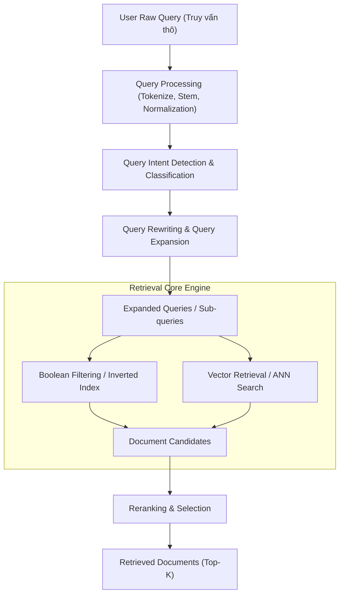
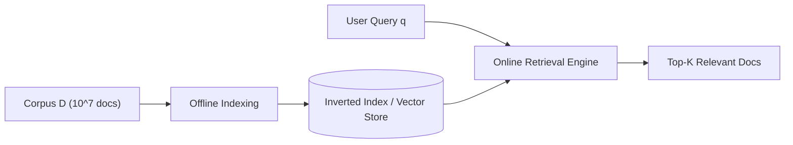
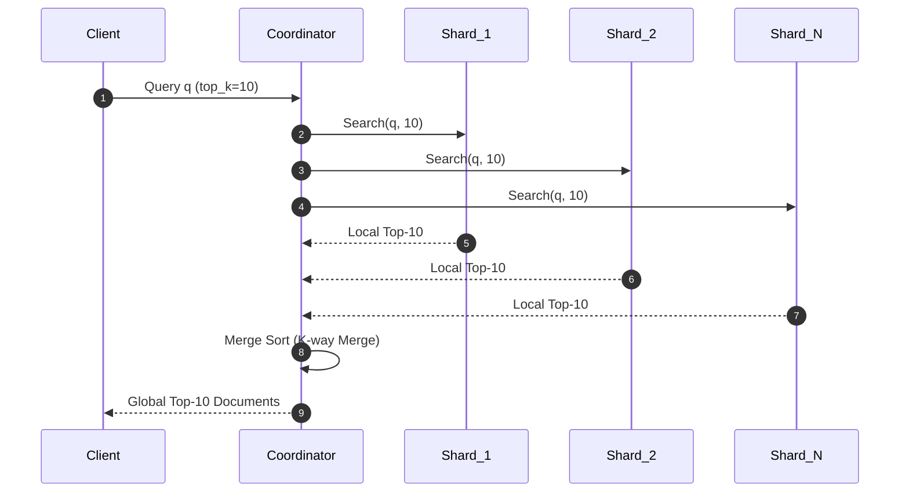
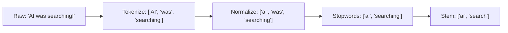
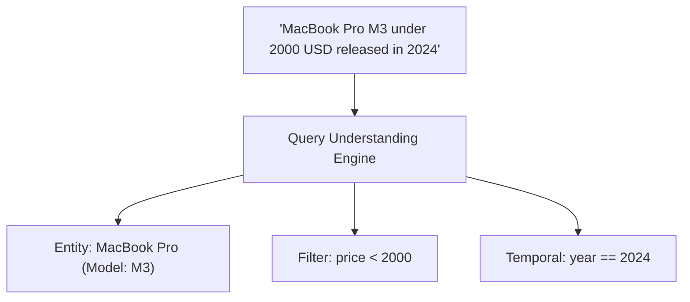
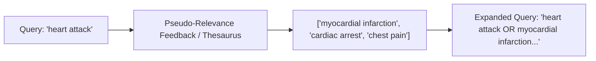
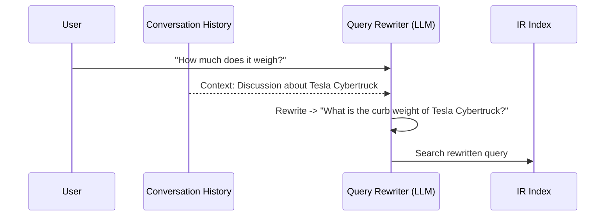
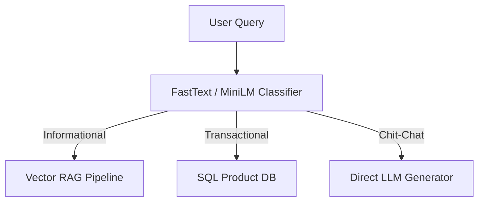
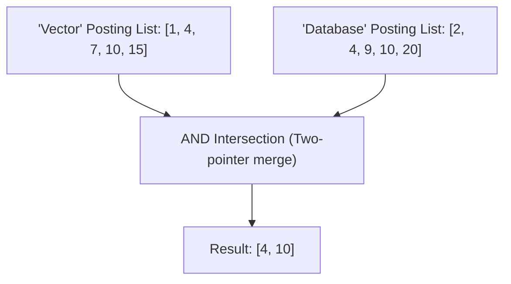

# Chuyên đề: Nguyên lý Truy xuất Thông tin & Xử lý Truy vấn (IR Fundamentals & Query Processing)

## 1. Tổng quan Chuyên đề
Trong kỷ nguyên Trí tuệ Nhân tạo và Hệ thống Dữ liệu Lớn, **Truy xuất Thông tin (Information Retrieval - IR)** là nền tảng cốt lõi cho mọi kiến trúc tìm kiếm hiện đại, hệ thống trợ lý ảo, RAG (Retrieval-Augmented Generation) và AI Agent. Một hệ thống IR hiệu năng cao không chỉ đơn thuần là việc quét qua các chuỗi văn bản (pattern matching), mà là sự kết hợp chặt chẽ giữa kỹ thuật phân giải ngôn ngữ, hiểu ý định người dùng (Query Understanding), xử lý và tối ưu hóa câu truy vấn (Query Processing/Expansion/Rewriting) trước khi đối chiếu với chỉ mục dữ liệu (Index).

Kiến trúc tổng thể của chuỗi xử lý truy vấn trong hệ thống IR hiện đại:



---

## 2. Chi tiết từng Keyword

---

### 1. Information Retrieval (IR)

#### a. Định nghĩa Bản chất Kỹ thuật & Toán học
**Information Retrieval (IR)** là khoa học về việc tìm kiếm và truy xuất các tài nguyên thông tin phi cấu trúc (thường là văn bản, âm thanh, hình ảnh) thỏa mãn nhu cầu thông tin (information need) từ một kho ngữ liệu khổng lồ (corpus $\mathcal{D}$).
Mô hình toán học tổng quát của IR là một bộ tứ:
$$\mathcal{M}_{IR} = \langle \mathcal{D}, \mathcal{Q}, \mathcal{F}, R(d_j, q) \rangle$$
Trong đó:
- $\mathcal{D} = \{d_1, d_2, \dots, d_N\}$: Tập hợp các tài liệu trong kho lưu trữ (corpus).
- $\mathcal{Q}$: Không gian các câu truy vấn khả dĩ.
- $\mathcal{F}$: Khung biểu diễn cấu trúc cho tài liệu và truy vấn (ví dụ không gian véc-tơ, tập hợp logic, hoặc phân phối xác suất).
- $R(d_j, q): \mathcal{D} \times \mathcal{Q} \to \mathbb{R}$: Hàm đánh giá mức độ liên quan (Relevance Scoring function).

#### b. Cơ chế Tầng Sâu & Kiến trúc Hệ thống (Internals)
- **Kiến trúc hai tầng (Two-Tower / Two-Stage Retrieval)**: Gồm tầng *Retrieval* (quét nhanh $10^6 - 10^9$ tài liệu xuống vài trăm candidates qua Inverted Index hoặc ANN) và tầng *Ranking* (dùng mô hình học sâu đắt đỏ để tính điểm $Top\text{-}K$).
- **Độ trễ & Thông lượng (Latency & Throughput)**: Hệ thống IR thương mại yêu cầu p99 latency $< 50\text{ms}$. Việc phân tán chỉ mục (Sharding) và sao chép (Replication) trên cụm máy chủ là bắt buộc để duy trì thông lượng hàng chục ngàn QPS.

#### c. Sơ đồ Minh họa


#### d. Code Thực chiến (C++ & Python)

```cpp
// C++20: Cấu trúc biểu diễn kết quả truy xuất cơ bản
#include <iostream>
#include <vector>
#include <algorithm>
#include <string>

struct SearchResult {
    uint32_t doc_id;
    float relevance_score;

    bool operator>(const SearchResult& other) const {
        return relevance_score > other.relevance_score;
    }
};

class SimpleIRRetriever {
public:
    std::vector<SearchResult> top_k(std::vector<SearchResult>& candidates, size_t k) {
        if (k < candidates.size()) {
            std::nth_element(candidates.begin(), candidates.begin() + k, candidates.end(), std::greater<SearchResult>());
            candidates.resize(k);
        }
        std::sort(candidates.begin(), candidates.end(), std::greater<SearchResult>());
        return candidates;
    }
};

int main() {
    std::vector<SearchResult> hits = {{101, 0.45f}, {102, 0.89f}, {103, 0.72f}, {104, 0.95f}};
    SimpleIRRetriever ir;
    auto top2 = ir.top_k(hits, 2);
    for (const auto& hit : top2) {
        std::cout << "DocID: " << hit.doc_id << " Score: " << hit.relevance_score << "\n";
    }
    return 0;
}
```

```python
# Python: Mô phỏng trừu tượng khung IR
from typing import List, Tuple

class SimpleIRSystem:
    def __init__(self, corpus: List[str]):
        self.corpus = corpus

    def score(self, query: str, doc: str) -> float:
        # Tần suất xuất hiện token giao nhau làm điểm số tương đồng thô
        q_tokens = set(query.lower().split())
        d_tokens = doc.lower().split()
        return sum(1 for t in d_tokens if t in q_tokens) / (len(d_tokens) + 1e-5)

    def retrieve(self, query: str, top_k: int = 2) -> List[Tuple[int, str, float]]:
        scores = [(idx, doc, self.score(query, doc)) for idx, doc in enumerate(self.corpus)]
        scores.sort(key=lambda x: x[2], reverse=True)
        return scores[:top_k]

sys = SimpleIRSystem(["Deep learning and neural networks", "Information retrieval and search engines", "Vector databases for RAG"])
print(sys.retrieve("information retrieval"))
```

#### e. Lỗi Thường gặp & Tối ưu Hệ thống
- **Pitfall**: Đánh đồng giữa Lexical Match (khớp từ vựng) và Semantic Relevance (sự liên quan ngữ nghĩa), khiến bỏ lỡ các tài liệu đồng nghĩa hoặc nhầm lẫn ngữ cảnh.
- **Tối ưu**: Triển khai hybrid retrieval kết hợp cả sparse index (BM25) và dense index (Embedding vectors).

#### f. Ứng dụng Thực chiến trong AI Systems
Nền tảng của bộ máy tìm kiếm (Elasticsearch, OpenSearch) và pha Retrieval đầu vào trong các hệ thống RAG quy mô lớn.

---

### 2. Document Retrieval (Truy xuất Tài liệu)

#### a. Định nghĩa Bản chất Kỹ thuật & Toán học
**Document Retrieval** là bài toán con cụ thể của IR, tập trung vào việc xác định và trả về toàn bộ hoặc một phần danh sách tài liệu từ kho dữ liệu thỏa mãn truy vấn văn bản, tối đa hóa hàm liên quan xác suất:
$$P(R=1 \mid d, q)$$
Trong đó $R \in \{0, 1\}$ là biến ngẫu nhiên biểu thị tính liên quan giữa tài liệu $d$ và truy vấn $q$.

#### b. Cơ chế Tầng Sâu & Kiến trúc Hệ thống
- Đơn vị truy xuất có thể là toàn bộ văn bản (Full Document), đoạn văn (Passage/Paragraph), hoặc từng lát cắt ngữ nghĩa (Chunk).
- Trong hệ thống phân tán, Document Retrieval sử dụng kỹ thuật **Scatter-Gather**: Gửi truy vấn đến toàn bộ $S$ shard chứa các posting lists phân vùng, mỗi shard tính toán local top-$K$, sau đó tụ họp (reduce) tại bộ điều phối (Coordinator node) để tạo global top-$K$.

#### c. Sơ đồ Minh họa


#### d. Code Thực chiến (C++ & Python)

```cpp
// C++17: K-way merge kết quả Document Retrieval từ nhiều Shards
#include <iostream>
#include <vector>
#include <queue>

struct ShardDoc {
    int doc_id;
    float score;
    int shard_idx;
    bool operator<(const ShardDoc& o) const { return score < o.score; } // Max-heap
};

std::vector<ShardDoc> merge_shards(const std::vector<std::vector<ShardDoc>>& shard_results, size_t k) {
    std::priority_queue<ShardDoc> pq;
    for (const auto& list : shard_results) {
        for (const auto& item : list) {
            pq.push(item);
        }
    }
    std::vector<ShardDoc> res;
    while (!pq.empty() && res.size() < k) {
        res.push_back(pq.top());
        pq.pop();
    }
    return res;
}
```

```python
# Python: K-way reduction mô phỏng Document Retrieval
import heapq

def scatter_gather_retrieve(shards, query_scorer, top_k=3):
    shard_hits = []
    for shard_id, docs in enumerate(shards):
        local_scored = [(query_scorer(d), shard_id, d) for d in docs]
        local_top = heapq.nlargest(top_k, local_scored, key=lambda x: x[0])
        shard_hits.extend(local_top)
    return heapq.nlargest(top_k, shard_hits, key=lambda x: x[0])
```

#### e. Lỗi Thường gặp & Tối ưu Hệ thống
- **Pitfall**: Kích thước tài liệu quá lớn làm loãng điểm tương đồng cục bộ (length normalization bias).
- **Tối ưu**: Chia nhỏ tài liệu thành passage 256–512 tokens trước khi lập chỉ mục, lưu kèm `parent_doc_id`.

#### f. Ứng dụng Thực chiến trong AI Systems
Pha Document Fetching trong RAG, tải payload tương ứng với vector ID thu được từ Vector Database.

---

### 3. Query Processing (Xử lý Truy vấn)

#### a. Định nghĩa Bản chất Kỹ thuật & Toán học
**Query Processing** là chuỗi biến đổi hình thức chuyển đổi một chuỗi văn bản tự nhiên thô $q_{raw}$ thành dạng cấu trúc nội bộ $q_{norm}$ hoặc biểu diễn véc-tơ $\mathbf{q} \in \mathbb{R}^d$:
$$q_{norm} = \pi_{filter} \circ \pi_{stem} \circ \pi_{tokenize}(q_{raw})$$

#### b. Cơ chế Tầng Sâu & Kiến trúc Hệ thống
1. **Tokenization**: Cắt chuỗi thành token (dùng BPE, WordPiece, hoặc regex whitespace).
2. **Normalizing & Lowercasing**: Chuẩn hóa Unicode (NFC/NFD), chuyển chữ thường để loại bỏ sai lệch case-sensitive.
3. **Stop-word Removal**: Loại bỏ các từ vô nghĩa mang lại ít giá trị phân biệt như "the", "a", "is" (cần cẩn trọng trong Dense Retrieval vì stop-words có thể mang cấu trúc ngữ pháp).
4. **Stemming / Lemmatization**: Đưa từ về gốc (Porter Stemmer: "running" $\to$ "run").

#### c. Sơ đồ Minh họa


#### d. Code Thực chiến (C++ & Python)

```cpp
// C++17: Tokenizer và chuẩn hóa chuỗi cơ bản
#include <iostream>
#include <sstream>
#include <vector>
#include <algorithm>
#include <cctype>

std::vector<std::string> process_query(const std::string& raw) {
    std::vector<std::string> tokens;
    std::string token;
    std::istringstream stream(raw);
    while (stream >> token) {
        std::string clean;
        for (char c : token) {
            if (std::isalnum(c)) clean += std::tolower(c);
        }
        if (!clean.empty() && clean != "the" && clean != "is" && clean != "and") {
            tokens.push_back(clean);
        }
    }
    return tokens;
}

int main() {
    auto res = process_query("The Deep-Learning is Fast!");
    for (const auto& t : res) std::cout << "[" << t << "] ";
    std::cout << "\n";
    return 0;
}
```

```python
# Python: Pipeline Query Processing với Regex
import re

def process_query_py(query: str, stop_words: set = {"is", "the", "in", "a"}) -> list[str]:
    cleaned = re.sub(r"[^\w\s]", " ", query.lower())
    tokens = cleaned.split()
    return [t for t in tokens if t not in stop_words]

print(process_query_py("What is the speed of HNSW indexing?"))
```

#### e. Lỗi Thường gặp & Tối ưu Hệ thống
- **Pitfall**: Xóa nhầm các stop-word đóng vai trò quyết định ngữ nghĩa phủ định như "not", "no" hoặc tên riêng (như ban nhạc "The Who").
- **Tối ưu**: Tránh biến đổi phá hủy với Dense Retrieval; chỉ áp dụng pipeline lọc mạnh cho Lexical BM25.

#### f. Ứng dụng Thực chiến trong AI Systems
Khâu tiền xử lý bắt buộc trước khi tính hash hoặc nạp vào tokenizer của Transformer.

---

### 4. Query Understanding (Hiểu Truy vấn)

#### a. Định nghĩa Bản chất Kỹ thuật & Toán học
**Query Understanding** là quá trình trích xuất cấu trúc ngữ nghĩa tiềm ẩn (latent semantic structure), các thực thể (entities), và các thuộc tính bị ràng buộc từ câu truy vấn của người dùng:
$$\mathcal{S}_q = \langle \mathcal{E}, \mathcal{A}, \mathcal{T}, \mathcal{I} \rangle$$
Trong đó $\mathcal{E}$ là tập thực thể (Entities), $\mathcal{A}$ là thuộc tính (Attributes), $\mathcal{T}$ là khung thời gian (Temporal constraints), $\mathcal{I}$ là ý định (Intent).

#### b. Cơ chế Tầng Sâu & Kiến trúc Hệ thống
- Áp dụng mô hình ngôn ngữ nhẹ (Small Language Models như RoBERTa, DistilBERT hoặc FastText) chạy ở biên (Edge/Inference Gateway) để duy trì độ trễ dưới 5ms.
- Nhận diện các ràng buộc logic: "laptop gaming dưới 20 triệu pin trâu" $\to$ Category: Laptop, Sub-cat: Gaming, Price: $< 20.000.000$, Attribute: battery_life=high.

#### c. Sơ đồ Minh họa


#### d. Code Thực chiến (C++ & Python)

```cpp
// C++17: Rút trích cấu trúc filter đơn giản bằng key-value matching
#include <iostream>
#include <string>
#include <regex>

struct QueryFilters {
    std::string device;
    int max_price = -1;
};

QueryFilters parse_intent(const std::string& q) {
    QueryFilters f;
    if (q.find("macbook") != std::string::npos) f.device = "Apple_MacBook";
    std::regex price_regex(r"(?:under|less than)\s+(\d+)");
    std::smatch match;
    if (std::regex_search(q, match, price_regex)) {
        f.max_price = std::stoi(match[1]);
    }
    return f;
}
```

```python
# Python: Structured Query Understanding sử dụng Pydantic
from pydantic import BaseModel
from typing import Optional

class StructuredQuery(BaseModel):
    raw_query: str
    target_entity: Optional[str]
    max_price: Optional[float]
    requires_comparison: bool = False

def understand_query(q: str) -> StructuredQuery:
    q_low = q.lower()
    return StructuredQuery(
        raw_query=q,
        target_entity="MacBook" if "macbook" in q_low else None,
        max_price=2000.0 if "under 2000" in q_low else None,
        requires_comparison="vs" in q_low or "compare" in q_low
    )

print(understand_query("Compare MacBook Air vs Pro under 2000 dollars"))
```

#### e. Lỗi Thường gặp & Tối ưu Hệ thống
- **Pitfall**: Parsing cứng nhắc bằng Regex thất bại hoàn toàn trước lỗi chính tả hoặc ngôn ngữ tự nhiên phức tạp.
- **Tối ưu**: Sử dụng bộ phân loại Intent kết hợp Slot-filling model (Joint Intent & Slot Filling NLU).

#### f. Ứng dụng Thực chiến trong AI Systems
Dùng trong Router Agent của LangGraph/LlamaIndex để tách query thành vector search và metadata filtering.

---

### 5. Query Expansion (Mở rộng Truy vấn)

#### a. Định nghĩa Bản chất Kỹ thuật & Toán học
**Query Expansion** là kỹ thuật bổ sung thêm các thuật ngữ đồng nghĩa, liên quan hoặc mở rộng vào câu truy vấn gốc $q$ để tăng độ bao phủ (Recall), giảm thiểu vấn đề sai lệch từ vựng (Vocabulary Mismatch):
$$q_{expanded} = q \cup \{t_1, t_2, \dots, t_m\}, \quad t_i \sim P(t \mid q)$$
Phương pháp kinh điển bao gồm Pseudo-Relevance Feedback (PRF - mô hình Rocchio):
$$\mathbf{q}_{new} = \alpha \mathbf{q}_0 + \frac{\beta}{|D_R|} \sum_{d \in D_R} \mathbf{d} - \frac{\gamma}{|D_{NR}|} \sum_{d \in D_{NR}} \mathbf{d}$$

#### b. Cơ chế Tầng Sâu & Kiến trúc Hệ thống
- **Thesaurus-based Expansion**: Tra cứu WordNet hoặc từ điển đồng nghĩa (latency $< 1\text{ms}$).
- **PRF (Pseudo-Relevance Feedback)**: Giả định top-$K$ tài liệu lấy về ở vòng 1 là liên quan, trích xuất các từ có TF-IDF cao nhất trong đó rồi truy vấn lại.
- **LLM-based Expansion**: Dùng LLM sinh ra các từ khóa liên quan trước khi tìm kiếm.

#### c. Sơ đồ Minh họa


#### d. Code Thực chiến (C++ & Python)

```cpp
// C++17: Triển khai từ điển đồng nghĩa mở rộng truy vấn (Synonym Dictionary)
#include <iostream>
#include <unordered_map>
#include <vector>
#include <sstream>

class QueryExpander {
    std::unordered_map<std::string, std::vector<std::string>> synonyms;
public:
    void add_synonym(const std::string& term, const std::vector<std::string>& syns) {
        synonyms[term] = syns;
    }

    std::vector<std::string> expand(const std::string& term) {
        std::vector<std::string> result = {term};
        auto it = synonyms.find(term);
        if (it != synonyms.end()) {
            result.insert(result.end(), it->second.begin(), it->second.end());
        }
        return result;
    }
};
```

```python
# Python: Query Expansion bằng LLM hoặc từ điển đồng nghĩa
def expand_query(query: str, synonym_map: dict) -> list[str]:
    expanded = [query]
    words = query.lower().split()
    for w in words:
        if w in synonym_map:
            for syn in synonym_map[w]:
                expanded.append(query.lower().replace(w, syn))
    return list(set(expanded))

syns = {"llm": ["large language model", "foundation model"], "rag": ["retrieval augmented generation"]}
print(expand_query("optimize llm with rag", syns))
```

#### e. Lỗi Thường gặp & Tối ưu Hệ thống
- **Query Drift**: Mở rộng quá đà thêm các từ đa nghĩa (ví dụ: "Apple" mở rộng sang "fruit", "juice" trong khi đang tìm "iPhone").
- **Tối ưu**: Giới hạn trọng số của các từ mở rộng ($\beta \ll \alpha$) và giới hạn số lượng token mở rộng tối đa (ví dụ $m \le 3$).

#### f. Ứng dụng Thực chiến trong AI Systems
Dùng trong Multi-query retriever của LangChain, sinh ra nhiều câu hỏi tương đương để tăng Recall.

---

### 6. Query Rewriting (Viết lại Truy vấn)

#### a. Định nghĩa Bản chất Kỹ thuật & Toán học
**Query Rewriting** là quá trình biến đổi toàn diện câu truy vấn gốc $q$ thành một truy vấn mới $q'$ rõ ràng hơn, sửa lỗi chính tả, chuẩn hóa cú pháp hoặc giải quyết tham chiếu đại từ (Coreference Resolution) trong hội thoại đa lượt:
$$q' = \arg\max_{q^*} P(q^* \mid q, \mathcal{H})$$
Với $\mathcal{H} = (u_1, a_1, \dots, u_{t-1}, a_{t-1})$ là lịch sử hội thoại (Conversation History).

#### b. Cơ chế Tầng Sâu & Kiến trúc Hệ thống
Trong Chatbot & Conversational Search: Người dùng thường hỏi: "Nó giá bao nhiêu?". Một bộ viết lại truy vấn (Query Rewriter) dựa trên LLM sẽ phân tích lịch sử để chuyển thành: "Giá của iPhone 15 Pro Max là bao nhiêu?".

#### c. Sơ đồ Minh họa


#### d. Code Thực chiến (C++ & Python)

```cpp
// C++17: Sửa lỗi chính tả đơn giản qua Levenshtein Distance
#include <iostream>
#include <string>
#include <vector>
#include <algorithm>

int edit_distance(const std::string& s1, const std::string& s2) {
    int m = s1.size(), n = s2.size();
    std::vector<std::vector<int>> dp(m + 1, std::vector<int>(n + 1));
    for (int i = 0; i <= m; ++i) dp[i][0] = i;
    for (int j = 0; j <= n; ++j) dp[0][j] = j;
    for (int i = 1; i <= m; ++i) {
        for (int j = 1; j <= n; ++j) {
            if (s1[i - 1] == s2[j - 1]) dp[i][j] = dp[i - 1][j - 1];
            else dp[i][j] = 1 + std::min({dp[i - 1][j], dp[i][j - 1], dp[i - 1][j - 1]});
        }
    }
    return dp[m][n];
}
```

```python
# Python: LLM-based Query Rewriting cho Multi-turn RAG
def rewrite_query_with_context(history: list[str], current_query: str) -> str:
    # Mô phỏng logic prompt rewriting
    combined_context = " ".join(history).lower()
    if "cybertruck" in combined_context and any(pronoun in current_query.lower() for pronoun in ["it", "this truck"]):
        return current_query.lower().replace("it", "Tesla Cybertruck").replace("this truck", "Tesla Cybertruck")
    return current_query

history = ["User: Tell me about Tesla Cybertruck", "AI: It is an electric pickup truck made by Tesla."]
print(rewrite_query_with_context(history, "How fast can it accelerate?"))
```

#### e. Lỗi Thường gặp & Tối ưu Hệ thống
- **Over-rewriting**: LLM diễn giải sai ngữ cảnh làm sai lệch hoàn toàn câu hỏi nguyên bản của người dùng.
- **Tối ưu**: Luôn fallback về câu hỏi gốc nếu điểm tự tin của mô hình rewrite thấp ($P_{conf} < 0.7$).

#### f. Ứng dụng Thực chiến trong AI Systems
Thành phần cốt lõi trong Conversational RAG pipeline (LangGraph Memory Buffer + Query Condenser).

---

### 7. Query Classification & 8. Query Intent Detection

#### a. Định nghĩa Bản chất Kỹ thuật & Toán học
- **Query Classification**: Phân loại truy vấn vào một tập nhãn danh mục tĩnh $\mathcal{C} = \{c_1, \dots, c_K\}$:
  $$\hat{c} = \arg\max_{c \in \mathcal{C}} P(c \mid q)$$
- **Query Intent Detection**: Xác định mục đích hành động của người dùng, phân loại theo ba nhóm kinh điển của Broder:
  1. *Informational*: Tìm kiếm tri thức ("Lịch sử hình thành C++").
  2. *Navigational*: Tìm tới một địa chỉ/trang cụ thể ("Facebook login").
  3. *Transactional*: Thực hiện hành vi mua bán/giao dịch ("Mua vé máy bay Hà Nội - Sài Gòn").

#### b. Cơ chế Tầng Sâu & Kiến trúc Hệ thống
Hệ thống router phân luồng:
- Nếu Intent = *Informational* $\to$ Route sang RAG / Dense Vector Index.
- Nếu Intent = *Transactional* $\to$ Route sang SQL Database / Elastic Catalog Search.
- Nếu Intent = *Navigational* $\to$ Route sang URL cache direct redirect.

#### c. Sơ đồ Minh họa


#### d. Code Thực chiến (C++ & Python)

```cpp
// C++17: Bộ Router Intent đơn giản dựa trên Rule-base heuristics
#include <iostream>
#include <string>

enum class QueryIntent { INFORMATIONAL, TRANSACTIONAL, CHITCHAT };

QueryIntent detect_intent(const std::string& query) {
    if (query.find("buy") != std::string::npos || query.find("order") != std::string::npos || query.find("price") != std::string::npos) {
        return QueryIntent::TRANSACTIONAL;
    }
    if (query.find("hello") != std::string::npos || query.find("who are you") != std::string::npos) {
        return QueryIntent::CHITCHAT;
    }
    return QueryIntent::INFORMATIONAL;
}
```

```python
# Python: Query Intent Detection với Zero-shot Cosine Routing
import numpy as np

def classify_intent_by_embeddings(query_vec: np.ndarray, intent_prototypes: dict) -> str:
    best_intent = None
    max_sim = -1.0
    for intent, proto_vec in intent_prototypes.items():
        sim = np.dot(query_vec, proto_vec) / (np.linalg.norm(query_vec) * np.linalg.norm(proto_vec))
        if sim > max_sim:
            max_sim = sim
            best_intent = intent
    return best_intent

# Prototype dummy vectors
prototypes = {"TRANSACTIONAL": np.array([0.9, 0.1]), "INFORMATIONAL": np.array([0.1, 0.9])}
print("Intent:", classify_intent_by_embeddings(np.array([0.85, 0.2]), prototypes))
```

#### e. Lỗi Thường gặp & Tối ưu Hệ thống
- **Cold start ambiguity**: Truy vấn 1 từ quá ngắn như "Python" có thể là Informational (ngôn ngữ lập trình) hoặc Transactional (mua sách Python).
- **Tối ưu**: Trả về kết quả hỗn hợp (Blended Results) từ cả hai nguồn khi độ tự tin dưới ngưỡng.

#### f. Ứng dụng Thực chiến trong AI Systems
Semantic Router trong LangChain, Semantic Kernel để điều phối Agent giữa các Tool thích hợp.

---

### 9. Indexing & 10. Boolean Retrieval

#### a. Định nghĩa Bản chất Kỹ thuật & Toán học
- **Indexing (Lập chỉ mục)**: Quá trình phân tích cú pháp tài liệu $\mathcal{D}$ ngoại tuyến (offline) để tạo cấu trúc dữ liệu cho phép tra cứu với độ phức tạp thời gian cực thấp $\mathcal{O}(1)$ hoặc $\mathcal{O}(\log |\mathcal{D}|)$ thay vì quét toàn bộ $\mathcal{O}(|\mathcal{D}| \cdot L)$.
- **Boolean Retrieval**: Mô hình IR cổ điển dựa trên đại số Boolean (George Boole). Truy vấn là biểu thức logic gồm các toán tử `AND`, `OR`, `NOT`:
  $$\mathcal{R}(q_{bool}) = \mathcal{E}(t_1) \cap \mathcal{E}(t_2) \setminus \mathcal{E}(t_3)$$
  Mỗi tài liệu được đánh giá là liên quan nhị phân: $R(d, q) \in \{0, 1\}$.

#### b. Cơ chế Tầng Sâu & Kiến trúc Hệ thống
Posting Lists của Boolean Retrieval được lưu dưới dạng danh sách mảng số nguyên đã sắp xếp (Sorted DocID Array).
- Phép `AND` thực hiện bằng thuật toán **Intersection of Two Sorted Arrays**: Dùng hai con trỏ duyệt song song trong $\mathcal{O}(L_1 + L_2)$.
- Tăng tốc bằng **Skip Pointers / Skip Lists**: Nhảy cóc $\sqrt{L}$ phần tử để bỏ qua các đoạn DocID không khớp mà không cần đọc tuần tự từng ô nhớ.

#### c. Sơ đồ Minh họa


#### d. Code Thực chiến (C++ & Python)

```cpp
// C++20: Thuật toán Boolean AND Intersection với Sorted Posting Lists
#include <iostream>
#include <vector>

std::vector<uint32_t> intersect_posting_lists(const std::vector<uint32_t>& p1, const std::vector<uint32_t>& p2) {
    std::vector<uint32_t> result;
    size_t i = 0, j = 0;
    while (i < p1.size() && j < p2.size()) {
        if (p1[i] == p2[j]) {
            result.push_back(p1[i]);
            ++i;
            ++j;
        } else if (p1[i] < p2[j]) {
            ++i;
        } else {
            ++j;
        }
    }
    return result;
}

int main() {
    std::vector<uint32_t> post1 = {1, 3, 5, 8, 12, 19, 25};
    std::vector<uint32_t> post2 = {2, 5, 8, 14, 19, 30};
    auto common = intersect_posting_lists(post1, post2);
    std::cout << "Intersected DocIDs: ";
    for (auto id : common) std::cout << id << " ";
    std::cout << "\n";
    return 0;
}
```

```python
# Python: Boolean Retrieval Engine cơ bản
class BooleanSearchEngine:
    def __init__(self):
        self.index: dict[str, set[int]] = {}

    def add_doc(self, doc_id: int, text: str):
        for term in set(text.lower().split()):
            self.index.setdefault(term, set()).add(doc_id)

    def boolean_query(self, term1: str, op: str, term2: str) -> set[int]:
        s1 = self.index.get(term1.lower(), set())
        s2 = self.index.get(term2.lower(), set())
        if op == "AND":
            return s1 & s2
        elif op == "OR":
            return s1 | s2
        elif op == "NOT":
            return s1 - s2
        return set()

engine = BooleanSearchEngine()
engine.add_doc(1, "deep learning neural networks")
engine.add_doc(2, "vector database learning")
engine.add_doc(3, "deep neural networks and vector search")
print("AND Result:", engine.boolean_query("deep", "AND", "vector"))
```

#### e. Lỗi Thường gặp & Tối ưu Hệ thống
- **Pitfall**: Không có khái niệm điểm số xếp hạng (Ranking score). Mọi tài liệu khớp đều được coi là như nhau, gây quá tải nếu trả về hàng chục ngàn kết quả.
- **Tối ưu**: Nâng cấp lên mô hình thống kê có trọng số (TF-IDF hoặc BM25) để xếp thứ tự ưu tiên các kết quả.

#### f. Ứng dụng Thực chiến trong AI Systems
Bộ lọc siêu dữ liệu (Metadata Filtering) cứng trong Qdrant, Pinecone hoặc Elasticsearch: `filter: {"category": "tech" AND "status": "active"}`.
