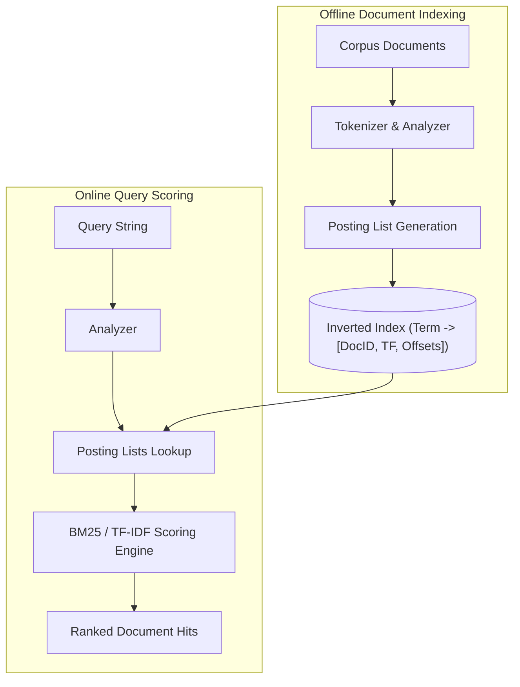
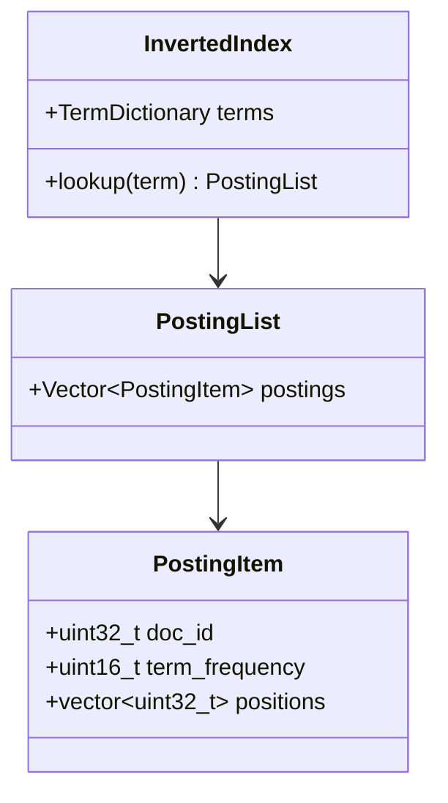
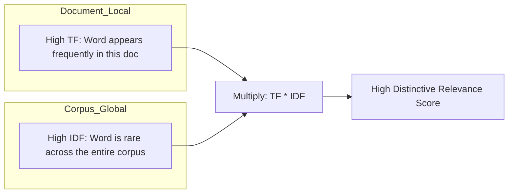
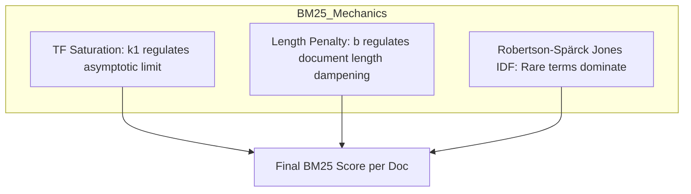
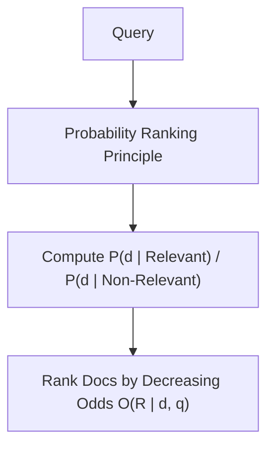
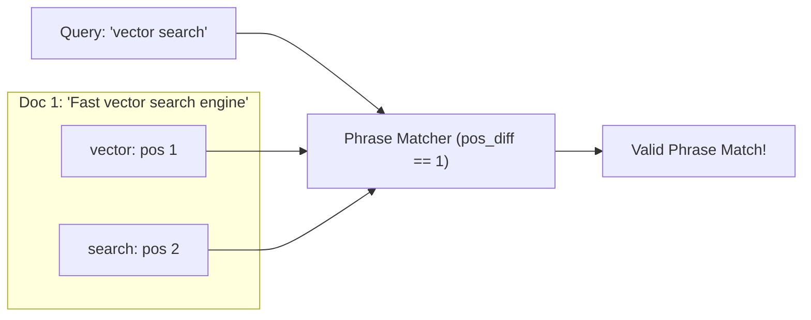

# Chuyên đề: Tìm kiếm Từ vựng & Mô hình Xác suất (Lexical & Probabilistic Search)

## 1. Tổng quan Chuyên đề
Tìm kiếm từ vựng (Lexical Search) và các mô hình truy xuất xác suất (Probabilistic Retrieval Models) là xương sống của các công cụ tìm kiếm văn bản kinh điển (Apache Lucene, Elasticsearch, OpenSearch). Ngay cả trong kỷ nguyên của Large Language Models và Dense Embeddings, các phương pháp từ vựng như **BM25** và **Inverted Index** vẫn giữ vai trò tối quan trọng nhờ tốc độ truy vấn cực nhanh, khả năng khớp chính xác các từ hiếm (out-of-vocabulary, mã sản phẩm, định danh ID), và khả năng diễn giải hoàn hảo mà các vector dày đặc không thể thay thế hoàn toàn.

Kiến trúc hoạt động của công cụ tìm kiếm từ vựng và chỉ mục đảo:



---

## 2. Chi tiết từng Keyword

---

### 1. Inverted Index (Chỉ mục Đảo)

#### a. Định nghĩa Bản chất Kỹ thuật & Toán học
**Inverted Index** (chỉ mục đảo) là một cấu trúc dữ liệu ánh xạ từ từng từ vựng (Term/Word $t \in \mathcal{V}$) tới một danh sách các tài liệu (Posting List) có chứa từ vựng đó:
$$\mathcal{I}(t) = \big\{ \langle d, f_{t, d}, [p_1, p_2, \dots] \rangle \mid t \in d \big\}$$
Trong đó:
- $d$: Document ID (số nguyên định danh tài liệu).
- $f_{t, d}$: Term frequency (tần suất xuất hiện của từ $t$ trong tài liệu $d$).
- $[p_1, p_2, \dots]$: Danh sách vị trí xuất hiện (positions/offsets) phục vụ tìm kiếm cụm từ (Phrase Search) và tính khoảng cách (Proximity Scoring).

#### b. Cơ chế Tầng Sâu & Kiến trúc Hệ thống (Internals)
1. **Từ điển (Term Dictionary)**: Chứa tất cả các từ duy nhất, thường được tổ chức dưới dạng FST (Finite State Transducer) hoặc Trie để tiết kiệm RAM và hỗ trợ tìm kiếm mờ (fuzzy search).
2. **Posting Lists trên Disk**: Nằm trong các file segment bất biến (như `.doc`, `.pos` trong Lucene).
3. **Kỹ thuật Nén Bộ nhớ**:
   - Thay vì lưu trực tiếp DocID tuyệt đối $[100, 105, 120]$, hệ thống lưu **Delta Gap (d-gaps)**: $[100, +5, +15]$.
   - Dùng các mã hóa biến thiên độ dài bit như **VByte (Variable Byte)** hoặc **SIMD-BP128 / PForDelta** để nén posting lists tới 70–80%, tối ưu hóa băng thông bộ nhớ và CPU L1/L2 cache.

#### c. Sơ đồ Minh họa


#### d. Code Thực chiến (C++ & Python)

```cpp
// C++20: Chỉ mục đảo nhỏ gọn với Term Dictionary và Posting Lists
#include <iostream>
#include <string>
#include <vector>
#include <unordered_map>
#include <sstream>

struct PostingEntry {
    uint32_t doc_id;
    uint32_t term_freq;
};

class CompactInvertedIndex {
    std::unordered_map<std::string, std::vector<PostingEntry>> index;
public:
    void add_document(uint32_t doc_id, const std::string& text) {
        std::unordered_map<std::string, uint32_t> local_counts;
        std::istringstream iss(text);
        std::string token;
        while (iss >> token) {
            for (char& c : token) c = std::tolower(c);
            local_counts[token]++;
        }
        for (const auto& [term, count] : local_counts) {
            index[term].push_back({doc_id, count});
        }
    }

    const std::vector<PostingEntry>* get_postings(const std::string& term) const {
        auto it = index.find(term);
        return (it != index.end()) ? &(it->second) : nullptr;
    }
};

int main() {
    CompactInvertedIndex idx;
    idx.add_document(1, "lucene and elasticsearch power modern search");
    idx.add_document(2, "vector search and lexical search hybrid");
    
    if (auto postings = idx.get_postings("search")) {
        std::cout << "Postings for 'search':\n";
        for (const auto& p : *postings) {
            std::cout << "  DocID: " << p.doc_id << ", TF: " << p.term_freq << "\n";
        }
    }
    return 0;
}
```

```python
# Python: Inverted Index hoàn chỉnh với delta compression
class InvertedIndexPy:
    def __init__(self):
        self.postings: dict[str, list[tuple[int, int]]] = {}

    def index_doc(self, doc_id: int, content: str):
        words = content.lower().split()
        tf_map = {}
        for w in words:
            tf_map[w] = tf_map.get(w, 0) + 1
        for word, tf in tf_map.items():
            self.postings.setdefault(word, []).append((doc_id, tf))

    def search_term(self, term: str) -> list[tuple[int, int]]:
        return self.postings.get(term.lower(), [])

idx = InvertedIndexPy()
idx.index_doc(10, "deep neural networks and retrieval")
idx.index_doc(12, "dense retrieval vs sparse retrieval")
print("Search term 'retrieval':", idx.search_term("retrieval"))
```

#### e. Lỗi Thường gặp & Tối ưu Hệ thống
- **Pitfall**: Posting list của từ phổ biến (như "the", "a") quá dài, làm chậm quá trình quét và tốn bộ nhớ RAM.
- **Tối ưu**: Lọc stop-words hoặc áp dụng thuật toán WAND (Weak AND) / Block-Max WAND để bỏ qua việc tính điểm trên các posting items không có tiềm năng đạt top-$K$.

#### f. Ứng dụng Thực chiến trong AI Systems
Trái tim của Elasticsearch, OpenSearch, Apache Lucene và module sparse indexing trong các vector database hiện đại (như Qdrant Sparse Vectors, Milvus).

---

### 2. Term Frequency (TF) & 3. Inverse Document Frequency (IDF) & 4. TF-IDF

#### a. Định nghĩa Bản chất Kỹ thuật & Toán học
Mô hình **TF-IDF** kết hợp hai yếu tố cơ bản để lượng hóa tầm quan trọng của một từ $t$ trong một tài liệu $d$ thuộc ngữ liệu $\mathcal{D}$:
1. **Term Frequency (TF)**: Đo lường mức độ xuất hiện cục bộ trong tài liệu:
   $$\text{TF}(t, d) = \frac{f_{t, d}}{\sum_{t' \in d} f_{t', d}} \quad \text{hoặc} \quad \text{TF}_{sublinear}(t, d) = 1 + \log(f_{t, d}) \quad (\text{nếu } f_{t,d} > 0)$$
2. **Inverse Document Frequency (IDF)**: Đo lường mức độ đặc trưng toàn cục của từ trong cả kho ngữ liệu $\mathcal{D}$ ($N = |\mathcal{D}|$):
   $$\text{IDF}(t, \mathcal{D}) = \log \frac{N}{|\{d \in \mathcal{D} : t \in d\}| + 1}$$
3. **TF-IDF Weight**: Tích số giữa mức độ quan trọng cục bộ và tính hiếm toàn cục:
   $$\text{TF-IDF}(t, d, \mathcal{D}) = \text{TF}(t, d) \times \text{IDF}(t, \mathcal{D})$$
   Điểm tương đồng giữa tài liệu $d$ và truy vấn $q$ qua véc-tơ TF-IDF trong không gian véc-tơ (Vector Space Model):
   $$\text{Score}(q, d) = \sum_{t \in q \cap d} \text{TF-IDF}(t, d, \mathcal{D}) \times \text{TF-IDF}(t, q, \mathcal{D})$$

#### b. Cơ chế Tầng Sâu & Kiến trúc Hệ thống
- Bản chất thông tin học: $\text{IDF}$ là thước đo nghịch đảo lượng thông tin của biến cố xuất hiện từ $t$: Từ càng xuất hiện ở nhiều tài liệu thì thông tin đem lại (Surprisal/Entropy) càng thấp.
- Trong tính toán phân tán (Distributed Search): $N$ và $DF(t)$ cần được đồng bộ toàn cục giữa các shard để tránh sai lệch IDF do phân vùng dữ liệu không đồng nhất.

#### c. Sơ đồ Minh họa


#### d. Code Thực chiến (C++ & Python)

```cpp
// C++17: Tính toán TF-IDF véc-tơ đơn giản
#include <iostream>
#include <vector>
#include <cmath>
#include <string>
#include <unordered_map>

double compute_tfidf(int tf, int doc_len, int total_docs, int doc_freq) {
    if (tf <= 0 || doc_freq <= 0) return 0.0;
    double tf_val = static_cast<double>(tf) / doc_len;
    double idf_val = std::log(static_cast<double>(total_docs) / (doc_freq + 1)) + 1.0;
    return tf_val * idf_val;
}

int main() {
    int total_docs = 100000;
    int df_rare = 20;     // Từ hiếm như "backpropagation"
    int df_common = 80000;// Từ thông dụng như "example"
    
    std::cout << "TF-IDF Rare: " << compute_tfidf(3, 100, total_docs, df_rare) << "\n";
    std::cout << "TF-IDF Common: " << compute_tfidf(3, 100, total_docs, df_common) << "\n";
    return 0;
}
```

```python
# Python: TF-IDF Scorer từ scratch bằng NumPy
import numpy as np
from collections import Counter

class SimpleTFIDF:
    def __init__(self, corpus: list[str]):
        self.corpus = [doc.lower().split() for doc in corpus]
        self.N = len(self.corpus)
        self.vocab = sorted(list(set(w for doc in self.corpus for w in doc)))
        self.word2idx = {w: i for i, w in enumerate(self.vocab)}
        self.idf = np.zeros(len(self.vocab))
        for w, idx in self.word2idx.items():
            df = sum(1 for doc in self.corpus if w in doc)
            self.idf[idx] = np.log((self.N + 1) / (df + 1)) + 1.0

    def transform(self, doc: str) -> np.ndarray:
        vec = np.zeros(len(self.vocab))
        counts = Counter(doc.lower().split())
        total = sum(counts.values()) or 1
        for w, count in counts.items():
            if w in self.word2idx:
                idx = self.word2idx[w]
                tf = count / total
                vec[idx] = tf * self.idf[idx]
        norm = np.linalg.norm(vec)
        return vec / norm if norm > 0 else vec

tfidf = SimpleTFIDF(["machine learning in python", "deep learning and neural networks"])
print("Vocab size:", len(tfidf.vocab))
```

#### e. Lỗi Thường gặp & Tối ưu Hệ thống
- **Pitfall**: Vấn đề tăng tuyến tính không bị chặn của TF truyền thống: Tài liệu lặp từ $t$ 100 lần sẽ có điểm gấp 100 lần tài liệu có 1 lần, dù giá trị liên quan không tăng tương ứng.
- **Tối ưu**: Sử dụng hàm bão hòa phi tuyến (như trong BM25).

#### f. Ứng dụng Thực chiến trong AI Systems
Tạo sparse vectors cho Splade, BM25, trích xuất từ khóa (keyword extraction) và feature engineering cho mô hình ML truyền thống.

---

### 5. BM25 (Best Matching 25)

#### a. Định nghĩa Bản chất Kỹ thuật & Toán học
**BM25** (Okapi BM25) là thuật toán xếp hạng phi tham số chuẩn công nghiệp hàng đầu dựa trên khung xác suất (Probabilistic Relevance Framework). Công thức tính điểm giữa truy vấn $q$ và tài liệu $d$:
$$\text{Score}_{BM25}(q, d) = \sum_{t \in q} \text{IDF}_{BM25}(t) \cdot \frac{f_{t, d} \cdot (k_1 + 1)}{f_{t, d} + k_1 \cdot \left(1 - b + b \cdot \frac{|d|}{\text{avgdl}}\right)}$$
Trong đó:
- $\text{IDF}_{BM25}(t) = \ln \left( \frac{N - n(t) + 0.5}{n(t) + 0.5} + 1 \right)$, với $n(t)$ là số tài liệu chứa từ $t$.
- $f_{t, d}$: Tần suất từ $t$ trong tài liệu $d$.
- $|d|$: Độ dài (số lượng từ) của tài liệu $d$; $\text{avgdl}$: Độ dài trung bình của toàn bộ tài liệu trong kho ngữ liệu.
- $k_1$: Tham số bão hòa tần suất từ (thường $k_1 \in [1.2, 2.0]$). Khi $f_{t, d} \to \infty$, giá trị tiệm cận về $(k_1 + 1)$.
- $b$: Tham số phạt độ dài tài liệu (thường $b \approx 0.75$). Khi $b=1$, phạt hoàn toàn theo tỷ lệ độ dài; khi $b=0$, bỏ qua độ dài tài liệu.

#### b. Cơ chế Tầng Sâu & Kiến trúc Hệ thống
- **Sự bão hòa phi tuyến của Term Frequency**: Khác với TF tuyến tính, khi một từ xuất hiện nhiều lần liên tiếp trong một văn bản, đạo hàm biên của điểm số $\frac{\partial \text{Score}}{\partial f}$ giảm dần về 0.
- **Length Normalization**: Tài liệu dài hơn có xác suất chứa từ cao hơn một cách ngẫu nhiên. Thành phần $\left(1 - b + b \cdot \frac{|d|}{\text{avgdl}}\right)$ điều chỉnh để không thiên vị các tài liệu dài dòng.

#### c. Sơ đồ Minh họa


#### d. Code Thực chiến (C++ & Python)

```cpp
// C++20: Thuật toán tính điểm Okapi BM25 chuẩn hóa
#include <iostream>
#include <cmath>
#include <vector>
#include <string>

class BM25Scorer {
    double k1;
    double b;
    double avgdl;
    size_t total_docs;

public:
    BM25Scorer(double k1_val, double b_val, double avg_doc_len, size_t n_docs)
        : k1(k1_val), b(b_val), avgdl(avg_doc_len), total_docs(n_docs) {}

    double idf(size_t doc_freq) const {
        return std::log((total_docs - doc_freq + 0.5) / (doc_freq + 0.5) + 1.0);
    }

    double score_term(int tf, size_t doc_len, size_t doc_freq) const {
        if (tf <= 0) return 0.0;
        double idf_val = idf(doc_freq);
        double len_norm = 1.0 - b + b * (static_cast<double>(doc_len) / avgdl);
        double tf_sat = (tf * (k1 + 1.0)) / (tf + k1 * len_norm);
        return idf_val * tf_sat;
    }
};

int main() {
    BM25Scorer bm25(1.5, 0.75, 200.0, 100000);
    std::cout << "BM25 score (rare term, tf=2, len=150): " << bm25.score_term(2, 150, 15) << "\n";
    std::cout << "BM25 score (rare term, tf=20, len=150): " << bm25.score_term(20, 150, 15) << "\n";
    return 0;
}
```

```python
# Python: Triển khai BM25 đơn giản cho danh sách văn bản
import math
from collections import Counter

class BM25:
    def __init__(self, corpus: list[list[str]], k1: float = 1.5, b: float = 0.75):
        self.k1 = k1
        self.b = b
        self.corpus = corpus
        self.corpus_size = len(corpus)
        self.doc_lens = [len(doc) for doc in corpus]
        self.avgdl = sum(self.doc_lens) / (self.corpus_size or 1)
        self.doc_freqs: dict[str, int] = {}
        for doc in corpus:
            for term in set(doc):
                self.doc_freqs[term] = self.doc_freqs.get(term, 0) + 1

    def get_scores(self, query: list[str]) -> list[float]:
        scores = [0.0] * self.corpus_size
        for term in query:
            if term not in self.doc_freqs:
                continue
            df = self.doc_freqs[term]
            idf = math.log((self.corpus_size - df + 0.5) / (df + 0.5) + 1.0)
            for i, doc in enumerate(self.corpus):
                tf = doc.count(term)
                if tf > 0:
                    len_norm = 1.0 - self.b + self.b * (self.doc_lens[i] / self.avgdl)
                    scores[i] += idf * (tf * (self.k1 + 1.0)) / (tf + self.k1 * len_norm)
        return scores

corpus = [["retrieval", "augmented", "generation"], ["vector", "search", "dense", "retrieval"]]
bm = BM25(corpus)
print("Scores for ['dense', 'retrieval']:", bm.get_scores(["dense", "retrieval"]))
```

#### e. Lỗi Thường gặp & Tối ưu Hệ thống
- **Negative IDF**: Trong công thức gốc, nếu $n(t) > N/2$ (từ xuất hiện trong hơn 50% số văn bản), IDF có thể bị âm.
- **Tối ưu**: Dùng công thức BM25 của Lucene với hàm $\ln(1 + \frac{N - n(t) + 0.5}{n(t) + 0.5})$ để đảm bảo IDF luôn không âm.

#### f. Ứng dụng Thực chiến trong AI Systems
Baseline chuẩn cho mọi bài toán IR; thành phần lexical trong Hybrid Search của Elasticsearch, Pinecone, Qdrant, Vespa.

---

### 6. Probabilistic Retrieval Models (Mô hình Truy xuất Xác suất)

#### a. Định nghĩa Bản chất Kỹ thuật & Toán học
**Probabilistic Retrieval Models** dựa trên **Nguyên lý Xếp hạng Xác suất (Probability Ranking Principle - PRP)** của Robertson (1977): *Hệ thống đạt hiệu quả tối ưu nếu nó xếp hạng các tài liệu theo thứ tự xác suất liên quan giảm dần đối với nhu cầu thông tin của người dùng*.
Hàm mục tiêu là tỷ lệ chênh lệch xác suất (Odds of Relevance):
$$O(R \mid d, q) = \frac{P(R=1 \mid d, q)}{P(R=0 \mid d, q)} = \frac{P(d \mid R=1, q)}{P(d \mid R=0, q)} \cdot \frac{P(R=1 \mid q)}{P(R=0 \mid q)}$$
Áp dụng giả định độc lập có điều kiện giữa các từ (Conditional Independence), ta thu được mô hình Binary Independence Model (BIM), là tiền thân toán học của BM25.

#### b. Cơ chế Tầng Sâu & Kiến trúc Hệ thống
BIM giả định mỗi tài liệu được mô tả bằng một véc-tơ nhị phân $\mathbf{x} = (x_1, \dots, x_M) \in \{0, 1\}^M$ biểu thị sự vắng/mặt của từ vựng:
$$\log O(R \mid d, q) = \sum_{i: x_i = 1, q_i = 1} \log \frac{p_i (1 - u_i)}{u_i (1 - p_i)} + C$$
Với $p_i = P(x_i = 1 \mid R=1)$, $u_i = P(x_i = 1 \mid R=0)$.

#### c. Sơ đồ Minh họa


#### d. Code Thực chiến (C++ & Python)

```cpp
// C++17: Mô hình Binary Independence Model (BIM) tính log-odds
#include <iostream>
#include <vector>
#include <cmath>

double compute_bim_rsv(const std::vector<int>& doc_term_present, const std::vector<double>& p, const std::vector<double>& u) {
    double rsv = 0.0;
    for (size_t i = 0; i < doc_term_present.size(); ++i) {
        if (doc_term_present[i]) {
            double weight = std::log((p[i] * (1.0 - u[i])) / (u[i] * (1.0 - p[i]) + 1e-9));
            rsv += weight;
        }
    }
    return rsv;
}
```

```python
# Python: PRP log-odds ranking
import numpy as np

def binary_independence_model_score(doc_binary: np.ndarray, p_i: np.ndarray, u_i: np.ndarray) -> float:
    weights = np.log((p_i * (1 - u_i)) / (u_i * (1 - p_i) + 1e-9))
    return float(np.sum(doc_binary * weights))
```

#### e. Lỗi Thường gặp & Tối ưu Hệ thống
- **Giả định độc lập không thực tế**: Trong thực tế, các từ phụ thuộc chặt chẽ vào nhau theo ngữ pháp và ngữ cảnh (ví dụ: "Hong" và "Kong").
- **Tối ưu**: Mở rộng bằng Language Models for IR (Unigram with Dirichlet Smoothing) hoặc Markov Random Fields (MRF).

#### f. Ứng dụng Thực chiến trong AI Systems
Nền móng lý thuyết cho phân loại rác (Spam Filtering), Active Learning trong Search, và các bộ lọc Bayes.

---

### 7. Lexical Search & 8. Full-Text Search (Tìm kiếm Từ vựng & Toàn văn)

#### a. Định nghĩa Bản chất Kỹ thuật & Toán học
- **Lexical Search**: Quá trình tìm kiếm khớp chính xác các token từ vựng giữa câu truy vấn và văn bản (Syntactic token matching) thông qua Inverted Index.
- **Full-Text Search (Tìm kiếm Toàn văn)**: Kỹ thuật quét và đánh giá toàn diện nội dung tài liệu văn bản, hỗ trợ các truy vấn nâng cao như:
  - *Phrase Matching*: Khớp thứ tự liền kề $\text{Pos}(t_2) = \text{Pos}(t_1) + 1$.
  - *Proximity Search*: Khớp trong khoảng cách $k$ từ $|\text{Pos}(t_2) - \text{Pos}(t_1)| \le k$.
  - *Wildcard & Fuzzy Search*: Khớp biểu thức `teach*` hoặc khoảng cách chỉnh sửa $\text{Levenshtein}(w_1, w_2) \le 2$.

#### b. Cơ chế Tầng Sâu & Kiến trúc Hệ thống
Full-Text Search Engine tổ chức posting lists có kèm **Position Offsets**:
Mỗi posting item lưu mảng `positions = [p1, p2, ...]`. Khi kiểm tra `query = "vector search"`:
Hệ thống nạp posting của "vector" và "search", dùng hai con trỏ kiểm tra điều kiện $pos_{search} - pos_{vector} == 1$.

#### c. Sơ đồ Minh họa


#### d. Code Thực chiến (C++ & Python)

```cpp
// C++20: Thuật toán so khớp cụm từ (Phrase Search) dựa trên Position Arrays
#include <iostream>
#include <vector>

bool verify_phrase_match(const std::vector<int>& pos1, const std::vector<int>& pos2) {
    size_t i = 0, j = 0;
    while (i < pos1.size() && j < pos2.size()) {
        if (pos1[i] + 1 == pos2[j]) return true;
        if (pos1[i] + 1 < pos2[j]) ++i;
        else ++j;
    }
    return false;
}

int main() {
    std::vector<int> positions_deep = {2, 10, 45};
    std::vector<int> positions_learning = {3, 20, 80}; // Khớp tại cặp (2, 3)
    std::cout << "Phrase 'deep learning' matched? " << (verify_phrase_match(positions_deep, positions_learning) ? "YES" : "NO") << "\n";
    return 0;
}
```

```python
# Python: Full-text Search Engine hỗ trợ Phrase Search
class MiniFullTextEngine:
    def __init__(self):
        # term -> {doc_id: [positions]}
        self.index: dict[str, dict[int, list[int]]] = {}

    def add_doc(self, doc_id: int, text: str):
        words = text.lower().split()
        for pos, w in enumerate(words):
            self.index.setdefault(w, {}).setdefault(doc_id, []).append(pos)

    def phrase_search(self, term1: str, term2: str) -> list[int]:
        p1_docs = self.index.get(term1.lower(), {})
        p2_docs = self.index.get(term2.lower(), {})
        matches = []
        for doc_id, pos1_list in p1_docs.items():
            if doc_id in p2_docs:
                pos2_list = p2_docs[doc_id]
                if any(p1 + 1 in pos2_list for p1 in pos1_list):
                    matches.append(doc_id)
        return matches

engine = MiniFullTextEngine()
engine.add_doc(1, "we build fast vector search engines")
engine.add_doc(2, "vector representations for search")
print("Phrase match 'vector search':", engine.phrase_search("vector", "search"))
```

#### e. Lỗi Thường gặp & Tối ưu Hệ thống
- **Vocabulary Mismatch Problem**: Người dùng tìm "buy automobile" nhưng tài liệu lại dùng "purchase car". Lexical search sẽ cho 0 kết quả vì không trùng token.
- **Tối ưu**: Kết hợp Hybrid Search (Lexical + Dense Vector) để bù trừ lẫn nhau.

#### f. Ứng dụng Thực chiến trong AI Systems
Dùng trong Elasticsearch, PostgreSQL Full-Text Search (`tsvector`, `tsquery`), và nhánh Keyword Search của AWS Kendra, Azure AI Search.
