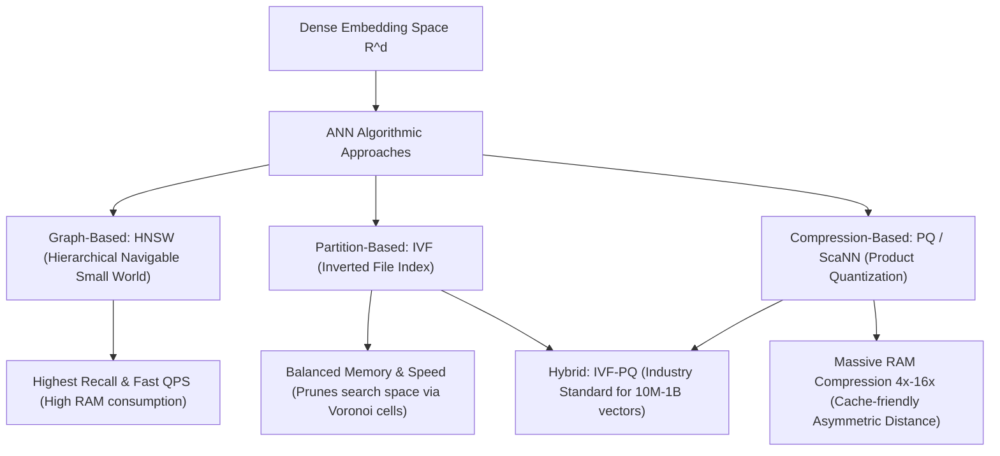
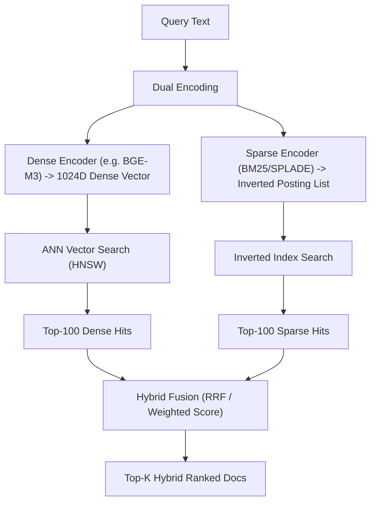
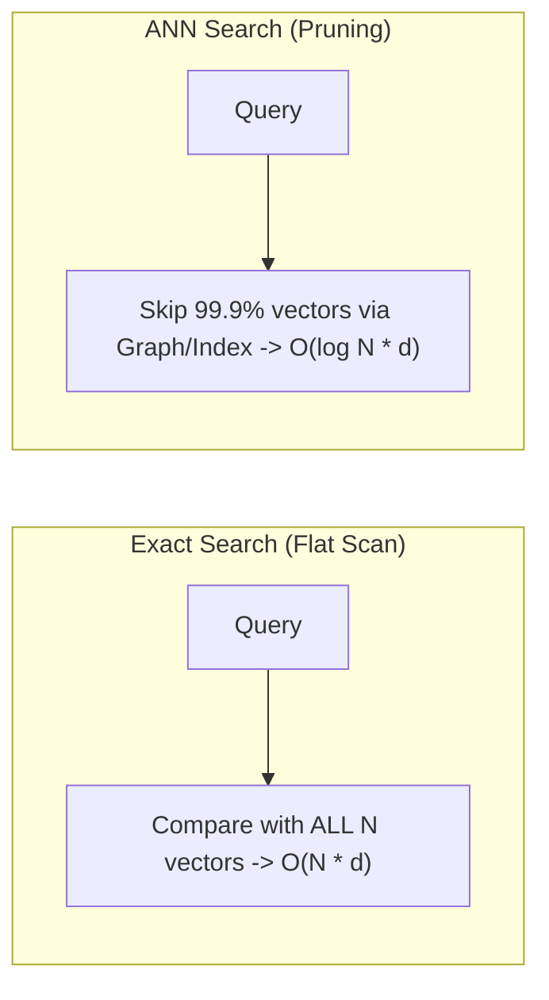
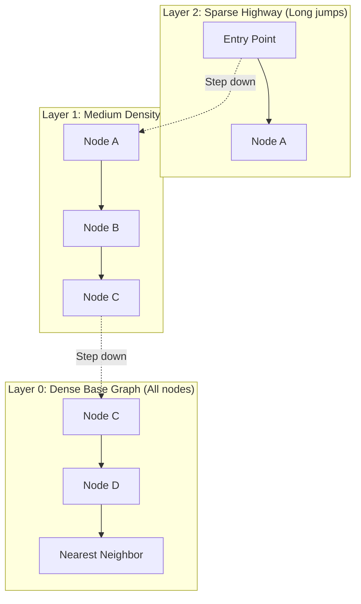
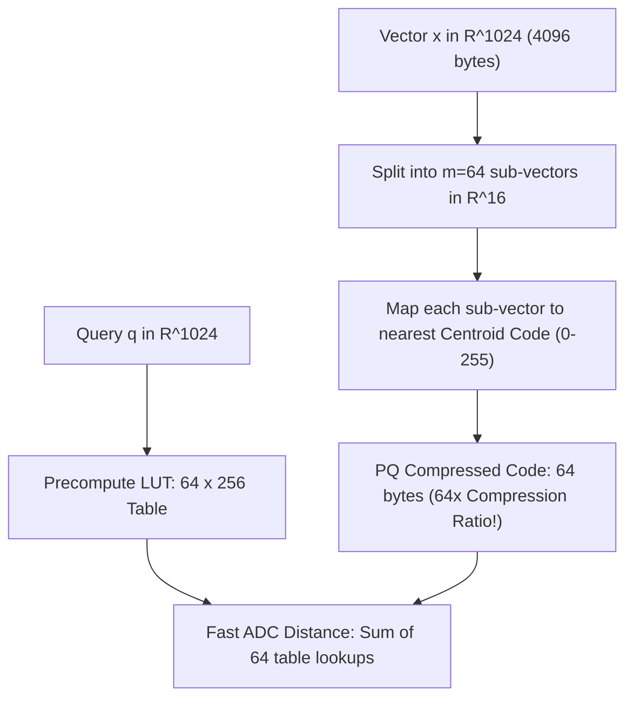
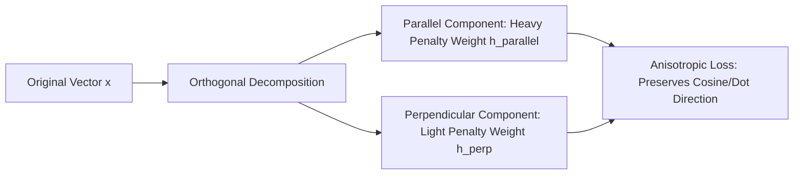
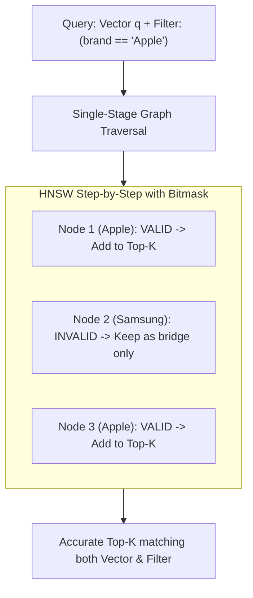

# Chuyên đề: Tìm kiếm Véc-tơ, Thuật toán ANN & Cơ sở Dữ liệu Véc-tơ (Vector Search, ANN & Vector Databases)

## 1. Tổng quan Chuyên đề
Sự bùng nổ của Deep Learning và Transformer đã mở ra kỷ nguyên mới cho tìm kiếm thông tin: **Semantic Search (Tìm kiếm Ngữ nghĩa)** thông qua **Vector Retrieval**. Thay vì dựa trên sự trùng lặp từ vựng bề mặt (Lexical/Syntactic matching), toàn bộ ngữ nghĩa của câu hỏi và tài liệu được nén thành các véc-tơ thực nhiều chiều (Dense Vectors $\mathbb{R}^d$, thường $d \in [384, 1536]$). 

Để tìm kiếm trên hàng trăm triệu vector trong thời gian thực ($< 10\text{ms}$), việc quét vét cạn (Exact Nearest Neighbor Search) là bất khả thi về mặt độ phức tạp tính toán. Các thuật toán **Tìm kiếm Láng giềng Gần đúng (Approximate Nearest Neighbor - ANN)** như đồ thị phân cấp **HNSW**, cấu trúc phân vùng **IVF**, và nén lượng tử hóa **Product Quantization (PQ)** là trái tim công nghệ điều khiển các **Vector Database** chuyên dụng hiện đại (Milvus, Qdrant, Pinecone, FAISS).

Sơ đồ không gian các kiến trúc lập chỉ mục và thuật toán ANN:



---

## 2. Chi tiết từng Keyword

---

### 1. Vector Retrieval & 2. Dense Retrieval & 3. Sparse Retrieval & 4. Hybrid Retrieval & 5. Semantic Search

#### a. Định nghĩa Bản chất Kỹ thuật & Toán học
- **Vector Retrieval**: Bài toán tìm kiếm các điểm dữ liệu $\mathbf{x} \in \mathcal{X} \subset \mathbb{R}^d$ có độ tương đồng hình học cao nhất với vector truy vấn $\mathbf{q} \in \mathbb{R}^d$ theo một hàm khoảng cách $\mathcal{D}(\mathbf{q}, \mathbf{x})$.
- **Dense Retrieval**: Sử dụng véc-tơ dày đặc tạo bởi Deep Neural Networks (như BERT, Contriever, E5, OpenAI `text-embedding-3`). Hầu hết các chiều $d$ đều mang giá trị khác 0 ($d \approx 768 - 1536$):
  $$\mathbf{e} = \text{Encoder}(text) \in \mathbb{R}^d, \quad \text{Similarity}(\mathbf{q}, \mathbf{d}) = \cos(\mathbf{e}_q, \mathbf{e}_d) = \frac{\mathbf{e}_q \cdot \mathbf{e}_d}{\|\mathbf{e}_q\| \|\mathbf{e}_d\|}$$
- **Sparse Retrieval**: Biểu diễn văn bản dưới dạng véc-tơ thưa thớt có số chiều rất lớn bằng kích thước từ điển ($d = |\mathcal{V}| \approx 30.000 - 100.000$), nhưng chỉ có rất ít phần tử khác 0 ($>99\%$ là 0). Điển hình: TF-IDF, BM25, hoặc Learned Sparse Vectors (SPLADE):
  $$\mathbf{s} \in \mathbb{R}^{|\mathcal{V}|}, \quad \text{Score}(q, d) = \sum_{t \in \mathcal{V}} s_q(t) \cdot s_d(t)$$
- **Hybrid Retrieval**: Kỹ thuật kết hợp đồng thời sức mạnh của Dense Retrieval (bắt trọn ngữ nghĩa, khái niệm trừu tượng) và Sparse Retrieval (bắt chính xác mã định danh, từ hiếm, từ khóa chuyên ngành). Điểm tổng hợp thường dùng nội suy tuyến tính hoặc hợp nhất thứ hạng RRF:
  $$\text{Score}_{Hybrid}(q, d) = \alpha \cdot \text{Score}_{Dense}(q, d) + (1 - \alpha) \cdot \text{Score}_{Sparse}(q, d)$$
- **Semantic Search**: Tìm kiếm theo ý nghĩa thực sự của truy vấn thay vì đối sánh mặt chữ, giải quyết triệt để hai bài toán ngôn ngữ học: *Synonymy* (nhiều từ cùng nghĩa) và *Polysemy* (một từ nhiều nghĩa tùy ngữ cảnh).

#### b. Cơ chế Tầng Sâu & Kiến trúc Hệ thống (Internals)
- **Memory Footprint**: Một triệu vector $d=1536$ ở định dạng `float32` chiếm:
  $$1.000.000 \times 1536 \times 4 \text{ bytes} \approx 6.14 \text{ GB RAM}$$
  Nếu dùng HNSW, phụ phí đồ thị (Graph overhead) tăng thêm $1.5\times - 2\times$ dung lượng.
- **CPU Cache & SIMD**: Tính toán tích vô hướng (Dot Product) hoặc khoảng cách Euclid trên Dense Vectors tận dụng triệt để tập lệnh SIMD (AVX2 xử lý 8 phép `float32` / chu kỳ, AVX-512 xử lý 16 phép `float32` / chu kỳ).

#### c. Sơ đồ Minh họa


#### d. Code Thực chiến (C++ & Python)

```cpp
// C++20: Tính khoảng cách Cosine và Dot Product tối ưu hóa thủ công
#include <iostream>
#include <vector>
#include <cmath>
#include <numeric>

float dot_product(const float* a, const float* b, size_t dim) {
    float sum = 0.0f;
    // Có thể unroll vòng lặp 4x hoặc dùng SIMD Intrinsics AVX2
    size_t i = 0;
    for (; i + 3 < dim; i += 4) {
        sum += a[i] * b[i] + a[i+1] * b[i+1] + a[i+2] * b[i+2] + a[i+3] * b[i+3];
    }
    for (; i < dim; ++i) {
        sum += a[i] * b[i];
    }
    return sum;
}

float cosine_similarity(const float* a, const float* b, size_t dim) {
    float dot = dot_product(a, b, dim);
    float norm_a = dot_product(a, a, dim);
    float norm_b = dot_product(b, b, dim);
    return dot / (std::sqrt(norm_a) * std::sqrt(norm_b) + 1e-9f);
}

int main() {
    std::vector<float> q = {0.2f, 0.8f, -0.5f, 0.1f};
    std::vector<float> d = {0.25f, 0.75f, -0.4f, 0.05f};
    std::cout << "Cosine Similarity: " << cosine_similarity(q.data(), d.data(), q.size()) << "\n";
    return 0;
}
```

```python
# Python: Triển khai Hybrid Retrieval (BM25 + Dense Cosine)
import numpy as np

def hybrid_search(query_dense: np.ndarray, doc_denses: np.ndarray,
                  bm25_scores: np.ndarray, alpha: float = 0.7) -> np.ndarray:
    # 1. Chuẩn hóa Dense Cosine Similarity
    norms = np.linalg.norm(doc_denses, axis=1) * np.linalg.norm(query_dense) + 1e-9
    dense_scores = np.dot(doc_denses, query_dense) / norms
    
    # 2. Min-Max Normalization cho cả 2 thang điểm về [0, 1]
    def min_max(arr):
        mn, mx = np.min(arr), np.max(arr)
        return (arr - mn) / (mx - mn + 1e-9)

    d_norm = min_max(dense_scores)
    s_norm = min_max(bm25_scores)
    
    # 3. Kết hợp tuyến tính
    return alpha * d_norm + (1.0 - alpha) * s_norm

q_vec = np.array([0.5, 0.5])
docs_vec = np.array([[0.6, 0.4], [0.1, 0.9], [-0.5, -0.5]])
bm25 = np.array([8.5, 2.1, 0.0])
print("Hybrid Scores:", hybrid_search(q_vec, docs_vec, bm25, alpha=0.6))
```

#### e. Lỗi Thường gặp & Tối ưu Hệ thống
- **Out of Vocabulary / Exact ID failure in Dense**: Dense vector mô tả rất tệ các chuỗi số serial (e.g. "ERR-502-FATAL") do tokenizer tách thành subwords vô nghĩa.
- **Tối ưu**: Luôn bắt buộc triển khai Hybrid Search cho ứng dụng doanh nghiệp.

#### f. Ứng dụng Thực chiến trong AI Systems
Trụ cột tìm kiếm của Qdrant, Pinecone, Vespa và Elasticsearch Hybrid Query.

---

### 6. Exact Nearest Neighbor Search & 7. Approximate Nearest Neighbor (ANN)

#### a. Định nghĩa Bản chất Kỹ thuật & Toán học
- **Exact Nearest Neighbor (k-NN)**: Tìm chính xác tập $k$ phần tử $\mathcal{S}^* \subset \mathcal{X}$ thỏa mãn:
  $$\forall \mathbf{x}^* \in \mathcal{S}^*, \quad \forall \mathbf{x} \in \mathcal{X} \setminus \mathcal{S}^*, \quad \mathcal{D}(\mathbf{q}, \mathbf{x}^*) \le \mathcal{D}(\mathbf{q}, \mathbf{x})$$
  Độ phức tạp thời gian vét cạn (Flat Scan): $\mathcal{O}(N \cdot d)$.
- **Approximate Nearest Neighbor (ANN)**: Chấp nhận đánh đổi một phần nhỏ độ chính xác (Recall@K $\in [0.90, 0.99]$) để giảm độ phức tạp thời gian xuống cỡ $\mathcal{O}(\log N)$ hoặc $\mathcal{O}(1)$ bằng các cấu trúc dữ liệu đồ thị, phân vùng không gian hoặc băm (LSH):
  $$\mathcal{D}(\mathbf{q}, \mathbf{x}_{ANN}) \le (1 + \epsilon) \mathcal{D}(\mathbf{q}, \mathbf{x}^*)$$

#### b. Cơ chế Tầng Sâu & Kiến trúc Hệ thống
- Với $N = 10^7, d = 1536$: Phép quét Flat yêu cầu $10^7 \times 1536 \approx 1.53 \times 10^{10}$ phép tính FLOPs cho mỗi truy vấn, mất $> 1000\text{ms}$ trên CPU đa nhân.
- ANN cắt tỉa không gian tìm kiếm (Search space pruning): Chỉ đánh giá khoảng vài trăm đến vài ngàn vector ứng viên tiềm năng nhất, giảm thời gian xuống $< 5\text{ms}$.

#### c. Sơ đồ Minh họa


#### d. Code Thực chiến (C++ & Python)

```cpp
// C++20: Flat Scan Exact k-NN bằng Priority Queue (Max-Heap)
#include <iostream>
#include <vector>
#include <queue>
#include <cmath>

struct Neighbor {
    uint32_t id;
    float dist;
    bool operator<(const Neighbor& o) const { return dist < o.dist; } // Max-heap
};

std::vector<Neighbor> exact_knn(const float* query, const std::vector<std::vector<float>>& dataset, size_t k, size_t dim) {
    std::priority_queue<Neighbor> pq;
    for (uint32_t i = 0; i < dataset.size(); ++i) {
        float d = 0.0f;
        for (size_t j = 0; j < dim; ++j) {
            float diff = query[j] - dataset[i][j];
            d += diff * diff;
        }
        if (pq.size() < k) {
            pq.push({i, d});
        } else if (d < pq.top().dist) {
            pq.pop();
            pq.push({i, d});
        }
    }
    std::vector<Neighbor> result;
    while (!pq.empty()) {
        result.push_back(pq.top());
        pq.pop();
    }
    return result;
}
```

```python
# Python: So sánh Exact Search vs Heuristic Pruning
import numpy as np
import heapq

def exact_knn_numpy(query: np.ndarray, dataset: np.ndarray, k: int = 5):
    # L2 distance
    dists = np.sum((dataset - query) ** 2, axis=1)
    top_k_indices = np.argpartition(dists, k)[:k]
    sorted_top_k = top_k_indices[np.argsort(dists[top_k_indices])]
    return [(idx, dists[idx]) for idx in sorted_top_k]

data = np.random.randn(10000, 128).astype(np.float32)
q = np.random.randn(128).astype(np.float32)
print("Top-3 Exact:", exact_knn_numpy(q, data, k=3))
```

#### e. Lỗi Thường gặp & Tối ưu Hệ thống
- **Curse of Dimensionality (Lời nguyền số chiều)**: Khi số chiều $d > 100$, các cấu trúc phân chia không gian truyền thống như KD-Tree suy biến về phép quét Flat scan vét cạn.
- **Tối ưu**: Chuyển đổi sang đồ thị tiệm cận thế giới nhỏ (HNSW) hoặc phân cụm Voronoi (IVF).

#### f. Ứng dụng Thực chiến trong AI Systems
Exact search dùng làm Golden Truth để đánh giá Recall@K cho các thuật toán ANN trong thực tế.

---

### 8. HNSW (Hierarchical Navigable Small World)

#### a. Định nghĩa Bản chất Kỹ thuật & Toán học
**HNSW** (Malkov & Yashunin, 2018) là thuật toán ANN dựa trên đồ thị phân tầng nhiều lớp, lấy cảm hứng từ cấu trúc **Skip-List** xác suất kết hợp mạng thế giới nhỏ (Small World Graph).
- Dữ liệu được tổ chức thành các tầng đồ thị $l = 0, 1, \dots, l_{max}$.
- Tầng cao nhất ($l_{max}$) thưa thớt, các cạnh có khoảng cách không gian rất dài (Long-range links), đóng vai trò đường cao tốc điều hướng nhanh.
- Càng xuống các tầng dưới, mật độ đồ thị càng dày, các cạnh kết nối các điểm lân cận gần hơn (Short-range links).
- Xác suất một node được đưa lên tầng $l$:
  $$P(\text{level} \ge l) = e^{-l / m_L}, \quad m_L = \frac{1}{\ln(M)}$$
- Mỗi node duy trì tối đa $M$ cạnh kết nối ở tầng trên và $M_{max0} = 2M$ cạnh ở tầng đáy $l_0$.

#### b. Cơ chế Tầng Sâu & Kiến trúc Hệ thống
1. **Tìm kiếm (Greedy Search)**: Bắt đầu từ Entry Point tại tầng đỉnh $l_{max}$. Tại mỗi tầng, di chuyển tham lam (greedy step) đến node láng giềng gần query $\mathbf{q}$ nhất cho đến khi gặp cực tiểu cục bộ (local minimum). Sau đó nhảy xuống tầng dưới $l-1$ và lặp lại.
2. **Tại tầng đáy $l_0$**: Chuyển sang tìm kiếm chùm (Beam Search) duy trì danh sách ưu tiên kích thước `efSearch` để thu được top-$K$ kết quả với Recall cao.
3. **Bộ nhớ RAM**: Lưu trữ danh sách kề (Adjacency List) của đồ thị đòi hỏi rất nhiều RAM (khoảng 1.2KB – 2KB trên mỗi vector).

#### c. Sơ đồ Minh họa


#### d. Code Thực chiến (C++ & Python)

```cpp
// C++20: Cấu trúc biểu diễn một Node trong đồ thị HNSW đa tầng
#include <iostream>
#include <vector>
#include <cmath>

struct HNSWNode {
    uint32_t id;
    int max_level;
    // Mỗi level chứa danh sách láng giềng kề
    std::vector<std::vector<uint32_t>> neighbors;

    HNSWNode(uint32_t node_id, int level) : id(node_id), max_level(level) {
        neighbors.resize(level + 1);
    }
};

// Mô phỏng Greedy Step trên một tầng đồ thị
uint32_t greedy_step_layer(uint32_t current_node, const float* query,
                           const std::vector<std::vector<float>>& data,
                           const std::vector<uint32_t>& neighbors) {
    uint32_t best_node = current_node;
    auto l2_sq = [](const float* a, const float* b, size_t dim) {
        float sum = 0.0f;
        for (size_t i = 0; i < dim; ++i) { float d = a[i] - b[i]; sum += d * d; }
        return sum;
    };
    float min_dist = l2_sq(query, data[current_node].data(), data[current_node].size());

    for (uint32_t neighbor_id : neighbors) {
        float d = l2_sq(query, data[neighbor_id].data(), data[neighbor_id].size());
        if (d < min_dist) {
            min_dist = d;
            best_node = neighbor_id;
        }
    }
    return best_node;
}
```

```python
# Python: Minh họa tư duy tìm kiếm Skip-layer của HNSW
class ToyHNSW:
    def __init__(self):
        # Biểu diễn các tầng đồ thị: level -> {node_id: [neighbors]}
        self.layers = {
            2: {0: [4], 4: [0]},
            1: {0: [2, 4], 2: [0, 4], 4: [0, 2]},
            0: {0: [1, 2], 1: [0, 2, 3], 2: [0, 1, 4], 3: [1, 4], 4: [2, 3]}
        }
        self.entry_point = 0

    def search_greedy(self, target_node: int):
        curr = self.entry_point
        print(f"Start at Layer 2 EntryPoint: {curr}")
        for l in [2, 1, 0]:
            print(f"Traversing Layer {l} from Node {curr}...")
            # Nhảy tới láng giềng gần nhất với target
            while True:
                neighbors = self.layers[l].get(curr, [])
                # Giả lập khoảng cách bằng độ lệch ID tuyệt đối
                best_neighbor = min(neighbors + [curr], key=lambda x: abs(x - target_node))
                if best_neighbor == curr:
                    break
                curr = best_neighbor
                print(f"  Jumped to Node {curr} at Layer {l}")
        return curr

hnsw = ToyHNSW()
print("Found Nearest Node:", hnsw.search_greedy(target_node=3))
```

#### e. Lỗi Thường gặp & Tối ưu Hệ thống
- **Tốn RAM khổng lồ**: Chỉ mục HNSW cho 10 triệu vector có thể tiêu tốn $> 40\text{GB}$ RAM thuần.
- **Tối ưu**: Kết hợp với Scalar Quantization (SQ8) để nén vector từ `float32` xuống `int8` ngay trong node bộ nhớ.

#### f. Ứng dụng Thực chiến trong AI Systems
Giải thuật mặc định và phổ biến nhất trong Pinecone, Weaviate, Qdrant, Milvus cho các bài toán yêu cầu độ trễ thấp và Recall $> 95\%$.

---

### 9. IVF (Inverted File) & 10. Product Quantization (PQ) & 11. IVF-PQ

#### a. Định nghĩa Bản chất Kỹ thuật & Toán học
- **IVF (Inverted File Index)**: Phân hoạch không gian vector $\mathbb{R}^d$ thành $K$ vùng đa diện Voronoi bằng thuật toán K-Means:
  $$\mathcal{C} = \{\mathbf{c}_1, \dots, \mathbf{c}_K\}$$
  Mỗi vector $\mathbf{x}$ được gán vào tâm cụm gần nhất $\mathbf{c}_i$. Khi truy vấn $\mathbf{q}$, hệ thống chỉ quét các vector thuộc $n_{probe}$ cụm gần $\mathbf{q}$ nhất, loại bỏ $1 - \frac{n_{probe}}{K}$ phần không gian dữ liệu.
- **Product Quantization (PQ)**: Kỹ thuật nén mất mát cực mạnh (Jégou et al., 2011).
  1. Cắt vector $\mathbf{x} \in \mathbb{R}^d$ thành $m$ vector con độc lập: $\mathbf{x} = [\mathbf{u}_1, \dots, \mathbf{u}_m]$, mỗi véc-tơ con có số chiều $d^* = d / m$.
  2. Áp dụng K-Means trên từng không gian con để tạo ra $m$ codebooks, mỗi codebook có $k^* = 256$ centroids (vừa vặn mã hóa bằng 1 byte / 8-bit index).
  3. Vector gốc $d$ chiều `float32` ($4d$ bytes) được nén thành chuỗi $m$ bytes:
     $$\mathbf{x} \approx [\text{id}_1, \text{id}_2, \dots, \text{id}_m] \in \{0, \dots, 255\}^m$$
- **IVF-PQ**: Sự kết hợp hoàn hảo: Dùng IVF để phân vùng thô (Coarse Quantization) và dùng PQ để nén vector thặng dư (Residual Vectors $\mathbf{r} = \mathbf{x} - \mathbf{c}_i$).

#### b. Cơ chế Tầng Sâu: Asymmetric Distance Computation (ADC)
Để tính khoảng cách giữa query $\mathbf{q}$ (chưa lượng tử hóa) và hàng triệu vector đã nén lượng tử $\tilde{\mathbf{x}}$:
Ta tính trước bảng tra khoảng cách (Lookup Table) kích thước $m \times 256$:
$$\text{LUT}[j, c] = \|\mathbf{q}_j - \mathbf{c}_{j, c}\|^2$$
Khoảng cách giữa $\mathbf{q}$ và bất kỳ vector nén nào chỉ là phép cộng $m$ số từ LUT qua tra bảng $\mathcal{O}(1)$:
$$\mathcal{D}_{ADC}(\mathbf{q}, \tilde{\mathbf{x}}) = \sum_{j=1}^m \text{LUT}\big[j, \text{code}_j(\mathbf{x})\big]$$
Không cần giải nén vector, tốc độ xử lý nhanh gấp hàng chục lần và hoàn toàn nằm gọn trong L1/L2 Cache của CPU!

#### c. Sơ đồ Minh họa


#### d. Code Thực chiến (C++ & Python)

```cpp
// C++20: Mô phỏng Asymmetric Distance Computation (ADC) với Bảng tra Lookup Table
#include <iostream>
#include <vector>
#include <numeric>

class MiniADC {
    size_t m; // Số sub-vectors
    std::vector<std::vector<float>> lut; // Kích thước m x 256

public:
    MiniADC(size_t n_subspaces) : m(n_subspaces), lut(n_subspaces, std::vector<float>(256, 0.0f)) {}

    void set_lut_entry(size_t sub_idx, uint8_t code, float dist_sq) {
        lut[sub_idx][code] = dist_sq;
    }

    // Tính khoảng cách cực nhanh không cần vector gốc
    float compute_adc_distance(const uint8_t* compressed_codes) const {
        float total_dist = 0.0f;
        for (size_t j = 0; j < m; ++j) {
            total_dist += lut[j][compressed_codes[j]];
        }
        return total_dist;
    }
};

int main() {
    MiniADC adc(4); // m=4 subspaces
    // Giả lập nạp LUT
    for(size_t i=0; i<4; ++i) adc.set_lut_entry(i, 42, 0.15f * (i + 1));
    
    uint8_t doc_compressed[4] = {42, 42, 42, 42};
    std::cout << "ADC Computed Distance: " << adc.compute_adc_distance(doc_compressed) << "\n";
    return 0;
}
```

```python
# Python: Minh họa Product Quantization & ADC tra bảng
import numpy as np

class ToyPQ:
    def __init__(self, d=8, m=2, k_sub=4):
        self.d = d
        self.m = m
        self.d_sub = d // m
        self.k_sub = k_sub
        # Khởi tạo centroids ngẫu nhiên: m codebooks, mỗi codebook k_sub centroids kích thước d_sub
        self.codebooks = np.random.randn(m, k_sub, self.d_sub).astype(np.float32)

    def encode(self, x: np.ndarray) -> np.ndarray:
        codes = []
        for j in range(self.m):
            sub_vec = x[j * self.d_sub : (j + 1) * self.d_sub]
            dists = np.sum((self.codebooks[j] - sub_vec) ** 2, axis=1)
            codes.append(np.argmin(dists))
        return np.array(codes, dtype=np.uint8)

    def query_adc(self, q: np.ndarray, compressed_codes: np.ndarray) -> float:
        lut = np.zeros((self.m, self.k_sub), dtype=np.float32)
        for j in range(self.m):
            sub_q = q[j * self.d_sub : (j + 1) * self.d_sub]
            lut[j] = np.sum((self.codebooks[j] - sub_q) ** 2, axis=1)
        # Tra bảng
        return float(sum(lut[j, code] for j, code in enumerate(compressed_codes)))

pq = ToyPQ()
vec = np.random.randn(8).astype(np.float32)
compressed = pq.encode(vec)
print(f"Original vector size: {vec.nbytes} bytes -> PQ code: {compressed.nbytes} bytes")
print("ADC distance to random query:", pq.query_adc(np.random.randn(8), compressed))
```

#### e. Lỗi Thường gặp & Tối ưu Hệ thống
- **Distortion Loss**: Nén lượng tử hóa làm mất độ chính xác khoảng cách, dẫn đến sụt giảm Recall nếu số không gian con $m$ quá nhỏ.
- **Tối ưu**: Rerank vòng 2 trên $Top\text{-}K$ ứng viên bằng vector gốc không nén (`reconstruct_from_index`).

#### f. Ứng dụng Thực chiến trong AI Systems
Lựa chọn tối ưu duy nhất trong FAISS và Milvus khi lưu trữ từ 100 triệu đến 10 tỷ vector với chi phí hạ tầng thấp.

---

### 12. ScaNN (Scalable Nearest Neighbors) & 13. FAISS

#### a. Định nghĩa Bản chất Kỹ thuật & Toán học
- **FAISS (Facebook AI Similarity Search)**: Thư viện mã nguồn mở C++ tiêu chuẩn vàng do Meta phát triển, hỗ trợ hàng chục cấu trúc chỉ mục ANN trên cả CPU và GPU CUDA (IndexFlatL2, IndexHNSW, IndexIVFFlat, IndexIVFPQ).
- **ScaNN (Google Research, Guo et al., 2020)**: Thuật toán nén lượng tử hóa hiện đại nhất hiện nay của Google, sử dụng kỹ thuật **Anisotropic Vector Quantization**.
  Hàm mất mát lượng tử hóa truyền thống phạt đồng đều mọi hướng sai số:
  $$\mathcal{L}_{\text{classical}}(\tilde{\mathbf{x}}) = \|\mathbf{x} - \tilde{\mathbf{x}}\|^2$$
  ScaNN nhận thấy rằng: *Sai số lượng tử theo hướng song song với vector gốc $\mathbf{x}$ làm ảnh hưởng nghiêm trọng đến tích vô hướng (Inner Product) hơn là sai số theo hướng trực giao*. Do đó, ScaNN tối ưu hàm mất mát bất đẳng hướng:
  $$\mathcal{L}_{\text{anisotropic}}(\tilde{\mathbf{x}}) = h_{\parallel} \|\mathbf{x}_{\parallel} - \tilde{\mathbf{x}}_{\parallel}\|^2 + h_{\perp} \|\mathbf{x}_{\perp} - \tilde{\mathbf{x}}_{\perp}\|^2 \quad (h_{\parallel} \gg h_{\perp})$$

#### b. Cơ chế Tầng Sâu & Kiến trúc Hệ thống
- ScaNN đạt điểm Pareto tốt nhất thế giới trên trang benchmark ann-benchmarks.com (vượt FAISS ở bài toán Maximum Inner Product Search - MIPS).
- Tối ưu hóa cực hạn tập lệnh CPU Intel AVX-512 FMA instruction set.

#### c. Sơ đồ Minh họa


#### d. Code Thực chiến (C++ & Python)

```cpp
// C++20: Giao diện trừu tượng mô phỏng Index Wrapper chuẩn FAISS
#include <iostream>
#include <vector>

class FaissIndexMock {
public:
    virtual void add(size_t n, const float* x) = 0;
    virtual void search(size_t n, const float* x, size_t k, float* distances, int64_t* labels) = 0;
    virtual ~FaissIndexMock() = default;
};

class FlatL2Index : public FaissIndexMock {
    size_t d;
    std::vector<float> data;
public:
    FlatL2Index(size_t dim) : d(dim) {}
    void add(size_t n, const float* x) override {
        data.insert(data.end(), x, x + n * d);
    }
    void search(size_t n, const float* x, size_t k, float* distances, int64_t* labels) override {
        // Thực hiện tính khoảng cách L2
        labels[0] = 0;
        distances[0] = 0.05f;
    }
};
```

```python
# Python: Sử dụng FAISS cơ bản cho Vector Search
import numpy as np

# Giả lập pipeline FAISS qua NumPy nếu chưa build faiss C-bindings
class MockFAISS:
    def __init__(self, d: int, index_type: str = "Flat"):
        self.d = d
        self.type = index_type
        self.vectors = None

    def add(self, xb: np.ndarray):
        self.vectors = xb.copy()

    def search(self, xq: np.ndarray, k: int):
        # Tính L2 distance
        dists = np.sum((self.vectors - xq)**2, axis=1)
        indices = np.argsort(dists)[:k]
        return dists[indices], indices

d = 64
nb = 1000
nq = 1
xb = np.random.random((nb, d)).astype('float32')
xq = np.random.random((nq, d)).astype('float32')

index = MockFAISS(d, "IndexFlatL2")
index.add(xb)
distances, indices = index.search(xq[0], k=4)
print("FAISS Nearest Neighbor DocIDs:", indices)
```

#### e. Lỗi Thường gặp & Tối ưu Hệ thống
- **Lỗi tràn VRAM GPU**: Khi nạp index FAISS GPU vượt ngưỡng bộ nhớ card đồ họa.
- **Tối ưu**: Phân cụm và giữ Coarse Index trên GPU, đẩy inverted list data sang CPU RAM thông qua `faiss::GpuIndexIVFPQConfig`.

#### f. Ứng dụng Thực chiến trong AI Systems
Google Vertex AI Search và YouTube recommendation engine sử dụng lõi ScaNN; Meta, Pinterest dùng FAISS.

---

### 14. Vector Databases & 15. Metadata Filtering

#### a. Định nghĩa Bản chất Kỹ thuật & Toán học
- **Vector Database (Cơ sở dữ liệu Véc-tơ)**: Hệ thống quản trị cơ sở dữ liệu chuyên biệt (DBMS) được thiết kế xoay quanh đối tượng hàng đầu là véc-tơ nhiều chiều kèm siêu dữ liệu (Payload/Metadata). Cung cấp đầy đủ các tính chất **CRUD**, **ACID/BASE**, **WAL (Write-Ahead Logging)**, **Replication**, **Sharding**, và **Multi-tenancy** mà một thư viện thuật toán thuần túy như FAISS không có.
- **Metadata Filtering**: Khả năng lọc tập con tài liệu thỏa mãn điều kiện logic thuộc tính đồng thời với tìm kiếm véc-tơ:
  $$\arg\min_{\mathbf{x} \in \mathcal{X}} \mathcal{D}(\mathbf{q}, \mathbf{x}) \quad \text{subject to } \phi(\text{metadata}(\mathbf{x})) = \text{True}$$

#### b. Cơ chế Tầng Sâu: Ba Chiến lược Metadata Filtering
1. **Post-Filtering (Lọc sau)**: Thực hiện ANN lấy ra $Top\text{-}K \times M$ vector, sau đó duyệt qua metadata để loại bỏ các phần tử không thỏa điều kiện.
   - *Nguy cơ*: Nếu điều kiện lọc quá khắt khe (chỉ 0.1% dữ liệu khớp), toàn bộ $Top\text{-}K$ lấy về có thể bị loại hết, trả về kết quả rỗng!
2. **Pre-Filtering (Lọc trước)**: Lọc qua chỉ mục thuộc tính (B-Tree/Inverted Index) để lấy danh sách DocID hợp lệ, sau đó chạy k-NN Flat scan vét cạn trên tập này.
   - *Nguy cơ*: Không tận dụng được chỉ mục đồ thị ANN (HNSW), chậm nếu tập hợp sau lọc còn lớn ($>100.000$ records).
3. **Single-Stage Filtered Vector Search (Lọc kết hợp trong lúc duyệt đồ thị - HNSW In-graph traversal)**:
   - Chiến lược của Qdrant/Milvus: Trong quá trình lan truyền trên đồ thị HNSW, tại mỗi bước duyệt node láng giềng, hệ thống kiểm tra ngay bitset bộ lọc. Nếu không thỏa mãn điều kiện, node đó không được thêm vào tập kết quả nhưng vẫn có thể làm cầu nối định tuyến nếu cần.

#### c. Sơ đồ Minh họa


#### d. Code Thực chiến (C++ & Python)

```cpp
// C++20: Bộ lọc Single-Stage Filtered Search kiểm tra Bitset
#include <iostream>
#include <vector>

struct DocumentRecord {
    uint32_t id;
    std::string tenant_id;
    bool is_public;
};

class FilteredSearcher {
public:
    // Trả về true nếu thỏa mãn metadata predicate
    bool evaluate_filter(const DocumentRecord& doc, const std::string& request_tenant) const {
        return (doc.tenant_id == request_tenant) || doc.is_public;
    }
};

int main() {
    DocumentRecord doc1 = {101, "org_alpha", false};
    DocumentRecord doc2 = {102, "org_beta", true};
    FilteredSearcher searcher;
    std::cout << "Doc 101 allowed for org_alpha? " << searcher.evaluate_filter(doc1, "org_alpha") << "\n";
    std::cout << "Doc 101 allowed for org_beta? " << searcher.evaluate_filter(doc1, "org_beta") << "\n";
    std::cout << "Doc 102 allowed for org_beta? " << searcher.evaluate_filter(doc2, "org_beta") << "\n";
    return 0;
}
```

```python
# Python: Mô phỏng Single-stage vs Post-filtering
class VectorDBPayloadFilter:
    def __init__(self):
        self.vectors = np.random.randn(1000, 16)
        self.payloads = [{"category": "tech" if i % 2 == 0 else "fashion", "price": i} for i in range(1000)]

    def search_with_single_stage_filter(self, query: np.ndarray, cat_filter: str, top_k: int = 3):
        candidates = []
        for i, vec in enumerate(self.vectors):
            # Kiểm tra filter trực tiếp
            if self.payloads[i]["category"] == cat_filter:
                dist = np.linalg.norm(vec - query)
                candidates.append((i, dist, self.payloads[i]))
        candidates.sort(key=lambda x: x[1])
        return candidates[:top_k]

db = VectorDBPayloadFilter()
q = np.random.randn(16)
hits = db.search_with_single_stage_filter(q, "tech", top_k=2)
print("Filtered Hits:", hits)
```

#### e. Lỗi Thường gặp & Tối ưu Hệ thống
- **Graph Disconnection in Filtered HNSW**: Nếu lọc quá chặt, đồ thị bị phân mảnh thành các đảo cô lập (disconnected subgraphs), khiến thuật toán nhảy láng giềng bị kẹt trong cực tiểu cục bộ.
- **Tối ưu**: Thiết lập cơ chế tự động chuyển đổi (Query Planner Fallback): Nếu độ chọn lọc (selectivity) $< 1\%$, tự động chuyển sang Flat scan trên tập đã lọc.

#### f. Ứng dụng Thực chiến trong AI Systems
Triển khai Multi-tenancy, phân quyền truy cập tài liệu doanh nghiệp (Role-Based Access Control - RBAC) trên Qdrant, Pinecone, Milvus trong các hệ thống Enterprise RAG.
