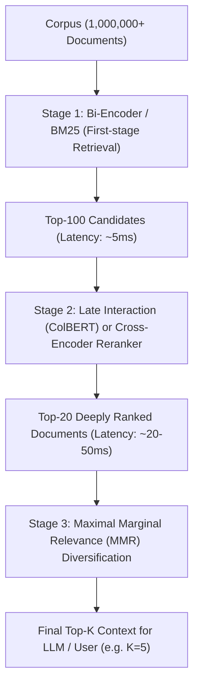
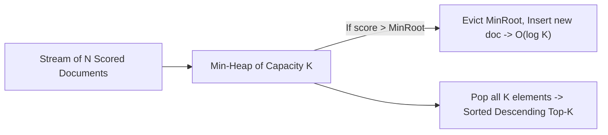
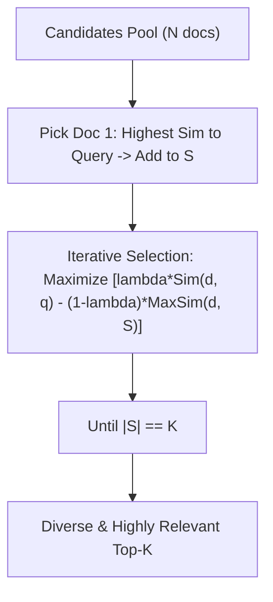
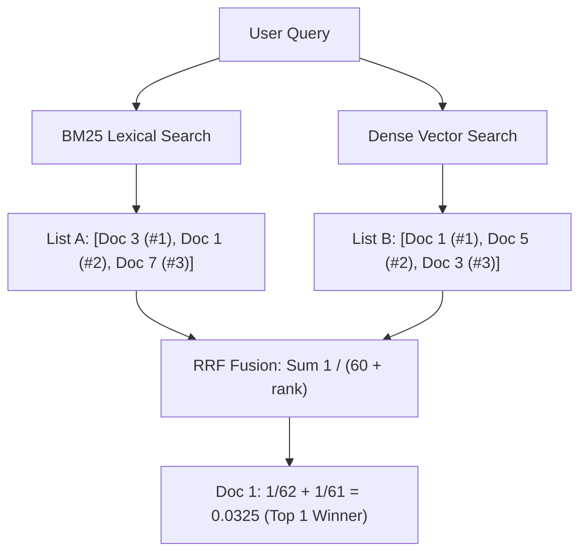
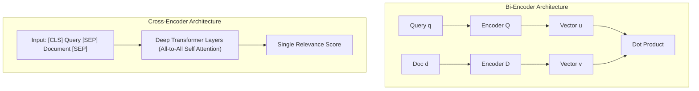
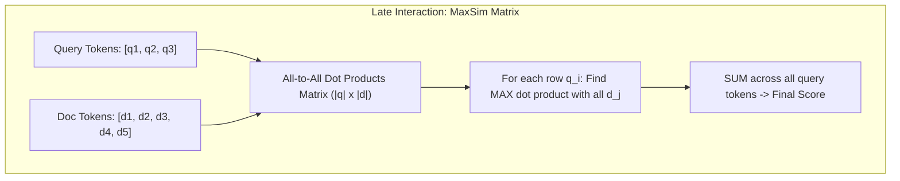
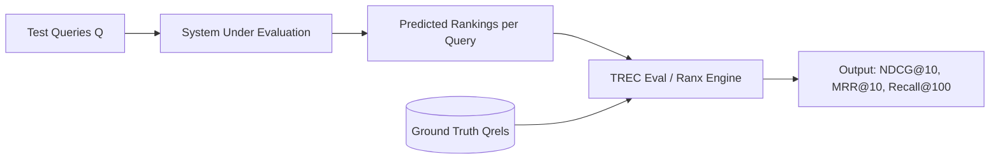
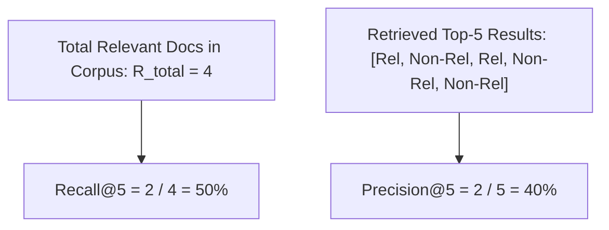
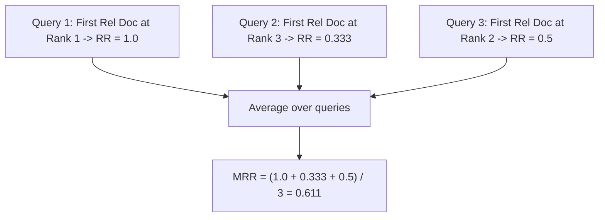
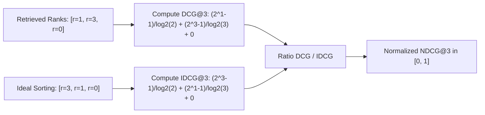

# Chuyên đề: Xếp hạng, Tương tác Trễ & Độ đo Đánh giá Truy xuất (Ranking, Late Interaction & Evaluation Metrics)

## 1. Tổng quan Chuyên đề
Giai đoạn lấy ứng viên ban đầu (First-stage retrieval) thường ưu tiên tốc độ quét để chọn ra từ vài chục đến vài trăm tài liệu từ hàng triệu dữ liệu thô. Tuy nhiên, để đáp ứng chất lượng trả lời cho người dùng hoặc cung cấp ngữ cảnh chính xác cao nhất cho mô hình sinh LLM, hệ thống bắt buộc phải trải qua pha **Xếp hạng & Tinh chỉnh (Reranking & Selection)**.

Chương này đi sâu vào toàn bộ hệ sinh thái xếp hạng đa tầng: từ mô hình **Bi-Encoder** tốc độ cao, tương tác trễ token **Late Interaction (ColBERT)**, đến mô hình tái xếp hạng sâu sắc **Cross-Encoder**, các giải thuật đa dạng hóa **MMR**, hợp nhất đa nguồn **RRF**, cùng hệ thống các độ đo đánh giá truy xuất chuẩn mực quốc tế (**Recall@K, MRR, MAP, NDCG**).

Kiến trúc phễu đa tầng của một Search / RAG Engine chuẩn mực:



---

## 2. Chi tiết từng Keyword

---

### 1. Similarity Search & 2. Top-K Retrieval

#### a. Định nghĩa Bản chất Kỹ thuật & Toán học
- **Similarity Search (Tìm kiếm Độ tương đồng)**: Bài toán tìm các tài liệu $d \in \mathcal{D}$ có điểm tương quan $\text{Sim}(q, d)$ cao nhất theo một hàm mêtric (như Cosine Similarity, Inner Product, hoặc L2 Distance):
  $$\text{CosineSim}(\mathbf{q}, \mathbf{d}) = \frac{\mathbf{q} \cdot \mathbf{d}}{\|\mathbf{q}\|_2 \|\mathbf{d}\|_2} \in [-1, 1]$$
- **Top-K Retrieval**: Trích xuất chính xác một tập con có thứ tự $\mathcal{R}_K = (d_{(1)}, d_{(2)}, \dots, d_{(K)})$ sao cho:
  $$\forall i \le K, \quad \forall d' \in \mathcal{D} \setminus \mathcal{R}_K, \quad \text{Sim}(q, d_{(i)}) \ge \text{Sim}(q, d')$$
  Độ phức tạp lựa chọn: $\mathcal{O}(N \log K)$ thông qua cấu trúc Min-Heap kích thước $K$.

#### b. Cơ chế Tầng Sâu & Kiến trúc Hệ thống
Để tìm Top-$K$ trên danh sách $N$ phần tử:
- Không bao giờ gọi `std::sort` toàn bộ $\mathcal{O}(N \log N)$ vì sẽ gây lãng phí bộ nhớ và cache misses.
- Dùng **Min-Heap (Priority Queue)** kích thước cố định $K$: Nếu phần tử mới có điểm lớn hơn đỉnh heap, đẩy đỉnh heap ra và nạp phần tử mới vào với chi phí $\mathcal{O}(\log K)$.

#### c. Sơ đồ Minh họa


#### d. Code Thực chiến (C++ & Python)

```cpp
// C++20: Top-K Retrieval hiệu năng cao sử dụng Min-Heap
#include <iostream>
#include <vector>
#include <queue>
#include <algorithm>

struct ScoredItem {
    uint32_t doc_id;
    float score;
    bool operator>(const ScoredItem& other) const {
        return score > other.score; // Min-Heap so sánh greater
    }
};

std::vector<ScoredItem> get_top_k(const std::vector<ScoredItem>& stream, size_t k) {
    std::priority_queue<ScoredItem, std::vector<ScoredItem>, std::greater<ScoredItem>> min_heap;
    for (const auto& item : stream) {
        if (min_heap.size() < k) {
            min_heap.push(item);
        } else if (item.score > min_heap.top().score) {
            min_heap.pop();
            min_heap.push(item);
        }
    }
    std::vector<ScoredItem> result;
    while (!min_heap.empty()) {
        result.push_back(min_heap.top());
        min_heap.pop();
    }
    std::reverse(result.begin(), result.end()); // Xếp từ cao xuống thấp
    return result;
}
```

```python
# Python: Top-K bằng heapq.nlargest
import heapq

def top_k_heap(scores_list: list[tuple[int, float]], k: int = 3):
    return heapq.nlargest(k, scores_list, key=lambda x: x[1])

stream = [(1, 0.45), (2, 0.92), (3, 0.12), (4, 0.88), (5, 0.95)]
print("Top-3 Retrieved:", top_k_heap(stream, 3))
```

#### e. Lỗi Thường gặp & Tối ưu Hệ thống
- **Tie-breaking instability**: Các tài liệu có điểm số giống hệt nhau trả về thứ tự ngẫu nhiên giữa các lần truy vấn.
- **Tối ưu**: Luôn quy định thứ tự phụ (secondary sort key), ví dụ `doc_id` hoặc thời gian tạo `timestamp`.

#### f. Ứng dụng Thực chiến trong AI Systems
Bước cuối cùng trong mọi module vector database search và ranker.

---

### 3. Maximal Marginal Relevance (MMR)

#### a. Định nghĩa Bản chất Kỹ thuật & Toán học
**Maximal Marginal Relevance (MMR)** (Carbonell & Goldstein, 1998) là giải thuật cân bằng động giữa **Độ liên quan (Relevance)** và **Tính đa dạng (Diversity)**, nhằm tránh hiện tượng $Top\text{-}K$ tài liệu bị trùng lặp nội dung (Redundancy):
$$\text{MMR}(q, \mathcal{D}, \mathcal{S}) = \arg\max_{d_i \in \mathcal{D} \setminus \mathcal{S}} \left[ \lambda \cdot \text{Sim}_1(d_i, q) - (1 - \lambda) \max_{d_j \in \mathcal{S}} \text{Sim}_2(d_i, d_j) \right]$$
Trong đó:
- $\mathcal{S}$: Tập hợp các tài liệu đã được chọn vào Top-$K$.
- $\mathcal{D} \setminus \mathcal{S}$: Tập hợp các tài liệu ứng viên còn lại.
- $\text{Sim}_1(d_i, q)$: Độ tương đồng giữa ứng viên $d_i$ và truy vấn $q$.
- $\text{Sim}_2(d_i, d_j)$: Độ tương đồng giữa ứng viên $d_i$ và các tài liệu $d_j$ ĐÃ ĐƯỢC CHỌN trong $\mathcal{S}$.
- $\lambda \in [0, 1]$: Hệ số cân bằng. Khi $\lambda = 1$, MMR suy biến thành tìm kiếm tương đồng thuần túy; khi $\lambda = 0$, ưu tiên tối đa tính đa dạng.

#### b. Cơ chế Tầng Sâu & Kiến trúc Hệ thống
- Độ phức tạp thuật toán: Mỗi bước chọn 1 tài liệu vào $\mathcal{S}$, cần tính tương đồng với toàn bộ các phần tử hiện có trong $\mathcal{S}$. Để chọn $K$ phần tử từ $N$ ứng viên, chi phí là $\mathcal{O}(K \cdot N \cdot d)$.
- Ma trận Gram (Pairwise Similarity Matrix): Để tăng tốc, tính trước ma trận tương đồng pairwise $N \times N$ giữa các vector ứng viên bằng phép nhân ma trận GEMM trên GPU/BLAS.

#### c. Sơ đồ Minh họa


#### d. Code Thực chiến (C++ & Python)

```cpp
// C++20: Giải thuật MMR tham lam (Greedy MMR)
#include <iostream>
#include <vector>
#include <cmath>
#include <algorithm>

float cosine_sim(const std::vector<float>& a, const std::vector<float>& b) {
    float dot = 0.0f, na = 0.0f, nb = 0.0f;
    for (size_t i = 0; i < a.size(); ++i) {
        dot += a[i] * b[i];
        na += a[i] * a[i];
        nb += b[i] * b[i];
    }
    return dot / (std::sqrt(na) * std::sqrt(nb) + 1e-9f);
}

std::vector<int> compute_mmr(const std::vector<float>& query,
                             const std::vector<std::vector<float>>& docs,
                             size_t k, float lambda = 0.5f) {
    std::vector<int> selected;
    std::vector<bool> used(docs.size(), false);
    
    // Tính trước similarity với query
    std::vector<float> query_sims(docs.size());
    for (size_t i = 0; i < docs.size(); ++i) query_sims[i] = cosine_sim(query, docs[i]);

    while (selected.size() < k && selected.size() < docs.size()) {
        int best_idx = -1;
        float max_mmr_score = -1e9f;

        for (size_t i = 0; i < docs.size(); ++i) {
            if (used[i]) continue;
            float max_sim_to_selected = 0.0f;
            for (int s_idx : selected) {
                max_sim_to_selected = std::max(max_sim_to_selected, cosine_sim(docs[i], docs[s_idx]));
            }
            float mmr_score = lambda * query_sims[i] - (1.0f - lambda) * max_sim_to_selected;
            if (mmr_score > max_mmr_score) {
                max_mmr_score = mmr_score;
                best_idx = static_cast<int>(i);
            }
        }
        if (best_idx == -1) break;
        selected.push_back(best_idx);
        used[best_idx] = true;
    }
    return selected;
}
```

```python
# Python: Triển khai MMR bằng NumPy
import numpy as np

def maximal_marginal_relevance(query_vec: np.ndarray, doc_vecs: np.ndarray,
                               k: int = 3, lambda_param: float = 0.6) -> list[int]:
    # Chuẩn hóa vector
    q_norm = query_vec / (np.linalg.norm(query_vec) + 1e-9)
    d_norms = doc_vecs / (np.linalg.norm(doc_vecs, axis=1, keepdims=True) + 1e-9)
    
    sim_to_query = np.dot(d_norms, q_norm)
    pairwise_doc_sims = np.dot(d_norms, d_norms.T)

    selected = []
    candidates = list(range(len(doc_vecs)))

    while len(selected) < k and candidates:
        if not selected:
            best_idx = int(np.argmax(sim_to_query))
        else:
            scores = []
            for c in candidates:
                relevance = sim_to_query[c]
                redundancy = np.max([pairwise_doc_sims[c, s] for s in selected])
                mmr_val = lambda_param * relevance - (1.0 - lambda_param) * redundancy
                scores.append((mmr_val, c))
            best_idx = max(scores, key=lambda x: x[0])[1]

        selected.append(best_idx)
        candidates.remove(best_idx)
    return selected

docs = np.array([[1.0, 0.0], [0.99, 0.01], [0.0, 1.0], [0.7, 0.7]])
q = np.array([1.0, 0.0])
print("Selected diverse indices (MMR):", maximal_marginal_relevance(q, docs, k=2, lambda_param=0.5))
```

#### e. Lỗi Thường gặp & Tối ưu Hệ thống
- **Thiết lập $\lambda$ sai lệch**: Nếu đặt $\lambda$ quá thấp ($< 0.2$), hệ thống có xu hướng chọn các tài liệu hoàn toàn lạc đề chỉ vì chúng "khác biệt" với các tài liệu trước đó.
- **Tối ưu**: Khuyên dùng $\lambda \in [0.5, 0.7]$ trong các hệ thống RAG thực chiến.

#### f. Ứng dụng Thực chiến trong AI Systems
Dùng trong LangChain / LlamaIndex VectorStore Retriever để tránh nhồi các chunk thông tin trùng lặp vào Prompt Context của LLM.

---

### 4. Reciprocal Rank Fusion (RRF)

#### a. Định nghĩa Bản chất Kỹ thuật & Toán học
**Reciprocal Rank Fusion (RRF)** (Cormack et al., 2009) là giải thuật hợp nhất thứ hạng phi tham số cực kỳ mạnh mẽ để kết hợp danh sách kết quả từ nhiều bộ tìm kiếm độc lập (ví dụ Dense Vector + BM25 Lexical + ColBERT) mà không cần quan tâm đến thang đo điểm số gốc (Score calibration-free):
$$\text{RRF\_Score}(d \in \mathcal{D}) = \sum_{m \in \mathcal{M}} \frac{1}{k + r_m(d)}$$
Trong đó:
- $\mathcal{M}$: Tập hợp các hệ thống tìm kiếm thành phần.
- $r_m(d) \in \{1, 2, \dots\}$: Thứ hạng của tài liệu $d$ trong danh sách trả về của hệ thống $m$ (1-indexed). Nếu $d$ không xuất hiện trong top trả về của hệ thống $m$, coi như $r_m(d) \to \infty$.
- $k$: Hằng số làm mượt (Smoothing constant, tiêu chuẩn kinh điển $k = 60$).

#### b. Cơ chế Tầng Sâu & Kiến trúc Hệ thống
- **Miễn nhiễm với điểm số lệch (Score Scale Invariance)**: Điểm số của BM25 (thường từ $0 \dots 40$) và Cosine similarity (từ $-1 \dots 1$) có phân phối hoàn toàn khác biệt. RRF chỉ quan tâm tới **vị trí xếp hạng $r(d)$**, loại bỏ hoàn toàn nhu cầu chuẩn hóa điểm số min-max hay z-score phức tạp.
- **Hiệu ứng phạt nghịch đảo**: Tài liệu đứng đầu nhận điểm $\frac{1}{60 + 1} \approx 0.01639$; đứng thứ 10 nhận $\frac{1}{60 + 10} \approx 0.01428$. Sự chênh lệch giảm dần mượt mà, giúp tài liệu xuất hiện đều ở top 10 của cả hai hệ thống sẽ vượt qua tài liệu chỉ đứng top 1 ở một hệ thống nhưng biến mất ở hệ thống còn lại.

#### c. Sơ đồ Minh họa


#### d. Code Thực chiến (C++ & Python)

```cpp
// C++20: Reciprocal Rank Fusion kết hợp nhiều nguồn truy xuất
#include <iostream>
#include <unordered_map>
#include <vector>
#include <algorithm>

struct RRFResult {
    uint32_t doc_id;
    double rrf_score;
};

std::vector<RRFResult> compute_rrf(const std::vector<std::vector<uint32_t>>& ranked_lists, double k = 60.0) {
    std::unordered_map<uint32_t, double> scores;
    for (const auto& list : ranked_lists) {
        for (size_t rank = 0; rank < list.size(); ++rank) {
            uint32_t doc = list[rank];
            scores[doc] += 1.0 / (k + (rank + 1));
        }
    }
    std::vector<RRFResult> sorted_results;
    for (const auto& [doc, score] : scores) {
        sorted_results.push_back({doc, score});
    }
    std::sort(sorted_results.begin(), sorted_results.end(),
              [](const auto& a, const auto& b) { return a.rrf_score > b.rrf_score; });
    return sorted_results;
}

int main() {
    std::vector<uint32_t> bm25_rank = {101, 102, 103};
    std::vector<uint32_t> vector_rank = {102, 104, 101};
    auto fused = compute_rrf({bm25_rank, vector_rank});
    for (const auto& r : fused) {
        std::cout << "DocID: " << r.doc_id << ", RRF Score: " << r.rrf_score << "\n";
    }
    return 0;
}
```

```python
# Python: Triển khai RRF chuẩn sản phẩm
def reciprocal_rank_fusion(ranked_lists: list[list[int]], k: int = 60) -> list[tuple[int, float]]:
    rrf_map = {}
    for r_list in ranked_lists:
        for rank, doc_id in enumerate(r_list, start=1):
            rrf_map[doc_id] = rrf_map.get(doc_id, 0.0) + (1.0 / (k + rank))
    return sorted(rrf_map.items(), key=lambda x: x[1], reverse=True)

bm25_hits = [1, 2, 3, 4]
dense_hits = [2, 5, 1, 6]
print("Fused Rankings:", reciprocal_rank_fusion([bm25_hits, dense_hits]))
```

#### e. Lỗi Thường gặp & Tối ưu Hệ thống
- **Thiếu trọng số ưu tiên nguồn**: Mặc định RRF coi mọi bộ tìm kiếm có độ tin cậy ngang nhau.
- **Tối ưu**: Triển khai Weighted RRF với hệ số $w_m$: $\sum_{m} \frac{w_m}{k + r_m(d)}$.

#### f. Ứng dụng Thực chiến trong AI Systems
Chuẩn mực hợp nhất của Azure AI Search, Elasticsearch Hybrid Search, và Qdrant Query Fusion API.

---

### 5. Bi-Encoder Retrieval & 6. Cross-Encoder Reranking

#### a. Định nghĩa Bản chất Kỹ thuật & Toán học
- **Bi-Encoder (Mô hình Hai tháp - Dual-Tower)**: Query và Document được mã hóa hoàn toàn độc lập bởi hai mạng Transformer (hoặc dùng chung trọng số Siamese):
  $$\mathbf{u} = \text{Encoder}_Q(q) \in \mathbb{R}^d, \quad \mathbf{v} = \text{Encoder}_D(d) \in \mathbb{R}^d, \quad \text{Score}(q, d) = \mathbf{u} \cdot \mathbf{v}$$
  *Ưu điểm*: Véc-tơ tài liệu $\mathbf{v}$ được tính toán trước ngoại tuyến (Offline Pre-indexing) và lưu vào Vector DB. Khi tìm kiếm chỉ cần mã hóa $q$ và chạy ANN $\mathcal{O}(\log N)$.
- **Cross-Encoder (Mô hình Ghép cặp Toàn phần)**: Nạp đồng thời cả Query và Document vào một mạng Transformer duy nhất, ngăn cách bởi token phân cách `[SEP]`:
  $$\mathbf{z} = \text{Transformer}(\text{[CLS]} \circ q \circ \text{[SEP]} \circ d \circ \text{[SEP]}), \quad \text{Score}(q, d) = \text{Sigmoid}(\mathbf{W} \mathbf{z}_{\text{[CLS]}})$$
  *Bản chất*: Cho phép các token của Query và Document chú ý chéo (Cross-Attention) toàn diện qua từng layer Transformer.

#### b. Cơ chế Tầng Sâu: So sánh Độ phức tạp & Hiệu năng
| Tiêu chí | Bi-Encoder (Dense Search) | Cross-Encoder (Reranker) |
| :--- | :--- | :--- |
| **Cơ chế Attention** | Tự chú ý nội bộ độc lập ($Q \leftrightarrow Q$, $D \leftrightarrow D$) | Toàn bộ các token chú ý lẫn nhau ($Q \leftrightarrow D$) |
| **Độ chính xác (Quality)** | Khá tốt (mất mát thông tin do nén về 1 vector) | Cực cao (nắm bắt tinh tế phủ định, hoán vị từ) |
| **Khả năng Index Offline**| **CÓ** (Lưu sẵn hàng tỷ vector) | **KHÔNG** (Bắt buộc suy luận online theo cặp) |
| **Độ trễ tính toán** | Siêu nhanh ($1 - 5\text{ms}$ qua ANN) | Rất chậm ($50 - 200\text{ms}$ cho 100 cặp) |
| **Vị trí trong Hệ thống** | Giai đoạn 1: First-stage candidate generation | Giai đoạn 2: Second-stage reranker (Top 20–100) |

#### c. Sơ đồ Minh họa


#### d. Code Thực chiến (C++ & Python)

```cpp
// C++20: Mô phỏng Pipeline Two-Stage: Bi-Encoder Filter -> Cross-Encoder Rerank
#include <iostream>
#include <vector>
#include <algorithm>

struct CandidateDoc {
    int doc_id;
    float bi_encoder_score;
    float cross_encoder_score;
};

// Giả lập inference Cross-Encoder trên Top Candidates
void cross_encoder_rerank(std::vector<CandidateDoc>& candidates) {
    for (auto& doc : candidates) {
        // Mô phỏng deep cross-attention: điểm số được hiệu chỉnh chính xác
        doc.cross_encoder_score = doc.bi_encoder_score * 1.15f + (doc.doc_id % 3 == 0 ? 0.2f : -0.1f);
    }
    std::sort(candidates.begin(), candidates.end(),
              [](const auto& a, const auto& b) { return a.cross_encoder_score > b.cross_encoder_score; });
}
```

```python
# Python: Sử dụng HuggingFace Sentence-Transformers Cross-Encoder
class MockCrossEncoderPipeline:
    def __init__(self):
        pass

    def rerank(self, query: str, candidates: list[str], top_k: int = 2) -> list[tuple[str, float]]:
        # Giả lập chấm điểm cặp tương tác sâu
        scored = []
        for doc in candidates:
            # Token overlap kết hợp penalty độ dài mô phỏng cross-attention
            common = set(query.lower().split()) & set(doc.lower().split())
            score = len(common) / (len(query.split()) + 0.1)
            scored.append((doc, score))
        scored.sort(key=lambda x: x[1], reverse=True)
        return scored[:top_k]

ce = MockCrossEncoderPipeline()
docs = [
    "Python is an interpreted high-level general-purpose programming language.",
    "A python is a genus of constricting snakes in the family Pythonidae.",
    "Data analysis and machine learning using Python pandas and numpy."
]
print("Cross-Encoder Reranked:", ce.rerank("machine learning with python", docs))
```

#### e. Lỗi Thường gặp & Tối ưu Hệ thống
- **Gây tắc nghẽn độ trễ (Latency bottleneck)**: Gửi quá nhiều ứng viên ($> 500$) vào Cross-Encoder khiến API phản hồi quá $1000\text{ms}$.
- **Tối ưu**: Chỉ nạp $Top\text{-}50$ ứng viên từ Bi-Encoder vào Cross-Encoder (như BGE-Reranker-Large hoặc Cohere Rerank).

#### f. Ứng dụng Thực chiến trong AI Systems
Kiến trúc tiêu chuẩn cho mọi hệ thống RAG doanh nghiệp chất lượng cao (Cohere Rerank, BGE-Reranker).

---

### 7. Late Interaction & 8. ColBERT (Contextualized Late Interaction over BERT)

#### a. Định nghĩa Bản chất Kỹ thuật & Toán học
**Late Interaction (Tương tác Trễ)** và đại diện tiêu biểu là **ColBERT** (Khattab & Zaharia, Stanford, 2020) là giải pháp đột phá kết hợp hoàn hảo ưu điểm của cả hai thế giới: *Tốc độ biểu diễn vector độc lập của Bi-Encoder* và *Độ chính xác so khớp token tương tác sâu của Cross-Encoder*.
- Thay vì nén cả đoạn văn bản dài thành một vector đơn lẻ (gây nghẽn thông tin - Information Bottleneck), ColBERT giữ lại véc-tơ nhúng cho **từng token một**:
  $$\mathbf{E}_Q = \text{Encoder}(q) \in \mathbb{R}^{|q| \times d}, \quad \mathbf{E}_D = \text{Encoder}(d) \in \mathbb{R}^{|d| \times d}$$
- **Toán tử MaxSim (Maximum Similarity Operator)**:
  Với mỗi token thứ $i$ trong câu truy vấn, tìm tích vô hướng cực đại với tất cả các token trong tài liệu, sau đó cộng dồn lại:
  $$\text{Score}_{\text{ColBERT}}(q, d) = \sum_{i=1}^{|q|} \max_{j=1}^{|d|} \left( \mathbf{E}_{Q, i} \cdot \mathbf{E}_{D, j} \right)$$

#### b. Cơ chế Tầng Sâu: Tối ưu hóa PLAID & Bit-Quantization
- Các véc-tơ token của tài liệu $\mathbf{E}_D$ được tính toán và lưu sẵn vào chỉ mục từ trước.
- Khi truy vấn, phép toán MaxSim được tính cực nhanh trên GPU/SIMD nhờ phép nhân ma trận nhỏ $\mathbf{E}_Q \mathbf{E}_D^T$ và phép `reduce_max` theo từng hàng.
- Công nghệ **PLAID (Performance-optimized Late Interaction for Asymmetric Information Distribution)** nén các token embeddings xuống 2-bit và sử dụng centroid pruning, cho phép ColBERT chạy nhanh gần ngang Bi-Encoder với độ chính xác tương đương Cross-Encoder.

#### c. Sơ đồ Minh họa


#### d. Code Thực chiến (C++ & Python)

```cpp
// C++20: Thuật toán MaxSim của ColBERT tối ưu hóa
#include <iostream>
#include <vector>
#include <algorithm>
#include <numeric>

float colbert_maxsim(const std::vector<std::vector<float>>& eq,
                     const std::vector<std::vector<float>>& ed, size_t dim) {
    float total_score = 0.0f;
    for (const auto& q_tok : eq) {
        float max_sim = -1e9f;
        for (const auto& d_tok : ed) {
            float dot = 0.0f;
            for (size_t k = 0; k < dim; ++k) {
                dot += q_tok[k] * d_tok[k];
            }
            if (dot > max_sim) max_sim = dot;
        }
        total_score += max_sim;
    }
    return total_score;
}

int main() {
    size_t dim = 4;
    // Query có 2 token
    std::vector<std::vector<float>> query_tokens = {{1, 0, 0, 0}, {0, 1, 0, 0}};
    // Doc có 3 token
    std::vector<std::vector<float>> doc_tokens = {{0.9f, 0.1f, 0, 0}, {0, 0.8f, 0.2f, 0}, {0, 0, 1, 0}};

    std::cout << "ColBERT MaxSim Score: " << colbert_maxsim(query_tokens, doc_tokens, dim) << "\n";
    return 0;
}
```

```python
# Python: Triển khai ColBERT MaxSim bằng PyTorch
import torch

def colbert_maxsim_torch(E_q: torch.Tensor, E_d: torch.Tensor) -> float:
    """
    E_q: shape [len_q, dim] (Normalized)
    E_d: shape [len_d, dim] (Normalized)
    """
    # Ma trận dot product pairwise: [len_q, len_d]
    similarity_matrix = torch.matmul(E_q, E_d.T)
    # MaxSim: Tìm max trên từng dòng của câu truy vấn
    max_sims, _ = torch.max(similarity_matrix, dim=1)
    # Cộng dồn
    return float(torch.sum(max_sims).item())

eq = torch.tensor([[1.0, 0.0, 0.0], [0.0, 1.0, 0.0]])
ed = torch.tensor([[0.8, 0.2, 0.0], [0.1, 0.9, 0.0], [0.0, 0.0, 1.0]])
print("PyTorch MaxSim Score:", colbert_maxsim_torch(eq, ed))
```

#### e. Lỗi Thường gặp & Tối ưu Hệ thống
- **Dung lượng lưu trữ Token khổng lồ**: Vì phải lưu vector cho từng token, một tài liệu 500 từ tốn dung lượng gấp 500 lần Bi-Encoder.
- **Tối ưu**: Sử dụng framework **ColBERT-v2 / RAGatouille** với residual compression và 2-bit quantization để giảm $90\%$ bộ nhớ.

#### f. Ứng dụng Thực chiến trong AI Systems
Công cụ RAG thế hệ mới vượt trội: RAGatouille, Vespa ColBERT engine, Answer.ai.

---

### 9. Search Relevance & 10. Retrieval Evaluation

#### a. Định nghĩa Bản chất Kỹ thuật & Toán học
- **Search Relevance (Mức độ Liên quan Tìm kiếm)**: Mức độ thỏa mãn nhu cầu thông tin chủ quan của người dùng đối với danh sách kết quả trả về, được phân loại theo nhãn nhị phân ($r \in \{0, 1\}$) hoặc thang điểm nhiều mức (Graded Relevance $r \in \{0, 1, 2, 3, 4\}$ - Từ Irrelevant đến Perfectly Relevant).
- **Retrieval Evaluation (Đánh giá Truy xuất)**: Quy trình đo lường định lượng hiệu quả của một hệ thống IR trên tập dữ liệu chuẩn (Benchmark Dataset như MS MARCO, BEIR, TREC) dựa trên tập truy vấn kiểm thử $\mathcal{Q}_{test}$ và tập nhãn đánh giá con người (Ground Truth Judgments / Qrels).

#### b. Cơ chế Tầng Sâu & Kiến trúc Hệ thống
Một bộ dữ liệu kiểm thử IR chuẩn gồm 3 thành phần:
1. **Corpus**: Danh sách toàn bộ tài liệu ($N \approx 10^5 - 10^7$).
2. **Queries**: Danh sách câu truy vấn mẫu.
3. **Qrels (Query Relevance judgements)**: File ánh xạ `(query_id, doc_id, relevance_label)`.

#### c. Sơ đồ Minh họa


#### d. Code Thực chiến (C++ & Python)

```cpp
// C++17: Cấu trúc lưu trữ Ground Truth Qrels và đánh giá nhị phân
#include <iostream>
#include <unordered_set>
#include <vector>

bool is_hit_relevant(int doc_id, const std::unordered_set<int>& qrels) {
    return qrels.find(doc_id) != qrels.end();
}
```

```python
# Python: Tạo khung đánh giá IR chuẩn
class IREvaluationBench:
    def __init__(self, qrels: dict[str, set[str]]):
        self.qrels = qrels  # q_id -> set of relevant doc_ids

    def evaluate_system(self, run_results: dict[str, list[str]], metric_fn):
        scores = []
        for q_id, pred_docs in run_results.items():
            if q_id in self.qrels:
                scores.append(metric_fn(pred_docs, self.qrels[q_id]))
        return sum(scores) / (len(scores) or 1)
```

#### e. Lỗi Thường gặp & Tối ưu Hệ thống
- **Unjudged Document Bias**: Tài liệu thực tế rất hay nhưng chưa được người gán nhãn chấm trong Qrels sẽ bị coi là không liên quan ($r=0$).
- **Tối ưu**: Sử dụng LLM-as-a-Judge (GPT-4) để bổ trợ gán nhãn cho các tài liệu mới trong quá trình đánh giá.

#### f. Ứng dụng Thực chiến trong AI Systems
Sử dụng trong thư viện `ranx`, `mteb` (Massive Text Embedding Benchmark), và `beir`.

---

### 11. Recall@K & 12. Precision@K

#### a. Định nghĩa Bản chất Kỹ thuật & Toán học
- **Precision@K (Độ chính xác tại K)**: Tỷ lệ phần trăm tài liệu thực sự liên quan nằm trong top $K$ kết quả trả về:
  $$\text{Precision@K} = \frac{|\text{Retrieved}_K \cap \text{Relevant}|}{K} = \frac{\sum_{i=1}^K \text{rel}(i)}{K}$$
  Trong đó $\text{rel}(i) \in \{0, 1\}$ là chỉ dấu cho biết tài liệu tại vị trí $i$ có liên quan hay không.
- **Recall@K (Độ phủ tại K)**: Tỷ lệ phần trăm số tài liệu liên quan đã được tìm thấy trong top $K$ so với tổng số tài liệu liên quan thực tế tồn tại trong ngữ liệu:
  $$\text{Recall@K} = \frac{|\text{Retrieved}_K \cap \text{Relevant}|}{|\text{Relevant}|} = \frac{\sum_{i=1}^K \text{rel}(i)}{R_{total}}$$

#### b. Cơ chế Tầng Sâu & Vai trò trong Pipeline RAG
- Trong hệ thống RAG, **Recall@K tại giai đoạn Retrieval thứ nhất là giới hạn trần (Upper Bound)** của toàn bộ hệ thống! Nếu tài liệu chứa câu trả lời bị bỏ lỡ ở khâu Retrieval, mô hình LLM phía sau sẽ hoàn toàn không có thông tin và chắc chắn sinh ra ảo giác (Hallucination).
- Do đó, First-stage Retrieval luôn được cấu hình với $K$ lớn ($K=50$ hoặc $K=100$) để tối ưu hóa Recall, sau đó giao cho Reranker tối ưu Precision.

#### c. Sơ đồ Minh họa


#### d. Code Thực chiến (C++ & Python)

```cpp
// C++20: Tính Precision@K và Recall@K
#include <iostream>
#include <vector>
#include <unordered_set>

struct EvalScore {
    double precision;
    double recall;
};

EvalScore evaluate_pk_rk(const std::vector<int>& retrieved_top_k,
                         const std::unordered_set<int>& relevant_docs) {
    if (retrieved_top_k.empty() || relevant_docs.empty()) return {0.0, 0.0};
    int hits = 0;
    for (int doc : retrieved_top_k) {
        if (relevant_docs.count(doc)) hits++;
    }
    double p = static_cast<double>(hits) / retrieved_top_k.size();
    double r = static_cast<double>(hits) / relevant_docs.size();
    return {p, r};
}

int main() {
    std::vector<int> retrieved = {1, 2, 5, 8, 9}; // Top-5
    std::unordered_set<int> ground_truth = {2, 9, 10, 15}; // 4 tài liệu liên quan
    auto res = evaluate_pk_rk(retrieved, ground_truth);
    std::cout << "Precision@5: " << res.precision * 100 << "%\n";
    std::cout << "Recall@5: " << res.recall * 100 << "%\n";
    return 0;
}
```

```python
# Python: Vectorized Precision@K & Recall@K
def precision_recall_at_k(retrieved: list[int], relevant: set[int], k: int) -> tuple[float, float]:
    sub_retrieved = retrieved[:k]
    hits = sum(1 for doc in sub_retrieved if doc in relevant)
    p_k = hits / k
    r_k = hits / (len(relevant) or 1)
    return p_k, r_k

print("P@3 and R@3:", precision_recall_at_k([10, 20, 30, 40], {20, 50}, k=3))
```

#### e. Lỗi Thường gặp & Tối ưu Hệ thống
- **Precision-Recall Tradeoff**: Tăng $K$ luôn làm tăng hoặc giữ nguyên Recall, nhưng thường làm giảm Precision do kéo theo nhiều kết quả nhiễu.
- **Tối ưu**: Chọn $K$ phù hợp với Context Window của LLM trong RAG (thường $K=3 \dots 7$ cho generation).

#### f. Ứng dụng Thực chiến trong AI Systems
Chỉ số kiểm thử bắt buộc trong việc so sánh các mô hình embedding trên BEIR Benchmark.

---

### 13. Mean Reciprocal Rank (MRR) & 14. Mean Average Precision (MAP)

#### a. Định nghĩa Bản chất Kỹ thuật & Toán học
- **Mean Reciprocal Rank (MRR)**: Đo lường vị trí xuất hiện của **tài liệu liên quan đầu tiên** (First Relevant Document). Rất phù hợp cho các bài toán hỏi đáp (Factoid QA) hoặc tìm kiếm định hướng (Navigational Search) nơi người dùng chỉ cần một câu trả lời đúng duy nhất:
  $$\text{RR}(q) = \frac{1}{\text{rank}_1}, \quad \text{MRR} = \frac{1}{|\mathcal{Q}|} \sum_{q \in \mathcal{Q}} \frac{1}{\text{rank}_1(q)}$$
  Nếu không có tài liệu liên quan nào trong top kết quả, $\text{RR}(q) = 0$.
- **Mean Average Precision (MAP)**: Đo lường chất lượng toàn diện của toàn bộ thứ hạng cho các truy vấn có **nhiều tài liệu liên quan**:
  $$\text{AP}(q) = \frac{\sum_{k=1}^N \text{Precision@k} \times \text{rel}(k)}{|\text{Relevant}_q|}, \quad \text{MAP} = \frac{1}{|\mathcal{Q}|} \sum_{q \in \mathcal{Q}} \text{AP}(q)$$

#### b. Cơ chế Tầng Sâu & Kiến trúc Hệ thống
- **MRR** phạt rất nặng nếu kết quả đúng đầu tiên bị tụt xuống vị trí thấp:
  - Xuất hiện ở vị trí 1: $1 / 1 = 1.0$
  - Xuất hiện ở vị trí 2: $1 / 2 = 0.5$ (mất 50% điểm!)
  - Xuất hiện ở vị trí 5: $1 / 5 = 0.2$
- **MAP** đánh giá độ dốc tích lũy: Thưởng điểm khi các tài liệu liên quan tập trung dày đặc ở các vị trí đầu tiên của danh sách.

#### c. Sơ đồ Minh họa


#### d. Code Thực chiến (C++ & Python)

```cpp
// C++20: Tính MRR và AP cho một truy vấn đơn lẻ
#include <iostream>
#include <vector>
#include <unordered_set>

double calculate_reciprocal_rank(const std::vector<int>& retrieved, const std::unordered_set<int>& relevant) {
    for (size_t rank = 0; rank < retrieved.size(); ++rank) {
        if (relevant.count(retrieved[rank])) {
            return 1.0 / (rank + 1);
        }
    }
    return 0.0;
}

double calculate_average_precision(const std::vector<int>& retrieved, const std::unordered_set<int>& relevant) {
    if (relevant.empty()) return 0.0;
    double cumulative_p = 0.0;
    int hits = 0;
    for (size_t rank = 0; rank < retrieved.size(); ++rank) {
        if (relevant.count(retrieved[rank])) {
            hits++;
            cumulative_p += static_cast<double>(hits) / (rank + 1);
        }
    }
    return cumulative_p / relevant.size();
}
```

```python
# Python: Tính MRR và MAP trên tập nhiều truy vấn
def compute_mrr(runs: dict[str, list[int]], qrels: dict[str, set[int]]) -> float:
    rr_list = []
    for q_id, docs in runs.items():
        rel = qrels.get(q_id, set())
        rr = 0.0
        for idx, doc in enumerate(docs, start=1):
            if doc in rel:
                rr = 1.0 / idx
                break
        rr_list.append(rr)
    return sum(rr_list) / (len(rr_list) or 1)

runs = {"q1": [10, 20, 30], "q2": [5, 6, 7]}
qrels = {"q1": {20}, "q2": {7}} # q1 trúng ở rank 2 (0.5), q2 trúng ở rank 3 (0.333)
print("MRR:", compute_mrr(runs, qrels))
```

#### e. Lỗi Thường gặp & Tối ưu Hệ thống
- **Hạn chế của MRR**: Hoàn toàn bỏ qua các tài liệu liên quan đứng sau tài liệu đầu tiên. Không dùng MRR khi bài toán yêu cầu tổng hợp thông tin đa nguồn (Multi-hop RAG).
- **Tối ưu**: Thay thế bằng MAP hoặc NDCG khi hệ thống cần nhiều góc nhìn tài liệu.

#### f. Ứng dụng Thực chiến trong AI Systems
Độ đo chính để đánh giá công cụ tìm kiếm tài liệu lập trình, FAQ retrieval bot, và MS MARCO Leaderboard.

---

### 15. Normalized Discounted Cumulative Gain (NDCG)

#### a. Định nghĩa Bản chất Kỹ thuật & Toán học
**Normalized Discounted Cumulative Gain (NDCG)** (Järvelin & Kekäläinen, 2002) là độ đo xếp hạng cao cấp và hoàn thiện nhất trong khoa học IR hiện đại, hỗ trợ **độ liên quan nhiều mức (Graded Relevance $r_i \in \{0, 1, 2, 3\}$)** và cơ chế suy giảm vị trí logarit.
1. **Cumulative Gain tại vị trí $K$ (CG@K)**:
   $$\text{CG@K} = \sum_{i=1}^K r_i$$
2. **Discounted Cumulative Gain tại vị trí $K$ (DCG@K)**: Phạt theo hàm logarit vị trí (vị trí càng xa càng bị giảm giá trị):
   $$\text{DCG@K} = \sum_{i=1}^K \frac{2^{r_i} - 1}{\log_2(i + 1)}$$
3. **Ideal DCG tại vị trí $K$ (IDCG@K)**: Điểm DCG của danh sách tài liệu nếu được sắp xếp một cách hoàn hảo theo thứ tự điểm liên quan giảm dần lý tưởng:
   $$\text{IDCG@K} = \sum_{i=1}^{|\mathcal{R}^*|_K} \frac{2^{r_{(i)}^*} - 1}{\log_2(i + 1)}$$
4. **Normalized DCG (NDCG@K)**: Chuẩn hóa về đoạn $[0, 1]$:
   $$\text{NDCG@K} = \frac{\text{DCG@K}}{\text{IDCG@K}}$$

#### b. Cơ chế Tầng Sâu & Phân tích Đẳng cấp
- Tử số $2^{r_i} - 1$ tạo ra sự vượt trội theo hàm mũ: Tài liệu hoàn hảo ($r=3 \implies 2^3 - 1 = 7$) có giá trị gấp 7 lần tài liệu chỉ hơi liên quan ($r=1 \implies 2^1 - 1 = 1$).
- Mẫu số $\log_2(i+1)$ là mức phạt sinh lý học: Người dùng máy tính có xu hướng tập trung vào 3 kết quả đầu tiên; việc đẩy một tài liệu xuất sắc xuống vị trí thứ 10 bị phạt giảm điểm tới $\log_2(11) \approx 3.46$ lần.

#### c. Sơ đồ Minh họa


#### d. Code Thực chiến (C++ & Python)

```cpp
// C++20: Tính toán DCG, IDCG và NDCG@K chuẩn mực
#include <iostream>
#include <vector>
#include <cmath>
#include <algorithm>

double compute_dcg(const std::vector<int>& grades, size_t k) {
    double dcg = 0.0;
    size_t limit = std::min(k, grades.size());
    for (size_t i = 0; i < limit; ++i) {
        int rel = grades[i];
        dcg += (std::pow(2.0, rel) - 1.0) / std::log2(i + 2.0); // i=0 -> log2(2)
    }
    return dcg;
}

double compute_ndcg_at_k(const std::vector<int>& predicted_grades,
                         std::vector<int> ideal_grades, size_t k) {
    double dcg = compute_dcg(predicted_grades, k);
    std::sort(ideal_grades.begin(), ideal_grades.end(), std::greater<int>());
    double idcg = compute_dcg(ideal_grades, k);
    if (idcg <= 0.0) return 0.0;
    return dcg / idcg;
}

int main() {
    // Dự đoán lấy về có điểm liên quan: [1, 3, 0, 2]
    std::vector<int> pred = {1, 3, 0, 2};
    std::vector<int> ideal = {3, 2, 1, 0};
    std::cout << "NDCG@4: " << compute_ndcg_at_k(pred, ideal, 4) << "\n";
    return 0;
}
```

```python
# Python: Tính NDCG@K bằng NumPy
import numpy as np

def ndcg_at_k(predicted_relevances: list[int], k: int = 10) -> float:
    r = np.asfarray(predicted_relevances)[:k]
    if r.size == 0:
        return 0.0
    # DCG
    discounts = np.log2(np.arange(len(r)) + 2)
    dcg = np.sum((np.power(2, r) - 1) / discounts)
    # IDCG
    ideal_r = np.sort(r)[::-1]
    idcg = np.sum((np.power(2, ideal_r) - 1) / discounts)
    return float(dcg / idcg) if idcg > 0 else 0.0

print("NDCG@3 Score:", ndcg_at_k([2, 3, 0], k=3))
```

#### e. Lỗi Thường gặp & Tối ưu Hệ thống
- **Chia cho 0 khi IDCG = 0**: Xảy ra khi không có tài liệu liên quan nào trong toàn bộ ground truth. Cần gán mặc định $\text{NDCG} = 0.0$ hoặc $1.0$ nhất quán.
- **Tối ưu**: Luôn đo lường song song NDCG@10 (cho user experience) và Recall@100 (cho candidate pool coverage).

#### f. Ứng dụng Thực chiến trong AI Systems
Thước đo số một trong công nghiệp tìm kiếm: Google Search, Bing, MTEB Leaderboard, và đánh giá RAG Reranker.
