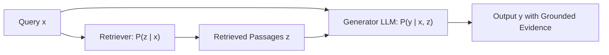
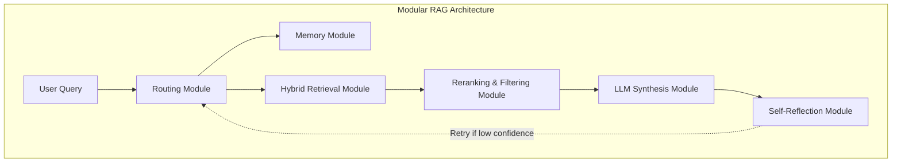
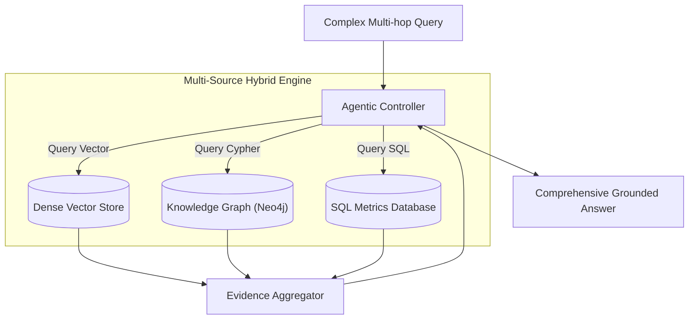
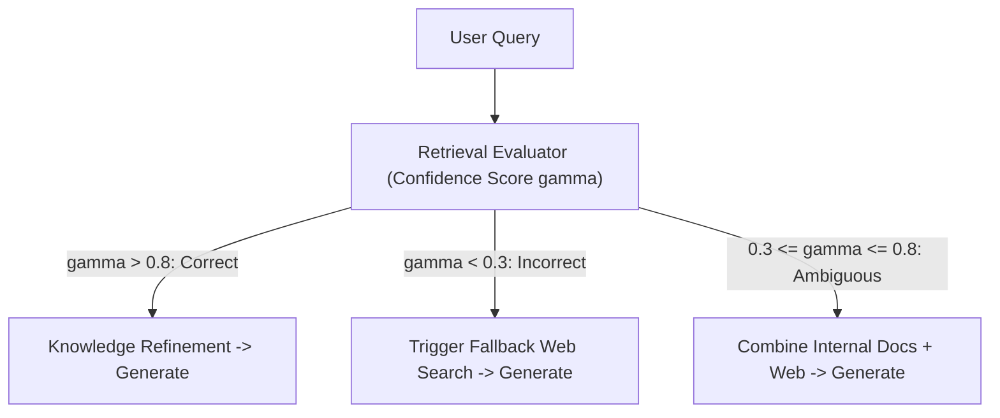

# Chuyên đề: Các Kiến trúc & Mô thức RAG (RAG Architectures & Paradigms)

## 1. Tổng quan Chuyên đề
Mô hình Ngôn ngữ Lớn (LLMs) sở hữu khả năng suy luận phi thường nhưng lại bị hạn chế nghiêm ngặt bởi hai vấn đề cố hữu: **Ảo giác tri thức (Hallucination)** và **Sự lạc hậu của tham số tĩnh (Knowledge Cutoff)**. **Retrieval-Augmented Generation (RAG)** ra đời như một bước chuyển dịch mô thức then chốt: tách rời năng lực tính toán ngôn ngữ (LLM parametric memory) khỏi kho lưu trữ tri thức thực tế (Non-parametric external memory).

Từ mô hình **Naive RAG** sơ khai, hệ thống đã tiến hóa qua nhiều thế hệ: **Advanced RAG** với các khâu tiền/hậu xử lý tinh vi, **Modular RAG** với các module hoán đổi linh hoạt, **Self-RAG / Corrective RAG (CRAG)** có khả năng tự phán đoán và phản xạ, cho tới **Agentic RAG** và **Graph RAG** có khả năng tự động lập kế hoạch và suy luận đa bước.

Sự tiến hóa của các mô thức RAG:

```mermaid
flowchart TD
    subgraph Gen1 ["Thế hệ 1: Naive RAG"]
        Q1["Query"] --> Retrieve1["Index Retrieve"] --> Prompt1["Stuffing Prompt"] --> LLM1["LLM Generate"]
    end
    
    subgraph Gen2 ["Thế hệ 2: Advanced RAG"]
        Q2["Query"] --> Pre["Query Transformation"]
        Pre --> Ret2["Hybrid Retrieval"]
        Ret2 --> Post["Rerank & Compression"]
        Post --> LLM2["Grounded LLM"]
    end

    subgraph Gen3 ["Thế hệ 3: Modular & Adaptive RAG"]
        Q3["Query"] --> Router{"Complexity Router"}
        Router -->|Simple| Direct["Direct LLM"]
        Router -->|Complex| Web["External / Search Engine"]
        Router -->|Domain| Vector["Vector + Graph Store"]
    end

    subgraph Gen4 ["Thế hệ 4: Self-Reflective / Agentic RAG"]
        Q4["Query"] --> AgentLoop["Agent Loop (Plan - Action - Observe)"]
        AgentLoop --> EvalSelf{"Self-Check: Is context relevant & faithful?"}
        EvalSelf -->|No| RewriteStep["Rewrite Query & Retrieve Again"]
        EvalSelf -->|Yes| Output["Final Verified Answer with Citations"]
    end
```



---

## 2. Chi tiết từng Keyword

---

### 1. Retrieval-Augmented Generation (RAG) & 2. Knowledge-Intensive Tasks

#### a. Định nghĩa Bản chất Kỹ thuật & Toán học
- **Retrieval-Augmented Generation (RAG)** (Lewis et al., 2020): Mô hình sinh ngôn ngữ có điều kiện kết hợp bộ nhớ tham số (Parametric memory $\mathbf{\theta}$ của LLM) và bộ nhớ phi tham số (Non-parametric memory $\mathcal{D}$ - kho tài liệu).
  Hàm phân phối xác suất sinh văn bản cho chuỗi đầu ra $\mathbf{y} = (y_1, \dots, y_T)$ với câu hỏi $\mathbf{x}$:
  $$P(\mathbf{y} \mid \mathbf{x}) = \sum_{z \in \text{Top-K}(\mathcal{D})} P(z \mid \mathbf{x}) \prod_{t=1}^T P(y_t \mid \mathbf{x}, z, \mathbf{y}_{<t}; \mathbf{\theta})$$
  Trong đó $P(z \mid \mathbf{x})$ là xác suất truy xuất tài liệu $z$, và $P(y_t \mid \dots)$ là xác suất sinh token tiếp theo có điều kiện kèm ngữ cảnh $z$.
- **Knowledge-Intensive Tasks**: Các tác vụ xử lý thông tin phức tạp mà một con người hay mô hình AI không thể giải quyết chính xác nếu không được tra cứu tài liệu tham khảo chuyên biệt (ví dụ: tư vấn luật, chẩn đoán y khoa, đối soát hồ sơ tài chính, phân tích lỗi mã nguồn nội bộ).

#### b. Cơ chế Tầng Sâu & Kiến trúc Hệ thống
- Tách rời tri thức và mô hình giúp cập nhật kiến thức liên tục trong thời gian thực ($\mathcal{O}(1)$ update vào Vector DB) mà không cần tốn hàng triệu USD để Fine-tuning hoặc Pre-training lại LLM.
- **Context Injection**: Ngữ cảnh truy xuất được gắn trực tiếp vào System/User Prompt trong Context Window của LLM qua kỹ thuật prompt template.

#### c. Sơ đồ Minh họa


#### d. Code Thực chiến (C++ & Python)

```cpp
// C++20: Khung mô phỏng Pipeline RAG chuẩn hóa
#include <iostream>
#include <string>
#include <vector>

struct RAGInput {
    std::string query;
    std::vector<std::string> retrieved_chunks;
};

class RAGPromptBuilder {
public:
    static std::string build_grounded_prompt(const RAGInput& input) {
        std::string prompt = "### System: You are a factual assistant. Answer strictly based on the context.\n\n### Context:\n";
        for (size_t i = 0; i < input.retrieved_chunks.size(); ++i) {
            prompt += "[" + std::to_string(i + 1) + "] " + input.retrieved_chunks[i] + "\n";
        }
        prompt += "\n### Question: " + input.query + "\n\n### Answer:";
        return prompt;
    }
};

int main() {
    RAGInput req = {"What is RAG?", {"RAG combines retrieval with LLMs.", "It reduces hallucinations."}};
    std::cout << RAGPromptBuilder::build_grounded_prompt(req) << "\n";
    return 0;
}
```

```python
# Python: Triển khai luồng RAG cơ bản
from typing import List

class BasicRAG:
    def __init__(self, retriever_fn, llm_generate_fn):
        self.retriever = retriever_fn
        self.llm = llm_generate_fn

    def answer(self, question: str, top_k: int = 2) -> str:
        docs = self.retriever(question, top_k)
        context_str = "\n".join([f"- {d}" for d in docs])
        prompt = f"Answer using only context:\nContext:\n{context_str}\n\nQuestion: {question}\nAnswer:"
        return self.llm(prompt)

# Mock
retriever = lambda q, k: ["HNSW is an ANN graph index.", "IVF uses Voronoi cells."]
generator = lambda p: "HNSW is an approximate nearest neighbor graph index."
rag = BasicRAG(retriever, generator)
print("RAG Response:", rag.answer("What is HNSW?"))
```

#### e. Lỗi Thường gặp & Tối ưu Hệ thống
- **Context Stuffing**: Nhồi nhét quá nhiều chunk không liên quan làm loãng attention của LLM (Lost in the middle phenomenon).
- **Tối ưu**: Lọc ngưỡng điểm số tương đồng (Score thresholding) trước khi đưa vào prompt context.

#### f. Ứng dụng Thực chiến trong AI Systems
Chatbot hỗ trợ khách hàng, trợ lý pháp lý, tra cứu quy chế nội bộ doanh nghiệp.

---

### 3. Naive RAG vs 4. Advanced RAG vs 5. Modular RAG

#### a. Định nghĩa Bản chất Kỹ thuật & Toán học
- **Naive RAG**: Luồng xử lý tuyến tính kinh điển: *Retrieve $\to$ Read*. Dữ liệu được cắt cố định (Fixed chunking), mã hóa vector, tìm top-$K$ bằng Cosine Similarity thô, nhét toàn bộ vào prompt.
- **Advanced RAG**: Bổ sung hai pha tối quan trọng:
  - *Pre-retrieval*: Query expansion, Query rewriting, HyDE, tối ưu hóa chunking.
  - *Post-retrieval*: Cross-encoder reranking, context compression, deduplication.
- **Modular RAG**: Kiến trúc phi tuyến tính, hướng module độc lập (Decoupled Modules): Cho phép tích hợp các module cắm-rút như Memory Module, Search Routing Module, Evaluation Module, Tool Calling Module.

#### b. Cơ chế Tầng Sâu & Kiến trúc Hệ thống
| Đặc tính | Naive RAG | Advanced RAG | Modular RAG |
| :--- | :--- | :--- | :--- |
| **Pipeline Flow** | Tuyến tính cố định ($1 \to 2 \to 3$) | Tuyến tính nâng cao với Pre/Post | Đồ thị DAG / Rẽ nhánh linh hoạt |
| **Query Handling** | Dùng nguyên văn bản thô | Rewrite, Expand, Decompose | Phân luồng thích ứng (Adaptive Router) |
| **Retrieval Mode** | Vector Search đơn lẻ | Hybrid (Dense + BM25) + Rerank | Multi-source (Vector, Graph, Web, DB) |
| **Khả năng tự sửa**| Không | Rất ít | Có (Reflective Feedback loops) |

#### c. Sơ đồ Minh họa


#### d. Code Thực chiến (C++ & Python)

```cpp
// C++20: State pattern cho Modular RAG Engine
#include <iostream>
#include <memory>
#include <string>

class IRAGModule {
public:
    virtual std::string process(const std::string& input) = 0;
    virtual ~IRAGModule() = default;
};

class PreRetrievalRewriter : public IRAGModule {
public:
    std::string process(const std::string& input) override {
        return "Cleaned & Expanded: " + input;
    }
};

class ModularRAGOrchestrator {
    std::vector<std::unique_ptr<IRAGModule>> pipeline;
public:
    void add_module(std::unique_ptr<IRAGModule> mod) {
        pipeline.push_back(std::move(mod));
    }
    std::string execute(const std::string& query) {
        std::string current = query;
        for (const auto& mod : pipeline) {
            current = mod->process(current);
        }
        return current;
    }
};
```

```python
# Python: Advanced RAG Pipeline với Pre-retrieval và Post-retrieval
class AdvancedRAGPipeline:
    def __init__(self, rewriter, retriever, reranker, generator):
        self.rewriter = rewriter
        self.retriever = retriever
        self.reranker = reranker
        self.generator = generator

    def run(self, raw_query: str) -> str:
        # 1. Pre-retrieval
        refined_query = self.rewriter(raw_query)
        # 2. Retrieval
        candidates = self.retriever(refined_query, top_k=20)
        # 3. Post-retrieval
        reranked = self.reranker(refined_query, candidates, top_k=3)
        # 4. Generation
        return self.generator(refined_query, reranked)
```

#### e. Lỗi Thường gặp & Tối ưu Hệ thống
- **Naive RAG Pitfall**: Độ chính xác thấp, rất dễ bị đánh lừa bởi tài liệu có vector gần nhưng nội dung sai lệch; dễ tràn token.
- **Tối ưu**: Luôn nâng cấp hệ thống từ Naive lên Advanced RAG bằng cách chèn thêm một lớp Reranker (như BGE-Reranker).

#### f. Ứng dụng Thực chiến trong AI Systems
LlamaIndex Workflows, Haystack 2.0, LangChain LCEL (LangChain Expression Language).

---

### 6. Agentic RAG & 7. Graph RAG & 8. Hybrid RAG & 9. Multimodal RAG

#### a. Định nghĩa Bản chất Kỹ thuật & Toán học
- **Agentic RAG**: Mô hình kết hợp AI Agent vào RAG: Hệ thống không truy xuất 1 lần mà thực hiện một chu trình tự chủ (Autonomous Loop): lập kế hoạch câu hỏi phụ, chủ động gọi công cụ tìm kiếm nhiều lần, đánh giá tài liệu thu về, và tiếp tục tìm kiếm nếu chưa đủ thông tin.
- **Graph RAG**: Sử dụng Knowledge Graph (Đồ thị Tri thức) làm cấu trúc chỉ mục. Cho phép thực hiện suy luận đa bước (Multi-hop Reasoning) và tóm tắt toàn cục (Global Summarization) trên toàn bộ kho tài liệu.
- **Hybrid RAG**: Tích hợp đồng thời Dense Vector Search, Sparse BM25, và Structured Graph/SQL Database trong một giao diện truy xuất thống nhất.
- **Multimodal RAG**: Truy xuất và sinh văn bản có điều kiện trên nhiều phương thức dữ liệu hỗn hợp (Văn bản, Hình ảnh, Bảng biểu, Âm thanh):
  $$\mathbf{e} = \text{CLIP/ColPali}(image\_chunk), \quad \text{Score} = \mathbf{e}_{query} \cdot \mathbf{e}_{image}$$

#### b. Cơ chế Tầng Sâu: ColPali & Vision Language RAG
Trong Multimodal RAG hiện đại (ColPali): Thay vì dùng OCR phức tạp để bóc tách PDF, hệ thống render trang tài liệu thành hình ảnh và dùng Vision Transformer (ViT / PaliGemma) để tạo token embeddings trực tiếp từ bố cục hình ảnh và bảng biểu.

#### c. Sơ đồ Minh họa


#### d. Code Thực chiến (C++ & Python)

```cpp
// C++20: Bộ điều phối Router quyết định nguồn truy xuất (Hybrid Router)
#include <iostream>
#include <string>

enum class SourceTarget { VECTOR_STORE, KNOWLEDGE_GRAPH, RELATIONAL_SQL };

SourceTarget route_query_source(const std::string& query) {
    if (query.find("relationship") != std::string::npos || query.find("connect") != std::string::npos) {
        return SourceTarget::KNOWLEDGE_GRAPH;
    }
    if (query.find("revenue") != std::string::npos || query.find("sum") != std::string::npos) {
        return SourceTarget::RELATIONAL_SQL;
    }
    return SourceTarget::VECTOR_STORE;
}
```

```python
# Python: Luồng cơ bản của Agentic RAG
class AgenticRAG:
    def __init__(self, tools_dict):
        self.tools = tools_dict

    def execute_plan(self, question: str):
        steps = ["Decompose question", "Retrieve sub-facts", "Synthesize"]
        context_gathered = []
        # Bước 1: Quyết định gọi tool vector search
        sub_query_1 = f"Identify core concept of {question}"
        context_gathered.append(self.tools["vector_search"](sub_query_1))
        # Bước 2: Kiểm tra nếu cần quan hệ thực thể
        if "relation" in question.lower():
            context_gathered.append(self.tools["graph_search"](question))
        return "Synthesized Answer from: " + "; ".join(context_gathered)

tools = {
    "vector_search": lambda q: f"[Vector docs for {q}]",
    "graph_search": lambda q: f"[Graph relationships for {q}]"
}
agent = AgenticRAG(tools)
print(agent.execute_plan("What is the relation between Transformer and Attention?"))
```

#### e. Lỗi Thường gặp & Tối ưu Hệ thống
- **Infinite Retrieval Loop in Agentic RAG**: Agent liên tục đánh giá tài liệu là chưa đủ và rơi vào vòng lặp tìm kiếm vô tận.
- **Tối ưu**: Thiết lập biến đếm độ sâu tối đa (`max_iterations = 3`) và cơ chế fallback ngắt mạch (Circuit Breaker).

#### f. Ứng dụng Thực chiến trong AI Systems
Microsoft GraphRAG, LlamaIndex Agentic Workflow, và hệ thống phân tích báo cáo tài chính doanh nghiệp.

---

### 10. Adaptive RAG & 11. Corrective RAG (CRAG) & 12. Self-RAG & 13. Query-Focused RAG

#### a. Định nghĩa Bản chất Kỹ thuật & Toán học
- **Adaptive RAG** (Jeong et al., 2024): Hệ thống linh hoạt đánh giá độ phức tạp của câu hỏi để chọn chiến lược:
  - Câu hỏi đơn giản: Không cần retrieval, để LLM trả lời trực tiếp.
  - Câu hỏi thông thường: Single-step Naive/Advanced RAG.
  - Câu hỏi phức tạp: Multi-step Iterative Agentic RAG.
- **Corrective RAG (CRAG)** (Yan et al., 2024): Đưa vào một bộ chấm điểm mức độ liên quan (Retrieval Evaluator):
  - *Correct*: Tinh lọc tài liệu và sinh câu trả lời.
  - *Incorrect*: Loại bỏ toàn bộ tài liệu nội bộ và chuyển hướng sang Web Search API.
  - *Ambiguous*: Kết hợp cả hai nguồn nội bộ và web search.
- **Self-RAG** (Asai et al., 2023): Huấn luyện LLM sinh ra các token phản xạ đặc biệt (Reflection Tokens):
  `[Retrieve]`, `[IsRel]`, `[IsSup]`, `[IsUse]` để tự kiểm soát: Có cần tra cứu không? Tài liệu có liên quan không? Câu trả lời có căn cứ không?
- **Query-Focused RAG**: Tối ưu hóa toàn bộ quá trình tóm tắt và trích xuất thông tin xoay quanh câu hỏi trọng tâm, tránh hiện tượng sinh câu trả lời chung chung mang tính tóm tắt toàn bộ văn bản.

#### b. Cơ chế Tầng Sâu & Reflection Tokens trong Self-RAG
Bảng các token phản xạ trong kiến trúc Self-RAG:
- `Retrieve`: Quyết định kích hoạt tìm kiếm $\{ \text{yes}, \text{no}, \text{continue} \}$.
- `ISREL`: Đánh giá mức độ liên quan của từng passage $\{ \text{relevant}, \text{irrelevant} \}$.
- `ISSUP`: Đánh giá câu trả lời có được minh chứng đầy đủ bởi passage không $\{ \text{fully supported}, \text{partially}, \text{no} \}$.
- `ISUSE`: Đánh giá độ hữu ích tổng thể của câu trả lời $\{ 5, 4, 3, 2, 1 \}$.

#### c. Sơ đồ Minh họa


#### d. Code Thực chiến (C++ & Python)

```cpp
// C++20: Logic phân loại độ tin cậy của Corrective RAG (CRAG)
#include <iostream>
#include <string>

enum class CRAGAction { GENERATE_DIRECT, TRIGGER_WEB_SEARCH, COMBINE_SOURCES };

CRAGAction evaluate_retrieval_confidence(float top1_score, float top2_score) {
    if (top1_score >= 0.85f) {
        return CRAGAction::GENERATE_DIRECT;
    } else if (top1_score < 0.40f) {
        return CRAGAction::TRIGGER_WEB_SEARCH;
    } else {
        return CRAGAction::COMBINE_SOURCES;
    }
}

int main() {
    std::cout << "CRAG Action for score 0.92: " << (int)evaluate_retrieval_confidence(0.92f, 0.88f) << "\n";
    std::cout << "CRAG Action for score 0.25: " << (int)evaluate_retrieval_confidence(0.25f, 0.10f) << "\n";
    return 0;
}
```

```python
# Python: Luồng Corrective RAG (CRAG) với Fallback
def corrective_rag_pipeline(query: str, internal_retriever, web_searcher, llm):
    docs, confidence = internal_retriever(query)
    
    if confidence > 0.75:
        context = "Internal Docs: " + " ".join(docs)
    elif confidence < 0.35:
        # Fallback web search
        web_docs = web_searcher(query)
        context = "Web Fallback: " + " ".join(web_docs)
    else:
        # Ambiguous: Kết hợp
        web_docs = web_searcher(query)
        context = "Combined: " + " ".join(docs + web_docs)

    prompt = f"Answer '{query}' based on: {context}"
    return llm(prompt)
```

#### e. Lỗi Thường gặp & Tối ưu Hệ thống
- **Chi phí gọi LLM quá cao**: Việc thêm nhiều bước chấm điểm và phản xạ làm tăng số lần gọi LLM gấp 3–4 lần, tăng chi phí token và độ trễ.
- **Tối ưu**: Sử dụng các mô hình nhỏ (như Llama-3-8B hoặc T5 đã fine-tune riêng cho grading) thay vì dùng GPT-4 cho bước đánh giá.

#### f. Ứng dụng Thực chiến trong AI Systems
LangGraph CRAG template, Perplexity AI search logic, và Enterprise Customer Support bots.
