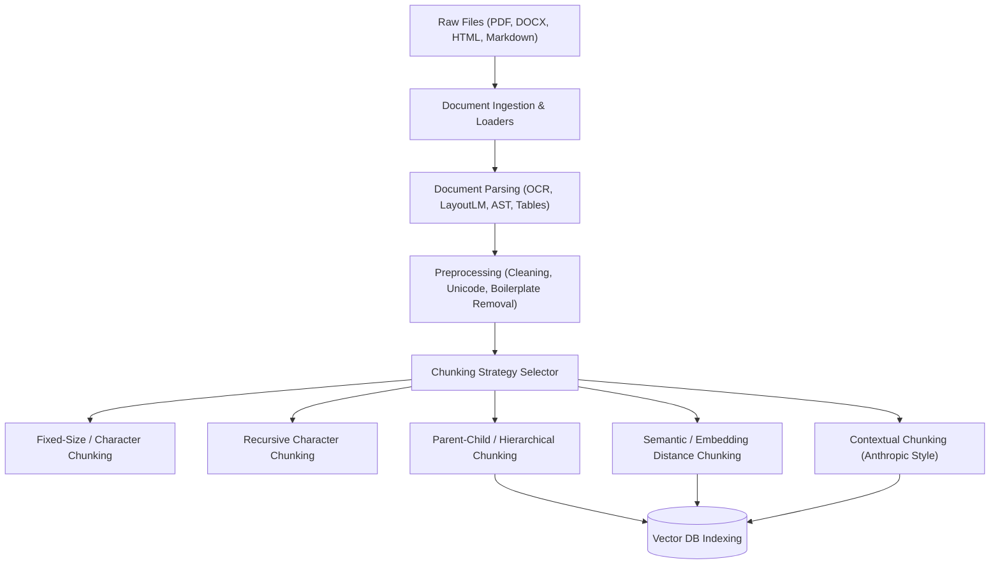
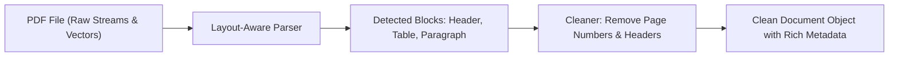
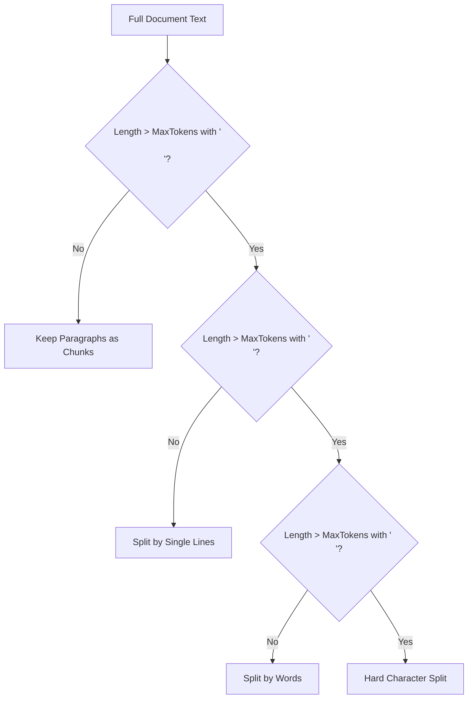
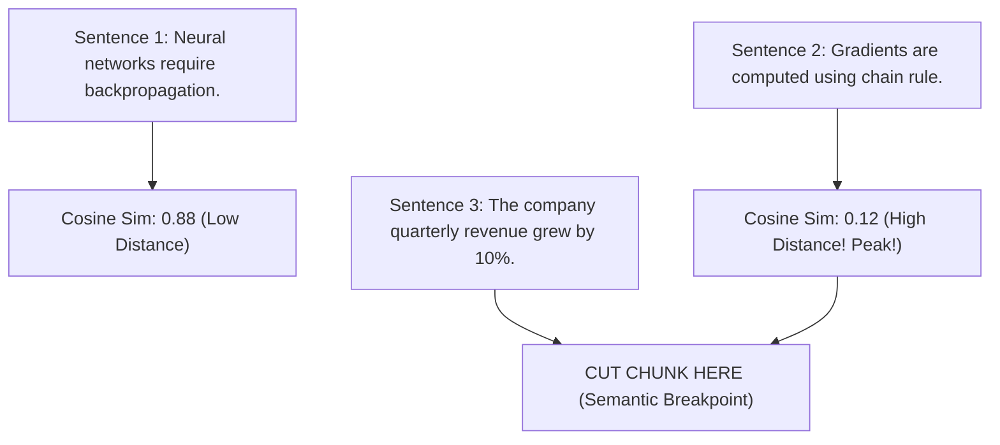
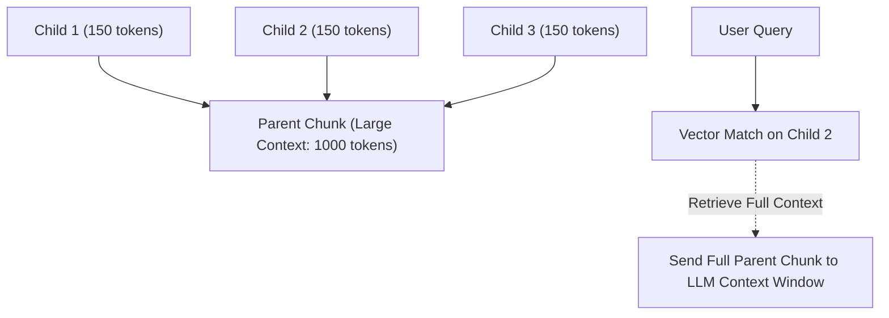
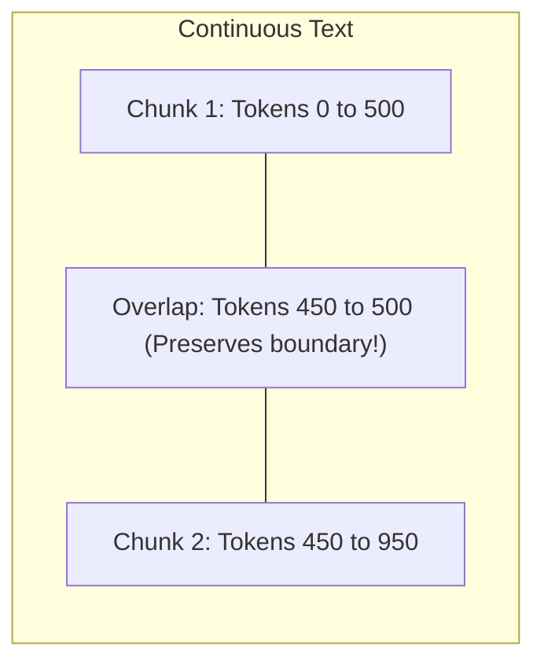

# Chuyên đề: Nạp Tài liệu, Phân tích Cú pháp & Chiến lược Phân mảnh (Document Ingestion, Parsing & Chunking Strategies)

## 1. Tổng quan Chuyên đề
Hiệu năng của bất kỳ hệ thống RAG nào cũng tuân theo nguyên lý kinh điển của khoa học máy tính: **"Garbage In, Garbage Out"** (Rác vào thì rác ra). Cho dù mô hình LLM có mạnh mẽ hay thuật toán vector search có tiên tiến đến đâu, nếu khâu nạp dữ liệu (Document Ingestion), bóc tách cấu trúc (Document Parsing), tiền xử lý (Preprocessing) và chia nhỏ văn bản (Chunking) bị sai lệch hoặc mất ngữ cảnh, hệ thống sẽ liên tục trả về các thông tin rời rạc, tối nghĩa và gây ảo giác nghiêm trọng.

Chuyên đề này phân tích toàn diện tầng vật lý và giải thuật của quy trình ETL dữ liệu văn bản cho AI: từ các kỹ thuật phân tích layout, xử lý cấu trúc đa cấp, đến các chiến lược phân mảnh hiện đại nhất: **Fixed-size, Recursive, Semantic, Parent-Child, Hierarchical**, và **Contextual Retrieval Chunking**.

Quy trình ETL xử lý tài liệu vào Vector Store:



---

## 2. Chi tiết từng Keyword

---

### 1. Document Ingestion & 2. Document Parsing & 3. Document Loaders & 4. Document Preprocessing

#### a. Định nghĩa Bản chất Kỹ thuật & Toán học
- **Document Ingestion (Nạp Dữ liệu)**: Quá trình tiếp nhận dữ liệu liên tục hoặc theo mẻ (Batch/Streaming) từ các nguồn dữ liệu không đồng nhất (S3, Google Drive, Notion, Confluence, SQL/NoSQL databases) vào pipeline xử lý.
- **Document Loaders**: Các module I/O chuyên biệt chịu trách nhiệm đọc các định dạng tệp thô nhị phân khác nhau (PDF, DOCX, PPTX, CSV, Parquet) và chuyển thành đối tượng văn bản chuẩn:
  $$\text{Document} = \langle \text{page\_content}: \text{str}, \text{metadata}: \text{dict} \rangle$$
- **Document Parsing (Phân tích Cú pháp Văn bản)**: Kỹ thuật nhận diện cấu trúc logic (Hierarchical AST) của tài liệu: tiêu đề (Headings H1-H6), đoạn văn, bảng biểu (Tables), danh sách, ghi chú chân trang (Footnotes) và khối mã (Codeblocks).
- **Document Preprocessing (Tiền xử lý)**: Làm sạch dữ liệu, chuẩn hóa Unicode (NFC/NFKC), loại bỏ các thành phần rác (Boilerplate, Header/Footer lặp lại theo trang, ký tự vô nghĩa).

#### b. Cơ chế Tầng Sâu: Thách thức Xử lý File PDF
PDF là định dạng hướng hiển thị đồ họa (Display/Print oriented) chứ không phải định dạng cấu trúc ngôn ngữ. Các ký tự trong file PDF được định vị bằng tọa độ tuyệt đối $(x, y)$ trên trang:
- Dòng chữ trên cùng một hàng có thể bị chia thành nhiều text object ngẫu nhiên.
- Bảng biểu (Tables) không có thẻ `<table>` mà chỉ là tập hợp các đường kẻ vạch (lines/rectangles) và chữ cái rơi vào các ô tọa độ.
- Các công cụ phân tích hiện đại dùng Vision-Language Models (như Nougat, LayoutLMv3, Unstructured, Marker) để bảo toàn cấu trúc bảng dưới dạng Markdown format.

#### c. Sơ đồ Minh họa


#### d. Code Thực chiến (C++ & Python)

```cpp
// C++20: Cấu trúc Document chuẩn hóa và bộ lọc làm sạch chuỗi
#include <iostream>
#include <string>
#include <unordered_map>
#include <regex>

struct Document {
    std::string page_content;
    std::unordered_map<std::string, std::string> metadata;
};

class DocumentPreprocessor {
public:
    static std::string clean_text(const std::string& raw) {
        // Loại bỏ khoảng trắng thừa và ký tự điều khiển
        std::string cleaned = std::regex_replace(raw, std::regex(r"\s+"), " ");
        // Loại bỏ các mẫu footer ví dụ "Page X of Y"
        cleaned = std::regex_replace(cleaned, std::regex(r"Page \d+ of \d+"), "");
        return cleaned;
    }
};

int main() {
    std::string messy = "Quarterly Report   2024. \n\n Page 1 of 12 \t\t Revenue grew 15%.";
    std::cout << "Cleaned: '" << DocumentPreprocessor::clean_text(messy) << "'\n";
    return 0;
}
```

```python
# Python: Document Loader và Pipeline Preprocessing
import re
from dataclasses import dataclass

@dataclass
class Document:
    page_content: str
    metadata: dict

class SimplePDFCleaner:
    @staticmethod
    def preprocess(doc: Document) -> Document:
        text = doc.page_content
        # 1. Chuẩn hóa xuống dòng lỗi
        text = re.sub(r'(\w+)-\n(\w+)', r'\1\2', text) # Nối các từ bị gạch nối ngắt dòng
        text = re.sub(r'\n+', '\n', text)
        # 2. Xóa header/footer trang mẫu
        text = re.sub(r'Confidential Document - \d{4}', '', text)
        return Document(page_content=text.strip(), metadata=doc.metadata)

raw_doc = Document("Artifi-\ncial Intelligence is expanding.\n\nConfidential Document - 2024", {"source": "report.pdf"})
print("Preprocessed Content:\n", SimplePDFCleaner.preprocess(raw_doc).page_content)
```

#### e. Lỗi Thường gặp & Tối ưu Hệ thống
- **Gãy nát cấu trúc Bảng (Broken Tables)**: Bóc tách PDF bằng regex hoặc `pypdf` thô biến bảng số liệu tài chính thành chuỗi số vô nghĩa, khiến LLM tính toán sai hoàn toàn.
- **Tối ưu**: Luôn parse bảng biểu ra định dạng Markdown Table hoặc HTML Table (`| Column 1 | Column 2 |`) trước khi chunking.

#### f. Ứng dụng Thực chiến trong AI Systems
Module nạp dữ liệu của Unstructured.io, LlamaParse, Apache Tika và LangChain Document Loaders.

---

### 5. Document Chunking & 6. Fixed-Size Chunking & 7. Recursive Character Chunking & 8. Sentence-Based Chunking

#### a. Định nghĩa Bản chất Kỹ thuật & Toán học
- **Document Chunking**: Quá trình phân chia một văn bản dài $D = (t_1, t_2, \dots, t_L)$ thành tập các đoạn văn bản nhỏ hơn $\mathcal{C} = \{c_1, c_2, \dots, c_m\}$ thỏa mãn ràng buộc kích thước:
  $$\forall c_i \in \mathcal{C}, \quad |c_i| \le \text{Max\_Tokens}$$
- **Fixed-Size Chunking**: Chia văn bản thuần túy theo số lượng ký tự hoặc token cố định $N$, bất chấp ranh giới câu hay đoạn.
- **Sentence-Based Chunking**: Chia văn bản theo ranh giới câu (Sentence Boundary Detection - SBD qua NLTK, spaCy, hoặc regex dấu chấm kết thúc câu).
- **Recursive Character Chunking**: Thuật toán chia phân cấp sử dụng danh sách các ký tự phân cách ưu tiên giảm dần:
  $$\text{Separators} = [\text{"\n\n"}, \text{"\n"}, \text{" "}, \text{""}]$$
  Thuật toán cố gắng giữ các đoạn văn (`\n\n`) nguyên vẹn; nếu đoạn vẫn quá lớn thì cắt theo dòng (`\n`), rồi đến từ (` `), cuối cùng mới cắt theo ký tự.

#### b. Cơ chế Tầng Sâu & Phân tích Bộ nhớ
- **Token Count vs Character Count**: 1 Token trong mô hình ngôn ngữ (như Tiktoken `cl100k_base` của OpenAI) trung bình tương đương khoảng $4$ ký tự tiếng Anh, nhưng trong tiếng Việt hoặc ngôn ngữ tượng hình có thể tốn $1.5 - 3$ tokens cho mỗi âm tiết.
- Cắt theo ký tự cố định có thể cắt đôi một token hoặc một từ tiếng Việt (ví dụ: "thông" và "minh" bị tách sang 2 chunk khác nhau). Cắt theo Tokenizer BPE là cách tiếp cận chuẩn hóa nhất.

#### c. Sơ đồ Minh họa


#### d. Code Thực chiến (C++ & Python)

```cpp
// C++20: Recursive Chunking cơ bản theo danh sách ký tự phân cách
#include <iostream>
#include <string>
#include <vector>

std::vector<std::string> recursive_split(const std::string& text, size_t max_size,
                                         const std::vector<std::string>& seps, size_t sep_idx = 0) {
    if (text.size() <= max_size || sep_idx >= seps.size()) {
        return {text};
    }
    const std::string& sep = seps[sep_idx];
    std::vector<std::string> splits;
    size_t start = 0, pos = 0;
    while ((pos = text.find(sep, start)) != std::string::npos) {
        splits.push_back(text.substr(start, pos - start));
        start = pos + sep.size();
    }
    splits.push_back(text.substr(start));

    std::vector<std::string> chunks;
    std::string current_chunk;
    for (const auto& piece : splits) {
        if (current_chunk.size() + piece.size() <= max_size) {
            current_chunk += (current_chunk.empty() ? "" : sep) + piece;
        } else {
            if (!current_chunk.empty()) chunks.push_back(current_chunk);
            if (piece.size() > max_size) {
                auto sub_chunks = recursive_split(piece, max_size, seps, sep_idx + 1);
                chunks.insert(chunks.end(), sub_chunks.begin(), sub_chunks.end());
                current_chunk.clear();
            } else {
                current_chunk = piece;
            }
        }
    }
    if (!current_chunk.empty()) chunks.push_back(current_chunk);
    return chunks;
}

int main() {
    std::string text = "Paragraph 1 is here.\n\nParagraph 2 is very long and has lots of words inside it.\n\nParagraph 3.";
    auto chunks = recursive_split(text, 35, {"\n\n", "\n", " "});
    for (size_t i = 0; i < chunks.size(); ++i) {
        std::cout << "Chunk " << i << ": [" << chunks[i] << "]\n";
    }
    return 0;
}
```

```python
# Python: RecursiveCharacterTextSplitter mô phỏng LangChain
class RecursiveTextSplitter:
    def __init__(self, chunk_size: int = 200, chunk_overlap: int = 20):
        self.chunk_size = chunk_size
        self.chunk_overlap = chunk_overlap
        self.separators = ["\n\n", "\n", ". ", " ", ""]

    def split_text(self, text: str) -> list[str]:
        final_chunks = []
        # Tách thô theo đoạn văn trước
        paragraphs = text.split("\n\n")
        current_chunk = ""
        for p in paragraphs:
            if len(current_chunk) + len(p) <= self.chunk_size:
                current_chunk += ("\n\n" if current_chunk else "") + p
            else:
                if current_chunk:
                    final_chunks.append(current_chunk)
                current_chunk = p
        if current_chunk:
            final_chunks.append(current_chunk)
        return final_chunks

splitter = RecursiveTextSplitter(chunk_size=50)
print("Chunks:", splitter.split_text("Chunking is crucial for RAG.\n\nIt preserves semantic coherence."))
```

#### e. Lỗi Thường gặp & Tối ưu Hệ thống
- **Context Loss do ngắt câu tùy tiện**: Fixed-size chunking cắt ngang giữa một câu mệnh đề hoặc câu điều kiện, khiến ý nghĩa bị đảo ngược.
- **Tối ưu**: Luôn ưu tiên Recursive Character Chunking với dấu ngắt đoạn `\n\n` và câu `. `.

#### f. Ứng dụng Thực chiến trong AI Systems
Chiến lược mặc định trong LangChain `RecursiveCharacterTextSplitter` và LlamaIndex `SentenceSplitter`.

---

### 9. Semantic Chunking & 10. Structure-Aware Chunking

#### a. Định nghĩa Bản chất Kỹ thuật & Toán học
- **Semantic Chunking (Phân mảnh theo Ngữ nghĩa)** (Kamradt, 2023): Thay vì cắt theo quy tắc ký tự cơ học, thuật toán tìm các điểm biến động đột ngột về ngữ nghĩa (Semantic Drift / Breakpoint) giữa các câu liên tiếp:
  1. Tách văn bản thành chuỗi các câu: $(s_1, s_2, \dots, s_n)$.
  2. Tính vector nhúng cho từng câu: $\mathbf{e}_i = \text{Embed}(s_i)$.
  3. Tính khoảng cách Cosine giữa các câu liền kề:
     $$d_i = 1 - \cos(\mathbf{e}_i, \mathbf{e}_{i+1})$$
  4. Xác định điểm ngắt chunk (Breakpoint) nếu khoảng cách $d_i$ vượt quá ngưỡng phân vị (Percentile Threshold):
     $$\text{Breakpoint}(i) = \mathbb{I}(d_i > \mu_d + k \cdot \sigma_d)$$
- **Structure-Aware Chunking (Phân mảnh Nhận biết Cấu trúc)**: Tôn trọng tuyệt đối cây cú pháp (AST) của văn bản. Mỗi Section (H1, H2), bảng biểu (Table), hay hàm mã nguồn (Function AST) được đóng gói nguyên vẹn trong một chunk độc lập.

#### b. Cơ chế Tầng Sâu & Kiến trúc Hệ thống
- Semantic Chunking đảm bảo tính trọn vẹn của một chủ đề tư duy (Thematic Cohesion): Khi tác giả chuyển ý sang một chủ đề mới, vector ngữ nghĩa lập tức đổi hướng tạo thành một đỉnh sóng (peak) trên biểu đồ khoảng cách, kích hoạt việc ngắt chunk.
- Đối với mã nguồn (Code Chunking): Sử dụng **Tree-sitter parser** để cắt chunk theo đúng ranh giới của `class` hoặc `function`, không bao giờ cắt đôi thân hàm.

#### c. Sơ đồ Minh họa


#### d. Code Thực chiến (C++ & Python)

```cpp
// C++20: Phát hiện Breakpoint theo ngưỡng độ lệch chuẩn (Statistical Breakpoint Detector)
#include <iostream>
#include <vector>
#include <cmath>
#include <numeric>

std::vector<size_t> detect_breakpoints(const std::vector<float>& distances, float k_std = 1.0f) {
    if (distances.empty()) return {};
    float mean = std::accumulate(distances.begin(), distances.end(), 0.0f) / distances.size();
    float variance = 0.0f;
    for (float d : distances) variance += (d - mean) * (d - mean);
    float std_dev = std::sqrt(variance / distances.size());
    float threshold = mean + k_std * std_dev;

    std::vector<size_t> breakpoints;
    for (size_t i = 0; i < distances.size(); ++i) {
        if (distances[i] > threshold) {
            breakpoints.push_back(i);
        }
    }
    return breakpoints;
}
```

```python
# Python: Triển khai Semantic Chunking từ véc-tơ câu
import numpy as np

def semantic_chunking(sentences: list[str], embeddings: np.ndarray, threshold_percentile: float = 80) -> list[str]:
    # 1. Tính khoảng cách Cosine giữa các câu liên kề
    norms = np.linalg.norm(embeddings, axis=1, keepdims=True)
    normed_e = embeddings / (norms + 1e-9)
    # Cosine sim giữa câu i và i+1
    sims = np.sum(normed_e[:-1] * normed_e[1:], axis=1)
    dists = 1.0 - sims
    
    # 2. Ngưỡng ngắt
    threshold = np.percentile(dists, threshold_percentile)
    
    # 3. Gom cụm các câu
    chunks = []
    current_chunk = [sentences[0]]
    for i, dist in enumerate(dists):
        if dist > threshold:
            chunks.append(" ".join(current_chunk))
            current_chunk = [sentences[i + 1]]
        else:
            current_chunk.append(sentences[i + 1])
    if current_chunk:
        chunks.append(" ".join(current_chunk))
    return chunks

sentences = [
    "Machine learning algorithms optimize loss functions.",
    "Gradient descent updates model weights iteratively.",
    "Baking a cake requires flour and sugar.",
    "Preheat the oven to 350 degrees."
]
# Giả lập embeddings 2 cụm chủ đề khác nhau
embs = np.array([[1.0, 0.0], [0.95, 0.05], [0.0, 1.0], [0.05, 0.95]])
print("Semantic Chunks:", semantic_chunking(sentences, embs))
```

#### e. Lỗi Thường gặp & Tối ưu Hệ thống
- **Chi phí suy luận Embedding quá lớn**: Phải tính embedding cho từng câu đơn lẻ trong toàn bộ tập tài liệu đồ sộ làm chậm tốc độ ingestion hàng chục lần.
- **Tối ưu**: Gom các câu thành nhóm nhỏ (Buffer window của 3 câu) trước khi nhúng.

#### f. Ứng dụng Thực chiến trong AI Systems
Tối ưu hóa tài liệu kỹ thuật dài, luận văn khoa học, và mã nguồn phức tạp (AST Chunking trong GitHub Copilot).

---

### 11. Parent-Child Chunking & 12. Hierarchical Chunking & 13. Contextual Chunking

#### a. Định nghĩa Bản chất Kỹ thuật & Toán học
- **Parent-Child Chunking**: Kỹ thuật phân tách tài liệu thành 2 cấp độ:
  - *Child Chunks (Kích thước nhỏ: 100–200 tokens)*: Được nhúng véc-tơ để tối ưu hóa độ chính xác tìm kiếm (Retrieval Accuracy / High Precision).
  - *Parent Chunks (Kích thước lớn: 800–2000 tokens)*: Lưu trữ ngữ cảnh rộng bao quanh child chunk.
  $$\text{Vector Index}(\mathbf{e}_{child}) \xrightarrow{\text{Lookup Key}} \text{Storage}(\text{Parent\_Content})$$
  *Cơ chế*: Khi tìm kiếm, thuật toán so khớp véc-tơ trên **Child Chunk**, nhưng khi nạp vào Prompt của LLM thì lại trả về **Parent Chunk**!
- **Hierarchical Chunking**: Mở rộng Parent-Child ra cây đa cấp (Root Document $\to$ Chapters $\to$ Sections $\to$ Paragraphs $\to$ Sentences).
- **Contextual Chunking (Anthropic, 2024)**: Trước khi nhúng véc-tơ cho từng chunk độc lập, dùng một LLM nhẹ sinh ra 1–2 câu tóm tắt ngữ cảnh toàn cục của tài liệu và gắn vào đầu mỗi chunk:
  $$c_{contextualized} = \text{LLM\_Context}(D, c_i) \circ c_i$$

#### b. Cơ chế Tầng Sâu & Giải quyết Vấn đề "Mất Ngữ Cảnh Cục Bộ"
Trong tài liệu tài chính, một chunk có thể chỉ chứa: *"Doanh thu quý này tăng 5%"*. Nếu đọc riêng lẻ, cả vector search lẫn LLM đều không biết "quý này" là quý nào và của "công ty nào".
Contextual Chunking sẽ biến đổi thành: *"Đây là báo cáo tài chính Q3/2024 của Vinamilk. Doanh thu quý này tăng 5%"*. Vector nhúng sẽ nắm bắt hoàn hảo cả thực thể công ty lẫn mốc thời gian!

#### c. Sơ đồ Minh họa


#### d. Code Thực chiến (C++ & Python)

```cpp
// C++20: Cấu trúc Parent-Child ID Mapping
#include <iostream>
#include <unordered_map>
#include <string>

struct ParentChildMapping {
    std::unordered_map<uint32_t, uint32_t> child_to_parent; // child_id -> parent_id
    std::unordered_map<uint32_t, std::string> parent_storage; // parent_id -> text

    void register_chunk(uint32_t child_id, uint32_t parent_id, const std::string& parent_text) {
        child_to_parent[child_id] = parent_id;
        parent_storage[parent_id] = parent_text;
    }

    std::string fetch_parent_context(uint32_t child_id) const {
        auto it = child_to_parent.find(child_id);
        if (it != child_to_parent.end()) {
            return parent_storage.at(it->second);
        }
        return "";
    }
};
```

```python
# Python: Contextual Chunking mô phỏng giải pháp Anthropic
def generate_contextualized_chunk(doc_summary: str, chunk_text: str) -> str:
    # Bổ sung tiền tố ngữ cảnh toàn cục vào chunk cục bộ
    prefix = f"[Document Context: {doc_summary}]\n"
    return prefix + chunk_text

doc_summary = "SEC 10-K Filing for Apple Inc. for fiscal year ended September 30, 2023."
local_chunk = "Services net sales were $85,200 million compared to $78,129 million in 2022."
contextual_chunk = generate_contextualized_chunk(doc_summary, local_chunk)
print(contextual_chunk)
```

#### e. Lỗi Thường gặp & Tối ưu Hệ thống
- **Trùng lặp Parent Chunks**: Nhiều Child Chunks của cùng một Parent Chunk cùng lọt vào Top-$K$, khiến nạp nhiều lần Parent giống nhau vào Prompt.
- **Tối ưu**: Luôn thực hiện Deduplication theo `parent_id` trước khi dựng context cho LLM.

#### f. Ứng dụng Thực chiến trong AI Systems
Chiến lược tối ưu chuẩn mực trong LlamaIndex `ParentDocumentRetriever` và Anthropic Contextual Retrieval RAG.

---

### 14. Chunk Overlap & 15. Chunk Size Optimization

#### a. Định nghĩa Bản chất Kỹ thuật & Toán học
- **Chunk Overlap (Độ gối đầu giữa các Chunk)**: Tỷ lệ hoặc số lượng token/ký tự chung được lặp lại giữa hai chunk liên tiếp $c_i$ và $c_{i+1}$:
  $$\text{Overlap}(c_i, c_{i+1}) = c_i \cap c_{i+1} = \Delta \text{ tokens}$$
  Mục đích: Đảm bảo không làm mất thông tin ngữ nghĩa nằm ngay tại đường biên cắt lát (boundary context).
- **Chunk Size Optimization (Tối ưu hóa Kích thước Chunk)**: Bài toán tối ưu hóa đa mục tiêu giữa:
  - *Kích thước nhỏ ($128 - 256$ tokens)*: Vector nhúng tập trung, ít nhiễu, điểm tương đồng sắc nét nhưng thiếu ngữ cảnh mở rộng.
  - *Kích thước lớn ($512 - 1024$ tokens)*: Ngữ cảnh phong phú nhưng vector bị nhòe mờ (diluted embeddings), dễ làm phân tán attention của LLM.

#### b. Cơ chế Tầng Sâu & Nguyên tắc Thực nghiệm
- Tỷ lệ Overlap tiêu chuẩn: Thường thiết lập $\text{Overlap} \in [10\%, 20\%]$ kích thước Chunk Size (ví dụ: Chunk Size 512 tokens thì Overlap 50 tokens).
- Tối ưu hóa kích thước phụ thuộc vào mô hình Embedding: Các mô hình như `text-embedding-3-small` hoặc `bge-base` hoạt động tối ưu nhất ở dải 256–512 tokens.

#### c. Sơ đồ Minh họa


#### d. Code Thực chiến (C++ & Python)

```cpp
// C++20: Slide Window Chunking với Overlap
#include <iostream>
#include <vector>
#include <string>

std::vector<std::string> sliding_window_chunk(const std::vector<std::string>& tokens,
                                              size_t chunk_size, size_t overlap) {
    std::vector<std::string> chunks;
    if (chunk_size <= overlap || tokens.empty()) return chunks;
    size_t step = chunk_size - overlap;
    for (size_t i = 0; i < tokens.size(); i += step) {
        size_t end = std::min(i + chunk_size, tokens.size());
        std::string chunk_str;
        for (size_t j = i; j < end; ++j) {
            chunk_str += tokens[j] + " ";
        }
        chunks.push_back(chunk_str);
        if (end == tokens.size()) break;
    }
    return chunks;
}
```

```python
# Python: Sliding Window Token Chunking với Overlap
def sliding_window_chunking(tokens: list[str], chunk_size: int = 10, overlap: int = 3):
    step = chunk_size - overlap
    chunks = []
    for i in range(0, len(tokens), step):
        chunk = tokens[i : i + chunk_size]
        chunks.append(" ".join(chunk))
        if i + chunk_size >= len(tokens):
            break
    return chunks

tokens = [f"tok_{i}" for i in range(25)]
chunks = sliding_window_chunking(tokens, chunk_size=8, overlap=2)
for idx, c in enumerate(chunks):
    print(f"Chunk {idx}:", c)
```

#### e. Lỗi Thường gặp & Tối ưu Hệ thống
- **Overlap quá lớn ($> 50\%$)**: Làm tăng số lượng vector lên gấp 2–3 lần, lãng phí chi phí lưu trữ Vector DB và tăng nguy cơ trùng lặp thông tin.
- **Tối ưu**: Khuyên dùng kích thước Chunk 512 tokens với Overlap 50 tokens làm cấu hình cơ sở (Baseline) trước khi tinh chỉnh.

#### f. Ứng dụng Thực chiến trong AI Systems
Cấu hình bắt buộc khi khởi tạo `CharacterTextSplitter` hoặc `TokenTextSplitter` trong mọi hệ thống RAG thực tế.
