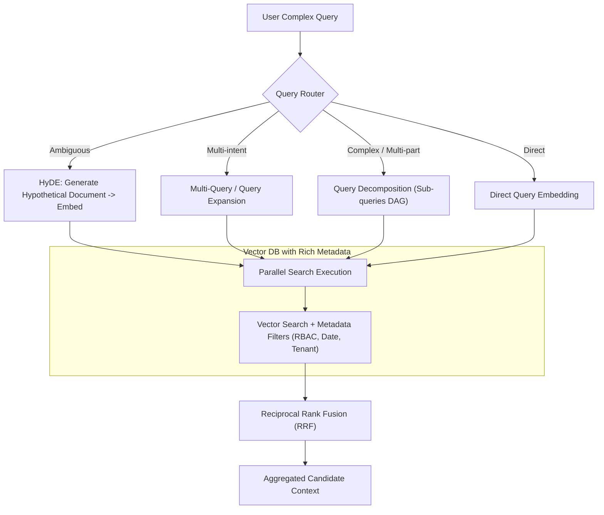
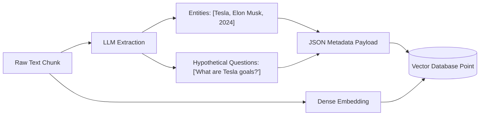
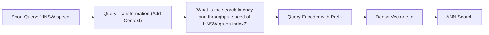
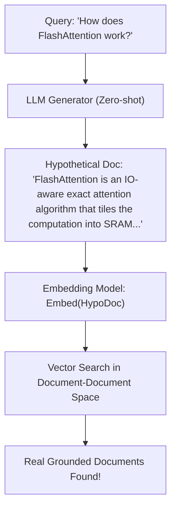
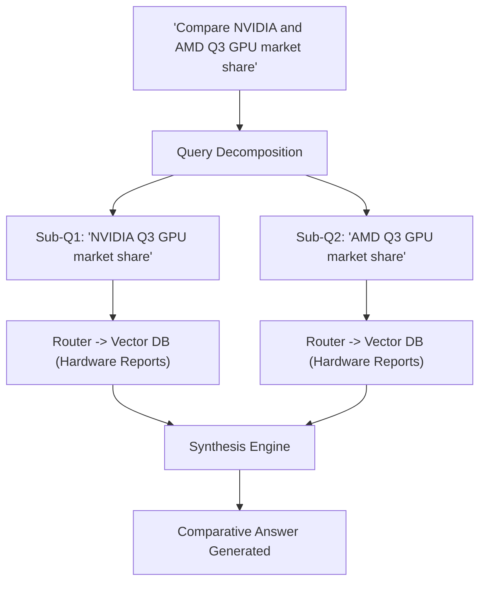

# Chuyên đề: Siêu dữ liệu, Nhúng Véc-tơ & Luồng Truy xuất Nâng cao (Metadata, Embedding & Advanced Retrieval Flows)

## 1. Tổng quan Chuyên đề
Một hệ thống RAG đẳng cấp doanh nghiệp không bao giờ gửi thẳng câu hỏi thô của người dùng vào Vector Database. Người dùng thường hỏi những câu mơ hồ, chứa lỗi diễn đạt, hoặc quá ngắn để vector nhúng có thể nắm bắt đầy đủ ngữ nghĩa tiềm ẩn. Ngược lại, tài liệu lưu trong cơ sở dữ liệu nếu thiếu đi các siêu dữ liệu cấu trúc (Metadata) sẽ biến việc tìm kiếm thành một bài toán mò kim đáy bể.

Chuyên đề này đi sâu vào quy trình **làm giàu siêu dữ liệu (Metadata Enrichment)**, kỹ thuật **nhúng vector đa nhiệm (Embedding Mechanics)**, cùng toàn bộ chuỗi **chuyển đổi truy vấn nâng cao (Advanced Query Transformations)**: **Multi-Query, HyDE (Hypothetical Document Embeddings), Query Decomposition**, và **Query Routing**.

Kiến trúc luồng xử lý và chuyển đổi truy vấn nâng cao:



---

## 2. Chi tiết từng Keyword

---

### 1. Document Metadata & 2. Metadata Enrichment & 3. Document Embedding & 4. Vector Indexing

#### a. Định nghĩa Bản chất Kỹ thuật & Toán học
- **Document Metadata (Siêu dữ liệu)**: Tập hợp các thuộc tính có cấu trúc đi kèm với từng đoạn văn bản $c_i$:
  $$\mathcal{M}(c_i) = \{ \text{author}, \text{creation\_date}, \text{source\_url}, \text{tenant\_id}, \text{category}, \text{doc\_version}, \text{access\_level} \}$$
- **Metadata Enrichment (Làm giàu Siêu dữ liệu)**: Sử dụng các mô hình AI chuyên dụng (hoặc LLM nhỏ) để tự động trích xuất và bổ sung thêm các thuộc tính ngữ nghĩa vào metadata trước khi index:
  $$\mathcal{M}_{enriched}(c_i) = \mathcal{M}_{raw}(c_i) \cup \{ \text{Keywords}, \text{Named\_Entities}, \text{Topic\_Summary}, \text{Hypothetical\_Questions} \}$$
- **Document Embedding**: Quá trình ánh xạ phi tuyến văn bản thành vector nhiều chiều thông qua mạng Transformer:
  $$\mathbf{e}_d = \text{MeanPooling}(\text{Transformer}(c_i)) \in \mathbb{R}^d, \quad \|\mathbf{e}_d\|_2 = 1$$
- **Vector Indexing (Lập chỉ mục Véc-tơ)**: Nạp các cặp $\langle \mathbf{e}_d, \mathcal{M}(c_i), c_i \rangle$ vào cấu trúc dữ liệu đồ thị hoặc phân vùng (HNSW, IVF-PQ) trên đĩa/RAM để sẵn sàng phục vụ truy vấn.

#### b. Cơ chế Tầng Sâu: Kỹ thuật "Reverse HyDE" (Question Generation for Chunks)
Trong Metadata Enrichment: Dùng LLM sinh ra 3 câu hỏi tiềm năng mà đoạn văn $c_i$ có thể trả lời được:
$$\mathcal{Q}_{hypo} = \text{LLM\_Generate\_Questions}(c_i)$$
Sau đó nhúng chính các câu hỏi giả định này vào Vector DB. Khi người dùng hỏi một câu hỏi thực tế, khoảng cách Cosine giữa *câu hỏi của người dùng* và *câu hỏi giả định* sẽ gần nhau hơn rất nhiều so với khoảng cách giữa *câu hỏi* và *đoạn văn trả lời*!

#### c. Sơ đồ Minh họa


#### d. Code Thực chiến (C++ & Python)

```cpp
// C++20: Biểu diễn một Vector Record hoàn chỉnh trong Vector DB
#include <iostream>
#include <vector>
#include <string>
#include <unordered_map>

struct VectorPoint {
    std::string point_id;
    std::vector<float> dense_vector;
    std::unordered_map<std::string, std::string> metadata;
};

class VectorIndexManager {
    std::vector<VectorPoint> points;
public:
    void upsert_point(const VectorPoint& pt) {
        points.push_back(pt);
    }
    size_t count() const { return points.size(); }
};
```

```python
# Python: Tự động trích xuất metadata làm giàu chunk
import json

def enrich_chunk_metadata(chunk_text: str, base_metadata: dict) -> dict:
    enriched = base_metadata.copy()
    # Giả lập bóc tách entities và sinh câu hỏi kiểm tra
    has_financial = any(w in chunk_text.lower() for w in ["revenue", "profit", "ebitda", "$"])
    enriched["contains_financial_data"] = has_financial
    enriched["character_count"] = len(chunk_text)
    enriched["synthetic_query"] = f"Key details regarding: {chunk_text[:30]}..."
    return enriched

base_meta = {"source": "sec_filing_q4.pdf", "tenant": "enterprise_01"}
chunk = "The operating margin improved by 3.2% reaching $450M in operating income."
print(json.dumps(enrich_chunk_metadata(chunk, base_meta), indent=2))
```

#### e. Lỗi Thường gặp & Tối ưu Hệ thống
- **Quá tải kích thước Payload**: Lưu trữ toàn bộ văn bản thô khổng lồ trong metadata của Vector DB gây chậm I/O khi duyệt chỉ mục.
- **Tối ưu**: Chỉ lưu metadata lọc trong Vector DB (như IDs, tags, timestamp); toàn bộ text raw lưu trong Document Store thứ cấp (như MongoDB, Redis, PostgreSQL).

#### f. Ứng dụng Thực chiến trong AI Systems
Kỹ thuật chuẩn trong Qdrant Payload Indexes, Milvus Scalar Fields, và Elastic Vector Search.

---

### 5. Retrieval Pipeline & 6. Query Embedding & 7. Query Transformation

#### a. Định nghĩa Bản chất Kỹ thuật & Toán học
- **Retrieval Pipeline**: Kiến trúc đường ống kết nối toàn bộ chuỗi mắt xích từ lúc tiếp nhận câu hỏi của người dùng cho đến khi trả về danh sách tài liệu cuối cùng:
  $$\text{Query} \xrightarrow{\text{Transform}} \mathbf{q}' \xrightarrow{\text{Embed}} \mathbf{e}_{q'} \xrightarrow{\text{Retrieve}} \text{Top-Candidates} \xrightarrow{\text{Rerank}} \text{Context}$$
- **Query Embedding**: Chuyển đổi câu truy vấn thành vector trong cùng không gian ẩn (Latent Space) với tài liệu:
  $$\mathbf{e}_q = \text{Encoder}_Q(q) \in \mathbb{R}^d$$
  *Chú ý*: Các mô hình như BGE hoặc Instructor yêu cầu thêm tiền tố chỉ dẫn (Instruction Prefix) khi nhúng câu truy vấn: `"Represent this question for retrieving relevant documents: "`.
- **Query Transformation**: Họ các giải thuật biến đổi toán học hoặc ngữ nghĩa trên câu truy vấn để thu hẹp khoảng cách biểu diễn (semantic gap) giữa ngôn ngữ câu hỏi và ngôn ngữ tài liệu.

#### b. Cơ chế Tầng Sâu: Không đối xứng giữa Query và Document
Độ dài câu truy vấn thường rất ngắn (5–15 từ), trong khi văn bản tài liệu dài (200–512 từ). Điều này tạo ra sự bất đối xứng về mật độ thông tin (Asymmetric Information Density). Query Transformation có nhiệm vụ "bơm đầy" (inflate) thông tin vào câu hỏi để vector truy vấn nằm gần hơn với cụm tài liệu đích.

#### c. Sơ đồ Minh họa


#### d. Code Thực chiến (C++ & Python)

```cpp
// C++17: Định dạng Query với Instruction Prefix cho Bi-Encoder
#include <iostream>
#include <string>

std::string format_query_for_bge(const std::string& raw_query) {
    const std::string prefix = "Represent this sentence for searching relevant passages: ";
    return prefix + raw_query;
}

int main() {
    std::cout << format_query_for_bge("How does MMR prevent redundancy?") << "\n";
    return 0;
}
```

```python
# Python: Chuỗi Pipeline Query Embedding với Instruction Prefix
class EmbeddingPipeline:
    def __init__(self, model_name: str = "BAAI/bge-large-en-v1.5"):
        self.model_name = model_name
        self.instruction = "Represent this sentence for searching relevant passages: "

    def encode_query(self, query: str):
        full_query = self.instruction + query
        # Giả lập vector nhúng normalized
        dummy_vec = [0.1, 0.4, -0.2]
        return dummy_vec

pipeline = EmbeddingPipeline()
print("Processed Vector:", pipeline.encode_query("What is late interaction in ColBERT?"))
```

#### e. Lỗi Thường gặp & Tối ưu Hệ thống
- **Quên thêm tiền tố Instruction**: Nhúng truy vấn bằng mô hình BGE/E5 mà không có tiền tố tương ứng làm giảm Recall@10 từ 5% đến 15% trên các tập benchmark chuẩn.
- **Tối ưu**: Luôn trừu tượng hóa hàm `embed_query` và `embed_documents` riêng biệt trong code base.

#### f. Ứng dụng Thực chiến trong AI Systems
Triển khai trong HuggingFace `SentenceTransformers`, LangChain `Embeddings` interface.

---

### 8. Multi-Query Retrieval & 9. Hypothetical Document Embeddings (HyDE)

#### a. Định nghĩa Bản chất Kỹ thuật & Toán học
- **Multi-Query Retrieval**: Sử dụng LLM để tạo ra $M$ biến thể ngữ nghĩa khác nhau của cùng một câu hỏi ban đầu:
  $$\{q^{(1)}, q^{(2)}, \dots, q^{(M)}\} \sim \text{LLM}(q_{origin})$$
  Hệ thống thực hiện $M$ truy vấn vector độc lập song song vào Vector Database, sau đó hợp nhất các tập kết quả bằng thuật toán RRF (Reciprocal Rank Fusion) hoặc phép hợp tập hợp:
  $$\mathcal{R}_{final} = \text{RRF}\big(\text{Retrieved}(q^{(1)}), \dots, \text{Retrieved}(q^{(M)})\big)$$
- **Hypothetical Document Embeddings (HyDE)** (Gao et al., 2022): Thay vì nhúng trực tiếp câu hỏi ngắn, LLM được yêu cầu "tưởng tượng" và tự viết ra một đoạn tài liệu giả định ($d_{hypo}$) trả lời cho câu hỏi đó:
  $$d_{hypo} \sim \text{LLM}(\text{Prompt: "Write a hypothetical passage answering: "} \circ q)$$
  Sau đó nhúng chính $d_{hypo}$ để tìm kiếm tài liệu thực trong kho:
  $$\mathbf{e}_{search} = \text{Embed}(d_{hypo})$$

#### b. Cơ chế Tầng Sâu: Tại sao HyDE lại hiệu quả?
HyDE chuyển bài toán **Truy xuất Bất đối xứng (Asymmetric Query-Document Retrieval)** thành bài toán **Truy xuất Đối xứng (Symmetric Document-Document Retrieval)**!
Mặc dù $d_{hypo}$ có thể chứa thông tin giả định hoặc sai số liệu cụ thể (do ảo giác của LLM), nhưng cấu trúc ngữ pháp, thuật ngữ chuyên ngành và không gian ngữ nghĩa của một "đoạn văn tài liệu" vẫn giống với các tài liệu thực tế hơn nhiều so với một "câu hỏi ngắn".

#### c. Sơ đồ Minh họa


#### d. Code Thực chiến (C++ & Python)

```cpp
// C++20: Mô phỏng RRF hợp nhất kết quả Multi-Query song song
#include <iostream>
#include <vector>
#include <unordered_map>
#include <algorithm>

struct DocScore {
    int id;
    double score;
};

std::vector<DocScore> fuse_multi_queries(const std::vector<std::vector<int>>& query_results, double k = 60.0) {
    std::unordered_map<int, double> fused;
    for (const auto& list : query_results) {
        for (size_t rank = 0; rank < list.size(); ++rank) {
            fused[list[rank]] += 1.0 / (k + rank + 1);
        }
    }
    std::vector<DocScore> res;
    for (const auto& [id, sc] : fused) res.push_back({id, sc});
    std::sort(res.begin(), res.end(), [](const auto& a, const auto& b) { return a.score > b.score; });
    return res;
}
```

```python
# Python: Triển khai HyDE (Hypothetical Document Embeddings)
class HyDERetriever:
    def __init__(self, llm_generate_fn, embed_fn, vector_search_fn):
        self.llm = llm_generate_fn
        self.embed = embed_fn
        self.search = vector_search_fn

    def retrieve(self, question: str, top_k: int = 3):
        # 1. Sinh văn bản giả định
        prompt = f"Please write a technical passage answering this question:\n{question}\nPassage:"
        hypothetical_doc = self.llm(prompt)
        print(f"Generated HyDE Passage:\n'{hypothetical_doc}'\n")

        # 2. Nhúng văn bản giả định thay vì nhúng câu hỏi
        hypo_vector = self.embed(hypothetical_doc)

        # 3. Tìm kiếm tài liệu thực
        return self.search(hypo_vector, top_k)

# Mock
mock_llm = lambda p: "FlashAttention reduces memory access by computing softmax incrementally in SRAM."
mock_embed = lambda t: [0.35, 0.85]
mock_search = lambda v, k: [f"Doc_{i} (Actual Research Paper)" for i in range(k)]

hyde = HyDERetriever(mock_llm, mock_embed, mock_search)
print("Retrieved Real Documents:", hyde.retrieve("What is FlashAttention?"))
```

#### e. Lỗi Thường gặp & Tối ưu Hệ thống
- **HyDE Hallucination Trap**: Nếu câu hỏi chứa các thực thể quá mới hoặc chuyên sâu mà LLM sinh ra tài liệu giả định hoàn toàn lạc đề, HyDE sẽ dẫn đường cho Vector Search tìm kiếm sai hướng.
- **Tối ưu**: Luôn kết hợp véc-tơ của HyDE với véc-tơ của câu hỏi gốc: $\mathbf{e}_{final} = 0.5 \mathbf{e}_{query} + 0.5 \mathbf{e}_{hyde}$.

#### f. Ứng dụng Thực chiến trong AI Systems
Thành phần then chốt trong LangChain `MultiQueryRetriever` và LlamaIndex `HyDEQueryTransform`.

---

### 10. Query Decomposition & 11. Query Routing

#### a. Định nghĩa Bản chất Kỹ thuật & Toán học
- **Query Decomposition (Phân rã Truy vấn)**: Phân tách một câu hỏi phức hợp đa mục tiêu thành một đồ thị có hướng không chu trình (DAG) gồm các câu hỏi phụ đơn giản hơn:
  $$q_{complex} \longrightarrow \{q_{sub}^{(1)}, q_{sub}^{(2)}, \dots, q_{sub}^{(k)}\}$$
  *Ví dụ*: "So sánh doanh thu năm 2023 giữa Microsoft và Google?" $\to$
  - Sub-query 1: "Doanh thu năm 2023 của Microsoft là bao nhiêu?"
  - Sub-query 2: "Doanh thu năm 2023 của Google là bao nhiêu?"
- **Query Routing (Định tuyến Truy vấn)**: Bộ phân loại động quyết định đưa truy vấn hoặc từng câu hỏi phụ tới kho lưu trữ dữ liệu chuyên biệt thích hợp nhất:
  $$\text{Route}(q) \in \{ \text{VectorDB}, \text{GraphDB}, \text{SQL\_DB}, \text{WebSearch}, \text{DirectLLM} \}$$

#### b. Cơ chế Tầng Sâu & Kiến trúc Hệ thống
1. **Semantic Routing**: Dùng vector embedding của câu hỏi so sánh Cosine với tập vector đại diện (Centroids) của từng nguồn dữ liệu.
2. **LLM Function Calling Routing**: Định nghĩa mỗi kho dữ liệu là một Function Tool với mô tả schema chi tiết, để LLM tự quyết định chọn tool phù hợp.

#### c. Sơ đồ Minh họa


#### d. Code Thực chiến (C++ & Python)

```cpp
// C++20: Mô hình Router quyết định đích đến dựa trên từ khóa và độ dài
#include <iostream>
#include <string>

enum class EngineDestination { VECTOR_DB, SQL_DATABASE, WEB_SEARCH };

EngineDestination route_query(const std::string& query) {
    if (query.find("SELECT") != std::string::npos || query.find("count") != std::string::npos || query.find("average") != std::string::npos) {
        return EngineDestination::SQL_DATABASE;
    }
    if (query.find("today") != std::string::npos || query.find("latest news") != std::string::npos) {
        return EngineDestination::WEB_SEARCH;
    }
    return EngineDestination::VECTOR_DB;
}
```

```python
# Python: Query Decomposition DAG cơ bản
from typing import List

class QueryDecomposer:
    @staticmethod
    def decompose(complex_query: str) -> List[str]:
        # Phân tách các truy vấn so sánh qua liên từ 'and', 'vs', 'compare'
        if "compare" in complex_query.lower() and "and" in complex_query.lower():
            # Tách thô
            parts = complex_query.replace("Compare", "").split("and")
            return [f"Details on {p.strip()}" for p in parts if p.strip()]
        return [complex_query]

print("Sub-queries:", QueryDecomposer.decompose("Compare Apple M3 chip and Intel Core Ultra"))
```

#### e. Lỗi Thường gặp & Tối ưu Hệ thống
- **Context Loss trong Sub-queries**: Phân rã câu hỏi: "Ai sáng lập công ty đó và vốn hóa của nó là bao nhiêu?" thành 2 câu hỏi cụt lủn không rõ "công ty đó" là công ty nào.
- **Tối ưu**: Luôn thực hiện Coreference Resolution (thay thế đại từ bằng danh từ cụ thể) trước khi phân rã câu hỏi.

#### f. Ứng dụng Thực chiến trong AI Systems
LlamaIndex `SubQuestionQueryEngine`, LangChain Router Chains, và Autogen Multi-hop Assistants.
