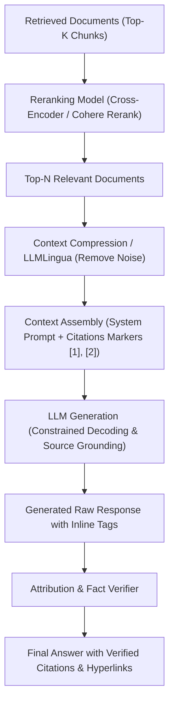
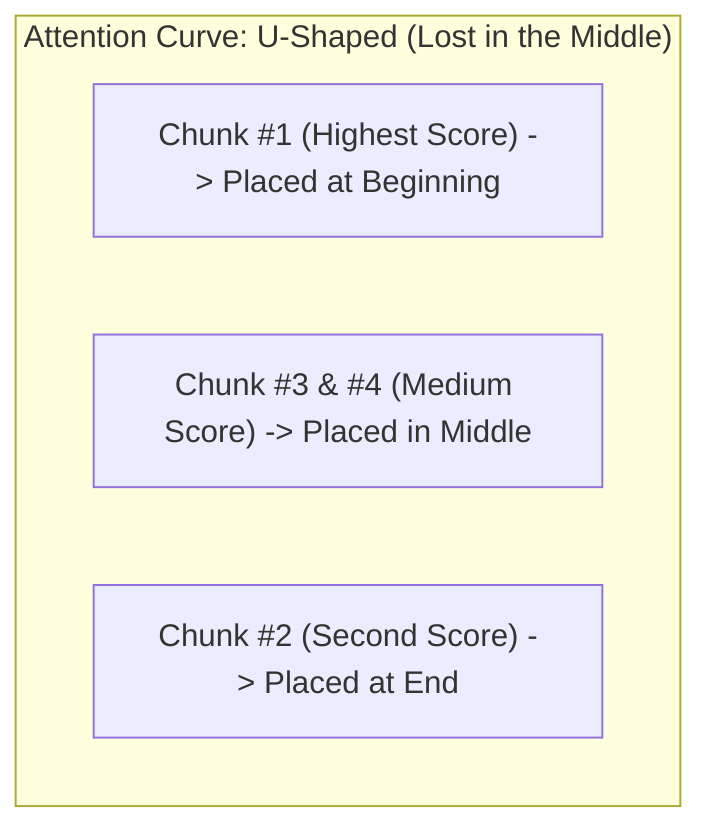
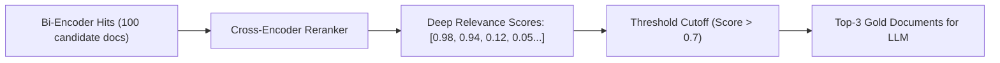
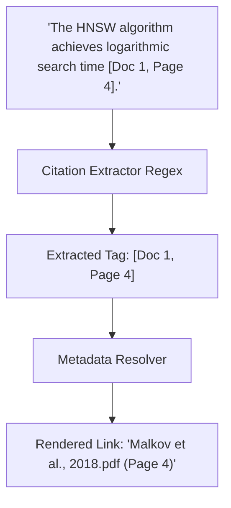
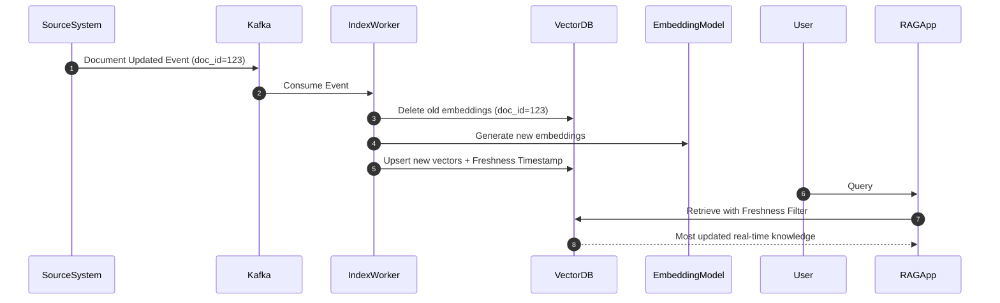

# Chuyên đề: Tổng hợp Ngữ cảnh, Sinh Có Căn cứ & Quy chiếu Nguồn (Context Synthesis, Grounded Generation & Attribution)

## 1. Tổng quan Chuyên đề
Lấy được tài liệu đúng từ kho lưu trữ mới chỉ giải quyết được một nửa bài toán RAG. Nửa còn lại—đôi khi mang tính quyết định đến trải nghiệm người dùng và sự tin cậy của doanh nghiệp—nằm ở cách hệ thống xử lý, cô đọng ngữ cảnh (Context Compression/Assembly), thực hiện **tái xếp hạng (Reranking)**, chỉ thị cho LLM sinh câu trả lời bám sát sự thật (**Grounded Generation**), trích dẫn chính xác nguồn gốc từng câu khẳng định (**Citation & Source Attribution**), triệt tiêu hoàn toàn nguy cơ ảo giác (**Hallucination Mitigation**) và duy trì tri thức luôn cập nhật (**Knowledge Freshness**).

Quy trình từ các đoạn tài liệu rời rạc đến câu trả lời minh bạch có dẫn nguồn:



---

## 2. Chi tiết từng Keyword

---

### 1. Contextual Retrieval & 2. Context Assembly & 3. Context Compression & 4. Contextual Compression

#### a. Định nghĩa Bản chất Kỹ thuật & Toán học
- **Contextual Retrieval**: Kỹ thuật truy xuất tài liệu có xem xét toàn diện bối cảnh lịch sử hội thoại, vị trí địa lý, quyền hạn người dùng hoặc ngữ cảnh tài liệu xung quanh.
- **Context Assembly (Lắp ráp Ngữ cảnh)**: Quá trình định dạng, sắp xếp và kết hợp các đoạn văn bản (chunks) thu được thành một cấu trúc prompt thống nhất, tối ưu hóa sự chú ý (Attention distribution) của LLM:
  $$\text{Prompt}_{\text{assembled}} = \mathcal{T}_{\text{system}} \circ \bigoplus_{i=1}^K \text{Format}(c_{(i)}, \text{meta}_i) \circ \mathcal{T}_{\text{query}}$$
- **Context Compression / Contextual Compression**: Kỹ thuật cắt bỏ các câu hoặc từ ngữ thừa thãi trong các chunk lấy về, chỉ giữ lại các thành phần ngữ nghĩa có liên quan trực tiếp tới câu hỏi:
  $$c_{\text{compressed}} = \pi_{\text{filter}}(c \mid q), \quad |c_{\text{compressed}}| \ll |c|$$

#### b. Cơ chế Tầng Sâu: Hiện tượng "Lost in the Middle" & Thứ tự Lắp ráp
Nghiên cứu của Stanford (Liu et al., 2023) chỉ ra rằng: Transformer có xu hướng chú ý mạnh nhất vào **đầu** và **cuối** của Prompt Context, trong khi thông tin nằm ở **giữa** dễ bị bỏ qua (Lost in the middle).
Do đó, chiến lược lắp ráp ngữ cảnh tối ưu là sắp xếp tài liệu quan trọng nhất ở vị trí đầu tiên, tài liệu quan trọng thứ hai ở cuối cùng, và các tài liệu ít quan trọng hơn nằm ở giữa.

#### c. Sơ đồ Minh họa


#### d. Code Thực chiến (C++ & Python)

```cpp
// C++20: Chiến lược lắp ráp ngữ cảnh chống 'Lost in the Middle'
#include <iostream>
#include <vector>
#include <string>

std::vector<std::string> assemble_lost_in_middle_order(const std::vector<std::string>& ranked_chunks) {
    if (ranked_chunks.size() <= 2) return ranked_chunks;
    std::vector<std::string> assembled(ranked_chunks.size());
    size_t left = 0, right = ranked_chunks.size() - 1;
    bool place_left = true;
    for (const auto& chunk : ranked_chunks) {
        if (place_left) {
            assembled[left++] = chunk;
        } else {
            assembled[right--] = chunk;
        }
        place_left = !place_left;
    }
    return assembled;
}
```

```python
# Python: Contextual Compression lọc các câu không liên quan
def compress_context_by_overlap(query: str, doc_chunk: str, threshold: float = 0.2) -> str:
    sentences = doc_chunk.split(". ")
    q_words = set(query.lower().split())
    relevant_sentences = []
    for s in sentences:
        s_words = set(s.lower().split())
        overlap = len(q_words & s_words) / (len(q_words) or 1)
        if overlap >= threshold:
            relevant_sentences.append(s)
    return ". ".join(relevant_sentences) if relevant_sentences else doc_chunk

doc = "Apple announced quarterly results. Revenue reached 90 billion dollars. The weather in California was sunny. iPhone sales were strong."
q = "What was the revenue and iPhone sales?"
print("Compressed Chunk:\n", compress_context_by_overlap(q, doc))
```

#### e. Lỗi Thường gặp & Tối ưu Hệ thống
- **Nén làm mất ý nghĩa ngữ pháp**: Cắt cụt câu có thể loại bỏ điều kiện loại trừ ("Tuy nhiên", "Trừ trường hợp").
- **Tối ưu**: Sử dụng các thư viện nén token chuyên dụng như **LLMLingua** (dựa trên perplexity của Small LM) để nén mà không mất thông tin logic.

#### f. Ứng dụng Thực chiến trong AI Systems
Module `LLMLinguaCompressor` và `ContextualCompressionRetriever` trong LangChain.

---

### 5. Reranking

#### a. Định nghĩa Bản chất Kỹ thuật & Toán học
**Reranking (Tái xếp hạng)** là bước chuyển dịch từ không gian tương đồng hình học đa hướng (Embedding similarity) sang mô hình tính toán tương quan ngữ nghĩa sâu sắc:
$$\text{Score}_{rerank}(q, d) = \text{Model}_{CE}(q, d) \in \mathbb{R}$$
Khác với Bi-Encoder tính khoảng cách giữa hai vector độc lập, Reranker (như BGE-Reranker, Cohere Rerank, Jina Reranker) cho phép các token của câu hỏi tương tác toàn diện với từng token của tài liệu qua hàng loạt lớp Self-Attention.

#### b. Cơ chế Tầng Sâu & Kiến trúc Hệ thống
- Reranker hoạt động như một "Bộ lọc chất lượng cao" (High-precision gatekeeper): Thu hẹp danh sách ứng viên từ $100$ xuống còn $3 - 5$ tài liệu có chất lượng cao nhất để đưa vào Prompt của LLM.
- Khả năng lọc bỏ các tài liệu "ngụy biện" (False Positives): Những tài liệu có nhiều từ khóa trùng lặp nhưng nội dung thực tế phủ định hoặc không trả lời câu hỏi sẽ bị Reranker đánh tụt điểm ngay lập tức.

#### c. Sơ đồ Minh họa


#### d. Code Thực chiến (C++ & Python)

```cpp
// C++17: Reranking Filter áp dụng ngưỡng điểm tối thiểu (Score Threshold Cutoff)
#include <iostream>
#include <vector>
#include <algorithm>

struct RerankedHit {
    int doc_id;
    float rerank_score;
};

std::vector<RerankedHit> filter_and_top_k(std::vector<RerankedHit>& hits, float min_threshold, size_t k) {
    std::vector<RerankedHit> filtered;
    for (const auto& h : hits) {
        if (h.rerank_score >= min_threshold) filtered.push_back(h);
    }
    std::sort(filtered.begin(), filtered.end(), [](const auto& a, const auto& b) {
        return a.rerank_score > b.rerank_score;
    });
    if (filtered.size() > k) filtered.resize(k);
    return filtered;
}
```

```python
# Python: Reranking pipeline chuẩn
class SimpleReranker:
    def __init__(self):
        pass

    def rerank(self, query: str, docs: list[str], top_k: int = 2) -> list[tuple[str, float]]:
        # Giả lập Cross-Encoder chấm điểm chính xác
        scored = []
        for d in docs:
            # Ưu tiên tài liệu có chứa cụm từ chính xác
            exact_match_bonus = 0.5 if query.lower() in d.lower() else 0.0
            score = exact_match_bonus + 0.4
            scored.append((d, score))
        scored.sort(key=lambda x: x[1], reverse=True)
        return scored[:top_k]

reranker = SimpleReranker()
docs = ["HNSW builds a hierarchical graph for ANN search.", "BM25 is a term matching algorithm."]
print("Reranked:", reranker.rerank("HNSW graph", docs))
```

#### e. Lỗi Thường gặp & Tối ưu Hệ thống
- **Quá tải tài nguyên tính toán**: Chạy Reranker 1024-tokens trên 100 tài liệu làm tăng tải GPU đáng kể.
- **Tối ưu**: Áp dụng kỹ thuật suy luận lượng tử hóa ONNX Runtime / TensorRT INT8 cho Cross-Encoder.

#### f. Ứng dụng Thực chiến trong AI Systems
Cohere Rerank API, BGE-Reranker-Large, và AWS Bedrock Knowledge Bases Reranking.

---

### 6. Grounded Generation & 7. Citation Generation & 8. Source Attribution

#### a. Định nghĩa Bản chất Kỹ thuật & Toán học
- **Grounded Generation (Sinh Ngôn ngữ Có Căn cứ)**: Nguyên tắc ép buộc mô hình LLM chỉ được phép tạo câu trả lời dựa trên thông tin có thể chứng minh được từ tập tài liệu ngữ cảnh $\mathcal{C}$ được cung cấp:
  $$\forall \text{Claim } c \in \text{Answer } \mathbf{y}, \quad \exists s \in \mathcal{C} \quad \text{such that } s \models c$$
  (Mọi luận điểm trong câu trả lời đều phải được hệ thống tài liệu kéo theo logic).
- **Citation Generation (Tạo Trích dẫn)**: Khả năng của hệ thống gắn các thẻ chỉ mục tham chiếu cụ thể vào từng câu khẳng định, ví dụ: `"Doanh thu công ty đạt 50 tỷ USD trong năm 2023 [1][2]"`.
- **Source Attribution (Quy chiếu Nguồn)**: Ánh xạ minh bạch từ thẻ trích dẫn `[1]` về siêu dữ liệu chi tiết của tài liệu gốc: Tiêu đề tệp, số trang, số dòng, tác giả, và đường dẫn URL trực tiếp.

#### b. Cơ chế Tầng Sâu: Constrained Prompting & Citation Tags
Hệ thống sử dụng kỹ thuật Few-shot Prompting kết hợp JSON Schema hoặc Markdown Citation Tags để chỉ dẫn LLM:
*"Mỗi khi bạn đưa ra một sự kiện hoặc số liệu, bắt buộc phải kèm theo mã định danh `[doc_id]`. Nếu thông tin không có trong tài liệu, bạn phải từ chối trả lời bằng câu: 'Tài liệu được cung cấp không đủ thông tin để trả lời câu hỏi này' thay vì suy đoán."*

#### c. Sơ đồ Minh họa


#### d. Code Thực chiến (C++ & Python)

```cpp
// C++20: Trích xuất các thẻ trích dẫn Citation dạng [Doc_ID] từ câu trả lời
#include <iostream>
#include <string>
#include <regex>
#include <vector>

std::vector<std::string> extract_citations(const std::string& response_text) {
    std::vector<std::string> citations;
    std::regex citation_regex(r"\[(?:Doc|Ref)\s*(\d+)\]");
    auto words_begin = std::sregex_iterator(response_text.begin(), response_text.end(), citation_regex);
    auto words_end = std::sregex_iterator();
    for (std::sregex_iterator i = words_begin; i != words_end; ++i) {
        citations.push_back((*i)[1].str());
    }
    return citations;
}

int main() {
    std::string ans = "Product Quantization compresses vectors [Doc 1] and uses ADC lookup [Doc 3].";
    auto refs = extract_citations(ans);
    std::cout << "Extracted Doc IDs: ";
    for (const auto& r : refs) std::cout << r << " ";
    std::cout << "\n";
    return 0;
}
```

```python
# Python: Structured Attribution Mapper
class SourceAttributionEngine:
    def __init__(self, doc_catalog: dict):
        self.catalog = doc_catalog  # id -> {title, url, page}

    def resolve_response_citations(self, text: str) -> dict:
        import re
        tags = re.findall(r"\[(\d+)\]", text)
        unique_ids = sorted(list(set(tags)))
        sources = [self.catalog.get(doc_id, {"title": "Unknown"}) for doc_id in unique_ids]
        return {
            "formatted_answer": text,
            "citations": sources
        }

catalog = {
    "1": {"title": "Qdrant Architecture", "url": "https://qdrant.tech", "page": 12},
    "2": {"title": "FAISS Manual", "url": "https://faiss.ai", "page": 4}
}
raw_text = "Vector databases provide ACID transactions [1] and GPU acceleration [2]."
engine = SourceAttributionEngine(catalog)
print("Resolved Attribution:\n", engine.resolve_response_citations(raw_text))
```

#### e. Lỗi Thường gặp & Tối ưu Hệ thống
- **Hallucinated Citations (Trích dẫn Ma)**: LLM tự bịa ra thẻ `[3]` trong khi chỉ có 2 tài liệu được cung cấp!
- **Tối ưu**: Áp dụng bước hậu kiểm tra (Post-hoc Verification step) đối chiếu thẻ trích dẫn với tập ID hợp lệ trong context, xóa bỏ các thẻ không có thật.

#### f. Ứng dụng Thực chiến trong AI Systems
Perplexity AI, Bing Copilot, và các giải pháp Enterprise Search tuân thủ pháp lý y tế / tài chính.

---

### 9. Hallucination Mitigation & 10. Knowledge Freshness

#### a. Định nghĩa Bản chất Kỹ thuật & Toán học
- **Hallucination Mitigation (Triệt tiêu Ảo giác)**: Tập hợp các cơ chế kiến trúc và thuật toán nhằm giảm thiểu tối đa xác suất mô hình sinh ra thông tin sai lệch về mặt thực tế ($P(\text{Hallucination}) \to 0$).
  Bao gồm:
  1. *Negative Constraint Prompting*: Yêu cầu từ chối trả lời nếu thiếu căn cứ.
  2. *Low Temperature Decoding*: Đặt $T \approx 0.0$ hoặc dùng Greedy Decoding để loại bỏ tính ngẫu nhiên.
  3. *Fact-Checking Post-Processor*: Dùng mô hình NLI (Natural Language Inference) kiểm tra quan hệ kéo theo (Entailment) giữa câu trả lời và tài liệu.
- **Knowledge Freshness (Tính Tươi mới của Tri thức)**: Khả năng của hệ thống phản ánh ngay lập tức các thay đổi, sửa đổi, hoặc bổ sung dữ liệu mới nhất trong thế giới thực mà không gặp độ trễ:
  $$\text{Freshness\_Lag} = t_{\text{query}} - t_{\text{doc\_update}} \to 0$$

#### b. Cơ chế Tầng Sâu & Kiến trúc Dynamic TTL
- **Dynamic Time-to-Live (TTL)** trong Vector DB: Mỗi bản ghi tài liệu mang cờ `valid_until` và `last_updated_at`.
- Khi có thay đổi chính sách hoặc tài liệu mới, hệ thống kích hoạt **Event-Driven Invalidation** qua Kafka / RabbitMQ để lập tức ghi đè (upsert) hoặc xóa bỏ các chunk cũ trong Vector Store, bảo đảm LLM luôn truy xuất phiên bản tri thức mới nhất.

#### c. Sơ đồ Minh họa


#### d. Code Thực chiến (C++ & Python)

```cpp
// C++20: Bộ lọc kiểm tra tính tươi mới của tài liệu theo Timestamp
#include <iostream>
#include <chrono>

struct FreshnessMetadata {
    uint64_t created_timestamp_sec;
    uint64_t ttl_duration_sec;

    bool is_fresh(uint64_t current_time_sec) const {
        return (current_time_sec - created_timestamp_sec) <= ttl_duration_sec;
    }
};

int main() {
    uint64_t now = 1700000000;
    FreshnessMetadata doc1 = {1699990000, 86400}; // Còn hạn trong 1 ngày
    FreshnessMetadata doc2 = {1695000000, 86400}; // Đã hết hạn
    std::cout << "Doc 1 is fresh? " << doc1.is_fresh(now) << "\n";
    std::cout << "Doc 2 is fresh? " << doc2.is_fresh(now) << "\n";
    return 0;
}
```

```python
# Python: Fact-checking NLI Gatekeeper giảm thiểu ảo giác
class HallucinationChecker:
    @staticmethod
    def verify_claim(context: str, claim: str) -> bool:
        # Giả lập NLI entailment: Kiểm tra xem các từ khóa của claim có nằm trong context không
        claim_keywords = [w for w in claim.lower().split() if len(w) > 3]
        matched = sum(1 for w in claim_keywords if w in context.lower())
        ratio = matched / (len(claim_keywords) or 1)
        return ratio > 0.6 # Entailment threshold

context = "In 2023, Tesla delivered 1.8 million electric vehicles worldwide."
valid_claim = "Tesla delivered 1.8 million vehicles in 2023."
hallucinated_claim = "Tesla manufactured 5 million rockets in 2023."

print("Valid claim grounded? ", HallucinationChecker.verify_claim(context, valid_claim))
print("Hallucinated claim grounded? ", HallucinationChecker.verify_claim(context, hallucinated_claim))
```

#### e. Lỗi Thường gặp & Tối ưu Hệ thống
- **Stale Cache Retrieval**: Kết quả tìm kiếm trả về các chunk đã bị xóa hoặc sửa đổi do hệ thống cache phân tán (như Redis) chưa kịp đồng bộ xóa cache cũ.
- **Tối ưu**: Thiết lập cơ chế Cache Invalidation tức thời theo khóa `doc_id` hoặc gắn version hash vào cache key.

#### f. Ứng dụng Thực chiến trong AI Systems
Hệ thống tin tức tài chính thời gian thực (BloombergGPT), sàn thương mại điện tử cập nhật giá và tồn kho từng giây.
