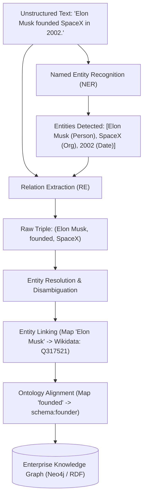
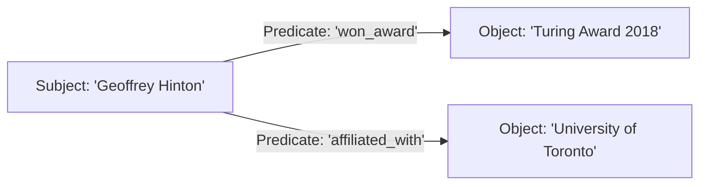
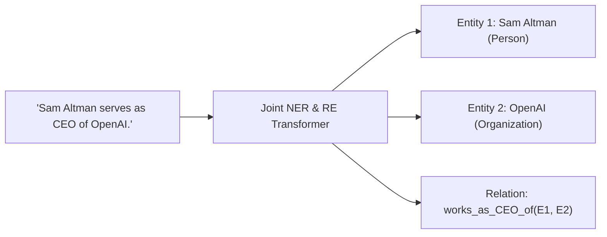
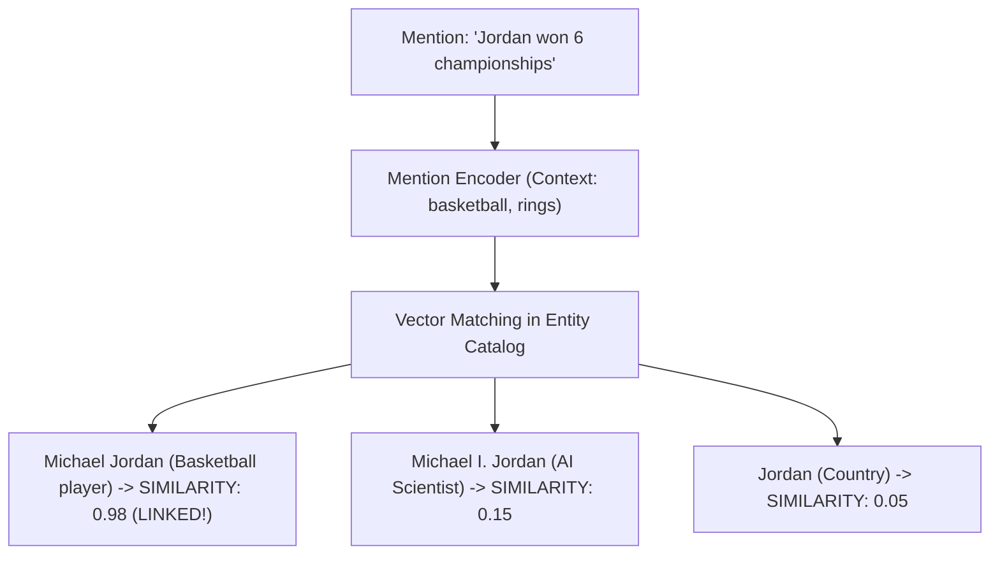

# Chuyên đề: Xây dựng Đồ thị Tri thức & Trích xuất Thực thể - Quan hệ (Knowledge Graph Construction & Extraction)

## 1. Tổng quan Chuyên đề
Mặc dù Vector Databases rất xuất sắc trong việc nắm bắt sự tương đồng ngữ nghĩa mơ hồ (fuzzy semantic similarity), chúng hoàn toàn mù tịt trước các mối quan hệ cấu trúc phức tạp, cấu trúc phả hệ, và mạng lưới kết nối giữa các thực thể trong thế giới thực. **Đồ thị Tri thức (Knowledge Graph - KG)** là cầu nối hoàn hảo giữa tính phi cấu trúc của ngôn ngữ tự nhiên và tính chính xác tuyệt đối của cơ sở dữ liệu quan hệ.

Một đồ thị tri thức chuẩn mực được xây dựng từ tập hợp các bộ ba tri thức (Triples) theo cấu trúc **Subject - Predicate - Object** (Chủ ngữ - Vị ngữ - Tân ngữ). Quy trình kiến tạo đồ thị đòi hỏi một chuỗi xử lý tinh vi: từ **Trích xuất Thực thể (Entity Extraction)**, **Trích xuất Quan hệ (Relation Extraction)**, giải quyết sự nhập nhằng ngôn ngữ (**Entity Resolution & Disambiguation**), ánh xạ liên kết (**Entity Linking**), cho tới chuẩn hóa bản thể luận (**Ontology Alignment**).

Quy trình kiến tạo Đồ thị Tri thức từ văn bản tự nhiên:



---

## 2. Chi tiết từng Keyword

---

### 1. Knowledge Graph Construction & 2. Subject-Predicate-Object & 3. Triple Extraction

#### a. Định nghĩa Bản chất Kỹ thuật & Toán học
- **Knowledge Graph (Đồ thị Tri thức)**: Là một đồ thị đa quan hệ có hướng (Directed Multi-relational Graph) $\mathcal{G} = (\mathcal{E}, \mathcal{R}, \mathcal{T})$:
  - $\mathcal{E}$: Tập hợp các đỉnh đại diện cho các thực thể (Entities / Nodes).
  - $\mathcal{R}$: Tập hợp các loại quan hệ (Relation Types / Edge Labels).
  - $\mathcal{T} \subseteq \mathcal{E} \times \mathcal{R} \times \mathcal{E}$: Tập hợp các cạnh có hướng, biểu diễn dưới dạng bộ ba tri thức (**Triples**).
- **Subject-Predicate-Object (SPO)**: Đơn vị biểu diễn tri thức nguyên tử trong mô hình RDF (Resource Description Framework):
  $$\tau = \langle s, p, o \rangle \in \mathcal{E} \times \mathcal{R} \times \mathcal{E}$$
  Trong đó:
  - $s \in \mathcal{E}$: Chủ thể nguồn (Subject Entity).
  - $p \in \mathcal{R}$: Vị ngữ/Thuộc tính quan hệ (Predicate).
  - $o \in \mathcal{E}$: Đối tượng đích (Object Entity hoặc Literal value).
- **Triple Extraction**: Tác vụ bóc tách tự động các bộ ba $\langle s, p, o \rangle$ từ câu văn bản tự nhiên phi cấu trúc thông qua OpenIE (Open Information Extraction), Dependency Parsing, hoặc LLM Prompting.

#### b. Cơ chế Tầng Sâu & Kiến trúc Hệ thống
1. **Rule-based & Dependency Parsing**: Dùng đồ thị cú pháp câu (Stanford CoreNLP, spaCy) để tìm cấu trúc ngữ pháp `nsubj` (danh từ chủ ngữ) $\to$ `ROOT` (động từ vị ngữ) $\to$ `dobj` (tân ngữ trực tiếp).
2. **LLM Structured Generation**: Dùng mô hình Transformer với JSON Schema / Function Calling để xuất trực tiếp danh sách triples với độ chính xác vượt trội.

#### c. Sơ đồ Minh họa


#### d. Code Thực chiến (C++ & Python)

```cpp
// C++20: Cấu trúc biểu diễn Bộ ba Tri thức (Triple)
#include <iostream>
#include <string>
#include <vector>

struct Triple {
    std::string subject;
    std::string predicate;
    std::string object;

    void print() const {
        std::cout << "(" << subject << ") --[" << predicate << "]--> (" << object << ")\n";
    }
};

class SimpleGraphStore {
    std::vector<Triple> triples;
public:
    void add_triple(const std::string& s, const std::string& p, const std::string& o) {
        triples.push_back({s, p, o});
    }
    const std::vector<Triple>& get_all() const { return triples; }
};

int main() {
    SimpleGraphStore kg;
    kg.add_triple("Attention_Is_All_You_Need", "published_in", "2017");
    kg.add_triple("Transformer", "proposed_by", "Google_Brain");
    for (const auto& t : kg.get_all()) t.print();
    return 0;
}
```

```python
# Python: Trích xuất Triple SPO từ văn bản sử dụng Pydantic
from pydantic import BaseModel
from typing import List

class KnowledgeTriple(BaseModel):
    subject: str
    predicate: str
    object: str

class ExtractionResponse(BaseModel):
    triples: List[KnowledgeTriple]

# Giả lập phản hồi từ LLM trích xuất SPO
sample_json = {
    "triples": [
        {"subject": "Demis Hassabis", "predicate": "co-founded", "object": "DeepMind"},
        {"subject": "DeepMind", "predicate": "acquired_by", "object": "Google"}
    ]
}
parsed = ExtractionResponse(**sample_json)
for t in parsed.triples:
    print(f"Triple: <{t.subject}> -[{t.predicate}]-> <{t.object}>")
```

#### e. Lỗi Thường gặp & Tối ưu Hệ thống
- **Triple Explosion (Bùng nổ bộ ba vô nghĩa)**: Trích xuất OpenIE sinh ra hàng triệu bộ ba thừa thãi chứa các cụm từ ngữ vụn vặt ("he", "said", "it").
- **Tối ưu**: Lọc danh sách vị ngữ theo một Schema / Ontology cố định từ trước.

#### f. Ứng dụng Thực chiến trong AI Systems
Nền tảng của Google Knowledge Graph, Wikidata, DBpedia, và Microsoft GraphRAG.

---

### 4. Entity Extraction & 5. Relation Extraction

#### a. Định nghĩa Bản chất Kỹ thuật & Toán học
- **Entity Extraction (Named Entity Recognition - NER)**: Tác vụ gán nhãn chuỗi (Sequence Tagging) xác định ranh giới span và danh mục của các thực thể trong văn bản:
  $$x = (w_1, w_2, \dots, w_n) \longrightarrow y = (y_1, y_2, \dots, y_n), \quad y_i \in \{\text{B-PER}, \text{I-PER}, \text{B-ORG}, \text{O}, \dots\}$$
- **Relation Extraction (RE)**: Tác vụ phân loại mối quan hệ ngữ nghĩa $r \in \mathcal{R} \cup \{\text{None}\}$ giữa hai thực thể đã được xác định trước $e_1$ và $e_2$:
  $$\hat{r} = \arg\max_{r \in \mathcal{R}} P(r \mid \text{Sentence}, e_1, e_2)$$

#### b. Cơ chế Tầng Sâu & Kiến trúc Joint NER & RE
Thay vì chạy hai mô hình nối tiếp (Pipeline approach: NER rồi mới RE - rất dễ bị dồn tích lũy sai số), các kiến trúc hiện đại (như SpERT, OneIE, hoặc Transformer Decoder) thực hiện **Trích xuất Khớp nối Đồng thời (Joint Entity and Relation Extraction)** trong đúng một lượt suy luận duy nhất thông qua cơ chế Span-level Representation.

#### c. Sơ đồ Minh họa


#### d. Code Thực chiến (C++ & Python)

```cpp
// C++17: Phân loại quan hệ đơn giản dựa trên mẫu câu (Pattern Matching RE)
#include <iostream>
#include <string>
#include <regex>

struct RelationHit {
    std::string person;
    std::string role;
    std::string company;
};

bool extract_ceo_relation(const std::string& sentence, RelationHit& out) {
    std::regex pattern(r"([A-Z][a-z]+ [A-Z][a-z]+)\s+is the\s+(CEO|founder)\s+of\s+([A-Z][a-z]+)");
    std::smatch match;
    if (std::regex_search(sentence, match, pattern)) {
        out.person = match[1];
        out.role = match[2];
        out.company = match[3];
        return true;
    }
    return false;
}
```

```python
# Python: Relation Extraction với Spacy/Matcher logic
def extract_relations_mock(sentence: str):
    # Phát hiện thực thể và quan hệ
    relations = []
    if "acquired" in sentence:
        parts = sentence.split("acquired")
        buyer = parts[0].strip()
        bought = parts[1].replace(".", "").strip()
        relations.append((buyer, "ACQUIRED", bought))
    return relations

print(extract_relations_mock("Microsoft acquired GitHub."))
```

#### e. Lỗi Thường gặp & Tối ưu Hệ thống
- **Long-tail Entity Miss**: Bỏ sót các thực thể hiếm, viết tắt hoặc biệt danh chuyên môn.
- **Tối ưu**: Fine-tune mô hình Token Classification trên tập dữ liệu đặc thù miền (Domain-specific corpus).

#### f. Ứng dụng Thực chiến trong AI Systems
Xây dựng đồ thị y sinh (Biomedical KG), phân tích tình báo kinh doanh từ bài báo tài chính.

---

### 6. Entity Resolution & 7. Entity Linking & 8. Entity Disambiguation & 9. Ontology Alignment

#### a. Định nghĩa Bản chất Kỹ thuật & Toán học
- **Entity Resolution (Giải quyết Thực thể)**: Bài toán hợp nhất các bản ghi thực thể khác nhau cùng trỏ về một đối tượng thực tế trong thế giới thực (Record Linkage / Deduplication):
  $$\text{IsSame}(\text{"Elon R. Musk"}, \text{"E. Musk"}) \longrightarrow \text{True}$$
- **Entity Disambiguation (Khử Nhập nhằng Thực thể)**: Phân biệt các thực thể khác nhau nhưng có cùng tên gọi bề mặt (Surface Name):
  *Ví dụ*: Từ "Apple" trong câu "Apple ra mắt iPhone" (Organization) khác với "Apple chứa nhiều vitamin C" (Fruit).
- **Entity Linking (Ánh xạ Liên kết)**: Quá trình ánh xạ một thực thể trong văn bản tới định danh chuẩn (Unique ID / URI) trong cơ sở tri thức toàn cầu (như Wikidata, Wikipedia):
  $$\text{Mention}(m, \text{context}) \xrightarrow{\text{Link}} \text{URI: } \text{https://www.wikidata.org/wiki/Q312}$$
- **Ontology Alignment (Khớp nối Bản thể luận)**: Ánh xạ và dung hòa hai lược đồ tri thức (Ontologies / Schemas) khác nhau về cùng một chuẩn ngữ nghĩa chung (ví dụ: khớp `foaf:name` với `schema:name`).

#### b. Cơ chế Tầng Sâu & Kiến trúc Dense Entity Linking
Mô hình hiện đại (như BLINK của Meta) sử dụng Bi-Encoder:
1. *Mention Encoder*: Mã hóa ngữ cảnh bao quanh từ nhắc đến trong văn bản: $\mathbf{e}_m = \text{BERT}(\text{context}_m)$.
2. *Entity Description Encoder*: Mã hóa phần mô tả tóm tắt của thực thể trong từ điển tri thức: $\mathbf{e}_e = \text{BERT}(\text{title} \circ \text{description})$.
3. Tìm kiếm Nearest Neighbor trong không gian vector để chọn ra entity ID phù hợp nhất.

#### c. Sơ đồ Minh họa


#### d. Code Thực chiến (C++ & Python)

```cpp
// C++20: Entity Resolution đơn giản dựa trên Jaro-Winkler string similarity
#include <iostream>
#include <string>
#include <algorithm>

double simple_jaccard_similarity(const std::string& s1, const std::string& s2) {
    std::unordered_set<char> set1(s1.begin(), s1.end());
    std::unordered_set<char> set2(s2.begin(), s2.end());
    int intersection = 0;
    for (char c : set1) if (set2.count(c)) intersection++;
    int union_size = set1.size() + set2.size() - intersection;
    return union_size > 0 ? static_cast<double>(intersection) / union_size : 0.0;
}

int main() {
    std::cout << "Sim ('Google Inc', 'Google LLC'): " << simple_jaccard_similarity("google inc", "google llc") << "\n";
    return 0;
}
```

```python
# Python: Entity Disambiguation qua Context Cosine Matching
import numpy as np

def disambiguate_entity(mention_context_vec: np.ndarray, candidates_meta: list[dict]) -> str:
    best_candidate = None
    max_sim = -1.0
    for cand in candidates_meta:
        sim = np.dot(mention_context_vec, cand["vector"]) / (
            np.linalg.norm(mention_context_vec) * np.linalg.norm(cand["vector"]) + 1e-9
        )
        if sim > max_sim:
            max_sim = sim
            best_candidate = cand["id"]
    return best_candidate

# Context: Bóng rổ NBA
mention_vec = np.array([0.9, 0.1])
candidates = [
    {"id": "Q41421_Michael_Jordan_NBA", "vector": np.array([0.88, 0.12])},
    {"id": "Q161245_Michael_Jordan_Berkeley_Prof", "vector": np.array([0.05, 0.95])}
]
print("Linked Entity ID:", disambiguate_entity(mention_vec, candidates))
```

#### e. Lỗi Thường gặp & Tối ưu Hệ thống
- **Gộp nhầm thực thể (False Merge)**: Nhầm lẫn hai người có cùng tên làm việc tại cùng một tổ chức.
- **Tối ưu**: Bổ sung các ràng buộc logic phủ định (Disjoint constraints) trong Ontology.

#### f. Ứng dụng Thực chiến trong AI Systems
Chuẩn hóa dữ liệu hồ sơ khách hàng (Customer 360), Master Data Management (MDM).
