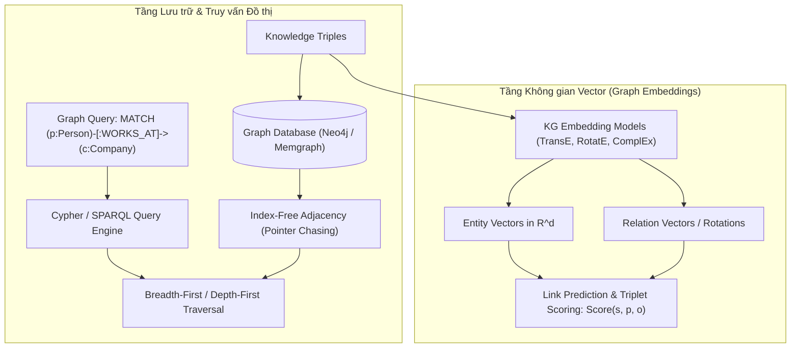
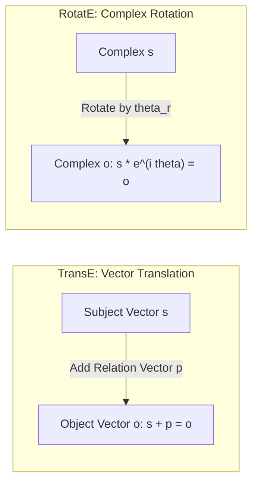
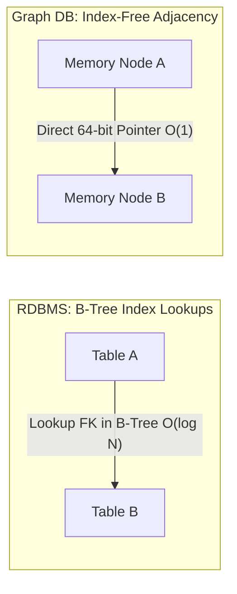
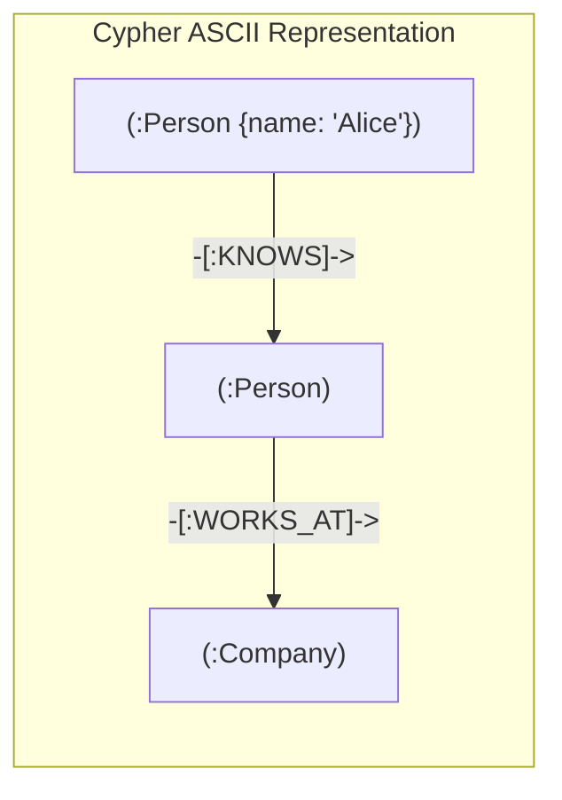

# Chuyên đề: Nhúng Đồ thị, Cơ sở Dữ liệu Đồ thị & Ngôn ngữ Truy vấn (Graph Embeddings, Databases & Querying)

## 1. Tổng quan Chuyên đề
Để máy tính và các thuật toán Machine Learning có thể tính toán trên mạng lưới tri thức phức tạp, Đồ thị Tri thức cần được biểu diễn dưới hai hình thái bổ trợ:
1. **Dạng Hình học Vector (Knowledge Graph Embeddings)**: Nén các thực thể và quan hệ thành các véc-tơ toán học trong không gian liên tục nhiều chiều, cho phép thực hiện phép dự đoán liên kết còn thiếu (Link Prediction) và hoàn thiện đồ thị (Knowledge Graph Completion).
2. **Dạng Cơ sở Dữ liệu & Ngôn ngữ Truy vấn (Graph Databases & Querying)**: Lưu trữ các đỉnh và cạnh dưới dạng cấu trúc con trỏ trực tiếp (Index-free Adjacency) trong các cơ sở dữ liệu đồ thị chuyên dụng (Neo4j, Amazon Neptune, Memgraph), cho phép thực hiện việc duyệt đồ thị (Graph Traversal) và truy vấn quan hệ nhiều bước (Multi-hop Querying) thông qua các ngôn ngữ tiêu chuẩn hóa như **Cypher** và **SPARQL**.

Toàn cảnh kiến trúc lưu trữ, nhúng và truy vấn đồ thị:



---

## 2. Chi tiết từng Keyword

---

### 1. Knowledge Graph Embedding & 2. Entity Embeddings & 3. Relation Embeddings

#### a. Định nghĩa Bản chất Kỹ thuật & Toán học
- **Knowledge Graph Embedding (KGE)**: Bài toán học không giám sát ánh xạ các thực thể $e \in \mathcal{E}$ và các quan hệ $r \in \mathcal{R}$ vào một không gian véc-tơ liên tục nhiều chiều:
  $$e \mapsto \mathbf{e} \in \mathbb{R}^d \quad (\text{hoặc } \mathbb{C}^d), \quad r \mapsto \mathbf{r} \in \mathbb{R}^d$$
  sao cho hàm tính điểm (Score Function) $f(s, p, o)$ cho giá trị cao đối với các bộ ba đúng và giá trị thấp đối với các bộ ba sai (Negative samples).
- **Mô hình Dịch chuyển Tuyến tính (TransE - Bordes et al., 2013)**: Biểu diễn quan hệ dưới dạng phép tịnh tiến (Translation) véc-tơ:
  $$\mathbf{s} + \mathbf{p} \approx \mathbf{o} \implies f(s, p, o) = -\|\mathbf{s} + \mathbf{p} - \mathbf{o}\|_{L_1 / L_2}$$
- **Mô hình Quay Số phức (RotatE - Sun et al., 2019)**: Biểu diễn quan hệ dưới dạng phép quay trên mặt phẳng phức $\mathbb{C}^d$:
  $$\mathbf{o} = \mathbf{s} \circ \mathbf{r}, \quad r_i = e^{i \theta_{r, i}} \implies f(s, p, o) = -\|\mathbf{s} \circ \mathbf{r} - \mathbf{o}\|$$
  *Đột phá*: RotatE có khả năng mô hình hóa hoàn hảo cả 4 mẫu quan hệ đại số: Đối xứng (Symmetry), Phản đối xứng (Antisymmetry), Nghịch đảo (Inversion), và Bắc cầu (Composition).

#### b. Cơ chế Tầng Sâu & Huấn luyện Tương phản (Negative Sampling Loss)
Hàm mất mát huấn luyện KGE thường sử dụng Margin-based Ranking Loss:
$$\mathcal{L} = \sum_{\tau \in \mathcal{T}^+} \sum_{\tau' \in \mathcal{T}^-} \max\big(0, \gamma - f(\tau) + f(\tau')\big)$$
Trong đó $\tau = (s, p, o)$ là bộ ba có thật, $\tau' = (s', p, o)$ là bộ ba giả tạo bằng cách thay thế ngẫu nhiên thực thể nguồn hoặc đích (Corrupted Triples).

#### c. Sơ đồ Minh họa


#### d. Code Thực chiến (C++ & Python)

```cpp
// C++20: Tính điểm Score Function của TransE L2-norm
#include <iostream>
#include <vector>
#include <cmath>

float compute_transe_score(const std::vector<float>& s,
                           const std::vector<float>& p,
                           const std::vector<float>& o) {
    float dist_sq = 0.0f;
    for (size_t i = 0; i < s.size(); ++i) {
        float diff = (s[i] + p[i]) - o[i];
        dist_sq += diff * diff;
    }
    return -std::sqrt(dist_sq); // Điểm càng gần 0 càng đúng
}

int main() {
    std::vector<float> s = {1.0f, 0.5f};
    std::vector<float> p = {0.2f, -0.3f};
    std::vector<float> o_true = {1.2f, 0.2f};
    std::cout << "TransE Score for True Triple: " << compute_transe_score(s, p, o_true) << "\n";
    return 0;
}
```

```python
# Python: Triển khai TransE Scoring bằng PyTorch
import torch
import torch.nn as nn

class TransE(nn.Module):
    def __init__(self, num_entities, num_relations, dim=64):
        super().__init__()
        self.entity_embeddings = nn.Embedding(num_entities, dim)
        self.relation_embeddings = nn.Embedding(num_relations, dim)
        # Khởi tạo chuẩn hóa L2
        nn.init.xavier_uniform_(self.entity_embeddings.weight)
        nn.init.xavier_uniform_(self.relation_embeddings.weight)

    def forward(self, s_idx, p_idx, o_idx):
        s = self.entity_embeddings(s_idx)
        p = self.relation_embeddings(p_idx)
        o = self.entity_embeddings(o_idx)
        # Score = - || s + p - o ||_2
        score = -torch.norm(s + p - o, p=2, dim=-1)
        return score

model = TransE(num_entities=100, num_relations=10, dim=4)
print("Score:", model(torch.tensor([0]), torch.tensor([1]), torch.tensor([2])).item())
```

#### e. Lỗi Thường gặp & Tối ưu Hệ thống
- **TransE sụp đổ trên quan hệ 1-Nhiều (1-to-N)**: Nếu một người có nhiều con ($s + p \approx o_1$ và $s + p \approx o_2$), TransE sẽ ép buộc vector của $o_1$ và $o_2$ trùng nhau!
- **Tối ưu**: Thay thế bằng **TransH** (chiếu lên siêu phẳng riêng của từng quan hệ) hoặc **RotatE**.

#### f. Ứng dụng Thực chiến trong AI Systems
Dự đoán liên kết trong đồ thị tri thức y sinh (tìm thuốc điều trị bệnh mới - Drug Repurposing), phát hiện gian lận tài chính.

---

### 4. Graph Traversal & 5. Graph Querying

#### a. Định nghĩa Bản chất Kỹ thuật & Toán học
- **Graph Traversal (Duyệt Đồ thị)**: Quy trình viếng thăm (khám phá) các đỉnh và cạnh của đồ thị theo các đường dẫn logic:
  - *BFS (Breadth-First Search)*: Mở rộng đều theo từng bước nhảy ($k$-hop neighborhood), tối ưu cho việc tìm đường đi ngắn nhất.
  - *DFS (Depth-First Search)*: Đi sâu hết mức theo một nhánh quan hệ trước khi quay lui (backtracking).
- **Graph Querying**: Việc thực thi các câu truy vấn mẫu đồ thị (Graph Pattern Matching) để trích xuất các đồ thị con thỏa mãn điều kiện ràng buộc:
  $$\mathcal{Q}_{\text{sub}} \cong \mathcal{G}_{\text{target}}$$
  (Bài toán đẳng cấu đồ thị con - Subgraph Isomorphism Problem).

#### b. Cơ chế Tầng Sâu: Index-Free Adjacency (Liên thuộc Không dùng Chỉ mục)
- Trong cơ sở dữ liệu quan hệ (RDBMS), việc nối 3 bảng qua 2 khóa ngoại đòi hỏi 2 phép JOIN bảng tốn kém thông qua chỉ mục B-Tree: $\mathcal{O}(\log N)$.
- Trong Graph Database chuẩn (như Neo4j), mỗi node lưu trực tiếp **con trỏ bộ nhớ vật lý (Pointer Dereferencing)** trỏ thẳng tới các cạnh kề và node láng giềng. Duyệt qua một cạnh chỉ tốn đúng 1 lệnh dereference con trỏ $\mathcal{O}(1)$ mà không cần tra cứu bất kỳ chỉ mục nào!

#### c. Sơ đồ Minh họa


#### d. Code Thực chiến (C++ & Python)

```cpp
// C++20: Duyệt K-hop Neighborhood trên Đồ thị bằng BFS
#include <iostream>
#include <vector>
#include <unordered_map>
#include <queue>
#include <unordered_set>

class AdjacencyGraph {
    std::unordered_map<int, std::vector<int>> adj;
public:
    void add_edge(int u, int v) {
        adj[u].push_back(v);
        adj[v].push_back(u);
    }

    std::vector<int> get_k_hop_neighbors(int start_node, int max_hops) {
        std::unordered_set<int> visited = {start_node};
        std::queue<std::pair<int, int>> q; // {node, current_hop}
        q.push({start_node, 0});
        std::vector<int> k_neighbors;

        while (!q.empty()) {
            auto [u, hop] = q.front();
            q.pop();
            if (hop > 0) k_neighbors.push_back(u);
            if (hop < max_hops) {
                for (int v : adj[u]) {
                    if (!visited.count(v)) {
                        visited.insert(v);
                        q.push({v, hop + 1});
                    }
                }
            }
        }
        return k_neighbors;
    }
};

int main() {
    AdjacencyGraph g;
    g.add_edge(1, 2); g.add_edge(2, 3); g.add_edge(3, 4);
    auto neighbors = g.get_k_hop_neighbors(1, 2);
    std::cout << "2-hop neighbors of Node 1: ";
    for (int n : neighbors) std::cout << n << " ";
    std::cout << "\n";
    return 0;
}
```

```python
# Python: Traversal đồ thị tri thức trích xuất Multi-hop Path
from collections import defaultdict, deque

class SimpleKG:
    def __init__(self):
        # source -> [(relation, target)]
        self.edges = defaultdict(list)

    def add_edge(self, s: str, p: str, o: str):
        self.edges[s].append((p, o))

    def find_paths(self, start: str, end: str, max_depth: int = 2):
        results = []
        queue = deque([([start], [])]) # ([nodes_in_path], [relations_in_path])
        while queue:
            curr_path, curr_rels = queue.popleft()
            curr_node = curr_path[-1]
            if curr_node == end and len(curr_rels) > 0:
                results.append((curr_path, curr_rels))
                continue
            if len(curr_rels) < max_depth:
                for rel, neighbor in self.edges[curr_node]:
                    if neighbor not in curr_path: # Tránh chu trình
                        queue.append((curr_path + [neighbor], curr_rels + [rel]))
        return results

kg = SimpleKG()
kg.add_edge("Transformer", "uses", "Self_Attention")
kg.add_edge("Self_Attention", "has_complexity", "O(N^2)")
print("Paths Found:", kg.find_paths("Transformer", "O(N^2)", max_depth=2))
```

#### e. Lỗi Thường gặp & Tối ưu Hệ thống
- **Supernode Explosion**: Các node trung tâm có hàng triệu cạnh kết nối (ví dụ node quốc gia "United States") khiến thuật toán duyệt bị bùng nổ tổ hợp (combinatorial explosion) và tràn RAM.
- **Tối ưu**: Lọc giới hạn phân nhánh (Degree truncation / Sampling neighbor limit $M \le 50$).

#### f. Ứng dụng Thực chiến trong AI Systems
Khai phá chuỗi liên kết tội phạm rửa tiền, phân tích mạng xã hội, truy vết chuỗi cung ứng.

---

### 6. Cypher & 7. SPARQL & 8. Graph Databases

#### a. Định nghĩa Bản chất Kỹ thuật & Toán học
- **Graph Databases (Cơ sở Dữ liệu Đồ thị)**: Hệ quản trị cơ sở dữ liệu chuyên biệt lưu trữ dữ liệu dưới dạng Labeled Property Graph (LPG) hoặc Semantic Web Triplestores (RDF).
  - *LPG (Labeled Property Graph)*: Đỉnh và cạnh đều có thể mang nhãn (Labels) và thuộc tính dạng key-value pairs (Neo4j, Memgraph).
  - *RDF Triplestore*: Lưu trữ các bộ ba chuẩn W3C, hỗ trợ suy luận ngữ nghĩa OWL (Ontology Web Language) như GraphDB, AllegroGraph, Amazon Neptune.
- **Cypher**: Ngôn ngữ truy vấn đồ thị khai báo (Declarative Graph Query Language) trực quan, sử dụng ký hiệu nghệ thuật ASCII để mô tả các mẫu liên kết:
  $$\text{ASCII Pattern: } \texttt{(node1)-[:RELATION]->(node2)}$$
- **SPARQL**: Ngôn ngữ truy vấn chuẩn hóa của W3C dành riêng cho các kho dữ liệu bộ ba RDF:
  $$\texttt{SELECT ?s ?o WHERE \{ ?s <http://xmlns.com/foaf/0.1/knows> ?o \}}$$

#### b. Cơ chế Tầng Sâu & Thực thi Truy vấn
Khi thực thi một câu lệnh Cypher:
`MATCH (a:Person {name: 'Alice'})-[:KNOWS]->(b:Person)-[:WORKS_AT]->(c:Company) RETURN c.name`
Bộ tối ưu hóa truy vấn (Cost-based Query Optimizer) của Neo4j sẽ:
1. Tra cứu chỉ mục đỉnh tìm con trỏ node `Alice`.
2. Lần theo danh sách con trỏ cạnh `KNOWS` ở bộ nhớ RAM để tìm các node `b`.
3. Tiếp tục lần theo con trỏ cạnh `WORKS_AT` để lấy `c` mà không cần quét bảng.

#### c. Sơ đồ Minh họa


#### d. Code Thực chiến (C++ & Python)

```cpp
// C++17: Bộ sinh truy vấn Cypher động từ tham số người dùng
#include <iostream>
#include <string>

std::string generate_cypher_2hop(const std::string& entity_name, const std::string& rel1, const std::string& rel2) {
    return "MATCH (a {name: '" + entity_name + "'})-[:" + rel1 + "]->(b)-[:" + rel2 + "]->(c) RETURN a, b, c LIMIT 20;";
}

int main() {
    std::cout << generate_cypher_2hop("Google", "OWNED_BY", "SHAREHOLDER") << "\n";
    return 0;
}
```

```python
# Python: Tạo và truy vấn mẫu Cypher trên Neo4j Client logic
def run_cypher_query_mock(cypher_script: str):
    print("Executing Cypher Script on Graph Engine:\n" + cypher_script)
    # Giả lập kết quả trả về
    return [
        {"entity_a": "Sam Altman", "relation": "CEO_OF", "entity_b": "OpenAI"}
    ]

query = """
MATCH (p:Person {name: 'Sam Altman'})-[r:CEO_OF]->(org:Organization)
RETURN p.name, type(r), org.name
"""
results = run_cypher_query_mock(query)
print("Query Result:", results)
```

#### e. Lỗi Thường gặp & Tối ưu Hệ thống
- **Truy vấn không giới hạn số bước nhảy (Unbounded Variable-length Path)**: Viết `MATCH (a)-[*]->(b)` có thể khóa chặt toàn bộ server vì đồ thị chứa hàng triệu đường dẫn.
- **Tối ưu**: Luôn thiết lập cận trên cho bước nhảy: `MATCH (a)-[*1..3]->(b)` và kèm theo mệnh đề `LIMIT`.

#### f. Ứng dụng Thực chiến trong AI Systems
Text-to-Cypher trong LangChain Neo4j QA Chain, cho phép LLM tự dịch câu hỏi tiếng Việt sang Cypher để truy vấn đồ thị doanh nghiệp.
