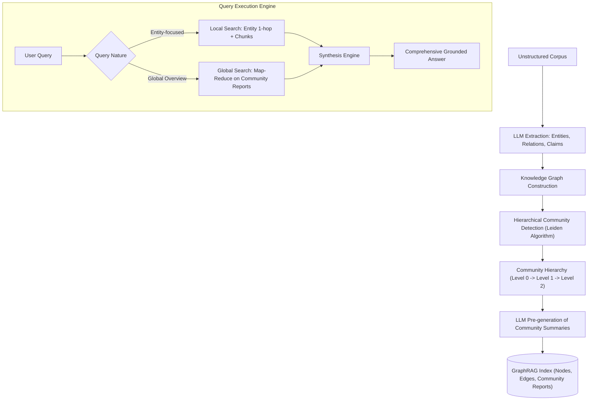
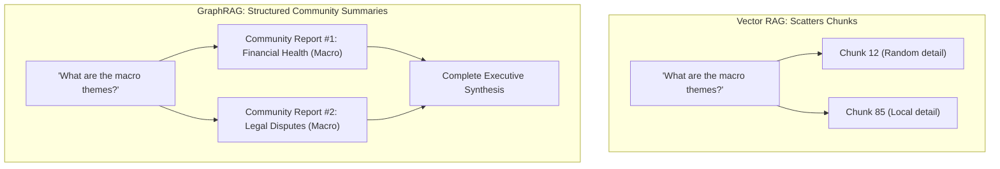
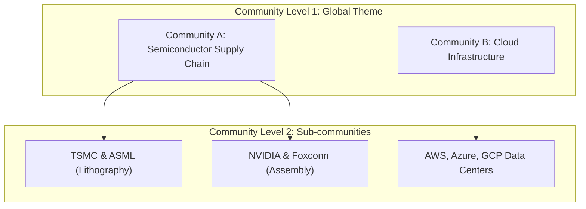
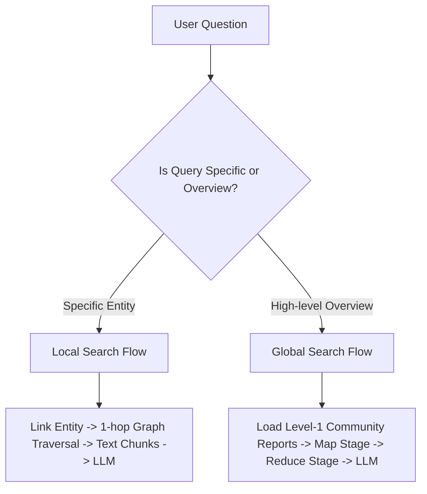
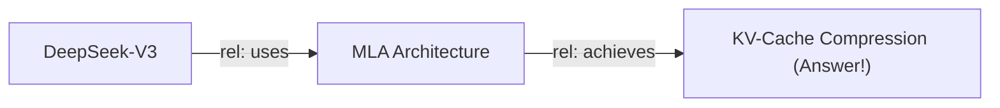

# Chuyên đề: GraphRAG, Cơ chế Suy luận & Tìm kiếm Toàn cục (GraphRAG, Reasoning & Search Mechanisms)

## 1. Tổng quan Chuyên đề
Vector RAG truyền thống thường thất bại hoàn toàn trước hai dạng câu hỏi phức tạp:
1. **Câu hỏi Suy luận Đa bước (Multi-Hop Reasoning)**: *"Người vợ thứ hai của nhà khoa học phát minh ra kính hiển vi sinh ra ở thành phố nào?"* (Đòi hỏi xâu chuỗi thông tin qua nhiều thực thể liên tiếp).
2. **Câu hỏi Tổng quan Toàn diện (Global Sensemaking / Whole-dataset Summarization)**: *"Các chủ đề chính được thảo luận trong toàn bộ kho tài liệu 1000 trang này là gì?"* (Vector search chỉ lấy được vài chunk cục bộ ngẫu nhiên, hoàn toàn không thể khái quát được toàn bộ bức tranh dữ liệu).

**GraphRAG (Microsoft Research, Edge et al., 2024)** là giải pháp mang tính cách mạng kết hợp **Phát hiện Cộng đồng (Community Detection)** theo cấu trúc phân cấp (Hierarchical Leiden Algorithm) và **Tóm tắt Đồ thị (Graph Summarization)**. GraphRAG hỗ trợ hai chế độ tìm kiếm độc lập: **Local Search** (cho câu hỏi xoay quanh thực thể cụ thể) và **Global Search** (cho câu hỏi tổng hợp bao quát toàn bộ ngữ liệu).

Kiến trúc vận hành của Microsoft GraphRAG:



---

## 2. Chi tiết từng Keyword

---

### 1. Graph-Based Retrieval & 2. Graph-Augmented Generation & 3. GraphRAG

#### a. Định nghĩa Bản chất Kỹ thuật & Toán học
- **Graph-Based Retrieval**: Quá trình tìm kiếm thông tin không chỉ dựa vào vector của văn bản mà dựa vào cấu trúc topo hình học của đồ thị (Graph Topology): Đỉnh liên thuộc, các đường đi ngắn nhất (Shortest Paths), và các cụm cộng đồng (Dense Subgraphs).
- **Graph-Augmented Generation (GAG)**: Cơ chế nạp các đường dẫn tri thức (Knowledge Paths) hoặc mạng con (Subgraphs) $\mathcal{G}_{sub} = (\mathcal{V}_{sub}, \mathcal{E}_{sub})$ vào ngữ cảnh của LLM để định hướng suy luận:
  $$P(\mathbf{y} \mid \mathbf{x}, \mathcal{G}_{sub}) = \prod_{t=1}^T P(y_t \mid \mathbf{x}, \mathcal{G}_{sub}, \mathbf{y}_{<t})$$
- **GraphRAG**: Khung kiến trúc hoàn chỉnh do Microsoft giới thiệu:
  1. Tự động chuyển đổi văn bản thành Knowledge Graph.
  2. Phân cụm cộng đồng thực thể đa tầng bằng giải thuật Leiden.
  3. Dùng LLM viết trước các báo cáo tóm tắt độc lập (Community Reports) cho từng cụm.
  4. Sử dụng mô hình Map-Reduce trên các báo cáo cộng đồng để trả lời các câu hỏi toàn thể.

#### b. Cơ chế Tầng Sâu: GraphRAG vượt trội hơn Vector RAG như thế nào?
- **Vector RAG**: Tìm kiếm điểm mù (Isolated Chunks). Chỉ tìm kiếm các đoạn văn bản có từ ngữ hoặc ý nghĩa gần với câu hỏi.
- **GraphRAG**: Cung cấp bức tranh cấu trúc toàn cảnh. Ngay cả khi câu hỏi không đề cập trực tiếp đến tên thực thể nào, các báo cáo cộng đồng (Community Reports) đã tổng hợp sẵn các xu hướng vĩ mô, cho phép trả lời câu hỏi tổng quát với độ chính xác cao gấp 2–3 lần.

#### c. Sơ đồ Minh họa


#### d. Code Thực chiến (C++ & Python)

```cpp
// C++20: Cấu trúc báo cáo cộng đồng Community Report trong GraphRAG
#include <iostream>
#include <string>
#include <vector>

struct CommunityReport {
    int community_id;
    int level;
    std::string title;
    std::string summary;
    std::vector<std::string> member_entities;
};

class GraphRAGIndex {
    std::vector<CommunityReport> reports;
public:
    void add_report(const CommunityReport& rep) { reports.push_back(rep); }
    const std::vector<CommunityReport>& get_reports_by_level(int lvl) const {
        // Lọc các báo cáo ở tầng chỉ định
        return reports;
    }
};
```

```python
# Python: Mô phỏng khung GraphRAG Pipeline
class GraphRAGPipeline:
    def __init__(self, community_reports: list[dict]):
        self.reports = community_reports

    def global_search_map_reduce(self, query: str, llm_fn) -> str:
        # Giai đoạn 1: MAP - Đánh giá từng Community Report
        intermediate_answers = []
        for rep in self.reports:
            prompt_map = f"Query: {query}\nCommunity: {rep['title']}\nSummary: {rep['summary']}\nProvide key facts:"
            fact = llm_fn(prompt_map)
            intermediate_answers.append(fact)
        
        # Giai đoạn 2: REDUCE - Tổng hợp các câu trả lời trung gian
        prompt_reduce = f"Query: {query}\nSynthesize all facts:\n" + "\n".join(intermediate_answers)
        return llm_fn(prompt_reduce)

reports = [
    {"title": "AI Hardware", "summary": "NVIDIA and AMD produce GPUs for training."},
    {"title": "Open Source Models", "summary": "Meta releases LLaMA weights for researchers."}
]
mock_llm = lambda p: f"[Processed: {p[:30]}...]"
rag = GraphRAGPipeline(reports)
print("GraphRAG Result:\n", rag.global_search_map_reduce("Overview of AI Ecosystem", mock_llm))
```

#### e. Lỗi Thường gặp & Tối ưu Hệ thống
- **Chi phí Token khổng lồ khi Indexing**: Việc trích xuất toàn bộ thực thể và sinh Community Reports cho một kho tài liệu lớn tốn hàng ngàn USD tiền API LLM.
- **Tối ưu**: Sử dụng các mô hình nguồn mở như Llama-3-70B chạy local vLLM để xây dựng đồ thị ngoại tuyến.

#### f. Ứng dụng Thực chiến trong AI Systems
Phân tích hồ sơ rò rỉ (như Panama Papers), nghiên cứu thị trường, điều tra gian lận nội bộ doanh nghiệp.

---

### 4. Community Detection & 5. Graph Clustering & 6. Graph Summarization

#### a. Định nghĩa Bản chất Kỹ thuật & Toán học
- **Community Detection (Phát hiện Cộng đồng)**: Tác vụ phân chia tập đỉnh $\mathcal{V}$ của đồ thị thành các cụm $\mathcal{C} = \{C_1, C_2, \dots, C_k\}$ sao cho mật độ cạnh kết nối nội bộ trong từng cụm là lớn nhất, trong khi mật độ cạnh kết nối giữa các cụm là nhỏ nhất:
  $$\max_{\mathcal{C}} \mathcal{Q}(\mathcal{C}) \quad (\text{Tối đa hóa hàm Modularity } \mathcal{Q})$$
  $$\mathcal{Q} = \frac{1}{2m} \sum_{i, j} \left( A_{ij} - \frac{k_i k_j}{2m} \right) \delta(c_i, c_j)$$
  Trong đó $A_{ij}$ là ma trận kề, $k_i$ là bậc của đỉnh $i$, $m$ là tổng số cạnh, $c_i$ là nhãn cộng đồng của node $i$.
- **Hierarchical Leiden Algorithm**: Giải thuật phát hiện cộng đồng hiện đại cải tiến từ Louvain, khắc phục triệt để lỗi sinh ra các cộng đồng bị ngắt kết nối (Disconnected Communities) và đảm bảo hội tụ về cấu trúc phân cấp ổn định.
- **Graph Summarization (Tóm tắt Đồ thị)**: Quá trình dùng LLM để nén thông tin chi tiết của hàng trăm đỉnh và cạnh trong một cụm thành một báo cáo có cấu trúc gồm: Tiêu đề, phát hiện chính (Key Findings), và mức độ quan trọng.

#### b. Cơ chế Tầng Sâu & Cấu trúc Phân tầng Leiden (Level Hierarchy)
- **Level 0 (Root Level)**: 3–5 cộng đồng vĩ mô lớn nhất đại diện cho các ngành/chủ đề toàn cục.
- **Level 1 (Sub-communities)**: 20–50 phân ngành cụ thể.
- **Level 2 (Micro-clusters)**: Hàng trăm cụm cục bộ gồm các thực thể liên quan trực tiếp.

#### c. Sơ đồ Minh họa


#### d. Code Thực chiến (C++ & Python)

```cpp
// C++20: Cấu trúc biểu diễn phân vùng cộng đồng Modularity
#include <iostream>
#include <vector>
#include <unordered_map>

class CommunityCluster {
    std::unordered_map<int, int> node_to_community;
public:
    void assign(int node_id, int comm_id) {
        node_to_community[node_id] = comm_id;
    }
    int get_community(int node_id) const {
        auto it = node_to_community.find(node_id);
        return it != node_to_community.end() ? it->second : -1;
    }
};
```

```python
# Python: Mô phỏng phát hiện cộng đồng và tóm tắt tệp
import networkx as nx

def build_community_summary_mock(graph: nx.Graph) -> list[dict]:
    # Sử dụng thuật toán Girvan-Newman hoặc Greedy Modularity
    import networkx.algorithms.community as nx_comm
    communities = list(nx_comm.greedy_modularity_communities(graph))
    summaries = []
    for idx, comm in enumerate(communities):
        members = list(comm)
        summary = {
            "community_id": idx,
            "members": members,
            "summary_text": f"Community centered around entities: {', '.join(members)}"
        }
        summaries.append(summary)
    return summaries

G = nx.Graph()
G.add_edges_from([("CPU", "RAM"), ("RAM", "Motherboard"), ("GPU", "VRAM"), ("GPU", "CUDA")])
print("Generated Summaries:\n", build_community_summary_mock(G))
```

#### e. Lỗi Thường gặp & Tối ưu Hệ thống
- **Cộng đồng quá lớn (Mega-communities)**: Khiến số lượng token của các thành viên vượt quá Context Window của mô hình tóm tắt.
- **Tối ưu**: Thiết lập giới hạn kích thước tối đa cho cộng đồng và tiếp tục chia nhánh đệ quy (Recursive Sub-clustering).

#### f. Ứng dụng Thực chiến trong AI Systems
Module trung tâm của Microsoft GraphRAG Indexing Engine.

---

### 7. Local Search vs 8. Global Search

#### a. Định nghĩa Bản chất Kỹ thuật & Toán học
- **Local Search (Tìm kiếm Cục bộ)**: Dành cho các câu hỏi nhắm vào **thực thể cụ thể (Entity-centric questions)**:
  *"Thông số kỹ thuật và chuỗi cung ứng của chip H100 là gì?"*
  - *Cơ chế*: Bắt đầu từ việc tìm các Entity Seeds liên quan trong truy vấn $\to$ Mở rộng sang đồ thị lân cận 1-hop / 2-hop $\to$ Lấy các Text Chunks và quan hệ kề $\to$ Nạp vào context của LLM.
- **Global Search (Tìm kiếm Toàn cục)**: Dành cho các câu hỏi **tổng quan, trừu tượng (Dataset-wide Sensemaking questions)**:
  *"Những rủi ro địa chính trị lớn nhất ảnh hưởng đến ngành công nghệ là gì?"*
  - *Cơ chế*: Hoàn toàn không tìm kiếm theo entity hay chunk đơn lẻ! Thay vào đó, áp dụng cơ chế Map-Reduce trên tập hợp các **Community Reports** ở một tầng phân cấp cụ thể trong đồ thị.

#### b. Cơ chế Tầng Sâu & Bảng So sánh
| Tiêu chí | Local Search | Global Search |
| :--- | :--- | :--- |
| **Bản chất câu hỏi** | Hẹp, chi tiết, cụ thể về đối tượng | Rộng, khái quát, bao quát toàn bộ ngữ liệu |
| **Đơn vị truy xuất** | Entities, Quan hệ kề, Text Chunks gốc | Báo cáo cộng đồng (Community Reports) |
| **Chi phí suy luận** | Rất thấp (1 lần gọi LLM) | Cao (Map-Reduce qua hàng chục Community Reports) |
| **Khả năng trả lời** | Cực kỳ chính xác cho Factoid QA | Xuất sắc cho Executive Summary / Thematic Analysis |

#### c. Sơ đồ Minh họa


#### d. Code Thực chiến (C++ & Python)

```cpp
// C++17: Bộ phân loại câu hỏi chuyển luồng Local vs Global
#include <iostream>
#include <string>

enum class SearchMode { LOCAL_SEARCH, GLOBAL_SEARCH };

SearchMode select_graphrag_mode(const std::string& query) {
    if (query.find("summary") != std::string::npos || 
        query.find("overview") != std::string::npos || 
        query.find("main themes") != std::string::npos ||
        query.find("trends") != std::string::npos) {
        return SearchMode::GLOBAL_SEARCH;
    }
    return SearchMode::LOCAL_SEARCH;
}
```

```python
# Python: Triển khai Local Search vs Global Search Dispatcher
class GraphRAGDispatcher:
    def __init__(self, local_search_fn, global_search_fn):
        self.local_search = local_search_fn
        self.global_search = global_search_fn

    def execute(self, query: str):
        is_overview = any(w in query.lower() for w in ["overview", "themes", "summary", "key trends", "what are the"])
        if is_overview:
            print("[Routing to GLOBAL SEARCH (Community Map-Reduce)]")
            return self.global_search(query)
        else:
            print("[Routing to LOCAL SEARCH (Entity 1-Hop Subgraph)]")
            return self.local_search(query)

dispatcher = GraphRAGDispatcher(
    local_search_fn=lambda q: "Local entities: [Apple M3, 3nm process, TSMC]",
    global_search_fn=lambda q: "Global report: [Macro trends: Chiplet architecture and AI acceleration]"
)
print(dispatcher.execute("What are the key trends across the entire report?"))
print(dispatcher.execute("What is the manufacturing node of Apple M3?"))
```

#### e. Lỗi Thường gặp & Tối ưu Hệ thống
- **Dùng nhầm Local Search cho câu hỏi vĩ mô**: Khi người dùng hỏi *"Toàn bộ tài liệu nói về điều gì?"*, Local Search sẽ tìm vector gần nhất và trả về một câu chuyện chi tiết vô nghĩa thay vì tóm tắt toàn bộ.
- **Tối ưu**: Huấn luyện một Intent Router chuyên biệt để phân luồng Local / Global tự động.

#### f. Ứng dụng Thực chiến trong AI Systems
Tính năng cốt lõi trong Microsoft GraphRAG CLI và các công cụ trợ lý phân tích báo cáo doanh nghiệp.

---

### 9. Graph Reasoning & 10. Multi-Hop Reasoning

#### a. Định nghĩa Bản chất Kỹ thuật & Toán học
- **Graph Reasoning (Suy luận Đồ thị)**: Khả năng rút ra các tri thức mới, chưa từng được phát biểu tường minh trong văn bản, thông qua việc áp dụng các quy tắc logic hình thức (Horn Clauses / Logical Rules) hoặc suy luận ngầm trên cấu trúc đồ thị:
  $$\forall X, Y, Z: \quad \text{Father}(X, Y) \wedge \text{Brother}(Y, Z) \implies \text{Uncle}(X, Z)$$
- **Multi-Hop Reasoning (Suy luận Đa bước)**: Khả năng xâu chuỗi thông tin qua đường dẫn gồm $k$ cạnh liên tiếp ($k \ge 2$) để tìm câu trả lời:
  $$e_0 \xrightarrow{r_1} e_1 \xrightarrow{r_2} e_2 \dots \xrightarrow{r_k} e_k$$
  *Ví dụ*:
  - Bước 1: $\langle \text{DeepSeek-V3}, \text{uses}, \text{MLA} \rangle$
  - Bước 2: $\langle \text{MLA}, \text{stands\_for}, \text{Multi-Head Latent Attention} \rangle$
  - Bước 3: $\langle \text{Multi-Head Latent Attention}, \text{compresses}, \text{KV-Cache} \rangle$
  $\implies$ *Kết luận suy luận đa bước*: "DeepSeek-V3 nén KV-Cache thông qua cơ chế MLA".

#### b. Cơ chế Tầng Sâu & Giải thuật Subgraph Extraction
Khi giải quyết bài toán Multi-Hop, hệ thống trích xuất một đồ thị con lồi (Steiner Minimal Tree / Shortest Path Graph) kết nối giữa các thực thể xuất hiện trong câu hỏi và các thực thể tiềm năng đích. Đồ thị con này sau đó được tuyến tính hóa (Linearize) thành chuỗi câu logic và nạp vào Context của LLM.

#### c. Sơ đồ Minh họa


#### d. Code Thực chiến (C++ & Python)

```cpp
// C++20: Tìm kiếm chuỗi suy luận đa bước ngắn nhất (Shortest Inference Path)
#include <iostream>
#include <vector>
#include <string>
#include <queue>
#include <unordered_map>

struct Edge {
    int to;
    std::string relation;
};

std::vector<std::string> trace_reasoning_path(int start, int target,
                                              const std::unordered_map<int, std::vector<Edge>>& graph) {
    std::queue<std::pair<int, std::vector<std::string>>> q;
    q.push({start, {}});
    std::unordered_set<int> visited = {start};

    while (!q.empty()) {
        auto [u, path] = q.front();
        q.pop();
        if (u == target) return path;

        auto it = graph.find(u);
        if (it != graph.end()) {
            for (const auto& edge : it->second) {
                if (!visited.count(edge.to)) {
                    visited.insert(edge.to);
                    auto new_path = path;
                    new_path.push_back(edge.relation);
                    q.push({edge.to, new_path});
                }
            }
        }
    }
    return {};
}
```

```python
# Python: Xâu chuỗi Multi-hop reasoning và tuyến tính hóa cho LLM
class MultiHopReasoner:
    def __init__(self, triples: list[tuple]):
        self.triples = triples

    def explain_chain(self, start_entity: str, target_entity: str) -> str:
        # Giả lập tìm chain: A -> B -> C
        explanation = []
        curr = start_entity
        for s, p, o in self.triples:
            if s == curr:
                explanation.append(f"Fact: {s} {p} {o}.")
                curr = o
                if curr == target_entity:
                    break
        return " Reasoning Chain: " + " Then ".join(explanation)

triples = [
    ("Alan Turing", "conceived", "Turing Machine"),
    ("Turing Machine", "formalized", "Theory of Computation")
]
reasoner = MultiHopReasoner(triples)
print(reasoner.explain_chain("Alan Turing", "Theory of Computation"))
```

#### e. Lỗi Thường gặp & Tối ưu Hệ thống
- **Lạc đường suy luận (Semantic Drift during hops)**: Sau 3–4 bước nhảy, chuỗi suy luận có thể trôi dạt sang các chủ đề hoàn toàn không liên quan đến câu hỏi ban đầu.
- **Tối ưu**: Giới hạn tối đa 3 bước nhảy ($k \le 3$) và sử dụng Cosine similarity phạt các bước nhảy đi chệch khỏi không gian ngữ nghĩa của câu hỏi.

#### f. Ứng dụng Thực chiến trong AI Systems
Hệ thống chẩn đoán y tế phức hợp (liên kết triệu chứng $\to$ cơ chế sinh học $\to$ thuốc điều trị), phân tích chuỗi nguyên nhân gốc rễ trong giám sát DevOps.
