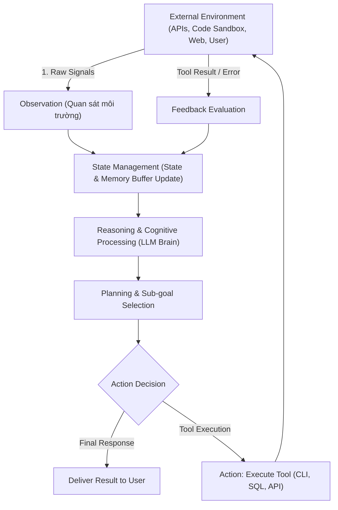
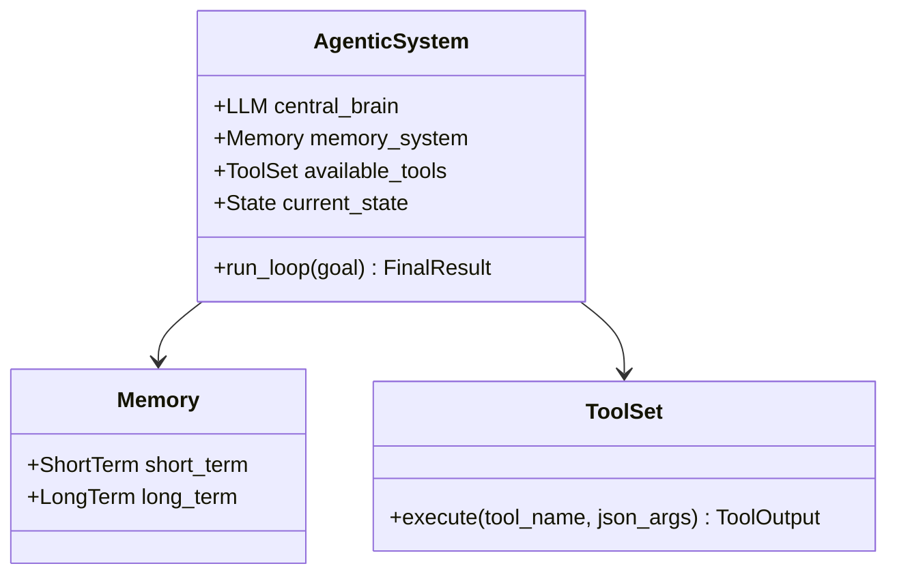
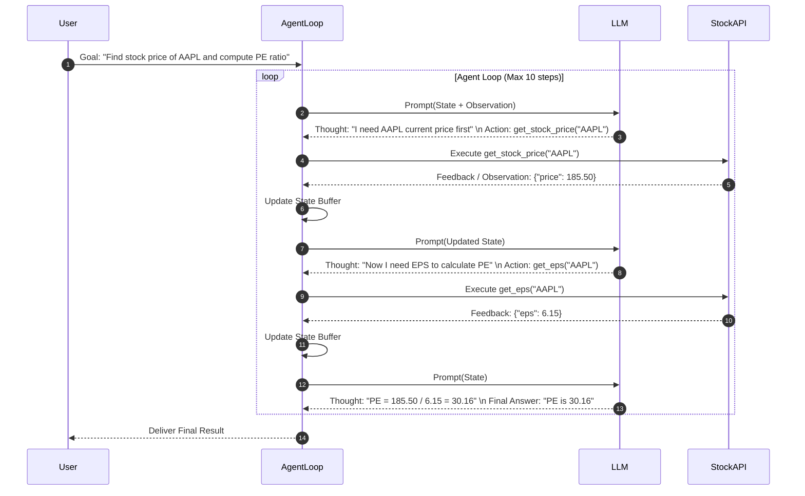
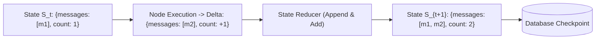

# Chuyên đề: Nền tảng AI Agent, Vòng lặp Thực thi & Quản lý Trạng thái (Agent Foundations, Loop & State Management)

## 1. Tổng quan Chuyên đề
Sự xuất hiện của Large Language Models (LLMs) đã đánh dấu bước chuyển mình mang tính thời đại: từ **Mô hình Thụ động (Passive Generation - chỉ biết sinh văn bản theo prompt)** sang **Tác tử Thông minh Chủ động (Autonomous AI Agents - có khả năng nhận thức, lập luận, hành động và tự sửa đổi hành vi)**.

Một hệ thống Agentic hoàn chỉnh không chỉ đơn thuần là việc gọi API mô hình ngôn ngữ. Nó là một cỗ máy trạng thái phức hợp gồm: một bộ não suy luận (Reasoning Engine), một vòng lặp kín (**Agent Loop: Observation $\to$ Reasoning $\to$ Planning $\to$ Action $\to$ Feedback**), một cơ chế lưu giữ trạng thái bền vững (**State Management**), và khả năng tương tác trực tiếp với thế giới kỹ thuật số thông qua công cụ phần mềm (**Tools & APIs**).

Kiến trúc Vòng lặp Nhận thức - Hành động của một AI Agent:



---

## 2. Chi tiết từng Keyword

---

### 1. AI Agents & 2. LLM-Based Agents & 3. Autonomous Agents & 4. Conversational Agents & 5. Task-Oriented Agents & 6. Tool-Using Agents & 7. Agentic Systems

#### a. Định nghĩa Bản chất Kỹ thuật & Toán học
- **AI Agent (Tác tử AI)**: Một thực thể tính toán độc lập có khả năng cảm nhận môi trường thông qua các cảm biến (Sensors), duy trì trạng thái nội bộ, và thực thi các hành động (Actions) thông qua các cơ cấu tác động (Actuators) nhằm tối đa hóa hàm mục tiêu kỳ vọng:
  $$\pi^* = \arg\max_\pi \mathbb{E}\left[ \sum_{t=0}^T \gamma^t R(s_t, a_t) \;\Big|\; a_t \sim \pi(\cdot \mid s_t) \right]$$
- **LLM-Based Agents**: Tác tử thông minh sử dụng Large Language Model làm bộ điều khiển trung tâm (Central Cognitive Engine). LLM đóng vai trò như hệ điều hành sinh học: lập luận ngữ nghĩa, suy đoán logic, dịch ngôn ngữ tự nhiên thành lời gọi hàm có cấu trúc.
- **Autonomous Agents (Tác tử Tự chủ)**: Agent có khả năng tự đặt ra các mục tiêu con (Sub-goals), tự khởi tạo hành động và giải quyết các bài toán mở dài hạn mà không cần sự can thiệp liên tục từng bước của con người.
- **Conversational Agents**: Tác tử hướng hội thoại tự nhiên đa lượt (Multi-turn dialogue), duy trì nhân cách nhất quán và theo dõi lịch sử ngữ cảnh giao tiếp.
- **Task-Oriented Agents**: Tác tử được thiết kế chuyên biệt để hoàn thành một nhiệm vụ hữu hạn xác định (ví dụ: đặt vé máy bay, trích xuất hóa đơn, sửa lỗi cú pháp code).
- **Tool-Using Agents**: Agent được trang bị tập công cụ mở rộng $\mathcal{T} = \{\tau_1, \tau_2, \dots, \tau_m\}$ (như máy tính số học, API thời tiết, Shell CLI, trình duyệt web), vượt qua giới hạn của việc chỉ sinh văn bản thuần túy.
- **Agentic Systems**: Hệ thống phần mềm hoàn chỉnh kết hợp nhiều Agent, môi trường thực thi (Environment Sandbox), hệ thống phân quyền, cơ chế giám sát và bộ nhớ ngoài.

#### b. Cơ chế Tầng Sâu & Nguyên tắc Hoạt động
Khác biệt giữa một LLM thông thường và một LLM Agent:
- *LLM thuần túy*: $y = \text{Forward}(x)$ (Một hàm ánh xạ tĩnh $1 \to 1$).
- *LLM Agent*: Vận hành trong một vòng lặp động có trạng thái (Dynamic Stateful While-Loop): Khởi tạo trạng thái $S_0$, liên tục tương tác với môi trường để cập nhật trạng thái $S_{t+1} = \text{Step}(S_t, a_t)$ cho tới khi điều kiện dừng (Termination Condition) được thỏa mãn.

#### c. Sơ đồ Minh họa


#### d. Code Thực chiến (C++ & Python)

```cpp
// C++20: Khung kiến trúc Agent trừu tượng hướng đối tượng
#include <iostream>
#include <string>
#include <vector>
#include <memory>

class ITool {
public:
    virtual std::string name() const = 0;
    virtual std::string execute(const std::string& input_json) = 0;
    virtual ~ITool() = default;
};

class CalculatorTool : public ITool {
public:
    std::string name() const override { return "calculator"; }
    std::string execute(const std::string& input_json) override {
        return "Result: 42"; // Giả lập tính toán
    }
};

class BaseAgent {
protected:
    std::vector<std::shared_ptr<ITool>> tools;
public:
    void register_tool(std::shared_ptr<ITool> tool) {
        tools.push_back(tool);
    }
    virtual std::string run(const std::string& goal) = 0;
    virtual ~BaseAgent() = default;
};
```

```python
# Python: Khung Tool-Using Agent cơ bản
from typing import Callable, Dict

class ToolUsingAgent:
    def __init__(self, llm_decision_fn: Callable):
        self.llm = llm_decision_fn
        self.tools: Dict[str, Callable] = {}

    def register_tool(self, name: str, fn: Callable):
        self.tools[name] = fn

    def step(self, user_goal: str) -> str:
        # LLM quyết định: Trả lời thẳng hay gọi tool
        decision = self.llm(user_goal)
        if decision.startswith("CALL_TOOL:"):
            _, tool_name, arg = decision.split(":")
            if tool_name in self.tools:
                tool_output = self.tools[tool_name](arg)
                return f"Agent executed [{tool_name}] with output: {tool_output}"
        return f"Agent responded: {decision}"

# Mock
agent = ToolUsingAgent(lambda g: "CALL_TOOL:search:OpenAI Strawberry")
agent.register_tool("search", lambda q: f"Search results for '{q}'")
print(agent.step("What is the latest OpenAI model?"))
```

#### e. Lỗi Thường gặp & Tối ưu Hệ thống
- **Excessive Agency (Thừa quyền hạn)**: Cho phép Agent tự ý xóa database hoặc gửi email cho toàn bộ nhân viên mà không có người phê duyệt.
- **Tối ưu**: Áp dụng nguyên tắc đặc quyền tối thiểu (Least Privilege) và thiết lập cơ chế Human-in-the-Loop cho các hành động rủi ro cao.

#### f. Ứng dụng Thực chiến trong AI Systems
Kỹ sư phần mềm ảo (Devin, Cursor Agent), chuyên viên phân tích thị trường tự động.

---

### 8. Agent Loop & 9. Observation & 10. Reasoning & 11. Planning & 12. Action & 13. Feedback

#### a. Định nghĩa Bản chất Kỹ thuật & Toán học
**Agent Loop** là vòng lặp khép kín điều khiển toàn bộ chu trình sống của tác tử. Tại mỗi bước lặp $t \in [0, T_{max}]$:
1. **Observation ($o_t \in \mathcal{O}$)**: Cảm nhận kết quả từ môi trường hoặc câu lệnh của người dùng:
   $$o_t = \text{Perceive}(\text{Environment})$$
2. **State Management**: Cập nhật lịch sử và trạng thái:
   $$S_t = \text{UpdateState}(S_{t-1}, o_t)$$
3. **Reasoning ($r_t$)**: Tiến trình suy luận nội tâm (Internal Monologue / Chain-of-Thought):
   $$r_t \sim P_{\text{LLM}}(\text{Thought} \mid S_t)$$
4. **Planning ($p_t$)**: Lập kế hoạch phân rã mục tiêu thành chuỗi hành động:
   $$p_t = (a_{t, 1}, a_{t, 2}, \dots)$$
5. **Action ($a_t \in \mathcal{A}$)**: Thực thi hành động hoặc phát ra lời gọi hàm (Tool Invocation):
   $$a_t = \text{ToolCall}(\text{name}, \text{arguments})$$
6. **Feedback ($f_t$)**: Môi trường trả về kết quả (stdout, stderr, JSON response) làm tín hiệu phản hồi để bắt đầu vòng lặp tiếp theo $t+1$:
   $$o_{t+1} = f_t = \text{Env.Execute}(a_t)$$

#### b. Cơ chế Tầng Sâu & Điều kiện Dừng (Termination Conditions)
Vòng lặp Agent phải luôn có các điều kiện dừng an toàn để tránh lặp vô tận:
1. `Finish Action`: Agent tự đánh giá mục tiêu đã hoàn thành (`Action: Final_Answer`).
2. `Max Iterations Reached`: Đạt số bước tối đa (ví dụ $t \ge 20$).
3. `Token Limit / Budget Exceeded`: Vượt quá ngân sách token hoặc chi phí tài chính cho phép.
4. `Unrecoverable Tool Error`: Lỗi công cụ lặp lại liên tiếp 3 lần mà không tự sửa được.

#### c. Sơ đồ Minh họa


#### d. Code Thực chiến (C++ & Python)

```cpp
// C++20: Cỗ máy trạng thái Vòng lặp Agent Loop chuẩn mực
#include <iostream>
#include <string>
#include <vector>

enum class StepResult { CONTINUE, FINISH, ERROR_LIMIT };

struct AgentState {
    int current_step = 0;
    int max_steps = 5;
    std::string user_goal;
    std::vector<std::string> history;
    std::string final_answer;
};

class MiniAgentLoop {
public:
    StepResult execute_turn(AgentState& state) {
        if (state.current_step >= state.max_steps) {
            return StepResult::ERROR_LIMIT;
        }
        state.current_step++;
        std::cout << "[Step " << state.current_step << "] Thinking & Planning...\n";
        
        // Giả lập phán đoán hoàn thành ở step 2
        if (state.current_step == 2) {
            state.final_answer = "Task successfully solved!";
            return StepResult::FINISH;
        }
        state.history.push_back("Executed intermediate tool step.");
        return StepResult::CONTINUE;
    }
};

int main() {
    AgentState state;
    state.user_goal = "Automate unit tests";
    MiniAgentLoop loop;
    while (true) {
        auto res = loop.execute_turn(state);
        if (res == StepResult::FINISH) {
            std::cout << "SUCCESS: " << state.final_answer << "\n";
            break;
        } else if (res == StepResult::ERROR_LIMIT) {
            std::cout << "FAILED: Reached step limit.\n";
            break;
        }
    }
    return 0;
}
```

```python
# Python: Agent Loop hoàn chỉnh có Feedback Mechanism
class AutonomousAgentLoop:
    def __init__(self, max_iterations=5):
        self.max_iterations = max_iterations
        self.state = {"history": [], "finished": False}

    def run(self, goal: str):
        print(f"Starting Agent Loop for Goal: '{goal}'")
        for step in range(1, self.max_iterations + 1):
            print(f"\n--- Iteration {step} ---")
            # 1. Reasoning & Planning
            thought = f"Analyze progress at step {step}"
            print(f"Thought: {thought}")
            
            # 2. Action
            if step == 2:
                print("Action: FINISH(Answer='Goal reached!')")
                self.state["finished"] = True
                return "Goal reached!"
            
            action = f"CALL_TOOL:fetch_data(step={step})"
            print(f"Action: {action}")
            
            # 3. Feedback / Observation
            observation = f"Data from step {step}: OK"
            print(f"Observation: {observation}")
            self.state["history"].append({"step": step, "obs": observation})
            
        return "Failed: Maximum iterations reached."

agent = AutonomousAgentLoop()
agent.run("Deploy Kubernetes service")
```

#### e. Lỗi Thường gặp & Tối ưu Hệ thống
- **Stuck in Loop (Kẹt vòng lặp)**: Khi một tool trả về lỗi (như `FileNotFoundError`), LLM liên tục thử lại đúng câu lệnh đó với các đối số cũ, làm cạn kiệt ngân sách token.
- **Tối ưu**: Bổ sung bộ phát hiện trùng lặp hành động (Duplicate Action Detector) để ép LLM phải đổi hướng chiến lược nếu thử thất bại 2 lần.

#### f. Ứng dụng Thực chiến trong AI Systems
Trái tim vận hành của AutoGPT, BabyAGI, MetaGPT, và LangGraph StateGraph.

---

### 14. State Management (Quản lý Trạng thái Agent)

#### a. Định nghĩa Bản chất Kỹ thuật & Toán học
**State Management (Quản lý Trạng thái)** là cơ chế ghi nhận, lưu trữ bền vững (Persistence) và chuyển dịch đồ thị trạng thái của Agent qua thời gian.
Mô hình toán học dựa trên **Máy trạng thái hữu hạn có trạng thái dữ liệu (Statechart / Extended Finite State Machine)**:
$$\mathcal{S}_{t+1} = \delta(\mathcal{S}_t, a_t, o_{t+1})$$
Trong đó trạng thái $\mathcal{S}$ là một cấu trúc dữ liệu tổng hợp (Schema):
$$\mathcal{S} = \langle \text{messages}: \text{List}[\text{Message}], \text{variables}: \text{Dict}, \text{current\_node}: \text{str}, \text{checkpoint\_id}: \text{UUID} \rangle$$

#### b. Cơ chế Tầng Sâu & Giảm Tải Trạng thái (State Reducer & Immutability)
Trong các framework hiện đại như **LangGraph**:
- Trạng thái được quản lý theo mô hình **Bất biến (Immutable State)** và **Hàm giảm (Reducers)** tương tự như Redux trong phát triển phần mềm Frontend.
- Khi một node chạy xong, nó không ghi đè trực tiếp lên toàn bộ trạng thái mà trả về một bản cập nhật cục bộ (Delta update):
  $$\Delta \mathcal{S} = \{ \text{messages}: [new\_message] \}, \quad \mathcal{S}_{new} = \text{Reducer}(\mathcal{S}_{old}, \Delta \mathcal{S})$$
- Hỗ trợ lưu trữ trạng thái xuống cơ sở dữ liệu (PostgreSQL Checkpointer / Redis) cho phép hệ thống tạm dừng (Suspend) và khôi phục (Resume) tác tử sau nhiều ngày mà không mất dữ liệu.

#### c. Sơ đồ Minh họa


#### d. Code Thực chiến (C++ & Python)

```cpp
// C++20: State Management với Delta Reducer Pattern
#include <iostream>
#include <vector>
#include <string>

struct AppState {
    std::vector<std::string> messages;
    int retry_count = 0;
};

struct StateDelta {
    std::string new_message;
    int add_retry = 0;
};

class StateReducer {
public:
    static AppState apply_delta(const AppState& old_state, const StateDelta& delta) {
        AppState updated = old_state;
        if (!delta.new_message.empty()) {
            updated.messages.push_back(delta.new_message);
        }
        updated.retry_count += delta.add_retry;
        return updated;
    }
};

int main() {
    AppState s0 = {{"User: Hello"}, 0};
    StateDelta d1 = {"Agent: How can I help?", 0};
    AppState s1 = StateReducer::apply_delta(s0, d1);
    std::cout << "Messages count in S1: " << s1.messages.size() << "\n";
    return 0;
}
```

```python
# Python: LangGraph-style TypedDict State Management với Reducer
from typing import TypedDict, Annotated
import operator

def append_reducer(existing_list: list, new_items: list) -> list:
    return existing_list + new_items

class AgentState(TypedDict):
    messages: Annotated[list[str], append_reducer]
    current_step: int
    context_data: dict

# Giả lập Reducer Execution
state: AgentState = {"messages": ["Init Goal"], "current_step": 0, "context_data": {}}
# Delta từ Node 1
delta_messages = ["Action: Query DB"]
state["messages"] = append_reducer(state["messages"], delta_messages)
state["current_step"] += 1
print("Updated State:\n", state)
```

#### e. Lỗi Thường gặp & Tối ưu Hệ thống
- **Tràn bộ nhớ do State quá lớn**: Danh sách `messages` chứa toàn bộ output khổng lồ của các tool CLI dài hàng ngàn dòng, làm vượt quá Context Window của LLM.
- **Tối ưu**: Áp dụng cơ chế cắt tỉa lược bớt (State Pruning / Summarization) trên mảng tin nhắn trước khi nạp vào lượt suy luận mới.

#### f. Ứng dụng Thực chiến trong AI Systems
Kiến trúc cốt lõi của LangGraph, LlamaIndex Workflows, và CrewAI State Engine.
