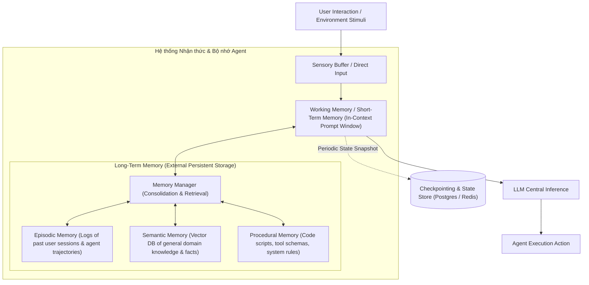
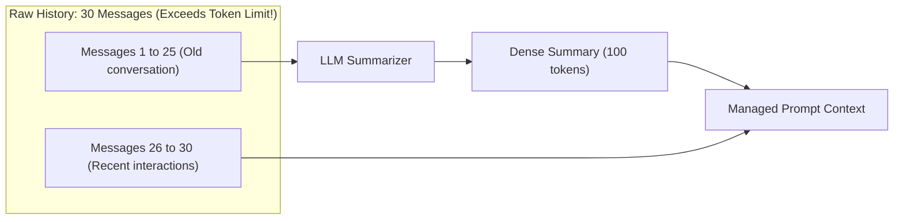
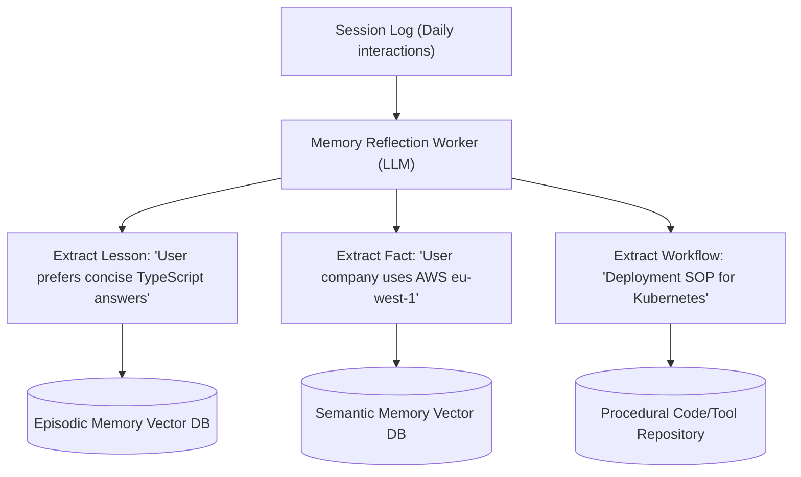
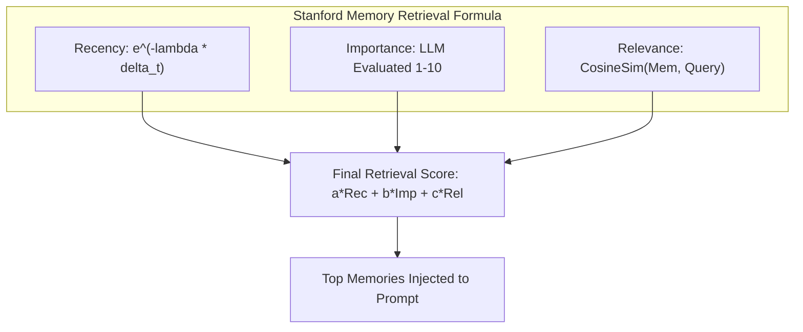

# Chuyên đề: Hệ thống Bộ nhớ Tác tử & Quản trị Ngữ cảnh (Agent Memory Systems & Context Management)

## 1. Tổng quan Chuyên đề
Một mô hình ngôn ngữ lớn (LLM) bản chất là một thực thể **vô trạng thái (Stateless)**: mỗi lượt gọi API là một phép tính độc lập, không hề lưu giữ bất kỳ ký ức nào về các tương tác trước đó. Để biến một mô hình không trạng thái thành một AI Agent có khả năng học hỏi qua kinh nghiệm, duy trì sự gắn kết trong các dự án dài hạn kéo dài nhiều tuần, và cá nhân hóa trải nghiệm người dùng, hệ thống bắt buộc phải được trang bị một **Hệ thống Bộ nhớ Phân tầng (Hierarchical Memory Architecture)** lấy cảm hứng từ khoa học nhận thức thần kinh (Cognitive Neuroscience).

Chuyên đề này phân tích sâu sắc toàn bộ các dạng bộ nhớ của AI Agent: **Bộ nhớ Ngắn hạn (Short-Term / Working Memory)**, **Bộ nhớ Dài hạn (Long-Term Memory)** được chia thành **Bộ nhớ Sự kiện (Episodic)**, **Bộ nhớ Ngữ nghĩa (Semantic)**, và **Bộ nhớ Quy trình (Procedural)**, cùng các cơ chế **Truy xuất Ký ức (Memory Retrieval)**, **Quản lý Ngữ cảnh (Context Management)** và **Lưu điểm Phục hồi (Checkpointing)**.

Kiến trúc Hệ thống Bộ nhớ Phân tầng cho AI Agent:



---

## 2. Chi tiết từng Keyword

---

### 1. Short-Term Memory & 2. Working Memory & 3. Context Management

#### a. Định nghĩa Bản chất Kỹ thuật & Toán học
- **Short-Term Memory (Bộ nhớ Ngắn hạn)**: Khả năng lưu giữ thông tin tạm thời trong phạm vi một phiên làm việc hiện tại (Current Session), thường được biểu diễn trực tiếp bằng lịch sử các tin nhắn trong Context Window của LLM:
  $$\mathcal{M}_{short} = (m_1, m_2, \dots, m_t), \quad \sum_{i=1}^t \text{Tokens}(m_i) \le \text{Context\_Window\_Limit}$$
- **Working Memory (Bộ nhớ Làm việc)**: Không gian làm việc năng động (Scratchpad / Reasoning Buffer) nơi Agent lưu giữ các biến trung gian, kế hoạch đang thực thi dở dang, và kết quả phân tích tạm thời trước khi tổng hợp thành câu trả lời cuối cùng.
- **Context Management (Quản lý Ngữ cảnh)**: Tập hợp các chiến lược kiểm soát, nén và xoay vòng dữ liệu nạp vào Context Window nhằm tránh hiện tượng tràn bộ đệm (Context Overflow) và giảm chi phí token:
  $$\mathcal{M}_{managed} = \text{Compress}\big(\mathcal{M}_{short}, \text{Budget}\big)$$

#### b. Cơ chế Tầng Sâu & Các Chiến lược Quản trị Ngữ cảnh
1. **Sliding Window Memory**: Chỉ giữ lại $N$ tin nhắn gần nhất; các tin nhắn cũ hơn bị đẩy ra khỏi hàng đợi FIFO.
2. **Token-Buffer Memory**: Đặt ngân sách cố định (ví dụ 4000 tokens), tự động loại bỏ các tin nhắn cũ nhất khi vượt ngưỡng.
3. **Summary Memory (Bộ nhớ Tóm tắt)**: Khi lịch sử hội thoại quá dài, kích hoạt một LLM chạy ngầm để tóm tắt 10 tin nhắn cũ thành một đoạn văn ngắn gọn và thay thế chúng.
4. **Summary + Buffer Hybrid Memory**: Giữ tóm tắt của quá khứ xa kết hợp với nguyên văn của vài lượt trao đổi gần nhất.

#### c. Sơ đồ Minh họa


#### d. Code Thực chiến (C++ & Python)

```cpp
// C++20: Sliding Window Memory Buffer với giới hạn kích thước FIFO
#include <iostream>
#include <deque>
#include <string>

class SlidingWindowMemory {
    size_t max_messages;
    std::deque<std::string> buffer;
public:
    SlidingWindowMemory(size_t limit) : max_messages(limit) {}

    void add_message(const std::string& msg) {
        if (buffer.size() >= max_messages) {
            buffer.pop_front(); // Đẩy tin nhắn cũ nhất ra
        }
        buffer.push_back(msg);
    }

    void dump_context() const {
        std::cout << "--- Active Short-Term Memory ---\n";
        for (const auto& m : buffer) std::cout << m << "\n";
    }
};

int main() {
    SlidingWindowMemory mem(3);
    mem.add_message("User: Hello");
    mem.add_message("Agent: Hi! How can I help?");
    mem.add_message("User: I need a flight to Tokyo");
    mem.add_message("Agent: When do you want to fly?"); // "User: Hello" bị đẩy ra
    mem.dump_context();
    return 0;
}
```

```python
# Python: ConversationSummaryBufferMemory mô phỏng LangChain
class ConversationSummaryBufferMemory:
    def __init__(self, max_token_limit: int = 100):
        self.max_limit = max_token_limit
        self.summary = ""
        self.buffer = []

    def add_interaction(self, user_msg: str, ai_msg: str):
        self.buffer.append(f"User: {user_msg}")
        self.buffer.append(f"AI: {ai_msg}")
        self._prune()

    def _prune(self):
        # Ước lượng token thô bằng số từ
        total_tokens = sum(len(m.split()) for m in self.buffer)
        if total_tokens > self.max_limit:
            # Chuyển nửa đầu buffer thành summary
            pruned_text = " ".join(self.buffer[:2])
            self.summary += f" [Past summary: {pruned_text[:50]}...]"
            self.buffer = self.buffer[2:]

    def get_prompt_context(self) -> str:
        res = f"Summary of earlier conversation: {self.summary}\n" if self.summary else ""
        res += "\n".join(self.buffer)
        return res

mem = ConversationSummaryBufferMemory(max_token_limit=15)
mem.add_interaction("Hi, my name is Alex.", "Nice to meet you Alex!")
mem.add_interaction("I live in Hanoi.", "Hanoi is a great city.")
print(mem.get_prompt_context())
```

#### e. Lỗi Thường gặp & Tối ưu Hệ thống
- **Tóm tắt làm mất thực thể quan trọng**: LLM tóm tắt vô tình lược bỏ số điện thoại, mã đơn hàng, hoặc tên riêng của người dùng.
- **Tối ưu**: Duy trì một biến metadata `EntityStore` riêng độc lập với chuỗi hội thoại tóm tắt để lưu các biến thực thể cứng.

#### f. Ứng dụng Thực chiến trong AI Systems
Module `ConversationBufferWindowMemory` và `ConversationSummaryMemory` trong LangChain và OpenAI Assistants API Thread Management.

---

### 4. Long-Term Memory & 5. Episodic Memory & 6. Semantic Memory & 7. Procedural Memory & 8. External Memory

#### a. Định nghĩa Bản chất Kỹ thuật & Toán học
Hệ thống **Long-Term Memory (Bộ nhớ Dài hạn)** là kho lưu trữ bền vững phi tham số ngoài RAM giúp Agent duy trì thông tin qua nhiều ngày, nhiều tháng hoặc xuyên suốt toàn bộ vòng đời:
1. **Episodic Memory (Bộ nhớ Sự kiện / Trải nghiệm)**: Lưu lại toàn bộ chuỗi sự kiện, hành động và kinh nghiệm cụ thể trong quá khứ của Agent:
   $$\mathcal{M}_{episodic} = \{ \langle \text{Timestamp}, \text{Context}, \text{Action\_Taken}, \text{Outcome}, \text{Reward} \rangle \}$$
   *Ví dụ*: "Hôm qua khi build Docker trên macOS m1, lệnh `apt-get` bị lỗi kiến trúc ARM, Agent đã giải quyết bằng cờ `--platform linux/amd64`".
2. **Semantic Memory (Bộ nhớ Ngữ nghĩa / Tri thức)**: Lưu giữ các sự thật khách quan, khái niệm và tri thức phi ngữ cảnh về thế giới (thường lưu trong Vector DB hoặc Knowledge Graph):
   $$\mathcal{M}_{semantic} = \{ \text{Triples, Documentation, Product Specs, User Preferences} \}$$
3. **Procedural Memory (Bộ nhớ Quy trình / Kỹ năng)**: Lưu trữ các quy tắc điều hành, mã nguồn công cụ, workflow cố định, và kỹ năng thao tác (Skills/Tools):
   $$\mathcal{M}_{procedural} = \{ \text{Tool Schemas, Python Functions, System Prompts, SOP Guidelines} \}$$
4. **External Memory (Bộ nhớ Ngoài)**: Cơ sở dữ liệu vật lý (PostgreSQL, Redis, Qdrant, Milvus, File System) nơi chứa dữ liệu của 3 loại bộ nhớ dài hạn trên.

#### b. Cơ chế Tầng Sâu & Quá trình Củng cố Trí nhớ (Memory Consolidation)
Lấy cảm hứng từ quá trình chuyển dịch ký ức từ Hồi hải mã (Hippocampus) sang Vỏ não (Neocortex) trong giấc ngủ con người:
- Vào cuối mỗi phiên làm việc hoặc định kỳ ban đêm, một tiến trình chạy ngầm (Offline Memory Reflection Worker) sẽ đọc toàn bộ log tương tác trong ngày.
- Nó tiến hành chắt lọc (Distill): Rút ra các bài học kinh nghiệm (Episodic), phát hiện các sở thích mới của người dùng (Semantic), và cập nhật các đoạn mã mẫu mới (Procedural) vào Vector Store.

#### c. Sơ đồ Minh họa


#### d. Code Thực chiến (C++ & Python)

```cpp
// C++20: Cấu trúc bản ghi Bộ nhớ Trải nghiệm (Episodic Memory Entry)
#include <iostream>
#include <string>
#include <vector>

struct EpisodicExperience {
    uint64_t timestamp;
    std::string task_description;
    std::string strategy_used;
    bool success;
    float reward_score;
};

class EpisodicMemoryStore {
    std::vector<EpisodicExperience> experiences;
public:
    void record_experience(const EpisodicExperience& exp) {
        experiences.push_back(exp);
    }
    size_t count() const { return experiences.size(); }
};
```

```python
# Python: Hệ thống Long-Term Memory đa thành phần
from dataclasses import dataclass
from typing import List, Dict

@dataclass
class MemoryRecord:
    type: str # 'EPISODIC', 'SEMANTIC', 'PROCEDURAL'
    content: str
    importance_score: float

class AgentLongTermMemory:
    def __init__(self):
        self.storage: List[MemoryRecord] = []

    def add_memory(self, m_type: str, content: str, importance: float = 1.0):
        self.storage.append(MemoryRecord(m_type, content, importance))

    def retrieve_by_type(self, m_type: str) -> List[str]:
        return [m.content for m in self.storage if m.type == m_type]

ltm = AgentLongTermMemory()
ltm.add_memory("SEMANTIC", "User preferred language: Vietnamese", 0.9)
ltm.add_memory("EPISODIC", "Last week: Failed to connect to port 5432 due to firewall", 0.8)
ltm.add_memory("PROCEDURAL", "To run tests: execute 'pytest -v tests/'", 1.0)

print("Semantic Preferences:", ltm.retrieve_by_type("SEMANTIC"))
print("Procedural Guidelines:", ltm.retrieve_by_type("PROCEDURAL"))
```

#### e. Lỗi Thường gặp & Tối ưu Hệ thống
- **Memory Contamination (Ô nhiễm Ký ức)**: Agent lưu lại những kết luận suy diễn sai lầm trong quá khứ thành sự thật lâu dài (Hallucinated Long-term Facts), khiến các phiên làm việc sau bị ảnh hưởng.
- **Tối ưu**: Thiết lập cơ chế xác nhận người dùng trước khi ghi vĩnh viễn vào Semantic Memory hoặc áp dụng cơ chế suy giảm niềm tin theo thời gian (Ebbinghaus Forgetting Curve).

#### f. Ứng dụng Thực chiến trong AI Systems
Generative Agents (Park et al., 2023 - thí nghiệm làng ảo Stanford), MemGPT / Letta, và Zep Memory.

---

### 9. Memory Retrieval & 10. Checkpointing

#### a. Định nghĩa Bản chất Kỹ thuật & Toán học
- **Memory Retrieval (Truy xuất Ký ức)**: Giải thuật trích xuất các mẩu ký ức liên quan nhất từ bộ nhớ dài hạn để nạp vào Working Memory của Agent tại thời điểm ra quyết định.
  Hàm tính điểm ưu tiên ký ức của Stanford Generative Agents kết hợp 3 thành phần:
  $$\text{Score}(m) = \alpha \cdot \text{Recency}(m) + \beta \cdot \text{Importance}(m) + \gamma \cdot \text{Relevance}(m, q)$$
  Trong đó:
  - $\text{Recency}(m) = e^{-\lambda (t_{\text{now}} - t_m)}$: Độ tươi mới theo hàm suy giảm mũ thời gian.
  - $\text{Importance}(m) \in [1, 10]$: Điểm tầm quan trọng do LLM tự đánh giá khi tạo ký ức.
  - $\text{Relevance}(m, q) = \cos(\mathbf{e}_m, \mathbf{e}_q)$: Độ tương đồng ngữ nghĩa vector với tình huống hiện tại.
- **Checkpointing (Lưu điểm Phục hồi)**: Cơ chế chụp ảnh nhanh (Snapshot) toàn bộ trạng thái thực thi của Agent (State, Memory, Variables, Step index) vào bộ lưu trữ đĩa/DB tại từng bước chuyển giao node:
  $$\text{Checkpoint}(t) = \text{Serialize}(\mathcal{S}_t) \xrightarrow{\text{Save}} \text{Database}$$

#### b. Cơ chế Tầng Sâu & Khả năng "Time-Travel" (Du hành Thời gian)
Nhờ có Checkpointing (như trong PostgresSaver của LangGraph):
- Hệ thống hỗ trợ khả năng **Time-Travel Debugging**: Cho phép nhà phát triển quay ngược trạng thái của Agent về bước thứ 3 trong quá khứ, sửa đổi tham số và cho Agent chạy tiếp theo một nhánh rẽ mới!
- Bảo đảm khả năng **Durable Execution**: Nếu máy chủ hoặc container bị sập nguồn giữa chừng, tiến trình mới khởi động lại sẽ đọc checkpoint gần nhất và tiếp tục chạy mà không phải chạy lại từ đầu.

#### c. Sơ đồ Minh họa


#### d. Code Thực chiến (C++ & Python)

```cpp
// C++20: Tính điểm truy xuất ký ức (Memory Retrieval Scorer)
#include <iostream>
#include <cmath>
#include <algorithm>

struct MemoryItem {
    std::string text;
    float importance; // 0.0 -> 1.0
    float hours_ago;
    float semantic_sim; // 0.0 -> 1.0
};

float score_memory(const MemoryItem& item, float decay_rate = 0.05f) {
    float recency = std::exp(-decay_rate * item.hours_ago);
    float alpha = 0.2f, beta = 0.3f, gamma = 0.5f;
    return alpha * recency + beta * item.importance + gamma * item.semantic_sim;
}

int main() {
    MemoryItem m1 = {"User loves Python", 0.9f, 2.0f, 0.85f};
    MemoryItem m2 = {"User said hello", 0.1f, 0.1f, 0.20f};
    std::cout << "Score Memory 1: " << score_memory(m1) << "\n";
    std::cout << "Score Memory 2: " << score_memory(m2) << "\n";
    return 0;
}
```

```python
# Python: Checkpoint Manager mô phỏng Durable Execution
import json
import uuid

class StateCheckpointer:
    def __init__(self):
        self.checkpoints = {} # checkpoint_id -> state_json

    def save_checkpoint(self, thread_id: str, state: dict) -> str:
        chk_id = str(uuid.uuid4())
        self.checkpoints[chk_id] = {
            "thread_id": thread_id,
            "state": state.copy()
        }
        return chk_id

    def load_checkpoint(self, chk_id: str) -> dict:
        return self.checkpoints.get(chk_id, {}).get("state", {})

checkpointer = StateCheckpointer()
state_step1 = {"step": 1, "plan": ["Search API", "Execute SQL"], "data": {}}
chk_1 = checkpointer.save_checkpoint("thread_101", state_step1)
print(f"Saved Checkpoint ID: {chk_1}")
print("Loaded State on Resume:", checkpointer.load_checkpoint(chk_1))
```

#### e. Lỗi Thường gặp & Tối ưu Hệ thống
- **Chi phí Serialization lớn**: Checkpoint chứa toàn bộ binary payload lớn làm chậm tốc độ thực thi của vòng lặp Agent.
- **Tối ưu**: Chỉ lưu khóa tham chiếu (Pointer IDs) trỏ tới object storage thay vì nhúng trực tiếp file nhị phân vào State.

#### f. Ứng dụng Thực chiến trong AI Systems
Cơ chế cốt lõi trong LangGraph Checkpointers (`SqliteSaver`, `PostgresSaver`), Temporal Workflow for AI, và MemGPT persistent agents.
