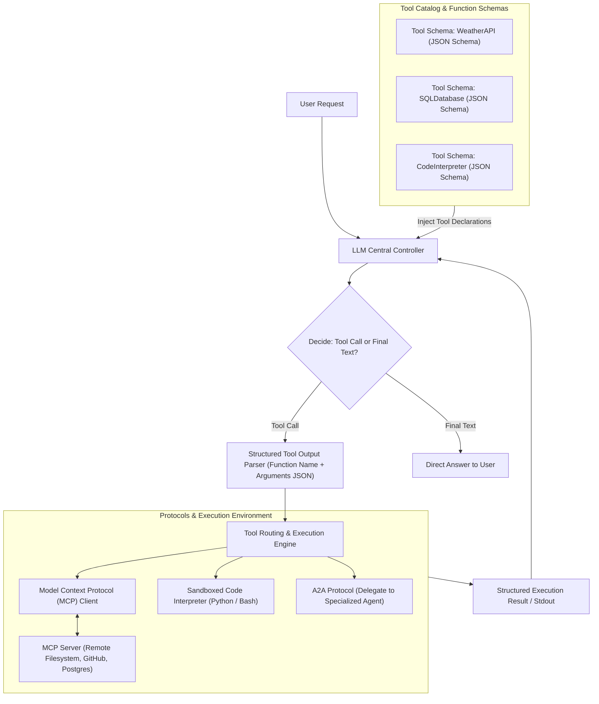
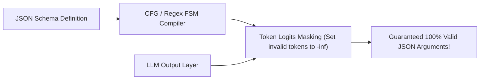
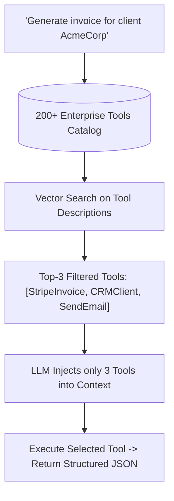
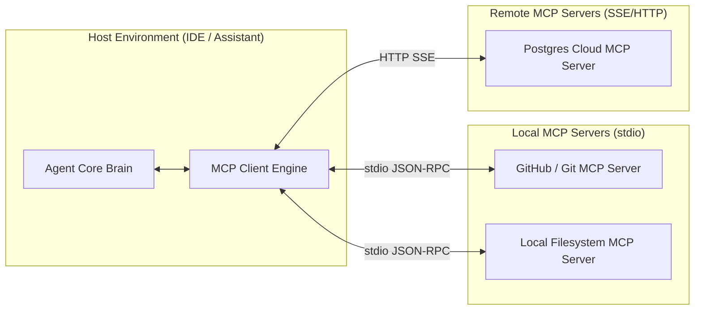
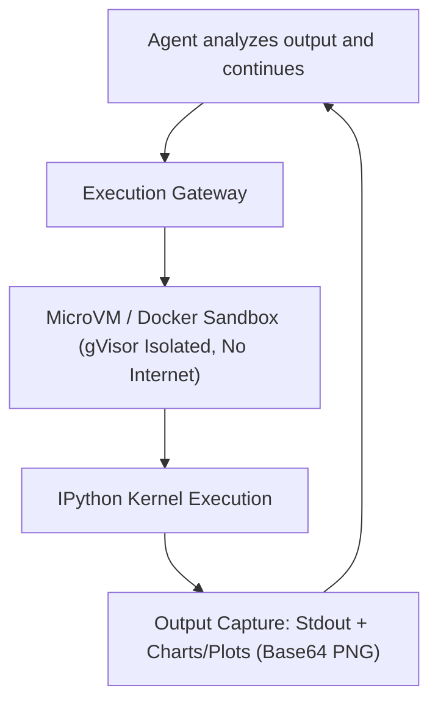

# Chuyên đề: Gọi Công cụ, Thực thi Hàm & Giao thức Kết nối (Tool Calling, Function Calling & Protocols)

## 1. Tổng quan Chuyên đề
Khả năng biến các mô hình ngôn ngữ từ "người trò chuyện" thành "người hành động" phụ thuộc hoàn toàn vào cơ chế **Gọi Công cụ (Tool Calling / Function Calling)**. Thông qua cơ chế này, LLM không còn bị giới hạn trong việc sinh văn bản tự do, mà có thể xuất ra các cấu trúc đối số chuẩn xác theo **JSON Schema**, kích hoạt các API phần mềm, thực thi mã nguồn trong môi trường cô lập (**Code Interpreter / Sandbox**), và trao đổi thông tin với các Agent khác.

Đặc biệt, sự ra đời của các giao thức chuẩn hóa mở như **Model Context Protocol (MCP - Anthropic)**, các chuẩn giao tiếp tác tử **Agent Communication Protocols (A2A)** và định dạng tương thích **OpenAI-Compatible Tool Calling** đang tạo nên một cuộc cách mạng: biến toàn bộ hệ sinh thái phần mềm, cơ sở dữ liệu và công cụ của loài người thành các "cánh tay nối dài" chuẩn hóa cho AI.

Kiến trúc Thực thi Công cụ & Giao thức Kết nối MCP:



---

## 2. Chi tiết từng Keyword

---

### 1. Tool Calling & 2. Function Calling & 3. OpenAI-Compatible Tool Calling & 4. Function Schemas & 5. JSON Schema

#### a. Định nghĩa Bản chất Kỹ thuật & Toán học
- **Function Calling (Gọi Hàm)**: Tính năng được tinh chỉnh (Fine-tuned) chuyên biệt trong các mô hình LLM hiện đại (như GPT-4, Claude 3.5, Gemini 1.5, LLaMA-3.1-Instruct) cho phép mô hình phát hiện khi nào cần gọi một hàm cụ thể và xuất ra một chuỗi JSON hợp lệ chứa các đối số cần thiết thay vì sinh văn bản thông thường.
- **Tool Calling (Gọi Công cụ)**: Khái niệm mở rộng của Function Calling, cho phép mô hình:
  - Gọi nhiều công cụ song song trong cùng một bước lặp (Parallel Tool Calling).
  - Sử dụng các loại công cụ không chỉ là hàm code (như Web Browser, Code Interpreter, File Retrieval).
- **Function Schemas & JSON Schema**: Bản đặc tả chuẩn mực (IETF JSON Schema Standard) định nghĩa tên hàm, mô tả ngữ nghĩa (Description) và kiểu dữ liệu của các tham số đầu vào:
  $$\mathcal{T}_{schema} = \langle \text{name}, \text{description}, \text{parameters}: \text{JSON\_Schema} \rangle$$
- **OpenAI-Compatible Tool Calling**: Tiêu chuẩn định dạng API thống nhất được toàn bộ ngành công nghiệp AI chấp nhận rộng rãi (OpenAI, Anthropic, vLLM, Ollama, Together AI, Groq) với cấu trúc:
  ```json
  "tools": [{
    "type": "function",
    "function": {
      "name": "get_stock_price",
      "description": "Fetch real-time stock ticker price",
      "parameters": {
        "type": "object",
        "properties": {
          "ticker": {"type": "string", "description": "Stock symbol (e.g. AAPL)"}
        },
        "required": ["ticker"]
      }
    }
  }]
  ```

#### b. Cơ chế Tầng Sâu & Ràng buộc Giải mã Ngữ pháp (Grammar-Constrained Decoding)
Làm thế nào để đảm bảo LLM không bao giờ sinh ra JSON bị lỗi cú pháp (`SyntaxError`)?
- Các inference engine hiện đại (như llama.cpp, vLLM, Outlines, Guidance) sử dụng **CFG (Context-Free Grammar) Masking**:
- Tại mỗi bước sinh token, công cụ suy luận biên dịch JSON Schema thành một máy trạng thái hữu hạn (Pushdown Automaton / Regex FSM).
- Công cụ áp dụng một mặt nạ xác suất (Logits Mask): **Ép xác suất $P(\text{token}) = 0$** đối với bất kỳ token nào vi phạm cú pháp JSON Schema tại vị trí đó! Do đó, đầu ra được đảm bảo 100% hợp lệ về mặt cấu trúc toán học.

#### c. Sơ đồ Minh họa


#### d. Code Thực chiến (C++ & Python)

```cpp
// C++20: Cấu trúc biểu diễn một Function Schema và lời gọi Tool Call
#include <iostream>
#include <string>
#include <vector>

struct ToolCallPayload {
    std::string tool_id;
    std::string function_name;
    std::string arguments_json;
};

class ToolDispatcher {
public:
    static void dispatch(const ToolCallPayload& call) {
        std::cout << "Dispatching Tool Call [" << call.tool_id << "]:\n";
        std::cout << "  Function: " << call.function_name << "\n";
        std::cout << "  Arguments: " << call.arguments_json << "\n";
    }
};

int main() {
    ToolCallPayload call = {"call_abc123", "execute_sql_query", "{\"query\": \"SELECT count(*) FROM users;\"}"};
    ToolDispatcher::dispatch(call);
    return 0;
}
```

```python
# Python: Định nghĩa Function Schema chuẩn Pydantic & OpenAI Format
from pydantic import BaseModel, Field

class WeatherQueryArgs(BaseModel):
    city: str = Field(description="Name of the city, e.g. San Francisco")
    unit: str = Field(default="celsius", description="Temperature unit: celsius or fahrenheit")

# Chuyển đổi Pydantic Model sang OpenAI Tool Schema
openai_tool_schema = {
    "type": "function",
    "function": {
        "name": "get_current_weather",
        "description": "Get current weather for a specific location",
        "parameters": WeatherQueryArgs.model_json_schema()
    }
}
import json
print(json.dumps(openai_tool_schema, indent=2))
```

#### e. Lỗi Thường gặp & Tối ưu Hệ thống
- **Mô tả hàm (Description) mơ hồ**: Khiến LLM không hiểu rõ mục đích sử dụng của công cụ hoặc gọi nhầm công cụ khác.
- **Tối ưu**: Luôn viết mô tả chi tiết cả trường hợp nên dùng (When to use) và không nên dùng (When NOT to use) kèm các ví dụ mẫu.

#### f. Ứng dụng Thực chiến trong AI Systems
Chuẩn mực nền tảng của GPT Function Calling, Claude Tool Use, LangChain Agents, và Semantic Kernel.

---

### 6. Tool Selection & 7. Tool Routing & 8. Tool Execution & 9. Structured Tool Outputs & 10. API Integration

#### a. Định nghĩa Bản chất Kỹ thuật & Toán học
- **Tool Selection (Lựa chọn Công cụ)**: Quá trình tác tử phân tích nhu cầu và chọn ra công cụ thích hợp nhất $\tau^* \in \mathcal{T}$ từ một tập hợp hàng trăm công cụ khả dĩ:
  $$\tau^* = \arg\max_{\tau \in \mathcal{T}} P(\tau \mid \text{Goal}, \text{State})$$
- **Tool Routing (Định tuyến Công cụ)**: Cơ chế chuyển tiếp lời gọi hàm tới đúng service/worker tương ứng trên mạng lưới phân tán.
- **Tool Execution (Thực thi Công cụ)**: Tiến trình nạp tham số, kiểm tra tính hợp lệ (Validation via Pydantic/Zod), gọi API thực tế qua HTTP/gRPC, và bắt các ngoại lệ lỗi (Exception Handling).
- **Structured Tool Outputs**: Quy định kết quả trả về của công cụ phải được chuẩn hóa dưới dạng JSON có cấu trúc (gồm trạng thái thành công, dữ liệu payload, và mã lỗi) thay vì trả về chuỗi văn bản tự do, giúp LLM dễ dàng phân tích ở bước tiếp theo:
  $$\text{ToolResponse} = \langle \text{status}: \text{str}, \text{data}: \text{Any}, \text{error}: \text{Optional}[\text{str}] \rangle$$
- **API Integration (Tích hợp API)**: Khả năng kết nối Agent với các hệ thống phần mềm doanh nghiệp của bên thứ ba (Salesforce, Stripe, Jira, GitHub, Slack) thông qua RESTful APIs hoặc GraphQL.

#### b. Cơ chế Tầng Sâu: Xử lý Vấn đề "Quá Nhiều Công Cụ" (Tool Retrieval)
Nếu đưa 200 Tool Schemas vào System Prompt cùng lúc:
- Chi phí token sẽ bùng nổ (mất 20.000 tokens chỉ để mô tả công cụ).
- LLM bị phân tâm và giảm độ chính xác lựa chọn (Context Clutter).
- **Giải pháp: Tool Retrieval via Vector Search**:
  Lập chỉ mục vector cho phần mô tả của 200 công cụ. Khi người dùng đưa ra câu hỏi, chỉ tìm kiếm và nạp **Top 3–5 công cụ có độ tương đồng ngữ nghĩa cao nhất** vào Prompt của lượt đó!

#### c. Sơ đồ Minh họa


#### d. Code Thực chiến (C++ & Python)

```cpp
// C++20: Bộ điều phối Tool Execution an toàn có bắt lỗi ngoại lệ
#include <iostream>
#include <string>
#include <functional>
#include <unordered_map>

struct ToolExecutionResult {
    bool success;
    std::string payload_json;
    std::string error_message;
};

class SafeToolExecutor {
    std::unordered_map<std::string, std::function<std::string(const std::string&)>> registry;
public:
    void register_fn(const std::string& name, std::function<std::string(const std::string&)> fn) {
        registry[name] = fn;
    }

    ToolExecutionResult execute(const std::string& name, const std::string& args_json) {
        auto it = registry.find(name);
        if (it == registry.end()) {
            return {false, "{}", "Tool not found: " + name};
        }
        try {
            std::string output = it->second(args_json);
            return {true, output, ""};
        } catch (const std::exception& e) {
            return {false, "{}", std::string("Execution Error: ") + e.what()};
        }
    }
};
```

```python
# Python: Structured Tool Output Handler với Pydantic Validation
from pydantic import BaseModel
from typing import Any, Optional

class StandardToolOutput(BaseModel):
    success: bool
    data: Optional[Any] = None
    error: Optional[str] = None

def mock_database_query_tool(query_str: str) -> StandardToolOutput:
    try:
        if "DROP" in query_str.upper():
            raise PermissionError("Destructive operations are forbidden.")
        # Giả lập truy vấn thành công
        return StandardToolOutput(success=True, data={"rows_affected": 15, "status": "OK"})
    except Exception as e:
        return StandardToolOutput(success=False, error=str(e))

print(mock_database_query_tool("SELECT * FROM users;").model_dump_json())
print(mock_database_query_tool("DROP TABLE users;").model_dump_json())
```

#### e. Lỗi Thường gặp & Tối ưu Hệ thống
- **Tool Crash không bắt Exception**: Lỗi sập API hoặc timeout của bên thứ ba khiến toàn bộ tiến trình Agent Loop bị văng (Crash).
- **Tối ưu**: Luôn bọc lời gọi công cụ trong khối `try/catch` và nạp thông điệp lỗi (Error Stack) ngược lại vào context để LLM tự khắc phục.

#### f. Ứng dụng Thực chiến trong AI Systems
Các hệ thống tích hợp Enterprise Zapier AI Actions, Toolhouse.ai, và LangChain Tools.

---

### 11. Model Context Protocol (MCP) & 12. Agent Communication Protocols & 13. A2A (Agent-to-Agent)

#### a. Định nghĩa Bản chất Kỹ thuật & Toán học
- **Model Context Protocol (MCP)**: Chuẩn giao thức mở do **Anthropic** công bố vào cuối năm 2024, được ví như "cổng USB-C dành cho AI". MCP chuẩn hóa cách thức mà các ứng dụng Agent kết nối an toàn với các nguồn dữ liệu cục bộ và dịch vụ đám mây (Local Filesystems, Postgres DBs, GitHub repositories, Slack workspaces) thông qua kiến trúc **Client-Server JSON-RPC 2.0**:
  $$\text{Agent Application (MCP Client)} \xleftrightarrow{\text{JSON-RPC 2.0 (stdio / SSE)}} \text{MCP Servers (Data & Tools)}$$
- **Agent Communication Protocols (Giao thức Giao tiếp Tác tử)**: Bộ quy tắc trao đổi thông điệp chuẩn hóa giữa các Agent phân tán (Distributed Multi-Agent Systems), kế thừa từ chuẩn FIPA-ACL (Foundation for Intelligent Physical Agents).
- **A2A (Agent-to-Agent)**: Kiến trúc giao tiếp ngang hàng hoặc phân cấp cho phép các tác tử trao đổi yêu cầu, ủy quyền nhiệm vụ (Delegation), thương lượng (Negotiation) và chia sẻ kết quả trực tiếp với nhau thông qua tin nhắn có cấu trúc (Structured Message Passing).

#### b. Cơ chế Tầng Sâu của MCP: Ba Thực thể Cốt lõi
Giao thức MCP định nghĩa 3 năng lực chính mà một MCP Server cung cấp cho Client:
1. **Prompts**: Các mẫu chỉ dẫn có sẵn được máy chủ chia sẻ.
2. **Resources**: Dữ liệu ngữ cảnh đọc được (Read-only context, như nội dung file, schema database).
3. **Tools**: Các hàm có thể thực thi (Executable functions có kèm JSON Schema).
- Cơ chế vận chuyển (Transport Layer): Hỗ trợ **stdio** (tiến trình cục bộ trên máy tính) và **SSE (Server-Sent Events)** qua HTTP dành cho dịch vụ từ xa.

#### c. Sơ đồ Minh họa


#### d. Code Thực chiến (C++ & Python)

```cpp
// C++20: Gói tin JSON-RPC 2.0 chuẩn MCP
#include <iostream>
#include <string>

struct JsonRpcMessage {
    std::string jsonrpc = "2.0";
    std::string id;
    std::string method;
    std::string params_json;

    std::string serialize() const {
        return "{\"jsonrpc\":\"" + jsonrpc + "\",\"id\":\"" + id + "\",\"method\":\"" + method + "\",\"params\":" + params_json + "}";
    }
};

int main() {
    JsonRpcMessage req = {"2.0", "req_1", "tools/call", "{\"name\":\"read_file\",\"arguments\":{\"path\":\"/etc/hosts\"}}"};
    std::cout << "MCP Wire Protocol Frame:\n" << req.serialize() << "\n";
    return 0;
}
```

```python
# Python: Mô phỏng MCP Server Tool Dispatcher cơ bản
class MiniMCPServer:
    def __init__(self, server_name: str):
        self.server_name = server_name
        self.tools = {}

    def register_mcp_tool(self, name: str, schema: dict, handler):
        self.tools[name] = {"schema": schema, "handler": handler}

    def handle_jsonrpc_request(self, request: dict) -> dict:
        method = request.get("method")
        req_id = request.get("id")
        
        if method == "tools/list":
            return {"jsonrpc": "2.0", "id": req_id, "result": {"tools": [t["schema"] for t in self.tools.values()]}}
        elif method == "tools/call":
            params = request.get("params", {})
            tool_name = params.get("name")
            args = params.get("arguments", {})
            if tool_name in self.tools:
                output = self.tools[tool_name]["handler"](**args)
                return {"jsonrpc": "2.0", "id": req_id, "result": {"content": [{"type": "text", "text": str(output)}]}}
        return {"jsonrpc": "2.0", "id": req_id, "error": {"code": -32601, "message": "Method not found"}}

server = MiniMCPServer("FileSystemMCP")
server.register_mcp_tool("get_pwd", {"name": "get_pwd", "description": "Get current dir"}, lambda: "/home/user/workspace")
print("Response:", server.handle_jsonrpc_request({"jsonrpc": "2.0", "id": "1", "method": "tools/call", "params": {"name": "get_pwd"}}))
```

#### e. Lỗi Thường gặp & Tối ưu Hệ thống
- **Lỗ hổng bảo mật qua Server không tin cậy**: MCP Client kết nối tới một MCP Server độc hại có thể bị khai thác đọc trộm file hệ thống hoặc rò rỉ token.
- **Tối ưu**: Luôn yêu cầu xác nhận phê duyệt cấp quyền (Consent Prompting) trước khi thực thi tool từ MCP Server ngoài.

#### f. Ứng dụng Thực chiến trong AI Systems
Claude Desktop MCP Extensions, Goose AI CLI, Antigravity IDE MCP Integration.

---

### 14. Code Interpreter (Trình Thông dịch Mã nguồn)

#### a. Định nghĩa Bản chất Kỹ thuật & Toán học
**Code Interpreter (Trình Thông dịch Mã nguồn)**: Một công cụ tối thượng cho phép AI Agent tự viết mã nguồn (thường là Python), gửi mã vào một môi trường thực thi hộp cát (**Sandboxed REPL Environment**), nhận kết quả thực thi (Variables, Dataframe Tables, stdout, stderr, biểu đồ hình ảnh PNG), và dùng kết quả đó để hoàn thành bài toán.
- *Nguyên lý*: Thay vì bắt LLM phải tính nhẩm số học phức tạp (rất dễ sai sót), Agent sẽ viết một đoạn code Python ngắn để tính toán và lấy kết quả chính xác 100%.

#### b. Cơ chế Tầng Sâu & Bảo mật Môi trường Hộp cát (Sandbox Isolation)
Môi trường Code Interpreter bắt buộc phải được cách ly tuyệt đối để ngăn chặn mã độc hại (như `rm -rf /` hoặc fork-bomb):
1. **Linux Containerization & cgroups**: Giới hạn CPU (1 core), RAM (512MB), ngắt kết nối mạng Internet hoàn toàn (Network Namespace `none`).
2. **Ephemeral MicroVMs (Firecracker / gVisor)**: Khởi tạo một máy ảo siêu nhẹ trong vòng 100ms cho mỗi phiên người dùng và hủy ngay sau khi dùng xong (Stateless teardown).

#### c. Sơ đồ Minh họa


#### d. Code Thực chiến (C++ & Python)

```cpp
// C++17: Kiểm tra an toàn mã nguồn thô trước khi nạp vào Code Interpreter
#include <iostream>
#include <string>
#include <vector>

bool is_code_suspicious(const std::string& python_code) {
    const std::vector<std::string> blacklisted = {
        "import os", "import subprocess", "import socket", "__import__", "open("
    };
    for (const auto& bad : blacklisted) {
        if (python_code.find(bad) != std::string::npos) return true;
    }
    return false;
}

int main() {
    std::string safe_code = "import math\nprint(math.sqrt(144))";
    std::string dangerous_code = "import os\nos.system('rm -rf /')";
    std::cout << "Safe code suspicious? " << is_code_suspicious(safe_code) << "\n";
    std::cout << "Dangerous code suspicious? " << is_code_suspicious(dangerous_code) << "\n";
    return 0;
}
```

```python
# Python: Khung Code Interpreter an toàn sử dụng exec với biến cô lập
def execute_safe_python(code_snippet: str) -> dict:
    import io, sys
    # Bắt stdout
    old_stdout = sys.stdout
    redirected_output = sys.stdout = io.StringIO()
    
    # Biến môi trường hạn chế (Không có builtins nguy hiểm)
    safe_globals = {"__builtins__": {"print": print, "range": range, "len": len, "sum": sum}}
    safe_locals = {}
    
    try:
        exec(code_snippet, safe_globals, safe_locals)
        output = redirected_output.getvalue()
        return {"success": True, "output": output.strip()}
    except Exception as e:
        return {"success": False, "error": str(e)}
    finally:
        sys.stdout = old_stdout

print("Execution Result:", execute_safe_python("print(sum([x*2 for x in range(5)]))"))
```

#### e. Lỗi Thường gặp & Tối ưu Hệ thống
- **Kẹt tiến trình do vòng lặp vô hạn**: Code sinh ra chứa `while True: pass` làm đóng băng toàn bộ server.
- **Tối ưu**: Luôn thiết lập giới hạn thời gian thực thi nghiêm ngặt (Execution Timeout, ví dụ 10 giây qua `signal.SIGALRM` hoặc timeout flag).

#### f. Ứng dụng Thực chiến trong AI Systems
ChatGPT Advanced Data Analysis (Code Interpreter), Claude Artifacts, và E2B Sandbox for Agents.
