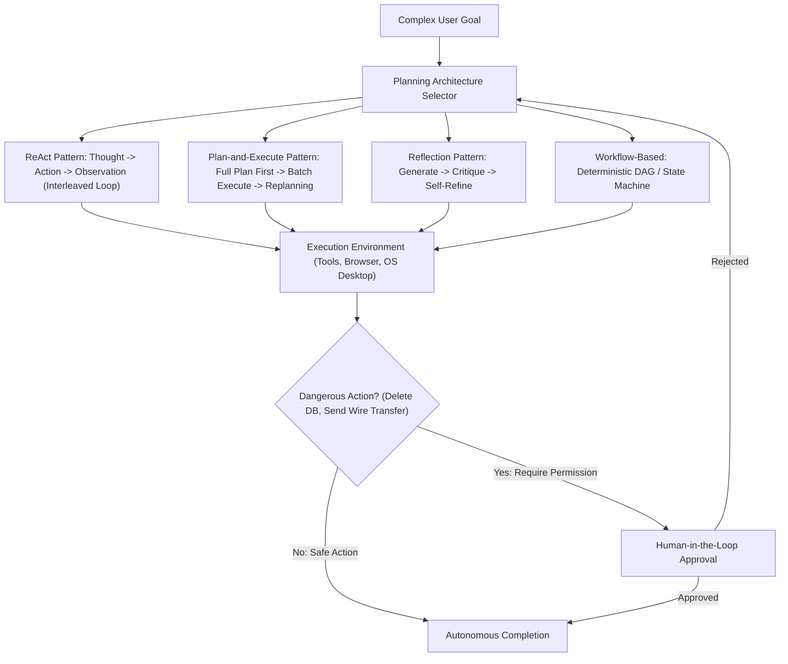
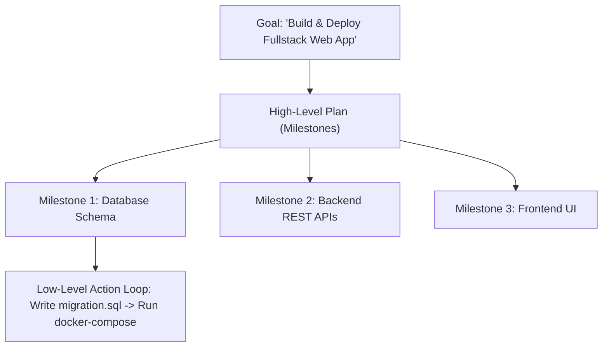
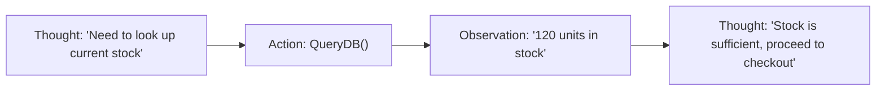
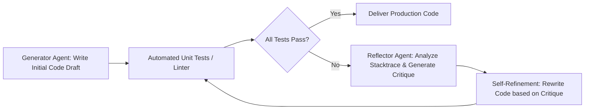
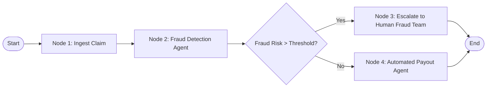
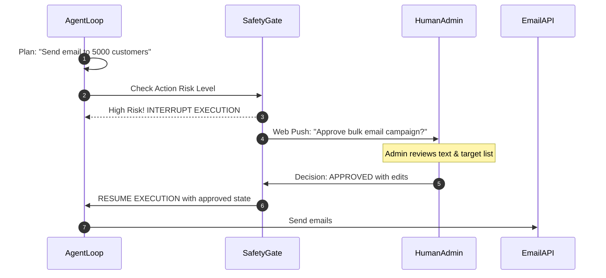
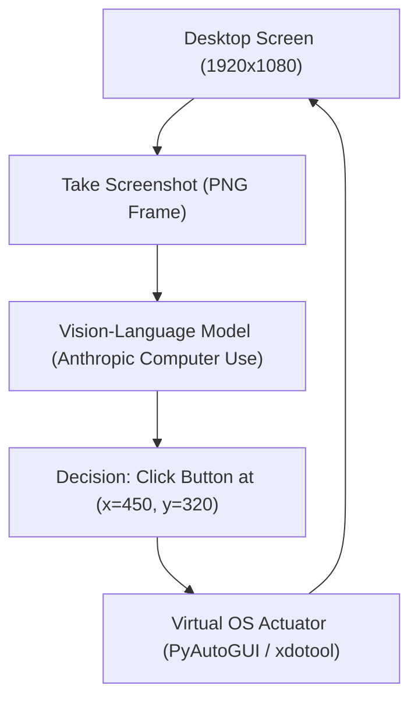

# Chuyên đề: Lập kế hoạch, Mô hình Suy luận & Mô thức Thực thi Tác tử (Agent Planning, Reasoning & Execution Patterns)

## 1. Tổng quan Chuyên đề
Để giải quyết những bài toán phức tạp trong thế giới thực, một AI Agent không thể chỉ hành động bộc phát (Greedy Step-by-Step). Nó cần sở hữu khả năng **Lập kế hoạch (Agent Planning)**: nhìn xa trông rộng, phân tách mục tiêu lớn thành các nhiệm vụ con khả thi (**Task Decomposition & Hierarchical Planning**), suy luận đan xen với hành động (**ReAct Paradigm**), hoặc lập kế hoạch toàn diện trước khi thực thi (**Plan-and-Execute**).

Hơn thế nữa, các tác tử hiện đại được nâng cấp với khả năng tự nhìn nhận lỗi lầm và tự sửa sai (**Reflection & Self-Refinement Agents**), vận hành theo các luồng quy trình chặt chẽ (**Workflow-Based Agents, State Machines, DAGs**), kết hợp sự can thiệp và phê duyệt của con người (**Human-in-the-Loop / Human Approval**), và mở rộng khả năng thao tác trên trình duyệt và hệ điều hành máy tính (**Browser Agents & Computer-Use Agents**).

Toàn cảnh các mô thức Lập kế hoạch và Suy luận Tác tử:



---

## 2. Chi tiết từng Keyword

---

### 1. Agent Planning & 2. Task Decomposition & 3. Hierarchical Planning & 4. Plan-and-Execute

#### a. Định nghĩa Bản chất Kỹ thuật & Toán học
- **Agent Planning (Lập kế hoạch Tác tử)**: Quá trình tìm kiếm một chuỗi hành động có thứ tự $\pi = (a_1, a_2, \dots, a_T)$ chuyển dịch trạng thái ban đầu $S_0$ thành trạng thái đích $S_g \in \mathcal{S}_{goal}$:
  $$S_0 \xrightarrow{a_1} S_1 \xrightarrow{a_2} \dots \xrightarrow{a_T} S_g$$
- **Task Decomposition (Phân rã Nhiệm vụ)**: Kỹ thuật chia nhỏ một nhiệm vụ phức tạp thành một tập hợp các công việc con độc lập hoặc phụ thuộc lẫn nhau:
  $$\text{Task } \mathcal{T} \longrightarrow \{ \tau_1, \tau_2, \dots, \tau_k \}$$
- **Hierarchical Planning (Lập kế hoạch Phân cấp)**: Mô hình lập kế hoạch đa tầng:
  - *High-Level Planner (Tầng chiến lược)*: Đưa ra các mục tiêu vĩ mô (Milestones).
  - *Low-Level Controllers (Tầng chiến thuật)*: Thực thi chi tiết từng bước hành động cụ thể để đạt được từng Milestone đó.
- **Plan-and-Execute (Lập kế hoạch rồi Thực thi)**: Mô thức tách rời hoàn toàn hai pha:
  1. *Pha 1 (Planner)*: LLM lớn (như GPT-4) sinh ra bản kế hoạch toàn bộ các bước.
  2. *Pha 2 (Executor)*: Một LLM nhỏ hơn hoặc vòng lặp code thực thi tuần tự từng bước trong kế hoạch, chỉ gọi lại Planner khi có sự cố xảy ra (Replanning).

#### b. Cơ chế Tầng Sâu & Phân tích Đánh đổi
- **ReAct vs Plan-and-Execute**:
  - *ReAct*: Linh hoạt thích ứng từng bước, nhưng dễ mất phương hướng (Goal Drift) trong các tác vụ dài hạn $> 20$ bước.
  - *Plan-and-Execute*: Duy trì định hướng mục tiêu cực tốt, tiết kiệm token suy luận, nhưng kém linh hoạt nếu kế hoạch ban đầu dựa trên tiền đề sai.

#### c. Sơ đồ Minh họa


#### d. Code Thực chiến (C++ & Python)

```cpp
// C++20: Plan-and-Execute Task Queue Manager
#include <iostream>
#include <vector>
#include <string>

struct SubTask {
    int id;
    std::string description;
    bool completed = false;
};

class ExecutionPlan {
    std::vector<SubTask> tasks;
    size_t current_idx = 0;
public:
    void add_task(const std::string& desc) {
        tasks.push_back({static_cast<int>(tasks.size() + 1), desc, false});
    }

    bool has_next() const { return current_idx < tasks.size(); }

    SubTask& next_task() {
        return tasks[current_idx++];
    }
};

int main() {
    ExecutionPlan plan;
    plan.add_task("Clone GitHub repository");
    plan.add_task("Run unit tests with pytest");
    plan.add_task("Deploy to AWS staging cluster");
    
    while (plan.has_next()) {
        auto& t = plan.next_task();
        std::cout << "Executing Task " << t.id << ": " << t.description << "\n";
        t.completed = true;
    }
    return 0;
}
```

```python
# Python: Mô thức Plan-and-Execute với Replanning Logic
class PlanAndExecuteAgent:
    def __init__(self, planner_fn, executor_fn):
        self.planner = planner_fn
        self.executor = executor_fn

    def run(self, high_level_goal: str):
        # Bước 1: Lập kế hoạch
        plan = self.planner(high_level_goal)
        print(f"Initial Plan: {plan}")
        
        # Bước 2: Thực thi từng bước
        results = {}
        for step in plan:
            print(f"\n--> Executing Step: '{step}'")
            status, res = self.executor(step, results)
            if not status:
                print(f"Step failed! Triggering Replanning for: {step}")
                # Kích hoạt replanning...
                break
            results[step] = res
        return results

mock_planner = lambda g: ["Step 1: Check server disk space", "Step 2: Clear /tmp cache"]
mock_executor = lambda s, r: (True, "Success: Free space is 50GB")
agent = PlanAndExecuteAgent(mock_planner, mock_executor)
agent.run("Free up disk space on production server")
```

#### e. Lỗi Thường gặp & Tối ưu Hệ thống
- **Kế hoạch quá cứng nhắc**: Kế hoạch sinh ra 10 bước nhưng bước 2 thất bại khiến 8 bước sau trở thành vô nghĩa.
- **Tối ưu**: Triển khai cơ chế **Dynamic Replanning**: Đánh giá lại tính khả thi của các bước còn lại sau mỗi lần hoàn thành một bước.

#### f. Ứng dụng Thực chiến trong AI Systems
BabyAGI, LlamaIndex `PlanAndSolveAgent`, và Devin Autonomous Software Engineer.

---

### 5. ReAct (Reasoning and Acting)

#### a. Định nghĩa Bản chất Kỹ thuật & Toán học
**ReAct** (Yao et al., ICLR 2023) là mô thức kinh điển nhất kết hợp **Suy luận (Reasoning)** và **Hành động (Acting)** thành một chuỗi đan xen đồng vận (Synergistic Interleaving):
$$\dots \to \text{Thought}_t \to \text{Action}_t \to \text{Observation}_t \to \text{Thought}_{t+1} \to \dots$$
- **Thought (Suy nghĩ)**: Cho phép Agent theo dõi tiến độ, phân tích các quan sát bất ngờ, lập luận nguyên nhân - kết quả và điều chỉnh kế hoạch.
- **Action (Hành động)**: Gọi công cụ bên ngoài để lấy thêm thông tin thực tế từ môi trường.
- **Observation (Quan sát)**: Kết quả trả về của hành động, đóng vai trò căn cứ thực tế cập nhật vào suy nghĩ tiếp theo.

#### b. Cơ chế Tầng Sâu & Cấu trúc Prompt Tiêu chuẩn
Mẫu định dạng văn bản (Few-shot Prompt Format) của ReAct:
```text
Question: What is the elevation range for the area that the eastern sector of the Colorado orogeny extends into?
Thought 1: I need to search Colorado orogeny, find the eastern sector, then find its elevation range.
Action 1: Search[Colorado orogeny]
Observation 1: The Colorado orogeny was an episode of mountain building in Colorado and surrounding areas...
Thought 2: The eastern sector extends into High Plains. Now I need to search High Plains elevation.
Action 2: Search[High Plains]
Observation 2: High Plains elevation ranges from 1,160 to 7,840 ft (350 to 2,400 m).
Thought 3: The elevation range is 1,160 to 7,840 ft.
Action 3: Finish[1,160 to 7,840 ft]
```

#### c. Sơ đồ Minh họa


#### d. Code Thực chiến (C++ & Python)

```cpp
// C++20: ReAct Step State Tracker
#include <iostream>
#include <string>

struct ReActTurn {
    std::string thought;
    std::string action;
    std::string observation;

    void print() const {
        std::cout << "Thought: " << thought << "\n";
        std::cout << "Action: " << action << "\n";
        std::cout << "Observation: " << observation << "\n";
    }
};
```

```python
# Python: Triển khai ReAct Loop với Regex Parser
import re

class MiniReActAgent:
    def __init__(self, llm_fn, tool_fn):
        self.llm = llm_fn
        self.tool = tool_fn

    def run(self, question: str, max_turns: int = 3):
        prompt = f"Answer question using Thought/Action/Observation loop.\nQuestion: {question}\n"
        for turn in range(max_turns):
            response = self.llm(prompt)
            print(f"\n[Turn {turn+1}] Model Output:\n{response}")
            
            # Kiểm tra nếu hoàn thành
            finish_match = re.search(r"Finish\[(.*?)\]", response)
            if finish_match:
                return finish_match.group(1)
            
            # Tìm Action
            action_match = re.search(r"Action:\s*(.*?)$", response, re.MULTILINE)
            if action_match:
                action_str = action_match.group(1)
                obs = self.tool(action_str)
                prompt += f"{response}\nObservation: {obs}\n"
            else:
                break
        return "Not resolved within limit."

# Mock
mock_llm = lambda p: "Thought: I will search.\nAction: Search[AI]" if "Observation" not in p else "Thought: Got it.\nFinish[Artificial Intelligence]"
mock_tool = lambda a: "AI is machine intelligence."
agent = MiniReActAgent(mock_llm, mock_tool)
print("Final Answer:", agent.run("What is AI?"))
```

#### e. Lỗi Thường gặp & Tối ưu Hệ thống
- **Ảo giác trong bước Action**: Mô hình tự tưởng tượng ra kết quả của Observation thay vì chờ tool thực thi thực tế!
- **Tối ưu**: Sử dụng `stop_sequences = ["\nObservation:"]` để ngắt LLM ngay khi vừa sinh xong Action, ép hệ thống gọi tool thật.

#### f. Ứng dụng Thực chiến trong AI Systems
Kỹ thuật suy luận tiêu chuẩn trong LangChain `create_react_agent` và LlamaIndex Agent Runner.

---

### 6. Reflection Agents & 7. Self-Refinement Agents

#### a. Định nghĩa Bản chất Kỹ thuật & Toán học
- **Reflection Agents (Tác tử Tự phản xạ)** (Shinn et al., Reflexion, NeurIPS 2023): Tác tử có khả năng tự đánh giá và phản tư về kết quả thực thi của chính mình:
  $$\text{Critique} = \text{Reflect}(\text{Trajectory}, \text{Outcome})$$
  Thông điệp phê bình này được ghi lại vào bộ nhớ ngữ cảnh để hướng dẫn lần thử tiếp theo, biến thất bại thành kinh nghiệm học tập in-context.
- **Self-Refinement Agents (Tác tử Tự hoàn thiện)** (Madaan et al., 2023): Mô thức lặp khép kín:
  $$\text{Draft}_0 \xrightarrow{\text{Feedback}_1} \text{Draft}_1 \xrightarrow{\text{Feedback}_2} \dots \xrightarrow{\text{Feedback}_k} \text{Final Output}$$
  *Ví dụ*: Viết code $\to$ Chạy Unit Test $\to$ Bị lỗi $\to$ Phân tích Error Trace $\to$ Sửa code $\to$ Chạy lại cho đến khi Pass toàn bộ test cases.

#### b. Cơ chế Tầng Sâu: Reflexion Framework
Kiến trúc Reflexion gồm 3 thành phần chính:
1. **Actor**: Sinh hành vi và tương tác với môi trường.
2. **Evaluator**: Chấm điểm thành công (Binary hoặc Scalar Reward).
3. **Self-Reflection Model**: Phân tích: *"Tại sao kế hoạch này thất bại? Điểm yếu nằm ở đâu? Lần sau cần làm gì khác?"* $\to$ Lưu vào Episodic Memory.

#### c. Sơ đồ Minh họa


#### d. Code Thực chiến (C++ & Python)

```cpp
// C++20: Vòng lặp Self-Refinement với bộ đếm số lần hoàn thiện
#include <iostream>
#include <string>

class SelfRefinementEngine {
    int max_refinements;
public:
    SelfRefinementEngine(int max_tries) : max_refinements(max_tries) {}

    std::string refine_loop(const std::string& task) {
        std::string current_draft = "Draft 0 for " + task;
        for (int i = 1; i <= max_refinements; ++i) {
            std::cout << "[Iteration " << i << "] Evaluating: " << current_draft << "\n";
            bool has_bug = (i < 3); // Giả lập có bug ở 2 lần đầu
            if (!has_bug) {
                std::cout << "Passed quality verification!\n";
                return current_draft + " (VERIFIED)";
            }
            std::string critique = "Found edge-case bug with null pointer.";
            std::cout << "Critique: " << critique << "\n";
            current_draft = "Refined Draft " + std::to_string(i) + " (Fixed null ptr)";
        }
        return current_draft;
    }
};

int main() {
    SelfRefinementEngine engine(3);
    std::cout << engine.refine_loop("Sort Array Function") << "\n";
    return 0;
}
```

```python
# Python: Chu trình Reflexion hoàn chỉnh
class ReflexionAgent:
    def __init__(self, max_attempts=3):
        self.max_attempts = max_attempts
        self.memory_reflections = []

    def solve(self, coding_problem: str):
        for attempt in range(1, self.max_attempts + 1):
            print(f"\n--- Attempt {attempt} ---")
            context = f"Past Reflections:\n" + "\n".join(self.memory_reflections)
            # Sinh mã
            code = f"def solution(): # Attempt {attempt} considering past reflections"
            print(f"Generated: {code}")
            
            # Kiểm thử
            test_passed = (attempt == 2) # Giả lập pass ở lần 2
            if test_passed:
                print("All tests passed!")
                return code
            else:
                critique = f"Attempt {attempt} failed: Index out of range on empty list."
                print(f"Self-Reflection Critique: {critique}")
                self.memory_reflections.append(critique)
        return "Failed after max attempts."

agent = ReflexionAgent()
agent.solve("Binary search algorithm")
```

#### e. Lỗi Thường gặp & Tối ưu Hệ thống
- **Vòng lặp phê bình vô bổ (Echoing Failure)**: Mô hình tự đưa ra nhận xét nhưng ở bước hoàn thiện tiếp theo lại tiếp tục mắc lại đúng lỗi đó.
- **Tối ưu**: Cung cấp các công cụ kiểm thử khách quan (Compiler, Linter, Unit Tests) thay vì chỉ để LLM tự chấm bài của chính nó.

#### f. Ứng dụng Thực chiến trong AI Systems
Hệ thống tự sửa lỗi mã nguồn (Self-healing code in Cursor, SWE-bench solvers).

---

### 8. Workflow-Based Agents & 9. State Machines & 10. Directed Acyclic Graph Workflows

#### a. Định nghĩa Bản chất Kỹ thuật & Toán học
- **Workflow-Based Agents (Tác tử Dựa trên Luồng công việc)**: Sự kết hợp giữa tính linh hoạt của LLM và tính tất định (Deterministic Structure) của kỹ thuật phần mềm. Thay vì để một Agent hoàn toàn tự do chạy lung tung, quy trình được mô hình hóa thành một **Đồ thị Thực thi (Execution Graph)** gồm các Node (Bước tính toán) và Edge (Cạnh rẽ nhánh có điều kiện).
- **State Machines (Máy trạng thái)**: Hệ thống chuyển dịch trạng thái theo định nghĩa hình thức:
  $$\mathcal{M} = \langle \mathcal{S}, \Sigma, \delta, s_0, \mathcal{F} \rangle$$
- **Directed Acyclic Graph (DAG) Workflows**: Đồ thị có hướng không chứa chu trình biểu diễn chuỗi các tác vụ song song và tuần tự phụ thuộc dữ liệu (Task Dependencies):
  $$\forall \text{path } v_1 \to v_2 \to \dots \to v_k, \quad v_1 \neq v_k$$

#### b. Cơ chế Tầng Sâu & Nguyên tắc Phân định Vai trò
Trong hệ thống doanh nghiệp, **Workflow cố định được áp dụng cho quy trình nghiệp vụ** (ví dụ: Tiếp nhận yêu cầu $\to$ Lấy dữ liệu bảo hiểm $\to$ Kiểm tra gian lận $\to$ Phê duyệt chi trả), trong khi **LLM Agent chỉ được dùng bên trong từng Node cục bộ** để xử lý ngôn ngữ và ra quyết định nhỏ. Điều này đảm bảo hệ thống luôn tuân thủ quy chuẩn pháp lý và dễ dàng kiểm toán (Auditability).

#### c. Sơ đồ Minh họa


#### d. Code Thực chiến (C++ & Python)

```cpp
// C++20: State Machine Workflow Engine cơ bản
#include <iostream>
#include <string>

enum class WorkflowState { INGESTION, ANALYSIS, APPROVAL, COMPLETED, REJECTED };

class InsuranceWorkflow {
    WorkflowState current_state = WorkflowState::INGESTION;
public:
    void process_event(bool is_valid, bool fraud_detected) {
        switch (current_state) {
            case WorkflowState::INGESTION:
                if (is_valid) current_state = WorkflowState::ANALYSIS;
                else current_state = WorkflowState::REJECTED;
                break;
            case WorkflowState::ANALYSIS:
                if (fraud_detected) current_state = WorkflowState::APPROVAL;
                else current_state = WorkflowState::COMPLETED;
                break;
            default: break;
        }
    }
    WorkflowState get_state() const { return current_state; }
};
```

```python
# Python: DAG Workflow Runner mô phỏng LangGraph StateGraph
class Node:
    def __init__(self, name, action_fn):
        self.name = name
        self.action = action_fn

class SimpleDAGWorkflow:
    def __init__(self):
        self.nodes = {}
        self.edges = {}

    def add_node(self, name: str, fn):
        self.nodes[name] = Node(name, fn)

    def add_edge(self, from_node: str, to_node: str):
        self.edges[from_node] = to_node

    def run(self, start_node: str, initial_state: dict):
        curr = start_node
        state = initial_state
        while curr:
            print(f"Running Node: [{curr}]")
            state = self.nodes[curr].action(state)
            curr = self.edges.get(curr, None)
        return state

dag = SimpleDAGWorkflow()
dag.add_node("step_fetch", lambda s: {**s, "data": "Raw Data"})
dag.add_node("step_process", lambda s: {**s, "data": s["data"] + " -> Processed"})
dag.add_edge("step_fetch", "step_process")
print("Workflow Output:", dag.run("step_fetch", {}))
```

#### e. Lỗi Thường gặp & Tối ưu Hệ thống
- **Tạo chu trình vô tận trong DAG**: Thiết lập cạnh điều kiện lặp lại không có điều kiện dừng phá vỡ cấu trúc DAG.
- **Tối ưu**: Luôn kiểm tra tính không chu trình (Acyclicity Check qua Topological Sort) trước khi nạp đồ thị workflow vào sản xuất.

#### f. Ứng dụng Thực chiến trong AI Systems
LangGraph, Temporal.io, Prefect, và Apache Airflow LLM Pipelines.

---

### 11. Human-in-the-Loop & 12. Human Approval

#### a. Định nghĩa Bản chất Kỹ thuật & Toán học
- **Human-in-the-Loop (HITL - Con người trong Vòng lặp)**: Cơ chế kiến trúc tích hợp sự phán đoán, đánh giá và kiểm soát của con người trực tiếp vào chu trình vận hành của AI Agent.
- **Human Approval (Phê duyệt của Con người)**: Điểm kiểm soát an toàn bắt buộc (Safety Gate / Interruption Point) nơi tiến trình thực thi của Agent bị tạm dừng (Paused/Suspended) để chờ con người bấm nút xác nhận, từ chối hoặc chỉnh sửa tham số trước khi thực hiện các hành động không thể đảo ngược (Destructive / High-risk Actions):
  $$\text{Action } a_t \text{ executed} \iff \text{HumanDecide}(a_t, \text{State}) == \text{APPROVED}$$

#### b. Cơ chế Tầng Sâu & Cơ chế Ngắt (Interrupt & Resume Pattern)
Trong kiến trúc phần mềm bất đồng bộ:
1. Agent tiến đến một nút nhạy cảm (như lệnh `transfer_money(amount=$100,000)`).
2. Hệ thống gọi hàm `interrupt(payload)`: Tự động lưu checkpoint toàn bộ trạng thái vào Database và chuyển trạng thái luồng sang `WAITING_FOR_APPROVAL`.
3. Hệ thống gửi thông báo (Notification qua Slack/Email/Dashboard) kèm theo giao diện web để quản trị viên xem xét.
4. Quản trị viên phê duyệt $\to$ API gọi hàm `resume(thread_id)` để Agent thức dậy và tiếp tục chạy từ đúng điểm đã dừng.

#### c. Sơ đồ Minh họa


#### d. Code Thực chiến (C++ & Python)

```cpp
// C++17: Human Approval Gatekeeper Pattern
#include <iostream>
#include <string>

enum class ApprovalStatus { PENDING, APPROVED, REJECTED };

struct ActionRequest {
    std::string action_name;
    std::string target_resource;
    bool requires_human_signoff;
};

class ApprovalGate {
public:
    static bool evaluate(const ActionRequest& req, ApprovalStatus admin_decision) {
        if (!req.requires_human_signoff) return true; // Hành động an toàn
        return admin_decision == ApprovalStatus::APPROVED;
    }
};

int main() {
    ActionRequest dangerous_action = {"DROP_DATABASE", "prod_customers", true};
    std::cout << "Action allowed without approval? " 
              << ApprovalGate::evaluate(dangerous_action, ApprovalStatus::PENDING) << "\n";
    std::cout << "Action allowed with Admin APPROVE? " 
              << ApprovalGate::evaluate(dangerous_action, ApprovalStatus::APPROVED) << "\n";
    return 0;
}
```

```python
# Python: LangGraph-style Interrupt & Resume Mock
class HumanInTheLoopEngine:
    def __init__(self):
        self.pending_interrupts = {}

    def execute_step(self, step_name: str, payload: dict, is_risky: bool):
        if is_risky:
            ticket_id = f"TICK_{len(self.pending_interrupts) + 1}"
            self.pending_interrupts[ticket_id] = {"step": step_name, "payload": payload, "status": "WAITING"}
            print(f"[INTERRUPT] Action '{step_name}' halted. Waiting for human approval. Ticket: {ticket_id}")
            return False, ticket_id
        return True, "Executed immediately."

    def approve_ticket(self, ticket_id: str):
        if ticket_id in self.pending_interrupts:
            self.pending_interrupts[ticket_id]["status"] = "APPROVED"
            print(f"[RESUME] Ticket {ticket_id} approved. Resuming execution for {self.pending_interrupts[ticket_id]['step']}.")
            return True
        return False

hitl = HumanInTheLoopEngine()
_, ticket = hitl.execute_step("refund_order", {"order_id": 999, "amount": 500}, is_risky=True)
hitl.approve_ticket(ticket)
```

#### e. Lỗi Thường gặp & Tối ưu Hệ thống
- **Gây tắc nghẽn vô tận (Indefinite Blocking)**: Luồng chạy của Agent chờ người phê duyệt nhưng người dùng đã đóng trình duyệt, làm chiếm dụng tài nguyên server.
- **Tối ưu**: Thiết lập chính sách hết hạn Timeout (ví dụ sau 24 giờ tự động hủy tác vụ hoặc fallback về hành động an toàn).

#### f. Ứng dụng Thực chiến trong AI Systems
Duyệt thanh toán tài chính, phê duyệt triển khai mã nguồn vào nhánh `main` trong CI/CD.

---

### 13. Browser Agents & 14. Computer-Use Agents

#### a. Định nghĩa Bản chất Kỹ thuật & Toán học
- **Browser Agents (Tác tử Trình duyệt)**: AI Agent được trang bị khả năng điều khiển trình duyệt web không đầu (Headless Browser qua Playwright, Puppeteer, hoặc Selenium) để tự động hóa các tác vụ trực tuyến: Đăng nhập, nhấp chuột vào phần tử DOM, điền biểu mẫu, cuộn trang và trích xuất dữ liệu web.
- **Computer-Use Agents (Tác tử Điều khiển Máy tính Toàn diện)** (Anthropic Claude 3.5 Sonnet Computer Use, 2024): Đột phá công nghệ cho phép Agent tương tác trực tiếp với giao diện đồ họa người dùng (GUI) của bất kỳ hệ điều hành nào (macOS, Windows, Linux) như một con người thực sự:
  - *Đầu vào*: Chụp ảnh màn hình trực tiếp (**Screenshot Perception** qua Vision-Language Models).
  - *Đầu ra*: Phát các lệnh tọa độ chuột và bàn phím ảo:
    $$\text{Action} \in \{ \text{mouse\_move}(x, y), \text{mouse\_click}(\text{left/right}), \text{key\_press}(\text{"Return"}), \text{type\_text}(\text{"hello"}) \}$$

#### b. Cơ chế Tầng Sâu & Vòng lặp Nhận thức Thị giác GUI
Mô hình Computer-Use hoạt động qua chu trình:
1. Agent nhận câu lệnh: *"Mở bảng tính Excel, sao chép cột doanh thu và gửi qua Slack"*.
2. Chụp ảnh màn hình độ phân giải chuẩn (ví dụ $1024 \times 768$).
3. VLM phân tích hình ảnh để xác định tọa độ $(x, y)$ của biểu tượng ứng dụng hoặc nút bấm.
4. Gửi tín hiệu phần cứng ảo (OS-level synthetic mouse/keyboard events qua xdotool hoặc PyAutoGUI).
5. Chụp ảnh màn hình mới để xác nhận kết quả đã thay đổi đúng như kỳ vọng.

#### c. Sơ đồ Minh họa


#### d. Code Thực chiến (C++ & Python)

```cpp
// C++17: Cấu trúc mô phỏng lệnh điều khiển chuột GUI (GUI Mouse Command)
#include <iostream>
#include <string>

enum class MouseActionType { CLICK_LEFT, CLICK_RIGHT, MOVE, DOUBLE_CLICK };

struct MouseCommand {
    MouseActionType action;
    int x;
    int y;

    void execute_mock() const {
        std::cout << "OS Event: Mouse Action [" << (int)action << "] at Screen Coordinates (" << x << ", " << y << ")\n";
    }
};

int main() {
    MouseCommand cmd = {MouseActionType::CLICK_LEFT, 512, 384};
    cmd.execute_mock();
    return 0;
}
```

```python
# Python: Mô phỏng Browser Playwright Action Controller
class MockBrowserAgent:
    def __init__(self):
        self.current_url = "about:blank"

    def navigate(self, url: str):
        self.current_url = url
        print(f"Browser navigated to: {url}")

    def click_element_by_selector(self, selector: str):
        print(f"Clicked on DOM element: '{selector}'")

    def fill_input(self, selector: str, text: str):
        print(f"Typed '{text}' into input field '{selector}'")

browser = MockBrowserAgent()
browser.navigate("https://github.com/login")
browser.fill_input("#login_field", "agent_user")
browser.click_element_by_selector("input[type='submit']")
```

#### e. Lỗi Thường gặp & Tối ưu Hệ thống
- **Lệch tọa độ do co giãn màn hình (DPI Scaling Mismatch)**: VLM phán đoán nút bấm ở tọa độ $(800, 600)$ nhưng do màn hình Retina có tỉ lệ $2\times$ nên nhấp chuột trượt vào khoảng trống!
- **Tối ưu**: Luôn chuẩn hóa độ phân giải màn hình về hệ tọa độ cố định trước khi đưa vào mô hình thị giác.

#### f. Ứng dụng Thực chiến trong AI Systems
Anthropic Claude Computer Use API, MultiOn AI, Browserbase, và các hệ thống RPA (Robotic Process Automation) thế hệ mới.
