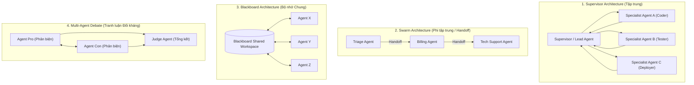
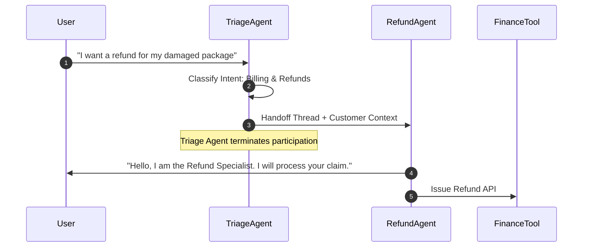
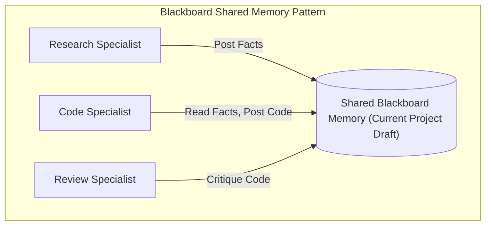
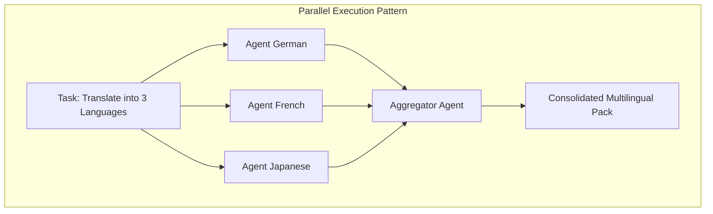

# Chuyên đề: Kiến trúc Đa Tác tử & Điều phối Hệ thống (Multi-Agent Architectures & Orchestration)

## 1. Tổng quan Chuyên đề
Khi độ phức tạp của bài toán vượt quá khả năng của một tác tử đơn lẻ (Single-Agent Bottleneck: quá tải System Prompt, loãng ngữ cảnh, xung đột vai trò), việc chuyển dịch sang **Kiến trúc Đa Tác tử (Multi-Agent Systems - MAS)** là tất yếu. Tương tự như cách một công ty hiện đại phân chia công việc cho các phòng ban chuyên môn (Kỹ sư, Thiết kế, Quản lý dự án, Kiểm thử), một hệ thống đa tác tử phân tách các trách nhiệm thành các Agent chuyên biệt hóa (Specialized Agents).

Chuyên đề này phân tích toàn cảnh lý thuyết và kỹ thuật công nghệ điều phối đa tác tử (**Multi-Agent Orchestration & Collaboration**): các cơ chế bàn giao nhiệm vụ (**Agent Delegation & Handoff**), giao tiếp và đàm phán (**Communication & Negotiation**), các mô hình cấu trúc kinh điển (**Supervisor, Router, Swarm, Blackboard, Hierarchical, Parallel, Sequential**), cơ chế tranh luận đa tác tử (**Multi-Agent Debate**), và các quy trình tự động hóa phức hợp (**Agentic Workflows**).

Toàn cảnh các mô thức điều phối Đa Tác tử hàng đầu:



---

## 2. Chi tiết từng Keyword

---

### 1. Multi-Agent Orchestration & 2. Multi-Agent Collaboration & 3. Agent Delegation & 4. Agent Handoff & 5. Agent Communication & 6. Agent Coordination & 7. Agent Negotiation

#### a. Định nghĩa Bản chất Kỹ thuật & Toán học
- **Multi-Agent Orchestration (Điều phối Đa Tác tử)**: Khung điều hành trung tâm quản lý vòng đời, phân bổ tài nguyên, điều phối luồng thông tin và đồng bộ hóa tiến độ giữa nhiều tác tử độc lập:
  $$\Omega = \langle \mathcal{A} = \{A_1, A_2, \dots, A_n\}, \mathcal{G}_{\text{workflow}}, \mathcal{M}_{\text{shared}}, \Phi_{\text{rules}} \rangle$$
- **Multi-Agent Collaboration (Cộng tác Đa Tác tử)**: Quá trình nhiều Agent làm việc cùng nhau để đạt được một mục tiêu chung mà một Agent đơn lẻ không thể hoàn thành hoặc hoàn thành kém hơn.
- **Agent Delegation (Ủy quyền Tác tử)**: Hành vi một Agent giao lại một mục tiêu con cụ thể cho một Agent khác có kỹ năng chuyên môn phù hợp hơn:
  $$\text{Task } \tau \xrightarrow{\text{Delegate}} \text{Agent}_{specialist}$$
- **Agent Handoff (Chuyển giao Tác quyền)**: Quá trình chuyển giao hoàn toàn quyền kiểm soát phiên tương tác (Control of Thread / Session) từ Agent A sang Agent B. Agent A rút lui và Agent B tiếp tục trò chuyện trực tiếp với người dùng (ví dụ: Triage Agent chuyển giao cho Refund Specialist).
- **Agent Communication (Giao tiếp Tác tử)**: Giao thức truyền tải thông điệp giữa các Agent (đồng bộ hoặc bất đồng bộ) thông qua Direct RPC, Message Broker (RabbitMQ/Kafka) hoặc In-memory Queue.
- **Agent Coordination (Phối hợp Tác tử)**: Cơ chế sắp xếp trình tự hành động để tránh xung đột tài nguyên (Resource Contention / Race Conditions).
- **Agent Negotiation (Thương lượng Tác tử)**: Tiến trình giải quyết bất đồng quan điểm hoặc thương lượng phân bổ tài nguyên giữa các tác tử có mục tiêu cạnh tranh thông qua cơ chế đấu giá (Auction mechanisms) hoặc đối thoại lập luận (Argumentation).

#### b. Cơ chế Tầng Sâu & Nguyên tắc Phân chia Trách nhiệm
Tại sao Đa Tác tử lại vượt trội hơn Đơn Tác tử trong các dự án lớn?
1. **Context Isolation (Cô lập Ngữ cảnh)**: Coder Agent không cần phải đọc toàn bộ các tài liệu hướng dẫn viết test của QA Agent, giúp System Prompt của mỗi bên luôn ngắn gọn và sắc nét.
2. **Specialized Tools (Chuyên môn hóa Công cụ)**: Coder chỉ có công cụ sửa file, QA chỉ có công cụ chạy test; giảm nguy cơ gọi nhầm tool.
3. **Fault Containment (Khoanh vùng Lỗi)**: Một Agent bị lỗi vòng lặp không làm sập toàn bộ hệ thống.

#### c. Sơ đồ Minh họa


#### d. Code Thực chiến (C++ & Python)

```cpp
// C++20: Mô phỏng cơ chế Agent Delegation thông qua Message Passing
#include <iostream>
#include <string>
#include <memory>
#include <unordered_map>

struct AgentMessage {
    std::string from;
    std::string to;
    std::string task_payload;
};

class BaseSpecialist {
public:
    virtual std::string handle_task(const std::string& task) = 0;
    virtual ~BaseSpecialist() = default;
};

class SQLSpecialist : public BaseSpecialist {
public:
    std::string handle_task(const std::string& task) override {
        return "SQL Result: Executed [" + task + "] successfully.";
    }
};

class CoordinatorAgent {
    std::unordered_map<std::string, std::shared_ptr<BaseSpecialist>> team;
public:
    void register_agent(const std::string& role, std::shared_ptr<BaseSpecialist> agent) {
        team[role] = agent;
    }

    std::string delegate(const std::string& role, const std::string& task) {
        if (team.count(role)) {
            std::cout << "Delegating task to specialist: [" << role << "]\n";
            return team[role]->handle_task(task);
        }
        return "Error: No specialist available for " + role;
    }
};

int main() {
    CoordinatorAgent coord;
    coord.register_agent("db_expert", std::make_shared<SQLSpecialist>());
    std::cout << coord.delegate("db_expert", "SELECT count(*) FROM orders") << "\n";
    return 0;
}
```

```python
# Python: Cơ chế Agent Handoff mô phỏng OpenAI Swarm Framework
class Result:
    def __init__(self, value="", agent=None):
        self.value = value
        self.agent = agent

class Agent:
    def __init__(self, name: str, instructions: str):
        self.name = name
        self.instructions = instructions
        self.functions = []

def transfer_to_billing():
    """Handoff function chuyển quyền sang Billing Agent"""
    print(">>> Transferring control to Billing Agent...")
    return billing_agent

triage_agent = Agent("Triage", "Classify customer requests")
billing_agent = Agent("Billing", "Handle refunds and invoices")
triage_agent.functions.append(transfer_to_billing)

# Kích hoạt handoff
next_agent = triage_agent.functions[0]()
print(f"Active Agent is now: {next_agent.name}")
```

#### e. Lỗi Thường gặp & Tối ưu Hệ thống
- **Ping-Pong Handoff Loop**: Agent A chuyển giao cho Agent B, rồi Agent B lại chuyển ngược về Agent A vô tận.
- **Tối ưu**: Thiết lập biến đếm số lần chuyển giao tối đa (`max_handoffs = 5`) và lưu lại danh sách các Agent đã ghé thăm trong metadata của thread.

#### f. Ứng dụng Thực chiến trong AI Systems
OpenAI Swarm, CrewAI Tasks, và AutoGen Conversable Agents.

---

### 8. Supervisor Architecture vs 9. Router Architecture vs 10. Swarm Architecture vs 11. Blackboard Architecture

#### a. Định nghĩa Bản chất Kỹ thuật & Toán học
Bốn mô thức kiến trúc đa tác tử kinh điển:
1. **Supervisor Architecture (Kiến trúc Giám sát Tập trung)**: Một tác tử đóng vai trò Quản lý (Supervisor / Manager). Quản lý nhận câu lệnh tổng, phân bổ việc cho các Worker Agents, nhận kết quả và tổng hợp. Các Worker không nói chuyện trực tiếp với nhau mà chỉ báo cáo về Supervisor.
2. **Router Architecture (Kiến trúc Định tuyến)**: Tác tử Router chỉ đóng vai trò phân luồng duy nhất ở bước đầu tiên: Đọc yêu cầu và chuyển hướng tới đúng 1 Worker duy nhất để xử lý xong là kết thúc (Point-to-point dispatching).
3. **Swarm Architecture (Kiến trúc Đàn / Phi tập trung)**: Không có bất kỳ người quản lý trung tâm nào! Các tác tử hoàn toàn bình đẳng, tự do trao đổi và chuyển giao quyền kiểm soát (Handoff) cho nhau dựa trên các quy tắc cục bộ.
4. **Blackboard Architecture (Kiến trúc Bảng đen)**: Toàn bộ các Agent chia sẻ chung một không gian làm việc tri thức tập trung (**Blackboard Workspace**). Mỗi Agent đóng vai trò một nguồn tri thức (Knowledge Source): khi thấy dữ liệu trên Blackboard phù hợp với kỹ năng của mình, nó sẽ tự động cập nhật giải pháp lên đó để các Agent khác tiếp tục xử lý.

#### b. Bảng So sánh Chuyên sâu Các Kiến trúc
| Tiêu chí | Supervisor Architecture | Swarm Architecture | Blackboard Architecture |
| :--- | :--- | :--- | :--- |
| **Cơ chế Kiểm soát**| Tập trung (Centralized) | Phân tán (Decentralized) | Hướng sự kiện (Event-driven) |
| **Giao tiếp** | Hub-and-Spoke (Qua Supervisor) | Point-to-Point Handoff | Chia sẻ qua Shared State (Blackboard) |
| **Độ phức tạp** | Vừa phải, rất dễ debug | Khó debug hành vi tổng thể | Cao, cần xử lý đồng bộ hóa dữ liệu |
| **Khả năng mở rộng**| Bị nghẽn tại Supervisor | Mở rộng rất linh hoạt | Cực tốt cho bài toán phức hợp |

#### c. Sơ đồ Minh họa


#### d. Code Thực chiến (C++ & Python)

```cpp
// C++20: Kiến trúc Bảng đen (Blackboard Architecture) với Shared State
#include <iostream>
#include <string>
#include <unordered_map>

class Blackboard {
    std::unordered_map<std::string, std::string> board;
public:
    void write(const std::string& key, const std::string& value) {
        board[key] = value;
    }
    std::string read(const std::string& key) const {
        auto it = board.find(key);
        return it != board.end() ? it->second : "";
    }
    bool contains(const std::string& key) const { return board.count(key); }
};

class WorkerA {
public:
    void step(Blackboard& bb) {
        if (!bb.contains("requirements")) {
            bb.write("requirements", "System must support 10k QPS");
            std::cout << "[WorkerA] Posted requirements to Blackboard.\n";
        }
    }
};

class WorkerB {
public:
    void step(Blackboard& bb) {
        if (bb.contains("requirements") && !bb.contains("architecture")) {
            bb.write("architecture", "Distributed C++ microservices with gRPC");
            std::cout << "[WorkerB] Posted architecture based on requirements.\n";
        }
    }
};

int main() {
    Blackboard bb;
    WorkerA a; WorkerB b;
    a.step(bb);
    b.step(bb);
    std::cout << "Final Architecture on Blackboard: " << bb.read("architecture") << "\n";
    return 0;
}
```

```python
# Python: Supervisor Pattern sử dụng cấu trúc điều phối tập trung
class SupervisorAgent:
    def __init__(self, workers_dict):
        self.workers = workers_dict

    def run_workflow(self, user_prompt: str):
        print(f"[Supervisor] Received request: '{user_prompt}'")
        # Bước 1: Điều phối Worker Research
        research_data = self.workers["researcher"](user_prompt)
        print(f"[Supervisor] Received research data.")
        
        # Bước 2: Chuyển sang Worker Writer
        final_doc = self.workers["writer"](research_data)
        print(f"[Supervisor] Final document assembled.")
        return final_doc

workers = {
    "researcher": lambda q: "Key findings: Transformers scale with compute.",
    "writer": lambda facts: f"Executive Briefing:\n{facts}"
}
supervisor = SupervisorAgent(workers)
print(supervisor.run_workflow("Study LLM scaling laws"))
```

#### e. Lỗi Thường gặp & Tối ưu Hệ thống
- **Supervisor Bottleneck (Nghẽn cổ chai tại Quản lý)**: Toàn bộ tin nhắn đều phải đi qua Supervisor khiến chi phí token tăng gấp đôi.
- **Tối ưu**: Cho phép các Worker con trao đổi trực tiếp khi giải quyết các nhiệm vụ phụ (Sub-network clustering).

#### f. Ứng dụng Thực chiến trong AI Systems
LangGraph Multi-Agent Supervisor Tutorial, OpenAI Swarm, MetaGPT Software Company.

---

### 12. Hierarchical Agents & 13. Parallel Agents & 14. Sequential Agents & 15. Multi-Agent Debate & 16. Agentic Workflows

#### a. Định nghĩa Bản chất Kỹ thuật & Toán học
- **Sequential Agents (Tác tử Tuần tự)**: Mô hình đường ống tuyến tính (Linear Pipeline): Đầu ra của Agent trước là đầu vào của Agent sau:
  $$A_1(x) \xrightarrow{y_1} A_2(y_1) \xrightarrow{y_2} \dots \xrightarrow{y_{k-1}} A_k(y_{k-1}) = y_{final}$$
- **Parallel Agents (Tác tử Song song)**: Nhiều Agent cùng chạy đồng thời trên các phân vùng nhiệm vụ độc lập, sau đó kết quả được gom lại bằng hàm Fan-In / Aggregate:
  $$y_1 = A_1(x), \; y_2 = A_2(x), \dots \implies y_{final} = \text{Reduce}(y_1, y_2, \dots)$$
- **Hierarchical Agents (Tác tử Phân cấp)**: Cây tác tử đa tầng (Tree of Agents): Giám đốc điều hành (CEO) $\to$ Trưởng phòng (Managers) $\to$ Nhân viên thực thi (Workers).
- **Multi-Agent Debate (Tranh luận Đa Tác tử)** (Du et al., 2023): Cơ chế đối kháng (Adversarial Mechanism): Hai hoặc nhiều Agent có quan điểm đối lập tranh luận qua nhiều vòng để bóc trần lỗ hổng logic của nhau, giúp câu trả lời cuối cùng đạt độ chính xác và tính khách quan cao nhất.
- **Agentic Workflows (Quy trình Làm việc Tác tử)**: Toàn bộ sự kết hợp hài hòa giữa các chuỗi tuần tự, song song, rẽ nhánh điều kiện và vòng lặp tự phản xạ trong một hệ sinh thái tự động hóa hoàn chỉnh.

#### b. Cơ chế Tầng Sâu: Tại sao Multi-Agent Debate lại giảm Ảo giác?
Theo nghiên cứu của MIT: Một LLM đơn lẻ thường có xu hướng "tự tin thái quá" vào các suy luận sai lầm của chính mình (Confirmation Bias).
Khi đưa hai Agent vào thế đối đầu:
- Agent A đưa ra lời giải.
- Agent B được giao nhiệm vụ: *"Tìm kiếm các giả định sai lầm hoặc lỗi tính toán trong lời giải của Agent A"*.
- Quá trình phản biện qua 3 vòng buộc cả hai phải hội tụ về các luận điểm vững chắc nhất dựa trên sự thật khách quan.

#### c. Sơ đồ Minh họa


#### d. Code Thực chiến (C++ & Python)

```cpp
// C++20: Mô hình Sequential Pipeline đa tác tử
#include <iostream>
#include <string>
#include <vector>
#include <functional>

class SequentialAgentPipeline {
    std::vector<std::function<std::string(const std::string&)>> pipeline;
public:
    void add_stage(std::function<std::string(const std::string&)> stage) {
        pipeline.push_back(stage);
    }

    std::string execute(const std::string& input) {
        std::string current = input;
        for (size_t i = 0; i < pipeline.size(); ++i) {
            current = pipeline[i](current);
            std::cout << "[Pipeline Stage " << (i + 1) << " Done] Output: " << current << "\n";
        }
        return current;
    }
};

int main() {
    SequentialAgentPipeline pipe;
    pipe.add_stage([](const std::string& in) { return in + " -> Researched"; });
    pipe.add_stage([](const std::string& in) { return in + " -> Written"; });
    pipe.add_stage([](const std::string& in) { return in + " -> Formatted"; });
    pipe.execute("Topic: Quantum Computing");
    return 0;
}
```

```python
# Python: Multi-Agent Debate Engine
class MultiAgentDebate:
    def __init__(self, agent_a, agent_b, judge):
        self.agent_a = agent_a
        self.agent_b = agent_b
        self.judge = judge

    def run_debate(self, topic: str, rounds: int = 2):
        transcript = []
        last_arg_b = "No arguments yet."
        for r in range(1, rounds + 1):
            print(f"\n--- Round {r} ---")
            arg_a = self.agent_a(f"Topic: {topic}\nOpponent said: {last_arg_b}\nProvide your argument:")
            print(f"Agent A: {arg_a}")
            transcript.append(f"Round {r} - Agent A: {arg_a}")
            
            arg_b = self.agent_b(f"Topic: {topic}\nOpponent said: {arg_a}\nCounter-argue:")
            print(f"Agent B: {arg_b}")
            transcript.append(f"Round {r} - Agent B: {arg_b}")
            last_arg_b = arg_b

        verdict = self.judge("\n".join(transcript))
        return verdict

# Mock
a = lambda p: "AI requires aggressive safety regulation to prevent risks."
b = lambda p: "Over-regulation will stifle open-source innovation and research."
judge = lambda t: "Verdict: Balanced policy favoring innovation with critical safeguards."

debate = MultiAgentDebate(a, b, judge)
print("\nFinal Consensus:", debate.run_debate("AI Regulation"))
```

#### e. Lỗi Thường gặp & Tối ưu Hệ thống
- **Bùng nổ chi phí tính toán (Token explosion)**: Chạy 5 vòng debate giữa hai mô hình lớn làm tăng chi phí gấp 10 lần.
- **Tối ưu**: Dùng mô hình nhỏ (như LLaMA-3-8B) cho các vòng tranh luận sơ bộ và chỉ dùng mô hình lớn (GPT-4 / Claude 3.5) cho vị trí Thẩm phán (Judge).

#### f. Ứng dụng Thực chiến trong AI Systems
ChatDev (Công ty phần mềm ảo tạo game trong 7 phút), ChatEval, và quy trình phân tích đầu tư tài chính đa chiều.
