# Chuyên đề: Tiền xử lý Văn bản & Phân tách Từ vị (Text Preprocessing & Tokenization)

## 1. Tổng quan Chuyên đề
Trong Khoa học Xử lý Ngôn ngữ Tự nhiên (Natural Language Processing - NLP), chuỗi ký tự thô (raw characters stream) là dữ liệu phi cấu trúc, rời rạc và có tính biến thiên rất cao. Để mạng nơ-ron hoặc các giải thuật học máy có thể tính toán được, dữ liệu văn bản phải trải qua pipeline chuẩn hóa (normalization), phân đoạn ngữ vi mô (sentence & word segmentation), tách từ vị (tokenization) và rút gọn hình thái học (morphological reduction).

Tầng xử lý này định hình không gian từ vựng $\mathcal{V}$, quyết định độ dài ngữ cảnh $L$, chi phối kích thước ma trận nhúng $E \in \mathbb{R}^{|\mathcal{V}| \times d}$ và ảnh hưởng trực tiếp đến hiệu năng bộ nhớ đệm (CPU L1/L2 cache), băng thông nạp chuỗi (string memory bandwidth) và độ trễ tiền xử lý (data pipeline bottleneck).

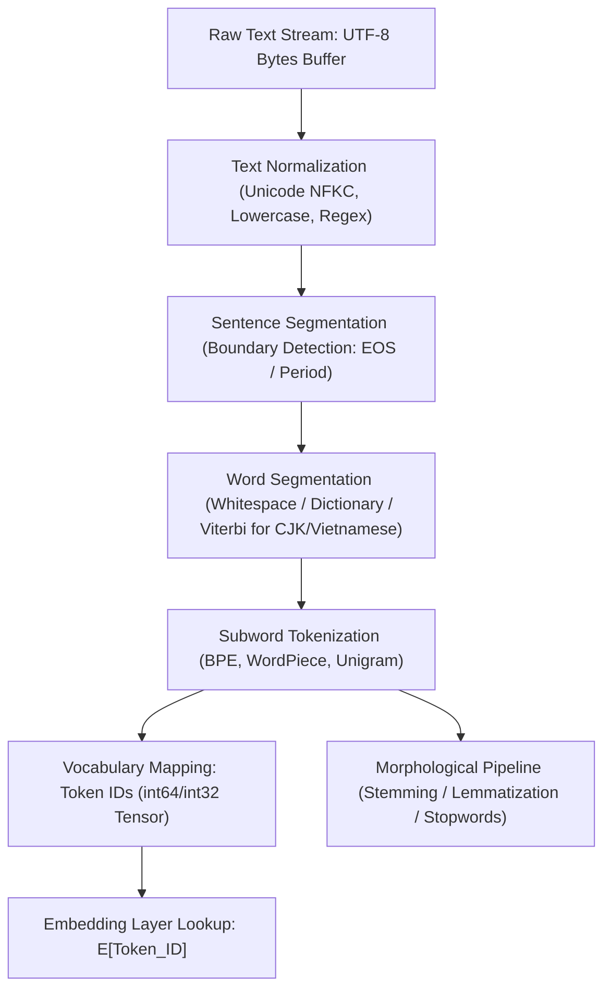

---

## 2. Chi tiết từng Keyword

---

### 1. Natural Language Processing (Xử lý Ngôn ngữ Tự nhiên)

#### a. Định nghĩa Bản chất Toán học (Mathematical Formulation)
Xử lý Ngôn ngữ Tự nhiên là bài toán ánh xạ từ không gian chuỗi ký hiệu rời rạc vô hạn $\Sigma^*$ sang không gian biểu diễn ngữ nghĩa liên tục $\mathbb{R}^d$ và ngược lại. Về bản chất mô hình hóa xác suất, bài toán ngôn ngữ tương đương với việc ước lượng phân phối hợp xác suất trên chuỗi token $\mathbf{x} = (x_1, x_2, \dots, x_T)$:
$$P(\mathbf{x}) = \prod_{t=1}^T P(x_t \mid x_1, x_2, \dots, x_{t-1}; \theta)$$
với $\theta$ là không gian tham số của mô hình học máy cần tối ưu hóa bằng cách cực tiểu hóa hàm mất mát Cross-Entropy:
$$\mathcal{L}(\theta) = - \frac{1}{T} \sum_{t=1}^T \log P(x_t \mid x_{<t}; \theta)$$

#### b. Cơ chế Tầng Sâu & Điện toán (Under The Hood / Hardware Internals)
- **Chuỗi ký tự trong bộ nhớ**: Dữ liệu văn bản biểu diễn dưới dạng mảng byte UTF-8 liên tục (`uint8_t[]`). Khi truyền vào CPU, các chuỗi có độ dài biến thiên (variable-length) gây phân mảnh heap và cache miss liên tục nếu cấp phát động (`std::string`).
- **SIMD String Scanning**: Các engine NLP hiệu năng cao (như simdutf, HuggingFace Tokenizers viết bằng Rust) sử dụng tập lệnh SIMD (AVX2/AVX-512) quét đồng thời 32 hoặc 64 bytes để tìm ranh giới ký tự UTF-8, khoảng trắng, hoặc ký hiệu phân tách chỉ trong 1 chu kỳ máy.
- **Data Loading Bottleneck**: Trong huấn luyện LLM, pipeline tiền xử lý CPU-bound có thể khiến GPU Tensor Cores bị "bỏ đói" (GPU starvation) nếu không sử dụng memory-mapped files (`mmap`) và zero-copy tokenization buffers.

#### c. Sơ đồ Minh họa (Mermaid Diagram)
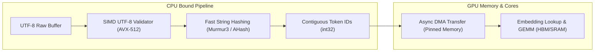

#### d. Code Thực chiến (C++ & Python)

```cpp
// C++17: Đọc buffer văn bản liên tục và đếm UTF-8 codepoints bằng Bitwise Operations
#include <iostream>
#include <string_view>
#include <vector>

size_t count_utf8_codepoints(std::string_view utf8_str) {
    size_t count = 0;
    const unsigned char* s = reinterpret_cast<const unsigned char*>(utf8_str.data());
    size_t len = utf8_str.size();
    for (size_t i = 0; i < len; ++i) {
        // Ký tự UTF-8 bắt đầu nếu 2 bit đầu không phải 10xxxxxx (tức (byte & 0xC0) != 0x80)
        if ((s[i] & 0xC0) != 0x80) {
            count++;
        }
    }
    return count;
}

int main() {
    std::string text = "Xử lý Ngôn ngữ Tự nhiên (Natural Language Processing)";
    std::cout << "Raw Bytes: " << text.size() << " | Codepoints: " << count_utf8_codepoints(text) << "\n";
    return 0;
}
```

```python
# Python / PyTorch: Đo lường phân phối độ dài token và chuyển đổi sang Tensor
import torch

class RawTextPipeline:
    def __init__(self, vocab_map: dict[str, int]):
        self.vocab = vocab_map
        self.unk_id = vocab_map.get("<UNK>", 0)

    def text_to_tensor(self, tokens: list[str]) -> torch.Tensor:
        ids = [self.vocab.get(tok, self.unk_id) for tok in tokens]
        # Tạo contiguous int64 tensor tối ưu nạp vào GPU embedding
        return torch.tensor(ids, dtype=torch.long)

vocab = {"Học": 1, "sâu": 2, "cho": 3, "NLP": 4, "<UNK>": 0}
pipeline = RawTextPipeline(vocab)
tensor_out = pipeline.text_to_tensor(["Học", "sâu", "NLP"])
print("Token Tensor:", tensor_out, "| Shape:", tensor_out.shape)
```

#### e. Lỗi Thường gặp & Ổn định Số học (Pitfalls & Numerical Stability)
- **UTF-8 Byte Order Mark (BOM) & Multi-byte Slicing**: Cắt chuỗi tại vị trí byte ngẫu nhiên thay vì codepoint boundary sẽ sinh ra byte lỗi `\xFF\xFD` (Replacement character).
- **Out of Vocabulary (OOV) Rate**: Tập từ vựng kín (closed vocabulary) gây mất mát ngữ nghĩa nghiêm trọng khi gặp từ hiếm hoặc từ mới.

#### f. Ứng dụng Thực chiến trong AI / Deep Learning
Là nền tảng cốt lõi của toàn bộ hệ sinh thái LLMs (GPT-4, Gemini, Claude, LLaMA), hệ thống dịch máy nơ-ron (NMT) và các hệ thống tìm kiếm thông tin ngữ nghĩa (Semantic Search).

---

### 2. Text Preprocessing (Tiền xử lý Văn bản)

#### a. Định nghĩa Bản chất Toán học
Tiền xử lý văn bản là chuỗi hàm hợp ánh xạ hình thức $\Phi = \phi_k \circ \phi_{k-1} \circ \dots \circ \phi_1$:
$$\Phi: \mathcal{S}_{\text{raw}} \to \mathcal{S}_{\text{clean}}$$
nhằm loại bỏ các nhiễu ngẫu nhiên $\eta$, đưa chuỗi ký tự về dạng chuẩn tắc sao cho khoảng cách phân phối ngữ nghĩa tối thiểu:
$$\min_{\Phi} D_{KL}\left( P(\mathbf{w}_{\text{clean}}) \parallel P(\mathbf{w}_{\text{target}}) \right)$$

#### b. Cơ chế Tầng Sâu & Điện toán
- **Memory Allocation Overhead**: Thao tác Regular Expression (`regex`) trên CPU tạo ra hàng ngàn chuỗi tạm thời trong bộ nhớ heap. Cần dùng cơ chế *In-place Mutation* hoặc String Buffer tĩnh có kích thước cố định (`std::string::reserve`) để tránh cấp phát lại (reallocation) liên tục.
- **Cache-Locality**: Gom nhóm các tác vụ chuẩn hóa ký tự thành 1 vòng lặp duy nhất (Single-pass iteration) thay vì chạy nhiều hàm duyệt qua chuỗi nhiều lần (Multi-pass traversal), giữ buffer trong L1 Cache (32KB).

#### c. Sơ đồ Minh họa (Mermaid Diagram)
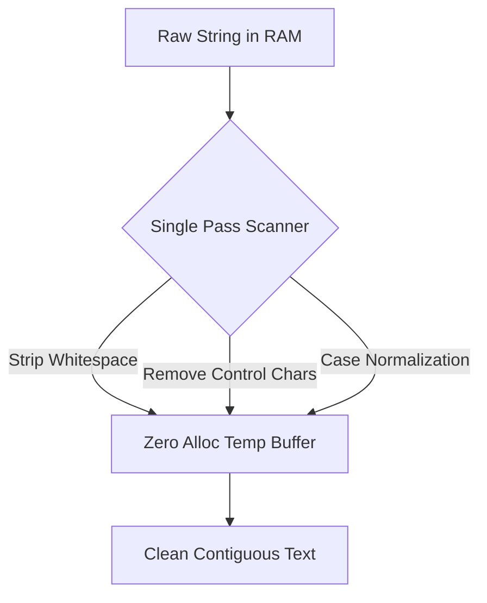

#### d. Code Thực chiến (C++ & Python)

```cpp
// C++17: In-place text cleaning không cấp phát thêm bộ nhớ heap
#include <iostream>
#include <string>
#include <cctype>

void in_place_clean_ascii(std::string& str) {
    size_t write_idx = 0;
    bool prev_space = false;
    for (size_t read_idx = 0; read_idx < str.size(); ++read_idx) {
        unsigned char c = str[read_idx];
        if (std::isspace(c)) {
            if (!prev_space && write_idx > 0) {
                str[write_idx++] = ' ';
                prev_space = true;
            }
        } else if (std::isalnum(c) || std::ispunct(c)) {
            str[write_idx++] = std::tolower(c);
            prev_space = false;
        }
    }
    // Cắt bỏ phần dư thừa cuối chuỗi
    str.resize(write_idx);
}

int main() {
    std::string raw = "  Deep Learning   &   Transformer-based NLP!!  ";
    in_place_clean_ascii(raw);
    std::cout << "Cleaned: '" << raw << "'\n";
    return 0;
}
```

```python
# Python: Vectorized clean với regex đã compile sẵn (Re-use state machine)
import re

class FastTextPreprocessor:
    def __init__(self):
        # Precompile regex state machine để tối ưu CPU time
        self.whitespace_regex = re.compile(r'\s+')
        self.control_char_regex = re.compile(r'[\x00-\x1f\x7f-\x9f]')

    def clean(self, text: str) -> str:
        text = self.control_char_regex.sub('', text)
        text = self.whitespace_regex.sub(' ', text)
        return text.strip().lower()

preprocessor = FastTextPreprocessor()
print(preprocessor.clean("  Trí Tuệ \x00 Nhân Tạo \t\t 2026 \n! "))
```

#### e. Lỗi Thường gặp & Ổn định Số học
- **Over-cleaning**: Xóa sạch toàn bộ dấu câu làm mất cấu trúc phân tách câu, khiến các mô hình ngôn ngữ không nhận diện được dấu kết thúc tư duy (`EOS`).
- **Regex Catastrophic Backtracking**: Sử dụng biểu thức chính quy lồng nhau như `(a+)+$` trên văn bản dài làm treo CPU thread vĩnh viễn (O(2^N) complexity).

#### f. Ứng dụng Thực chiến trong AI
Xây dựng Data Ingestion Engine xử lý hàng Terabyte dữ liệu web thô (Common Crawl, The Pile, FineWeb) trước khi đưa vào Pre-training cluster.

---

### 3. Text Normalization (Chuẩn hóa Văn bản)

#### a. Định nghĩa Bản chất Toán học
Chuẩn hóa văn bản là phép ánh xạ tương đương:
$$\mathcal{N}: \Sigma^* \to \Sigma^*, \quad \forall s_1, s_2 \in \Sigma^*: s_1 \sim s_2 \implies \mathcal{N}(s_1) = \mathcal{N}(s_2)$$
Trong đó $\sim$ biểu thị mối quan hệ tương đương về hình thái ngữ nghĩa (semantic canonical equivalence). Phổ biến nhất là 4 chuẩn Unicode Normalization Forms:
- **NFD**: Canonical Decomposition.
- **NFC**: Canonical Decomposition followed by Canonical Composition.
- **NFKD**: Compatibility Decomposition.
- **NFKC**: Compatibility Decomposition followed by Canonical Composition.

#### b. Cơ chế Tầng Sâu & Điện toán
- **Unicode Canonical Equivalence**: Ví dụ ký tự tiếng Việt "á" có thể được biểu diễn bằng 1 codepoint duy nhất `U+00E1` (precomposed) hoặc 2 codepoints `U+0061` (a) + `U+0301` (dấu sắc rời - combining acute accent). Nếu không chuẩn hóa NFKC/NFC, mạng nơ-ron coi đây là 2 token hoàn toàn khác nhau.
- **Lookup Table Optimization**: Các bảng ánh xạ Unicode (Casefolding, NFKC tables) có kích thước vài chục KB, vừa vặn lưu trong CPU L2 Cache để tăng tốc ánh xạ codepoint sang canonical codepoint với độ phức tạp $O(1)$.

#### c. Sơ đồ Minh họa (Mermaid Diagram)
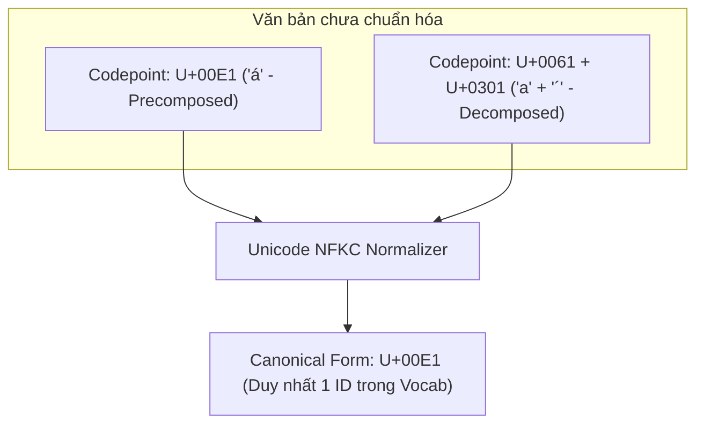

#### d. Code Thực chiến (C++ & Python)

```cpp
// C++17: Chuyển đổi số la mã và ký tự đặc biệt sang chuẩn ASCII tương đương
#include <iostream>
#include <string>
#include <unordered_map>

std::string normalize_special_chars(const std::string& input) {
    static const std::unordered_map<std::string, std::string> kReplacementMap = {
        {"\xE2\x80\x9C", "\""}, // “ Left double quote
        {"\xE2\x80\x9D", "\""}, // ” Right double quote
        {"\xE2\x80\x98", "'"},  // ‘ Left single quote
        {"\xE2\x80\x99", "'"},  // ’ Right single quote
        {"\xC2\xA0", " "}       // Non-breaking space
    };
    std::string result = input;
    for (const auto& [from, to] : kReplacementMap) {
        size_t pos = 0;
        while ((pos = result.find(from, pos)) != std::string::npos) {
            result.replace(pos, from.length(), to);
            pos += to.length();
        }
    }
    return result;
}

int main() {
    std::string quote = "\xE2\x80\x9CAI Revolution\xE2\x80\x9D";
    std::cout << "Normalized: " << normalize_special_chars(quote) << "\n";
    return 0;
}
```

```python
# Python: Chuẩn hóa Unicode toàn diện với unicodedata
import unicodedata

def normalize_vietnamese_unicode(text: str) -> str:
    # NFKC: Vừa chuẩn hóa kết hợp ký tự, vừa chuẩn hóa tính tương thích (e.g. ligature, superscripts)
    text = unicodedata.normalize('NFKC', text)
    # Loại bỏ khoảng trắng vô hình (zero-width spaces)
    text = text.replace('\u200b', '').replace('\ufeff', '')
    return text

raw_str1 = "toán học" # Có thể dùng tổ hợp
raw_str2 = "toán học" # Có thể dùng dựng sẵn
print("Trùng khớp trước:", raw_str1 == raw_str2)
print("Trùng khớp sau NFKC:", normalize_vietnamese_unicode(raw_str1) == normalize_vietnamese_unicode(raw_str2))
```

#### e. Lỗi Thường gặp & Ổn định Số học
- Bỏ qua chuẩn hóa dấu thanh tiếng Việt giữa kiểu gõ cũ (hòa, thúy) và kiểu gõ mới (hoà, thuý) khiến mô hình chia tách một từ thành 2 cụm subword khác nhau, phân tán xác suất của ma trận Softmax.

#### f. Ứng dụng Thực chiến trong AI
Mọi tokenizer hiện đại (tiktoken của OpenAI, SentencePiece của Google) đều đặt bước Unicode Normalization làm tiền đề tiên quyết trước khi thực hiện tách token.

---

### 4. Sentence Segmentation (Phân đoạn Câu)

#### a. Định nghĩa Bản chất Toán học
Phân đoạn câu là bài toán phân lớp nhị phân trên tập các vị trí kết thúc tiềm năng $\mathcal{B} \subset \{1, \dots, N\}$:
$$\hat{y}_i = \arg\max_{y \in \{0, 1\}} P(y \mid c_{i-k}, \dots, c_i, \dots, c_{i+k})$$
trong đó $y=1$ biểu thị vị trí ranh giới câu (Sentence Boundary), $c_i$ là ký tự tại vị trí $i$ (thường là dấu chấm `.`, chấm hỏi `?`, chấm than `!`), và $k$ là bán kính cửa sổ ngữ cảnh.

#### b. Cơ chế Tầng Sâu & Điện toán
- **Ambiguity in Punctuation**: Dấu chấm mang nhiều chức năng: kết thúc câu, dấu phân tách số thực (`3.14`), chữ viết tắt (`Dr.`, `Inc.`), đường dẫn URL/email.
- **Finite State Machine (FSM)**: Giải thuật FSM dựa trên Rule hoặc mô hình chuỗi điểm (Point-boundary classifier) thực thi trên CPU với độ trễ cực thấp ($O(N)$), tránh phải nạp cả văn bản vào Transformer nặng nề chỉ để tách câu.

#### c. Sơ đồ Minh họa (Mermaid Diagram)
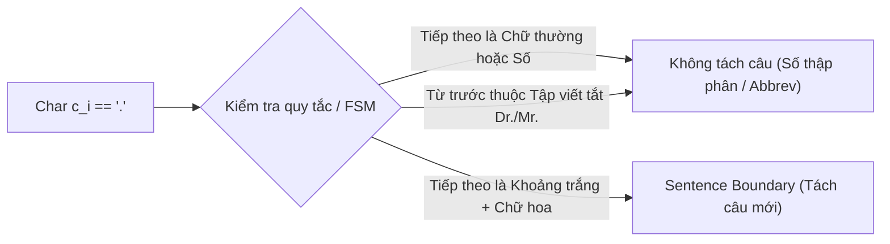

#### d. Code Thực chiến (C++ & Python)

```cpp
// C++17: Rule-based Sentence Boundary Detector tối ưu bộ nhớ
#include <iostream>
#include <string_view>
#include <vector>
#include <unordered_set>

class FastSentenceSegmenter {
private:
    std::unordered_set<std::string_view> abbreviations_ = {"mr.", "dr.", "ms.", "prof.", "inc.", "e.g.", "i.e."};
public:
    std::vector<std::string_view> segment(std::string_view text) {
        std::vector<std::string_view> sentences;
        size_t start = 0;
        size_t n = text.size();

        for (size_t i = 0; i < n; ++i) {
            if (text[i] == '.' || text[i] == '!' || text[i] == '?') {
                // Kiểm tra xem có nằm trong từ viết tắt không
                size_t word_start = text.rfind(' ', i);
                word_start = (word_start == std::string_view::npos) ? 0 : word_start + 1;
                std::string_view word = text.substr(word_start, i - word_start + 1);
                
                std::string lower_word;
                for (char c : word) lower_word += std::tolower(c);
                if (abbreviations_.find(lower_word) != abbreviations_.end()) {
                    continue; // Bỏ qua từ viết tắt
                }

                // Kiểm tra ký tự tiếp theo có phải khoảng trắng hoặc hết chuỗi
                if (i + 1 == n || text[i + 1] == ' ' || text[i + 1] == '\n') {
                    sentences.push_back(text.substr(start, i - start + 1));
                    while (i + 1 < n && (text[i + 1] == ' ' || text[i + 1] == '\n')) ++i;
                    start = i + 1;
                }
            }
        }
        if (start < n) sentences.push_back(text.substr(start));
        return sentences;
    }
};

int main() {
    FastSentenceSegmenter seg;
    std::string text = "Dr. Smith bought a GPU. It has 80GB VRAM! Fast inference.";
    auto sents = seg.segment(text);
    for (auto s : sents) std::cout << "-> " << s << "\n";
    return 0;
}
```

```python
# Python: Sentence Splitting dùng Spacy / PySBD
def simple_sentence_chunker(text: str) -> list[str]:
    # Sử dụng Regex lookbehind / lookahead để tránh mất dấu câu
    import re
    pattern = r'(?<!\w\.\w.)(?<![A-Z][a-z]\.)(?<=\.|\?|\!)\s'
    return [s.strip() for s in re.split(pattern, text) if s.strip()]

text = "Deep learning is advancing fast. Is it AGI yet? Dr. LeCun thinks not."
for s in simple_sentence_chunker(text):
    print("Sent:", s)
```

#### e. Lỗi Thường gặp & Ổn định Số học
- Tách câu sai trong các đoạn trích dẫn (Direct speech) có chứa dấu câu bên trong ngoặc kép `“...!”` khiến ngữ nghĩa bị bẻ gãy.

#### f. Ứng dụng Thực chiến trong AI
Xác định giới hạn chunk trong Retrieval-Augmented Generation (RAG) và chuẩn bị dữ liệu cặp câu cho bài toán Natural Language Inference (NLI) hoặc Next Sentence Prediction (NSP).

---

### 5. Word Segmentation (Phân đoạn Từ)

#### a. Định nghĩa Bản chất Toán học
Trong các ngôn ngữ không sử dụng khoảng trắng để phân tách từ (như tiếng Trung, tiếng Nhật) hoặc ngôn ngữ đơn lập đa tiết có ranh giới từ ghép phức tạp (như tiếng Việt), phân đoạn từ là bài toán tìm chuỗi từ $\mathbf{w}^* = (w_1, \dots, w_M)$ từ chuỗi âm tiết/ký tự $\mathbf{c} = (c_1, \dots, c_N)$ sao cho:
$$\mathbf{w}^* = \arg\max_{\mathbf{w}} P(\mathbf{w} \mid \mathbf{c}) = \arg\max_{\mathbf{w}} \prod_{i=1}^M P(w_i \mid w_{i-1}) \cdot P(c_{\text{span}(i)} \mid w_i)$$
Quy hoạch động (Dynamic Programming - Thuật toán Viterbi) trên đồ thị có hướng không chu trình (DAG) cho phép tìm đường đi tối ưu với độ phức tạp thời gian $O(N \cdot K^2)$ với $K$ là độ dài từ tối đa.

#### b. Cơ chế Tầng Sâu & Điện toán
- **Trie Data Structure for Lexicon**: Bảng từ điển (Lexicon Dictionary) được tổ chức thành cấu trúc Cây tiền tố (Double-Array Trie hoặc Marisa Trie) để tra cứu chuỗi tiền tố với độ phức tạp $O(L)$ theo độ dài chuỗi thay vì $O(\log |\mathcal{V}|)$.
- **Vietnamese Syllable Boundary**: Trong tiếng Việt, dấu cách phân tách âm tiết (syllables), không phải phân tách từ (words). Ví dụ "học sinh" là 1 từ gồm 2 âm tiết. Việc ghép từ (compound word segmentation) giảm thiểu số lượng token và tăng tính đơn trị ngữ nghĩa.

#### c. Sơ đồ Minh họa (Mermaid Diagram)
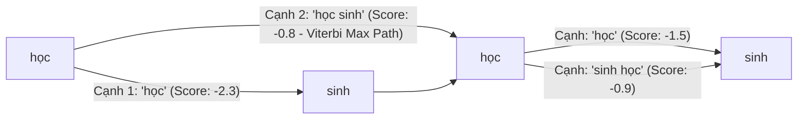

#### d. Code Thực chiến (C++ & Python)

```cpp
// C++17: Maximum Matching Algorithm (Forward Longest Match) dùng Trie
#include <iostream>
#include <string>
#include <vector>
#include <unordered_set>
#include <algorithm>

class WordSegmenter {
private:
    std::unordered_set<std::string> dictionary_;
    size_t max_word_len_ = 4; // Độ dài từ ghép tối đa (âm tiết)
public:
    void add_word(const std::string& word) { dictionary_.insert(word); }

    std::vector<std::string> segment(const std::vector<std::string>& syllables) {
        std::vector<std::string> words;
        size_t i = 0;
        size_t n = syllables.size();

        while (i < n) {
            bool matched = false;
            size_t max_k = std::min(max_word_len_, n - i);
            for (size_t k = max_k; k > 1; --k) {
                std::string compound = syllables[i];
                for (size_t j = 1; j < k; ++j) compound += "_" + syllables[i + j];

                if (dictionary_.find(compound) != dictionary_.end()) {
                    words.push_back(compound);
                    i += k;
                    matched = true;
                    break;
                }
            }
            if (!matched) {
                words.push_back(syllables[i]);
                i++;
            }
        }
        return words;
    }
};

int main() {
    WordSegmenter seg;
    seg.add_word("trí_tuệ");
    seg.add_word("nhân_tạo");

    std::vector<std::string> tokens = {"nghiên", "cứu", "trí", "tuệ", "nhân", "tạo"};
    auto result = seg.segment(tokens);
    for (const auto& w : result) std::cout << "[" << w << "] ";
    std::cout << "\n";
    return 0;
}
```

```python
# Python: Mô phỏng phân đoạn từ tiếng Việt với PyVi / VnCoreNLP
class SyllableWordSegmenter:
    def __init__(self, compound_dict: set[str]):
        self.compound_dict = compound_dict

    def segment(self, text: str) -> str:
        syllables = text.split()
        n = len(syllables)
        result = []
        i = 0
        while i < n:
            if i + 1 < n and f"{syllables[i]}_{syllables[i+1]}".lower() in self.compound_dict:
                result.append(f"{syllables[i]}_{syllables[i+1]}")
                i += 2
            else:
                result.append(syllables[i])
                i += 1
        return " ".join(result)

compound_dict = {"học_sinh", "sinh_viên", "trí_tuệ", "nhân_tạo"}
segmenter = SyllableWordSegmenter(compound_dict)
print(segmenter.segment("Các bạn sinh viên nghiên cứu trí tuệ nhân tạo"))
```

#### e. Lỗi Thường gặp & Ổn định Số học
- **Ranh giới nhập nhằng (Segmentation Ambiguity)**: Ví dụ chuỗi "học sinh học" có thể hiểu là [học_sinh] [học] (the student studies) hoặc [học] [sinh_học] (study biology). Cần mô hình chuỗi xác suất (CRF, BiLSTM, Transformer) để giải quyết phụ thuộc ngữ cảnh toàn cục.

#### f. Ứng dụng Thực chiến trong AI
Tiền đề của các mô hình ngôn ngữ tiếng Việt chuyên biệt (PhoBERT, ViBERT) và các hệ thống dịch tiếng Trung/Nhật.

---

### 6. Tokenization (Tách Token)

#### a. Định nghĩa Bản chất Toán học
Tokenization là thuật toán nén từ vựng (Vocabulary Compression) chuyển đổi một chuỗi ký tự thành dãy chỉ số số nguyên rời rạc $\mathbf{t} = (t_1, \dots, t_L)$ thuộc không gian từ vựng giới hạn $\mathcal{V}$:
$$t_i \in \{0, 1, \dots, |\mathcal{V}|-1\}$$
Ba giải thuật Subword Tokenization tiêu chuẩn:
1. **Byte-Pair Encoding (BPE)**: Bắt đầu từ tập ký tự cơ sở, lặp đi lặp lại việc gộp cặp byte/ký tự có tần suất xuất hiện cao nhất:
   $$(p^*, q^*) = \arg\max_{(p, q)} \text{Freq}(p, q)$$
2. **WordPiece**: Tối đa hóa hàm khả năng (likelihood) của mô hình ngôn ngữ khi thêm cặp ký tự vào từ vựng:
   $$\text{Score}(p, q) = \frac{\text{Freq}(p, q)}{\text{Freq}(p) \cdot \text{Freq}(q)}$$
3. **Unigram**: Bắt đầu từ tập từ vựng cực lớn, loại bỏ dần các token làm giảm ít nhất độ hợp lý của dữ liệu (minimize loss in corpus likelihood).

#### b. Cơ chế Tầng Sâu & Điện toán
- **Byte-level BPE (BBPE)**: Sử dụng trực tiếp 256 giá trị byte của UTF-8 làm tập ký tự gốc ban đầu. Điều này loại bỏ hoàn toàn hiện tượng Out-Of-Vocabulary (OOV) vì mọi chuỗi văn bản trên thế giới đều phân rã được thành byte.
- **Fast Tokenizer Cache**: Mọi thao tác mã hóa token được cache trong hash map (`std::unordered_map<std::string, int>`) hoặc Prefix Tree để đạt thông lượng hàng chục triệu tokens/giây trên CPU đa luồng (Multi-threading with Rayon / OpenMP).

#### c. Sơ đồ Minh họa (Mermaid Diagram)
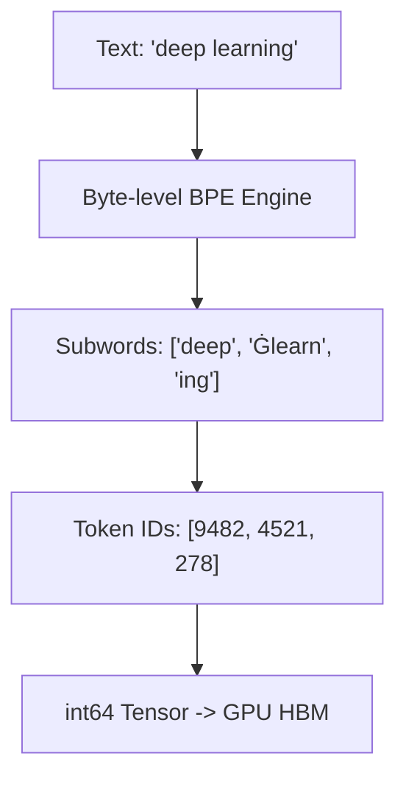

#### d. Code Thực chiến (C++ & Python)

```cpp
// C++17: Thuật toán BPE Merge cơ bản
#include <iostream>
#include <string>
#include <vector>
#include <map>
#include <sstream>

struct BPETokenizer {
    std::map<std::pair<std::string, std::string>, int> merge_ranks;

    std::vector<std::string> tokenize(const std::string& word) {
        std::vector<std::string> symbols;
        for (char c : word) symbols.push_back(std::string(1, c));

        while (symbols.size() >= 2) {
            int best_rank = 1e9;
            int best_idx = -1;

            for (size_t i = 0; i < symbols.size() - 1; ++i) {
                auto pair = std::make_pair(symbols[i], symbols[i + 1]);
                if (merge_ranks.count(pair)) {
                    int rank = merge_ranks[pair];
                    if (rank < best_rank) {
                        best_rank = rank;
                        best_idx = static_cast<int>(i);
                    }
                }
            }

            if (best_idx == -1) break; // Không còn cặp nào để gộp

            // Gộp cặp có rank thấp nhất (ưu tiên cao nhất)
            symbols[best_idx] = symbols[best_idx] + symbols[best_idx + 1];
            symbols.erase(symbols.begin() + best_idx + 1);
        }
        return symbols;
    }
};

int main() {
    BPETokenizer bpe;
    bpe.merge_ranks[{{"n", "e"}, 1}];
    bpe.merge_ranks[{{"w", "e"}, 2}];
    bpe.merge_ranks[{{"ne", "w"}, 3}];
    bpe.merge_ranks[{{"s", "t"}, 4}];

    auto res = bpe.tokenize("newest");
    std::cout << "BPE Subwords: ";
    for (const auto& s : res) std::cout << "[" << s << "] ";
    std::cout << "\n";
    return 0;
}
```

```python
# Python: Tiktoken Tokenization tương tự GPT-4
import tiktoken

enc = tiktoken.get_encoding("cl100k_base")
text = "Attention Is All You Need 2026!"
token_ids = enc.encode(text)
decoded_tokens = [enc.decode([t]) for t in token_ids]

print("Token IDs:", token_ids)
print("Decoded Subwords:", decoded_tokens)
print("Compression ratio (Bytes/Token):", len(text.encode('utf-8')) / len(token_ids))
```

#### e. Lỗi Thường gặp & Ổn định Số học
- **Leading Whitespace Sensitivity**: Trong GPT tokenizers, `" world"` và `"world"` có 2 token ID khác biệt hoàn toàn do tiền tố byte khoảng trắng (`Ġ` hay byte `0x20`).
- **Token Degradation**: Số nguyên lớn hoặc mã lập trình không chuẩn có thể bị xé thành hàng chục token đơn lẻ (Single-character tokens), làm cạn kiệt context window của Transformer.

#### f. Ứng dụng Thực chiến trong AI
Thành phần bắt buộc hàng đầu trong mọi LLM hiện đại (LLaMA 3, GPT-4o, Mistral, Gemma).

---

### 7. Stopword Removal (Loại bỏ Từ dừng)

#### a. Định nghĩa Bản chất Toán học
Từ dừng là các từ có tần suất xuất hiện cực cao trong ngữ liệu nhưng mang lượng thông tin riêng (Self-Information) rất thấp. Theo lý thuyết thông tin Shannon:
$$I(w) = -\log_2 P(w) \approx 0 \quad (\text{khi } P(w) \to 1)$$
Hàm loại bỏ từ dừng là toán tử lọc tập hợp:
$$\mathcal{F}_{\text{stop}}(\mathbf{w}) = \{w_i \in \mathbf{w} \mid w_i \notin \mathcal{S}_{\text{stopwords}}\}$$

#### b. Cơ chế Tầng Sâu & Điện toán
- **Bitset / Bloom Filter**: Thay vì tìm kiếm trong mảng tuyến tính $O(N)$ hay Hash Table có độ phân tán bộ nhớ cao, danh sách stopwords có thể biểu diễn bằng một bảng băm hoàn hảo (Minimal Perfect Hash Function - MPHF) hoặc Bloom Filter để kiểm tra tồn tại chỉ với 1-2 lần truy cập bộ nhớ L1 Cache.
- **Modern LLM Stance**: Trong Transformer-based LLMs, **tuyệt đối không loại bỏ stopwords** vì các từ dừng (giới từ, đại từ, liên từ) mang vai trò quyết định cấu trúc ngữ pháp và quan hệ chú ý (Self-Attention connections). Tác vụ này hiện nay chỉ phục vụ TF-IDF, BM25 hoặc Topic Modeling cổ điển.

#### c. Sơ đồ Minh họa (Mermaid Diagram)
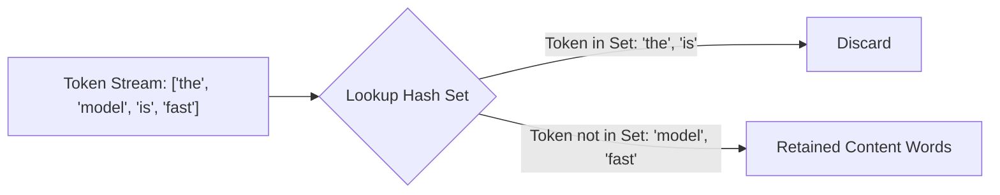

#### d. Code Thực chiến (C++ & Python)

```cpp
// C++17: Stopword Filtering hiệu năng cao với Hash Set phẳng
#include <iostream>
#include <vector>
#include <string_view>
#include <unordered_set>

class StopwordFilter {
private:
    std::unordered_set<std::string_view> stops_ = {"a", "an", "the", "is", "in", "at", "of", "and"};
public:
    std::vector<std::string_view> filter(const std::vector<std::string_view>& tokens) {
        std::vector<std::string_view> filtered;
        filtered.reserve(tokens.size());
        for (auto tok : tokens) {
            if (stops_.find(tok) == stops_.end()) {
                filtered.push_back(tok);
            }
        }
        return filtered;
    }
};

int main() {
    StopwordFilter sf;
    std::vector<std::string_view> doc = {"the", "transformer", "is", "an", "attention", "model"};
    auto out = sf.filter(doc);
    for (auto w : out) std::cout << w << " ";
    std::cout << "\n";
    return 0;
}
```

```python
# Python: Stopword filtering với Frozenset phục vụ BM25 Retreival
STOPWORDS = frozenset({"và", "của", "là", "có", "những", "các", "trong", "được"})

def filter_stopwords_vietnamese(tokens: list[str]) -> list[str]:
    return [t for t in tokens if t.lower() not in STOPWORDS]

print(filter_stopwords_vietnamese(["Mô", "hình", "được", "huấn", "luyện", "trong", "GPU"]))
```

#### e. Lỗi Thường gặp & Ổn định Số học
- Loại bỏ nhầm các từ phủ định như `not`, `never`, `no` làm đảo ngược 180 độ nhãn cảm xúc trong bài toán Sentiment Analysis.

#### f. Ứng dụng Thực chiến trong AI
Tối ưu hóa kích thước chỉ mục đảo (Inverted Index) trong Elasticsearch, Lucene, BM25 và giảm chiều không gian vector của TF-IDF.

---

### 8. Stemming (Rút gọn Gốc từ)

#### a. Định nghĩa Bản chất Toán học
Stemming là giải thuật heuristic chặt bỏ các tiếp vị ngữ (affixes/suffixes) để đưa từ về dạng gốc thô (stem), không đảm bảo từ sinh ra có nghĩa trong từ điển:
$$f_{\text{stem}}: w \mapsto s, \quad s \in \Sigma^*$$
Ví dụ trong thuật toán Porter Stemmer hoặc Snowball Stemmer, một tập các luật thay thế dạng chuỗi được áp dụng tuần tự:
$$\text{IF } \text{measure}(w) > 1 \text{ AND } \text{ends\_with}(w, \text{"ational"}) \implies \text{replace with } \text{"ate"}$$

#### b. Cơ chế Tầng Sâu & Điện toán
- **Deterministic Finite Automaton (DFA)**: Porter Stemmer được cấu tạo bởi 5 pha biến đổi kế tiếp. Mỗi pha là một tập luật được biên dịch thành một máy trạng thái hữu hạn (FSM) chạy trực tiếp trên con trỏ bộ nhớ chuỗi ký tự mà không cần tra từ điển.
- **Thông lượng**: Tốc độ xử lý của Stemming cực nhanh (vài triệu từ/giây trên một lõi CPU) do chỉ thao tác so khớp độ dài và tiếp vĩ ngữ.

#### c. Sơ đồ Minh họa (Mermaid Diagram)
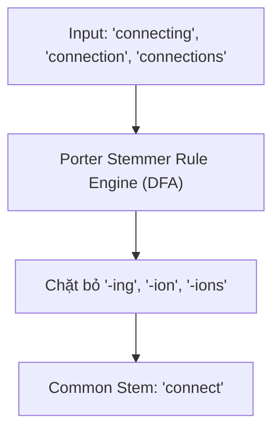

#### d. Code Thực chiến (C++ & Python)

```cpp
// C++17: Mô phỏng quy tắc cắt đuôi Porter Step 1b đơn giản
#include <iostream>
#include <string>

std::string simple_suffix_stemmer(std::string word) {
    if (word.size() > 4 && word.substr(word.size() - 3) == "ing") {
        word.resize(word.size() - 3);
        if (word.size() >= 2 && word.back() == word[word.size() - 2]) {
            word.pop_back(); // "running" -> "runn" -> "run"
        }
    } else if (word.size() > 3 && word.substr(word.size() - 2) == "ed") {
        word.resize(word.size() - 2);
    }
    return word;
}

int main() {
    std::cout << "running -> " << simple_suffix_stemmer("running") << "\n";
    std::cout << "trained -> " << simple_suffix_stemmer("trained") << "\n";
    return 0;
}
```

```python
# Python: Sử dụng PorterStemmer và SnowballStemmer của NLTK
from nltk.stem import PorterStemmer, SnowballStemmer

stemmer = PorterStemmer()
words = ["compute", "computer", "computing", "computed", "computational"]
stems = [stemmer.stem(w) for w in words]
print("Words:", words)
print("Stems:", stems) # Tất cả hội tụ về 'comput'
```

#### e. Lỗi Thường gặp & Ổn định Số học
- **Over-stemming**: Cắt bỏ quá nhiều khiến các từ có nghĩa khác nhau bị gộp chung (ví dụ `universe` và `universal` bị chặt thành `univers`, hoặc `policy` và `police` bị chặt thành `polic`).
- **Under-stemming**: Không cắt đủ khiến các từ cùng họ ngữ nghĩa không được liên kết (ví dụ `adhere` và `adhesion`).

#### f. Ứng dụng Thực chiến trong AI
Sử dụng trong Information Retrieval (IR) truyền thống, clustering tài liệu và giảm số chiều đặc trưng văn bản.

---

### 9. Lemmatization (Từ nguyên hóa)

#### a. Định nghĩa Bản chất Toán học
Khác với Stemming, Lemmatization là ánh xạ chính quy đưa từ biến cách về dạng nguyên mẫu từ điển (Lemma) dựa trên phân tích hình thái học và từ loại (Part-of-Speech - POS):
$$\mathcal{L}: (w, \text{pos}) \mapsto \text{lemma} \in \mathcal{D}$$
với $\mathcal{D}$ là từ điển từ vựng chuẩn (như WordNet). Ví dụ:
$$\mathcal{L}(\text{"better"}, \text{ADJ}) = \text{"good"}, \quad \mathcal{L}(\text{"meeting"}, \text{NOUN}) = \text{"meeting"}, \quad \mathcal{L}(\text{"meeting"}, \text{VERB}) = \text{"meet"}$$

#### b. Cơ chế Tầng Sâu & Điện toán
- **Dictionary Lookup + Morphological Rules**: Hệ thống lưu trữ các bảng ngoại lệ (Exception lists) dưới dạng Hash Map để tra cứu tức thì các dạng bất quy tắc (`went` $\to$ `go`, `children` $\to$ `child`). Với các từ theo quy tắc, giải thuật áp dụng các luật bóc tách tiếp đầu/tiếp vĩ ngữ và kiểm tra từ kết quả có nằm trong từ điển không.
- **Phụ thuộc POS Tagging**: Lemmatization đòi hỏi phải chạy bước gán nhãn từ loại trước đó, tạo ra chi phí tính toán cao gấp $10 \times - 100 \times$ so với Stemming.

#### c. Sơ đồ Minh họa (Mermaid Diagram)
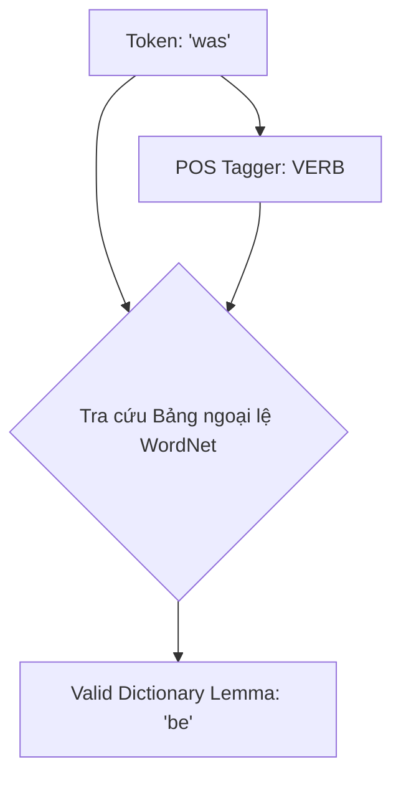

#### d. Code Thực chiến (C++ & Python)

```cpp
// C++17: Tra cứu từ nguyên hóa dùng Morphological Hash Map
#include <iostream>
#include <string>
#include <unordered_map>

class FastLemmatizer {
private:
    std::unordered_map<std::string, std::string> verb_lemmas_ = {
        {"ran", "run"}, {"running", "run"}, {"runs", "run"},
        {"was", "be"}, {"were", "be"}, {"been", "be"},
        {"has", "have"}, {"had", "have"}
    };
public:
    std::string lemmatize(const std::string& token, const std::string& pos) {
        if (pos == "VERB") {
            auto it = verb_lemmas_.find(token);
            if (it != verb_lemmas_.end()) return it->second;
        }
        return token;
    }
};

int main() {
    FastLemmatizer lem;
    std::cout << "ran (VERB) -> " << lem.lemmatize("ran", "VERB") << "\n";
    std::cout << "was (VERB) -> " << lem.lemmatize("was", "VERB") << "\n";
    return 0;
}
```

```python
# Python: Lemmatization với Spacy
import spacy

nlp = spacy.load("en_core_web_sm", disable=["parser", "ner"])
doc = nlp("The striped bats were hanging on their feet for best results")
lemmas = [(token.text, token.pos_, token.lemma_) for token in doc]

for text, pos, lemma in lemmas:
    print(f"{text:10} | POS: {pos:6} | Lemma: {lemma}")
```

#### e. Lỗi Thường gặp & Ổn định Số học
- Sai lệch POS tag dẫn đến Lemmatization sai (ví dụ từ `"leaves"` nếu gán nhãn NOUN sẽ cho lemma `"leaf"`, nhưng nếu là VERB sẽ cho lemma `"leave"`).

#### f. Ứng dụng Thực chiến trong AI
Xây dựng Knowledge Graphs, trích xuất thực thể y sinh (Biomedical Entity Normalization) và xây dựng Ontology.

---

### 10. Morphology (Hình thái học Ngôn ngữ)

#### a. Định nghĩa Bản chất Toán học
Hình thái học là ngành nghiên cứu cấu trúc nội tại của từ và các đơn vị ngữ nghĩa tối tiểu gọi là **Từ vị (Morphemes)**. Một từ $w$ được cấu thành bởi hình thái tố gốc (root/stem) và các hình thái tố phái sinh (affixes):
$$w = m_{\text{prefix}} \oplus m_{\text{root}} \oplus m_{\text{suffix}}$$
Hai tiến trình hình thái học chính:
1. **Inflectional Morphology (Biến tính)**: Thay đổi dạng thức của từ để thể hiện các phạm trù ngữ pháp (thì, giống, số, cách) mà không đổi từ loại: $w \to w'$ cùng từ loại.
2. **Derivational Morphology (Phái sinh)**: Tạo ra từ mới hoặc đổi từ loại: e.g., $\text{compute (V)} \to \text{computation (N)} \to \text{computational (ADJ)}$.

#### b. Cơ chế Tầng Sâu & Điện toán
- **Morphological Topology of Languages**:
  - *Ngôn ngữ đơn lập (Isolating/Analytic)* như tiếng Việt, tiếng Trung: Hầu như không có biến tính hình thái, từ không đổi dạng theo thì/số, ý nghĩa ngữ pháp thể hiện qua trật tự từ và hư từ.
  - *Ngôn ngữ biến tố (Fusional)* như tiếng Anh, Pháp, Nga: Một morpheme mang nhiều thuộc tính ngữ pháp.
  - *Ngôn ngữ chắp vá (Agglutinative)* như tiếng Thổ Nhĩ Kỳ, Phần Lan, Hàn: Ghép chuỗi dài các morpheme độc lập thành 1 từ duy nhất. Với các ngôn ngữ này, BPE/Unigram tokenization ở mức subword mô phỏng lại chính xác quá trình phân rã morpheme.
- **Embedding Efficiency**: Các kiến trúc như FastText sử dụng n-gram ký tự ($3 \le n \le 6$) để học vector cho từng sub-morpheme, cho phép biểu diễn các từ hiếm thông qua tổng vector các hình thái tố thành phần:
  $$\mathbf{v}_w = \sum_{g \in \mathcal{G}_w} \mathbf{z}_g$$

#### c. Sơ đồ Minh họa (Mermaid Diagram)
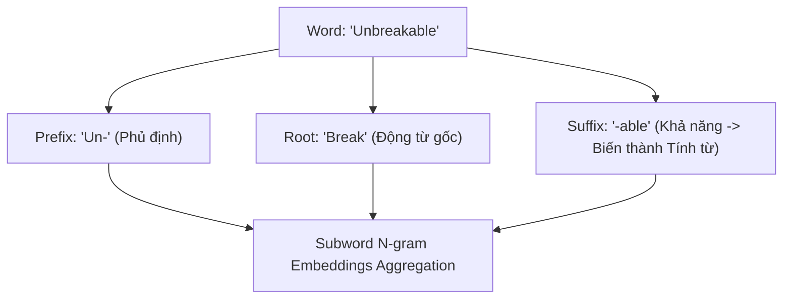

#### d. Code Thực chiến (C++ & Python)

```cpp
// C++17: Trích xuất Character N-grams mô phỏng biểu diễn hình thái tố của FastText
#include <iostream>
#include <string>
#include <vector>

std::vector<std::string> extract_character_ngrams(const std::string& word, size_t min_n, size_t max_n) {
    std::string tagged = "<" + word + ">"; // Ký hiệu ranh giới từ
    std::vector<std::string> ngrams;
    size_t len = tagged.size();

    for (size_t n = min_n; n <= max_n; ++n) {
        if (len < n) continue;
        for (size_t i = 0; i <= len - n; ++i) {
            ngrams.push_back(tagged.substr(i, n));
        }
    }
    return ngrams;
}

int main() {
    auto ngrams = extract_character_ngrams("deep", 3, 4);
    std::cout << "Character N-grams for 'deep':\n";
    for (const auto& g : ngrams) std::cout << "[" << g << "] ";
    std::cout << "\n";
    return 0;
}
```

```python
# Python / PyTorch: FastText-style Subword Embedding Layer
import torch
import torch.nn as nn

class MorphologicalSubwordEmbedding(nn.Module):
    def __init__(self, num_subwords: int, embedding_dim: int):
        super().__init__()
        # Embedding bag tính trung bình cộng hoặc tổng các vector subwords
        self.subword_embeddings = nn.EmbeddingBag(num_subwords, embedding_dim, mode='sum')

    def forward(self, subword_indices: torch.Tensor, offsets: torch.Tensor) -> torch.Tensor:
        # subword_indices: 1D tensor phẳng chứa IDs của tất cả n-grams
        # offsets: Chỉ số bắt đầu của mỗi từ trong buffer
        return self.subword_embeddings(subword_indices, offsets)

embed_layer = MorphologicalSubwordEmbedding(num_subwords=50000, embedding_dim=128)
indices = torch.tensor([12, 45, 99, 102, 5, 23], dtype=torch.long)
offsets = torch.tensor([0, 3], dtype=torch.long) # Từ 1 có 3 n-grams, từ 2 có 3 n-grams
word_vectors = embed_layer(indices, offsets)
print("Word Vector Representations Shape:", word_vectors.shape) # [2, 128]
```

#### e. Lỗi Thường gặp & Ổn định Số học
- Áp dụng các mô hình ngôn ngữ dựa trên từ nguyên khối (word-level) cho các ngôn ngữ chắp vá gây bùng nổ kích thước từ điển ($|\mathcal{V}| > 10^7$) dẫn đến Out-Of-Memory (OOM) trên GPU VRAM.

#### f. Ứng dụng Thực chiến trong AI
Khung lý thuyết nền móng cho thuật toán tách Subword Tokenization trong mọi kiến trúc Large Language Model hiện đại, giúp mô hình hiểu sâu các cấu trúc từ mượn và biến cách phức tạp trong đa ngôn ngữ.
