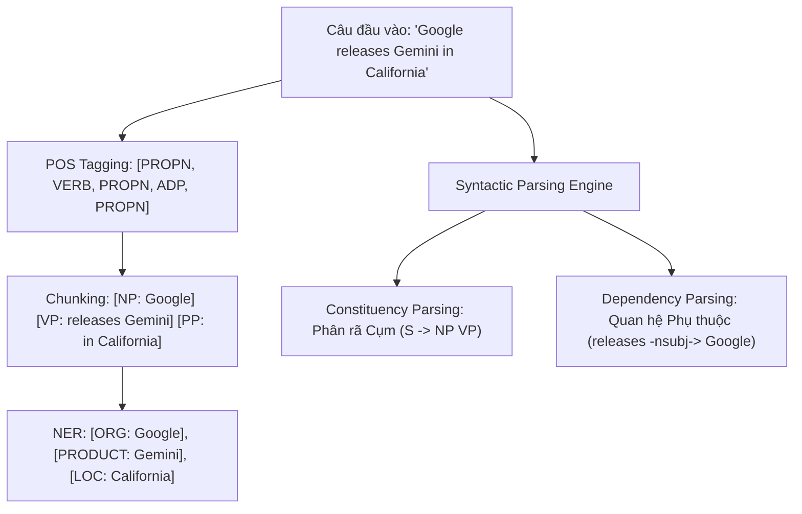
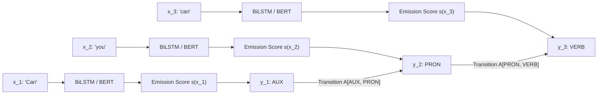
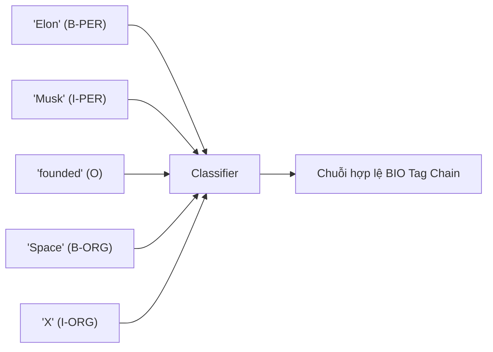
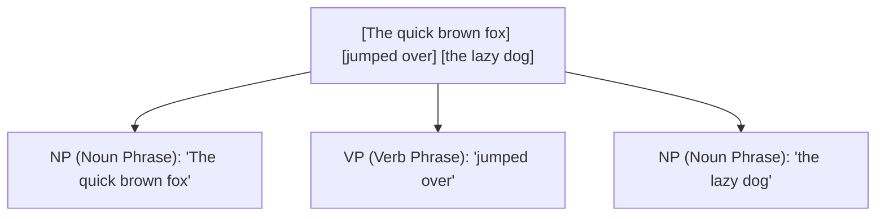
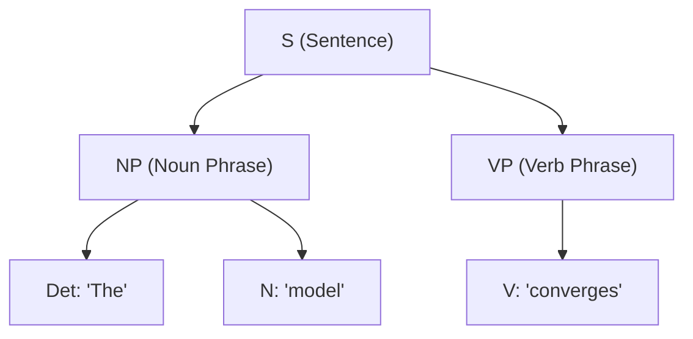
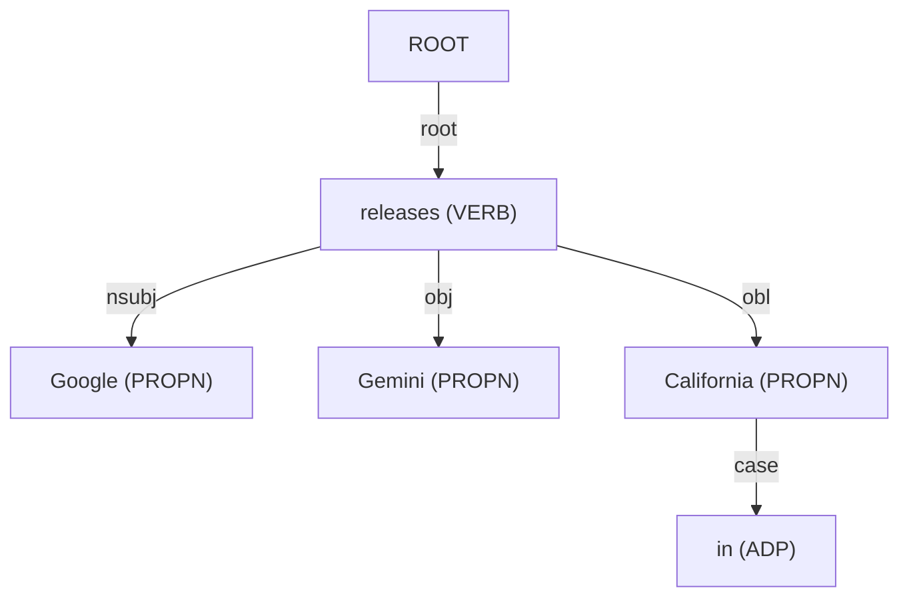
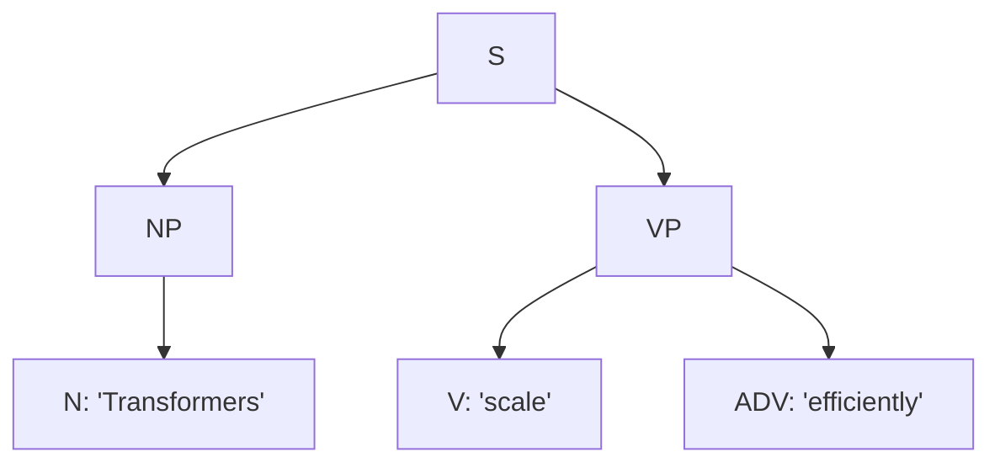
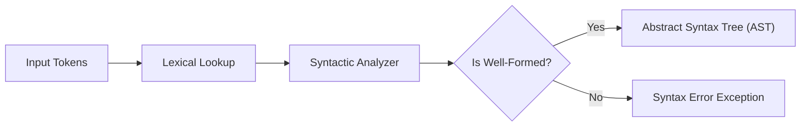
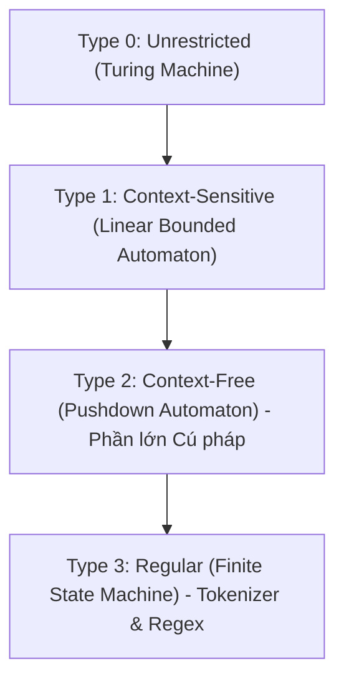
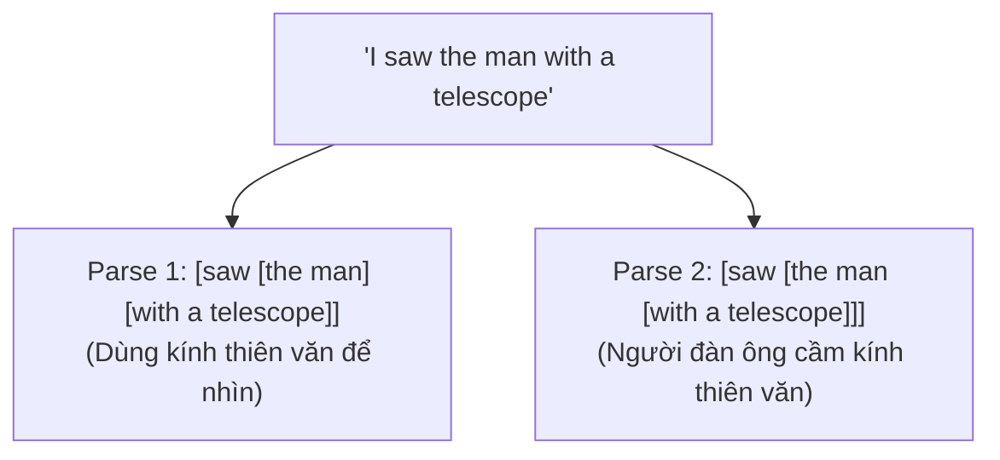

# Chuyên đề: Phân tích Cú pháp & Cấu trúc Ngôn ngữ (Linguistic Analysis & Parsing)

## 1. Tổng quan Chuyên đề
Để máy tính thực sự hiểu được văn bản thay vì chỉ coi nó là một "túi từ" (bag-of-words) rời rạc, hệ thống NLP phải phân tích được cấu trúc hình thức và quan hệ ngữ pháp giữa các thành phần trong câu. Quá trình này bao gồm việc gán nhãn từ tính (POS Tagging), nhận diện thực thể định danh (NER), gom cụm nông (Chunking), và xây dựng cây cú pháp hoàn chỉnh (Constituency & Dependency Parsing).

Trong kỷ nguyên Deep Learning, phân tích cú pháp không còn phụ thuộc vào các bảng luật viết tay mà được giải bằng các mô hình dự đoán cấu trúc (Structured Prediction) như Conditional Random Fields (CRF), Graph-based Parsers (Biaffine Attention), và Attention Heads chuyên biệt trong mô hình Transformer lớn.



---

## 2. Chi tiết từng Keyword

---

### 1. Part-of-Speech Tagging - POS (Gán nhãn Từ loại)

#### a. Định nghĩa Bản chất Toán học (Mathematical Formulation)
POS Tagging là bài toán gán nhãn chuỗi (Sequence Labeling), ánh xạ chuỗi từ $\mathbf{x} = (x_1, \dots, x_T)$ sang chuỗi nhãn từ loại $\mathbf{y} = (y_1, \dots, y_T)$ với $y_t \in \mathcal{T}$ (tập nhãn như Universal Dependencies: NOUN, VERB, ADJ, v.v.):
$$\mathbf{y}^* = \arg\max_{\mathbf{y} \in \mathcal{T}^T} P(\mathbf{y} \mid \mathbf{x})$$
Trong mô hình Trường ngẫu nhiên có điều kiện Tuyến tính (Linear-Chain CRF):
$$P(\mathbf{y} \mid \mathbf{x}) = \frac{1}{Z(\mathbf{x})} \exp \left( \sum_{t=1}^T \mathbf{w}^T \mathbf{f}(y_{t-1}, y_t, \mathbf{x}, t) \right)$$
với $Z(\mathbf{x}) = \sum_{\mathbf{y}'} \exp(\dots)$ là hàm phân hoạch (partition function) tính bằng thuật toán Forward-Backward.

#### b. Cơ chế Tầng Sâu & Điện toán (Under The Hood / Hardware Internals)
- **Ma trận chuyển trạng thái (Transition Matrix)**: Ma trận $\mathbf{A} \in \mathbb{R}^{K \times K}$ (với $K = |\mathcal{T}|$) lưu trữ điểm số chuyển đổi $A_{i, j} = \text{Score}(y_{t-1}=i \to y_t=j)$. Khi tính toán trên GPU/CPU, ma trận này được lưu trong L1 Cache và sử dụng thuật toán Viterbi giải mã theo lô (Batched Viterbi Decoding).
- **LogSumExp Trick**: Khi tính hàm phân hoạch $Z(\mathbf{x})$, tổng các lũy thừa lớn gây tràn số thực dương (Overflow). Bắt buộc phải áp dụng công thức ổn định số học:
  $$\text{LogSumExp}(z_1, \dots, z_n) = m + \log \left( \sum_{i=1}^n e^{z_i - m} \right), \quad m = \max_i z_i$$

#### c. Sơ đồ Minh họa (Mermaid Diagram)


#### d. Code Thực chiến (C++ & Python)

```cpp
// C++17: Thuật toán Viterbi giải mã chuỗi nhãn tối ưu
#include <iostream>
#include <vector>
#include <cmath>
#include <algorithm>

std::vector<int> viterbi_decode(
    const std::vector<std::vector<float>>& emissions, // [T, K]
    const std::vector<std::vector<float>>& transitions, // [K, K]
    const std::vector<float>& start_transitions) {     // [K]

    size_t T = emissions.size();
    size_t K = start_transitions.size();
    std::vector<std::vector<float>> viterbi_table(T, std::vector<float>(K, -1e9f));
    std::vector<std::vector<int>> backpointers(T, std::vector<int>(K, 0));

    // Bước khởi tạo
    for (size_t k = 0; k < K; ++k) {
        viterbi_table[0][k] = start_transitions[k] + emissions[0][k];
    }

    // Quy hoạch động
    for (size_t t = 1; t < T; ++t) {
        for (size_t curr = 0; curr < K; ++curr) {
            float max_score = -1e9f;
            int best_prev = 0;
            for (size_t prev = 0; prev < K; ++prev) {
                float score = viterbi_table[t - 1][prev] + transitions[prev][curr] + emissions[t][curr];
                if (score > max_score) {
                    max_score = score;
                    best_prev = static_cast<int>(prev);
                }
            }
            viterbi_table[t][curr] = max_score;
            backpointers[t][curr] = best_prev;
        }
    }

    // Truy vết ngược (Backtracking)
    std::vector<int> best_path(T);
    float best_final_score = -1e9f;
    for (size_t k = 0; k < K; ++k) {
        if (viterbi_table[T - 1][k] > best_final_score) {
            best_final_score = viterbi_table[T - 1][k];
            best_path[T - 1] = static_cast<int>(k);
        }
    }
    for (int t = static_cast<int>(T) - 2; t >= 0; --t) {
        best_path[t] = backpointers[t + 1][best_path[t + 1]];
    }
    return best_path;
}

int main() {
    // 2 tags: 0: NOUN, 1: VERB. 2 bước thời gian.
    std::vector<std::vector<float>> emissions = {{2.5f, 0.5f}, {0.2f, 3.1f}};
    std::vector<std::vector<float>> transitions = {{0.1f, 1.8f}, {1.2f, 0.1f}};
    std::vector<float> start_trans = {0.8f, 0.2f};

    auto path = viterbi_decode(emissions, transitions, start_trans);
    std::cout << "Decoded tags: ";
    for (int tag : path) std::cout << tag << " ";
    std::cout << "\n";
    return 0;
}
```

```python
# Python / PyTorch: Phân loại nhãn từ tính bằng Linear Layer trên Transformer Output
import torch
import torch.nn as nn

class TransformerPOSTagger(nn.Module):
    def __init__(self, hidden_dim: int, num_tags: int):
        super().__init__()
        # Classifier chiếu từ hidden states của Transformer sang không gian nhãn
        self.classifier = nn.Linear(hidden_dim, num_tags)

    def forward(self, hidden_states: torch.Tensor) -> torch.Tensor:
        # hidden_states: [Batch_Size, Seq_Len, Hidden_Dim]
        logits = self.classifier(hidden_states) # [B, L, Num_Tags]
        return logits

tagger = TransformerPOSTagger(hidden_dim=768, num_tags=17) # 17 Universal POS tags
dummy_hidden = torch.randn(2, 5, 768)
logits = tagger(dummy_hidden)
predictions = torch.argmax(logits, dim=-1)
print("Predicted POS Tag IDs shape:", predictions.shape)
```

#### e. Lỗi Thường gặp & Ổn định Số học
- Sự nhập nhằng từ tính (ví dụ từ `"book"` có thể là Danh từ trong `"read a book"` hoặc Động từ trong `"book a flight"`). Bỏ qua phụ thuộc ngữ cảnh toàn cục sẽ dẫn đến gán nhãn sai hoàn toàn.

#### f. Ứng dụng Thực chiến trong AI
Tiền đề quan trọng cho các công cụ Text-to-Speech (để xác định ngữ điệu và trọng âm đọc từ), Lemmatization và gán nhãn dữ liệu huấn luyện.

---

### 2. Named Entity Recognition - NER (Nhận diện Thực thể Định danh)

#### a. Định nghĩa Bản chất Toán học
NER định vị và phân loại các thực thể định danh trong văn bản thành các danh mục xác định sẵn (Người - PER, Tổ chức - ORG, Địa điểm - LOC, Thời gian - DATE). Chuẩn gán nhãn phổ biến nhất là biểu diễn **BIO (Begin, Inside, Outside)**:
$$\mathbf{y}_t \in \{\text{O}, \text{B-PER}, \text{I-PER}, \text{B-ORG}, \text{I-ORG}, \dots\}$$
Mục tiêu là tìm chuỗi $\mathbf{y}$ thỏa mãn tính hợp lệ cấu trúc (ràng buộc không thể xuất hiện `I-PER` ngay sau `O`).

#### b. Cơ chế Tầng Sâu & Điện toán
- **Subword-to-Word Alignment**: Transformer tokenizers tách một thực thể thành nhiều subwords (ví dụ `"HuggingFace"` $\to$ `["Hugging", "##Face"]`). Tầng NER phải gom vector biểu diễn (mean-pooling hoặc lấy subword đầu tiên) trước khi tính toán mất mát phân lớp để bảo đảm tính nhất quán của ranh giới thực thể.
- **Span-based vs Token-based**: Các kiến trúc SOTA hiện nay sử dụng *Span Representation* $\mathbf{h}_{i:j} = [\mathbf{h}_i; \mathbf{h}_j; \phi(j - i)]$ để trực tiếp phân loại mọi đoạn $[i, j]$ có độ dài tối đa $K$, giải quyết triệt để vấn đề thực thể lồng nhau (Nested NER).

#### c. Sơ đồ Minh họa (Mermaid Diagram)


#### d. Code Thực chiến (C++ & Python)

```cpp
// C++17: Kiểm tra tính hợp lệ cú pháp của BIO Sequence
#include <iostream>
#include <vector>
#include <string>

bool validate_bio_sequence(const std::vector<std::string>& tags) {
    std::string prev_type = "";
    bool in_entity = false;

    for (const auto& tag : tags) {
        if (tag == "O") {
            in_entity = false;
            prev_type = "";
        } else if (tag.rfind("B-", 0) == 0) {
            in_entity = true;
            prev_type = tag.substr(2);
        } else if (tag.rfind("I-", 0) == 0) {
            std::string curr_type = tag.substr(2);
            // I-Tag chỉ hợp lệ nếu đứng sau B-Tag hoặc I-Tag cùng loại
            if (!in_entity || curr_type != prev_type) {
                return false;
            }
        } else {
            return false;
        }
    }
    return true;
}

int main() {
    std::vector<std::string> valid = {"B-PER", "I-PER", "O", "B-LOC"};
    std::vector<std::string> invalid = {"O", "I-PER", "O"};
    std::cout << "Valid seq: " << validate_bio_sequence(valid) << "\n";
    std::cout << "Invalid seq: " << validate_bio_sequence(invalid) << "\n";
    return 0;
}
```

```python
# Python / PyTorch: Span-level Pooling cho Named Entity Recognition
import torch
import torch.nn as nn

class SpanRepresentation(nn.Module):
    def __init__(self, hidden_dim: int):
        super().__init__()
        # Chiếu vector ghép [start, end, diff] về không gian phân loại
        self.span_classifier = nn.Linear(hidden_dim * 3, 5) # 5 class thực thể

    def forward(self, sequence_output: torch.Tensor, start_idx: int, end_idx: int) -> torch.Tensor:
        # sequence_output: [Batch, Seq_Len, Hidden_Dim]
        h_start = sequence_output[:, start_idx, :]
        h_end = sequence_output[:, end_idx, :]
        h_diff = h_end - h_start
        # Ghép đặc trưng ranh giới span
        span_feat = torch.cat([h_start, h_end, h_diff], dim=-1)
        return self.span_classifier(span_feat)

seq_out = torch.randn(1, 10, 128)
span_rep = SpanRepresentation(128)
logits = span_rep(seq_out, start_idx=1, end_idx=3)
print("Span Logits Shape:", logits.shape)
```

#### e. Lỗi Thường gặp & Ổn định Số học
- **Boundary Shift**: Mô hình nhận diện nhầm ranh giới thực thể (ví dụ nhận diện `"Đại học Quốc gia"` nhưng bỏ sót chữ `"Hà Nội"` đi kèm).
- Mất cân bằng dữ liệu cực đoan giữa nhãn `O` (chiếm >90% văn bản) và các nhãn thực thể hiếm, đòi hỏi hàm mất mát Focal Loss.

#### f. Ứng dụng Thực chiến trong AI
Khai phá tri thức tự động (Knowledge Graph Construction), hệ thống trích xuất thông tin hợp đồng tài chính và phân tích văn bản y tế lâm sàng.

---

### 3. Chunking (Gom cụm Cú pháp Nông)

#### a. Định nghĩa Bản chất Toán học
Chunking (hay Shallow Parsing) phân đoạn câu thành các cụm ngữ pháp rời rạc không chồng lấn, không phân cấp sâu (non-recursive non-overlapping syntactic phrases):
$$\mathcal{C}(\mathbf{x}) = \{ (c_k, \text{start}_k, \text{end}_k) \}$$
Các cụm tiêu chuẩn bao gồm Cụm danh từ (Noun Phrase - NP), Cụm động từ (Verb Phrase - VP), Cụm giới từ (Prepositional Phrase - PP).

#### b. Cơ chế Tầng Sâu & Điện toán
- Khác với Full Parsing cần xây dựng cây phân cấp bậc cao với độ phức tạp $O(N^3)$, Chunking được mô hình hóa thành Sequence Labeling tương tự POS Tagging với độ phức tạp tuyến tính $O(N)$.
- Việc giảm tải này cho phép các hệ thống xử lý luồng (Streaming NLP) phân tích nhanh cấu trúc văn bản mà không bị nghẽn CPU.

#### c. Sơ đồ Minh họa (Mermaid Diagram)


#### d. Code Thực chiến (C++ & Python)

```cpp
// C++17: Nhóm các token theo nhãn IOB chunking
#include <iostream>
#include <vector>
#include <string>

struct Chunk {
    std::string type;
    std::vector<std::string> words;
};

std::vector<Chunk> extract_chunks(const std::vector<std::string>& words, const std::vector<std::string>& tags) {
    std::vector<Chunk> chunks;
    Chunk current_chunk;

    for (size_t i = 0; i < words.size(); ++i) {
        const std::string& tag = tags[i];
        if (tag.rfind("B-", 0) == 0) {
            if (!current_chunk.words.empty()) {
                chunks.push_back(current_chunk);
            }
            current_chunk.type = tag.substr(2);
            current_chunk.words = {words[i]};
        } else if (tag.rfind("I-", 0) == 0 && tag.substr(2) == current_chunk.type) {
            current_chunk.words.push_back(words[i]);
        } else {
            if (!current_chunk.words.empty()) {
                chunks.push_back(current_chunk);
                current_chunk.words.clear();
            }
        }
    }
    if (!current_chunk.words.empty()) chunks.push_back(current_chunk);
    return chunks;
}

int main() {
    std::vector<std::string> words = {"A", "deep", "neural", "network", "trains", "fast"};
    std::vector<std::string> tags = {"B-NP", "I-NP", "I-NP", "I-NP", "B-VP", "B-ADVP"};

    auto chunks = extract_chunks(words, tags);
    for (const auto& c : chunks) {
        std::cout << "[" << c.type << "]: ";
        for (const auto& w : c.words) std::cout << w << " ";
        std::cout << "\n";
    }
    return 0;
}
```

```python
# Python: Regular Expression Chunk Parser với NLTK
import nltk

grammar = r"""
  NP: {<DT|PP\$>?<JJ>*<NN.*>+}   # Cụm danh từ
  VP: {<VBD|VBZ|VBP|VBN><NP|PP>*} # Cụm động từ
  PP: {<IN><NP>}                 # Cụm giới từ
"""
cp = nltk.RegexpParser(grammar)
tagged_tokens = [("The", "DT"), ("transformer", "NN"), ("outperforms", "VBZ"), ("RNNs", "NNS")]
tree = cp.parse(tagged_tokens)
print("Chunked Subtrees:")
for subtree in tree.subtrees(filter=lambda t: t.label() in ['NP', 'VP']):
    print(subtree)
```

#### e. Lỗi Thường gặp & Ổn định Số học
- Giới hạn không lồng nhau khiến các cụm phức hợp bị chia nhỏ sai bản chất (ví dụ trong `"the president of Google"`, nếu chia thành hai NP riêng lẻ sẽ làm đứt gãy sở hữu cách).

#### f. Ứng dụng Thực chiến trong AI
Xác định các cụm khóa chính (Keyphrase Extraction), làm đơn vị trích xuất cơ sở cho các hệ thống Question Answering dạng rút trích (Extractive QA).

---

### 4. Parsing (Phân tích Cú pháp Tổng quát)

#### a. Định nghĩa Bản chất Toán học
Parsing là bài toán kiến tạo một đồ thị hoặc cây cú pháp $\mathcal{G} = (\mathcal{V}, \mathcal{E})$ thể hiện cấu trúc ngữ pháp hình thức của câu từ chuỗi token $\mathbf{w}$. Cho một văn phạm phi ngữ cảnh (Context-Free Grammar - CFG) xác suất $G = (V_N, V_T, S, R, P)$:
$$\hat{T} = \arg\max_{T \in \mathcal{T}(\mathbf{w})} P(T) = \arg\max_{T \in \mathcal{T}(\mathbf{w})} \prod_{r \in T} P(r)$$
trong đó mỗi $r \in R$ là một luật sản xuất (production rule) dạng $A \to \alpha$.

#### b. Cơ chế Tầng Sâu & Điện toán
- **Chart Parsing / CKY Algorithm**: Cần chuyển đổi văn phạm về dạng chuẩn Chomsky (Chomsky Normal Form - CNF). Bảng CKY kích thước $N \times N \times |V_N|$ được lấp đầy bằng quy hoạch động 3 vòng lặp với độ phức tạp thời gian $\mathcal{O}(N^3 |R|)$.
- **Bộ nhớ Cache Miss trong CKY**: Bảng CKY 3D có bước nhảy bộ nhớ (strides) rất lớn. Trong các engine C++, bảng này được flatten thành mảng 1D liên tục nhằm tối đa hóa tỷ lệ trúng Cache L2/L3.

#### c. Sơ đồ Minh họa (Mermaid Diagram)


#### d. Code Thực chiến (C++ & Python)

```cpp
// C++17: Thuật toán CKY cơ bản kiểm tra tính chấp nhận câu theo luật CNF
#include <iostream>
#include <vector>
#include <string>
#include <unordered_map>
#include <unordered_set>

struct Rule {
    std::string lhs;
    std::string rhs1;
    std::string rhs2;
};

bool cky_accept(const std::vector<std::string>& words, 
                const std::vector<Rule>& binary_rules,
                const std::unordered_map<std::string, std::string>& unary_rules) {
    size_t n = words.size();
    if (n == 0) return false;

    // Table[i][j] = tập hợp các Non-terminal sinh ra đoạn words[i...j]
    std::vector<std::vector<std::unordered_set<std::string>>> table(n, std::vector<std::unordered_set<std::string>>(n));

    // Khởi tạo quy tắc đơn vị (Unary / Terminals)
    for (size_t i = 0; i < n; ++i) {
        auto it = unary_rules.find(words[i]);
        if (it != unary_rules.end()) {
            table[i][i].insert(it->second);
        }
    }

    // Quy hoạch động CKY
    for (size_t len = 2; len <= n; ++len) {
        for (size_t i = 0; i <= n - len; ++i) {
            size_t j = i + len - 1;
            for (size_t k = i; k < j; ++k) {
                for (const auto& rule : binary_rules) {
                    if (table[i][k].count(rule.rhs1) && table[k + 1][j].count(rule.rhs2)) {
                        table[i][j].insert(rule.lhs);
                    }
                }
            }
        }
    }
    return table[0][n - 1].count("S") > 0;
}

int main() {
    std::vector<Rule> rules = {{"S", "NP", "VP"}, {"VP", "V", "NP"}};
    std::unordered_map<std::string, std::string> lexicon = {{"ai", "NP"}, {"beats", "V"}, {"chess", "NP"}};
    std::vector<std::string> words = {"ai", "beats", "chess"};

    std::cout << "CKY Accepts sentence: " << std::boolalpha << cky_accept(words, rules, lexicon) << "\n";
    return 0;
}
```

```python
# Python: Neural Parsing Inspection với Spacy Tree
import spacy

nlp = spacy.load("en_core_web_sm")
doc = nlp("Language models generate fluent paragraphs.")

def print_tree(token, depth=0):
    print("  " * depth + f"-> {token.text} ({token.dep_} / {token.pos_})")
    for child in token.children:
        print_tree(child, depth + 1)

print_tree(doc[:].root)
```

#### e. Lỗi Thường gặp & Ổn định Số học
- Bùng nổ tổ hợp (Combinatorial Explosion): Với câu dài 30 từ, số lượng cây phân tích hợp lệ có thể lên tới hàng triệu cây, khiến thuật toán quy hoạch động cổ điển cạn kiệt bộ nhớ nếu không áp dụng kỹ thuật tỉa nhánh (Beam Search / Pruning).

#### f. Ứng dụng Thực chiến trong AI
Kiểm chứng tính đúng đắn ngữ pháp trong trình biên dịch mã nguồn (Code LLMs, AST Parsing) và phân tích câu truy vấn phức tạp trong Text-to-SQL.

---

### 5. Dependency Parsing (Phân tích Phụ thuộc)

#### a. Định nghĩa Bản chất Toán học
Dependency Parsing xây dựng một đồ thị có hướng có gốc (Directed Rooted Tree) kết nối trực tiếp các từ trong câu thông qua các quan hệ phụ thuộc nhị phân $w_i \xrightarrow{r} w_j$, trong đó $w_i$ là từ trung tâm (Head/Governor), $w_j$ là từ phụ thuộc (Dependent/Modifier), và $r \in \mathcal{R}$ là nhãn quan hệ (nsubj, dobj, amod, advmod):
$$\mathcal{G}_{\text{dep}} = (\mathcal{V}, \mathcal{E}, \mathcal{R}), \quad \mathcal{V} = \{w_0=\text{ROOT}, w_1, \dots, w_N\}$$
Đồ thị phải thỏa mãn điều kiện cây bao trùm có hướng cực đại (Maximum Spanning Tree - Chu-Liu-Edmonds Algorithm).

#### b. Cơ chế Tầng Sâu & Điện toán
- **Biaffine Attention Architecture (Dozat & Manning)**: Mô hình SOTA sử dụng 2 phép chiếu MLP riêng biệt để tạo vector biểu diễn Head ($\mathbf{h}^{(\text{head})}$) và Dependent ($\mathbf{h}^{(\text{dep})}$), sau đó tính điểm số cạnh thông qua ma trận Biaffine:
  $$\text{Score}(i, j) = \mathbf{h}_i^{(\text{head})T} \mathbf{U} \mathbf{h}_j^{(\text{dep})} + \mathbf{W} [\mathbf{h}_i^{(\text{head})}; \mathbf{h}_j^{(\text{dep})}] + \mathbf{b}$$
- **Phép toán Tensor GEMM trên GPU**: Việc tính toàn bộ điểm số của tất cả các cặp $(i, j)$ được thực hiện đồng thời bằng phép nhân ma trận trên GPU Tensor Cores với độ phức tạp $\mathcal{O}(N^2 \cdot d)$.

#### c. Sơ đồ Minh họa (Mermaid Diagram)


#### d. Code Thực chiến (C++ & Python)

```cpp
// C++17: Thuật toán Transition-based Arc-Eager Parsing State Machine
#include <iostream>
#include <vector>
#include <stack>
#include <string>

struct ParserState {
    std::stack<int> stack;
    std::vector<int> buffer;
    std::vector<std::pair<int, int>> arcs; // (Head, Dependent)

    void shift() {
        if (!buffer.empty()) {
            stack.push(buffer.front());
            buffer.erase(buffer.begin());
        }
    }

    void left_arc() {
        if (!stack.empty() && !buffer.empty()) {
            int s = stack.top();
            int b = buffer.front();
            arcs.push_back({b, s}); // b là Head của s
            stack.pop();
        }
    }

    void right_arc() {
        if (!stack.empty() && !buffer.empty()) {
            int s = stack.top();
            int b = buffer.front();
            arcs.push_back({s, b}); // s là Head của b
            stack.push(b);
            buffer.erase(buffer.begin());
        }
    }
};

int main() {
    ParserState state;
    state.stack.push(0); // ROOT
    state.buffer = {1, 2}; // 1: She, 2: sleeps
    state.shift(); // push 1
    state.left_arc(); // 2 -> 1
    state.right_arc(); // 0 -> 2
    std::cout << "Number of constructed dependency arcs: " << state.arcs.size() << "\n";
    return 0;
}
```

```python
# Python / PyTorch: Biaffine Attention Layer cho Dependency Parsing
import torch
import torch.nn as nn

class BiaffineDependencyScorer(nn.Module):
    def __init__(self, hidden_dim: int):
        super().__init__()
        # Ma trận trọng số tương tác bậc 2
        self.U = nn.Parameter(torch.randn(hidden_dim, hidden_dim))

    def forward(self, h_heads: torch.Tensor, h_deps: torch.Tensor) -> torch.Tensor:
        # h_heads, h_deps: [Batch, Seq_Len, Hidden_Dim]
        # Tính điểm liên kết: h_head * U * h_dep^T
        intermediate = torch.matmul(h_heads, self.U) # [B, L, D]
        scores = torch.matmul(intermediate, h_deps.transpose(-1, -2)) # [B, L, L]
        return scores

scorer = BiaffineDependencyScorer(hidden_dim=64)
h = torch.randn(2, 8, 64)
edge_scores = scorer(h, h)
print("Dependency Adjacency Matrix Scores shape:", edge_scores.shape) # [2, 8, 8]
```

#### e. Lỗi Thường gặp & Ổn định Số học
- **Non-Projective Trees**: Các cây phụ thuộc có các cạnh bắt chéo nhau (phổ biến trong tiếng Đức, Séc) không thể giải được bằng thuật toán Transition-based Arc-Standard cổ điển mà phải dùng Graph-based hoặc Arc-Eager mở rộng.

#### f. Ứng dụng Thực chiến trong AI
Trích xuất quan hệ thực thể mở (Open IE), phân tích cấu trúc lập luận trong văn bản pháp lý và gán nhãn vai trò ngữ nghĩa (SRL).

---

### 6. Constituency Parsing (Phân tích Thành phần Cụm)

#### a. Định nghĩa Bản chất Toán học
Constituency Parsing (phân tích cụm thành tố) tổ chức câu thành cấu trúc hình cây phân cấp lồng nhau dựa trên ngữ pháp cấu trúc ngữ đoạn (Phrase Structure Grammar). Cây được biểu diễn bằng bộ ba $T = (V, E, \ell)$ với nhãn nút $\ell(v) \in \mathcal{N} \cup \Sigma$, trong đó các nút lá là các từ và nút trung gian là các cụm từ (Phrasal Categories: S, NP, VP, ADJP, PP).

#### b. Cơ chế Tầng Sâu & Điện toán
- **Chart-based Neural Parser**: Sử dụng span scoring. Mỗi span $[i, j]$ có điểm số thành tố $S_{\text{label}}(i, j)$ và cây tối ưu được tìm bằng thuật toán CKY mở rộng:
  $$\text{Score}(T) = \sum_{(i, j, \ell) \in T} S_{\ell}(i, j)$$
- **Chuyển đổi sang Dependency Tree**: Bằng các luật Head-Percolation (Luật Magerman / Collins), mọi cây Constituency có thể chuyển đổi thành cây Dependency để phục vụ các bài toán quan hệ trực tiếp.

#### c. Sơ đồ Minh họa (Mermaid Diagram)


#### d. Code Thực chiến (C++ & Python)

```cpp
// C++17: Cấu trúc Dữ liệu Node biểu diễn Cây Thành phần Cụm (Constituency Tree)
#include <iostream>
#include <string>
#include <vector>
#include <memory>

struct ConstNode {
    std::string label;
    std::string terminal; // Rỗng nếu là non-terminal
    std::vector<std::shared_ptr<ConstNode>> children;

    bool is_leaf() const { return children.empty(); }

    void print(int depth = 0) const {
        for (int i = 0; i < depth; ++i) std::cout << "  ";
        std::cout << "(" << label;
        if (!terminal.empty()) std::cout << " " << terminal;
        std::cout << "\n";
        for (const auto& child : children) {
            child->print(depth + 1);
        }
        for (int i = 0; i < depth; ++i) std::cout << "  ";
        std::cout << ")\n";
    }
};

int main() {
    auto root = std::make_shared<ConstNode>(ConstNode{"S", "", {}});
    auto np = std::make_shared<ConstNode>(ConstNode{"NP", "", {}});
    auto n = std::make_shared<ConstNode>(ConstNode{"N", "AI", {}});
    np->children.push_back(n);

    auto vp = std::make_shared<ConstNode>(ConstNode{"VP", "", {}});
    auto v = std::make_shared<ConstNode>(ConstNode{"V", "works", {}});
    vp->children.push_back(v);

    root->children.push_back(np);
    root->children.push_back(vp);
    root->print();
    return 0;
}
```

```python
# Python: Biểu diễn Cây dưới dạng S-Expression (LISP-style string)
class SExpressionParser:
    @staticmethod
    def to_bracket_string(node: dict) -> str:
        if "terminal" in node:
            return f"({node['label']} {node['terminal']})"
        children_str = " ".join([SExpressionParser.to_bracket_string(c) for c in node["children"]])
        return f"({node['label']} {children_str})"

tree_dict = {
    "label": "S",
    "children": [
        {"label": "NP", "children": [{"label": "NN", "terminal": "Attention"}]},
        {"label": "VP", "children": [{"label": "VBZ", "terminal": "helps"}]}
    ]
}
print(SExpressionParser.to_bracket_string(tree_dict))
```

#### e. Lỗi Thường gặp & Ổn định Số học
- Độ phức tạp $O(N^3)$ khiến việc phân tích thành phần câu dài trở nên bất khả thi trong các ứng dụng thời gian thực, buộc phải sử dụng các giải thuật xấp xỉ tuyến tính (Shift-Reduce Constituency Parsers).

#### f. Ứng dụng Thực chiến trong AI
Xây dựng tập dữ liệu cây ngữ pháp Penn Treebank, phân tích cấu trúc logic trong các mô hình kiểm chứng hình thức (Formal Verification).

---

### 7. Syntactic Analysis (Phân tích Cú pháp Học thuật)

#### a. Định nghĩa Bản chất Toán học
Phân tích cú pháp là quá trình nghiệm thu một chuỗi từ $\mathbf{w}$ dưới một hệ thống tiên đề và luật hình thức $\mathcal{S}$ nhằm xác định xem $\mathbf{w} \in \mathcal{L}(G)$ có thuộc về ngôn ngữ được sinh bởi văn phạm $G$ hay không, đồng thời gán cho nó một cấu trúc hình học rõ ràng.

#### b. Cơ chế Tầng Sâu & Điện toán
- Kết hợp cả hai phương pháp hình thức: phân tích từ dưới lên (Bottom-up Shift-Reduce) và từ trên xuống (Top-down Predictive Parsing).
- Tích hợp sâu vào biểu diễn nội tại của các mô hình Transformer: các nghiên cứu cơ chế giải thích (Mechanistic Interpretability) chỉ ra rằng một số Attention Heads chuyên biệt trong BERT/GPT tự động mã hóa quan hệ cú pháp trực tiếp giữa các token mà không cần huấn luyện có giám sát.

#### c. Sơ đồ Minh họa (Mermaid Diagram)


#### d. Code Thực chiến (C++ & Python)

```cpp
// C++17: Validator kiểm tra tính cân bằng ngoặc cú pháp (S-expression Syntax)
#include <iostream>
#include <string_view>
#include <stack>

bool validate_syntax_brackets(std::string_view expr) {
    std::stack<char> st;
    for (char c : expr) {
        if (c == '(' || c == '[' || c == '{') {
            st.push(c);
        } else if (c == ')' || c == ']' || c == '}') {
            if (st.empty()) return false;
            char top = st.top();
            if ((c == ')' && top != '(') ||
                (c == ']' && top != '[') ||
                (c == '}' && top != '{')) return false;
            st.pop();
        }
    }
    return st.empty();
}

int main() {
    std::string_view valid_s_expr = "(S (NP (DT The) (NN model)) (VP (VBZ works)))";
    std::cout << "Syntax Valid: " << std::boolalpha << validate_syntax_brackets(valid_s_expr) << "\n";
    return 0;
}
```

```python
# Python: Phân tích cấu trúc Attention Map để trích xuất cú pháp
import torch

def probe_syntactic_head(attention_matrix: torch.Tensor, threshold: float = 0.3) -> list[tuple[int, int]]:
    # attention_matrix: [Seq_Len, Seq_Len]
    # Trích xuất các liên kết mạnh mô phỏng quan hệ cú pháp
    links = []
    L = attention_matrix.shape[0]
    for i in range(L):
        for j in range(L):
            if i != j and attention_matrix[i, j].item() > threshold:
                links.append((i, j))
    return links

attn = torch.tensor([[0.1, 0.7, 0.2], [0.1, 0.1, 0.8], [0.0, 0.1, 0.9]])
print("Syntactic Links Detected:", probe_syntactic_head(attn, threshold=0.5))
```

#### e. Lỗi Thường gặp & Ổn định Số học
- Giả định văn bản đầu vào luôn tuân thủ chuẩn ngữ pháp khiến hệ thống sụp đổ khi gặp văn bản mạng xã hội (chứa tiếng lóng, lỗi chính tả, câu què cụt).

#### f. Ứng dụng Thực chiến trong AI
Xây dựng các công cụ sửa lỗi ngữ pháp (Grammarly-like engines), linter mã nguồn và dịch ngược mã máy (Decompilation).

---

### 8. Syntax (Cú pháp học)

#### a. Định nghĩa Bản chất Toán học
Cú pháp là hệ thống các nguyên lý, điều kiện và quy tắc chi phối cấu trúc câu trong ngôn ngữ tự nhiên. Theo hệ thống phân cấp Chomsky (Chomsky Hierarchy):
$$\text{Type 3 (Regular)} \subset \text{Type 2 (Context-Free)} \subset \text{Type 1 (Context-Sensitive)} \subset \text{Type 0 (Unrestricted / Recursively Enumerable)}$$
Hầu hết các ngôn ngữ tự nhiên thuộc lớp văn phạm vượt ngữ cảnh nhẹ (Mildly Context-Sensitive Grammars), không thể mô hình hóa trọn vẹn chỉ bằng biểu thức chính quy (FSM).

#### b. Cơ chế Tầng Sâu & Điện toán
- Sự phân tầng Chomsky quyết định lớp mô hình máy tính cần thiết để tính toán:
  - Type 3: Máy hữu hạn trạng thái (FSM) - $\mathcal{O}(N)$ thời gian, $\mathcal{O}(1)$ bộ nhớ.
  - Type 2: Máy đẩy xuống (Pushdown Automata - PDA) - $\mathcal{O}(N^3)$ thời gian, $\mathcal{O}(N^2)$ bộ nhớ.
  - Type 0: Máy Turing (Turing Machine).

#### c. Sơ đồ Minh họa (Mermaid Diagram)


#### d. Code Thực chiến (C++ & Python)

```cpp
// C++17: Mô phỏng Pushdown Automaton kiểm tra ngôn ngữ phi ngữ cảnh L = {a^n b^n}
#include <iostream>
#include <string_view>
#include <stack>

bool parse_context_free_an_bn(std::string_view str) {
    std::stack<char> pda_stack;
    size_t i = 0;
    size_t n = str.size();

    // Đẩy tất cả 'a' vào stack
    while (i < n && str[i] == 'a') {
        pda_stack.push('a');
        i++;
    }
    // Ghép cặp và pop cho mỗi 'b'
    while (i < n && str[i] == 'b') {
        if (pda_stack.empty()) return false;
        pda_stack.pop();
        i++;
    }
    return i == n && pda_stack.empty();
}

int main() {
    std::cout << "aaabbb valid: " << parse_context_free_an_bn("aaabbb") << "\n";
    std::cout << "aabbb valid: " << parse_context_free_an_bn("aabbb") << "\n";
    return 0;
}
```

```python
# Python: Phân tích sự phụ thuộc khoảng cách xa (Long-range syntactic dependencies)
def evaluate_subject_verb_agreement(sentence: str, subject_idx: int, verb_idx: int) -> bool:
    tokens = sentence.split()
    # Kiểm tra tính hòa hợp số ít / số nhiều giữa chủ ngữ và động từ
    is_plural_sub = tokens[subject_idx].endswith("s")
    is_plural_verb = not tokens[verb_idx].endswith("s")
    return is_plural_sub == is_plural_verb

print("Agreement valid:", evaluate_subject_verb_agreement("The models train fast", 1, 2))
```

#### e. Lỗi Thường gặp & Ổn định Số học
- Đồng nhất cú pháp với ngữ nghĩa (ví dụ câu kinh điển của Chomsky: *"Colorless green ideas sleep furiously"* hoàn toàn đúng cú pháp nhưng vô nghĩa).

#### f. Ứng dụng Thực chiến trong AI
Định hình cấu trúc inductive bias trong các mô hình Recursive Neural Networks (Tree-LSTM) và hướng dẫn sinh mã có cấu trúc (Constrained Decoding với Grammar Masking trong LLMs).

---

### 9. Linguistic Ambiguity (Tính Nhập nhằng Ngôn ngữ)

#### a. Định nghĩa Bản chất Toán học
Nhập nhằng ngôn ngữ xảy ra khi một chuỗi tín hiệu bề mặt $s$ có thể ánh xạ sang nhiều cấu trúc cú pháp hoặc diễn giải ngữ nghĩa khác nhau:
$$|\{T \mid \text{Yield}(T) = s\}| > 1 \quad \text{hoặc} \quad |\{\mathcal{M} \mid \text{Interpret}(s) = \mathcal{M}\}| > 1$$
Bốn cấp độ nhập nhằng chính:
1. **Phonetic Ambiguity**: Đồng âm dị nghĩa ("two" vs "to" vs "too").
2. **Lexical Ambiguity**: Từ đa nghĩa ("bank" là ngân hàng hay bờ sông).
3. **Syntactic Ambiguity (Structural)**: Nhập nhằng gắn kết cụm giới từ (PP-attachment): *"I saw the man with a telescope"*.
4. **Semantic / Pragmatic Ambiguity**: Hàm ý ngữ dụng và phạm vi lượng từ.

#### b. Cơ chế Tầng Sâu & Điện toán
- **Entropy of Distribution**: Độ nhập nhằng tỉ lệ thuận với độ hỗn loạn (Shannon Entropy) của phân phối dự đoán từ mô hình:
  $$H(Y \mid X = s) = - \sum_{y} P(y \mid s) \log P(y \mid s)$$
- **Transformer Softmax Attention as Disambiguation**: Cơ chế Self-Attention tính toán ma trận trọng số tương tác giữa từ nhập nhằng với toàn bộ ngữ cảnh xung quanh. Nếu từ `"bank"` đứng gần `"money"`, attention weight tập trung cao độ sẽ kéo vector embedding của nó về phía không gian tài chính trong các lớp sâu hơn (Layer 6-12).

#### c. Sơ đồ Minh họa (Mermaid Diagram)


#### d. Code Thực chiến (C++ & Python)

```cpp
// C++17: Tính toán Shannon Entropy đo lường mức độ nhập nhằng phân loại
#include <iostream>
#include <vector>
#include <cmath>

float compute_ambiguity_entropy(const std::vector<float>& probabilities) {
    float entropy = 0.0f;
    for (float p : probabilities) {
        if (p > 1e-7f) {
            entropy -= p * std::log2(p);
        }
    }
    return entropy;
}

int main() {
    std::vector<float> unambiguous = {0.99f, 0.01f};
    std::vector<float> highly_ambiguous = {0.50f, 0.50f};

    std::cout << "Entropy (Clear): " << compute_ambiguity_entropy(unambiguous) << " bits\n";
    std::cout << "Entropy (Ambiguous): " << compute_ambiguity_entropy(highly_ambiguous) << " bits\n";
    return 0;
}
```

```python
# Python / PyTorch: Đo lường sự dịch chuyển Embedding giải quyết nhập nhằng qua các tầng
import torch
import torch.nn.functional as F

def cosine_similarity(v1: torch.Tensor, v2: torch.Tensor) -> float:
    return F.cosine_similarity(v1.unsqueeze(0), v2.unsqueeze(0)).item()

# Mô phỏng vector 'bank' trong 2 ngữ cảnh khác nhau
v_bank_finance = torch.tensor([0.9, 0.1, -0.2])
v_bank_river = torch.tensor([-0.1, 0.8, 0.6])
v_money = torch.tensor([0.85, 0.15, -0.1])

print("Sim(Bank, Money) trong ngữ cảnh tài chính:", cosine_similarity(v_bank_finance, v_money))
print("Sim(Bank, Money) trong ngữ cảnh bờ sông:", cosine_similarity(v_bank_river, v_money))
```

#### e. Lỗi Thường gặp & Ổn định Số học
- **Greedy Decoding Trap**: Sử dụng giải thuật giải mã tham lam (Greedy Search) khi gặp điểm nhập nhằng cao dễ rơi vào cực tiểu cục bộ, sinh ra câu vô nghĩa hoặc ảo giác (hallucination). Cần dùng Nucleus Sampling ($p$) hoặc Beam Search.

#### f. Ứng dụng Thực chiến trong AI
Đánh giá độ chắc chắn của mô hình (Confidence Calibration), phát hiện câu hỏi nhập nhằng để chủ động hỏi lại người dùng trong hệ thống đàm thoại (Clarification Questions in Conversational AI).
