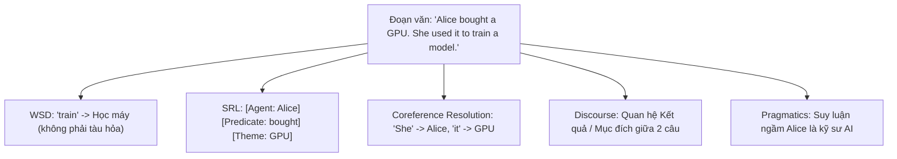
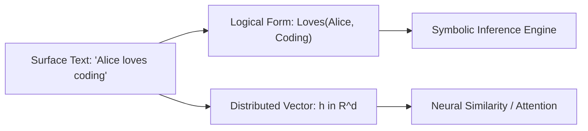
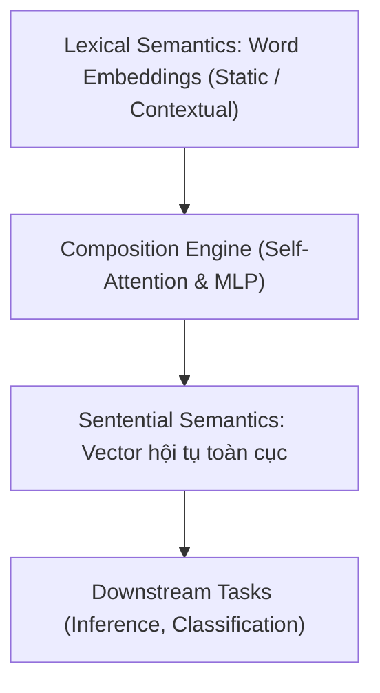
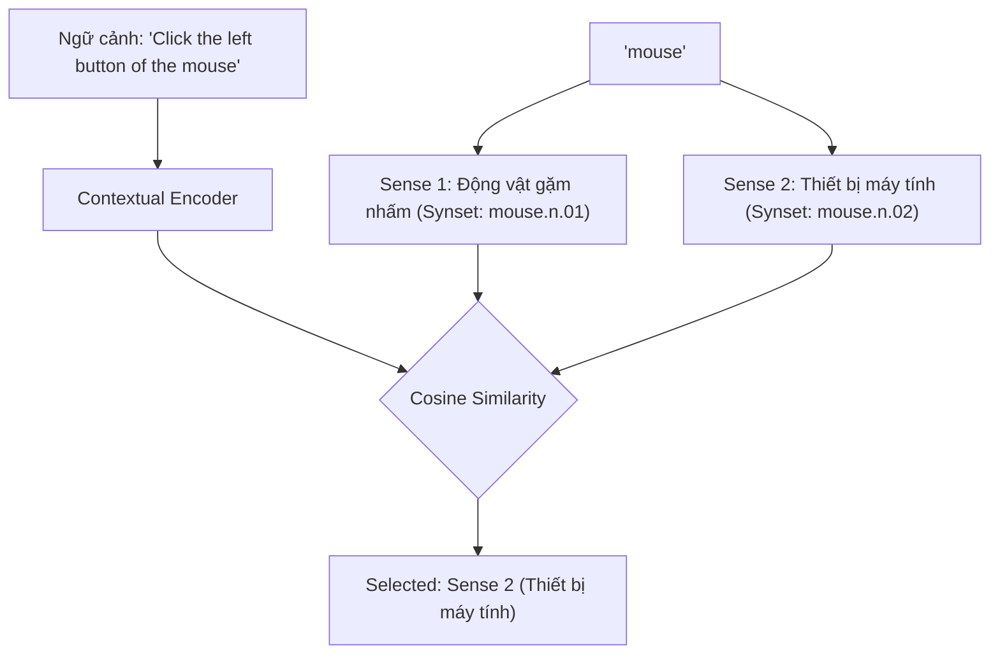
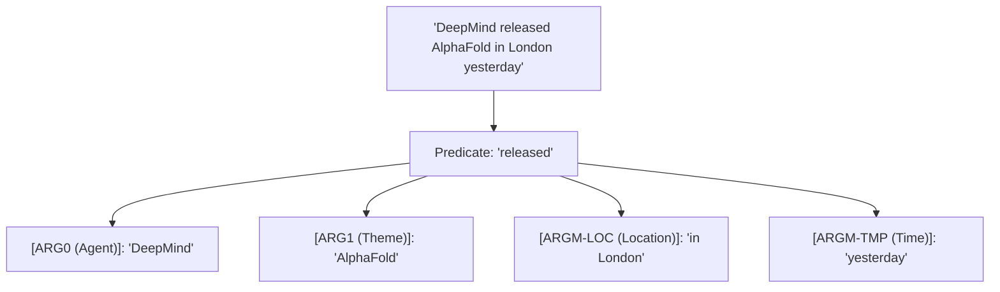
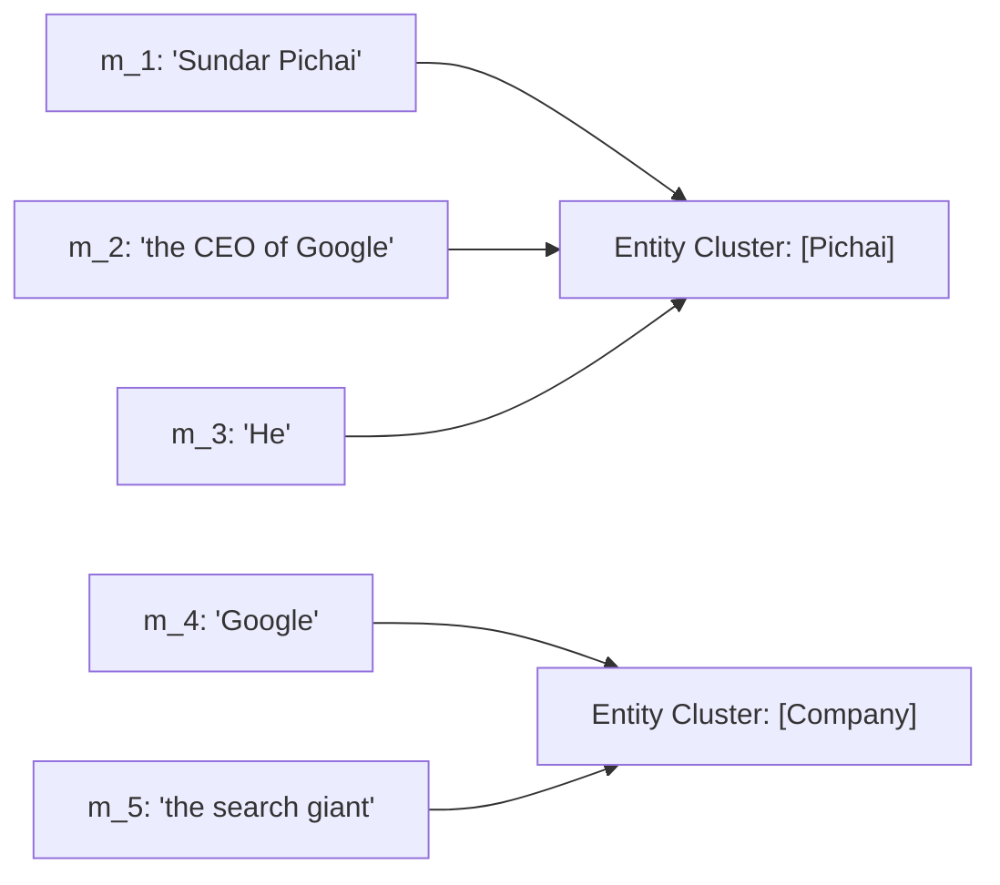
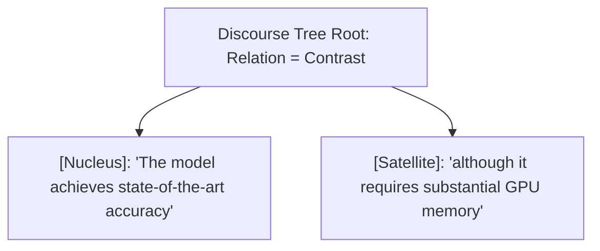
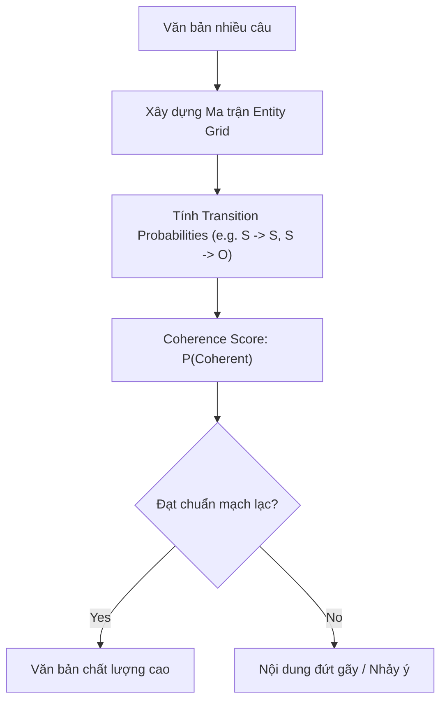
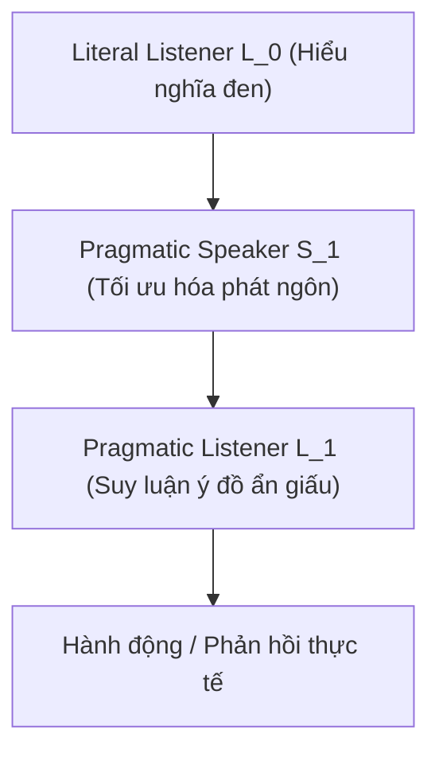
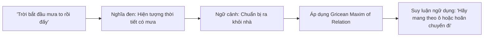

# Chuyên đề: Ngữ nghĩa học, Phân tích Diễn ngôn & Đồng tham chiếu (Semantics, Discourse & Coreference)

## 1. Tổng quan Chuyên đề
Nếu Cú pháp (Syntax) trả lời câu hỏi "câu văn có đúng cấu trúc ngữ pháp hay không?", thì Ngữ nghĩa (Semantics) và Ngữ dụng (Pragmatics) giải quyết câu hỏi "văn bản này mang ý nghĩa gì và người nói muốn đạt được mục đích gì?". Quá trình giải mã tầng sâu này đòi hỏi hệ thống AI phải phân giải được nghĩa chính xác của từ đa nghĩa trong ngữ cảnh (Word Sense Disambiguation - WSD), xác định khung hành động và các tác tử tham gia (Semantic Role Labeling - SRL), liên kết các đại từ thay thế về cùng thực thể thế giới thực (Coreference Resolution), và bảo đảm tính mạch lạc xuyên suốt nhiều câu (Discourse Coherence & Analysis).



---

## 2. Chi tiết từng Keyword

---

### 1. Semantic Analysis (Phân tích Ngữ nghĩa)

#### a. Định nghĩa Bản chất Toán học (Mathematical Formulation)
Phân tích ngữ nghĩa là quá trình ánh xạ chuỗi cú pháp sang một biểu diễn hình thức của ý nghĩa (Logical Meaning Representation) có thể suy luận chân trị được trong lý thuyết mô hình hình thức (Model-Theoretic Semantics):
$$\mathcal{M} = \llbracket \text{Sentence} \rrbracket^{\mathcal{M}, g}$$
Biểu diễn ngữ nghĩa hình thức sử dụng Logic vị từ bậc nhất (First-Order Predicate Logic - FOPL) hoặc $\lambda$-calculus:
$$\text{"Every AI engineer loves Python"} \iff \forall x (\text{AIEngineer}(x) \implies \text{Loves}(x, \text{Python}))$$

#### b. Cơ chế Tầng Sâu & Điện toán (Under The Hood / Hardware Internals)
- **Vector Space Semantics vs. Logical Forms**: Các hệ thống AI hiện đại chuyển dịch từ logic hình thức cổ điển (rời rạc, nhạy cảm với cú pháp) sang không gian hình học đa chiều liên tục $\mathbb{R}^d$. Ý nghĩa được phân bổ (distributed) trên các kích thước tiềm ẩn, cho phép tính toán độ tương đồng ngữ nghĩa bằng tích vô hướng (Dot Product) và khoảng cách Cosine trên GPU Tensor Cores.
- **Compositionality Function**: Hàm hợp ngữ nghĩa $\mathbf{h} = f(\mathbf{u}, \mathbf{v})$ trong mạng nơ-ron sâu được thực thi qua các tầng Feed-Forward Network kết hợp hàm kích hoạt phi tuyến tính (GELU/SwiGLU).

#### c. Sơ đồ Minh họa (Mermaid Diagram)


#### d. Code Thực chiến (C++ & Python)

```cpp
// C++17: Tính toán Cosine Similarity giữa 2 vector ngữ nghĩa tối ưu bộ nhớ
#include <iostream>
#include <vector>
#include <cmath>
#include <numeric>

float semantic_cosine_similarity(const std::vector<float>& u, const std::vector<float>& v) {
    if (u.size() != v.size() || u.empty()) return 0.0f;
    float dot = 0.0f, norm_u = 0.0f, norm_v = 0.0f;
    for (size_t i = 0; i < u.size(); ++i) {
        dot += u[i] * v[i];
        norm_u += u[i] * u[i];
        norm_v += v[i] * v[i];
    }
    float denom = std::sqrt(norm_u) * std::sqrt(norm_v);
    return (denom < 1e-9f) ? 0.0f : (dot / denom);
}

int main() {
    std::vector<float> vec_deep_learning = {0.8f, 0.6f, 0.1f};
    std::vector<float> vec_neural_nets = {0.78f, 0.59f, 0.15f};
    std::cout << "Semantic Cosine Sim: " << semantic_cosine_similarity(vec_deep_learning, vec_neural_nets) << "\n";
    return 0;
}
```

```python
# Python / PyTorch: Trích xuất Sentence Embedding từ Transformer
import torch
import torch.nn.functional as F

def extract_mean_pooled_embedding(token_embeddings: torch.Tensor, attention_mask: torch.Tensor) -> torch.Tensor:
    # token_embeddings: [Batch, Seq_Len, Hidden_Dim]
    # attention_mask: [Batch, Seq_Len]
    mask_expanded = attention_mask.unsqueeze(-1).expand_as(token_embeddings).float()
    sum_embeddings = torch.sum(token_embeddings * mask_expanded, dim=1)
    sum_mask = torch.clamp(mask_expanded.sum(dim=1), min=1e-9)
    # L2 Normalization để tích vô hướng tương đương Cosine Similarity
    sentence_embeddings = sum_embeddings / sum_mask
    return F.normalize(sentence_embeddings, p=2, dim=1)

tokens = torch.randn(2, 6, 128)
mask = torch.tensor([[1, 1, 1, 1, 0, 0], [1, 1, 1, 1, 1, 1]])
emb = extract_mean_pooled_embedding(tokens, mask)
print("Normalized Semantic Embeddings Shape:", emb.shape)
```

#### e. Lỗi Thường gặp & Ổn định Số học
- Giả định tính bảo toàn ngữ nghĩa khi thay thế từ đồng nghĩa: Một số từ đồng nghĩa trong ngữ cảnh này lại mang ý nghĩa xúc phạm hoặc lệch sắc thái trong ngữ cảnh khác.

#### f. Ứng dụng Thực chiến trong AI
Xây dựng Knowledge Base Question Answering, Semantic Search Engine, và cơ chế đánh giá mức độ tương đương ngữ nghĩa.

---

### 2. Semantics (Ngữ nghĩa học)

#### a. Định nghĩa Bản chất Toán học
Ngữ nghĩa học là ngành khoa học nghiên cứu ý nghĩa ngôn ngữ ở cấp độ từ vựng (Lexical Semantics) và câu (Sentential Semantics). Hai trụ cột nền tảng:
1. **Nguyên lý Hợp thành Frege (Principle of Compositionality)**: Ý nghĩa của một biểu thức phức hợp là hàm số của ý nghĩa các bộ phận cấu thành và cách thức kết hợp chúng:
   $$\llbracket e_1 \oplus e_2 \rrbracket = f(\llbracket e_1 \rrbracket, \llbracket e_2 \rrbracket)$$
2. **Giả thuyết Phân bố (Distributional Hypothesis - Harris & Firth, 1957)**: "Các từ xuất hiện trong ngữ cảnh tương đồng thì có ý nghĩa tương đồng":
   $$\mathbf{w} \sim \mathcal{D}(\text{Context}(w))$$

#### b. Cơ chế Tầng Sâu & Điện toán
- Sự đối lập giữa **Symbolic Compositionality** (ghép nối logic dạng cây) và **Vector Compositionality** (tương tác ma trận/tensor trong Transformer Multi-Head Self-Attention).
- Trong Transformer, phép biến đổi ngữ nghĩa diễn ra qua từng layer: Layer đầu học cú pháp cục bộ, layer giữa học ngữ nghĩa hợp thành (phrase composition), layer cuối học trừu tượng hóa toàn cục.

#### c. Sơ đồ Minh họa (Mermaid Diagram)


#### d. Code Thực chiến (C++ & Python)

```cpp
// C++17: Mô phỏng phép cộng vector biểu diễn nguyên lý phân bố ngữ nghĩa (King - Man + Woman = Queen)
#include <iostream>
#include <vector>
#include <cmath>

std::vector<float> vector_analogy(const std::vector<float>& king, 
                                  const std::vector<float>& man, 
                                  const std::vector<float>& woman) {
    size_t dim = king.size();
    std::vector<float> queen_pred(dim);
    for (size_t i = 0; i < dim; ++i) {
        queen_pred[i] = king[i] - man[i] + woman[i];
    }
    return queen_pred;
}

int main() {
    std::vector<float> king = {0.5f, 0.9f};
    std::vector<float> man = {0.4f, 0.2f};
    std::vector<float> woman = {0.3f, 0.3f};
    auto pred = vector_analogy(king, man, woman);
    std::cout << "Predicted Queen Vector: [" << pred[0] << ", " << pred[1] << "]\n";
    return 0;
}
```

```python
# Python / PyTorch: Triển khai Recursive Tree-LSTM đơn giản mô phỏng Frege Compositionality
import torch
import torch.nn as nn

class BinaryTreeLSTMCell(nn.Module):
    def __init__(self, hidden_dim: int):
        super().__init__()
        self.W_i = nn.Linear(2 * hidden_dim, hidden_dim)
        self.W_f_left = nn.Linear(2 * hidden_dim, hidden_dim)
        self.W_f_right = nn.Linear(2 * hidden_dim, hidden_dim)
        self.W_u = nn.Linear(2 * hidden_dim, hidden_dim)

    def forward(self, h_l: torch.Tensor, c_l: torch.Tensor, h_r: torch.Tensor, c_r: torch.Tensor):
        h_cat = torch.cat([h_l, h_r], dim=-1)
        i = torch.sigmoid(self.W_i(h_cat))
        f_l = torch.sigmoid(self.W_f_left(h_cat))
        f_r = torch.sigmoid(self.W_f_right(h_cat))
        u = torch.tanh(self.W_u(h_cat))
        c = i * u + f_l * c_l + f_r * c_r
        h = torch.tanh(c)
        return h, c

cell = BinaryTreeLSTMCell(hidden_dim=64)
h_left, c_left = torch.randn(1, 64), torch.randn(1, 64)
h_right, c_right = torch.randn(1, 64), torch.randn(1, 64)
h_parent, c_parent = cell(h_left, c_left, h_right, c_right)
print("Composed Parent Vector Shape:", h_parent.shape)
```

#### e. Lỗi Thường gặp & Ổn định Số học
- Sự sụp đổ chiều không gian biểu diễn (Representation Degeneration Problem / Anisotropy): Các vector nhúng trong LLMs thường co cụm vào một nón hẹp (narrow cone) trong không gian vector, khiến khoảng cách cosine giữa hai từ bất kỳ đều cao bất thường nếu không chuẩn hóa LayerNorm.

#### f. Ứng dụng Thực chiến trong AI
Là cơ sở lý thuyết tối thượng của Word2Vec, GloVe, BERT, Sentence-Transformers và các không gian nhúng đa phương thức (CLIP).

---

### 3. Word Sense Disambiguation - WSD (Giải trừ Nhập nhằng Nghĩa của Từ)

#### a. Định nghĩa Bản chất Toán học
Cho một từ $w_i$ xuất hiện trong ngữ cảnh $\mathcal{C} = (w_{i-k}, \dots, w_{i+k})$ và tập các nghĩa tiềm năng $\mathcal{S}(w_i) = \{s_1, \dots, s_M\}$ trong từ điển (WordNet Synsets). WSD là bài toán phân lớp tìm nghĩa $\hat{s}$:
$$\hat{s} = \arg\max_{s \in \mathcal{S}(w_i)} P(s \mid w_i, \mathcal{C}) = \arg\max_{s \in \mathcal{S}(w_i)} \text{sim}\left( \mathbf{h}(w_i, \mathcal{C}), \mathbf{e}(s) \right)$$
với $\mathbf{h}$ là vector ngữ cảnh từ Transformer và $\mathbf{e}(s)$ là vector định nghĩa (gloss embedding) của nghĩa $s$.

#### b. Cơ chế Tầng Sâu & Điện toán
- **Thuật toán Lesk Cổ điển**: Đếm số từ chồng lấn (overlap) giữa ngữ cảnh câu chứa từ và định nghĩa trong từ điển. Giải thuật này rất nhạy cảm với việc chọn từ và kích thước từ vựng.
- **Bi-Encoder Sense Matching**: Sử dụng Cross-Encoder hoặc Bi-Encoder so khớp trực tiếp representation của câu và synset definitions.

#### c. Sơ đồ Minh họa (Mermaid Diagram)


#### d. Code Thực chiến (C++ & Python)

```cpp
// C++17: Thuật toán Simplified Lesk Algorithm cơ bản
#include <iostream>
#include <string>
#include <vector>
#include <unordered_set>
#include <sstream>

int count_overlap(const std::unordered_set<std::string>& context_words, const std::string& definition) {
    std::stringstream ss(definition);
    std::string word;
    int overlap = 0;
    while (ss >> word) {
        if (context_words.count(word)) {
            overlap++;
        }
    }
    return overlap;
}

int main() {
    std::unordered_set<std::string> context = {"click", "button", "computer", "screen"};
    std::string def1 = "a small rodent that typically has a pointed snout";
    std::string def2 = "a small handheld device which is moved across a mat or flat surface to control a computer cursor";

    int score1 = count_overlap(context, def1);
    int score2 = count_overlap(context, def2);

    std::cout << "Sense 1 Score: " << score1 << " | Sense 2 Score: " << score2 << "\n";
    std::cout << "Disambiguated to: " << (score1 > score2 ? "Rodent" : "Computer Device") << "\n";
    return 0;
}
```

```python
# Python: Tra cứu WordNet Synsets giải trừ nghĩa
from nltk.corpus import wordnet as wn

def inspect_word_senses(word: str):
    synsets = wn.synsets(word)
    print(f"Tổng số nghĩa của '{word}': {len(synsets)}")
    for i, s in enumerate(synsets[:3]):
        print(f"  Sense {i+1} [{s.name()}]: {s.definition()}")

inspect_word_senses("apple")
```

#### e. Lỗi Thường gặp & Ổn định Số học
- Sự phân chia nghĩa quá mịn trong WordNet (Fine-grained sense inventory) dẫn đến việc con người cũng không thể phân biệt rạch ròi giữa 2 nghĩa gần kề, làm trần hiệu năng (upper bound) của mô hình bị kéo tụt.

#### f. Ứng dụng Thực chiến trong AI
Cải thiện độ chính xác của máy dịch (Machine Translation) để không dịch nhầm từ ngữ chuyên ngành (e.g., dịch `"plant"` là nhà máy công nghiệp thay vì cây cỏ trong bài báo sản xuất).

---

### 4. Semantic Role Labeling - SRL (Gán nhãn Vai trò Ngữ nghĩa)

#### a. Định nghĩa Bản chất Toán học
SRL xác định cấu trúc "Ai làm gì cho ai, khi nào và ở đâu?" (Who did what to whom, when, and where?). Với một vị từ (Predicate) $p$, SRL tìm kiếm các đối số (Arguments) và gán nhãn vai trò theo quy chuẩn PropBank hoặc FrameNet:
$$\text{Predicate} \to \{(\text{Arg}_k, \text{Label}_k)\}$$
Các nhãn PropBank cốt lõi:
- **ARG0**: Tác tử chủ động (Agent / Causer).
- **ARG1**: Đối tượng chịu tác động (Patient / Theme).
- **ARG2**: Đối tượng hưởng lợi hoặc công cụ (Beneficiary / Instrument).
- **ARGM-LOC**, **ARGM-TMP**, **ARGM-MNR**: Các trạng ngữ chỉ địa điểm, thời gian, phương thức.

#### b. Cơ chế Tầng Sâu & Điện toán
- **Span-based vs Token-level Bio Tagging**: Tương tự NER, SRL được giải quyết thông qua sequence labeling có điều kiện vị từ (Predicate-conditioned BiLSTM / Transformer) hoặc mô hình hóa Span.
- Vector chỉ báo vị từ (Predicate Indicator Vector) được thêm trực tiếp vào input embedding để mô hình tập trung chú ý vào vị từ mục tiêu:
  $$\mathbf{x}_i = [\mathbf{e}_i; \mathbf{p}_i], \quad p_i = \mathbb{I}(i = \text{predicate\_idx})$$

#### c. Sơ đồ Minh họa (Mermaid Diagram)


#### d. Code Thực chiến (C++ & Python)

```cpp
// C++17: Cấu trúc Dữ liệu lưu trữ SRL Frame
#include <iostream>
#include <string>
#include <vector>

struct SemanticArgument {
    std::string role; // ARG0, ARG1, ARGM-TMP...
    std::string text;
    int start_token;
    int end_token;
};

struct PredicateFrame {
    std::string predicate;
    int predicate_idx;
    std::vector<SemanticArgument> arguments;

    void display() const {
        std::cout << "Predicate: '" << predicate << "' at pos " << predicate_idx << "\n";
        for (const auto& arg : arguments) {
            std::cout << "  [" << arg.role << "]: '" << arg.text << "' (" 
                      << arg.start_token << " -> " << arg.end_token << ")\n";
        }
    }
};

int main() {
    PredicateFrame frame{"trained", 2, {
        {"ARG0", "Engineers", 0, 0},
        {"ARG1", "the LLM", 3, 4},
        {"ARGM-MNR", "with PyTorch", 5, 6}
    }};
    frame.display();
    return 0;
}
```

```python
# Python: Minh họa Pipeline SRL với Span Marker
import torch
import torch.nn as nn

class PredicateAwareClassifier(nn.Module):
    def __init__(self, hidden_dim: int, num_roles: int):
        super().__init__()
        # Input kết hợp: Token representation + Predicate representation
        self.role_classifier = nn.Linear(hidden_dim * 2, num_roles)

    def forward(self, hidden_states: torch.Tensor, pred_idx: int) -> torch.Tensor:
        # hidden_states: [Batch, Seq_Len, Hidden_Dim]
        pred_repr = hidden_states[:, pred_idx, :].unsqueeze(1).expand_as(hidden_states)
        combined = torch.cat([hidden_states, pred_repr], dim=-1) # [B, L, 2D]
        return self.role_classifier(combined)

srl_layer = PredicateAwareClassifier(hidden_dim=128, num_roles=8)
h = torch.randn(1, 10, 128)
role_logits = srl_layer(h, pred_idx=3)
print("Role Logits shape:", role_logits.shape)
```

#### e. Lỗi Thường gặp & Ổn định Số học
- Vi phạm ràng buộc cấu trúc (ví dụ trong một câu cùng một vị từ lại gán nhãn trùng lặp hai `ARG0` độc lập). Cần tầng giải mã Viterbi hoặc Integer Linear Programming (ILP) để áp đặt ràng buộc ngữ pháp.

#### f. Ứng dụng Thực chiến trong AI
Trích xuất quan hệ tri thức mở, hệ thống tóm tắt văn bản dựa trên sự kiện và xây dựng cơ sở dữ liệu đồ thị tri thức (Knowledge Graph Triplets Extraction).

---

### 5. Coreference Resolution (Phân giải Đồng tham chiếu)

#### a. Định nghĩa Bản chất Toán học
Phân giải đồng tham chiếu là bài toán gom nhóm tất cả các biểu thức ngôn ngữ (Mentions: danh từ, đại từ, tên riêng) trong một văn bản tham chiếu tới cùng một thực thể thế giới thực:
$$\mathcal{M} = \{m_1, m_2, \dots, m_K\} \implies \mathcal{C} = \{c_1, c_2, \dots, c_J\}, \quad \bigcup c_j = \mathcal{M}, \ c_i \cap c_j = \emptyset$$
Trong mô hình Span-Ranking (e.g. e2e-coref / c2f-coref của Lee et al.): Với mỗi mention $m_i$, mô hình tính phân phối xác suất trên tất cả các antecedent $m_j$ khả dĩ đứng trước nó ($j < i$) cộng thêm nhãn ảo $\epsilon$ (dummy antecedent):
$$P(y_i = j) = \frac{e^{s(m_i, m_j)}}{\sum_{j' \in \mathcal{Y}(i)} e^{s(m_i, m_{j'})}}$$
với điểm tương thích $s(m_i, m_j) = s_{\text{mention}}(m_i) + s_{\text{mention}}(m_j) + s_{\text{pair}}(m_i, m_j)$.

#### b. Cơ chế Tầng Sâu & Điện toán
- **O(N^4) Combinatorial Bottleneck**: Nếu văn bản có $N$ từ, số lượng spans tối đa là $\mathcal{O}(N^2)$, dẫn đến số cặp span cần so sánh là $\mathcal{O}(N^4)$. Điều này khiến GPU lập tức bị OOM.
- **Coarse-to-Fine Pruning**: Hệ thống phải áp dụng pruning 2 giai đoạn:
  1. *Coarse Step*: Tính điểm đơn lẻ $s_{\text{mention}}$ và chỉ giữ lại top $K = \lambda N$ mentions tiềm năng nhất (thường $\lambda \approx 0.4$).
  2. *Fine Step*: Chỉ so khớp các cặp trong tập đã tỉa bằng ma trận chú ý bậc cao.

#### c. Sơ đồ Minh họa (Mermaid Diagram)


#### d. Code Thực chiến (C++ & Python)

```cpp
// C++17: Cấu trúc Disjoint Set Union (DSU / Union-Find) gom cụm Coreference
#include <iostream>
#include <vector>
#include <numeric>

class DisjointSetUnion {
private:
    std::vector<int> parent_;
public:
    explicit DisjointSetUnion(size_t n) : parent_(n) {
        std::iota(parent_.begin(), parent_.end(), 0);
    }

    int find(int i) {
        if (parent_[i] == i) return i;
        return parent_[i] = find(parent_[i]); // Path compression
    }

    void unite(int i, int j) {
        int root_i = find(i);
        int root_j = find(j);
        if (root_i != root_j) {
            parent_[root_i] = root_j;
        }
    }
};

int main() {
    // 4 mentions: 0: "Barack Obama", 1: "the president", 2: "he", 3: "Michelle"
    DisjointSetUnion dsu(4);
    dsu.unite(0, 1);
    dsu.unite(1, 2);

    std::cout << "Mentions 0 and 2 co-refer? " 
              << std::boolalpha << (dsu.find(0) == dsu.find(2)) << "\n";
    std::cout << "Mentions 0 and 3 co-refer? " 
              << std::boolalpha << (dsu.find(0) == dsu.find(3)) << "\n";
    return 0;
}
```

```python
# Python / PyTorch: Scorer cho Antecedent Pair
import torch
import torch.nn as nn

class PairwiseCoreferenceScorer(nn.Module):
    def __init__(self, span_dim: int):
        super().__init__()
        # Scoring function: [g_i, g_j, g_i * g_j, feature]
        self.ffn = nn.Sequential(
            nn.Linear(span_dim * 3, 128),
            nn.ReLU(),
            nn.Linear(128, 1)
        )

    def forward(self, g_i: torch.Tensor, g_j: torch.Tensor) -> torch.Tensor:
        # g_i, g_j: [Batch, Span_Dim]
        pair_repr = torch.cat([g_i, g_j, g_i * g_j], dim=-1)
        return self.ffn(pair_repr).squeeze(-1)

scorer = PairwiseCoreferenceScorer(span_dim=64)
v_i = torch.randn(1, 64) # "He"
v_j = torch.randn(1, 64) # "Alan Turing"
score = scorer(v_i, v_j)
print("Antecedent Compatibility Score:", score.item())
```

#### e. Lỗi Thường gặp & Ổn định Số học
- **Winograd Schema Challenge**: Các câu phụ thuộc vào tri thức thế giới để giải đại từ (ví dụ: *"The trophy didn't fit into the suitcase because it was too large"* vs *"because it was too small"* - từ `it` thay đổi tham chiếu hoàn toàn chỉ vì 1 tính từ).

#### f. Ứng dụng Thực chiến trong AI
Bắt buộc trong các hệ thống đàm thoại nhiều lượt (Multi-turn Chatbots) để hiểu đại từ thay thế trong câu hỏi tiếp nối của người dùng (Contextual Query Rewriting).

---

### 6. Discourse Analysis (Phân tích Diễn ngôn)

#### a. Định nghĩa Bản chất Toán học
Phân tích diễn ngôn nghiên cứu cấu trúc ngữ nghĩa vượt ra ngoài ranh giới một câu đơn lẻ, mô hình hóa các mối liên kết tu từ (Rhetorical Relations) giữa các Đơn vị Diễn ngôn Cơ bản (Elementary Discourse Units - EDUs).
Theo Lý thuyết Cấu trúc Tu từ (Rhetorical Structure Theory - RST): Một tài liệu được phân rã thành một cây phân cấp các quan hệ nhị phân giữa hạt nhân (**Nucleus** - phần mang nội dung trọng tâm) và vệ tinh (**Satellite** - phần bổ trợ giải thích):
$$\mathcal{T}_{\text{RST}} = (V, E, \mathcal{R}_{\text{RST}})$$
Các quan hệ tu từ phổ biến: *Elaboration, Contrast, Cause-Result, Attribution, Condition*.

#### b. Cơ chế Tầng Sâu & Điện toán
- **Segmented Attention Masking**: Trong các mô hình Transformer xử lý tài liệu dài (Long-document Transformers), attention map toàn phương $O(N^2)$ có thể được tái cấu trúc thành Attention cục bộ theo ranh giới EDU và Global Attention cho các câu chủ đề (Topic Sentences), giúp giảm chi phí xuống $O(N \cdot k)$.

#### c. Sơ đồ Minh họa (Mermaid Diagram)


#### d. Code Thực chiến (C++ & Python)

```cpp
// C++17: Cấu trúc Cây Diễn ngôn RST cơ bản
#include <iostream>
#include <string>
#include <memory>

enum class RSTNodeType { NUCLEUS, SATELLITE, ROOT };

struct RSTNode {
    RSTNodeType type;
    std::string relation; // Contrast, Elaboration, Cause...
    std::string edu_text;
    std::shared_ptr<RSTNode> left;
    std::shared_ptr<RSTNode> right;
};

void traverse_rst(const std::shared_ptr<RSTNode>& node, int depth = 0) {
    if (!node) return;
    for (int i = 0; i < depth; ++i) std::cout << "  ";
    std::cout << "[" << node->relation << "] " << node->edu_text << "\n";
    traverse_rst(node->left, depth + 1);
    traverse_rst(node->right, depth + 1);
}

int main() {
    auto root = std::make_shared<RSTNode>(RSTNode{RSTNodeType::ROOT, "Contrast", "", nullptr, nullptr});
    root->left = std::make_shared<RSTNode>(RSTNode{RSTNodeType::NUCLEUS, "Nucleus", "Deep Learning is powerful", nullptr, nullptr});
    root->right = std::make_shared<RSTNode>(RSTNode{RSTNodeType::SATELLITE, "Satellite", "yet hard to debug", nullptr, nullptr});
    traverse_rst(root);
    return 0;
}
```

```python
# Python: Mô phỏng phân loại quan hệ diễn ngôn giữa 2 câu
import torch
import torch.nn as nn

class DiscourseRelationClassifier(nn.Module):
    def __init__(self, hidden_dim: int, num_relations: int):
        super().__init__()
        self.classifier = nn.Sequential(
            nn.Linear(hidden_dim * 4, hidden_dim),
            nn.Tanh(),
            nn.Linear(hidden_dim, num_relations)
        )

    def forward(self, u: torch.Tensor, v: torch.Tensor) -> torch.Tensor:
        # u: Vector biểu diễn EDU 1, v: Vector biểu diễn EDU 2
        # Feature: [u, v, |u - v|, u * v]
        features = torch.cat([u, v, torch.abs(u - v), u * v], dim=-1)
        return self.classifier(features)

cls = DiscourseRelationClassifier(hidden_dim=128, num_relations=5)
u_edu = torch.randn(1, 128)
v_edu = torch.randn(1, 128)
print("Discourse Logits Shape:", cls(u_edu, v_edu).shape)
```

#### e. Lỗi Thường gặp & Ổn định Số học
- Sự không đồng nhất giữa các khung phân tích diễn ngôn (RST vs Penn Discourse TreeBank - PDTB): RST dùng cây phân cấp toàn cục, trong khi PDTB tập trung vào quan hệ từ nối (Connective-based relations) cục bộ giữa các cặp mệnh đề.

#### f. Ứng dụng Thực chiến trong AI
Tóm tắt văn bản tự động (Text Summarization) bằng cách chỉ giữ lại các nút Nucleus và loại bỏ hoàn toàn các nút Satellite.

---

### 7. Discourse Coherence (Tính Mạch lạc Diễn ngôn)

#### a. Định nghĩa Bản chất Toán học
Tính mạch lạc đo lường mức độ liên kết chặt chẽ và dòng chảy logic giữa các câu trong một văn bản. Theo mô hình Lưới Thực thể (Centering Theory & Entity Grid Model - Barzilay & Lapata):
Một tài liệu $D$ được biểu diễn thành ma trận thực thể $\mathbf{M} \in \{S, O, X, -\}^{M \times N}$, trong đó hàng tương ứng với câu $s_i$, cột tương ứng với thực thể $e_j$, và giá trị ô là vai trò ngữ pháp của thực thể:
- $S$: Chủ ngữ (Subject).
- $O$: Tân ngữ (Object).
- $X$: Các vai trò khác.
- $-$: Không xuất hiện.
Xác suất mạch lạc được tính thông qua chuỗi chuyển trạng thái thực thể cục bộ:
$$P(\text{Coherent}) = \prod_{j=1}^N \prod_{i=1}^{M-k} P(r_{i+1, j} \mid r_{i, j}, \dots, r_{i-k+1, j})$$

#### b. Cơ chế Tầng Sâu & Điện toán
- **Next Sentence Prediction (NSP) & Sentence Order Prediction (SOP)**: Các mô hình như ALBERT huấn luyện nơ-ron phân biệt văn bản tự nhiên có tính mạch lạc so với văn bản bị tráo đổi thứ tự câu (Negative pairs generated by swapping two contiguous sentences).
- Điểm mạch lạc trong LLM có thể được định lượng gián tiếp bằng độ perplexity trung bình của chuỗi câu tiếp nối:
  $$\text{Perplexity}(S_t \mid S_{<t}) = \exp \left( -\frac{1}{|S_t|} \sum_{w \in S_t} \log P(w \mid S_{<t}, w_{<i}) \right)$$

#### c. Sơ đồ Minh họa (Mermaid Diagram)


#### d. Code Thực chiến (C++ & Python)

```cpp
// C++17: Tính toán tỷ lệ chuyển trạng thái thực thể (Entity Transition Frequencies)
#include <iostream>
#include <vector>
#include <string>
#include <map>

struct EntityGridTransition {
    std::map<std::pair<char, char>, int> transitions;

    void add_transition(char from, char to) {
        transitions[{from, to}]++;
    }

    void display() const {
        for (const auto& [pair, count] : transitions) {
            std::cout << "Transition (" << pair.first << " -> " << pair.second << "): " << count << "\n";
        }
    }
};

int main() {
    // Mô phỏng vai trò thực thể qua 3 câu liên tiếp: 'S' -> 'S' -> 'O'
    EntityGridTransition egt;
    egt.add_transition('S', 'S');
    egt.add_transition('S', 'O');
    egt.display();
    return 0;
}
```

```python
# Python: Đánh giá độ mạch lạc bằng Perplexity sử dụng PyTorch Softmax
import torch
import torch.nn.functional as F

def compute_coherence_loss(logits: torch.Tensor, target_ids: torch.Tensor) -> float:
    # logits: [Seq_Len, Vocab_Size], target_ids: [Seq_Len]
    loss = F.cross_entropy(logits, target_ids)
    perplexity = torch.exp(loss).item()
    return perplexity

dummy_logits = torch.randn(10, 1000)
targets = torch.randint(0, 1000, (10,))
ppl = compute_coherence_loss(dummy_logits, targets)
print(f"Negative Coherence Indicator (Perplexity): {ppl:.2f}")
```

#### e. Lỗi Thường gặp & Ổn định Số học
- Nhầm lẫn giữa tính liên kết từ vựng (Cohesion: lặp lại từ khóa) và tính mạch lạc ngữ nghĩa (Coherence: cấu trúc ý tưởng logic). Một văn bản lặp lại cùng một từ nhiều lần vẫn có thể hoàn toàn vô nghĩa.

#### f. Ứng dụng Thực chiến trong AI
Chấm điểm bài luận tự động (Automated Essay Scoring), đánh giá chất lượng sinh văn bản dài của LLMs.

---

### 8. Pragmatics (Ngữ dụng học)

#### a. Định nghĩa Bản chất Toán học
Ngữ dụng học nghiên cứu cách mà ngữ cảnh bên ngoài ngôn ngữ (tình huống giao tiếp, người nghe, tri thức nền tảng xã hội) đóng góp vào ý nghĩa được truyền đạt.
Mô hình toán học tiêu chuẩn hiện nay là **Mô hình Người nghe/Nói Thực dụng Hợp lý (Rational Speech Act - RSA)**:
- **Literal Listener ($L_0$)**: Diễn giải câu văn theo nghĩa đen thuần túy:
  $$P_{L_0}(w \mid u) \propto \mathcal{L}(u, w)$$
- **Pragmatic Speaker ($S_1$)**: Chọn phát ngôn $u$ tối ưu hóa lượng thông tin truyền đạt cho $L_0$ đồng thời tối thiểu hóa chi phí phát ngôn $C(u)$:
  $$P_{S_1}(u \mid w) \propto \exp \left( \alpha \left[ \log P_{L_0}(w \mid u) - C(u) \right] \right)$$
- **Pragmatic Listener ($L_1$)**: Suy luận trạng thái thế giới $w$ dựa trên niềm tin rằng Speaker là người có lý trí ($S_1$):
  $$P_{L_1}(w \mid u) \propto P_{S_1}(u \mid w) P(w)$$

#### b. Cơ chế Tầng Sâu & Điện toán
- Sự đệ quy suy luận RSA: $L_0 \to S_1 \to L_1 \to S_2 \dots$ mô phỏng Lý thuyết Tâm trí (Theory of Mind - ToM).
- Trong các mô hình Reinforcement Learning from Human Feedback (RLHF), các reward models ngầm học cách phản hồi phù hợp với ngữ dụng thay vì chỉ trả lời theo nghĩa đen.

#### c. Sơ đồ Minh họa (Mermaid Diagram)


#### d. Code Thực chiến (C++ & Python)

```cpp
// C++17: Thuật toán Rational Speech Act (RSA) một cấp cơ bản
#include <iostream>
#include <vector>
#include <cmath>

struct RSAModel {
    float alpha = 1.0f; // Rationality parameter

    // S1 Speaker: P(u | w)
    std::vector<float> compute_pragmatic_speaker(const std::vector<float>& l0_probs, const std::vector<float>& costs) {
        std::vector<float> unnormalized(l0_probs.size());
        float sum = 0.0f;
        for (size_t i = 0; i < l0_probs.size(); ++i) {
            float utility = std::log(l0_probs[i] + 1e-9f) - costs[i];
            unnormalized[i] = std::exp(alpha * utility);
            sum += unnormalized[i];
        }
        for (float& p : unnormalized) p /= sum;
        return unnormalized;
    }
};

int main() {
    RSAModel rsa;
    std::vector<float> l0 = {0.8f, 0.2f}; // Literal comprehension
    std::vector<float> costs = {0.1f, 0.5f}; // Utterance cost
    auto s1 = rsa.compute_pragmatic_speaker(l0, costs);
    std::cout << "Pragmatic Speaker P(u1): " << s1[0] << " | P(u2): " << s1[1] << "\n";
    return 0;
}
```

```python
# Python: Mô phỏng RSA Listener suy luận ý định người dùng
import numpy as np

def rsa_listener_inference(prior_world: np.ndarray, speaker_matrix: np.ndarray, utterance_idx: int) -> np.ndarray:
    # speaker_matrix: [Num_Utterances, Num_Worlds] -> P(u | w)
    likelihood = speaker_matrix[utterance_idx, :]
    posterior = likelihood * prior_world
    return posterior / np.sum(posterior)

prior = np.array([0.5, 0.5]) # Hai thế giới khả dĩ
speaker = np.array([[0.9, 0.1], [0.1, 0.9]]) # Khả năng nói câu u0, u1
posterior = rsa_listener_inference(prior, speaker, utterance_idx=0)
print("Pragmatic Inferred World Distribution:", posterior)
```

#### e. Lỗi Thường gặp & Ổn định Số học
- **Literal Blindness**: Mô hình ngôn ngữ trả lời đúng nghĩa đen nhưng sai hoàn toàn mục đích giao tiếp (ví dụ khi người dùng hỏi: *"Bạn có thể mở cửa sổ được không?"*, hệ thống trả lời: *"Có, tôi có khả năng đó"* thay vì thực hiện hành động mở cửa sổ).

#### f. Ứng dụng Thực chiến trong AI
Xây dựng trợ lý ảo AI có khả năng giao tiếp khéo léo (Politeness), hiểu được lời nói châm biếm (Sarcasm Detection) và hành vi gián tiếp.

---

### 9. Pragmatic Reasoning (Suy luận Ngữ dụng)

#### a. Định nghĩa Bản chất Toán học
Suy luận ngữ dụng là quá trình suy ra các hàm ngôn hội thoại (Conversational Implicatures) mà người nói muốn truyền tải nhưng không phát ngôn tường minh. Nền tảng được xây dựng trên **Nguyên tắc Hợp tác của Grice (Grice's Cooperative Principle)** với 4 phương châm:
1. **Maxim of Quantity (Lượng)**: Cung cấp lượng thông tin vừa đủ.
2. **Maxim of Quality (Chất)**: Không nói điều tin là sai hoặc thiếu bằng chứng.
3. **Maxim of Relation (Quan hệ)**: Phải có liên quan trực tiếp tới chủ đề.
4. **Maxim of Manner (Cách thức)**: Tránh tối nghĩa, mơ hồ, phải ngắn gọn và có thứ tự.
Sự suy diễn hàm ngôn bậc cao:
$$\text{Utterance}(u) \wedge \text{Context}(\mathcal{C}) \vdash_{\text{Grice}} \text{Implicature}(I)$$

#### b. Cơ chế Tầng Sâu & Điện toán
- Suy luận ngữ dụng đòi hỏi mô hình phải kết hợp giữa phân tích ngôn ngữ và mạng tri thức thường thức (Commonsense Knowledge Graphs như ConceptNet, ATOMIC).
- Trong các mô hình suy luận hiện đại (Chain-of-Thought - CoT, System 2 Reasoning), suy luận ngữ dụng được phân tách thành các bước tự vấn ngầm (Internal Monologue) trước khi sinh câu trả lời cuối cùng.

#### c. Sơ đồ Minh họa (Mermaid Diagram)


#### d. Code Thực chiến (C++ & Python)

```cpp
// C++17: Hệ thống Suy luận Quy tắc Ngữ dụng cơ bản dựa trên Điều kiện Ngữ cảnh
#include <iostream>
#include <string>
#include <unordered_map>

class PragmaticReasoner {
private:
    std::unordered_map<std::string, std::string> implicatures_ = {
        {"cold_in_here", "request_close_window"},
        {"late_at_night", "request_lower_volume"},
        {"raining_outside", "suggest_bring_umbrella"}
    };
public:
    std::string infer_intent(const std::string& surface_clue) {
        auto it = implicatures_.find(surface_clue);
        if (it != implicatures_.end()) {
            return it->second;
        }
        return "inform_only";
    }
};

int main() {
    PragmaticReasoner reasoner;
    std::cout << "Clue 'cold_in_here' implies -> " << reasoner.infer_intent("cold_in_here") << "\n";
    std::cout << "Clue 'sunny_sky' implies -> " << reasoner.infer_intent("sunny_sky") << "\n";
    return 0;
}
```

```python
# Python: Chain-of-Thought Prompting mô phỏng suy luận ngữ dụng
def chain_of_thought_pragmatic_inference(utterance: str, context: str) -> dict:
    # Mô phỏng quá trình tư duy nội tại của LLM (CoT)
    steps = []
    steps.append(f"1. Phân tích phát ngôn: '{utterance}'")
    steps.append(f"2. Đánh giá bối cảnh: '{context}'")
    steps.append("3. Áp dụng phương châm liên tưởng: Người nói không chỉ cung cấp thông tin thời tiết mà nhằm mục đích cảnh báo")
    implicature = "Nhắc nhở người nghe chuẩn bị đồ dùng che mưa"
    return {"reasoning_trace": steps, "final_implicature": implicature}

trace = chain_of_thought_pragmatic_inference("Trời đang mưa to đấy", "Người nghe chuẩn bị đi ra ngoài")
for step in trace["reasoning_trace"]:
    print(step)
print("-> Kết luận:", trace["final_implicature"])
```

#### e. Lỗi Thường gặp & Ổn định Số học
- **Over-inference (Suy diễn quá mức)**: Mô hình tự vẽ ra các hàm ý không có thật từ những câu trần thuật thông thường, biến một câu nói vô hại thành thông điệp tiêu cực hoặc thù địch.

#### f. Ứng dụng Thực chiến trong AI
Xây dựng AI Agents tự chủ có khả năng đàm phán (Negotiation Agents), phân tích tâm lý người dùng trong dịch vụ chăm sóc khách hàng tự động.
