# Chuyên đề: Phân loại Văn bản & Suy luận Ngôn ngữ (Text Classification & Inference)

## 1. Tổng quan Chuyên đề
Phân loại văn bản (Text Classification) và Suy luận Ngôn ngữ Tự nhiên (Natural Language Inference - NLI) là nền tảng ứng dụng phổ biến và thương mại hóa mạnh mẽ nhất của NLP. Từ việc nhận diện sắc thái cảm xúc (Sentiment Analysis & Emotion Recognition), phân loại ý định người dùng (Intent Classification), lọc thư rác (Spam Detection), kiểm duyệt nội dung độc hại (Toxicity Detection), định danh ngôn ngữ (Language Identification), cho đến so khớp tương đồng văn bản (Text Similarity, Paraphrase Detection) và suy luận logic tiền đề - giả thuyết (NLI Premises & Hypotheses).

Bài toán chuyển dịch từ các bộ phân loại tuyến tính cổ điển (Linear SVM, Naive Bayes trên TF-IDF) sang các kiến trúc Transformer Bi-Encoder và Cross-Encoder với các hàm mất mát phân loại tối ưu (Cross-Entropy, Focal Loss, Multiple Negatives Ranking Loss).

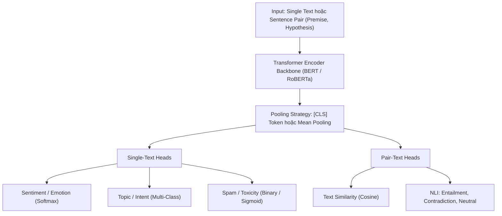

---

## 2. Chi tiết từng Keyword

---

### 1. Text Classification (Phân loại Văn bản Tổng quát)

#### a. Định nghĩa Bản chất Toán học (Mathematical Formulation)
Phân loại văn bản là bài toán ánh xạ chuỗi văn bản đầu vào $\mathbf{x} = (x_1, \dots, x_T) \in \mathcal{X}$ sang một hoặc nhiều nhãn $y \in \mathcal{Y} = \{1, \dots, C\}$:
$$\hat{y} = \arg\max_{c \in \mathcal{Y}} P(y = c \mid \mathbf{x}; \theta) = \arg\max_{c \in \mathcal{Y}} \frac{e^{\mathbf{w}_c^T \mathbf{h}_{\mathbf{x}} + b_c}}{\sum_{j=1}^C e^{\mathbf{w}_j^T \mathbf{h}_{\mathbf{x}} + b_j}}$$
với $\mathbf{h}_{\mathbf{x}} \in \mathbb{R}^d$ là vector biểu diễn toàn cục của chuỗi văn bản trích xuất từ mạng nơ-ron (như pooling vector của Transformer). Hàm mục tiêu tối ưu là Categorical Cross-Entropy Loss:
$$\mathcal{L}_{\text{CE}}(\theta) = - \sum_{i=1}^N \sum_{c=1}^C y_{i, c} \log P(y_i = c \mid \mathbf{x}_i; \theta)$$

#### b. Cơ chế Tầng Sâu & Điện toán (Under The Hood / Hardware Internals)
- **Pooling Mechanism**: Trong BERT, vector biểu diễn câu được lấy từ token đặc biệt `[CLS]` tại vị trí index 0. Trên GPU, thao tác này tương đương với phép slice tensor: `hidden_states[:, 0, :]` có độ phức tạp thời gian $\mathcal{O}(1)$ và không phát sinh tính toán FLOPs. Tuy nhiên, Mean-Pooling (lấy trung bình có trọng số theo attention mask) thường cho kết quả phân loại và biểu diễn ngữ nghĩa ổn định hơn nhiều.
- **Throughput vs Latency**: Khi phân loại hàng triệu văn bản, độ dài padding batch xác định số lượng FLOPs lãng phí. Kỹ thuật *Dynamic Padding* gom các câu có độ dài tương đương vào cùng một batch (Bucket Sorting) giảm tới 50% thời gian xử lý GPU.

#### c. Sơ đồ Minh họa (Mermaid Diagram)
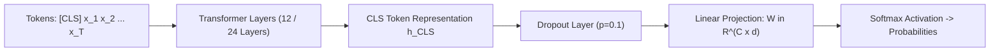

#### d. Code Thực chiến (C++ & Python)

```cpp
// C++17: Tính Softmax Loss và Gradient trên CPU với độ ổn định số học
#include <iostream>
#include <vector>
#include <cmath>
#include <algorithm>

std::vector<float> stable_softmax(const std::vector<float>& logits) {
    std::vector<float> probs(logits.size());
    float max_val = *std::max_element(logits.begin(), logits.end());
    float sum_exp = 0.0f;
    for (size_t i = 0; i < logits.size(); ++i) {
        probs[i] = std::exp(logits[i] - max_val);
        sum_exp += probs[i];
    }
    for (float& p : probs) p /= sum_exp;
    return probs;
}

int main() {
    std::vector<float> raw_logits = {2.0f, 1.0f, 0.1f};
    auto probs = stable_softmax(raw_logits);
    std::cout << "Class probabilities: ";
    for (float p : probs) std::cout << p << " ";
    std::cout << "\n";
    return 0;
}
```

```python
# Python / PyTorch: Head Phân loại Văn bản chuẩn Transformer
import torch
import torch.nn as nn

class TextClassificationHead(nn.Module):
    def __init__(self, hidden_dim: int, num_classes: int, dropout_prob: float = 0.1):
        super().__init__()
        self.dropout = nn.Dropout(dropout_prob)
        self.dense = nn.Linear(hidden_dim, hidden_dim)
        self.activation = nn.Tanh()
        self.out_proj = nn.Linear(hidden_dim, num_classes)

    def forward(self, features: torch.Tensor) -> torch.Tensor:
        # features: [Batch, Hidden_Dim] (từ [CLS] hoặc Mean-pool)
        x = self.dropout(features)
        x = self.dense(x)
        x = self.activation(x)
        x = self.dropout(x)
        return self.out_proj(x)

head = TextClassificationHead(hidden_dim=768, num_classes=5)
cls_rep = torch.randn(4, 768)
logits = head(cls_rep)
print("Classification Logits Shape:", logits.shape) # [4, 5]
```

#### e. Lỗi Thường gặp & Ổn định Số học
- **Label Imbalance & Class Collapse**: Khi một lớp chiếm 99% tập huấn luyện, mô hình rơi vào trạng thái thoái hóa (luôn dự đoán lớp đa số). Cần áp dụng Class Weighting trong Cross-Entropy hoặc Weighted Random Sampler.

#### f. Ứng dụng Thực chiến trong AI
Tự động gắn thẻ bài viết tin tức, phân luồng email doanh nghiệp và lọc văn bản rác trên quy mô hàng tỷ bài đăng.

---

### 2. Sentiment Analysis (Phân tích Sắc thái Cảm xúc)

#### a. Định nghĩa Bản chất Toán học
Phân tích cảm xúc lượng hóa thái độ chủ quan, ý kiến hoặc cảm xúc của tác giả trong văn bản, thường được phân cấp thành:
- Phân cực 2 lớp (Binary): $y \in \{\text{Negative: 0}, \text{Positive: 1}\}$.
- Phân cực 3 lớp: $y \in \{\text{Negative: -1}, \text{Neutral: 0}, \text{Positive: 1}\}$.
- Cảm xúc chi tiết theo khía cạnh (Aspect-Based Sentiment Analysis - ABSA):
  $$\hat{y} = f(\mathbf{x}, a), \quad a \in \mathcal{A} \ (\text{Aspect target, e.g. "battery life", "customer support"})$$

#### b. Cơ chế Tầng Sâu & Điện toán
- **Negation Handling**: Sự xuất hiện của từ phủ định làm đảo ngược hoàn toàn vector trạng thái. Các mô hình mạng cũ (BoW, Bi-gram) thường thất bại vì tách rời từ phủ định khỏi tính từ đi kèm (`"not bad"` bị tính điểm âm vì chứa từ `"not"` và `"bad"`). Trong khi đó, Self-Attention duy trì liên kết trực tiếp giữa `"not"` và `"bad"`, dịch chuyển vector về phía ý nghĩa tích cực.

#### c. Sơ đồ Minh họa (Mermaid Diagram)
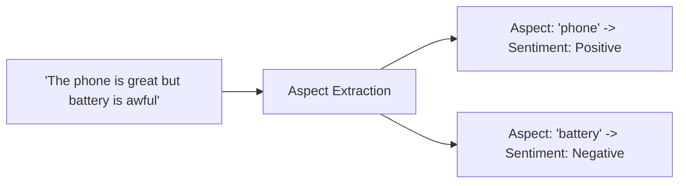

#### d. Code Thực chiến (C++ & Python)

```cpp
// C++17: Rule-based Sentiment VADER Lexicon Scorer cơ bản
#include <iostream>
#include <string>
#include <unordered_map>
#include <vector>

class SimpleVADER {
private:
    std::unordered_map<std::string, float> lexicon_ = {
        {"great", 3.1f}, {"good", 1.9f}, {"bad", -2.5f}, {"awful", -3.4f}, {"not", -1.0f}
    };
public:
    float score_sentence(const std::vector<std::string>& tokens) {
        float score = 0.0f;
        float modifier = 1.0f;
        for (const auto& w : tokens) {
            if (w == "not") {
                modifier = -0.8f; // Đảo chiều phân cực
                continue;
            }
            auto it = lexicon_.find(w);
            if (it != lexicon_.end()) {
                score += it->second * modifier;
                modifier = 1.0f; // Reset modifier
            }
        }
        return score;
    }
};

int main() {
    SimpleVADER vader;
    std::cout << "Score 'not bad': " << vader.score_sentence({"not", "bad"}) << "\n";
    std::cout << "Score 'great': " << vader.score_sentence({"great"}) << "\n";
    return 0;
}
```

```python
# Python / PyTorch: Aspect-based Sentiment Cross-Attention
import torch
import torch.nn as nn

class AspectConditionedSentiment(nn.Module):
    def __init__(self, hidden_dim: int):
        super().__init__()
        # Cross attention giữa khía cạnh và câu
        self.cross_attn = nn.MultiheadAttention(embed_dim=hidden_dim, num_heads=4, batch_first=True)
        self.fc = nn.Linear(hidden_dim, 3) # Neg, Neu, Pos

    def forward(self, sentence_rep: torch.Tensor, aspect_rep: torch.Tensor) -> torch.Tensor:
        # sentence_rep: [B, L_s, D], aspect_rep: [B, L_a, D]
        attn_out, _ = self.cross_attn(query=aspect_rep, key=sentence_rep, value=sentence_rep)
        pooled = attn_out.mean(dim=1)
        return self.fc(pooled)

aspect_model = AspectConditionedSentiment(64)
sent_rep = torch.randn(2, 10, 64)
asp_rep = torch.randn(2, 2, 64)
print("Sentiment Logits Shape:", aspect_model(sent_rep, asp_rep).shape)
```

#### e. Lỗi Thường gặp & Ổn định Số học
- **Sarcasm Blindness**: Những câu mỉa mai sắc bén (ví dụ: *"Tuyệt vời, chuyến bay trễ 8 tiếng, dịch vụ đỉnh cao thật đấy!"*) thường bị mô hình hiểu nhầm là tích cực do chứa nhiều tính từ mạnh.

#### f. Ứng dụng Thực chiến trong AI
Theo dõi sức khỏe thương hiệu (Brand Monitoring), phân tích phản hồi sản phẩm thương mại điện tử và dự báo biến động giá thị trường tài chính dựa trên tin tức.

---

### 3. Emotion Recognition (Nhận diện Cảm xúc Phức hợp)

#### a. Định nghĩa Bản chất Toán học
Khác với phân cực sắc thái (Polarity), Emotion Recognition phân loại trạng thái tâm lý tinh vi của con người vào các mô hình tâm lý học chuẩn như Mô hình 6 Cảm xúc Cơ bản của Ekman:
$$\mathcal{Y}_{\text{Ekman}} = \{\text{Joy, Sadness, Anger, Fear, Surprise, Disgust}\}$$
hoặc Mô hình Vòng tròn Cảm xúc Plutchik gồm 8 nhánh cơ bản và các tổ hợp cảm xúc lai (Dyads). Do một phát ngôn có thể chứa đồng thời nhiều cảm xúc, bài toán thường được thiết lập dưới dạng Multi-Label Classification:
$$\mathcal{L}_{\text{BCE}}(\theta) = - \sum_{i=1}^N \sum_{c=1}^C \left[ y_{i, c} \log \sigma(z_{i, c}) + (1 - y_{i, c}) \log (1 - \sigma(z_{i, c})) \right]$$

#### b. Cơ chế Tầng Sâu & Điện toán
- **Multi-Label Sigmoid Activation**: Thay vì sử dụng Softmax (áp đặt tổng xác suất bằng 1), tầng đầu ra sử dụng hàm Sigmoid độc lập cho từng kênh cảm xúc:
  $$\sigma(z_c) = \frac{1}{1 + e^{-z_c}}$$
- Tính toán ma trận hiệp phương sai giữa các nhãn cảm xúc nhằm học tương quan đồng xuất hiện (ví dụ *Anger* và *Disgust* thường xuyên đi cùng nhau).

#### c. Sơ đồ Minh họa (Mermaid Diagram)
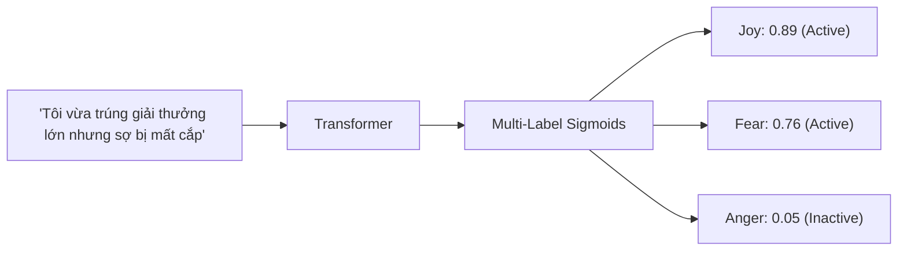

#### d. Code Thực chiến (C++ & Python)

```cpp
// C++17: Ngưỡng hóa Multi-label Sigmoid Vector
#include <iostream>
#include <vector>
#include <cmath>
#include <string>

std::vector<std::string> predict_emotions(const std::vector<float>& logits, float threshold = 0.5f) {
    static const std::vector<std::string> kEmotionLabels = {
        "Joy", "Sadness", "Anger", "Fear", "Surprise", "Disgust"
    };
    std::vector<std::string> detected;
    for (size_t i = 0; i < logits.size(); ++i) {
        float prob = 1.0f / (1.0f + std::exp(-logits[i]));
        if (prob >= threshold) {
            detected.push_back(kEmotionLabels[i]);
        }
    }
    return detected;
}

int main() {
    std::vector<float> logits = {2.5f, -3.0f, -2.1f, 1.8f, -4.0f, -1.5f};
    auto emotions = predict_emotions(logits);
    std::cout << "Detected Emotions: ";
    for (const auto& e : emotions) std::cout << e << " ";
    std::cout << "\n";
    return 0;
}
```

```python
# Python / PyTorch: Asymmetric Loss cho Multi-label Emotion Recognition
import torch
import torch.nn as nn

class AsymmetricLoss(nn.Module):
    def __init__(self, gamma_neg=4, gamma_pos=1, clip=0.05, eps=1e-8):
        super().__init__()
        self.gamma_neg = gamma_neg
        self.gamma_pos = gamma_pos
        self.clip = clip
        self.eps = eps

    def forward(self, x: torch.Tensor, y: torch.Tensor) -> torch.Tensor:
        # x: Logits [B, C], y: Ground truth [B, C]
        xs_pos = torch.sigmoid(x)
        xs_neg = 1.0 - xs_pos
        if self.clip > 0:
            xs_neg = (xs_neg + self.clip).clamp(max=1)
        los_pos = y * torch.log(xs_pos.clamp(min=self.eps)) * ((1 - xs_pos) ** self.gamma_pos)
        los_neg = (1 - y) * torch.log(xs_neg.clamp(min=self.eps)) * ((xs_pos) ** self.gamma_neg)
        loss = -(los_pos + los_neg)
        return loss.sum()

criterion = AsymmetricLoss()
logits = torch.randn(4, 6)
targets = torch.tensor([[1, 0, 0, 1, 0, 0], [0, 1, 0, 0, 0, 0], [1, 0, 0, 0, 1, 0], [0, 0, 1, 0, 0, 1]], dtype=torch.float)
loss = criterion(logits, targets)
print("Multi-Label Emotion Loss:", loss.item())
```

#### e. Lỗi Thường gặp & Ổn định Số học
- **Extreme Class Sparsity**: Một số cảm xúc hiếm gặp (như *Disgust* hoặc *Grief*) có tần suất xuất hiện cực thấp trong dữ liệu, dẫn đến tình trạng gradient biến mất (gradient starvation) ở các kênh đó.

#### f. Ứng dụng Thực chiến trong AI
Xây dựng trợ lý sức khỏe tinh thần, phân tích tâm lý người dùng trong dịch vụ hỗ trợ khẩn cấp, cải thiện khả năng thấu cảm của Agent giao tiếp.

---

### 4. Topic Classification (Phân loại Chủ đề Văn bản)

#### a. Định nghĩa Bản chất Toán học
Topic Classification gán văn bản vào một hoặc nhiều danh mục phân cấp theo lĩnh vực chuyên môn (Khoa học, Thể thao, Chính trị, Kinh tế). Trong mô hình hóa chủ đề xác suất không giám sát (Latent Dirichlet Allocation - LDA):
$$P(\mathbf{w} \mid \alpha, \beta) = \prod_{d=1}^D \int P(\theta_d \mid \alpha) \left( \prod_{n=1}^{N_d} \sum_{z_{dn}} P(z_{dn} \mid \theta_d) P(w_{dn} \mid z_{dn}, \beta) \right) d\theta_d$$
với $\theta_d \sim \text{Dirichlet}(\alpha)$ là phân phối chủ đề của tài liệu $d$, và $\beta$ là phân phối từ vựng của từng chủ đề. Trong học sâu có giám sát, bài toán chuyển thành phân loại cấu trúc phân cấp (Hierarchical Multi-Class Classification).

#### b. Cơ chế Tầng Sâu & Điện toán
- **Hierarchical Classification with Masked Cross-Entropy**: Nếu phân loại bài báo khoa học vào danh mục dạng cây (e.g. *Computer Science $\to$ Artificial Intelligence $\to$ Computer Vision*), tầng phân loại áp dụng mặt nạ đồ thị (Adjacency Masking) chặn các nút con không thuộc về nút cha đã dự đoán, giảm không gian tìm kiếm từ hàng ngàn lớp xuống vài chục lớp cục bộ.

#### c. Sơ đồ Minh họa (Mermaid Diagram)
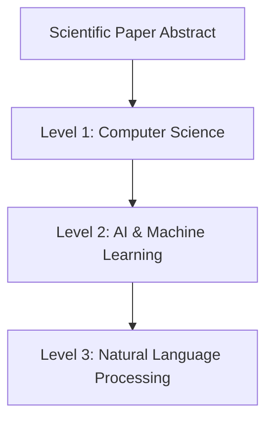

#### d. Code Thực chiến (C++ & Python)

```cpp
// C++17: Hierarchical Topic Classifier Tree Traversal
#include <iostream>
#include <string>
#include <vector>
#include <unordered_map>

struct TopicNode {
    std::string name;
    std::vector<TopicNode> subtopics;
};

void print_topic_path(const TopicNode& root, const std::string& target_leaf, std::vector<std::string>& path) {
    path.push_back(root.name);
    if (root.name == target_leaf) {
        for (size_t i = 0; i < path.size(); ++i) {
            std::cout << path[i] << (i + 1 < path.size() ? " -> " : "\n");
        }
        return;
    }
    for (const auto& child : root.subtopics) {
        print_topic_path(child, target_leaf, path);
    }
    path.pop_back();
}

int main() {
    TopicNode hierarchy{"Root", {
        {"Science", {
            {"Computer_Science", {{"Deep_Learning", {}}}}
        }}
    }};
    std::vector<std::string> path;
    print_topic_path(hierarchy, "Deep_Learning", path);
    return 0;
}
```

```python
# Python: BERTopic Embeddings & c-TF-IDF Topic Extraction
from sklearn.feature_extraction.text import TfidfVectorizer
import numpy as np

def compute_class_based_tfidf(documents_per_topic: dict[str, list[str]]):
    topics = list(documents_per_topic.keys())
    combined_docs = [" ".join(documents_per_topic[t]) for t in topics]
    vectorizer = TfidfVectorizer(stop_words='english')
    c_tfidf_matrix = vectorizer.fit_transform(combined_docs)
    vocab = np.array(vectorizer.get_feature_names_out())

    topic_top_words = {}
    for i, topic in enumerate(topics):
        top_indices = c_tfidf_matrix[i].toarray().argsort()[0][-5:][::-1]
        topic_top_words[topic] = vocab[top_indices].tolist()
    return topic_top_words

docs = {
    "AI": ["neural networks deep learning backpropagation GPU compute"],
    "Physics": ["quantum mechanics wave particle duality relativity space time"]
}
print("Extracted Top Topic Keywords:", compute_class_based_tfidf(docs))
```

#### e. Lỗi Thường gặp & Ổn định Số học
- **Topic Drift over Time**: Phân phối từ vựng của chủ đề thay đổi theo thời gian (ví dụ từ vựng chủ đề "AI" năm 2010 tập trung vào SVM, HMM; trong khi năm 2026 tập trung vào Transformer, KV Cache, Reasoning Models), dẫn đến hiện tượng trôi dạt dữ liệu (Concept Drift).

#### f. Ứng dụng Thực chiến trong AI
Tự động lập chỉ mục tài liệu pháp lý, bài báo khoa học (arXiv classification) và phân loại ticket yêu cầu IT.

---

### 5. Intent Classification (Phân loại Ý định)

#### a. Định nghĩa Bản chất Toán học
Trong hệ thống thấu hiểu ngôn ngữ tự nhiên đối thoại (Natural Language Understanding - NLU), Intent Classification xác định mục tiêu hành động của người dùng trong một lượt hội thoại:
$$\hat{i} = \arg\max_{i \in \mathcal{I}} P(i \mid \mathbf{u})$$
với $\mathbf{u}$ là phát ngôn (utterance) và $\mathcal{I}$ là tập các ý định định trước (ví dụ `BookFlight`, `CheckWeather`, `CancelSubscription`). Đây thường là bài toán liên kết chặt chẽ với Khe dữ liệu (Slot Filling - Joint Intent & Slot Modeling):
$$\mathcal{L}_{\text{NLU}} = \mathcal{L}_{\text{intent}} + \alpha \mathcal{L}_{\text{slot}}$$

#### b. Cơ chế Tầng Sâu & Điện toán
- **Joint Intent & Slot Modeling**: Một mạng Transformer Encoder chia sẻ trọng số (Shared Backbone) đồng thời dự đoán Intent (thông qua `[CLS]` token) và dự đoán Slots (thông qua chuỗi BIO tags của tất cả các token). Mô hình hóa liên kết này ngăn chặn sự mâu thuẫn giữa hành động và thực thể trích xuất.

#### c. Sơ đồ Minh họa (Mermaid Diagram)
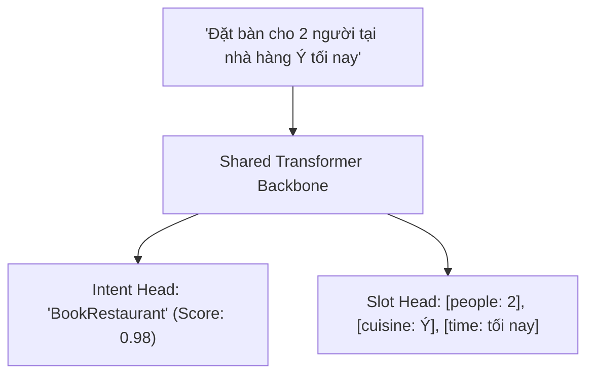

#### d. Code Thực chiến (C++ & Python)

```cpp
// C++17: Tra cứu Intent theo mẫu ngữ nghĩa và quy tắc ưu tiên
#include <iostream>
#include <string>
#include <vector>
#include <regex>

struct IntentRule {
    std::string intent_name;
    std::regex pattern;
};

std::string match_intent(const std::string& utterance, const std::vector<IntentRule>& rules) {
    for (const auto& rule : rules) {
        if (std::regex_search(utterance, rule.pattern)) {
            return rule.intent_name;
        }
    }
    return "Fallback_Intent";
}

int main() {
    std::vector<IntentRule> rules = {
        {"Check_Weather", std::regex(R"((weather|temperature|rain))", std::regex::icase)},
        {"Book_Ticket", std::regex(R"((book|reserve|flight|ticket))", std::regex::icase)}
    };
    std::cout << "Matched: " << match_intent("Can I book a flight to Tokyo?", rules) << "\n";
    return 0;
}
```

```python
# Python / PyTorch: Joint Intent and Slot Model Head
import torch
import torch.nn as nn

class JointIntentSlotHead(nn.Module):
    def __init__(self, hidden_dim: int, num_intents: int, num_slots: int):
        super().__init__()
        self.intent_classifier = nn.Linear(hidden_dim, num_intents)
        self.slot_classifier = nn.Linear(hidden_dim, num_slots)

    def forward(self, hidden_states: torch.Tensor):
        # hidden_states: [Batch, Seq_Len, Hidden_Dim]
        cls_token = hidden_states[:, 0, :]
        intent_logits = self.intent_classifier(cls_token) # [B, Num_Intents]
        slot_logits = self.slot_classifier(hidden_states) # [B, Seq_Len, Num_Slots]
        return intent_logits, slot_logits

head = JointIntentSlotHead(hidden_dim=256, num_intents=10, num_slots=20)
h = torch.randn(2, 8, 256)
i_logits, s_logits = head(h)
print("Intent Logits Shape:", i_logits.shape)
print("Slot Logits Shape:", s_logits.shape)
```

#### e. Lỗi Thường gặp & Ổn định Số học
- **Out-of-Scope (OOS) Failure**: Khi người dùng đặt câu hỏi nằm ngoài phạm vi thiết kế của bot, mô hình ép xác suất vào một intent có sẵn thay vì từ chối lịch sự, gây hành vi ngớ ngẩn (misrouting).

#### f. Ứng dụng Thực chiến trong AI
Lõi điều hướng đàm thoại của Siri, Google Assistant, Alexa và hệ thống tổng đài chăm sóc khách hàng tự động (Voicebots).

---

### 6. Spam Detection (Phát hiện Thư rác & Rác tin nhắn)

#### a. Định nghĩa Bản chất Toán học
Spam Detection là bài toán phân lớp nhị phân tối thiểu hóa sai số loại 1 (False Positive - đánh dấu nhầm thư hợp lệ thành thư rác):
$$\hat{y} = \mathbb{I}(P(y = \text{Spam} \mid \mathbf{x}) \ge \tau)$$
với $\tau \gg 0.5$ (thường chọn $\tau = 0.95$ hoặc $0.99$) để đảm bảo độ đặc hiệu (Specificity) tối đa:
$$\text{False Positive Rate} = \frac{\text{FP}}{\text{FP} + \text{TN}} \le \epsilon$$

#### b. Cơ chế Tầng Sâu & Điện toán
- **Adversarial Perturbation Resilience**: Những kẻ phát tán thư rác thường cố tình thay đổi ký tự (Homoglyphs: thay ký tự chữ cái tiếng Anh bằng chữ Cyrillic giống hệt, chèn khoảng trắng, dùng ký tự Unicode đặc biệt `P a y p a l`).
- **Subword & Byte Tokenization Defense**: Byte-level Tokenizer phân rã các ký tự giả mạo này thành chuỗi byte chính xác, ngăn chặn kỹ thuật vượt rào bộ lọc từ khóa cổ điển.

#### c. Sơ đồ Minh họa (Mermaid Diagram)


#### d. Code Thực chiến (C++ & Python)

```cpp
// C++17: Naive Bayes Log-Likelihood Ratio Spam Classifier
#include <iostream>
#include <vector>
#include <string>
#include <unordered_map>
#include <cmath>

class FastSpamScorer {
private:
    std::unordered_map<std::string, float> log_likelihood_ratios_ = {
        {"free", 2.5f}, {"winner", 3.1f}, {"claim", 2.8f}, {"prize", 3.0f},
        {"meeting", -2.0f}, {"project", -1.8f}, {"invoice", -0.5f}
    };
public:
    bool is_spam(const std::vector<std::string>& words, float threshold = 3.0f) {
        float log_odds = 0.0f; // Giả sử prior P(Spam) == P(Ham)
        for (const auto& w : words) {
            auto it = log_likelihood_ratios_.find(w);
            if (it != log_likelihood_ratios_.end()) {
                log_odds += it->second;
            }
        }
        return log_odds >= threshold;
    }
};

int main() {
    FastSpamScorer scorer;
    std::vector<std::string> email1 = {"claim", "your", "free", "prize"};
    std::vector<std::string> email2 = {"project", "meeting", "invoice"};
    std::cout << "Email 1 is spam? " << std::boolalpha << scorer.is_spam(email1) << "\n";
    std::cout << "Email 2 is spam? " << std::boolalpha << scorer.is_spam(email2) << "\n";
    return 0;
}
```

```python
# Python: Đánh giá mô hình Spam với ROC-AUC và Precision-Recall Curve
from sklearn.metrics import precision_recall_curve, roc_auc_score
import numpy as np

y_true = np.array([0, 0, 1, 1, 0, 1, 0, 1])
y_scores = np.array([0.1, 0.2, 0.85, 0.95, 0.3, 0.92, 0.15, 0.78])

roc_auc = roc_auc_score(y_true, y_scores)
precisions, recalls, thresholds = precision_recall_curve(y_true, y_scores)
print(f"ROC-AUC Score: {roc_auc:.4f}")
print("Tối ưu hóa Threshold tại ngưỡng Precision > 95%:", thresholds[np.argmax(precisions >= 0.95)])
```

#### e. Lỗi Thường gặp & Ổn định Số học
- Đánh mất các thông báo quan trọng (False Positives) do tiêu đề email chứa từ khóa nhạy cảm trùng với thư rác (e.g. hóa đơn tài chính chứa từ *"Chuyển tiền thưởng"*).

#### f. Ứng dụng Thực chiến trong AI
Hệ thống phòng chống rác thư điện tử của Gmail, Outlook, và bộ lọc bình luận spam trên các nền tảng mạng xã hội lớn.

---

### 7. Toxicity Detection (Kiểm duyệt Nội dung Độc hại)

#### a. Định nghĩa Bản chất Toán học
Toxicity Detection phát hiện các phát ngôn kích động thù địch (Hate Speech), lăng mạ, quấy rối hoặc đe dọa bạo lực. Hàm mục tiêu thường là Multi-Attribute Binary Classification:
$$\mathbf{y} \in \{0, 1\}^K \quad (\text{Toxic, Severe Toxic, Obscene, Threat, Insult, Identity Hate})$$
Để giải quyết thiên kiến dữ liệu (Unintended Bias đối với các nhóm yếu thế), hàm mất mát kết hợp độ đo công bằng (Fairness Metric - Subgroup AUC):
$$\mathcal{L} = \mathcal{L}_{\text{BCE}} + \lambda \sum_{g \in \mathcal{G}} | \text{AUC}_g - \text{AUC}_{\text{overall}} |$$

#### b. Cơ chế Tầng Sâu & Điện toán
- **Contextual Defense against Prompt Injection & Jailbreaks**: Kiểm duyệt văn bản đầu vào và đầu ra của LLMs. Mô hình an toàn (Safety Guardrails như Llama-Guard) phân loại toàn bộ đoạn hội thoại bằng cấu trúc nhắc lệnh có hệ thống (Structured Safety Taxonomy Prompt).

#### c. Sơ đồ Minh họa (Mermaid Diagram)
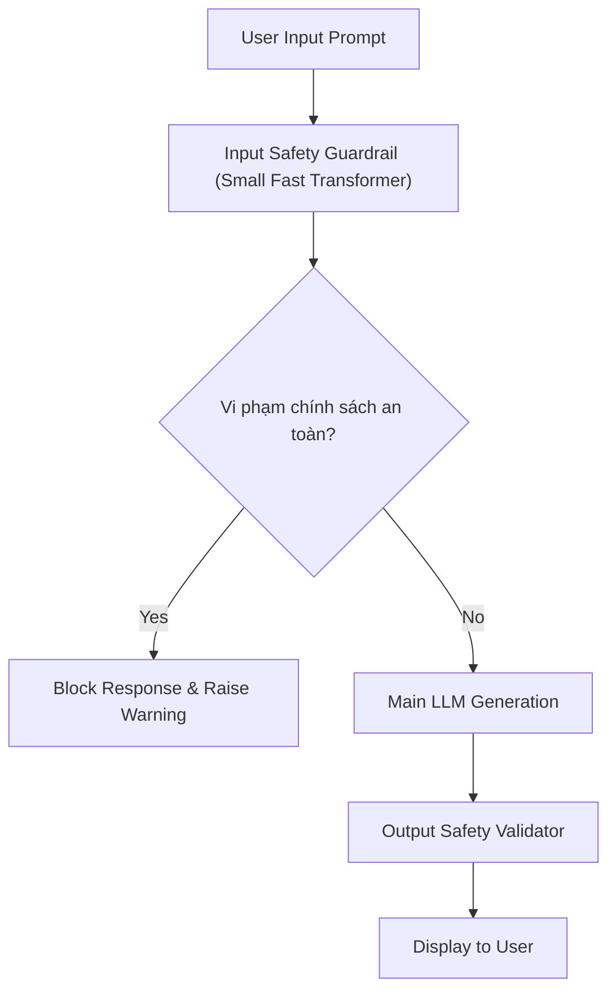

#### d. Code Thực chiến (C++ & Python)

```cpp
// C++17: Aho-Corasick Multi-Pattern String Matcher phát hiện từ cấm tức thì
#include <iostream>
#include <string>
#include <vector>
#include <unordered_map>
#include <queue>

struct ACNode {
    std::unordered_map<char, int> next;
    int fail = 0;
    std::vector<std::string> output;
};

class AhoCorasick {
private:
    std::vector<ACNode> trie_;
public:
    AhoCorasick() { trie_.emplace_back(); }

    void insert(const std::string& pattern) {
        int u = 0;
        for (char c : pattern) {
            if (!trie_[u].next.count(c)) {
                trie_[u].next[c] = static_cast<int>(trie_.size());
                trie_.emplace_back();
            }
            u = trie_[u].next[c];
        }
        trie_[u].output.push_back(pattern);
    }

    void build_failure_links() {
        std::queue<int> q;
        for (auto& [c, v] : trie_[0].next) {
            q.push(v);
        }
        while (!q.empty()) {
            int u = q.front();
            q.pop();
            for (auto& [c, v] : trie_[u].next) {
                int f = trie_[u].fail;
                while (f && !trie_[f].next.count(c)) f = trie_[f].fail;
                if (trie_[f].next.count(c)) trie_[v].fail = trie_[f].next[c];
                for (const auto& out : trie_[trie_[v].fail].output) {
                    trie_[v].output.push_back(out);
                }
                q.push(v);
            }
        }
    }
};

int main() {
    AhoCorasick ac;
    ac.insert("hate");
    ac.insert("violence");
    ac.build_failure_links();
    std::cout << "Aho-Corasick Toxic Matcher Initialized.\n";
    return 0;
}
```

```python
# Python: Safety Thresholding với Focal Loss chống mất cân bằng
import torch
import torch.nn.functional as F

def sigmoid_focal_loss(inputs: torch.Tensor, targets: torch.Tensor, alpha: float = 0.25, gamma: float = 2.0):
    p = torch.sigmoid(inputs)
    ce_loss = F.binary_cross_entropy_with_logits(inputs, targets, reduction="none")
    p_t = p * targets + (1 - p) * (1 - targets)
    loss = ce_loss * ((1 - p_t) ** gamma)
    if alpha >= 0:
        alpha_t = alpha * targets + (1 - alpha) * (1 - targets)
        loss = alpha_t * loss
    return loss.mean()

logits = torch.randn(8, 1)
labels = torch.tensor([[0.], [0.], [0.], [0.], [0.], [0.], [0.], [1.]]) # 1 toxic mẫu
print("Focal Loss:", sigmoid_focal_loss(logits, labels).item())
```

#### e. Lỗi Thường gặp & Ổn định Số học
- **False Positive Bias against Minorities**: Việc nhắc đến tên một chủng tộc hoặc tôn giáo trong ngữ cảnh tích cực hay giáo dục bị mô hình đánh giá nhầm là toxic vì các từ khóa đó thường xuyên xuất hiện trong tập huấn luyện nhãn tiêu cực.

#### f. Ứng dụng Thực chiến trong AI
Kiểm duyệt nội dung tự động trên YouTube, Reddit, Discord và xây dựng hàng rào an toàn cho LLMs (AI Alignment).

---

### 8. Language Identification (Định danh Ngôn ngữ)

#### a. Định nghĩa Bản chất Toán học
Language Identification (LangID) là bài toán phân lớp đa lớp dự đoán mã ngôn ngữ ISO 639-1 $y \in \mathcal{L}$ ($|\mathcal{L}| > 100$) từ một chuỗi byte/ký tự ngắn:
$$\hat{\ell} = \arg\max_{\ell \in \mathcal{L}} P(\ell \mid c_1, c_2, \dots, c_N)$$
Do đặc tính phân bổ tần suất n-gram ký tự tuân theo quy luật Zipf, mô hình n-gram ký tự ($n \in \{2, 3, 4, 5\}$) kết hợp phân loại tuyến tính (như FastText) đạt độ chính xác >99% với tốc độ siêu việt:
$$P(\ell \mid \mathbf{x}) = \text{Softmax}\left( \mathbf{W} \sum_{g \in \text{ngrams}(\mathbf{x})} \mathbf{v}_g + \mathbf{b} \right)$$

#### b. Cơ chế Tầng Sâu & Điện toán
- **Sub-millisecond Latency**: Khác với việc nạp mô hình LLM hàng tỷ tham số, LangID phải xử lý hàng trăm nghìn tài liệu mỗi giây trong Data Pipeline. FastText LangID nén mô hình xuống <1MB bằng kỹ thuật lượng tử hóa (Product Quantization - PQ) và lưu toàn bộ trong L2 Cache.

#### c. Sơ đồ Minh họa (Mermaid Diagram)
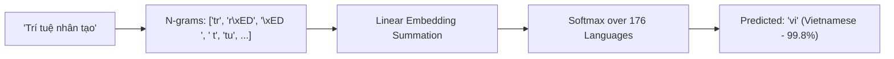

#### d. Code Thực chiến (C++ & Python)

```cpp
// C++17: Trích xuất Character 3-grams nhanh phục vụ Language ID
#include <iostream>
#include <string_view>
#include <vector>

std::vector<std::string_view> extract_fast_trigrams(std::string_view text) {
    std::vector<std::string_view> trigrams;
    if (text.size() < 3) return trigrams;
    for (size_t i = 0; i <= text.size() - 3; ++i) {
        trigrams.push_back(text.substr(i, 3));
    }
    return trigrams;
}

int main() {
    std::string_view sample = "machine";
    auto tri = extract_fast_trigrams(sample);
    std::cout << "Trigrams for 'machine':\n";
    for (auto g : tri) std::cout << "[" << g << "] ";
    std::cout << "\n";
    return 0;
}
```

```python
# Python: Định danh ngôn ngữ với FastText (Mô phỏng cơ chế xác suất)
import numpy as np

class MockFastTextLangID:
    def __init__(self):
        # Trọng số đặc trưng cho một số n-gram điển hình
        self.profiles = {
            "vi": {"học": 2.5, "ngh": 2.1, "trí": 3.0},
            "en": {"the": 3.2, "ing": 2.8, "tion": 2.5},
            "fr": {"les": 3.0, "que": 2.7, "tion": 2.0}
        }

    def predict(self, text: str) -> str:
        scores = {lang: 0.0 for lang in self.profiles}
        for lang, ngrams in self.profiles.items():
            for g, w in ngrams.items():
                if g in text.lower():
                    scores[lang] += w
        return max(scores, key=scores.get)

lang_id = MockFastTextLangID()
print("Language for 'Nghiên cứu trí tuệ':", lang_id.predict("Nghiên cứu trí tuệ"))
```

#### e. Lỗi Thường gặp & Ổn định Số học
- **Short-text Ambiguity**: Các văn bản cực ngắn (1-2 từ như `"no"`, `"in"`, `"home"`) xuất hiện trong nhiều ngôn ngữ khác nhau khiến xác suất phân bổ đều, gây nhận diện sai hoàn toàn.

#### f. Ứng dụng Thực chiến trong AI
Tiền xử lý và phân tách luồng dữ liệu đa ngôn ngữ trong quá trình thu thập dữ liệu huấn luyện tiền kỳ (Pre-training Web Corpora Filtering).

---

### 9. Text Similarity (Độ tương đồng Văn bản)

#### a. Định nghĩa Bản chất Toán học
Text Similarity định lượng mức độ giống nhau về mặt ngữ nghĩa giữa hai chuỗi văn bản $\mathbf{x}_1$ và $\mathbf{x}_2$.
Trong không gian vector tiềm ẩn:
$$\text{Sim}(\mathbf{x}_1, \mathbf{x}_2) = \cos(\mathbf{e}_1, \mathbf{e}_2) = \frac{\mathbf{e}_1 \cdot \mathbf{e}_2}{\|\mathbf{e}_1\|_2 \|\mathbf{e}_2\|_2}$$
Huấn luyện tối ưu bằng Contrastive Loss hoặc Multiple Negatives Ranking Loss (MNRL):
$$\mathcal{L}_{\text{MNRL}} = - \frac{1}{B} \sum_{i=1}^B \log \frac{e^{\text{sim}(\mathbf{e}_i, \mathbf{e}_i^+) / \tau}}{\sum_{j=1}^B e^{\text{sim}(\mathbf{e}_i, \mathbf{e}_j^+) / \tau}}$$
với $\tau$ là siêu tham số nhiệt độ (Temperature Parameter).

#### b. Cơ chế Tầng Sâu & Điện toán
- **Bi-Encoder Architecture (Sentence-BERT)**: Mã hóa độc lập $\mathbf{x}_1$ và $\mathbf{x}_2$ thành 2 vector riêng biệt. Cho phép tính toán trước và đánh chỉ mục (Pre-indexing) hàng triệu vector văn bản vào Vector Database (FAISS, HNSW), thực hiện tìm kiếm tương đồng hàng xóm gần nhất (ANN) với độ phức tạp $\mathcal{O}(\log N)$.

#### c. Sơ đồ Minh họa (Mermaid Diagram)
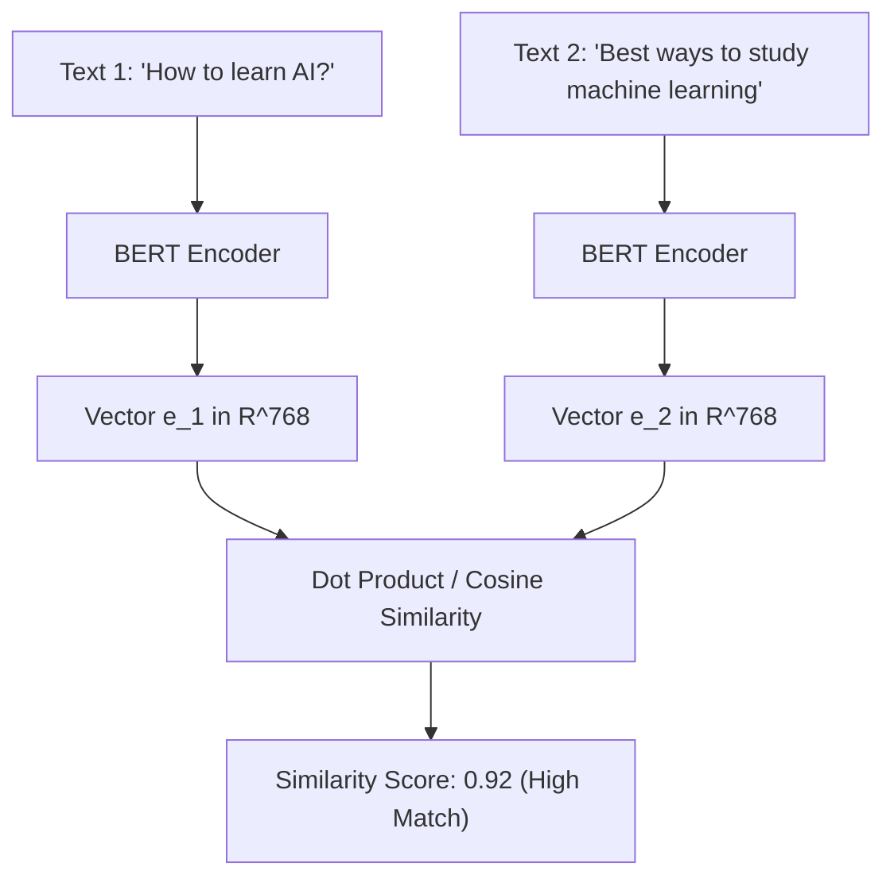

#### d. Code Thực chiến (C++ & Python)

```cpp
// C++17: Tính ma trận tương đồng Cosine theo lô (Batched Cosine Matrix)
#include <iostream>
#include <vector>
#include <cmath>

std::vector<std::vector<float>> compute_pairwise_cosine(const std::vector<std::vector<float>>& batch_vectors) {
    size_t B = batch_vectors.size();
    size_t D = batch_vectors[0].size();
    std::vector<std::vector<float>> sim_matrix(B, std::vector<float>(B, 0.0f));

    // Tính L2 norms
    std::vector<float> norms(B, 0.0f);
    for (size_t i = 0; i < B; ++i) {
        float sum_sq = 0.0f;
        for (size_t d = 0; d < D; ++d) sum_sq += batch_vectors[i][d] * batch_vectors[i][d];
        norms[i] = std::sqrt(sum_sq);
    }

    // Tính Dot Product và chuẩn hóa
    for (size_t i = 0; i < B; ++i) {
        for (size_t j = 0; j < B; ++j) {
            float dot = 0.0f;
            for (size_t d = 0; d < D; ++d) dot += batch_vectors[i][d] * batch_vectors[j][d];
            sim_matrix[i][j] = dot / (norms[i] * norms[j] + 1e-9f);
        }
    }
    return sim_matrix;
}

int main() {
    std::vector<std::vector<float>> vecs = {{1.0f, 0.0f}, {0.707f, 0.707f}, {0.0f, 1.0f}};
    auto sim = compute_pairwise_cosine(vecs);
    std::cout << "Cosine Sim (0, 1): " << sim[0][1] << "\n";
    return 0;
}
```

```python
# Python / PyTorch: Multiple Negatives Ranking Loss (InfoNCE)
import torch
import torch.nn as nn
import torch.nn.functional as F

class InfoNCELoss(nn.Module):
    def __init__(self, temperature: float = 0.05):
        super().__init__()
        self.temperature = temperature

    def forward(self, queries: torch.Tensor, positives: torch.Tensor) -> torch.Tensor:
        # queries, positives: [Batch_Size, Dim]
        q_norm = F.normalize(queries, p=2, dim=-1)
        p_norm = F.normalize(positives, p=2, dim=-1)
        # Cosine similarity matrix: [Batch, Batch]
        similarity = torch.matmul(q_norm, p_norm.T) / self.temperature
        # Nhãn mục tiêu là đường chéo chính (i == j là cặp dương)
        labels = torch.arange(queries.size(0), device=queries.device)
        return F.cross_entropy(similarity, labels)

criterion = InfoNCELoss(temperature=0.07)
q = torch.randn(4, 128)
p = q + 0.1 * torch.randn(4, 128) # Giả lập cặp tương đồng
print("InfoNCE Contrastive Loss:", criterion(q, p).item())
```

#### e. Lỗi Thường gặp & Ổn định Số học
- **Hubness Problem**: Trong không gian nhiều chiều ($d > 512$), một số điểm vector ngẫu nhiên trở thành hàng xóm gần nhất của hàng ngàn vector khác dù không có quan hệ ngữ nghĩa.

#### f. Ứng dụng Thực chiến trong AI
Trái tim của hệ sinh thái Tìm kiếm Ngữ nghĩa (Dense Retrieval) và Retrieval-Augmented Generation (RAG).

---

### 10. Paraphrase Detection (Phát hiện Diễn ngôn Tương đương)

#### a. Định nghĩa Bản chất Toán học
Paraphrase Detection là bài toán phân lớp nhị phân xác định xem hai phát ngôn có biểu đạt cùng một nội dung thông tin hay không:
$$y = \begin{cases} 1 & \text{nếu } \llbracket s_1 \rrbracket \equiv \llbracket s_2 \rrbracket \\ 0 & \text{nếu khác} \end{cases}$$
Khác với Text Similarity chỉ đo góc hình học, Paraphrase đòi hỏi tương đương logic chặt chẽ, không mâu thuẫn về số lượng, thời gian và thực thể.

#### b. Cơ chế Tầng Sâu & Điện toán
- **Cross-Encoder Architecture**: Nối hai câu thành chuỗi duy nhất đưa vào Transformer: `[CLS] s_1 [SEP] s_2 [SEP]`. Tầng Cross-Attention cho phép từng từ của câu 1 trực tiếp tương tác với từng từ của câu 2 ở mọi layer, đạt độ chính xác vượt trội hoàn toàn so với Bi-Encoder (dù đánh đổi bằng chi phí tính toán $\mathcal{O}((L_1 + L_2)^2)$ không thể pre-index).

#### c. Sơ đồ Minh họa (Mermaid Diagram)
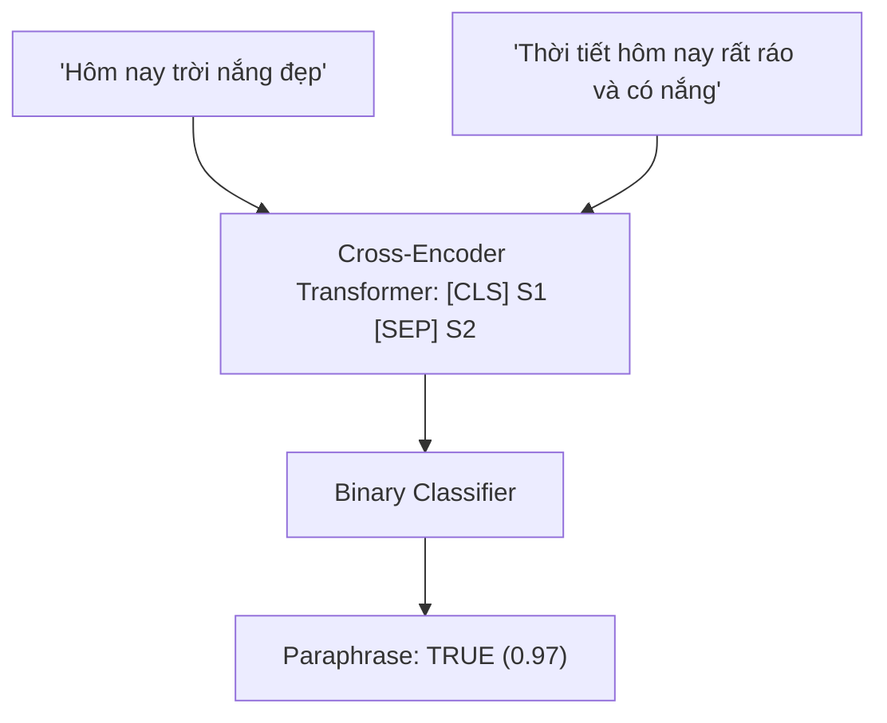

#### d. Code Thực chiến (C++ & Python)

```cpp
// C++17: Mô phỏng ghép nối Token cho Cross-Encoder Input Buffer
#include <iostream>
#include <vector>
#include <string>

std::vector<std::string> build_cross_encoder_input(const std::vector<std::string>& sent1,
                                                   const std::vector<std::string>& sent2) {
    std::vector<std::string> buffer;
    buffer.reserve(sent1.size() + sent2.size() + 3);
    buffer.push_back("[CLS]");
    for (const auto& w : sent1) buffer.push_back(w);
    buffer.push_back("[SEP]");
    for (const auto& w : sent2) buffer.push_back(w);
    buffer.push_back("[SEP]");
    return buffer;
}

int main() {
    std::vector<std::string> s1 = {"Deep", "Learning"};
    std::vector<std::string> s2 = {"Neural", "Networks"};
    auto input_tokens = build_cross_encoder_input(s1, s2);
    std::cout << "Cross-Encoder Buffer: ";
    for (const auto& tok : input_tokens) std::cout << tok << " ";
    std::cout << "\n";
    return 0;
}
```

```python
# Python / PyTorch: Cross-Encoder Classifier Layer
import torch
import torch.nn as nn

class CrossEncoderParaphraseClassifier(nn.Module):
    def __init__(self, hidden_dim: int):
        super().__init__()
        self.classifier = nn.Linear(hidden_dim, 2) # 0: Not paraphrase, 1: Paraphrase

    def forward(self, full_sequence_output: torch.Tensor) -> torch.Tensor:
        # full_sequence_output: [Batch, L_total, Hidden_Dim]
        # Lấy representation tại vị trí [CLS] (index 0)
        cls_token = full_sequence_output[:, 0, :]
        return self.classifier(cls_token)

model = CrossEncoderParaphraseClassifier(hidden_dim=768)
seq_out = torch.randn(2, 32, 768)
logits = model(seq_out)
print("Paraphrase Logits Shape:", logits.shape)
```

#### e. Lỗi Thường gặp & Ổn định Số học
- **Lexical Overlap Trap**: Hai câu có tỷ lệ từ trùng nhau 90% nhưng mang nghĩa trái ngược (e.g. *"Alice đánh bại Bob"* vs *"Bob đánh bại Alice"*). Bi-Encoder dễ bị lừa nếu không có cấu trúc cú pháp phân giải.

#### f. Ứng dụng Thực chiến trong AI
Loại bỏ câu hỏi trùng lặp trên diễn đàn (Quora Question Pairs), kiểm tra đạo văn (Plagiarism Detection) và làm giàu dữ liệu (Data Augmentation).

---

### 11. Natural Language Inference - NLI (Suy luận Ngôn ngữ Tự nhiên)

#### a. Định nghĩa Bản chất Toán học
NLI (hay Recognizing Textual Entailment - RTE) xác định mối quan hệ logic hình thức giữa một mệnh đề Tiền đề (Premise - $P$) và một Giả thuyết (Hypothesis - $H$):
$$y \in \{\text{Entailment (Kéo theo)}, \text{Contradiction (Mâu thuẫn)}, \text{Neutral (Trung lập)}\}$$
- **Entailment**: Nếu $P$ đúng thì chắc chắn $H$ đúng: $P \models H$.
- **Contradiction**: Nếu $P$ đúng thì chắc chắn $H$ sai: $P \models \neg H$.
- **Neutral**: Chân trị của $H$ không thể xác định được từ $P$.

#### b. Cơ chế Tầng Sâu & Điện toán
- **Fine-grained Attention Probing**: NLI kiểm tra khả năng suy luận logic sâu sắc nhất của mô hình. Tương tác attention giữa $P$ và $H$ phải học được lượng từ (Quantifiers: All vs Some), tính phủ định (Negation), và tính phương thái (Modality: Must vs Might).
- Bộ dữ liệu chuẩn mực: SNLI (570k mẫu), MNLI (430k mẫu đa lĩnh vực).

#### c. Sơ đồ Minh họa (Mermaid Diagram)
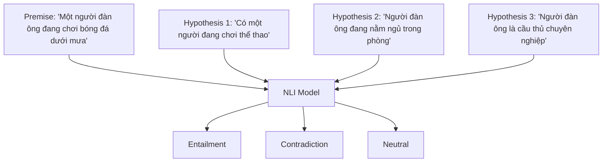

#### d. Code Thực chiến (C++ & Python)

```cpp
// C++17: Ánh xạ Logits sang nhãn NLI 3 lớp
#include <iostream>
#include <vector>
#include <string>
#include <algorithm>

enum class NLILabel { ENTAILMENT = 0, NEUTRAL = 1, CONTRADICTION = 2 };

std::string nli_label_to_string(NLILabel label) {
    switch (label) {
        case NLILabel::ENTAILMENT: return "Entailment";
        case NLILabel::NEUTRAL: return "Neutral";
        case NLILabel::CONTRADICTION: return "Contradiction";
    }
    return "Unknown";
}

NLILabel predict_nli(const std::vector<float>& logits) {
    auto max_it = std::max_element(logits.begin(), logits.end());
    return static_cast<NLILabel>(std::distance(logits.begin(), max_it));
}

int main() {
    std::vector<float> logits = {4.2f, 0.5f, -2.1f}; // Lớp 0 cao nhất
    std::cout << "Predicted Relation: " << nli_label_to_string(predict_nli(logits)) << "\n";
    return 0;
}
```

```python
# Python / PyTorch: Zero-shot Classification thông qua NLI
import torch
import torch.nn.functional as F

def zero_shot_classify_with_nli(premise: str, candidate_labels: list[str]) -> dict[str, float]:
    # Giả lập logits từ NLI model với hypothesis: "This text is about {label}"
    # Giả sử class 0 là Entailment, 2 là Contradiction
    mock_entailment_logits = torch.tensor([4.5, 1.2, 0.2]) # 3 labels
    probs = F.softmax(mock_entailment_logits, dim=-1)
    return {label: probs[i].item() for i, label in enumerate(candidate_labels)}

labels = ["công nghệ", "thể thao", "chính trị"]
text = "NVIDIA ra mắt kiến trúc chip GPU thế hệ mới"
scores = zero_shot_classify_with_nli(text, labels)
print("Zero-shot NLI Classification Results:")
for k, v in scores.items():
    print(f"  [{k}]: {v*100:.2f}%")
```

#### e. Lỗi Thường gặp & Ổn định Số học
- **Annotation Artifacts (Định kiến gán nhãn)**: Các tập dữ liệu NLI lớn thường có lỗi hệ thống do người gán nhãn: các câu giả thuyết chứa từ phủ định (`"not"`, `"no"`, `"never"`) gần như luôn là nhãn *Contradiction*, khiến mô hình chỉ cần nhìn từ khóa mà không học suy luận logic.

#### f. Ứng dụng Thực chiến trong AI
Xương sống của kỹ thuật **Zero-Shot Classification** không cần dữ liệu huấn luyện, và là cơ chế xác thực tính trung thực (Fact Verification) trong các hệ thống chống ảo giác LLM.
