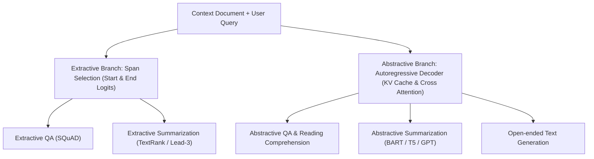
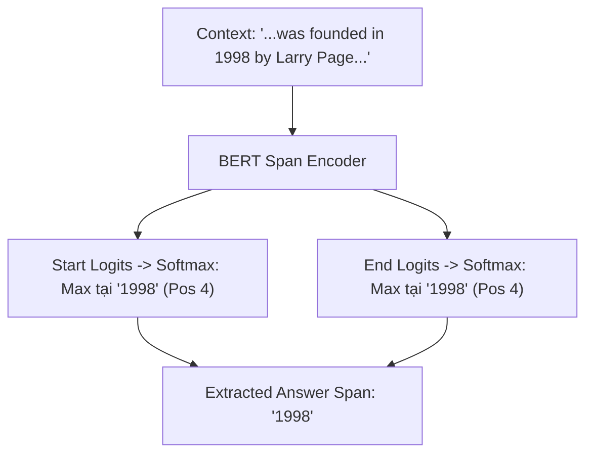
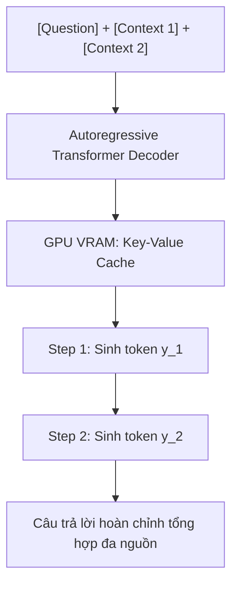
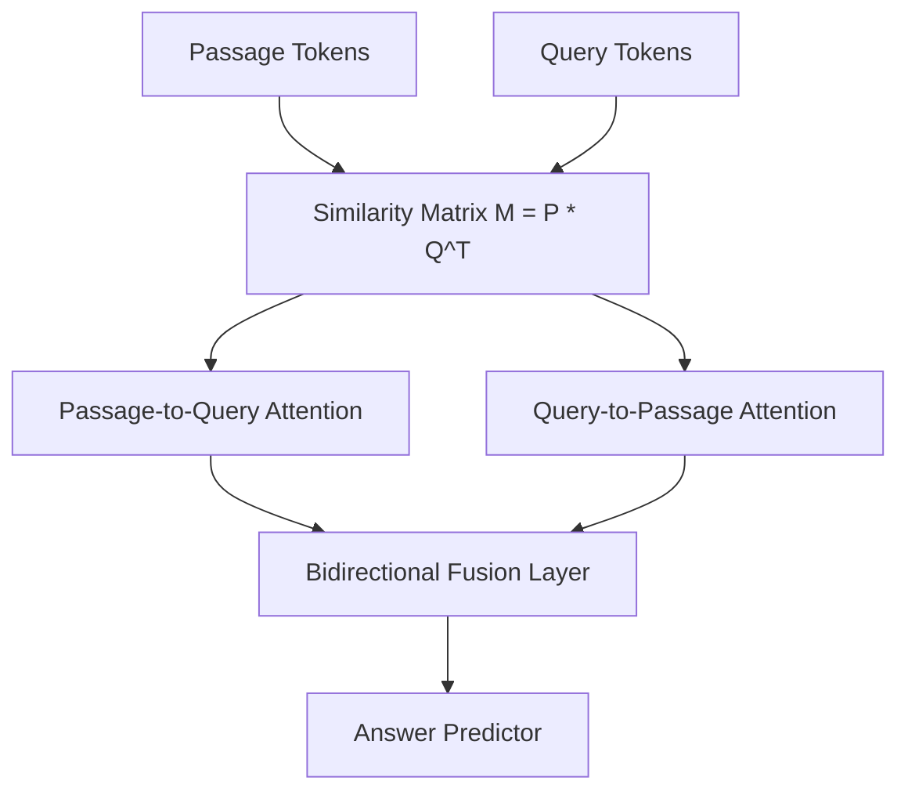
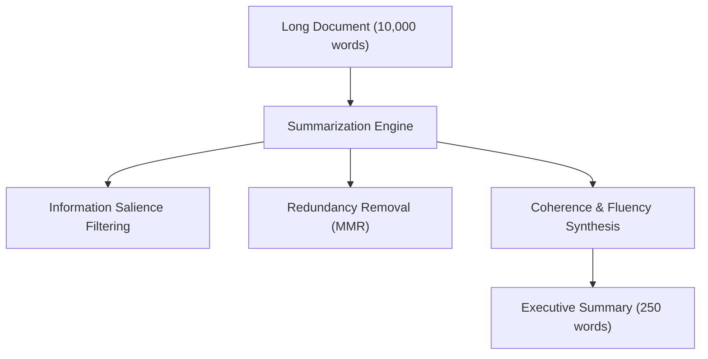
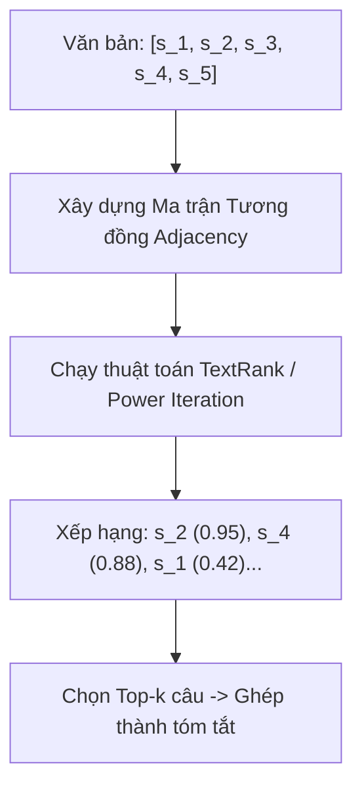
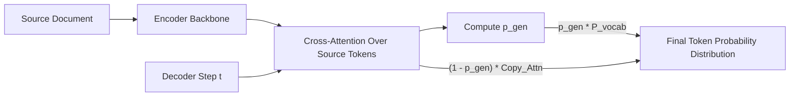
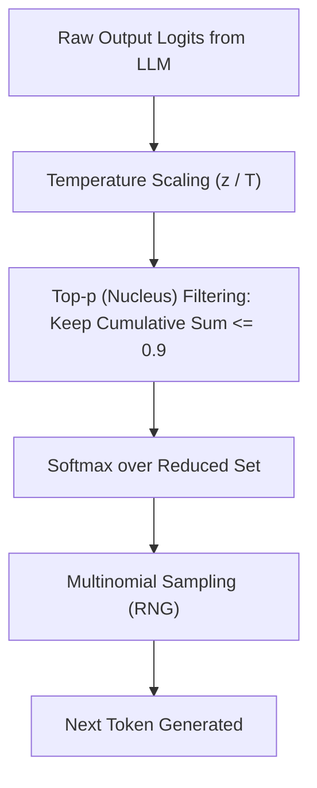

# Chuyên đề: Sinh Văn bản, Hỏi đáp & Tóm tắt (Text Generation, QA & Summarization)

## 1. Tổng quan Chuyên đề
Khả năng sinh văn bản mạch lạc (Text Generation), trả lời câu hỏi chính xác (Question Answering) và cô đọng tri thức (Text Summarization) đánh dấu sự chuyển dịch vĩ đại của Trí tuệ Nhân tạo từ giai đoạn phân tích thụ động sang giai đoạn sáng tạo chủ động (Generative AI). Các tác vụ này được chia thành hai nhánh kiến trúc cơ bản:
1. **Dạng rút trích (Extractive)**: Trích xuất trực tiếp các đoạn văn bản (spans hoặc sentences) có sẵn từ ngữ cảnh đầu vào mà không sửa đổi ký tự.
2. **Dạng tóm lược / trừu tượng (Abstractive)**: Tự do sinh các cụm từ mới, diễn đạt lại cấu trúc câu và tổng hợp thông tin từ nhiều nguồn rời rạc thông qua các mô hình Sequence-to-Sequence (Encoder-Decoder) và Causal Autoregressive LLMs (Decoder-only).



---

## 2. Chi tiết từng Keyword

---

### 1. Question Answering - QA (Hỏi đáp Tự động Tổng quát)

#### a. Định nghĩa Bản chất Toán học (Mathematical Formulation)
Hỏi đáp tự động là bài toán tìm câu trả lời tối ưu $\hat{\mathbf{a}}$ cho câu hỏi $\mathbf{q}$, dựa trên một tập tài liệu ngữ cảnh $\mathcal{C}$ hoặc cơ sở tri thức $\mathcal{K}$:
$$\hat{\mathbf{a}} = \arg\max_{\mathbf{a}} P(\mathbf{a} \mid \mathbf{q}, \mathcal{C}; \theta)$$
Các biến thể chính bao gồm:
- **Open-Domain QA**: $\mathcal{C}$ là toàn bộ kho tri thức khổng lồ (Wikipedia, Web); hệ thống kết hợp bước Tìm kiếm (Retriever) và Đọc hiểu (Reader):
  $$P(\mathbf{a} \mid \mathbf{q}) = \sum_{d \in \mathcal{C}} P(\mathbf{a} \mid \mathbf{q}, d) P(d \mid \mathbf{q})$$
- **Closed-Book QA**: Mô hình sinh câu trả lời trực tiếp từ tri thức đã tham số hóa trong trọng số $\theta$ mà không cần truy xuất ngoài:
  $$P(\mathbf{a} \mid \mathbf{q}; \theta)$$

#### b. Cơ chế Tầng Sâu & Điện toán (Under The Hood / Hardware Internals)
- **Retriever-Reader Bottleneck**: Trong Open-Domain QA, Retriever (như BM25 hoặc Dense Passage Retrieval - DPR) phải tìm kiếm top-$k$ đoạn văn trong số hàng chục triệu tài liệu trong vòng <50ms. Sau đó, Reader (Transformer) tiếp nhận $k$ đoạn văn đã ghép nối và tính toán tự chú ý đa đầu (Multi-Head Self-Attention).
- **Context Length Scaling**: Khi $k$ lớn, độ dài chuỗi $L = \sum |d_i|$ tăng vọt, tiêu thụ bộ nhớ $\mathcal{O}(L^2)$ theo attention map truyền thống, đòi hỏi FlashAttention-2 để tính trực tiếp Softmax trên GPU SRAM mà không ghi ma trận trung gian ra HBM.

#### c. Sơ đồ Minh họa (Mermaid Diagram)


#### d. Code Thực chiến (C++ & Python)

```cpp
// C++17: Tìm kiếm đoạn văn tương đồng cao nhất cho Question Answering
#include <iostream>
#include <vector>
#include <string>
#include <cmath>

struct DocumentPassage {
    int id;
    std::string text;
    std::vector<float> embedding;
};

int retrieve_best_passage(const std::vector<float>& query_emb, const std::vector<DocumentPassage>& corpus) {
    int best_id = -1;
    float max_dot = -1e9f;

    for (const auto& doc : corpus) {
        float dot = 0.0f;
        for (size_t i = 0; i < query_emb.size(); ++i) {
            dot += query_emb[i] * doc.embedding[i];
        }
        if (dot > max_dot) {
            max_dot = dot;
            best_id = doc.id;
        }
    }
    return best_id;
}

int main() {
    std::vector<float> q = {0.8f, 0.6f};
    std::vector<DocumentPassage> corpus = {
        {1, "Paris is the capital of France.", {0.2f, 0.9f}},
        {2, "Attention mechanism is used in Transformers.", {0.85f, 0.5f}}
    };
    int matched_id = retrieve_best_passage(q, corpus);
    std::cout << "Matched Passage ID for Query: " << matched_id << "\n";
    return 0;
}
```

```python
# Python / PyTorch: Open-domain QA Retrieval Scoring
import torch
import torch.nn.functional as F

def rank_documents(query_vec: torch.Tensor, doc_vecs: torch.Tensor) -> torch.Tensor:
    # query_vec: [1, Dim], doc_vecs: [Num_Docs, Dim]
    q_norm = F.normalize(query_vec, p=2, dim=-1)
    d_norm = F.normalize(doc_vecs, p=2, dim=-1)
    scores = torch.matmul(q_norm, d_norm.T).squeeze(0)
    # Trả về chỉ số văn bản xếp hạng từ cao xuống thấp
    return torch.argsort(scores, descending=True)

q = torch.randn(1, 128)
docs = torch.randn(10, 128)
rankings = rank_documents(q, docs)
print("Top 3 Retrieved Document Indices:", rankings[:3].tolist())
```

#### e. Lỗi Thường gặp & Ổn định Số học
- **Lost in the Middle**: Khi đưa nhiều tài liệu vào ngữ cảnh của LLM, thông tin quan trọng nằm ở giữa đoạn văn thường bị bỏ sót; mô hình chỉ ghi nhớ tốt phần đầu và phần cuối (U-shaped attention curve).

#### f. Ứng dụng Thực chiến trong AI
Các công cụ tìm kiếm hội thoại thế hệ mới (Perplexity, Bing Chat, Google Search AI Overviews) và hệ sinh thái Enterprise RAG.

---

### 2. Extractive QA (Hỏi đáp Rút trích)

#### a. Định nghĩa Bản chất Toán học
Trong Extractive QA (tiêu biểu như tập dữ liệu SQuAD 1.1/2.0), câu trả lời $\mathbf{a}$ được giới hạn là một đoạn văn bản liên tục (sub-string span) có sẵn trong đoạn văn $\mathcal{C} = (c_1, \dots, c_N)$. Mô hình dự đoán hai chỉ số: vị trí bắt đầu $i$ và vị trí kết thúc $j$ ($1 \le i \le j \le N$):
$$\hat{i} = \arg\max_{i} P_{\text{start}}(i \mid \mathbf{q}, \mathcal{C}), \quad \hat{j} = \arg\max_{j \ge \hat{i}} P_{\text{end}}(j \mid \mathbf{q}, \mathcal{C})$$
Xác suất được tính thông qua hai bộ phân loại tuyến tính $\mathbf{w}_{\text{start}}, \mathbf{w}_{\text{end}} \in \mathbb{R}^d$:
$$P_{\text{start}}(i) = \frac{e^{\mathbf{w}_{\text{start}}^T \mathbf{h}_i}}{\sum_{k=1}^N e^{\mathbf{w}_{\text{start}}^T \mathbf{h}_k}}, \quad P_{\text{end}}(j) = \frac{e^{\mathbf{w}_{\text{end}}^T \mathbf{h}_j}}{\sum_{k=1}^N e^{\mathbf{w}_{\text{end}}^T \mathbf{h}_k}}$$
Hàm mất mát là tổng Cross-Entropy của vị trí start và end:
$$\mathcal{L}_{\text{span}} = - \log P_{\text{start}}(i^*) - \log P_{\text{end}}(j^*)$$

#### b. Cơ chế Tầng Sâu & Điện toán
- **O(N^2) Span Filtering**: Điểm số của một đoạn hợp lệ $[i, j]$ là $S(i, j) = \text{logit}_{\text{start}}(i) + \text{logit}_{\text{end}}(j)$. Trên CPU/GPU, việc tìm kiếm cặp $(i, j)$ tối ưu với điều kiện $0 \le j - i \le L_{\max}$ được thực hiện bằng phép cộng Broadcasting và ma trận tam giác trên (Upper Triangular Mask) loại bỏ hoàn toàn các trường hợp $j < i$.

#### c. Sơ đồ Minh họa (Mermaid Diagram)


#### d. Code Thực chiến (C++ & Python)

```cpp
// C++17: Thuật toán tìm kiếm Best Span (i, j) thỏa mãn điều kiện i <= j và độ dài tối đa
#include <iostream>
#include <vector>
#include <algorithm>

struct SpanResult {
    int start;
    int end;
    float score;
};

SpanResult find_best_span(const std::vector<float>& start_logits,
                          const std::vector<float>& end_logits,
                          int max_answer_len = 30) {
    int n = start_logits.size();
    SpanResult best{-1, -1, -1e9f};

    for (int i = 0; i < n; ++i) {
        for (int j = i; j < std::min(n, i + max_answer_len); ++j) {
            float score = start_logits[i] + end_logits[j];
            if (score > best.score) {
                best = {i, j, score};
            }
        }
    }
    return best;
}

int main() {
    std::vector<float> s_logits = {-2.0f, 4.5f, 0.1f, -1.0f};
    std::vector<float> e_logits = {-1.0f, 0.2f, 4.8f, -0.5f};
    auto span = find_best_span(s_logits, e_logits);
    std::cout << "Best Span: [" << span.start << ", " << span.end << "] with Score: " << span.score << "\n";
    return 0;
}
```

```python
# Python / PyTorch: Span Classification Head cho SQuAD
import torch
import torch.nn as nn

class ExtractiveQAHead(nn.Module):
    def __init__(self, hidden_dim: int):
        super().__init__()
        # 2 outputs: Start logit và End logit
        self.qa_outputs = nn.Linear(hidden_dim, 2)

    def forward(self, sequence_output: torch.Tensor):
        # sequence_output: [Batch, Seq_Len, Hidden_Dim]
        logits = self.qa_outputs(sequence_output) # [B, L, 2]
        start_logits, end_logits = logits.split(1, dim=-1)
        return start_logits.squeeze(-1), end_logits.squeeze(-1)

head = ExtractiveQAHead(hidden_dim=768)
seq = torch.randn(2, 64, 768)
s_logits, e_logits = head(seq)
print("Start Logits Shape:", s_logits.shape)
print("End Logits Shape:", e_logits.shape)
```

#### e. Lỗi Thường gặp & Ổn định Số học
- **Unanswerable Questions (SQuAD 2.0)**: Khi câu hỏi không có câu trả lời trong văn bản, nếu không gán nhãn cho token đặc biệt `[CLS]` (index 0) đại diện cho nhãn "Không thể trả lời", mô hình luôn bị ép trích xuất một đoạn văn vô nghĩa.

#### f. Ứng dụng Thực chiến trong AI
Trích xuất số liệu từ báo cáo tài chính, tìm kiếm nhanh điều khoản trong hợp đồng bảo hiểm và tra cứu tài liệu kỹ thuật nội bộ.

---

### 3. Abstractive QA (Hỏi đáp Tóm lược / Trừu tượng)

#### a. Định nghĩa Bản chất Toán học
Abstractive QA không trích xuất nguyên văn mà tổng hợp thông tin, diễn đạt lại bằng ngôn ngữ tự nhiên tự do:
$$\hat{\mathbf{y}} = \arg\max_{\mathbf{y}} \prod_{t=1}^T P(y_t \mid y_{<t}, \mathbf{q}, \mathcal{C}; \theta)$$
Quá trình này giải quyết được các câu hỏi đòi hỏi suy luận phức hợp đa chặng (Multi-hop Reasoning), so sánh đối chiếu hoặc câu hỏi "Tại sao / Như thế nào" mà câu trả lời không nằm trọn vẹn trong một câu đơn lẻ.

#### b. Cơ chế Tầng Sâu & Điện toán
- **Autoregressive Generation & KV Caching**: Mô hình giải mã từng token một. Để tránh việc phải tính toán lại Self-Attention cho toàn bộ các token đã sinh trước đó với độ phức tạp $\mathcal{O}(T^2)$, kiến trúc sử dụng **KV Cache** lưu trữ ma trận Key và Value trên bộ nhớ GPU VRAM, giảm chi phí mỗi bước giải mã xuống $\mathcal{O}(T)$.

#### c. Sơ đồ Minh họa (Mermaid Diagram)


#### d. Code Thực chiến (C++ & Python)

```cpp
// C++17: Mô phỏng cơ chế cập nhật KV Cache cho bước giải mã tiếp theo
#include <iostream>
#include <vector>

struct KVCacheBuffer {
    size_t max_seq_len;
    size_t hidden_dim;
    size_t current_len = 0;
    std::vector<float> keys;
    std::vector<float> values;

    KVCacheBuffer(size_t max_len, size_t dim) 
        : max_seq_len(max_len), hidden_dim(dim), 
          keys(max_len * dim, 0.0f), values(max_len * dim, 0.0f) {}

    void append_token_kv(const std::vector<float>& new_k, const std::vector<float>& new_v) {
        if (current_len >= max_seq_len) return;
        size_t offset = current_len * hidden_dim;
        for (size_t d = 0; d < hidden_dim; ++d) {
            keys[offset + d] = new_k[d];
            values[offset + d] = new_v[d];
        }
        current_len++;
    }
};

int main() {
    KVCacheBuffer kv(128, 64);
    std::vector<float> k_tok(64, 0.5f);
    std::vector<float> v_tok(64, 0.1f);
    kv.append_token_kv(k_tok, v_tok);
    std::cout << "KV Cache updated. Current cache length: " << kv.current_len << "\n";
    return 0;
}
```

```python
# Python / PyTorch: Greedy Decoding Loop với Mock KV Cache
import torch

def mock_autoregressive_qa_generate(prompt_len: int, max_new_tokens: int, vocab_size: int = 1000):
    generated_ids = []
    # Giả lập vòng lặp giải mã từng token
    for step in range(max_new_tokens):
        # Mô phỏng logits từ Transformer Decoder tại bước hiện tại
        logits = torch.randn(1, vocab_size)
        next_token = torch.argmax(logits, dim=-1).item()
        generated_ids.append(next_token)
        if next_token == 0: # Token kết thúc EOS
            break
    return generated_ids

tokens = mock_autoregressive_qa_generate(prompt_len=20, max_new_tokens=5)
print("Generated Token IDs:", tokens)
```

#### e. Lỗi Thường gặp & Ổn định Số học
- **Ảo giác Thông tin (Hallucination)**: Mô hình tự bịa ra các dữ kiện có vẻ hợp lý nhưng hoàn toàn không có trong ngữ cảnh hoặc sai lệch sự thật khoa học.

#### f. Ứng dụng Thực chiến trong AI
Khả năng trả lời câu hỏi chuyên gia của ChatGPT, Claude, Gemini trong giáo dục, lập trình và tư vấn y tế.

---

### 4. Reading Comprehension (Đọc hiểu Máy tính)

#### a. Định nghĩa Bản chất Toán học
Đọc hiểu máy tính (Machine Reading Comprehension - MRC) là thước đo kiểm tra năng lực hiểu văn bản toàn diện của mô hình AI thông qua việc giải quyết các bài kiểm tra được chuẩn hóa:
- **Multiple-Choice MRC (RACE, MMLU)**:
  $$\hat{c} = \arg\max_{c \in \{A, B, C, D\}} P(c \mid \mathcal{P}, \mathcal{Q})$$
- **Span-based MRC (SQuAD)**.
- **Cloze-style MRC (CNN/DailyMail)**: Điền từ vào chỗ trống.
- **Conversational MRC (CoQA, QuAC)**: Đọc hiểu qua chuỗi hội thoại có lịch sử.

#### b. Cơ chế Tầng Sâu & Điện toán
- **Attention Over Attention (AoA)**: Tính toán ma trận tương tác chéo hai chiều (Bidirectional Cross-Attention) giữa đoạn văn (Passage) và câu hỏi (Query). Ma trận tương đồng $\mathbf{M} \in \mathbb{R}^{|P| \times |Q|}$ cho phép tính trọng số chú ý của từng từ trong đoạn văn đối với câu hỏi và ngược lại, trước khi tổng hợp vector đặc trưng.

#### c. Sơ đồ Minh họa (Mermaid Diagram)


#### d. Code Thực chiến (C++ & Python)

```cpp
// C++17: Tính Ma trận Attention Hai chiều giữa Passage và Query
#include <iostream>
#include <vector>

std::vector<std::vector<float>> compute_bi_attention_matrix(
    const std::vector<std::vector<float>>& passage_embs,
    const std::vector<std::vector<float>>& query_embs) {

    size_t Lp = passage_embs.size();
    size_t Lq = query_embs.size();
    size_t D = passage_embs[0].size();
    std::vector<std::vector<float>> mat(Lp, std::vector<float>(Lq, 0.0f));

    for (size_t i = 0; i < Lp; ++i) {
        for (size_t j = 0; j < Lq; ++j) {
            float dot = 0.0f;
            for (size_t d = 0; d < D; ++d) {
                dot += passage_embs[i][d] * query_embs[j][d];
            }
            mat[i][j] = dot;
        }
    }
    return mat;
}

int main() {
    std::vector<std::vector<float>> p = {{1.0f, 0.5f}, {0.2f, 0.8f}};
    std::vector<std::vector<float>> q = {{0.9f, 0.1f}};
    auto sim = compute_bi_attention_matrix(p, q);
    std::cout << "Attention Score Passage[0] - Query[0]: " << sim[0][0] << "\n";
    return 0;
}
```

```python
# Python / PyTorch: Multiple-Choice MRC Classifier Head
import torch
import torch.nn as nn

class MultipleChoiceMRCHead(nn.Module):
    def __init__(self, hidden_dim: int):
        super().__init__()
        self.classifier = nn.Linear(hidden_dim, 1)

    def forward(self, pooled_choices: torch.Tensor) -> torch.Tensor:
        # pooled_choices: [Batch, Num_Choices, Hidden_Dim]
        logits = self.classifier(pooled_choices) # [B, Num_Choices, 1]
        return logits.squeeze(-1) # [B, Num_Choices]

mrc = MultipleChoiceMRCHead(hidden_dim=256)
x = torch.randn(2, 4, 256) # 4 phương án A, B, C, D
scores = mrc(x)
print("Option Logits Shape:", scores.shape) # [2, 4]
```

#### e. Lỗi Thường gặp & Ổn định Số học
- **Spurious Statistical Cues**: Mô hình đọc hiểu học các mẹo bề mặt (ví dụ chọn đáp án dài nhất, hoặc đáp án có nhiều từ trùng khớp nhất với câu hỏi) mà không thực sự đọc hiểu logic bài toán.

#### f. Ứng dụng Thực chiến trong AI
Bộ tiêu chuẩn đánh giá trí tuệ nhân tạo (MMLU, GSM8K, Big-Bench), hệ thống chấm thi tự động và thẩm định văn bản chuyên ngành.

---

### 5. Text Summarization (Tóm tắt Văn bản Tổng quát)

#### a. Định nghĩa Bản chất Toán học
Tóm tắt văn bản là bài toán nén thông tin từ tài liệu gốc $\mathcal{D} = (x_1, \dots, x_N)$ thành bản tóm tắt ngắn gọn $\mathcal{S} = (y_1, \dots, y_M)$ ($M \ll N$) sao cho:
1. Tối đa hóa độ bao phủ thông tin cốt lõi (Salience / Informativeness).
2. Tối thiểu hóa tính dư thừa (Redundancy).
3. Đảm bảo tính trung thực thực tế (Factual Faithfulness).
Thước đo tự động tiêu chuẩn: Hệ thống **ROUGE (Recall-Oriented Understudy for Gesticulation Evaluation)**:
$$\text{ROUGE-N} = \frac{\sum_{S \in \{\text{Reference}\}} \sum_{\text{gram}_n \in S} \text{Count}_{\text{match}}(\text{gram}_n)}{\sum_{S \in \{\text{Reference}\}} \sum_{\text{gram}_n \in S} \text{Count}(\text{gram}_n)}$$

#### b. Cơ chế Tầng Sâu & Điện toán
- **Length Constraint Penalty**: Để kiểm soát độ dài sinh trong quá trình Beam Search, hàm mục tiêu cộng thêm hệ số phạt độ dài (Length Penalty):
  $$\text{LP}(y) = \frac{(5 + |y|)^\alpha}{(5 + 1)^\alpha}, \quad \text{Score}(y) = \frac{\sum_{t=1}^{|y|} \log P(y_t \mid y_{<t}, \mathcal{D})}{\text{LP}(y)}$$
  với $\alpha \approx 0.6 - 0.8$.

#### c. Sơ đồ Minh họa (Mermaid Diagram)


#### d. Code Thực chiến (C++ & Python)

```cpp
// C++17: Tính toán ROUGE-1 Recall giữa bản tóm tắt sinh và bản tóm tắt tham chiếu
#include <iostream>
#include <vector>
#include <string>
#include <unordered_map>
#include <algorithm>

float compute_rouge1_recall(const std::vector<std::string>& candidate, 
                            const std::vector<std::string>& reference) {
    std::unordered_map<std::string, int> ref_counts;
    for (const auto& w : reference) ref_counts[w]++;

    std::unordered_map<std::string, int> cand_counts;
    for (const auto& w : candidate) cand_counts[w]++;

    int overlap = 0;
    for (const auto& [word, count] : cand_counts) {
        if (ref_counts.count(word)) {
            overlap += std::min(count, ref_counts[word]);
        }
    }
    return reference.empty() ? 0.0f : static_cast<float>(overlap) / reference.size();
}

int main() {
    std::vector<std::string> cand = {"deep", "learning", "is", "powerful"};
    std::vector<std::string> ref = {"deep", "learning", "networks", "are", "very", "powerful"};
    std::cout << "ROUGE-1 Recall: " << compute_rouge1_recall(cand, ref) * 100.0f << "%\n";
    return 0;
}
```

```python
# Python: Maximal Marginal Relevance (MMR) cho Tóm tắt giảm dư thừa
import numpy as np

def maximal_marginal_relevance(doc_embeddings: np.ndarray, query_embedding: np.ndarray, 
                               lambda_param: float = 0.5, top_k: int = 3) -> list[int]:
    selected = []
    unselected = list(range(len(doc_embeddings)))

    for _ in range(min(top_k, len(doc_embeddings))):
        best_score = -1e9
        best_idx = -1
        for idx in unselected:
            sim_to_query = np.dot(doc_embeddings[idx], query_embedding)
            sim_to_selected = max([np.dot(doc_embeddings[idx], doc_embeddings[s]) for s in selected], default=0.0)
            mmr_score = lambda_param * sim_to_query - (1 - lambda_param) * sim_to_selected
            if mmr_score > best_score:
                best_score = mmr_score
                best_idx = idx

        selected.append(best_idx)
        unselected.remove(best_idx)
    return selected

docs = np.random.randn(10, 64)
q = np.random.randn(64)
print("MMR Selected Sentences:", maximal_marginal_relevance(docs, q, top_k=3))
```

#### e. Lỗi Thường gặp & Ổn định Số học
- **Lead Bias**: Dữ liệu tin tức thường chứa 80% nội dung quan trọng ở ngay 3 câu đầu tiên (Inverted Pyramid Style), khiến các mô hình học vẹt chỉ sao chép phần đầu (Lead-3 baseline) mà không đọc phần thân tài liệu.

#### f. Ứng dụng Thực chiến trong AI
Tóm tắt hồ sơ bệnh án, điểm tin tài chính buổi sáng (Financial Daily Digest) và cô đọng văn bản pháp luật.

---

### 6. Extractive Summarization (Tóm tắt Rút trích)

#### a. Định nghĩa Bản chất Toán học
Extractive Summarization lựa chọn một tập con các câu quan trọng nhất $\mathcal{S}^* \subset \{s_1, \dots, s_K\}$ từ tài liệu sao cho:
$$\mathcal{S}^* = \arg\max_{\mathcal{S}} \sum_{s \in \mathcal{S}} \text{Salience}(s) - \lambda \sum_{s_i, s_j \in \mathcal{S}} \text{Similarity}(s_i, s_j)$$
thỏa mãn điều kiện độ dài tổng thể $\sum_{s \in \mathcal{S}} |s| \le L_{\max}$.
Các giải thuật kinh điển dựa trên Đồ thị: **TextRank / LexRank** áp dụng PageRank trên đồ thị câu với trọng số cạnh là độ tương đồng Cosine:
$$\text{Score}(s_i) = (1 - d) + d \sum_{s_j \in \text{Adj}(s_i)} \frac{\text{sim}(s_i, s_j)}{\sum_{s_k} \text{sim}(s_j, s_k)} \text{Score}(s_j)$$

#### b. Cơ chế Tầng Sâu & Điện toán
- **BERTSum Architecture**: Chèn thêm token `[CLS]` vào trước MỖI câu trong văn bản: `[CLS] s_1 [SEP] [CLS] s_2 [SEP] ...`. Sau đó, các vector `[CLS]` tương ứng với từng câu được đưa vào một Inter-sentence Transformer Layer để phân loại nhị phân độc lập ($y_i \in \{0, 1\}$) xem câu đó có được đưa vào tóm tắt hay không.

#### c. Sơ đồ Minh họa (Mermaid Diagram)


#### d. Code Thực chiến (C++ & Python)

```cpp
// C++17: Thuật toán TextRank Power Iteration cơ bản tính trọng số câu
#include <iostream>
#include <vector>
#include <cmath>

std::vector<float> textrank_power_iteration(const std::vector<std::vector<float>>& adj_matrix, 
                                            float damping = 0.85f, int max_iter = 50) {
    size_t n = adj_matrix.size();
    std::vector<float> scores(n, 1.0f / n);
    std::vector<float> row_sums(n, 0.0f);

    for (size_t i = 0; i < n; ++i) {
        for (size_t j = 0; j < n; ++j) row_sums[i] += adj_matrix[i][j];
    }

    for (int iter = 0; iter < max_iter; ++iter) {
        std::vector<float> new_scores(n, (1.0f - damping) / n);
        for (size_t i = 0; i < n; ++i) {
            for (size_t j = 0; j < n; ++j) {
                if (row_sums[j] > 1e-9f) {
                    new_scores[i] += damping * (adj_matrix[j][i] / row_sums[j]) * scores[j];
                }
            }
        }
        scores = new_scores;
    }
    return scores;
}

int main() {
    std::vector<std::vector<float>> sim = {
        {0.0f, 0.8f, 0.2f},
        {0.8f, 0.0f, 0.7f},
        {0.2f, 0.7f, 0.0f}
    };
    auto ranks = textrank_power_iteration(sim);
    std::cout << "TextRank scores: ";
    for (float r : ranks) std::cout << r << " ";
    std::cout << "\n";
    return 0;
}
```

```python
# Python / PyTorch: BERTSum Sentence Extraction Classifier
import torch
import torch.nn as nn

class BERTSumClassifier(nn.Module):
    def __init__(self, hidden_dim: int):
        super().__init__()
        # Transformer layer mô hình hóa quan hệ liên câu
        encoder_layer = nn.TransformerEncoderLayer(d_model=hidden_dim, nhead=4, batch_first=True)
        self.inter_sentence_transformer = nn.TransformerEncoder(encoder_layer, num_layers=2)
        self.fc = nn.Linear(hidden_dim, 1)

    def forward(self, sentence_cls_reps: torch.Tensor) -> torch.Tensor:
        # sentence_cls_reps: [Batch, Num_Sentences, Hidden_Dim]
        transformed = self.inter_sentence_transformer(sentence_cls_reps)
        logits = self.fc(transformed).squeeze(-1)
        return torch.sigmoid(logits)

model = BERTSumClassifier(hidden_dim=128)
sent_reps = torch.randn(1, 8, 128) # 8 câu trong 1 văn bản
probs = model(sent_reps)
print("Sentence Selection Probabilities:", probs)
```

#### e. Lỗi Thường gặp & Ổn định Số học
- **Anaphora Resolution Breakdown**: Câu được trích xuất chứa đại từ mà câu trước đó không được chọn (ví dụ chọn câu: *"Ông ta đã bán nó vào tuần trước"*, người đọc hoàn toàn không biết "ông ta" và "nó" là gì).

#### f. Ứng dụng Thực chiến trong AI
Tóm tắt siêu tốc cho các văn bản cực dài (sách, tài liệu kỹ thuật nghìn trang) mà không lo ngại về độ dài context window của LLM.

---

### 7. Abstractive Summarization (Tóm tắt Trừu tượng)

#### a. Định nghĩa Bản chất Toán học
Abstractive Summarization xây dựng lại thông tin bằng ngôn ngữ hoàn toàn mới:
$$\mathbf{y}^* = \arg\max_{\mathbf{y}} \sum_{t=1}^T \log P(y_t \mid y_{<t}, \mathbf{x})$$
Kiến trúc tiên phong: **Pointer-Generator Network** (See et al.) kết hợp cơ chế sao chép (Copy mechanism) với cơ chế sinh mới qua hệ số pha trộn $p_{\text{gen}} \in [0, 1]$:
$$P(w) = p_{\text{gen}} P_{\text{vocab}}(w) + (1 - p_{\text{gen}}) \sum_{i: x_i = w} a_i^t$$
với $a_i^t$ là trọng số attention lên từ nguồn $x_i$ tại thời điểm $t$. Trong các mô hình hiện đại (BART, T5, LLaMA), quá trình này được thực hiện nội tại thông qua Causal Self-Attention.

#### b. Cơ chế Tầng Sâu & Điện toán
- **Coverage Mechanism**: Ngăn chặn hiện tượng lặp lại cùng một cụm từ nhiều lần trong văn bản tóm tắt bằng cách duy trì vector tích lũy chú ý (Coverage Vector) $c^t = \sum_{t'=0}^{t-1} a^{t'}$, và phạt mô hình khi tiếp tục chú ý vào các từ đã được bao phủ:
  $$\text{covloss}_t = \sum_i \min(a_i^t, c_i^t)$$

#### c. Sơ đồ Minh họa (Mermaid Diagram)


#### d. Code Thực chiến (C++ & Python)

```cpp
// C++17: Pointer-Generator Probability Blending Logic
#include <iostream>
#include <vector>
#include <cmath>

float compute_pointer_gen_prob(float p_gen, float p_vocab_word, float attn_weight_copy) {
    return p_gen * p_vocab_word + (1.0f - p_gen) * attn_weight_copy;
}

int main() {
    float p_gen = 0.7f;
    float p_vocab = 0.05f;
    float attn_copy = 0.8f;
    float final_p = compute_pointer_gen_prob(p_gen, p_vocab, attn_copy);
    std::cout << "Blended Word Probability: " << final_p << "\n";
    return 0;
}
```

```python
# Python / PyTorch: Coverage Loss Implementation
import torch

def compute_coverage_loss(attention_weights: torch.Tensor) -> torch.Tensor:
    # attention_weights: [Seq_Len_Dec, Seq_Len_Enc]
    coverage = torch.zeros(attention_weights.size(1))
    total_loss = 0.0
    for t in range(attention_weights.size(0)):
        attn_t = attention_weights[t]
        step_loss = torch.sum(torch.min(attn_t, coverage))
        total_loss += step_loss
        coverage = coverage + attn_t
    return total_loss

attn = torch.softmax(torch.randn(10, 20), dim=-1)
print("Coverage Loss:", compute_coverage_loss(attn).item())
```

#### e. Lỗi Thường gặp & Ổn định Số học
- **Factual Distortion (Xuyên tạc dữ kiện)**: Ghép nhầm chủ ngữ của sự kiện A với vị ngữ của sự kiện B (ví dụ bài báo nói *"Hãng X phá sản và Hãng Y mua lại bằng sáng chế"*, bản tóm tắt lại viết *"Hãng Y bị phá sản"*).

#### f. Ứng dụng Thực chiến trong AI
Soạn thảo email tóm tắt cuộc họp tự động, viết báo cáo tình báo tài chính và tóm tắt bài báo khoa học ngắn gọn.

---

### 8. Text Generation (Sinh Văn bản Tự nhiên)

#### a. Định nghĩa Bản chất Toán học
Text Generation là quá trình sinh tuần tự chuỗi token tự do bằng cách lấy mẫu từ phân phối xác suất có điều kiện:
$$x_t \sim \mathcal{M}(P(\cdot \mid x_{<t}))$$
Các chiến lược giải mã (Decoding Strategies):
1. **Greedy Search**: $x_t = \arg\max_w P(w \mid x_{<t})$.
2. **Temperature Sampling**: Lượng hóa độ bất định qua nhiệt độ $T > 0$:
   $$P_T(w) = \frac{\exp(z_w / T)}{\sum_j \exp(z_j / T)}$$
3. **Top-$k$ Sampling**: Chỉ lấy mẫu từ tập $k$ token có xác suất cao nhất.
4. **Top-$p$ (Nucleus) Sampling**: Chỉ lấy mẫu từ tập nhỏ nhất các token có tổng xác suất tích lũy vượt ngưỡng $p$:
   $$\mathcal{V}^{(p)} = \left\{ w \in \mathcal{V} \mid \sum_{w' \in \mathcal{V}^{(p)}} P(w') \ge p \right\}$$

#### b. Cơ chế Tầng Sâu & Điện toán
- **Speculative Decoding**: Sử dụng một mô hình nhỏ (Draft Model) sinh nhanh $K$ tokens với chi phí tính toán thấp, sau đó mô hình lớn (Target Model) xác thực song song cả $K$ tokens trong đúng 1 bước Forward Pass trên GPU. Giúp tăng tốc độ sinh văn bản từ $2\times - 3\times$ mà không làm suy giảm chất lượng toán học.

#### c. Sơ đồ Minh họa (Mermaid Diagram)


#### d. Code Thực chiến (C++ & Python)

```cpp
// C++17: Thuật toán Top-p (Nucleus) Filtering hiệu năng cao
#include <iostream>
#include <vector>
#include <numeric>
#include <algorithm>

struct TokenProb {
    int id;
    float prob;
};

std::vector<int> top_p_filter(std::vector<TokenProb>& candidates, float p = 0.9f) {
    // Sắp xếp xác suất giảm dần
    std::sort(candidates.begin(), candidates.end(), [](const auto& a, const auto& b) {
        return a.prob > b.prob;
    });

    std::vector<int> filtered_ids;
    float cumulative_prob = 0.0f;
    for (const auto& item : candidates) {
        filtered_ids.push_back(item.id);
        cumulative_prob += item.prob;
        if (cumulative_prob >= p) break;
    }
    return filtered_ids;
}

int main() {
    std::vector<TokenProb> probs = {{101, 0.5f}, {102, 0.25f}, {103, 0.15f}, {104, 0.08f}, {105, 0.02f}};
    auto valid = top_p_filter(probs, 0.85f);
    std::cout << "Nucleus Token IDs: ";
    for (int id : valid) std::cout << id << " ";
    std::cout << "\n";
    return 0;
}
```

```python
# Python / PyTorch: Top-p (Nucleus) Sampling Function
import torch

def top_p_sampling(logits: torch.Tensor, top_p: float = 0.9, temperature: float = 1.0) -> int:
    logits = logits / temperature
    sorted_logits, sorted_indices = torch.sort(logits, descending=True)
    cumulative_probs = torch.cumsum(torch.softmax(sorted_logits, dim=-1), dim=-1)

    # Loại bỏ các token có tích lũy vượt top_p (dịch 1 vị trí để giữ token đầu tiên vượt ngưỡng)
    sorted_indices_to_remove = cumulative_probs > top_p
    sorted_indices_to_remove[..., 1:] = sorted_indices_to_remove[..., :-1].clone()
    sorted_indices_to_remove[..., 0] = 0

    indices_to_remove = sorted_indices[sorted_indices_to_remove]
    logits[indices_to_remove] = -float('Inf')

    probs = torch.softmax(logits, dim=-1)
    next_token = torch.multinomial(probs, num_samples=1).item()
    return next_token

mock_logits = torch.randn(100)
chosen = top_p_sampling(mock_logits, top_p=0.8, temperature=0.7)
print("Sampled Next Token Index:", chosen)
```

#### e. Lỗi Thường gặp & Ổn định Số học
- **Repetition Loop & Degeneration**: Khi $T \to 0$ (Greedy Search), mô hình dễ rơi vào bẫy lặp lại một cụm từ vô tận. Cần áp dụng kỹ thuật Phạt lặp (Repetition Penalty):
  $$z_i = \begin{cases} z_i / \theta & \text{nếu } z_i > 0 \\ z_i \cdot \theta & \text{nếu } z_i < 0 \end{cases} \quad (\theta > 1.0)$$

#### f. Ứng dụng Thực chiến trong AI
Khả năng viết mã nguồn, sáng tác văn học, đối thoại và suy luận logic đa bước trong mọi hệ thống Frontier LLM ngày nay.
