# Chuyên đề: Dịch máy & Hệ thống Hội thoại (Machine Translation & Dialogue Systems)

## 1. Tổng quan Chuyên đề
Dịch máy (Machine Translation - MT) và Hệ thống Hội thoại (Dialogue Systems & Conversational AI) là hai đỉnh cao ứng dụng tổng hòa toàn bộ năng lực hiểu ngữ nghĩa, suy luận ngữ dụng và sinh ngôn ngữ tự nhiên. Từ các hệ thống dịch máy thống kê cổ điển (SMT) dựa trên cụm từ, kỷ nguyên Deep Learning đã đưa Neural Machine Translation (NMT) với kiến trúc Transformer Encoder-Decoder (như MarianMT, mBART, NLLB) trở thành tiêu chuẩn vàng toàn cầu, mở rộng sang dịch đa ngữ (Multilingual NLP), truyền tri thức liên ngôn ngữ (Cross-Lingual Transfer) và xử lý các ngôn ngữ nghèo tài nguyên (Low-Resource NLP).

Song song đó, Hệ thống Hội thoại đã tiến hóa từ các kiến trúc hướng tác vụ truyền thống (Task-Oriented Spoken Dialogue Systems) gồm các module độc lập: Nhận diện Hành vi Lời nói (Speech Act Recognition), Theo dõi Trạng thái Hội thoại (Dialogue State Tracking - DST) và Quản lý Hội thoại (Dialogue Management - DM), sang các trợ lý đàm thoại tương tác toàn diện dựa trên LLMs (Conversational AI Agents).

```mermaid
graph TD
    subgraph Machine_Translation ["Neural Machine Translation Pipeline"]
        Src["Source Sentence (e.g. Vietnamese)"] --> Enc["Multilingual Transformer Encoder"]
        Enc --> CrossAttn["Cross-Attention Alignment"]
        CrossAttn --> Dec["Autoregressive Decoder"]
        Dec --> Tgt["Target Sentence (e.g. English)"]
    end

    subgraph Dialogue_System ["Task-Oriented Dialogue Pipeline"]
        UserUtterance["User Utterance"] --> NLU["NLU / Speech Act Recognition"]
        NLU --> DST["Dialogue State Tracking (Belief State)"]
        DST --> Policy["Dialogue Policy / Management (DM)"]
        Policy --> Action["System Action / Database Query"]
        Action --> NLG["Natural Language Generation"]
    end
```

---

## 2. Chi tiết từng Keyword

---

### 1. Machine Translation (Dịch máy Tổng quát)

#### a. Định nghĩa Bản chất Toán học (Mathematical Formulation)
Dịch máy là bài toán chuyển đổi một văn bản nguồn $\mathbf{x} = (x_1, \dots, x_S)$ thuộc ngôn ngữ $\mathcal{L}_S$ sang một văn bản đích $\mathbf{y} = (y_1, \dots, y_T)$ thuộc ngôn ngữ $\mathcal{L}_T$ sao cho bảo toàn trọn vẹn ngữ nghĩa:
$$\mathbf{y}^* = \arg\max_{\mathbf{y}} P(\mathbf{y} \mid \mathbf{x}) = \arg\max_{\mathbf{y}} P(\mathbf{x} \mid \mathbf{y}) P(\mathbf{y})$$
Theo mô hình Kênh Nhiễu (Noisy Channel Model) của Dịch máy Thống kê (SMT):
- $P(\mathbf{x} \mid \mathbf{y})$: Mô hình dịch (Translation Model - học sự tương đương từ ngữ/cụm từ qua ma trận gióng hàng Alignment).
- $P(\mathbf{y})$: Mô hình ngôn ngữ đích (Language Model - đảm bảo câu đích trôi chảy, đúng ngữ pháp).
Thước đo đánh giá tự động chuẩn mực: **BLEU (Bilingual Evaluation Understudy)**:
$$\text{BLEU} = \text{BP} \cdot \exp \left( \sum_{n=1}^N w_n \log p_n \right), \quad \text{BP} = \min\left(1, e^{1 - r/c}\right)$$
với $p_n$ là độ chính xác n-gram biến tính, $c$ là độ dài câu dịch sinh ra, $r$ là độ dài câu tham chiếu, và $\text{BP}$ là hệ số phạt độ dài quá ngắn (Brevity Penalty).

#### b. Cơ chế Tầng Sâu & Điện toán (Under The Hood / Hardware Internals)
- **Word Alignment Matrix**: Trong SMT, bảng gióng hàng IBM Models 1-5 được tính toán bằng thuật toán Expectation-Maximization (EM) với ma trận xác suất gióng hàng $t(e \mid f)$. Chi phí tính toán là $\mathcal{O}(S \cdot T)$ cho mỗi cặp câu và đòi hỏi hàng Gigabyte RAM để lưu trữ Phrase Table trong bộ nhớ phẳng.
- **Modern Evaluation: chrF & COMET**: Do BLEU có nhược điểm chỉ so khớp ký tự bề mặt (Surface Matching) và không đánh giá được ngữ nghĩa tương đương, các hệ thống công nghiệp hiện đại bắt buộc phải dùng thêm **chrF** (Character n-gram F-score) và **COMET** (Crosslingual Optimized Metric for Evaluation of Translation - sử dụng mạng nơ-ron đa ngữ).

#### c. Sơ đồ Minh họa (Mermaid Diagram)
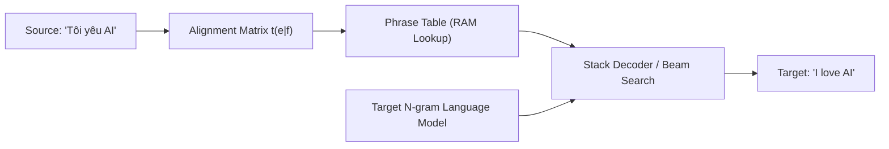

#### d. Code Thực chiến (C++ & Python)

```cpp
// C++17: Tính toán BLEU-1 và Brevity Penalty cơ bản
#include <iostream>
#include <vector>
#include <string>
#include <unordered_map>
#include <cmath>
#include <algorithm>

float compute_bleu1(const std::vector<std::string>& candidate, 
                    const std::vector<std::string>& reference) {
    std::unordered_map<std::string, int> ref_counts;
    for (const auto& w : reference) ref_counts[w]++;

    std::unordered_map<std::string, int> cand_counts;
    for (const auto& w : candidate) cand_counts[w]++;

    int clipped_matches = 0;
    for (const auto& [w, count] : cand_counts) {
        if (ref_counts.count(w)) {
            clipped_matches += std::min(count, ref_counts[w]);
        }
    }

    if (candidate.empty()) return 0.0f;
    float precision = static_cast<float>(clipped_matches) / candidate.size();

    // Brevity Penalty
    float bp = 1.0f;
    if (candidate.size() < reference.size()) {
        bp = std::exp(1.0f - static_cast<float>(reference.size()) / candidate.size());
    }
    return bp * precision;
}

int main() {
    std::vector<std::string> cand = {"the", "cat", "sat", "on", "mat"};
    std::vector<std::string> ref = {"the", "cat", "sat", "on", "the", "mat"};
    std::cout << "BLEU-1 Score: " << compute_bleu1(cand, ref) * 100.0f << "%\n";
    return 0;
}
```

```python
# Python: Đánh giá BLEU và chrF với SacreBLEU
import sacrebleu

candidate_translations = ["Tôi rất thích nghiên cứu trí tuệ nhân tạo."]
reference_translations = [["Tôi thực sự yêu thích nghiên cứu trí tuệ nhân tạo."]]

bleu = sacrebleu.corpus_bleu(candidate_translations, reference_translations)
chrf = sacrebleu.corpus_chrf(candidate_translations, reference_translations)

print(f"BLEU score: {bleu.score:.2f}")
print(f"chrF2 score: {chrf.score:.2f}")
```

#### e. Lỗi Thường gặp & Ổn định Số học
- **BLEU Gaming**: Mô hình có thể tối ưu hóa điểm BLEU cao bằng cách lặp lại các n-gram phổ biến nhưng sinh ra câu tối nghĩa hoặc sai logic thực tế.

#### f. Ứng dụng Thực chiến trong AI
Dịch phụ đề video thời gian thực, bản địa hóa phần mềm và thương mại điện tử xuyên biên giới.

---

### 2. Neural Machine Translation - NMT (Dịch máy Nơ-ron)

#### a. Định nghĩa Bản chất Toán học
NMT mô hình hóa toàn bộ quá trình dịch bằng một mạng nơ-ron duy nhất học từ đầu đến cuối (End-to-End Deep Learning):
$$P(\mathbf{y} \mid \mathbf{x}) = \prod_{t=1}^T P(y_t \mid y_{<t}, \mathbf{x}; \theta)$$
Trong kiến trúc Transformer Chuẩn (Vaswani et al., 2017), quá trình này bao gồm:
1. **Encoder**: Ánh xạ $\mathbf{x}$ thành chuỗi biểu diễn ngữ cảnh $\mathbf{H} = (\mathbf{h}_1, \dots, \mathbf{h}_S) \in \mathbb{R}^{S \times d}$.
2. **Decoder**: Sinh từng token đích thông qua Masked Causal Self-Attention kết hợp với **Cross-Attention** qua $\mathbf{H}$:
   $$\text{CrossAttn}(\mathbf{Q}, \mathbf{K}, \mathbf{V}) = \text{Softmax}\left( \frac{\mathbf{Q}\mathbf{K}^T}{\sqrt{d_k}} \right)\mathbf{V}$$
   với $\mathbf{Q} = \mathbf{H}_{\text{dec}}\mathbf{W}_Q$, $\mathbf{K} = \mathbf{H}\mathbf{W}_K$, $\mathbf{V} = \mathbf{H}\mathbf{W}_V$.

#### b. Cơ chế Tầng Sâu & Điện toán
- **Cross-Attention Memory Bandwidth**: Tại mỗi bước giải mã $t$ của Decoder, ma trận Keys ($\mathbf{K}$) và Values ($\mathbf{V}$) từ Encoder có kích thước $S \times d$ phải được đọc liên tục từ bộ nhớ GPU. Do $\mathbf{K}, \mathbf{V}$ của Encoder là cố định trong suốt quá trình sinh câu đích, chúng chỉ cần tính đúng 1 lần (Single-pass Encoder Forward) và lưu trữ trong bộ nhớ tạm để tái sử dụng.
- **Label Smoothing**: Khi tính mất mát Cross-Entropy, gán nhãn cứng (one-hot) khiến mô hình trở nên quá tự tin (overconfident) và giảm tính khái quát hóa. Áp dụng Label Smoothing với hệ số $\epsilon = 0.1$:
  $$y_k^{\text{smooth}} = (1 - \epsilon) y_k + \frac{\epsilon}{|\mathcal{V}|}$$

#### c. Sơ đồ Minh họa (Mermaid Diagram)
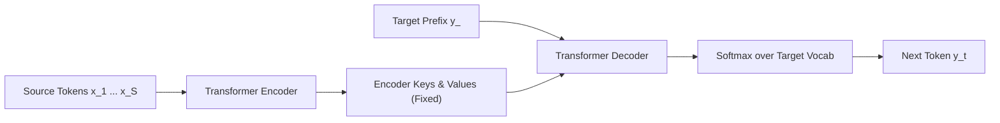

#### d. Code Thực chiến (C++ & Python)

```cpp
// C++17: Cross-Attention Softmax Weight Computation
#include <iostream>
#include <vector>
#include <cmath>

std::vector<float> compute_cross_attention_weights(const std::vector<float>& query, 
                                                   const std::vector<std::vector<float>>& keys, 
                                                   float scale) {
    size_t S = keys.size();
    size_t D = query.size();
    std::vector<float> scores(S, 0.0f);
    float max_s = -1e9f;

    for (size_t i = 0; i < S; ++i) {
        float dot = 0.0f;
        for (size_t d = 0; d < D; ++d) dot += query[d] * keys[i][d];
        scores[i] = dot * scale;
        if (scores[i] > max_s) max_s = scores[i];
    }

    float sum_exp = 0.0f;
    for (size_t i = 0; i < S; ++i) {
        scores[i] = std::exp(scores[i] - max_s);
        sum_exp += scores[i];
    }
    for (float& s : scores) s /= sum_exp;
    return scores;
}

int main() {
    std::vector<float> q = {1.0f, 0.0f};
    std::vector<std::vector<float>> k = {{0.9f, 0.1f}, {0.1f, 0.9f}};
    auto weights = compute_cross_attention_weights(q, k, 1.0f / std::sqrt(2.0f));
    std::cout << "Cross-Attention weight on Source 0: " << weights[0] << "\n";
    return 0;
}
```

```python
# Python / PyTorch: Label Smoothing Cross-Entropy Loss cho NMT
import torch
import torch.nn as nn
import torch.nn.functional as F

class LabelSmoothingLoss(nn.Module):
    def __init__(self, vocab_size: int, epsilon: float = 0.1, ignore_index: int = -100):
        super().__init__()
        self.vocab_size = vocab_size
        self.epsilon = epsilon
        self.ignore_index = ignore_index

    def forward(self, logits: torch.Tensor, targets: torch.Tensor) -> torch.Tensor:
        # logits: [Batch * Seq_Len, Vocab_Size], targets: [Batch * Seq_Len]
        log_probs = F.log_softmax(logits, dim=-1)
        smooth_loss = -log_probs.mean(dim=-1)
        nll_loss = F.nll_loss(log_probs, targets, ignore_index=self.ignore_index, reduction='none')
        loss = (1.0 - self.epsilon) * nll_loss + self.epsilon * smooth_loss
        return loss.mean()

criterion = LabelSmoothingLoss(vocab_size=1000, epsilon=0.1)
mock_logits = torch.randn(8, 1000)
mock_targets = torch.randint(0, 1000, (8,))
print("NMT Label Smoothing Loss:", criterion(mock_logits, mock_targets).item())
```

#### e. Lỗi Thường gặp & Ổn định Số học
- **Hallucinatory Translation under Perturbation**: Khi câu đầu vào chứa một lỗi chính tả nhỏ hoặc một từ chưa gặp, mô hình NMT có thể sinh ra một đoạn văn hoàn toàn xa lạ không dính dáng gì tới bản gốc (Off-target Hallucination).

#### f. Ứng dụng Thực chiến trong AI
Google Translate, DeepL, Meta NLLB (No Language Left Behind dịch trực tiếp giữa 200+ ngôn ngữ).

---

### 3. Cross-Lingual Transfer (Truyền tri thức Liên ngôn ngữ)

#### a. Định nghĩa Bản chất Toán học
Cross-Lingual Transfer là phương pháp huấn luyện mô hình trên ngôn ngữ giàu tài nguyên $\mathcal{L}_{\text{source}}$ (như tiếng Anh) và áp dụng trực tiếp (Zero-Shot) hoặc tinh chỉnh nhẹ (Few-Shot) lên ngôn ngữ đích $\mathcal{L}_{\text{target}}$ mà không cần dữ liệu nhãn tương đương:
$$\theta^* = \arg\max_\theta \mathbb{E}_{(\mathbf{x}, y) \sim \mathcal{D}_{\mathcal{L}_S}} [\log P(y \mid \mathbf{x}; \theta)] \implies \text{Evaluate on } (\mathbf{x}', y') \sim \mathcal{D}_{\mathcal{L}_T}$$
Điều kiện tiên quyết là không gian biểu diễn ẩn của hai ngôn ngữ phải được gióng hàng đẳng cấu (Isomorphic Semantic Alignment):
$$\|\mathbf{e}(\mathbf{x}_{\mathcal{L}_S}) - \mathbf{e}(\mathbf{x}_{\mathcal{L}_T})\|_2 \approx 0 \quad (\text{khi } \mathbf{x}_{\mathcal{L}_S} \text{ tương đương nghĩa với } \mathbf{x}_{\mathcal{L}_T})$$

#### b. Cơ chế Tầng Sâu & Điện toán
- **Shared Subword Vocabulary**: Sử dụng từ vựng chung (Shared BPE Vocabulary với kích thước lớn, ví dụ 250,000 token trong mBERT và XLM-RoBERTa). Điều này cho phép các từ gốc chung, tên riêng và các hình thái tố tương tự được gắn kết ngay từ tầng embedding đầu vào.
- **Multilingual Masked Language Modeling (MLM) & Translation Language Modeling (TLM)**: TLM mở rộng MLM bằng cách ghép cặp hai câu song ngữ: `[CLS] English [SEP] Vietnamese [SEP]` và ngẫu nhiên che token ở cả hai bên, buộc attention heads phải học gióng hàng chéo ngôn ngữ.

#### c. Sơ đồ Minh họa (Mermaid Diagram)
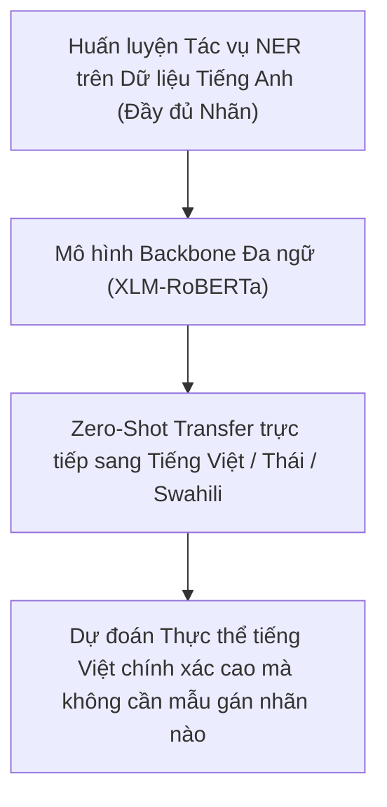

#### d. Code Thực chiến (C++ & Python)

```cpp
// C++17: Kiểm tra độ lệch chuẩn phân phối Embedding giữa hai ngôn ngữ
#include <iostream>
#include <vector>
#include <cmath>

float compute_alignment_distance(const std::vector<float>& emb_en, const std::vector<float>& emb_vi) {
    float dist = 0.0f;
    for (size_t i = 0; i < emb_en.size(); ++i) {
        float diff = emb_en[i] - emb_vi[i];
        dist += diff * diff;
    }
    return std::sqrt(dist);
}

int main() {
    std::vector<float> en = {0.8f, -0.2f, 0.5f};
    std::vector<float> vi = {0.78f, -0.19f, 0.49f};
    std::cout << "Euclidean Alignment Distance: " << compute_alignment_distance(en, vi) << "\n";
    return 0;
}
```

```python
# Python / PyTorch: Translation Language Modeling (TLM) Input Formatting
import torch

def create_tlm_pair(en_tokens: list[int], vi_tokens: list[int], 
                    cls_id=1, sep_id=2, pad_id=0):
    # Ghép chuỗi song ngữ: [CLS] En_Tokens [SEP] Vi_Tokens [SEP]
    input_ids = [cls_id] + en_tokens + [sep_id] + vi_tokens + [sep_id]
    # Language IDs: 0 cho En, 1 cho Vi
    lang_ids = [0] * (len(en_tokens) + 2) + [1] * (len(vi_tokens) + 1)
    return torch.tensor(input_ids), torch.tensor(lang_ids)

en_mock = [101, 204, 305]
vi_mock = [882, 991]
inputs, langs = create_tlm_pair(en_mock, vi_mock)
print("TLM Input IDs:", inputs)
print("Language IDs:", langs)
```

#### e. Lỗi Thường gặp & Ổn định Số học
- **Negative Transfer**: Khi ngôn ngữ nguồn và ngôn ngữ đích có sự khác biệt quá lớn về trật tự từ (Typology: SVO như tiếng Anh vs SOV như tiếng Nhật hoặc VSO như tiếng Ả Rập), việc truyền tri thức trực tiếp có thể gây suy giảm hiệu năng so với huấn luyện từ đầu.

#### f. Ứng dụng Thực chiến trong AI
Phát triển ứng dụng NLU toàn cầu cho các tập đoàn đa quốc gia chỉ bằng cách gán nhãn tập dữ liệu tiếng Anh duy nhất.

---

### 4. Multilingual NLP (Xử lý Ngôn ngữ Tự nhiên Đa ngữ)

#### a. Định nghĩa Bản chất Toán học
Multilingual NLP xây dựng các mô hình duy nhất có khả năng thấu hiểu và sinh văn bản cho hàng chục hoặc hàng trăm ngôn ngữ khác nhau:
$$\mathcal{M}: \bigcup_{i=1}^M \mathcal{L}_i \to \mathbb{R}^d \to \bigcup_{j=1}^M \mathcal{L}_j$$
Hiện tượng trung tâm trong mô hình đa ngữ là **Lời nguyền Đa ngữ (Curse of Multilinguality)**: Với dung lượng tham số cố định $C$, khi số lượng ngôn ngữ $M$ tăng lên, hiệu năng trên từng ngôn ngữ riêng lẻ sẽ tăng ban đầu (nhờ chia sẻ tri thức) nhưng sau đó suy giảm nghiêm trọng do tranh chấp dung lượng (Capacity Dilution):
$$\text{Performance}(\mathcal{L}_i) \propto \frac{C}{M} + \text{Transfer}(\mathcal{L}_{\neq i} \to \mathcal{L}_i)$$

#### b. Cơ chế Tầng Sâu & Điện toán
- **MoE (Mixture of Experts) for Multilingual Scaling**: Để vượt qua lời nguyền đa ngữ, các kiến trúc như Google Switch Transformer hay NLLB MoE tăng số lượng tham số lên hàng trăm tỷ nhưng giữ chi phí tính toán cố định bằng cách định tuyến các ngôn ngữ khác nhau vào các tầng FFN chuyên biệt (Language-specific Experts).

#### c. Sơ đồ Minh họa (Mermaid Diagram)
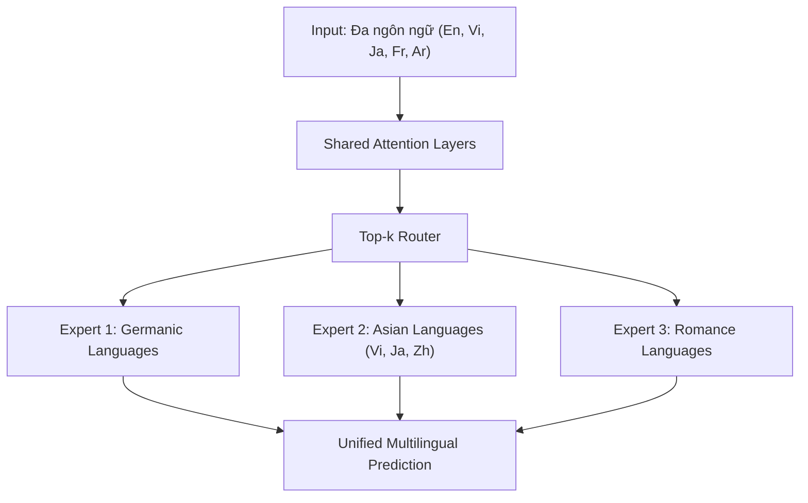

#### d. Code Thực chiến (C++ & Python)

```cpp
// C++17: Phân bố dung lượng từ vựng đa ngữ theo hàm mũ (Exponential Temperature Sampling)
#include <iostream>
#include <vector>
#include <cmath>
#include <numeric>

std::vector<float> compute_multilingual_sampling_probs(const std::vector<float>& corpus_sizes, float alpha = 0.3f) {
    std::vector<float> scaled_probs(corpus_sizes.size());
    float sum_p = 0.0f;
    for (size_t i = 0; i < corpus_sizes.size(); ++i) {
        scaled_probs[i] = std::pow(corpus_sizes[i], alpha);
        sum_p += scaled_probs[i];
    }
    for (float& p : scaled_probs) p /= sum_p;
    return scaled_probs;
}

int main() {
    std::vector<float> sizes = {1000.0f, 100.0f, 10.0f}; // En: 1000GB, Vi: 100GB, Lao: 10GB
    auto probs = compute_multilingual_sampling_probs(sizes, 0.3f);
    std::cout << "Smoothed Multilingual Sampling Proportions: ";
    for (float p : probs) std::cout << p * 100.0f << "% ";
    std::cout << "\n";
    return 0;
}
```

```python
# Python / PyTorch: Mixture-of-Experts Router cơ bản cho Đa ngữ
import torch
import torch.nn as nn
import torch.nn.functional as F

class SimpleMoERouter(nn.Module):
    def __init__(self, hidden_dim: int, num_experts: int, top_k: int = 1):
        super().__init__()
        self.router_weights = nn.Linear(hidden_dim, num_experts)
        self.top_k = top_k

    def forward(self, x: torch.Tensor):
        # x: [Batch, Hidden_Dim]
        logits = self.router_weights(x)
        weights, indices = torch.topk(F.softmax(logits, dim=-1), self.top_k, dim=-1)
        return weights, indices

router = SimpleMoERouter(hidden_dim=128, num_experts=4, top_k=2)
x = torch.randn(2, 128)
weights, indices = router(x)
print("Router Selected Expert Indices:", indices)
print("Router Expert Weights:", weights)
```

#### e. Lỗi Thường gặp & Ổn định Số học
- **Tokenization Unfairness (Sự bất công trong Tokenizer)**: Cùng một đoạn văn mang cùng lượng thông tin, tiếng Anh chỉ tốn 10 tokens trong khi tiếng Việt, tiếng Miến Điện tốn tới 40-50 tokens do tập từ vựng bị áp đảo bởi dữ liệu tiếng Anh, làm chi phí inference và độ trễ tăng gấp nhiều lần.

#### f. Ứng dụng Thực chiến trong AI
Nền tảng của các mô hình nền tảng toàn cầu (Global LLMs: GPT-4o, Claude 3.5, Gemini 1.5 Pro).

---

### 5. Low-Resource NLP (NLP cho Ngôn ngữ Nghèo Tài nguyên)

#### a. Định nghĩa Bản chất Toán học
Low-Resource NLP giải quyết thách thức khi kích thước ngữ liệu có nhãn $\mathcal{D}_{\text{labeled}}$ hoặc thậm chí không nhãn $\mathcal{D}_{\text{unlabeled}}$ cực kỳ nhỏ ($|\mathcal{D}| \ll 10^4$ câu).
Ba kỹ thuật cốt lõi:
1. **Back-Translation**: Tận dụng ngữ liệu đơn ngữ (Monolingual Data) của ngôn ngữ đích $\mathcal{L}_T$:
   $$\mathbf{y} \in \mathcal{D}_T \xrightarrow{\mathcal{M}_{T \to S}} \hat{\mathbf{x}} \implies (\hat{\mathbf{x}}, \mathbf{y}) \text{ trở thành dữ liệu song ngữ tổng hợp}$$
2. **Pivot Translation**: Dịch qua một ngôn ngữ trung gian phong phú (như tiếng Anh):
   $$\mathcal{L}_A \xrightarrow{\mathcal{M}_{A \to P}} \mathcal{L}_{\text{Pivot}} \xrightarrow{\mathcal{M}_{P \to B}} \mathcal{L}_B$$
3. **Cross-Lingual Meta-Learning**.

#### b. Cơ chế Tầng Sâu & Điện toán
- **Iterative Back-Translation Loop**: Quá trình tạo dữ liệu tổng hợp quy mô lớn trên cluster GPU. Để tránh việc mô hình học theo lỗi sai của bản dịch ngược, kỹ thuật *Beam Search Decoding* và lọc chất lượng qua mô hình ngôn ngữ (Dual Conditional Cross-Entropy Filtering) được tích hợp trong pipeline nạp dữ liệu.

#### c. Sơ đồ Minh họa (Mermaid Diagram)
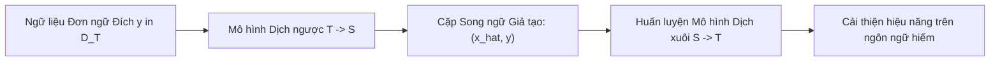

#### d. Code Thực chiến (C++ & Python)

```cpp
// C++17: Lọc câu song ngữ dựa trên tỷ lệ độ dài (Length Ratio Filtering)
#include <iostream>
#include <string>
#include <cmath>

bool is_valid_parallel_pair(size_t src_len, size_t tgt_len, float max_ratio = 2.0f) {
    if (src_len == 0 || tgt_len == 0) return false;
    float ratio = static_cast<float>(src_len) / tgt_len;
    return (ratio >= 1.0f / max_ratio) && (ratio <= max_ratio);
}

int main() {
    std::cout << "Pair (10, 15) valid? " << std::boolalpha << is_valid_parallel_pair(10, 15) << "\n";
    std::cout << "Pair (10, 50) valid? " << std::boolalpha << is_valid_parallel_pair(10, 50) << "\n";
    return 0;
}
```

```python
# Python: Mô phỏng Back-Translation Pipeline
def back_translate_augmentation(monolingual_target_sentences: list[str]) -> list[tuple[str, str]]:
    augmented_data = []
    for tgt in monolingual_target_sentences:
        # Giả lập mô hình dịch ngược Target -> Source
        pseudo_source = f"[Translated_to_Source]: {tgt}"
        augmented_data.append((pseudo_source, tgt))
    return augmented_data

mono_vi = ["Mô hình xử lý ngôn ngữ tự nhiên", "Trí tuệ nhân tạo phát triển nhanh"]
parallel_synth = back_translate_augmentation(mono_vi)
for src, tgt in parallel_synth:
    print(f"Synth Pair: ({src}) <=> ({tgt})")
```

#### e. Lỗi Thường gặp & Ổn định Số học
- **Error Propagation in Back-Translation**: Nếu mô hình dịch ngược ban đầu quá yếu, dữ liệu giả mạo sinh ra sẽ tràn ngập rác ngữ pháp, khiến mô hình dịch xuôi học sai lệch nghiêm trọng.

#### f. Ứng dụng Thực chiến trong AI
Bảo tồn các ngôn ngữ bản địa thiểu số, hỗ trợ y tế và cứu trợ nhân đạo tại các khu vực khó khăn thông qua rào cản ngôn ngữ.

---

### 6. Dialogue Systems (Hệ thống Hội thoại Tổng quan)

#### a. Định nghĩa Bản chất Toán học
Hệ thống hội thoại mô hình hóa chuỗi tương tác ngôn ngữ qua nhiều lượt (Multi-turn Conversation) giữa Người dùng ($U$) và Hệ thống ($S$):
$$S_t = f(U_t, H_{<t}, \mathcal{K})$$
với $H_{<t} = (U_1, S_1, \dots, U_{t-1}, S_{t-1})$ là lịch sử hội thoại và $\mathcal{K}$ là nguồn tri thức bên ngoài.
Phân loại thành hai nhánh lớn:
1. **Task-Oriented Dialogue (TOD)**: Giúp người dùng hoàn thành một nhiệm vụ cụ thể trong không gian trạng thái hữu hạn (e.g. đặt phòng, kiểm tra số dư).
2. **Open-Domain Dialogue (Chatbot)**: Tán ngẫu tự do, tối đa hóa thời gian tương tác và mức độ gắn kết cảm xúc của người dùng.

#### b. Cơ chế Tầng Sâu & Điện toán
- **Context Window Management**: Trong hội thoại dài nhiều chục lượt, độ dài $H_{<t}$ vượt quá giới hạn Context Length của Transformer hoặc tiêu tốn quá nhiều GPU VRAM cho KV Cache. Cần áp dụng kỹ thuật **Rolling Buffer with Summarization**: Tóm tắt các lượt hội thoại cũ thành 1 đoạn văn ngắn và chỉ giữ lại nguyên văn 3-5 lượt tương tác gần nhất.

#### c. Sơ đồ Minh họa (Mermaid Diagram)
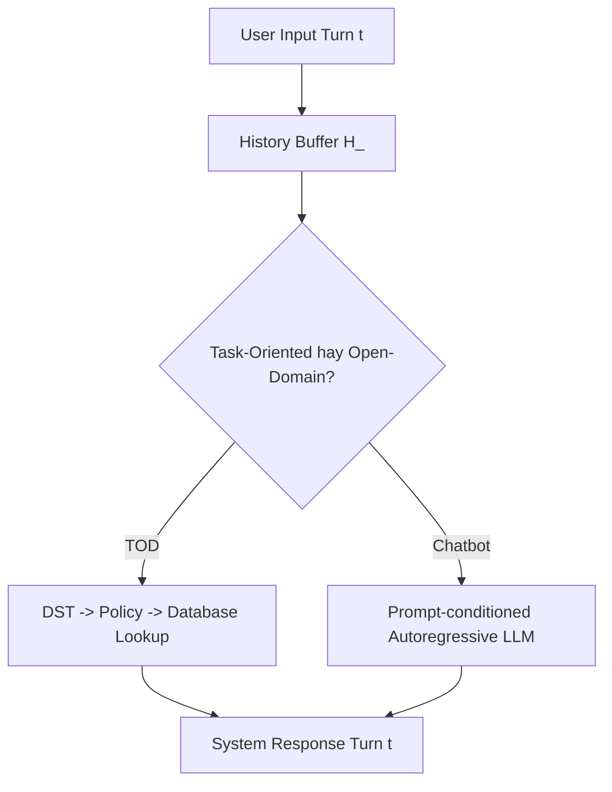

#### d. Code Thực chiến (C++ & Python)

```cpp
// C++17: Quản lý Bộ đệm Lịch sử Hội thoại có Giới hạn Lượt (Sliding Window Dialogue Buffer)
#include <iostream>
#include <deque>
#include <string>

struct DialogueTurn {
    std::string role; // "user" hoặc "assistant"
    std::string content;
};

class DialogueHistoryManager {
private:
    size_t max_turns_;
    std::deque<DialogueTurn> history_;
public:
    explicit DialogueHistoryManager(size_t max_turns) : max_turns_(max_turns) {}

    void add_turn(const std::string& role, const std::string& content) {
        if (history_.size() >= max_turns_) {
            history_.pop_front();
        }
        history_.push_back({role, content});
    }

    void display() const {
        for (const auto& turn : history_) {
            std::cout << "[" << turn.role << "]: " << turn.content << "\n";
        }
    }
};

int main() {
    DialogueHistoryManager dm(3);
    dm.add_turn("user", "Hello");
    dm.add_turn("assistant", "Hi there!");
    dm.add_turn("user", "What's the weather?");
    dm.add_turn("assistant", "It's sunny."); // Sẽ đẩy "Hello" ra ngoài
    dm.display();
    return 0;
}
```

```python
# Python: Prompt Template Formatting cho Hội thoại Nhiều lượt
def format_chat_prompt(messages: list[dict[str, str]]) -> str:
    # Chuẩn ChatML format (<|im_start|> ... <|im_end|>)
    formatted = ""
    for msg in messages:
        formatted += f"<|im_start|>{msg['role']}\n{msg['content']}<|im_end|>\n"
    formatted += "<|im_start|>assistant\n"
    return formatted

chat_history = [
    {"role": "system", "content": "You are a helpful AI assistant."},
    {"role": "user", "content": "Book me a table for two tonight."}
]
print("Formatted Prompt for LLM:\n" + format_chat_prompt(chat_history))
```

#### e. Lỗi Thường gặp & Ổn định Số học
- **Consistency Degradation (Mất nhất quán tính cách)**: Hệ thống trả lời mâu thuẫn với chính mình giữa các lượt hội thoại cách nhau (e.g. lượt 1 bảo *"Tôi là người ăn chay"*, lượt 10 lại bảo *"Món ăn yêu thích của tôi là bít tết bò"*).

#### f. Ứng dụng Thực chiến trong AI
Các trợ lý tổng đài Contact Center tự động hóa, nhân vật NPC thông minh trong game AAA và các nền tảng đàm thoại cá nhân hóa.

---

### 7. Conversational AI (Trí tuệ Nhân tạo Đàm thoại)

#### a. Định nghĩa Bản chất Toán học
Conversational AI là khái niệm bao quát việc xây dựng các Agent trí tuệ nhân tạo có khả năng giao tiếp tự nhiên hai chiều với con người bằng giọng nói và chữ viết. Về bản chất, nó là sự kết hợp của:
1. **Lý thuyết Quyết định Markov (MDP)**: Tối ưu hóa chuỗi hành động phản hồi để đạt phần thưởng dài hạn:
   $$\max_\pi \mathbb{E} \left[ \sum_{t=0}^\infty \gamma^t R(s_t, a_t) \right]$$
2. **Học Tăng cường từ Phản hồi Con người (RLHF)**: Tối ưu hóa chính sách sinh văn bản $\pi_\theta$ bằng thuật toán PPO / DPO dựa trên mô hình thưởng (Reward Model):
   $$\max_\theta \mathbb{E}_{(x, y) \sim \mathcal{D}} [r(x, y)] - \beta D_{KL}(\pi_\theta(y \mid x) \parallel \pi_{\text{ref}}(y \mid x))$$

#### b. Cơ chế Tầng Sâu & Điện toán
- **Tool Use & Function Calling**: Trong Conversational AI hiện đại, Agent không chỉ sinh text đơn thuần mà còn sinh ra các lệnh gọi hàm JSON có cấu trúc (`{"name": "check_flight", "arguments": {...}}`). Môi trường thực thi hàm (Function Execution Engine) trả về kết quả qua chu kỳ tương tác ReAct (Reason + Act).

#### c. Sơ đồ Minh họa (Mermaid Diagram)
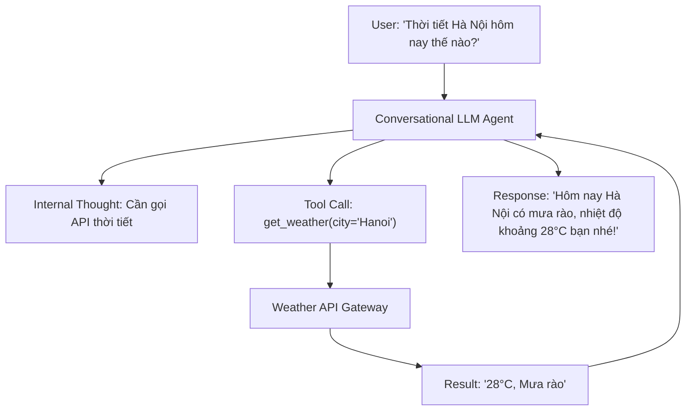

#### d. Code Thực chiến (C++ & Python)

```cpp
// C++17: JSON Tool Call Dispatcher cơ bản cho Conversational Agent
#include <iostream>
#include <string>
#include <unordered_map>
#include <functional>

class AgentToolDispatcher {
private:
    std::unordered_map<std::string, std::function<std::string(const std::string&)>> tools_;
public:
    void register_tool(const std::string& name, std::function<std::string(const std::string&)> func) {
        tools_[name] = func;
    }

    std::string execute_tool(const std::string& tool_name, const std::string& param) {
        if (tools_.count(tool_name)) {
            return tools_[tool_name](param);
        }
        return "Error: Tool not found";
    }
};

int main() {
    AgentToolDispatcher dispatcher;
    dispatcher.register_tool("get_weather", [](const std::string& city) {
        return "28C, Rainy in " + city;
    });

    std::cout << "Executed Tool Result: " 
              << dispatcher.execute_tool("get_weather", "Hanoi") << "\n";
    return 0;
}
```

```python
# Python: ReAct Agent Parsing Loop
import json

def parse_agent_action(llm_output: str) -> tuple[str, dict]:
    # Tìm kiếm cấu trúc Tool Call dạng JSON
    try:
        if "```json" in llm_output:
            json_str = llm_output.split("```json")[1].split("```")[0].strip()
            action_dict = json.loads(json_str)
            return action_dict.get("tool"), action_dict.get("params", {})
    except Exception as e:
        pass
    return "final_answer", {"text": llm_output}

mock_response = """
Tôi cần kiểm tra cơ sở dữ liệu.
```json
{
  "tool": "query_database",
  "params": {"user_id": 42}
}
```
"""
tool, params = parse_agent_action(mock_response)
print("Parsed Action:", tool, "| Params:", params)
```

#### e. Lỗi Thường gặp & Ổn định Số học
- **Infinite Tool Calling Loop**: Khi tool trả về lỗi hoặc dữ liệu trống, Agent liên tục gọi lại tool đó vô hạn lần, làm cạn kiệt API token và ngân sách tính toán. Cần đặt biến đếm `max_iterations`.

#### f. Ứng dụng Thực chiến trong AI
Trợ lý trí tuệ nhân tạo thế hệ mới (ChatGPT Plus với GPTs, Gemini Advanced, Copilot Studio).

---

### 8. Dialogue State Tracking - DST (Theo dõi Trạng thái Hội thoại)

#### a. Định nghĩa Bản chất Toán học
DST có nhiệm vụ ước lượng trạng thái niềm tin (Belief State - $\mathcal{B}_t$) của hệ thống tại mỗi lượt hội thoại $t$. Trạng thái niềm tin là một tập hợp các cặp Khe - Giá trị (Slot-Value pairs) ghi nhận các yêu cầu và ràng buộc mà người dùng đã thiết lập xuyên suốt cuộc trò chuyện:
$$\mathcal{B}_t = \{(s, v) \mid s \in \mathcal{S}, v \in \mathcal{V}_s\}$$
Xác suất phân phối trên các giá trị khả dĩ của khe $s$:
$$P(v \mid H_{\le t}) = \text{Softmax}\left( \text{Score}(s, v, H_{\le t}) \right)$$
Tập dữ liệu chuẩn mực để đánh giá: **MultiWOZ (Multi-Domain Wizard-of-Oz)** với thước đo Joint Goal Accuracy (JGA - chỉ tính đúng khi TẤT CẢ các slots trong lượt đều chính xác 100%).

#### b. Cơ chế Tầng Sâu & Điện toán
- **Open-Vocabulary DST (Generative DST)**: Thay vì phân loại trên một tập giá trị đóng giới hạn trước (Fixed Ontology) đòi hỏi bộ nhớ khổng lồ, các mô hình SOTA (như TripPy, SimpleTOD) sinh trực tiếp giá trị khe từ văn bản hoặc copy từ ngữ cảnh, giảm không gian tìm kiếm và hỗ trợ các giá trị mới (Out-of-Ontology values).

#### c. Sơ đồ Minh họa (Mermaid Diagram)
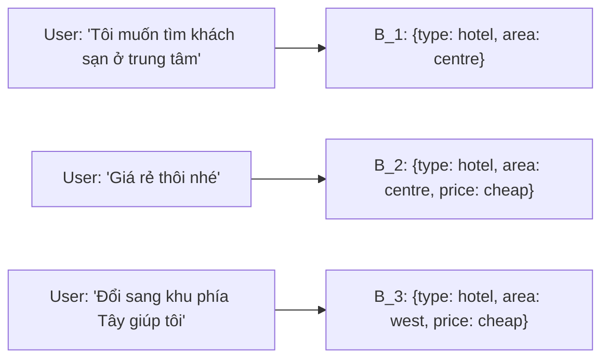

#### d. Code Thực chiến (C++ & Python)

```cpp
// C++17: Cấu trúc Trạng thái Niềm tin (Belief State) cập nhật qua các lượt
#include <iostream>
#include <string>
#include <unordered_map>

class DialogueBeliefState {
private:
    std::unordered_map<std::string, std::string> slots_;
public:
    void update_slot(const std::string& slot, const std::string& value) {
        if (value == "dontcare" || value == "none") {
            slots_.erase(slot);
        } else {
            slots_[slot] = value;
        }
    }

    void print_state() const {
        std::cout << "Current Belief State:\n";
        for (const auto& [s, v] : slots_) {
            std::cout << "  [" << s << "] = '" << v << "'\n";
        }
    }
};

int main() {
    DialogueBeliefState dbs;
    dbs.update_slot("hotel-area", "centre");
    dbs.update_slot("hotel-pricerange", "cheap");
    dbs.update_slot("hotel-area", "west"); // Cập nhật ghi đè
    dbs.print_state();
    return 0;
}
```

```python
# Python: Đánh giá Joint Goal Accuracy (JGA) cho DST
def compute_joint_goal_accuracy(ground_truth_states: list[dict], predicted_states: list[dict]) -> float:
    correct_turns = 0
    total_turns = len(ground_truth_states)

    for gt, pred in zip(ground_truth_states, predicted_states):
        # Khớp tuyệt đối mọi key-value pair
        if gt == pred:
            correct_turns += 1
    return correct_turns / total_turns if total_turns > 0 else 0.0

gt = [{"hotel-area": "centre", "hotel-stars": "3"}, {"food": "vietnamese"}]
pred = [{"hotel-area": "centre", "hotel-stars": "3"}, {"food": "thai"}] # Sai turn 2
print(f"Joint Goal Accuracy: {compute_joint_goal_accuracy(gt, pred) * 100:.1f}%")
```

#### e. Lỗi Thường gặp & Ổn định Số học
- **State Cascading Error**: Một khe bị gán giá trị sai ở lượt 1 sẽ tiếp tục tồn tại dai dẳng trong Belief State suốt các lượt 2, 3, 4, kéo tụt nghiêm trọng điểm JGA của toàn bộ phiên hội thoại.

#### f. Ứng dụng Thực chiến trong AI
Xây dựng bot đặt vé máy bay, đặt phòng khách sạn, giao dịch ngân hàng và quản lý đơn hàng thương mại điện tử.

---

### 9. Dialogue Management - DM (Quản lý Hội thoại)

#### a. Định nghĩa Bản chất Toán học
Dialogue Management là "bộ não" điều hành của hệ thống hội thoại hướng tác vụ. Tại mỗi thời điểm $t$, DM tiếp nhận Trạng thái Niềm tin $\mathcal{B}_t$ và kết quả truy vấn cơ sở dữ liệu $\mathcal{K}_t$, sau đó quyết định Hành động Tiếp theo của Hệ thống (System Action - $a_t$):
$$a_t = \pi(\mathcal{B}_t, \mathcal{K}_t)$$
Hành động $a_t$ có thể là:
- `Request(slot)`: Yêu cầu người dùng cung cấp thêm thông tin còn thiếu.
- `Confirm(slot, value)`: Xác nhận lại thông tin quan trọng.
- `Offer(entity)`: Đưa ra lựa chọn phù hợp từ cơ sở dữ liệu.
- `Inform(slot, value)`: Cung cấp thông tin chi tiết.
Chính sách $\pi$ được tối ưu hóa bằng Học Tăng Cường (Reinforcement Learning) để cực tiểu hóa số lượt tương tác cần thiết nhằm hoàn thành tác vụ.

#### b. Cơ chế Tầng Sâu & Điện toán
- **POMDP (Partially Observable Markov Decision Process)**: Do kết quả NLU và DST luôn có xác suất sai số, trạng thái môi trường chỉ được quan sát một phần. DM mô hình hóa không gian dưới dạng POMDP và sử dụng mạng DQN (Deep Q-Network) hoặc Policy Gradient (PPO) để đưa ra hành động tối ưu trong điều kiện bất định.

#### c. Sơ đồ Minh họa (Mermaid Diagram)
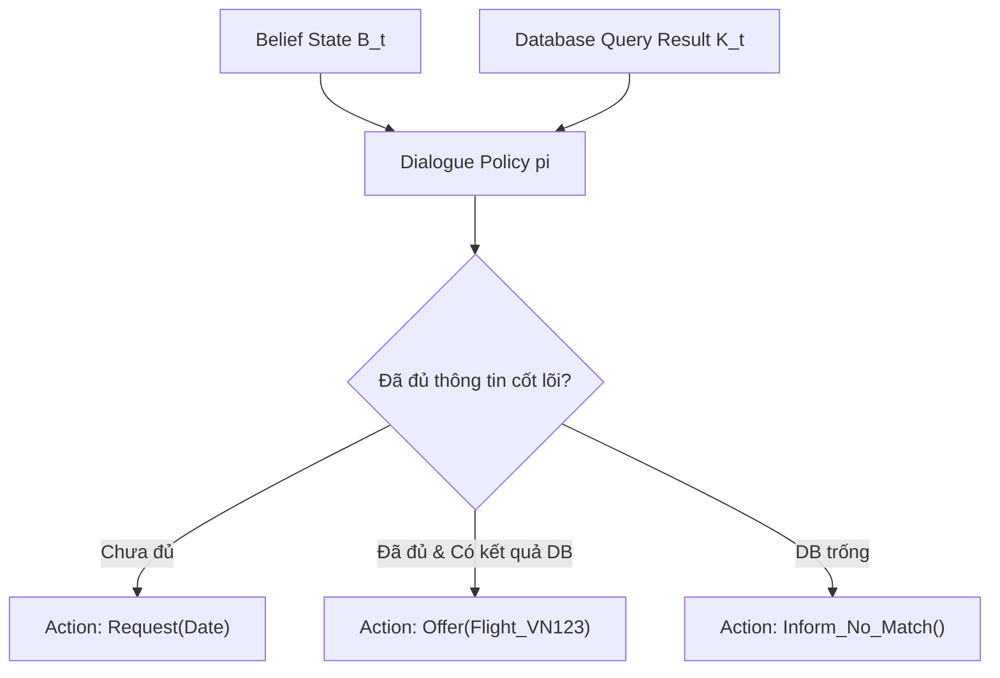

#### d. Code Thực chiến (C++ & Python)

```cpp
// C++17: Rule-based Dialogue Policy State Machine
#include <iostream>
#include <string>
#include <unordered_map>

class RuleBasedPolicy {
public:
    std::string select_action(const std::unordered_map<std::string, std::string>& state, int db_matches) {
        if (!state.count("destination")) {
            return "Request(destination)";
        }
        if (!state.count("date")) {
            return "Request(date)";
        }
        if (db_matches == 0) {
            return "Inform(no_flights_found)";
        }
        return "Offer(flight_recommendation)";
    }
};

int main() {
    RuleBasedPolicy policy;
    std::unordered_map<std::string, std::string> current_state = {{"destination", "Da Nang"}};
    std::cout << "System Action: " << policy.select_action(current_state, 5) << "\n";
    return 0;
}
```

```python
# Python / PyTorch: Q-Learning Policy Network cho Dialogue Management
import torch
import torch.nn as nn

class DialoguePolicyQNetwork(nn.Module):
    def __init__(self, state_dim: int, num_actions: int):
        super().__init__()
        self.net = nn.Sequential(
            nn.Linear(state_dim, 64),
            nn.ReLU(),
            nn.Linear(64, num_actions)
        )

    def forward(self, state_vector: torch.Tensor) -> torch.Tensor:
        # Trả về giá trị Q(s, a) cho tất cả hành động khả dĩ
        return self.net(state_vector)

policy = DialoguePolicyQNetwork(state_dim=16, num_actions=5)
s = torch.randn(1, 16)
q_vals = policy(s)
selected_action = torch.argmax(q_vals, dim=-1).item()
print("Q-Values:", q_vals)
print("Optimal Action Index Selected:", selected_action)
```

#### e. Lỗi Thường gặp & Ổn định Số học
- **Policy Loop / Deadlock**: Khi người dùng trả lời một câu không khớp với ontology mong đợi, hệ thống liên tục lặp lại cùng một câu hỏi xác nhận (Confirm Loop), gây ức chế tột độ cho người dùng.

#### f. Ứng dụng Thực chiến trong AI
Lõi điều khiển luồng đàm thoại thông minh trong các hệ thống IVR ngân hàng, bảo hiểm và ứng dụng chăm sóc khách hàng tự động.

---

### 10. Speech Act Recognition (Nhận diện Hành vi Lời nói)

#### a. Định nghĩa Bản chất Toán học
Theo Lý thuyết Hành vi Lời nói của Austin & Searle (Speech Act Theory), phát ngôn của con người không chỉ truyền tải thông tin miêu tả mà trực tiếp thực hiện một hành động (Illocutionary Acts). Bài toán là phân lớp phát ngôn $u$ vào các nhóm hành vi lời nói chuẩn:
$$u \mapsto \mathcal{A} \in \{\text{Assertive, Directive, Commissive, Expressive, Declarative}\}$$
1. **Assertive (Tuyên bố/Trần thuật)**: Khẳng định một sự thật ("Mô hình đã huấn luyện xong").
2. **Directive (Chỉ thị/Yêu cầu)**: Yêu cầu người nghe thực hiện hành động ("Hãy tăng learning rate lên").
3. **Commissive (Cam kết)**: Người nói cam kết hành động tương lai ("Tôi sẽ nộp báo cáo vào ngày mai").
4. **Expressive (Bộc lộ cảm xúc)**: Bày tỏ thái độ tâm lý ("Cảm ơn bạn rất nhiều!").
5. **Declarative (Tuyên bố tạo lập)**: Thay đổi hiện thực xã hội ngay khi phát ngôn ("Tôi tuyên bố phiên họp kết thúc").

#### b. Cơ chế Tầng Sâu & Điện toán
- **Hierarchical Utterance Modeling**: Phân loại Speech Act dựa trên cả hai tầng thông tin: Biểu diễn cú pháp nội tại của phát ngôn (Intra-utterance BiLSTM / Transformer) và Biểu diễn chuỗi chuyển dịch hành vi lời nói giữa các lượt (Inter-utterance CRF / GRU) nhằm học quy luật đối ứng (Adjacency Pairs: Question $\to$ Answer, Offer $\to$ Accept/Reject).

#### c. Sơ đồ Minh họa (Mermaid Diagram)
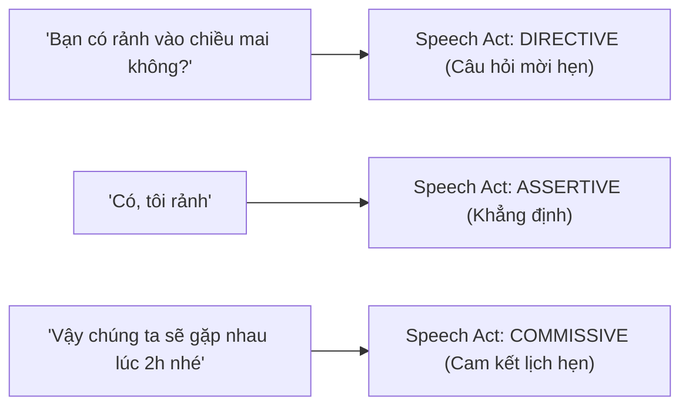

#### d. Code Thực chiến (C++ & Python)

```cpp
// C++17: Speech Act Rule Scorer cơ bản dựa trên Cấu trúc Ngữ pháp
#include <iostream>
#include <string>
#include <vector>

enum class SpeechAct { ASSERTIVE, DIRECTIVE, COMMISSIVE, EXPRESSIVE, UNKNOWN };

std::string speech_act_to_string(SpeechAct act) {
    switch (act) {
        case SpeechAct::ASSERTIVE: return "ASSERTIVE";
        case SpeechAct::DIRECTIVE: return "DIRECTIVE";
        case SpeechAct::COMMISSIVE: return "COMMISSIVE";
        case SpeechAct::EXPRESSIVE: return "EXPRESSIVE";
        default: return "UNKNOWN";
    }
}

SpeechAct classify_speech_act(const std::string& utterance) {
    if (utterance.find("?") != std::string::npos || utterance.rfind("Please", 0) == 0) {
        return SpeechAct::DIRECTIVE;
    }
    if (utterance.rfind("Thank", 0) == 0 || utterance.rfind("Sorry", 0) == 0) {
        return SpeechAct::EXPRESSIVE;
    }
    if (utterance.find("will") != std::string::npos || utterance.find("promise") != std::string::npos) {
        return SpeechAct::COMMISSIVE;
    }
    return SpeechAct::ASSERTIVE;
}

int main() {
    std::cout << "'Could you help me?' -> " << speech_act_to_string(classify_speech_act("Could you help me?")) << "\n";
    std::cout << "'I will finish it today' -> " << speech_act_to_string(classify_speech_act("I will finish it today")) << "\n";
    return 0;
}
```

```python
# Python / PyTorch: Sequential Speech Act Tagger dùng GRU liên lượt
import torch
import torch.nn as nn

class InterTurnSpeechActTagger(nn.Module):
    def __init__(self, utterance_dim: int, num_speech_acts: int):
        super().__init__()
        # GRU mô hình hóa dòng chảy hành vi lời nói qua chuỗi hội thoại
        self.gru = nn.GRU(utterance_dim, 64, batch_first=True)
        self.classifier = nn.Linear(64, num_speech_acts)

    def forward(self, dialogue_utterance_vectors: torch.Tensor) -> torch.Tensor:
        # dialogue_utterance_vectors: [Batch, Num_Turns, Utterance_Dim]
        gru_out, _ = self.gru(dialogue_utterance_vectors)
        logits = self.classifier(gru_out) # [B, Num_Turns, Num_Speech_Acts]
        return logits

tagger = InterTurnSpeechActTagger(utterance_dim=128, num_speech_acts=5)
turns = torch.randn(1, 6, 128) # 1 cuộc thoại 6 lượt
logits = tagger(turns)
print("Speech Act Logits Shape over turns:", logits.shape) # [1, 6, 5]
```

#### e. Lỗi Thường gặp & Ổn định Số học
- **Indirect Speech Acts (Hành vi lời nói gián tiếp)**: Một câu hỏi dạng nghi vấn bề mặt như *"Bạn có thể đưa tôi lọ muối được không?"* về hình thức là câu hỏi Assertive/Inquiry nhưng về bản chất ngữ dụng lại là một Directive (mệnh lệnh nhẹ nhàng). Nếu chỉ nhìn vào dấu hỏi chấm sẽ phân loại sai hoàn toàn ý định.

#### f. Ứng dụng Thực chiến trong AI
Xác định chính xác ý đồ hành động trong các hệ thống đàm thoại thương thuyết (Automated Negotiation), phân tích mức độ hài lòng của khách hàng và xây dựng trợ lý AI hiểu sâu ngữ cảnh xã hội.
